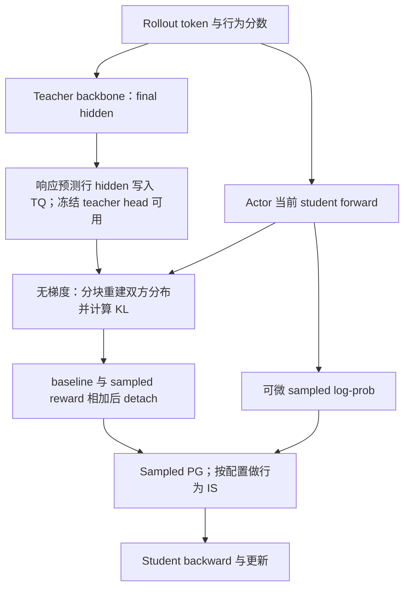
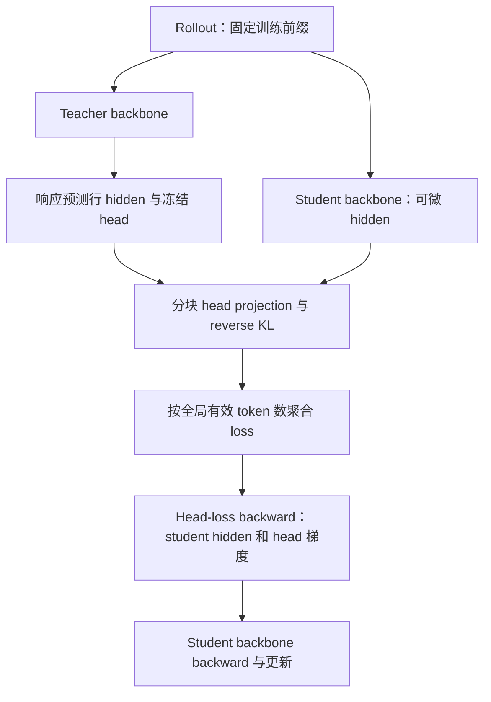

# Full baseline 与 Full-KL 实现计划

## 1. 目标、当前状态与资料边界

目标是在现有 FSDP2 shared-sync OPD 中实现两条独立训练路径：sampled-token + full KL baseline，以及直接 full-vocab reverse KL。两者共享 teacher hidden-state 数据通路、冻结 LM head 和部分归一化计算；训练目标、反向路径和指标分别维护。Math、code、IF 使用同一套工程实现，按领域验收数据和 mask。

截至 2026-10-22，正式训练仍只接入 sampled teacher log-prob。Full baseline、teacher hidden payload、full reverse-KL loss 和对应 FSDP2 适配均未实现。本文随附的 CPU/GPU 脚本只测试独立算子原型，不加载模型、不启动训练、不代表 FSDP2 集成已通过。

| 内容 | 唯一维护位置 |
| --- | --- |
| 符号及理论对应 | [统一符号](../符号约定.md) |
| KL 数值、baseline、直接梯度及 detach 推导 | [计算图与估计器](../opd-objective/2026-10-21-Reverse-KL实验排序与Top-k支持集.md#2-full-vocab-kl一个真值不同计算图) |
| 在线分块公式、payload、math 容量与历史步时预算 | [计算与显存预算](2026-10-22-词表蒸馏的计算与显存预算.md) |
| 用户提供的生产方案原文 | [Full-vocab OPD](reference/fullvocab-opd.md) |
| 当前独立实验、精度及计时边界 | [算子小实验](2026-10-22-Full-KL算子小实验.md) |

本文只维护接入计划、接口、优化优先级与验收条件。原始参考资料和预算已从 `opd-objective` 迁入本目录；算法调研、top-k 比较与通用估计器审计留在原目录，通过链接复用。

## 2. 当前代码入口与接入缺口

| 文件或入口 | 已有行为 | 拟修改内容 |
| --- | --- | --- |
| `verl/trainer/ppo/core_algos.py::kl_penalty_forward` | k1/k2/k3 等 sampled 公式；`full` 分支抛出异常 | 保持 sampled 接口；full 分布计算独立实现，不把 hidden/head 塞入 log-prob 接口 |
| `verl/trainer/distillation/losses.py::DistillationLossSettings` | `use_topk` 与 `use_estimator` 必须二选一 | 增加可表达 hidden payload 的能力描述，并保留旧配置兼容 |
| 同文件 `distillation_loss` | 非 vanilla 直接进入 `_sampled_token_loss`，绕过 loss 注册表 | 先选择 sampled 或 direct-full 目标，再选择 baseline、PG 模式和 backend |
| 同文件 `_sampled_token_loss` | 构造 current/frozen advantage，使用行为 IS、PPO 或 REINFORCE | 增加 detached baseline；两个 PG 入口使用相同 baseline 构造函数 |
| `verl/workers/config/distillation.py` 与 `verl/trainer/config/distillation/distillation.yaml` | shared-sync 限制 k1 + PG；没有 hidden/full 配置 | 增加合法组合检查、payload/backend/刷新策略，拒绝不支持的模型变换 |
| `verl/trainer/ppo/v1/trainer_base.py::_compute_shared_teacher_log_probs` | Teacher 推理、offload，driver 取 sampled 分数并重新写入 TQ | 增加 hidden 输出模式；大 payload 留在 worker/TQ 数据路径，避免 driver 拉取再发布 |
| `verl/workers/engine/fsdp/transformer_impl.py::forward_step` | 完整模型 forward 后处理 logits | 在 LM head 前接入 final hidden 和 loss 算子，保持 FSDP hooks 与梯度语义 |
| `verl/trainer/distillation/fsdp/losses.py` | 从已物化 logits 计算 top-k loss | 保持现有职责；full head-loss 在新模块中实现 |
| `examples/mirroropd/_run_single_teacher_fsdp2.sh` | 三个领域共用 sampled 配方 | 新增独立实验 wrapper，默认入口继续复现既有结果 |

最小代码组织建议新增 `verl/trainer/distillation/full_vocab.py`，维护 baseline 数值、backend 选择和能力检查；新增 `verl/trainer/distillation/fsdp/full_vocab.py`，维护 PyTorch 分块参考和 Liger 适配。Teacher payload 与 head 生命周期由已有 worker/engine 管理。后续新增多个估计器后再按职责拆出 `estimators.py`，避免第一版建立多层注册框架。

现有 `use_liger=True` 模型补丁并不等于启用 full-KL loss；FSDP 引擎还显式关闭该补丁的 fused linear CE。`use_fused_kernels=True` 也不能替代 teacher hidden 通路及 full-KL 目标接入。

## 3. 配置与两条训练路径

### 3.1 拟新增配置

以下是接口提案，尚不能直接传给现有启动脚本。字段名在实现时应同时进入 dataclass、Hydra 配置和 launcher 测试。

```yaml
distillation:
  distillation_loss:
    objective: sampled_pg        # sampled_pg | full_reverse_kl
    baseline_kind: none          # none | full_kl
    baseline_policy: current     # current | anchor
    full_vocab_backend: recompute # recompute | streaming | liger
    full_vocab_token_chunk: 512
    full_vocab_vocab_chunk: 8192
```

`sampled_pg + baseline_kind=none` 保持历史行为。`sampled_pg + full_kl` 继续使用 k1 sampled reward；baseline backend 提供每预测位置的无梯度 KL 数值，不改变 PG 类型。`full_reverse_kl` 直接输出可微 loss，要求 `baseline_kind=none`，不经过 sampled PPO clipping 和行为 ratio。第一版关闭 task reward，并保持 temperature=1 与全局 response-token mean。

`baseline_policy=current` 与 `anchor` 必须出现在实验配置和指标中。第一版 current baseline 仅与 current advantage 配对；已有 frozen/rollout advantage 如需使用 baseline，应单列目标和推导，不默认混配。Legacy vanilla 和 token-IS 等模式都应明确是否支持，不能静默忽略 baseline。

### 3.2 Full baseline：current 路径

令 $p=p_{k,n}$、teacher 为 $T$，对固定前缀使用 $K=\mathrm{KL}(p\Vert T)$。Actor 的 sampled advantage 为 $\operatorname{sg}(\log T_a-\log p_a+K)$，baseline 不参与反传；完整推导见上面的计算图文档。



首个可运行版本允许复用已有 student logits 计算 baseline，并只对 teacher 重建分块，但必须标注 student 的完整 logits 仍然存在，限制 micro-token 预算。优化版本在 head 前接入，同时产出可微 sampled log-prob 与 detached KL；其 backward 只处理 sampled score 的上游梯度。Liger 的标量 full-KL loss 不能直接充当这个接口。

若为了最小接入从 detached student hidden 再投影一次，应单独记录额外 head 计算；后续融合 sampled score 与 baseline 统计，消除重复 student projection。不要为 baseline 再执行一次完整 student backbone。

### 3.3 Full baseline：anchor 缓存变体

复用现有 old-log-prob 前向，在 `no_grad` 下算 $K(q_k,T)$，将每位置 scalar 写入 TQ，随后可释放 teacher hidden/head。Actor 更新使用该冻结 scalar 作为 action-independent baseline。其在多轮更新中不再等于 current KL；第一轮参数相同也应记录其来源为 anchor。

Baseline 的无偏控制变量解释要求完整支持、正确行为 IS 和停止梯度；PPO clipping、ratio 截断等会改变该解释。不能将当前动作自己的 k1 当成 baseline，否则它与负 k1 reward 抵消。新增辅助采样 baseline 必须检查条件独立性。

### 3.4 Full reverse KL：直接梯度路径



该目标不需要 sampled old-log-prob 或行为 ratio；若为诊断保留对应 forward，必须计入额外成本。Rollout 前缀仍来自行为分布，全词表积分只消除了固定前缀下的动作抽样。

Student hidden 和 LM head 都必须有梯度，teacher hidden/head 固定。第一版只承诺一阶梯度；自定义 VJP 不默认支持 Hessian 或高阶自动微分。

## 4. Teacher 数据与模型适配

### 4.1 Payload 与预测位置

每条样本保存经过 final norm、进入 LM head 前的 teacher hidden，及其对应的预测位置。已有 sample key 与 teacher 路由元数据继续复用；增加响应预测位置或可恢复的 offsets，标明 teacher 版本及 dtype。跨 rank 平衡、packing、micro-batch 重排后仍须按 sample key 和位置恢复对应关系。

对自回归输入 $x_0,\ldots,x_{L-1}$，第 $i$ 行 hidden 预测 $x_{i+1}$。筛选的是预测目标的 loss mask；首个 response token 使用最后一个 prompt 位置的 hidden。保留完整上下文输入，处理 EOS、工具结果、截断和最终无目标行。多轮 IF 按实际 assistant 监督 mask 选择，不按一个连续 response 区间猜测。

Teacher worker 直接写出 hidden，避免 trainer driver 拉取大张量再写回；sampled baseline 还需要 teacher sampled score，可与重建统计共算，或在首版额外提供该小 payload。纯 full loss 不应为了无用 sampled score 在 teacher 侧执行完整 head。

### 4.2 Teacher head 生命周期

当前单 teacher 时，actor 更新阶段每 rank 保留一份约 0.435 GiB 的 BF16 teacher head；可跨同批多个 epoch 复用 hidden。Teacher backbone 评分后继续 offload。Teacher head 单独管理，不加入 student optimizer，不进入 student 权重同步或模型导出。未来多 teacher 的 head 缓存策略独立扩展。

重计算 backward 仍需 teacher hidden/head，释放时间必须晚于相关 backward 完成。预计算梯度 backend 的生命周期不同，应由 backend 能力说明，而不是所有模式统一提前释放。

### 4.3 本机三个 teacher 的适配证据

2026-10-22 读取本机 `../models/` 中实际配置：student、JustRL-DeepSeek-1.5B、DeepCoder-1.5B-Preview、UltraData-IF-1.5B 均为 `qwen2`，hidden size=1536、vocab size=151936、`tie_word_embeddings=False`。三个 teacher 的 `tokenizer.json` 中 token-to-ID 映射与 added tokens 均与 student 相同。开发机启动默认路径仍是 `../model/`；不据此假定另一台机器已具备同一资产。

这些证据支持共用 Qwen2 adapter，但不是权重前向一致性测试。P1 仍需分别比较原模型 logits 与 final-hidden/head 重建值，以及各领域 causal mask。不同模板的文本编码、训练样本和多轮 IF 对话语义不由词表相等保证。

首版只支持已验收的 Qwen2 线性输出头。取得 final hidden 时不请求保存全部层的 `output_hidden_states`；对 HF backbone 调用、LM head 和 FSDP hook 使用显式 adapter，禁止通过绕过 sharded module 的参数访问破坏 all-gather/reshard。扩展模型需检查 bias、temperature、softcap、logit scaling、tied embeddings、LoRA 和词表 TP。

## 5. 算子与显存优化计划

### 5.1 两种接口，三个候选 backend

数值接口返回每位置 detached KL，必要时附 sampled teacher score；训练接口返回可微每位置 KL，或附明确 reduction 语义的标量。两种接口使用同一 mask、温度、输出变换和精度约定。

| Backend | 内存策略 | 优先用途 | 待验收事项 |
| --- | --- | --- | --- |
| PyTorch token 分块 | 每次持有 $[C_{\rm tok},V]$，数值路径 no-grad；训练路径 custom backward 重计算 | 可读的第一版与正确性参照 | chunk 边界真正释放；student head 全参数梯度 |
| 在线词表分块 | 双维 tile，在线归一化与加权统计；反向再次投影 | 显存受限、长 micro-batch | 小 GEMM、Python/kernel 启动开销、FP32 累积 |
| Liger fused linear JSD/rKL | 分块并在 forward 提前计算 student 梯度 | full loss 的性能候选 | KL 方向、归约、dtype、head 可训练、FSDP 生命周期 |

Liger 在已核对接口中 `jsd_beta=1` 表示 reverse KL；默认 `0.5` 是另一目标。不同入口有 hard/soft loss 混合参数，必须关闭额外 hard CE 并避免默认混合系数改变学习率尺度。Liger 实现与版本固定后再接入。[^liger-interface][^liger-implementation]

本机小实验支持将无梯度在线归约作为 full baseline 的优先候选，将 token 重计算作为 full loss 的初始 backend。当前 Liger 入口未获得速度优势，FP32 head 梯度累积还会增加开销；先保留为可选对照，再通过 chunk/入口适配和实际训练 profile 决定默认值，数值与测量见实验文档。

参考文档的 Chunked cuBLAS 保留当前 token 块的完整 logits，然后在 backward 重算。我们的 token 原型没有复现其二维融合 kernel；在线原型也不是 Nitrobrew 的性能复现。实现名称和测量结果须保持区分。

### 5.2 精度与进一步可省的工作

当前容量按 BF16 hidden/head 计算。归一化、KL 统计和 head 梯度累积优先 FP32；GEMM 输出 BF16 后再转 FP32，与直接输出 FP32 不等价，尤其在 student 接近 teacher 时。所有 backend 应比较相同数值合同，实际模型重建还需对齐已有 teacher scoring 的精度。

令已处理温度和输出变换的 logits 差为 $d_a=z^p_a-z^T_a$，$\mu=\sum_a p_a d_a$。由 $\log p_a-\log T_a=d_a-\log Z_p+\log Z_T$ 得

$$
K=\mu-\log Z_p+\log Z_T,
\qquad
\frac{\partial K}{\partial z^p_a}=p_a(d_a-\mu).
$$

因此 reverse-KL 梯度不需要 teacher normalizer；current full baseline 的中心化系数也可写为 $\mu-d_a$。真实 KL 指标仍需要 $\log Z_T$。若存在 softcap 等非线性输出变换，还要将该 logit 梯度通过变换回传到线性投影，不能直接套用原始 head 梯度公式。完整在线归约与 running maximum 推导只在共用预算文档维护。

先用数值接口和梯度接口分别完成正确性，再优化共享 projection、normalizer 复用与 buffer 生命周期。不改变 full 目标的情况下，SVD/低秩 teacher head、top-k 截断不属于这一阶段；它们是独立近似实验。

### 5.3 与 FSDP、mask 和 loss reduction 的衔接

保持全局 response-token mean。某个 Liger 入口若只返回本 rank/micro-batch 的 mean，需恢复局部有效 token sum，并结合全局 token 数和 FSDP 梯度归约语义缩放；不能把各 micro-batch mean 等权相加。不要同时套两次 `agg_loss` 缩放。

纯 full loss 不应为采样 log-prob、entropy 或未使用的 top-k 诊断再生成完整 logits。诊断可以复用分块统计，但每项新增 GEMM 或大 buffer 都要单独计时。第一版只计算必要 KL、有效 token 数和基本梯度指标。

Checkpointing 必须覆盖 projection 与 KL，而不只是已有 backbone。普通 Python 循环累加可微块 loss 会保留所有块的计算图，不能用它证明训练显存降为 $O(C_{\rm tok}V)$。自定义 backward 或梯度预计算需要用实测峰值随 token 数的变化验收。

### 5.4 I/O 与调度优化

单 teacher、SP=1 时先保留同步 TQ 路径测基线；大 payload 避免经过 driver。同步正确后，teacher 侧按 micro-batch 异步写出，actor 侧只预取下一 micro-batch，采用有界队列和明确的完成事件。异步任务完成前不复用 host/device buffer；head/hidden offload 等待所有依赖者结束。

共享 GPU 的 teacher 与 actor 仍分阶段运行。可重叠的是 teacher 写入与后续 teacher 计算、actor 读取与当前 actor 计算；不预设双方 backbone 同时驻留。采样生成期和 actor 更新期显存分别测量。

参考文档中 async write 的单独增量是 teacher 55.17→51.06 秒，下降 7.45%；prefetch 与 SP 合并后 actor 123.24→110.21 秒，下降 10.57%。后者不能归因为 prefetch 单项。SP=1 和单 teacher 下暂不实现 SP leader 读取与 teacher-aware packing。

## 6. 分阶段实施与提交边界

| 阶段 | 交付内容 | 验收后才进入下一阶段 |
| --- | --- | --- |
| P0：独立算子与设计 | 本文、原文/预算迁移、CPU 审计和单卡 probe | 数值、hidden/head 梯度、mask、计时和峰值口径明确；当前已完成的内容见实验文档 |
| P1：Teacher hidden 通路 | 配置能力、Qwen2 adapter、worker 写 TQ、冻结 head 生命周期 | 三个 teacher 的 logits 重建与位置对齐；不改变已有 sampled 默认行为 |
| P2：Full baseline | current 数值接口接入 sampled PG；anchor 变体独立开关 | baseline detached，行为 IS 期望梯度；current/anchor 刷新正确；小 token 预算训练 smoke |
| P3：Direct full reverse KL | head 前接入、分块 backward/Liger adapter、全局 reduction | dense oracle、两/四卡不等长与全 masked rank、真实 optimizer step、checkpoint 恢复 |
| P4：显存和吞吐 | sampled-score/baseline 融合、tile 调参、异步写、预取 | 相同轨迹的完整步时和阶段显存；每个优化单独消融，无吞吐或容量收益则不开默认 |
| P5：实验交付 | math/code/IF wrapper 与说明，多轮与完整验证 | 各领域的 rollout/mask/验证协议通过；三个目标可复现比较 |

每个阶段独立 Conventional Commit，包含对应配置和有针对性的测试。最小可比较组为 sampled、sampled+current full baseline、direct full reverse KL，统一一次更新、batch、学习率、mask、采样和精度；anchor baseline 单独列。任务 reward 和四轮更新在主对照之后扩展。

P5 拟提供 `run_full_baseline.sh` 与 `run_full_reverse_kl.sh`，复用公共配方并接收 `DOMAIN=math|code|if`。在引擎未接通前不发布看似可运行的训练脚本；当前可运行入口仅为独立实验脚本。

## 7. 验收矩阵与决策指标

| 层次 | 必测内容 |
| --- | --- |
| 数学 | FP64 dense 对齐；不同 hidden size；不整除 tile；任意上游权重；teacher 无梯度；self-teacher 值/梯度接近零 |
| Baseline | 无梯度数值；有限动作枚举的 PG/IS 期望梯度；baseline 不依赖同一 sampled action；current/anchor 刷新 |
| 模型 | 三个实际 teacher 的 hidden 重建；BF16/FP32 误差；首个 response、EOS、padding、截断、多轮 assistant mask |
| 分布式 | FSDP2 全参数 head 更新；不等 token 数；全零局部 mask；梯度累积和全局 mean；offload 后 backward 与 checkpoint |
| 性能 | 同输入和 mask 下 value-only、forward+backward；allocator allocated/reserved；真实 NVML 整卡峰值；CPU/TQ 驻留与等待 |
| 训练 | 固定轨迹单步梯度/参数 delta；短程 smoke；相同预算的验证准确率、响应长度和 optimizer 更新计数 |

微基准用 synthetic hidden 只回答算子容量和计算代价，不预测准确率和端到端倍数。实际训练还包括 backbone、FSDP all-gather、优化器、生成和验证。Backend 选择以目标 micro-token 预算下的整卡可行性和完整更新吞吐为依据，不只比较 kernel 的最低显存。

### 参考文献

[^liger-interface]: LinkedIn. Liger FusedLinearJSD 接口，2026-10-22 核对本机安装版 0.8.4 与官方源码。[接口](https://github.com/linkedin/Liger-Kernel/blob/main/src/liger_kernel/transformers/fused_linear_jsd.py)。
[^liger-implementation]: LinkedIn. Fused linear JSD 的 projection、梯度预计算与 backward。[实现](https://github.com/linkedin/Liger-Kernel/blob/main/src/liger_kernel/ops/fused_linear_jsd.py)。本机安装源码可能包含额外补丁，实验记录实际路径与精度约定，版本号本身不证明源码完全相同。
