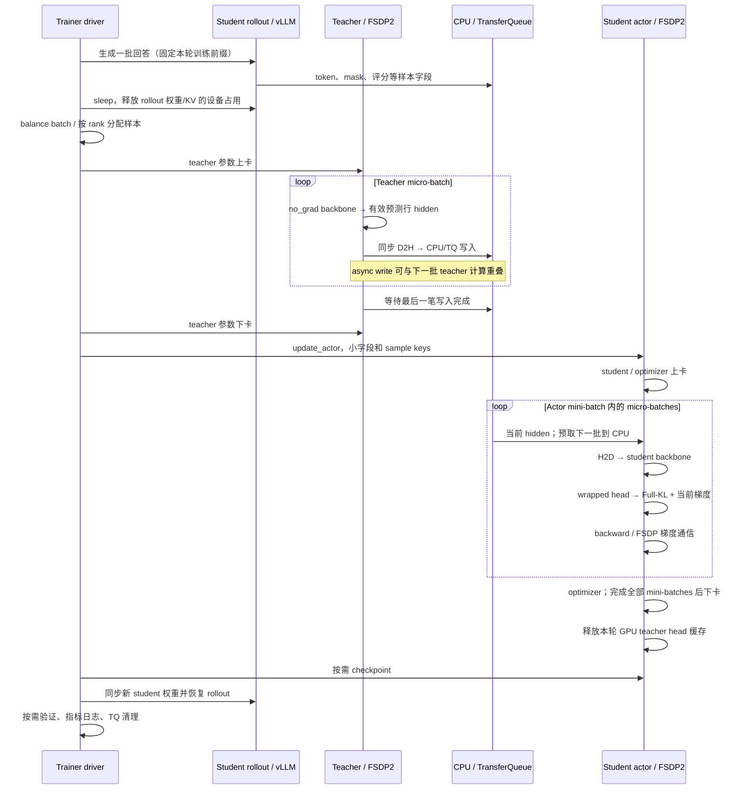
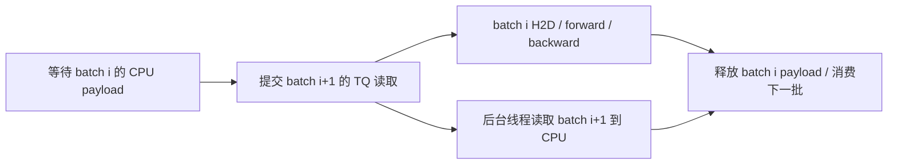

# Full-KL 全流程源码走读

本文是当前 full-vocab reverse KL 的工程主说明，按一次训练的实际调用顺序解释数据、梯度、显存和优化。训练实现的源码基准为 `cfb4f4c25e4dd221d7d682d3fdb0fe3211726491`；启动预设按 2026-10-23 增加 E16/E17 后的脚本核对，链接指向对应文件的具体起始行；后续代码改动时同步核对行号。数学符号沿用[统一约定](../符号约定.md)，完整目标推导由[理论文档](../theory/2026-10-22-Full-vocab计算图与四种更新.md#graphs)维护。

**KL 在 actor 当前有梯度的 forward 中计算。** Rollout 提供固定训练前缀；teacher 阶段提供这些前缀对应的 hidden；actor 用当前 student hidden、student head 和冻结 teacher hidden/head 计算全词表 KL，然后更新 student。此路径跳过 old-log-prob 和 sampled advantage，不使用 sampled-action IS。Full baseline 是另外一条尚未接入的训练路径，不在本文实现范围内。

## 1. 走读入口与默认配置

先分清三个入口，避免将可选优化误认为所有运行的默认行为：

| 入口 | 目标与默认实现 | 源码 |
| --- | --- | --- |
| `run_math_deepseek_r1_1_5b_fsdp2.sh` | 原 sampled-token 配方；仅名字中的 math/model 不会开启 Full-KL | [公共配方](../../launchers/_run_single_teacher_fsdp2.sh#L288) |
| `run_full_reverse_kl.sh` | `full_reverse_kl`；`recompute`，async write/prefetch 均关闭 | [默认值与目标覆盖：第 10 行](../../run_full_reverse_kl.sh#L10) |
| `run_math_opd_ablation_fsdp2.sh E13/E14` | Full-KL；`precompute`，async write/prefetch 均开启；E13 LR=1e-6，E14 LR=5e-7 | [预设：第 72 行](../../run_math_opd_ablation_fsdp2.sh#L72) |
| `run_math_opd_ablation_fsdp2.sh E16/E17` | 同一 current + IS 精确 Full-KL，分别同批更新 4/16 次，其余默认同 E13 | [复用预设：第 72 行](../../run_math_opd_ablation_fsdp2.sh#L72) |
| E13/E14 加 `FULL_KL_BACKEND=precompute_fused` | 可选 Triton 融合后端；目前没有替换 E13/E14 默认值 | [后端选择：第 97 行](../../run_math_opd_ablation_fsdp2.sh#L97) |

默认 Python 与模型/数据路径沿用公共脚本：仓库 `.venv-native/bin/python`、同级 `model/` 与 `data/`；本机 profile 环境和 `models/`、`MD-OPD/data/` 都通过环境变量显式覆盖，不能据此假定集群资产路径相同。

后文主线按 **E13 的同步共享 GPU 配方** 展开。默认全局 prompt batch=64、rollout n=1、mini-batch=64、PPO epochs=1，因此没有跳过更新时，每轮生成对应一次 optimizer update。源码复用 PPO 命名的训练循环，但 Full-KL 分支并不计算 PPO clipped surrogate。公共预算见 [_run_single_teacher_fsdp2.sh:96](../../launchers/_run_single_teacher_fsdp2.sh#L96)，E13/E14 的 epoch 与学习率见 [ablation 脚本:64](../../run_math_opd_ablation_fsdp2.sh#L72)。

默认 `STUDENT_GPUS=8` 表示整个共享池，四卡运行时显式设为 4；`TEACHER_GPUS=0` 表示没有独立 teacher 推理池，不表示 teacher 不用 GPU。Teacher 是 FSDP2 forward-only worker，student rollout 是 vLLM，二者不会共用一套模型对象。见[共享池配置：第 53 行](../../launchers/_run_single_teacher_fsdp2.sh#L53)。

| Full-KL 参数 | 通用入口默认 | E13/E14 默认 | 消费位置 |
| --- | --- | --- | --- |
| `FULL_KL_BACKEND` | `recompute` | `precompute` | [dispatcher:193](../../../../verl/trainer/distillation/full_vocab.py#L193) |
| `FULL_KL_TOKEN_CHUNK` | 512 | 512 | 位置分块；不改变训练 token 上限 |
| `FULL_KL_VOCAB_CHUNK` | 8192 | 8192 | 仅 `cached` / `streaming` 使用此词表分块值 |
| `FULL_KL_ASYNC_WRITE` | False | True | [writer:74](../../../../verl/trainer/distillation/hidden_io.py#L74) |
| `FULL_KL_PREFETCH` | False | True | [reader:56](../../../../verl/trainer/distillation/hidden_io.py#L56) |

这些变量写入 `distillation.distillation_loss.full_vocab`；字段及合法 backend 在 [FullVocabConfig:35](../../../../verl/workers/config/distillation.py#L35)。`run_full_reverse_kl.sh` 同时设定 direct loss、关闭 task reward 混合/截断和 rollout log-prob/actor entropy 计算，见[第 16 行](../../run_full_reverse_kl.sh#L16)。最终 Hydra 参数优先于脚本预设。

## 2. 初始化：模型、资源和适配层

1. Trainer 用 `loss_mode == "full_reverse_kl"` 判断路径，见 [_uses_full_vocab:452](../../../../verl/trainer/ppo/v1/trainer_base.py#L452)。只保留一个目标入口，没有要求用户再设置第二个 `enable_full_vocab` 开关。
2. Teacher 配置独立构造，开启 remove-padding、Full-KL adapter，关闭 teacher gradient checkpointing。Teacher/student 的完整 token→ID 词表及 BOS/EOS/PAD ID 必须相同，见 [_make_shared_teacher_config:469](../../../../verl/trainer/ppo/v1/trainer_base.py#L469)。
3. Actor worker 在 `reset()` 构建模型之前将内部 `model_config.enable_full_vocab=True`，再配置冻结 teacher head，见 [engine_workers.py:808](../../../../verl/workers/engine_workers.py#L808)。因此运行前导出 YAML 中该内部字段的初始值不代表最终执行分支。
4. FSDP engine 安装每个模型实例自己的 adapter，见 [transformer_impl.py:337](../../../../verl/workers/engine/fsdp/transformer_impl.py#L337)。Adapter 保存原来的 root/head forward；没有 callback 的普通调用仍走原路径，见 [install_full_vocab_adapter:8](../../../../verl/models/transformers/full_vocab.py#L8)。

当前接入要求 untied、bias-free Qwen2 线性 head，FSDP2、SP=1、packed input，无 LoRA、静态 packed padding 或 fused PPO output 路径；检查位于 [engine:340](../../../../verl/workers/engine/fsdp/transformer_impl.py#L340) 和 [head adapter:17](../../../../verl/models/transformers/full_vocab.py#L17)。温度 1、token-mean、无额外 critic/KL reward/entropy objective 的检查位于 [trainer:813](../../../../verl/trainer/ppo/v1/trainer_base.py#L813)。

共享生命周期还要求单节点、trainer v1 的 `sync` 模式、`parameter_sync_step=1`，以及 actor 参数/optimizer offload；校验见 [validate_shared_sync:417](../../../../verl/workers/config/distillation.py#L417)。这些是当前接入边界，不是 KL 数学公式本身的限制。

这里的模型适配和纯张量算子分层：算子只要求双方 hidden/head 维度一致配对、词表宽度相同，允许 student/teacher hidden size 不同；实际训练 adapter 当前仅验收上述 Qwen2 路径。不能由算子的形状泛化能力推出所有 Hugging Face 模型均已支持。

## 3. 一轮完整训练的调度

图表示调用依赖，不按时长比例绘制。Teacher 与 actor backbone 分阶段执行；异步读写发生在各自阶段内部。“student → teacher → student”主要是不同引擎及 CPU/GPU 驻留的切换，并非每一轮重新从磁盘加载整套模型。

### 3.1 Rollout 与评分

[PPOTrainer._step_once:664](../../../../verl/trainer/ppo/v1/trainer_base.py#L664) 先调用 `replay_buffer.sample()`。单轮 loop 在 [single_turn_agent_loop.py:62](../../../../verl/experimental/agent_loop/single_turn_agent_loop.py#L62) 分词，在[第 77 行](../../../../verl/experimental/agent_loop/single_turn_agent_loop.py#L77) 调用 vLLM 生成，再合并返回 token 与 mask。此时没有 teacher Full-KL 计算。

任务判分仍可用于日志和验证，异步评分入口在 [agent_loop.py:1019](../../../../verl/experimental/agent_loop/agent_loop.py#L1019)。`use_task_rewards=False` 表示它不混入 Full-KL 梯度目标，并不要求完全关闭判分。Rollout 接口的 `mode=async` 也不表示训练采用异步权重更新；这里使用同步 trainer。

样本收齐后，[trainer_sync.py:40](../../../../verl/trainer/ppo/v1/trainer_sync.py#L40) 调用 `sleep_replicas()`。随后 driver 进行序列工作量平衡和 teacher 计算，见 [trainer_base.py:683](../../../../verl/trainer/ppo/v1/trainer_base.py#L683)。

### 3.2 Teacher 阶段

[_compute_shared_teacher_log_probs:1998](../../../../verl/trainer/ppo/v1/trainer_base.py#L1998) 名字沿用 sampled 路径，但 Full-KL 模式只请求输入和 `loss_mask`，设置 `full_vocab_teacher=True`。Teacher 参数上卡后调用 `infer_batch()`，等待所有 futures 完成，再把参数移回 CPU，见[第 2017 行](../../../../verl/trainer/ppo/v1/trainer_base.py#L2017)。FSDP teacher 的阶段搬运会等待设备传输完成，见 [engine.to:928](../../../../verl/workers/engine/fsdp/transformer_impl.py#L928)。

Teacher forward 由 [BaseEngine.infer_batch:143](../../../../verl/workers/engine/base.py#L143) 包在 `no_grad()` 内。模型 adapter 调用 `self.model(...)` 得到经过最终 norm 的 `last_hidden_state`，不要求返回所有层 hidden；teacher callback 选择有效预测行并搬到 CPU，见 [adapter:25](../../../../verl/models/transformers/full_vocab.py#L25) 和 [teacher 分支:1235](../../../../verl/workers/engine/fsdp/transformer_impl.py#L1235)。该分支不调用 teacher LM head 投影完整 logits。

Hidden 由 worker 直接写入 TQ。Driver 在 [2036 行](../../../../verl/trainer/ppo/v1/trainer_base.py#L2036) 直接返回样本 metadata，不先取回整批 hidden 再转发。Teacher 的输出 head 权重由 actor 侧独立读取，见[冻结 head 生命周期](#teacher-head)。

### 3.3 跳过 old-log-prob 与 advantage

[trainer_base.py:689](../../../../verl/trainer/ppo/v1/trainer_base.py#L689) 与[第 704 行](../../../../verl/trainer/ppo/v1/trainer_base.py#L704) 用 `if not self._uses_full_vocab()` 跳过旧策略 log-prob 和 advantage/return。KL 不放在 old-log-prob 前向中预先算好；每次 actor 更新都使用当前 student 参数。

Actor loss 的名称仍叫 `distillation_ppo_loss`，但 [losses.py:223](../../../../verl/trainer/distillation/losses.py#L223) 在 direct-only 条件下跳过 PPO loss。`policy_loss_mode=vanilla` 是配置兼容值，不表示 Full-KL 又乘了 PPO ratio。这个分支中 task reward 关闭时 distillation 系数固定为 1，不能靠 `distillation_loss_coef` 改 Full-KL loss 尺度，见[第 237 行](../../../../verl/trainer/distillation/losses.py#L237)。

### 3.4 Actor 更新与本轮收尾

[_update_actor:2303](../../../../verl/trainer/ppo/v1/trainer_base.py#L2303) 只让输入、mask、prompt/response 等字段进入普通 TQ bridge，同时传递 Full-KL/prefetch 标志。Actor 不将整批 teacher hidden 一次性搬到 GPU。

[TrainingWorker.train_mini_batch:304](../../../../verl/workers/engine_workers.py#L304) 划分 mini-batch、遍历 PPO epochs；[第 347 行](../../../../verl/workers/engine_workers.py#L347) 用一个外层 `train_mode` 管理整个 actor 更新的驻留，内层设置 `disable_auto_offload=True`，避免每个 mini-batch 都搬一次模型。自动搬运的实现见 [BaseEngineCtx:323](../../../../verl/workers/engine/base.py#L323)。

每个 mini-batch 执行 `zero_grad → 所有 micro-batch forward/backward → optimizer`，见 [BaseEngine.train_batch:113](../../../../verl/workers/engine/base.py#L113)。最后，actor 参数/optimizer 按配置 offload；外层 `update_actor()` 的 `finally` 释放冻结 teacher head 的 GPU 缓存，见 [engine_workers.py:887](../../../../verl/workers/engine_workers.py#L887)。

按需 checkpoint 在步末权重同步之前执行，见 [trainer_base.py:570](../../../../verl/trainer/ppo/v1/trainer_base.py#L570)。[trainer_sync.py:35](../../../../verl/trainer/ppo/v1/trainer_sync.py#L35) 同步新 student 权重；[checkpoint manager:510](../../../../verl/checkpoint_engine/base.py#L510) 选择具体同步后端。验证、日志和 TQ 清理在后面，见 [trainer_base.py:587](../../../../verl/trainer/ppo/v1/trainer_base.py#L587)。冻结 teacher head 不在 student module/optimizer 中，因此不会被当作 student 参数保存或同步给 rollout。

## 4. Hidden 的数据合同与 IO 优化

### 4.1 位置、mask 和样本身份

[prediction_positions:12](../../../../verl/trainer/distillation/hidden.py#L12) 同时用于 teacher 和 student。对 response 布局的 mask，第 $j$ 个有效 target 对应的 hidden 行为

$$
i=j+\operatorname{len}(\texttt{input\_ids})-\operatorname{len}(\texttt{loss\_mask})-1.
$$

例如 prompt 长度 3、response 长度 2，输入为 `[p0,p1,p2,r0,r1]`，response mask=`[1,1]`，就选 hidden 第 2、3 行，分别预测 `r0,r1`。若 mask=`[1,0]`，只传第 2 行。最后一个输入 token 的 hidden 没有下一个有效 target，因此不会误加一行。

传输的数据包括每条样本的 `teacher_hidden` 和 `teacher_positions`，按 ragged/nested tensor 表达。只筛选 loss-bearing prediction rows；prompt 等完整上下文仍参与 backbone。合法的 EOS、截断与 padding 是否计 loss 由输入 mask 决定，不在这里另造规则。

TQ bridge 把原始 sample key 保存为 `NonTensorStack` 字段 `full_vocab_keys`，见 [_async_meta_to_realdata:160](../../../../verl/utils/transferqueue_utils.py#L160)。如果 DP dispatch 已把 key metadata 转成全局索引，bridge 会取回原 key。该字段随 shuffle、packing 和 micro-batch 切分一起重排，reader 依 key 取 hidden，而不依赖 teacher/actor 拥有相同 micro-batch 边界。Actor 还逐样本比较保存的位置与当前 `loss_mask` 推导的位置，见 [transformer_impl.py:1247](../../../../verl/workers/engine/fsdp/transformer_impl.py#L1247)。

### 4.2 Async write 的重叠范围

[HiddenBatchIO.publish:74](../../../../verl/trainer/distillation/hidden_io.py#L74) 接收已经位于 CPU 的 teacher payload，用单个后台线程执行 `tq.kv_batch_put()`。

- 当前批的写入可与下一批 teacher backbone 计算重叠。
- 提交下一笔写入前等待上一笔 future，限制为一个 pending write；计算中的新 payload 可以同时存在。
- 正常退出时等待最后一次写入的 `result()`，写线程异常不能丢失；线程池退出会等待并清理。见 [__exit__:36](../../../../verl/trainer/distillation/hidden_io.py#L36)。

Teacher 的 `selected.detach().cpu()` 发生在提交后台写之前，见 [1239 行](../../../../verl/workers/engine/fsdp/transformer_impl.py#L1239)。因此当前 async write 优化的是 **CPU→TQ 写入与计算重叠**，没有把 D2H 改成专用 CUDA stream 的异步拷贝，也没有让 teacher/actor backbone 同时运行。它与异步 checkpoint 保存是不同功能。

### 4.3 Prefetch 的重叠范围

[HiddenBatchIO.__iter__:56](../../../../verl/trainer/distillation/hidden_io.py#L56) 先提交第一批读取；每次等待当前 payload 到齐，然后提前读取下一批，再将当前批交给 actor。

这个预取只覆盖 **TQ→CPU**。H2D 在 [forward_step:1699](../../../../verl/workers/engine/fsdp/transformer_impl.py#L1699) 的 `micro_batch.to(device)` 中完成，没有提前给下一批安排 GPU buffer/copy stream。第一批读取等待和 teacher 最后一次 write flush 仍然存在。

当前批消费完成后从 micro-batch 字典移除 hidden/positions，见 [hidden_io.py:70](../../../../verl/trainer/distillation/hidden_io.py#L70)。Teacher 发布后也用小型 `teacher_payload_ready` 替换大输出，见[第 93 行](../../../../verl/trainer/distillation/hidden_io.py#L93)，避免 `output_lst` 把整轮的大 tensor 留住。TQ 中本轮数据仍保留到训练步清理，以支持同批多次更新。

### 4.4 冻结 teacher head

[FrozenTeacherHead:32](../../../../verl/trainer/distillation/hidden.py#L32) 从 safetensors 中只读取 `lm_head.weight`，保留 CPU tensor。首个 actor micro-batch 通过 [get:55](../../../../verl/trainer/distillation/hidden.py#L55) 将它搬到目标 device/dtype，后续 micro-batches 复用该缓存。

它是 engine 管理的独立对象，不注册到 student module。每个 actor rank 持有完整冻结 head，没有实现词表 TP 或跨 rank head 分片。当前 math 的 BF16 head 容量约 0.435 GiB/rank；完整容量公式见[共享预算](2026-10-22-词表蒸馏的计算与显存预算.md#3-teacher-数据量response-only-预算)。

Actor 更新全部结束或抛出异常后调用 `release()` 清除 GPU 缓存引用，CPU 权重保留。重计算后端的 backward 依赖 teacher hidden/head，因此不能在 loss forward 后立刻释放它们。预计算梯度后端虽不需要在 backward 再读 teacher，当前统一生命周期仍在 actor 更新结束时释放。

## 5. Actor forward：在 head 前接入 Full-KL

主入口是 [FSDPEngineWithLMHead._full_vocab_output:1219](../../../../verl/workers/engine/fsdp/transformer_impl.py#L1219)，建议连同 [model adapter:25](../../../../verl/models/transformers/full_vocab.py#L25) 一起看。

调用链为 `self.module(...) → model.forward adapter → self.model(...) → final hidden → callback → head(selected, full_vocab_callback=compute)`。其中：

1. 保留正常 root module 调用，让 FSDP root 的 forward hooks 参与。
2. Backbone 使用 packed 全上下文，输出 final hidden；callback 根据第 4 节的位置选择有效行。
3. Actor 检查 teacher positions，取得 frozen head，在[第 1255 行](../../../../verl/workers/engine/fsdp/transformer_impl.py#L1255) 的 callback 中调用纯张量算子。
4. **仍然调用 wrapped `head(...)`**，见[第 1268 行](../../../../verl/workers/engine/fsdp/transformer_impl.py#L1268)，而不是绕过 module 直接从外层读取 sharded head 参数做矩阵乘。Head adapter 在 FSDP hooks 内部将 `self.weight` 交给算子，保留 all-gather 与 backward 梯度处理。
5. 返回 `full_kl_sum` 和 `full_kl_count`，不返回全词表 logits；`forward_step()` 将 loss 交给既有损失函数，训练输出列表不缓存大 model output，见 [1716 行](../../../../verl/workers/engine/fsdp/transformer_impl.py#L1716) 和 [1738 行](../../../../verl/workers/engine/fsdp/transformer_impl.py#L1738)。

这一步从源头避免普通 CausalLM forward 先物化完整 `[所有输入位置, V]` 的 student logits。Teacher hidden 传输减少的是跨阶段 payload，head adapter 与分块算子减少的是 actor 计算时的词表工作区，两项优化解决不同问题。

以下形状按单个 actor micro-batch 定义：$\mathsf T_{\rm valid}$ 是其有效预测行数，$d_{\rm hid,S},d_{\rm hid,T}$ 是双方 hidden size，$C_{\rm tok}$ 是位置块上限。实际末块可以小于该上限。

| 对象 | 逻辑形状 | 驻留与生命周期 |
| --- | --- | --- |
| `teacher_hidden` | $[\mathsf T_{\rm valid},d_{\rm hid,T}]$ | TQ 中按样本保存 CPU payload，actor 按需取到当前 GPU micro-batch |
| `selected` / `hs` | $[\mathsf T_{\rm valid},d_{\rm hid,S}]$ | Student 当前 forward 的可微 tensor |
| Frozen `wt` | $[V,d_{\rm hid,T}]$ | 每 rank 完整 head，整个 actor 更新内缓存 |
| `zp`、`zt` | 各 $[C_{\rm tok},V]$ | `precompute` / fused 的当前块 FP32 logits，逐块消费 |
| `dh` accumulator | $[\mathsf T_{\rm valid},d_{\rm hid,S}]$ | 当前 micro-batch 的 student hidden 梯度 |
| `dw` accumulator | $[V,d_{\rm hid,S}]$ | 当前 micro-batch 的完整 head 梯度，FP32 累积后返回 FSDP |

`dw` 不是按词表分片后仅存 $V/G_{\rm DP}$ 行；普通 FSDP 的参数/梯度分片不等于本算子的词表 TP。Teacher payload 不含全词表 logits，但 actor 算子仍有受 chunk 约束的词表工作区。

## 6. 算子：默认预计算与可选融合

### 6.1 统一输入、目标与梯度

入口 [full_reverse_kl:193](../../../../verl/trainer/distillation/full_vocab.py#L193) 接收 `hs/ws/ht/wt`，分别是 student hidden/head 和 teacher hidden/head；输出未归一化的有效 token KL 总和。Teacher 两个输入统一 `detach()`，见[第 207 行](../../../../verl/trainer/distillation/full_vocab.py#L207)。

对一个固定前缀，当前 student 为 $p=p_{k,n}$，冻结 teacher 为 $T$。线性投影的 logits 为 $z^p,z^T$，代码对应 `zp,zt`。为解释 kernel 中的变量，定义

$$
\Delta z_a=z^p_a-z^T_a,\qquad
\overline{\Delta z}=\sum_{a\in\mathcal V}p_a\Delta z_a,\qquad
K(p,T)=\sum_{a\in\mathcal V}p_a\log\frac{p_a}{T_a}.
$$

对应的一阶 logit 梯度为

$$
\frac{\partial K}{\partial z^p_a}
=p_a\left(\log\frac{p_a}{T_a}-K\right)
=p_a(\Delta z_a-\overline{\Delta z}).
$$

两种写法在数学上相同：`precompute` 使用第一种，融合实现使用第二种。完整推导见[计算图说明](../theory/2026-10-22-Full-vocab计算图与四种更新.md#graphs)；在线统计量推导见[流式预算第 5 节](2026-10-22-词表蒸馏的计算与显存预算.md#5-精确-kl-的流式算法)。这里 full 表示扫描所有词表项；前缀仍来自本轮 rollout，不对生成过程反向传播，也没有消除前缀采样误差。

### 6.2 默认 `precompute`：forward 同时准备梯度

从 [PrecomputedKL.forward:155](../../../../verl/trainer/distillation/full_vocab.py#L155) 开始逐行看：

| 行 | 执行内容 | 保留或释放的对象 |
| --- | --- | --- |
| [156](../../../../verl/trainer/distillation/full_vocab.py#L156) | 建立 FP32 `dh`、`dw` accumulator 与 scalar total；FP64 参考保持 FP64 | 本 micro-batch 的 hidden 梯度和完整 head 梯度 |
| [160](../../../../verl/trainer/distillation/full_vocab.py#L160) | 每次处理至多 `token_chunk` 个有效预测行 | 默认 $C_{\rm tok}=512$，每块仍覆盖完整 $V$ |
| [162](../../../../verl/trainer/distillation/full_vocab.py#L162) | 分别执行 student / teacher projection | 两个 $[C_{\rm tok},V]$ logits |
| [166](../../../../verl/trainer/distillation/full_vocab.py#L166) | log-softmax、概率和每行 KL；累计真实 loss | 释放 logits，复用 log-prob 存储差值 |
| [174](../../../../verl/trainer/distillation/full_vocab.py#L174) | 原地构造 `dz = p * (log p - log T - KL)` | 释放不再需要的差值/概率 buffer |
| [178](../../../../verl/trainer/distillation/full_vocab.py#L178) | `dH += dZ @ W`，`dW += dZ.T @ H` | 直接累加到 accumulator |
| [182](../../../../verl/trainer/distillation/full_vocab.py#L182) | 保存 `dh/dw`，返回真实 KL sum | 不为每个词表块保留普通 autograd 的 softmax 图 |
| [187](../../../../verl/trainer/distillation/full_vocab.py#L187) | backward 接收上游 scalar，返回 `dh * upstream`、`dw * upstream` | Teacher 返回 None；继续 student backbone backward |

“forward 预计算梯度”没有提前更新参数。自定义 `autograd.Function` 先计算本地 KL 的 VJP，等外层 loss 做完全局缩放，backward 再乘上游梯度、交还 autograd/FSDP；参数更新仍只发生在 optimizer step。

CUDA BF16 的投影经 [project:30](../../../../verl/trainer/distillation/full_vocab.py#L30) 使用 `torch.mm(..., out_dtype=float32)`，避免先舍入为 BF16 logits 再转 FP32。归一化与梯度累积采用 FP32，矩阵乘的 `dZ` 输入及最终返回梯度转回对应模型 dtype。直接 `addmm` 到 accumulator 的实现见 [add_product:38](../../../../verl/trainer/distillation/full_vocab.py#L38)，它避免每块额外生成一个完整 FP32 head 梯度后再相加。

该 backend 节省 backward 中的重复投影，代价是保留 `dH/dW`。工作区随 token chunk 受控，但总显存仍包含 head 梯度、hidden、backbone 激活、FSDP 和 optimizer，不能称为仅 $O(C_{\rm tok}V)$ 的整模型内存。自定义 VJP 只承诺一阶梯度。

### 6.3 可选 `precompute_fused`：融合归约与逐元素梯度

[dispatcher:212](../../../../verl/trainer/distillation/full_vocab.py#L212) 仅在 CUDA BF16 时导入 Triton 并调用 `FusedPrecomputedKL`；CPU/其他 dtype 明确回退到 `PrecomputedKL`。CPU 的 FP64 通过说明参考路径正确，不单独证明 GPU Triton kernel 正确。

`FusedPrecomputedKL.forward` 的分块和 `dH/dW` 累积结构不变，见 [full_vocab_triton.py:81](../../../../verl/trainer/distillation/full_vocab_triton.py#L81)。两个 projection 和梯度 GEMM 仍走 PyTorch/cuBLAS，变化集中在 [fused_rows:68](../../../../verl/trainer/distillation/full_vocab_triton.py#L68) 的三个 Triton pass：

1. [_partials:19](../../../../verl/trainer/distillation/full_vocab_triton.py#L19)：每行按 4096 个词表项分 tile，计算局部最大值、指数和以及按 student 指数权重累积的 logit gap。
2. [_rows:38](../../../../verl/trainer/distillation/full_vocab_triton.py#L38)：合并各 tile，得到 `log Zp`、`log ZT`、`mu`；这里代码 `mu` 对应上面的 $\overline{\Delta z}$。真实 KL 为 $\overline{\Delta z}-\log Z_p+\log Z_T$。
3. [_gradient:57](../../../../verl/trainer/distillation/full_vocab_triton.py#L57)：直接写 `dZ = p * (zp - zt - mu)`；不额外物化整块 `lp/lt/p/log-gap` 张量。

临时统计只需每行每 tile 的小 buffer，见[第 72 行](../../../../verl/trainer/distillation/full_vocab_triton.py#L72)。但 **两个完整 token 块 logits 仍然存在**；这是投影后的 KL/梯度归约融合，没有实现 GEMM epilogue 与 KL 融合，也没有消除所有 logits 显存。Triton 的 4096 tile 是这个实现内部值，不由 `FULL_KL_VOCAB_CHUNK` 控制。

### 6.4 其余可选 backend

| Backend | 实际组织与源码 | 主要取舍 |
| --- | --- | --- |
| `dense` | [dense_rows:46](../../../../verl/trainer/distillation/full_vocab.py#L46)，完整有效行 logits 与 autograd | 小形状数值参照；大词表/长 micro-batch 内存高 |
| `recompute` | [RecomputedKL:88](../../../../verl/trainer/distillation/full_vocab.py#L88)，token 分块 forward，保存 hidden/head 与行统计，backward 再投影 | 少存 softmax 中间图，增加重复 projection |
| `streaming` | [row_statistics:69](../../../../verl/trainer/distillation/full_vocab.py#L69) 在线词表归约，再由相同 custom backward 分 tile 重算 | 前向只需小词表 tile；小 GEMM/启动开销可能抵消节省 |
| `cached` | [CachedKL:121](../../../../verl/trainer/distillation/full_vocab.py#L121)，二维投影填充复用的当前 token 块完整 logits cache，再分词表归约 | 与 reference 的缓存/重算思路对照；并非零完整词表缓存 |
| `liger` | [dispatcher:224](../../../../verl/trainer/distillation/full_vocab.py#L224)，`LigerFusedLinearJSD(jsd_beta=1.0, temperature=1.0, accum_dtype=float32)` | 安装版接口的可选对照；local mean 乘有效行数恢复 sum |

Liger 是库提供的 fused linear loss 实现；在此已核对接口中 `jsd_beta=1` 对应所需 reverse KL。当前 wrapper 没有把项目的两个 chunk 参数传给 Liger，不能用改 `FULL_KL_TOKEN_CHUNK` 的方式推断 Liger 内部分块改变。

Reference 中的 Chunked cuBLAS 是对分块 GEMM、缓存和重算组织的描述。本项目有相应的 cuBLAS 分块后端和额外 Triton 归约优化，但不能声称逐 kernel 复刻了参考文档未公开的实现。模型上的 `use_liger=True` 常规补丁也不等于 `backend=liger`；engine 的 fused linear CE 补丁在 [transformer_impl.py:320](../../../../verl/workers/engine/fsdp/transformer_impl.py#L320) 显式关闭。

## 7. 归一化、FSDP 与 optimizer

[forward_backward_batch:754](../../../../verl/workers/engine/fsdp/transformer_impl.py#L754) 在拆 micro-batch 前，按当前 mini-batch 的 `loss_mask` 统计有效 token，并在 DP group 中求和，得到全局分母。`prepare_micro_batches(..., same_micro_num_in_dp=True)` 保持各 rank 的 micro-batch 数量一致，见[第 764 行](../../../../verl/workers/engine/fsdp/transformer_impl.py#L764)。

[distillation_loss:265](../../../../verl/trainer/distillation/losses.py#L265) 取算子返回的局部 token sum $S_{r,m}$，构造

$$
L_{r,m}=S_{r,m}\frac{G_{\rm DP}}{\mathsf T_{\rm valid,global}}.
$$

在 DP 梯度平均语义下，所有 micro-batch 梯度累积后为

$$
\frac{1}{G_{\rm DP}}\sum_r\sum_m\nabla_\theta L_{r,m}
=\frac{1}{\mathsf T_{\rm valid,global}}\sum_r\sum_m\nabla_\theta S_{r,m}.
$$

因此每个有效 token 权重相同，不能再把每个 micro-batch 先平均后等权相加，也不能额外套一遍 `agg_loss`。真实 KL 指标使用 numerator/denominator 观察值汇总，见 [losses.py:274](../../../../verl/trainer/distillation/losses.py#L274)。

某个 rank 的有效 token 为零时，[full_reverse_kl:205](../../../../verl/trainer/distillation/full_vocab.py#L205) 返回与 student hidden/head 都连接的零值，使该 rank 仍参与对应梯度路径。整个 mini-batch 的全局 mask 为零则在 [engine:759](../../../../verl/workers/engine/fsdp/transformer_impl.py#L759) 报错。

每个 micro-batch 在 [815 行](../../../../verl/workers/engine/fsdp/transformer_impl.py#L815) 调用 `loss.backward()`；FSDP 的通信时机由既有 [_gradient_sync_context:717](../../../../verl/workers/engine/fsdp/transformer_impl.py#L717) 和配置决定，不由 Full-KL 算子私自发通信。完成所有 micro-batches 后，[optimizer_step:837](../../../../verl/workers/engine/fsdp/transformer_impl.py#L837) 做梯度裁剪，并按实际非有限梯度情况决定是否更新；更新计数不应只按配置推算。

## 8. 优化清单、证据与支持边界

| 优化 | 当前状态 | 省去的成本 / 保留的成本 |
| --- | --- | --- |
| 跳过 old-log-prob / advantage / sampled diagnostics | Full-KL 路径内置 | 省相关 forward 与大输出；保留 rollout 和任务判分 |
| 只传有效预测行 hidden | 内置 | 避免跨阶段传全词表 logits；保留完整上下文 backbone |
| Worker 直接写 TQ、按 sample key 读取 | 内置 | 避免 driver 二次搬运大 payload；仍需 CPU/TQ 存储和读写 |
| Wrapped head callback | 内置 | 避免先生成完整序列 logits，同时保留 FSDP hooks |
| Token 分块、FP32 累积、原地 buffer 与 `addmm` | `precompute` 等相应 backend 已实现 | 控制词表工作区和完整 head 临时梯度；保留最终 `dW` |
| Forward 预计算 VJP | E13/E14 默认 `precompute` | 省 backward 重投影；保存预计算梯度 |
| Triton 归约/逐元素梯度融合 | 可选 `precompute_fused` | 少写读中间量、少启动 kernel；保留 cuBLAS GEMM 和块 logits |
| Async write + prefetch | E13/E14 默认开；通用 wrapper 默认关 | CPU/TQ 与计算重叠；D2H、首批读取、末尾 flush 仍暴露 |
| Packed input + 动态 token budget | 当前 shared-sync 路径要求 | 减少 padding 与不均衡；每卡完整词表宽度不变 |
| 参数/optimizer offload + rollout sleep | 共享 GPU 配方要求/默认 | 降低阶段间常驻显存；增加搬运和切换时间 |
| Student activation checkpointing | 公共配方默认开 | 降 backbone 激活显存；backward 重算部分 backbone |
| CUDA graph rollout | 公共配方默认 `enforce_eager=False` | 推理执行优化；不等于 KL 算子优化 |

上述 offload、checkpointing 和 rollout 默认值见 [公共脚本:84](../../launchers/_run_single_teacher_fsdp2.sh#L84)。Teacher 为 no-grad forward，不需要照搬 student activation checkpointing；student checkpointing 与 Full-KL 的 head 分块/VJP 是两个不同的显存机制。

性能数字统一由 [Full-KL 优化结论与启动](../infra/profile/2026-10-23-Full-KL优化结论与启动.md) 维护：单卡 head/loss、四卡固定输入 actor 和 teacher→actor 都有独立测量；不能把 head 加速倍数直接当整步收益。[IO 对照](../infra/profile/2026-10-23-IO对照与显存轨迹.md) 的生成工作量不同，不能当严格固定工作量的单项因果加速比例。Graph rollout 的全流程观察另见 [e2e profile](../infra/profile/e2e-4gpu/README.md)。

### 8.1 已支持的模型与领域

本机三份 teacher（JustRL、DeepCoder、UltraData-IF）已通过 hidden/head 重建检查，证据见 [teacher-reconstruction.json](data/implementation-20261022/teacher-reconstruction.json)。领域通过 `DOMAIN=math|code|if` 选择数据、teacher 和判分，head/KL/IO 实现共用，见[公共脚本领域分支](../../launchers/_run_single_teacher_fsdp2.sh#L25)。

现有 shared-sync 训练要求 single-turn；[配置校验:445](../../../../verl/workers/config/distillation.py#L445) 拒绝 multi-turn rollout。MultiIF 的正式多轮验证没有因 teacher head 可重建而自动实现，公共脚本在 [44 行](../../launchers/_run_single_teacher_fsdp2.sh#L44) 明确关闭默认单轮验证替代。Code/IF 的领域级端到端训练与质量验收也不能由 math smoke 推断。

### 8.2 尚未实现的项目

Full baseline、多个 teacher、SP>1/词表 TP、tied head、LoRA、其他架构及非线性输出变换适配仍需独立实现与验收。当前没有专用 pinned-buffer/copy-stream 的 hidden D2H/H2D 流水线、SP leader 读取、teacher-aware packing，也没有 GEMM 与 KL 的零 logits 融合。

纯张量公式可泛化，但扩展模型必须核对 final norm、bias、temperature、softcap/logit scaling、词表语义、head 参数共享以及 FSDP 生命周期。压缩 teacher head、低秩近似和 top-k 截断还会改变数值目标，不能当作当前 exact full-vocab backend 的透明替换。

## 9. 建议的源码阅读顺序与验证入口

| 顺序 | 源码起点 | 阅读时确认 |
| --- | --- | --- |
| 1 | [E13/E14:72](../../run_math_opd_ablation_fsdp2.sh#L72) → [Full-KL wrapper:10](../../run_full_reverse_kl.sh#L10) | 实验实际打开哪些选项 |
| 2 | [trainer _step_once:664](../../../../verl/trainer/ppo/v1/trainer_base.py#L664) → [sync hooks:31](../../../../verl/trainer/ppo/v1/trainer_sync.py#L31) | rollout、teacher、actor 的执行顺序 |
| 3 | [teacher 调度:1998](../../../../verl/trainer/ppo/v1/trainer_base.py#L1998) → [teacher callback:1235](../../../../verl/workers/engine/fsdp/transformer_impl.py#L1235) | teacher 交付 hidden，不交付全词表概率 |
| 4 | [prediction_positions:12](../../../../verl/trainer/distillation/hidden.py#L12) → [TQ key bridge:160](../../../../verl/utils/transferqueue_utils.py#L160) | causal shift、mask、shuffle 后的样本身份 |
| 5 | [HiddenBatchIO:14](../../../../verl/trainer/distillation/hidden_io.py#L14) | 背压、预取、异常、首尾等待和 payload 释放 |
| 6 | [actor fields:2303](../../../../verl/trainer/ppo/v1/trainer_base.py#L2303) → [mini-batch loop:304](../../../../verl/workers/engine_workers.py#L304) | 参数驻留、数据切分、同批多次更新 |
| 7 | [full-vocab callback:1219](../../../../verl/workers/engine/fsdp/transformer_impl.py#L1219) → [model/head adapter:17](../../../../verl/models/transformers/full_vocab.py#L17) | 为什么既省 logits 又保留 FSDP hooks |
| 8 | [PrecomputedKL:151](../../../../verl/trainer/distillation/full_vocab.py#L151) → [Triton fused_rows:68](../../../../verl/trainer/distillation/full_vocab_triton.py#L68) | KL 数值、预计算 VJP、融合真正覆盖的运算 |
| 9 | [全局计数:754](../../../../verl/workers/engine/fsdp/transformer_impl.py#L754) → [loss 缩放:265](../../../../verl/trainer/distillation/losses.py#L265) → [optimizer:837](../../../../verl/workers/engine/fsdp/transformer_impl.py#L837) | 不等长样本、多卡、空局部 mask 的梯度尺度 |
| 10 | [head release:887](../../../../verl/workers/engine_workers.py#L887) → [步后处理:570](../../../../verl/trainer/ppo/v1/trainer_base.py#L570) | GPU/CPU 生命周期、权重同步和清理 |

数值/VJP 与全局归一化测试入口为 [test_full_vocab_on_cpu.py](../../../../tests/trainer/distillation/test_full_vocab_on_cpu.py)，IO 顺序/重叠/异常测试为 [test_hidden_io_on_cpu.py](../../../../tests/trainer/distillation/test_hidden_io_on_cpu.py)，分布式更新/空 mask/checkpoint 为 [test_full_vocab_fsdp2.py](../../../../tests/special_distributed/test_full_vocab_fsdp2.py)。历史测试数量、原始数据与命令由[初次验收记录](2026-10-22-Full-KL实现与验收.md)和[融合接入验证](../infra/profile/2026-10-23-融合算子接入与验证.md)维护，本页不复制结果表。

性能走读时，用 [profiling.py:14](../../../../verl/trainer/distillation/profiling.py#L14) 的 `full_vocab/*` 标签对应本文阶段；可选 host 时间线在 [timeline.py:72](../../../../verl/utils/profiler/timeline.py#L72)。`head_loss` 包含预计算 head 梯度，`backward_apply` 只应用缓存 VJP；host 区间包含提交和等待，不能直接当 GPU kernel 时长。`timer/step` 不含后续验证、日志和 TQ 清理，全流程计时边界统一见 [profile 说明](../infra/profile/e2e-4gpu/2026-10-23-全流程测量与现状说明.md)。
