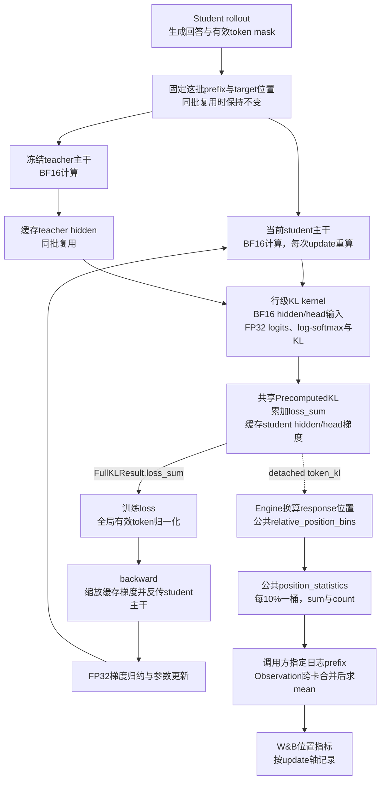

# KL 计算与公共位置指标分层

> 本文保留公共位置指标接入时的设计与验收说明。当前接口分别由[Full-vocab 走读](../internals/full-vocab.md)和[指标系统](../internals/metrics.md)维护。

更新：2026-10-24。相对位置统计已从 `trainer/distillation/position_metrics.py` 移至 [utils/metric/position.py](../../../../verl/utils/metric/position.py)。它现在接收任意逐token标量值，不依赖KL、teacher/student或模型输入布局。当前生产接入仍是Full-KL，其他指标可以复用相同接口，但没有自动启用。

## 1. 公共指标与业务接入的边界

| 层 | 职责 | 不应知道的内容 |
| --- | --- | --- |
| Full-KL kernel | 输出可反传loss及detached逐token KL | position、response长度、日志命名 |
| FSDP engine | 将预测state下标换算成response内的target下标，保留masked gap | 如何合并跨卡指标 |
| `utils.metric.position` | 按相对位置分桶，计算sum/count，生成Observation | teacher、student、KL公式、input IDs、prompt模板 |
| distillation loss | 指定业务namespace，归一化训练loss，提交诊断 | 分桶坐标算法 |
| 既有Observation系统 | microbatch与GPU之间合并充分统计 | token来自哪一种模型 |

公共模块提供三个函数：

```python
bins = relative_position_bins(positions, lengths)
sums, counts = position_statistics(values, bins)
metrics = position_observations(sums, counts, prefix="policy/entropy_position")
```

`positions` 是有效token在原始序列内的零基坐标，`lengths` 是对应序列的实际长度，`values` 是一一对应的标量。caller先选择有效token，不能把mask去掉后重新编号。`bins` 可以在相同位置上的多个指标间复用。

KL、entropy、NLL、advantage、逐token surrogate loss和clip指示量都可做这种聚合。不同指标仍保留各自含义：有符号advantage可以为负；布尔clip指示量的mean是比例；位置聚合不会把sampled log-ratio变成完整KL。sum/count只足以重建均值和总量，不能反推出分位数、最大值或方差。

## 2. 当前 Full-KL 计算与梯度路径

下图表示precompute/precompute_fused主路径。其他原生后端返回相同 `FullKLResult`；Liger没有逐token行时，训练分支继续工作，位置诊断分支不产生数据。



Teacher只提供冻结监督，不接收训练梯度。实线表示计算／训练数据流，虚线表示detached诊断分支。梯度矩阵乘法输入仍有BF16转换，FP32累加与FP32参数更新不代表整条反向链路都使用FP32。

每个有效前缀上的计算目标为：

$$
K_t=\sum_vp_\theta(v\mid s_t)
\left[\log p_\theta(v\mid s_t)-\log T(v\mid s_t)\right].
$$

对student logit的梯度为：

$$
\frac{\partial K_t}{\partial z_v}
=p_\theta(v\mid s_t)
\left[\log\frac{p_\theta(v\mid s_t)}{T(v\mid s_t)}-K_t\right].
$$

该梯度在precompute forward中分块累积并缓存，backward施加上游缩放。`token_kl`明确不参与反传，所以新增位置统计不会改变loss目标。教师输出词表更宽时，kernel层将额外归一化修正同时加入标量和诊断行，图中省略这一内部细节。

## 3. 相对位置与累计均值

每条response内零基位置为 $r$、长度为 $L$，以中点 $(r+0.5)/L$ 分到10个桶。当前Full-KL字段保持不变：

```text
distill/full_kl_position/p00_10/{sum,token_count,mean}
...
distill/full_kl_position/p90_100/{sum,token_count,mean}
```

前30%的均值为前三桶sum之和除以前三桶count之和。跨microbatch/GPU也先合并sum/count；空桶不填零均值。公共层保留非有限观测，不会静默删掉NaN来改善统计。

Response布局换算在[FSDP engine](../../../../verl/workers/engine/fsdp/transformer_impl.py)中完成；Full-KL日志namespace由[losses.py](../../../../verl/trainer/distillation/losses.py)指定。通用模块没有蒸馏namespace常量。

## 4. 验证

CPU检查覆盖带mask空洞的原坐标、短序列中点、同一位置下的有符号值／布尔值、多namespace、不同分区token数、空桶及非法坐标。原Full-KL数值与VJP测试继续执行。两卡集成另外核对每个桶的实际count，不只核对总count，并覆盖一张卡无有效token、不同response长度和teacher额外词表行。

复现结果见[验收记录](../data/position-common-20261024/README.md)。此次仅调整公共模块分层和接入，KL公式、分桶定义和既有日志字段没有改变。
