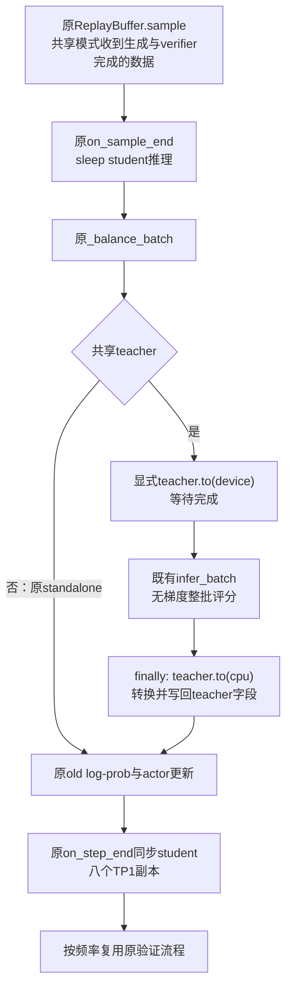

# 同步共享八卡的最小实现方案

首版在现有 V1 sync 中增加 `distillation.execution_mode=shared_sync`，保留默认 `standalone` 的原 4+4 路径。共享模式让 student rollout、冻结 teacher 前向、student 更新按阶段使用同一八卡池；验证复用八个 student TP1 副本。

优先直接复用 `TrainingWorker` 的 forward-only engine、`infer_batch()` 和 `to()`，不新增 teacher manager、worker 继承层、通用调度器或 replay 状态。Trainer 负责共池注册、评分调用与 TQ 字段转换。本文是源码审阅基点 `f5c017eae` 上的待实施设计，所有新增配置和方法名均为拟议接口。

方案比较与收益条件只在[八卡调度方案](2026-10-20-八卡调度方案.md#s3同步共享八卡分阶段运行冻结-teacher)展开；指标只在[最小指标方案](2026-10-20-最小指标实现方案.md)定义；固定/重算 advantage 的数学差异只在[目标推导](../opd-objective/2026-10-20-固定前缀下的优势估计与重要性采样.md)展开。

## 1. 首版边界与保留项

工程目标是保留当前训练算法，只改变 teacher 概率的生产位置。继续使用原始 student token、现有 `k1 + PG`、current-policy advantage、old-log-prob 重算和一次 optimizer update。当前批量 64、验证预算与输出规则沿用 [infra 固定条件](README.md#固定条件)。

首版支持单机、V1 sync、FSDP2、单冻结 teacher、兼容 tokenizer 的文本 causal LM，沿用当前数学模型组合。Actor 与 teacher 使用相同 DP world size；student 生成 TP1。项目入口使用 8 卡；测试入口可使用更小 world size 检查通信和生命周期。

多 teacher、TP/CP/MoE、LoRA、异步、partial rollout、独立 learned reward model 和其他蒸馏目标不在首版共享模式范围。Unsupported 组合在初始化前失败；原 standalone 模式保持原有支持范围。取消 clipping、bypass old 概率或启用 rollout IS 均另立算法实验。

## 2. 复用依据与改动位置

### 2.1 现有 TrainingWorker 足够完成 teacher 前向

[TrainingWorker](../../../../verl/workers/engine_workers.py) 已提供：

- `reset()` 初始化 engine。
- `infer_batch()` 注入动态 token budget、remove-padding 等参数，经 `engine.infer_batch()` 无梯度前向，返回 CPU 结果。
- `to(device, model, optimizer, grad)` 控制模型状态迁移。
- `forward_only=True` 时不建立 optimizer；训练入口会拒绝训练该 engine。

[FSDP engine](../../../../verl/workers/engine/fsdp/transformer_impl.py) 的 LM-head 路径已经计算指定 label 的 log-prob。当前 sampled-token teacher 不需要任意 top-k 查询，可以复用该能力，不另写 HF forward、causal shift、packing 或分布式分发。

Teacher 冻结的首版约束是无 optimizer、所有评分经 `torch.no_grad()`、禁止调用训练入口，且不进入 student checkpoint/weight-sync 路径。测试检查梯度为空和固定输入上的 teacher 输出在多轮切换后保持一致。

### 2.2 文件改动清单

| 文件 | 拟议最小改动 |
| --- | --- |
| [workers/config/distillation.py](../../../../verl/workers/config/distillation.py) | 增加执行模式和共享前向配置；将模型身份解析与独立 vLLM pool 校验分开 |
| [trainer/config/distillation/distillation.yaml](../../../../verl/trainer/config/distillation/distillation.yaml) 及生成配置 | 声明默认 standalone 和共享 engine 配置 |
| [trainer/ppo/v1/trainer_base.py](../../../../verl/trainer/ppo/v1/trainer_base.py) | 同池注册一个 TrainingWorker、初始化、获取 client 的模式分支、批评分 helper 及输出转换 |
| [experimental/agent_loop/agent_loop.py](../../../../verl/experimental/agent_loop/agent_loop.py) | 将“启用蒸馏 loss”与“需要在线 teacher RPC”分开；共享模式不构造 client、不等待评分 |
| [workers/config/engine.py](../../../../verl/workers/config/engine.py) | 增加向后兼容的 forward-only CPU offload 选择 |
| [workers/engine/fsdp/transformer_impl.py](../../../../verl/workers/engine/fsdp/transformer_impl.py) | 允许共享 teacher 使用阶段迁移，保留原 forward-only 默认 offload 行为 |
| [公共启动脚本](../../_run_single_teacher_fsdp2.sh) | 按模式派生 GPU 数和配置，允许共享模式没有独立 teacher 卡 |
| [Hope run.sh](../../../../hope/mirroropd/run.sh) | 去掉无条件覆盖 4+4，转为默认模式的派生配置 |

先不改 `trainer_sync.py`：其 `on_sample_end()` 已 sleep student，`on_step_end()` 已同步权重；只在测试证明边界不够时补一个窄的检查。`agent_loop_tq.py` 仍调用统一的 teacher helper，共享模式由 helper 返回，因此无需再复制一次模式判断。

`main_ppo.py` 可以继续把 `get_teacher_client()` 的返回值传给 AgentLoop；共享模式返回 None，由已校验的模式决定不创建 RPC manager。`ReplayBuffer`、`distillation/losses.py`、`core_algos.py`、Ray 底层及 checkpoint backend 原则上不修改。

## 3. 配置契约

### 3.1 一个执行模式，不再新增 trainer 类型

```yaml
# 拟议配置：这些字段尚未实现。
distillation:
  execution_mode: standalone  # standalone | shared_sync
```

两种模式都使用 `trainer.v1.trainer_mode=sync`。共享模式本身固定使用 FSDP2 teacher，不再同时暴露一个可产生非法组合的第二套 backend 选择器；以后确有第二个共享后端，再扩展该边界。

| 配置含义 | standalone | shared_sync |
| --- | --- | --- |
| `trainer.n_gpus_per_node` | Student 池，例如 4 | 全共享池，项目中为 8 |
| `distillation.n_gpus_per_node` / `nnodes` | 独立 teacher 池，例如 4/1 | 都为 0，明确不申请独立池 |
| `teacher_models.*.model_path` | 继续使用 | 继续使用，唯一 teacher |
| `teacher_models.*.inference` | vLLM 服务参数 | 不用于构造服务或推导副本 |
| 共享 teacher world size | 不适用 | 从 actor 池派生，不再配置一次 |

当前 `DistillationConfig.__post_init__()` 会按独立 pool 推导 `num_replicas`，并改写 teacher 的 prompt/response 预算。共享分支必须跳过这些 vLLM 专用行为，仅解析单 teacher 身份和模型路径。不能将 pool 设为 0 后继续走原解析，也不能将 teacher 占用再加到 8 卡总数上。

需要显式的模型/tokenizer 覆盖时复用 `HFModelConfig` 的现有字段；模型路径仍只有一个来源。首版共享 teacher 建议配置如下，最终默认值通过固定轨迹验收确定：

```yaml
# 拟议配置草图，不是现成可运行命令。
distillation:
  execution_mode: shared_sync
  n_gpus_per_node: 0
  nnodes: 0
  shared_teacher:
    strategy: fsdp2
    forward_only: true
    model_dtype: bfloat16
    param_offload: true
    optimizer_offload: false
    offload_policy: false
    forward_only_cpu_offload: false
    use_dynamic_bsz: true
    infer_max_token_len_per_gpu: 32768
```

`shared_teacher` 复用 `FSDPEngineConfig` 语义，而不是新建一套 teacher 参数体系。Teacher raw log-prob 的温度固定为 1，匹配当前 vLLM prompt-logprob 路径；不能随意继承经过采样变换的 student 温度。

### 3.2 区分逐层 offload 与阶段迁移

当前 FSDP2 初始化条件是 `offload_policy or forward_only`，会自动使用 `CPUOffloadPolicy`。即使外层写了 `param_offload=True`，也不能认定 teacher 会在整个评分阶段都驻留 GPU。

拟新增 `FSDPEngineConfig.forward_only_cpu_offload=True`，默认保持现状；FSDP2 条件收窄为：

```python
use_cpu_policy = offload_policy or (
    forward_only and forward_only_cpu_offload
)
```

共享 teacher 设置新字段为 False、`offload_policy=False`，保留显式 `param_offload=True`。这样使用已有模型迁移工具完成整阶段 onload/offload，不在每个 micro-batch 人为重建模型。原 actor、ref 和其他 forward-only 默认行为不变；该非默认选择首版只验收 FSDP2。

还必须同步修改 `FSDPEngine.to()`：当前它对所有 `forward_only` engine 直接 return。共享模式关闭逐层 CPU policy 后，应允许走现有 `load_fsdp_model_to_gpu()` / `offload_fsdp_model_to_cpu()`；不能只改初始化条件就认为 `.to()` 已生效。现有 [fsdp_utils.py](../../../../verl/utils/fsdp_utils.py) 的 FSDP2 卸载已使用阻塞 D2H 并释放 allocator 缓存，不另写搬运实现。

Teacher 的 `fsdp_size` 从共享 world size 显式派生，配合现有 eval 退出时的 root reshard 条件。测试确认 root 与层级临时权重均已释放，再唤醒其他角色；不能只检查某个分片参数位于 CPU。

## 4. 共池初始化与每步执行

### 4.1 初始化

`_init_resource_pool_mgr()` 在共享模式仅创建 global pool，teacher 角色映射到这个池。`_setup()` 在现有 `resource_pool_to_cls[pool]` 中同时注册 actor 与一个 forward-only `TrainingWorker`，复用 `create_colocated_worker_cls()` 和同一组 Ray worker。

初始化顺序是 actor 初始化并完成既有 offload → teacher 初始化并卸载 → student vLLM 初始化 → 载入/恢复 student checkpoint → 同步 student 推理权重。不能在两个完整模型与 vLLM cache 同时占满显存后才开始执行分时策略。

Teacher 初始化使用相同 tokenizer 语义、独立模型参数和自己的 engine 配置。共享的是物理设备与 worker 容器，不是将 teacher 覆盖到 actor 模型对象里。

### 4.2 评分接入点

在 `_step_once()` 的 `_balance_batch()` 之后、`_compute_old_log_prob()` 之前加入一个窄的 `_compute_shared_teacher_log_probs()` helper；standalone 分支不执行该 helper。



逻辑顺序为：

1. 从当前 batch 取得 teacher 所需输入，构造独立的 extra-info 视图；关闭 entropy、top-k 和 loss 计算，设置温度 1。
2. 显式 `teacher_wg.to("device", model=True, optimizer=False, grad=False)`。
3. 在独立的 `teacher_batch.extra_info` 中设置 `disable_auto_offload=True`、`compute_loss=False`，再调用 `infer_batch(teacher_batch)`；这两个开关是数据 metadata，不是该方法的新关键字参数。该 RPC 注册为非阻塞，沿用现有 `_compute_values()` 的 `ray.get(output.futures)` 等待方式；不能只取得 future 就进入卸载，也不新增一套同步 RPC 包装层。
4. 无论成功或异常，在 `finally` 中调用 `to("cpu", ...)` 并完成清理；失败时原异常向上传播，不进入 actor 更新。
5. 成功后将完整 teacher 输出转换并写入同一批 TQ trajectory keys，检查字段齐全，再继续原 student 路径。

显式迁移只发生在整批评分边界。`infer_batch()` 内部动态 micro-batch、无梯度执行和 CPU 返回均使用现有实现。Teacher 统计、迁移 timer 和 W&B 发布统一按[指标方案](2026-10-20-最小指标实现方案.md)执行。

Teacher调用使用新建的metadata对象及独立 `extra_info` 字典，trajectory keys保持相同。`disable_auto_offload`、teacher温度和推理预算不能泄漏到后续actor调用；helper返回原batch身份，只增加已完成的teacher输出字段。TQ桥接已由 `register()` 自动包装，无需新增桥接decorator或修改底层队列。

## 5. 数据契约与因果对齐

### 5.1 保留既有字段

AgentLoop 继续保存原始 `input_ids`、`prompts`、`responses`、`position_ids`、`response_mask/loss_mask`、`rollout_log_probs`、UID/session 和策略版本。共享模式仅延后 teacher 字段。

`TrainingWorker.infer_batch()` 返回标准 `log_probs`；首版允许在当前串行 helper 内部使用这一临时字段，立即复制/转换为 `teacher_logprobs`。之后 actor 重算覆盖自己的 `log_probs`，不会覆盖 teacher 字段。临时输出不作为“batch 已可训练”的依据，也不在 helper 外暴露给异步消费者。

完整输入布局保持 nested full-sequence；teacher 输出末维为 1，兼容当前 `no_padding_2_padding(...).squeeze(-1)`。保留 `teacher_ids` 以匹配已有协议，即使 k1 本身不需要额外候选集合。

### 5.2 不重复 shift

现有 FSDP LM-head 在位置 $i$ 计算的是下一 token $x_{i+1}$ 的概率。vLLM 的 [extract_prompt_logprobs()](../../../../verl/workers/rollout/vllm_rollout/utils.py) 也将首个无概率 token 丢弃、在末尾补 dummy，已经转换到同样的预测位置布局：

$$
\text{teacher\_logprobs}[i,0]
=\log T(x_{i+1}\mid x_{\le i}).
$$

因此共享模式保留该布局，仅补末维并将每条序列最后的 dummy 置零；`teacher_ids[i,0]=x_{i+1}`，每条序列最后为 dummy 0。随后由既有 [padding helper](../../../../verl/workers/utils/padding.py)提取 response 位置，不能提前切成 response-only 后再让 loss shift 一次。

例如 prompt 为 `[u,v]`、response 为`[a,b]`，完整输出的预测目标为 `[v,a,b,dummy]`，loss 应取位置 1、2，对应`a,b`。跨序列拼接时，每行末尾 dummy 独立处理，不能让下一条 prompt token 成为有效监督。

不同 teacher/student 后端的数值误差用固定输入验收；改变 tokenizer、词表或 chat template 不属于“仅换 teacher 后端”。

## 6. AgentLoop、Replay 与异常

AgentLoop 初始化先区分“启用蒸馏”和“需要在线 teacher RPC”。Standalone 继续构造 `AsyncTeacherLLMServerManager`；共享模式不构造。`_compute_teacher_logprobs()` 统一判断 RPC 是否应执行，TQ 子类继续调用该方法即可。

Trainer 在两种模式下都保留已解析的 `distillation_config` 和蒸馏 loss 开关。`get_teacher_client()` 返回 None 仅表示共享模式没有在线 RPC 服务，不能据此清空蒸馏配置或回退到普通 task-reward PPO；standalone 缺少 client 仍应作为初始化错误处理。

旧模式的 `finished` 仍表示生成、verifier 和 teacher 全部完成；共享模式表示生成侧与 verifier 完成，trainer 在共享评分 helper 返回后才可进入 loss。不会新增 `scored` 状态、后台 teacher 任务或新的 replay 队列。`ReplayBuffer._materialize_batch()` 清理的是 prompt 标记，trajectory keys 仍由 trainer 消费和最终清理；写回必须使用这些 trajectory keys。

共享首版不启用基于 teacher 结果的采样过滤。失败沿现有 trainer 异常路径停止，不发布新 student 版本，不让缺少 teacher 字段的 batch 进入更新。不设计评分中途自动续跑；恢复从已有 student checkpoint 开始，重新生成尚未完成的一批。固定 teacher 从配置指定权重初始化，不保存 optimizer，也不混入 student checkpoint。

## 7. 权重同步与验证

保持 `trainer_mode=sync` 及当前 naive checkpoint backend。`CheckpointEngineManager.update_weights()` 的 naive 分支调用现有 actor worker group 的更新接口；八卡 actor 初始化出的八个 student 推理副本沿原路径接收当前权重。共享 teacher 不注册为 student 副本，也不接收 student 权重。

不为 S3 引入动态 add/remove 副本或跨池 NCCL 传输；那是 S2 验证借卡/异步方案的问题。当前 [sync hooks](../../../../verl/trainer/ppo/v1/trainer_sync.py)已在更新后同步并恢复 student 推理。

验证因此直接使用同一 student manager 的八个 TP1 副本，teacher 保持 CPU 状态。沿用原题目、采样和窗口。跨窗口持续补充请求是单独优化，不与共享池首版同时修改，以便归因。

## 8. 上游参考的取舍

已有 PR 状态和完整仓库审计统一见[上游实现](2026-10-20-上游实现与论文基线.md)。本设计只取以下局部能力：

| 来源 | 借鉴 | 首版不移植 |
| --- | --- | --- |
| One-Shot-OPD | teacher 注册到 actor 共池、冻结前向 | V0 DataProto、基于 old 概率的 reward 分支 |
| NeMo RL 共置蒸馏 | 整阶段模型生命周期和验证复用 | 新框架、默认 top-k 损失 |
| verl #7058 | V1 训练侧批评分与 TQ 注入位置 | Megatron worker、legacy async、多 teacher 路由 |
| verl #6920 | 因果对齐和指定 token 概率接口的检查思路 | 新 top-k 目标、独立 teacher 池、任意候选查询接口 |

本仓已有标准 label log-prob 前向，所以无需照搬#6920 的专用 teacher 类；新增 manager 也没有独立职责。若固定轨迹测试证明标准接口无法保持字段合同，再增加最小适配函数，不能预先复制一整套 engine。

## 9. 分步交付与验证

| 阶段 | 必要工作与通过条件 |
| --- | --- |
| 配置兼容 | 默认仍为 standalone；旧 4+4 解析不变；共享模式只创建一个池，非法组合提前拒绝 |
| Teacher 独立前向 | 用既有 TrainingWorker，无 optimizer、无梯度；校验显式 onload/offload 和 micro-batch 间驻留 |
| 字段对照 | 固定 token 覆盖首 response、EOS、padding、空/截断回答和不同长度；输出 shape、顺序、mask 和概率与旧路径对照 |
| Loss 对照 | 同一 student 参数、轨迹和 teacher 概率下比较旧/新路径 loss 与梯度；数学 loss 代码不改 |
| 生命周期 | 连续生成→评分→更新→验证；检查同一模型版本、异常清理、resume 和 TQ 最终清理 |
| 性能 | 使用[最小指标](2026-10-20-最小指标实现方案.md)，比较固定 batch64 的完整步时与相同验证预算 |

CPU 测试优先扩展现有 `test_trainer_base_on_cpu.py`、`test_agent_loop_tq_on_cpu.py`，覆盖资源映射、调用顺序、缺字段和失败传播；新增一个聚焦共享 teacher 的测试模块即可，不新增测试框架。GPU 测试再验证 FSDP 通信、真实搬运和概率数值，不能由 mock 成功替代。

配置生成文件按现有流程更新；源码交付到开发机仍遵守[仓库传输流程](../../../../meituan/README.md)。本方案不会因为本机文件已改，就假定 Hope 接收端自动同步。
