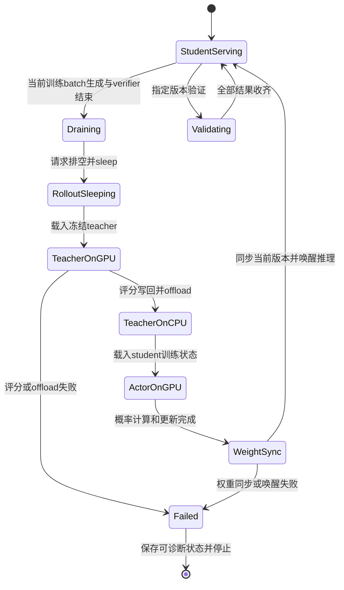

# 八卡 OPD 优化实施与验收

推荐与方案选择以[总览](README.md)为准，调度图与规模预算以[八卡方案](2026-10-20-八卡调度方案.md)为准。这里记录可实施的边界、对照方法和通过条件；所有新参数组合和共享实现仍待 GPU 验收。

## S3 共享池的最小实现范围

当前 V1 的入口、AgentLoop、TQ 和 loss 已形成一条连续依赖，新增 teacher backend 必须同时接入资源管理和数据就绪语义。只将 teacher worker 放到同一池，会使原本期待在线评分结果的 AgentLoop 等待一个尚未唤醒的模型。

| 边界 | 当前实现 | S3 所需行为 |
| --- | --- | --- |
| 资源池 | `_init_resource_pool_mgr()` 另建 teacher_pool | 只声明物理 8 卡，冻结 teacher 注册到同一池；启动初始化也遵守显存时序 |
| 模型后端 | Teacher 为独立 vLLM 服务 | Frozen FSDP2 前向，不建 optimizer、不求梯度、不开生成 KV；按序列/token 预算分批 |
| AgentLoop | Verifier 后立即 teacher RPC，完成后写 TQ | 保留 verifier 与完整 token 序列；共享模式将 teacher 评分移到 trainer 侧 |
| Replay / TQ | Prompt group 的 finished 发生在所有 session 后处理结束后 | 可以在生成/verifier 完成后交给 trainer，但更新前必须写齐 teacher 字段；不能让 RPC 继续阻塞就绪 |
| 概率与 loss | 当前 model_output 计算 k1，detach 后构造 PG advantage | 继续调用当前 loss，只改变 teacher 概率的生产位置 |
| 生命周期 | Student hybrid 已有 sleep/wake/offload | 增加 teacher onload/offload互斥、切换timer与异常清理 |
| 权重同步 | Actor 只同步现有 student 副本 | 覆盖同池全部 student 副本，明确 student 版本与固定 teacher 身份 |
| Hope 入口 | 本地 run.sh 强制 4+4 | 接收端对应入口声明总共 8 卡，配置检查与实际资源一致 |

本仓源码入口是 [V1 trainer](../../../../verl/trainer/ppo/v1/trainer_base.py)、[sync trainer](../../../../verl/trainer/ppo/v1/trainer_sync.py)、[AgentLoop TQ](../../../../verl/trainer/ppo/v1/agent_loop_tq.py)、[replay buffer](../../../../verl/trainer/ppo/v1/replay_buffer.py)与[distillation loss](../../../../verl/trainer/distillation/losses.py)。外部参考代码只作为实现证据，不整包迁移其数据协议或 loss。

### TQ 就绪与概率字段

当前 `_agent_loop_postprocess()` 按 `_compute_score()`→`_compute_teacher_logprobs()`→写输出执行，`_run_prompt()` 等全部 session 完成才将 prompt 标记 finished。共享模式需要跳过在线 teacher 调用，在 trainer 收到完整生成 batch 后统一评分，再进入 student 推断/训练。

ReplayBuffer 当前只识别既定 status 值，未知值会抛异常；不能只在生产者加一个`scored`或`generation_done`字符串。可在共享路径复用 finished 表示生成/verifier 结束，并由 trainer 在评分写回后才向 loss 交付 batch；如果引入两级状态，也必须完整修改 producer、replay 和 consumer。无论采取哪种方式，都要保持 prompt/session key 一致，不重复消费、不提前清理评分尚未写回的行。

当前 k1 estimator 读取 `data["teacher_logprobs"]`，转换成 padding 形式并`squeeze(-1)`，要求与 student sampled log-prob 和 response mask 对齐。输出字段应继续满足该约定，处理 nested/remove-padding 布局，不另造一套下游概率接口。

当前 advantage 在 loss 内来自当前 `model_output["log_probs"]` 与 teacher 概率之差并 detach；old_log_probs 另供策略更新逻辑使用。把 teacher 概率缓存到 batch 可以，缓存旧 student advantage 并跨更新复用会改变算法。也不能将 teacher top-k 归一化后的概率当作全词表归一化的 sampled-token 概率。


离线缓存应保留生成时原始 token IDs、prompt 长度、response mask、EOS/truncation 状态和模型/tokenizer/chat template 身份。Lightning 的准备脚本默认截断为 4096 并重新应用模板/编码文本，照搬会改变当前轨迹；可见文本相同不保证 token 序列相同。Teacher 应对保留的原始 IDs 评分。[^lightning-data]

### Frozen teacher 前向

Teacher 只需返回每个有效 response token 的 log-prob。对前缀$s_t$和实际 token$y_t$：

$$
\log p_T(y_t\mid s_t)=z_{T,y_t}-\operatorname{logsumexp}_{v\in V}z_{T,v}.
$$

词表归一化仍需覆盖完整$V$，输出可以只保留一个 token 概率。先确保 tokenizer/chat template、causal shift、position IDs、padding、response mask 和截断规则与原 vLLM 路径对应；不能为了降低载荷而忽略词表尾部。

当前词表 151936，一个 32768-token 的 BF16 logits 矩阵约 9.27GiB，FP32 副本约 18.55GiB。仅对已经生成的 logits 分块做 logsumexp，不能消除原始 logits 矩阵。若需要限制峰值，应在输出头计算前对 hidden state 分块做 LM-head 投影与归一化，或使用已验证的融合 log-prob 路径，并核对 FSDP/TP 下的全词表归一化与有效 token 顺序。

### 模型切换状态机



初始化、resume 和最后一次验证也遵守该顺序。每次切换记录角色、物理 GPU、模型身份、student 版本和开始/结束事件。Teacher 失败后不能继续用 student 服务响应 teacher RPC；额外 student 副本恢复失败后不能带着部分旧权重继续验证。

## S2 验证借卡的实现边界

S2 沿用训练 4+4，只在验证期间使用另外 4 个 student 副本。复用 S3 的生命周期、显存互斥与版本检查；新增服务接入同一 student 负载均衡器。旧 teacher 的底层 COLOCATED 副本已有 sleep/wake，但 manager 还需要调度封装。

共享 Ray placement group 必须在初始化时规划，或在原池内创建可共置的临时服务；不能由 sleep 推导独占 GPU reservation 已释放。当前 sync checkpoint manager 固定 naive backend，额外副本跨到另一个池后需要检查传输支持，不能假设现有四副本同步自动覆盖。

借卡前排空 teacher，验证前确认 8 副本同一 student 版本，结束后先排空和移除额外服务，再 sleep 并恢复固定 teacher。保存 checkpoint 和加载验证权重的顺序也要明确，避免验证版本比日志 global step 落后一轮。

## 参数与执行效率的对照

这些优化与拓扑相互独立。一次只改变一个因素，先记录预热与 graph capture，再比较稳定区间；保留固定验证工作量。对照可参考官方性能指南和 vLLM 调优说明。[^perf] [^vllm]

| 项目 | 候选对照 | 判断依据 |
| --- | --- | --- |
| Student CUDA Graph | `ROLLOUT_ENFORCE_EAGER=False`，按实际请求数设置 capture sizes | TPOT、decode token/s、CPU launch 间隙；同时检查 graph 常驻内存和训练峰值 |
| 推理容量 | 有排队时单测`MAX_NUM_SEQS=48`与 memory0.7 | Running/queued、KV、preemption；训练batch64/4副本只有约16请求，不能靠抬上限产生请求 |
| Prefill token 预算 | 从 8192 单独上调并记录 prefill/teacher 队列 | 主要影响 prefill/评分；不保证长 decode 提速 |
| Actor token 预算 | `PPO_MAX_TOKEN_LEN_PER_GPU=49152`，再比较 65536 | 每 rank micro-batch 数、通信、update_actor 墙钟和整卡峰值 |
| Offload | 在 S0 中分别关闭 optimizer 或 parameter offload | 搬运减少与推理/graph 共存代价；S3 生命周期仍必须保证阶段互斥 |
| 激活重算 | 单独比较`GRADIENT_CHECKPOINTING=False` | 激活峰值与步时，不能只看 MFU 变化 |
| 输出头融合 | `actor_rollout_ref.model.use_fused_kernels=True` | Sampled 概率、entropy、loss 及梯度数值；确认 backend 实际支持 |
| 模型内部融合 | 单独比较`actor_rollout_ref.model.use_liger=True` | 与输出头融合分开归因，确认导入和实际走到的算子 |

上表容量参数的配方环境变量是 `ROLLOUT_MAX_NUM_SEQS`、`ROLLOUT_GPU_MEMORY_UTILIZATION`；其余具体参数以[公共启动脚本](../../_run_single_teacher_fsdp2.sh)为准。Remove-padding 与动态 batching 当前已开启，不应作为新增优化再计一次。

48 条 35841-token context 的理论 KV 约 45.94GiB，加权重/graph/workspace 后需与设备实际容量和 vLLM 预算比较。memory0.7 不是“保证可用 56GiB”的精确承诺：设备总字节与框架预算应以运行时记录为准。参数增加后如果 preemption、反复重算或 OOM，吞吐可能下降。

可执行的单变量 Graph 对照入口示例：

```bash
ROLLOUT_ENFORCE_EAGER=False \
  EXPERIMENT_NAME=math-fixed-eval-student-graph \
  bash examples/mirroropd/run_math_deepseek_r1_1_5b_fsdp2.sh \
  'actor_rollout_ref.rollout.cudagraph_capture_sizes=[1,2,4,8,16,32]' \
  actor_rollout_ref.rollout.disable_log_stats=False
```

这是当前领域配方入口；Hope 任务仍通过本地`run.sh`调用它，不能假设工作区脚本已经同步到开发机。该例仅供计划对照，不代表已经验证 Graph 路径或适用于所有 batch/并行布局。


可先做 student4+teacher1 或 2、剩余 GPU 暂不用的缩容测量，保留 actor DP4 与 batch64，单独判断 teacher 吞吐是否下降。它不是最终八卡利用方案，但能避免同时增加 student rank、改变 batch 造成的混杂。实际预留的 8 卡 GPU 小时仍全额记账。

如果增大训练 batch 至 128/256，decode 可能获得更多在途请求，但每个 epoch 的更新次数、学习轨迹和有效 token 量也改变。应另立质量/吞吐实验，按相同 token 与优化预算报告，不能只按 epoch 时间宣布系统加速。

## 验证请求调度

保留当前验证预算。先在原窗口 16 题上比较 4 卡/8 卡；随后才比较有界跨窗口持续补充请求，避免同时修改服务容量和任务调度导致收益无法归因。

持续补充调度保留每题 16 条请求、题目顺序元数据、UID/session 计数和聚合规则。限制在途请求与 TQ 内存，完成一个可释放的请求组后补下一组；最后仍等待全部规定请求和 CPU 判分结束。更换调度后即使 seed 设置相同，文本不一定逐条完全相同，质量比较应考虑采样方差。

不能把未完成长回答提前丢弃、降低 max_tokens 或减少采样后，称为同预算验证加速。训练侧 partial rollout 若作为异步方案使用，应另记其数据分布和策略版本。

## 逐步验收

| 阶段 | 输入和测量 | 通过条件 |
| --- | --- | --- |
| 数值 | 固定 token 轨迹，覆盖不同 padding/长度、EOS、截断、空 response；比较原 vLLM 与 FSDP teacher | 因果位置、mask、有效 token 数一致；概率差有明确 dtype/backend 解释 |
| 梯度 | 同一 teacher 概率和 student 参数比较当前 k1+PG | Loss、梯度方向/范数在明确容差内；teacher 无梯度；不同长度权重聚合一致 |
| 生命周期 | 多轮生成→评分→更新→验证，含 resume 和异常 | 无两个冲突阶段同时占满显存；版本正确；失败不会继续消费缺字段数据 |
| 短训练 | 同一 GPU、数据和 batch64，区分初始化与稳定步 | 完整步时和阶段计时可闭合，TQ/CPU 内存无持续积压，质量指标无明显异常 |
| 完整验证 | 同一 checkpoint、570×16 与固定长度/采样 | 请求计数与结果完整；借卡/恢复单独计时；整次验证与尾部时间都记录 |
| 质量与成本 | 相同训练 token/更新预算，多次采样或独立 seed | 性能改善同时保持可接受的 student-only 质量；记录总 GPU 小时 |

BF16、不同 attention kernel 或归一化实现可能产生差异，容差需结合固定输入上的实际误差分布制定；不要求浮点逐位相同，也不在测量前编造一个必定通过的阈值。


## 包含验证的周期收益

按[现状观测](2026-10-20-现状与测量.md)，以稳定训练步均值和一个完整验证近似每 20 步的周期：

$$
T_{\mathrm{cycle}}\approx20\times144.967+21200.767\approx24100\ \mathrm{s},
\qquad T_{\mathrm{val}}/T_{\mathrm{cycle}}\approx88.0\%.
$$

这是敏感性分析，不是多个周期的实测分布，尚未计入未观测 checkpoint 成本。只把 actor update 减半，周期约减少 128 秒，即 0.53%；假设完整验证减半且切换成本忽略，周期约从 6.69 小时降为 3.75 小时，约 1.78 倍。后一个减半是假设，不能归因于从 4 卡换到 8 卡必然实现。

所以 S3 验收包含完整周期；S2 与持续补充验证请求可以分别测量。它们优化相同验证的执行，不减少评测题目、采样或长度。

## 必须新增的观测

| 组件 | 最少记录 |
| --- | --- |
| Student 服务 | Submit/start/end、prompt/response token 数、TTFT/TPOT、running/queued、KV/preemption、权重版本 |
| Teacher | Enqueue/start/end、有效token数、batch/micro-batch、onload/offload、GPU/模型身份 |
| CPU verifier | 请求数、排队与计算时间、p50/p95、timeout/异常与 worker 并发 |
| TQ/replay | 写入/可消费/清理时间、积压组数、字节量、failure/eviction 与 staleness |
| Actor | 每 rank micro-batch、forward/backward、NCCL、optimizer、CPU memcpy、峰值显存 |
| 同步与验证 | 参数导出/传输/wake/cache、最后 GPU 完成、最后 verifier 完成、聚合和输出结束 |

不同请求会重叠，逐请求 service time 之和不能代替整步关键路径。每阶段同时报告 wall time、有效 token 和 GPU 角色；GPU busy、allocator 高水位、整卡显存和 MFU 分别记录。当前 15 秒系统采样不足以测几秒甚至更短的阶段。

Teacher 当前不在 V1 默认 profiling manager 枚举中；训练 step profiler 停止点也不自动覆盖其后完整验证。先补明确的 teacher 与 validation-window start/stop，再采少量稳定窗口的trace。已有teacher lane 标签或打开 profiler 配置不等于真的采到 teacher trace，相关 PR 状态见[上游调研](2026-10-20-上游实现与论文基线.md#profiling-与可观测性)。

完整成本按资源预留计算：

$$
\mathrm{GPUh}_{\mathrm{total}}=\sum_j N_j\,T_j/3600.
$$

$N_j$是时段$j$实际预留的物理 GPU 数，$T_j$以秒计。若始终预留 8 卡，则为总墙钟秒数乘 8 再除 3600；不能按 busy 百分比给闲卡“打折”。离线算法包含数据生成、teacher 预计算、训练和相同验证，并明确是否包含额外 SFT 准备成本。

### 参考文献

[^perf]: verl contributors. Performance Tuning Guide. [官方性能说明](https://verl.readthedocs.io/en/latest/perf/perf_tuning.html)。
[^vllm]: vLLM contributors. Optimization and Tuning, v0.25.1. [官方调优说明](https://docs.vllm.ai/en/v0.25.1/configuration/optimization/)。

[^lightning-data]: Lightning OPD. 离线数据与概率准备，2026。[prepare_lightning_opd.py](https://github.com/jet-ai-projects/Lightning-OPD/blob/cd6b559dfedf091c316c761d566e99dc62d14fb9/data_curation/prepare_lightning_opd.py)。
