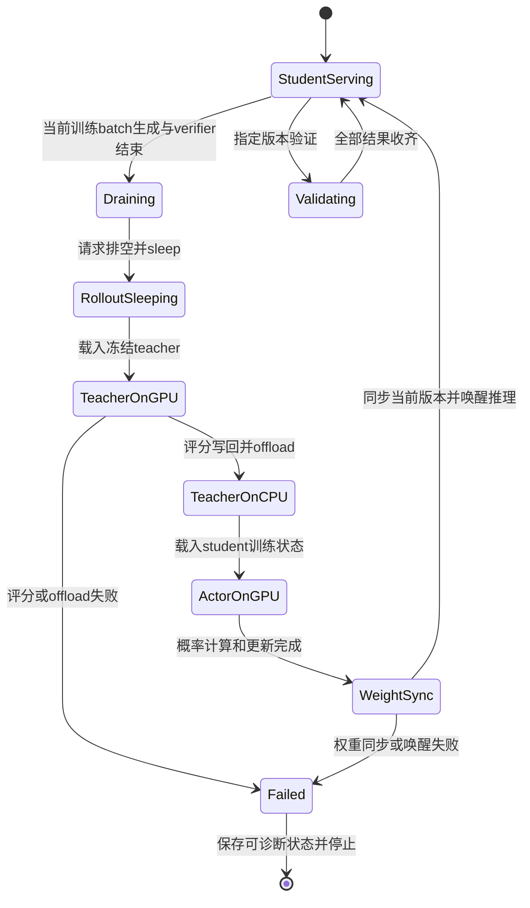

# 八卡 OPD 优化实施与验收

推荐与方案选择以[总览](README.md)为准，调度图与规模预算以[八卡方案](2026-10-20-八卡调度方案.md)为准。这里记录可实施的边界、对照方法和通过条件；所有新参数组合和共享实现仍待 GPU 验收。

## S3 共享池的最小实现范围

当前 V1 的入口、AgentLoop、TQ 和 loss 已形成一条连续依赖，新增 teacher backend 必须同时接入资源管理和数据就绪语义。只将 teacher worker 放到同一池，会使原本期待在线评分结果的 AgentLoop 等待一个尚未唤醒的模型。

| 边界 | 当前实现 | S3 所需行为 |
| --- | --- | --- |
| 资源池 | `_init_resource_pool_mgr()` 另建teacher_pool | 只声明物理8卡，冻结teacher注册到同一池；启动初始化也遵守显存时序 |
| 模型后端 | Teacher为独立vLLM服务 | Frozen FSDP2前向，不建optimizer、不求梯度、不开生成KV；按序列/token预算分批 |
| AgentLoop | Verifier后立即teacher RPC，完成后写TQ | 保留verifier与完整token序列；共享模式将teacher评分移到trainer侧 |
| Replay / TQ | Prompt group的finished发生在所有session后处理结束后 | 可以在生成/verifier完成后交给trainer，但更新前必须写齐teacher字段；不能让RPC继续阻塞就绪 |
| 概率与loss | 当前model_output计算k1，detach后构造PG advantage | 继续调用当前loss，只改变teacher概率的生产位置 |
| 生命周期 | Student hybrid已有sleep/wake/offload | 增加teacher onload/offload互斥、切换timer与异常清理 |
| 权重同步 | Actor只同步现有student副本 | 覆盖同池全部student副本，明确student版本与固定teacher身份 |
| Hope入口 | 本地run.sh强制4+4 | 接收端对应入口声明总共8卡，配置检查与实际资源一致 |

本仓源码入口是 [V1 trainer](../../../../verl/trainer/ppo/v1/trainer_base.py)、[sync trainer](../../../../verl/trainer/ppo/v1/trainer_sync.py)、[AgentLoop TQ](../../../../verl/trainer/ppo/v1/agent_loop_tq.py)、[replay buffer](../../../../verl/trainer/ppo/v1/replay_buffer.py)与[distillation loss](../../../../verl/trainer/distillation/losses.py)。外部参考代码只作为实现证据，不整包迁移其数据协议或loss。

### TQ 就绪与概率字段

当前 `_agent_loop_postprocess()` 按 `_compute_score()`→`_compute_teacher_logprobs()`→写输出执行，`_run_prompt()` 等全部 session 完成才将 prompt 标记finished。共享模式需要跳过在线teacher调用，在trainer收到完整生成batch后统一评分，再进入student推断/训练。

ReplayBuffer当前只识别既定status值，未知值会抛异常；不能只在生产者加一个`scored`或`generation_done`字符串。可在共享路径复用finished表示生成/verifier结束，并由trainer在评分写回后才向loss交付batch；如果引入两级状态，也必须完整修改producer、replay和consumer。无论采取哪种方式，都要保持prompt/session key一致，不重复消费、不提前清理评分尚未写回的行。

当前k1 estimator读取 `data["teacher_logprobs"]`，转换成padding形式并`squeeze(-1)`，要求与student sampled log-prob和response mask对齐。输出字段应继续满足该约定，处理nested/remove-padding布局，不另造一套下游概率接口。

当前advantage在loss内来自当前 `model_output["log_probs"]` 与teacher概率之差并detach；old_log_probs另供策略更新逻辑使用。把teacher概率缓存到batch可以，缓存旧student advantage并跨更新复用会改变算法。也不能将teacher top-k归一化后的概率当作全词表归一化的sampled-token概率。


离线缓存应保留生成时原始token IDs、prompt长度、response mask、EOS/truncation状态和模型/tokenizer/chat template身份。Lightning的准备脚本默认截断为4096并重新应用模板/编码文本，照搬会改变当前轨迹；可见文本相同不保证token序列相同。Teacher应对保留的原始IDs评分。[^lightning-data]

### Frozen teacher 前向

Teacher只需返回每个有效response token的log-prob。对前缀$s_t$和实际token$y_t$：

$$
\log p_T(y_t\mid s_t)=z_{T,y_t}-\operatorname{logsumexp}_{v\in V}z_{T,v}.
$$

词表归一化仍需覆盖完整$V$，输出可以只保留一个token概率。先确保tokenizer/chat template、causal shift、position IDs、padding、response mask和截断规则与原vLLM路径对应；不能为了降低载荷而忽略词表尾部。

当前词表151936，一个32768-token的BF16 logits矩阵约9.27GiB，FP32副本约18.55GiB。仅对已经生成的logits分块做logsumexp，不能消除原始logits矩阵。若需要限制峰值，应在输出头计算前对hidden state分块做LM-head投影与归一化，或使用已验证的融合log-prob路径，并核对FSDP/TP下的全词表归一化与有效token顺序。

### 模型切换状态机



初始化、resume和最后一次验证也遵守该顺序。每次切换记录角色、物理GPU、模型身份、student版本和开始/结束事件。Teacher失败后不能继续用student服务响应teacher RPC；额外student副本恢复失败后不能带着部分旧权重继续验证。

## S2 验证借卡的实现边界

S2沿用训练4+4，只在验证期间使用另外4个student副本。复用S3的生命周期、显存互斥与版本检查；新增服务接入同一student负载均衡器。旧teacher的底层COLOCATED副本已有sleep/wake，但manager还需要调度封装。

共享Ray placement group必须在初始化时规划，或在原池内创建可共置的临时服务；不能由sleep推导独占GPU reservation已释放。当前sync checkpoint manager固定naive backend，额外副本跨到另一个池后需要检查传输支持，不能假设现有四副本同步自动覆盖。

借卡前排空teacher，验证前确认8副本同一student版本，结束后先排空和移除额外服务，再sleep并恢复固定teacher。保存checkpoint和加载验证权重的顺序也要明确，避免验证版本比日志global step落后一轮。

## 参数与执行效率的对照

这些优化与拓扑相互独立。一次只改变一个因素，先记录预热与graph capture，再比较稳定区间；保留固定验证工作量。对照可参考官方性能指南和vLLM调优说明。[^perf] [^vllm]

| 项目 | 候选对照 | 判断依据 |
| --- | --- | --- |
| Student CUDA Graph | `ROLLOUT_ENFORCE_EAGER=False`，按实际请求数设置capture sizes | TPOT、decode token/s、CPU launch间隙；同时检查graph常驻内存和训练峰值 |
| 推理容量 | 有排队时单测`MAX_NUM_SEQS=48`与memory0.7 | Running/queued、KV、preemption；训练batch64/4副本只有约16请求，不能靠抬上限产生请求 |
| Prefill token预算 | 从8192单独上调并记录prefill/teacher队列 | 主要影响prefill/评分；不保证长decode提速 |
| Actor token预算 | `PPO_MAX_TOKEN_LEN_PER_GPU=49152`，再比较65536 | 每rank micro-batch数、通信、update_actor墙钟和整卡峰值 |
| Offload | 在S0中分别关闭optimizer或parameter offload | 搬运减少与推理/graph共存代价；S3生命周期仍必须保证阶段互斥 |
| 激活重算 | 单独比较`GRADIENT_CHECKPOINTING=False` | 激活峰值与步时，不能只看MFU变化 |
| 输出头融合 | `actor_rollout_ref.model.use_fused_kernels=True` | Sampled概率、entropy、loss及梯度数值；确认backend实际支持 |
| 模型内部融合 | 单独比较`actor_rollout_ref.model.use_liger=True` | 与输出头融合分开归因，确认导入和实际走到的算子 |

上表容量参数的配方环境变量是 `ROLLOUT_MAX_NUM_SEQS`、`ROLLOUT_GPU_MEMORY_UTILIZATION`；其余具体参数以[公共启动脚本](../../_run_single_teacher_fsdp2.sh)为准。Remove-padding与动态batching当前已开启，不应作为新增优化再计一次。

48条35841-token context的理论KV约45.94GiB，加权重/graph/workspace后需与设备实际容量和vLLM预算比较。memory0.7不是“保证可用56GiB”的精确承诺：设备总字节与框架预算应以运行时记录为准。参数增加后如果preemption、反复重算或OOM，吞吐可能下降。

可执行的单变量Graph对照入口示例：

```bash
ROLLOUT_ENFORCE_EAGER=False \
  EXPERIMENT_NAME=math-fixed-eval-student-graph \
  bash examples/mirroropd/run_math_deepseek_r1_1_5b_fsdp2.sh \
  'actor_rollout_ref.rollout.cudagraph_capture_sizes=[1,2,4,8,16,32]' \
  actor_rollout_ref.rollout.disable_log_stats=False
```

这是当前领域配方入口；Hope任务仍通过本地`run.sh`调用它，不能假设工作区脚本已经同步到开发机。该例仅供计划对照，不代表已经验证Graph路径或适用于所有batch/并行布局。


可先做student4+teacher1或2、剩余GPU暂不用的缩容测量，保留actor DP4与batch64，单独判断teacher吞吐是否下降。它不是最终八卡利用方案，但能避免同时增加student rank、改变batch造成的混杂。实际预留的8卡GPU小时仍全额记账。

如果增大训练batch至128/256，decode可能获得更多在途请求，但每个epoch的更新次数、学习轨迹和有效token量也改变。应另立质量/吞吐实验，按相同token与优化预算报告，不能只按epoch时间宣布系统加速。

## 验证请求调度

保留当前验证预算。先在原窗口16题上比较4卡/8卡；随后才比较有界跨窗口持续补充请求，避免同时修改服务容量和任务调度导致收益无法归因。

持续补充调度保留每题16条请求、题目顺序元数据、UID/session计数和聚合规则。限制在途请求与TQ内存，完成一个可释放的请求组后补下一组；最后仍等待全部规定请求和CPU判分结束。更换调度后即使seed设置相同，文本不一定逐条完全相同，质量比较应考虑采样方差。

不能把未完成长回答提前丢弃、降低max_tokens或减少采样后，称为同预算验证加速。训练侧partial rollout若作为异步方案使用，应另记其数据分布和策略版本。

## 逐步验收

| 阶段 | 输入和测量 | 通过条件 |
| --- | --- | --- |
| 数值 | 固定token轨迹，覆盖不同padding/长度、EOS、截断、空response；比较原vLLM与FSDP teacher | 因果位置、mask、有效token数一致；概率差有明确dtype/backend解释 |
| 梯度 | 同一teacher概率和student参数比较当前k1+PG | Loss、梯度方向/范数在明确容差内；teacher无梯度；不同长度权重聚合一致 |
| 生命周期 | 多轮生成→评分→更新→验证，含resume和异常 | 无两个冲突阶段同时占满显存；版本正确；失败不会继续消费缺字段数据 |
| 短训练 | 同一GPU、数据和batch64，区分初始化与稳定步 | 完整步时和阶段计时可闭合，TQ/CPU内存无持续积压，质量指标无明显异常 |
| 完整验证 | 同一checkpoint、570×16与固定长度/采样 | 请求计数与结果完整；借卡/恢复单独计时；整次验证与尾部时间都记录 |
| 质量与成本 | 相同训练token/更新预算，多次采样或独立seed | 性能改善同时保持可接受的student-only质量；记录总GPU小时 |

BF16、不同attention kernel或归一化实现可能产生差异，容差需结合固定输入上的实际误差分布制定；不要求浮点逐位相同，也不在测量前编造一个必定通过的阈值。


## 包含验证的周期收益

按[现状观测](2026-10-20-现状与测量.md)，以稳定训练步均值和一个完整验证近似每20步的周期：

$$
T_{\mathrm{cycle}}\approx20\times144.967+21200.767\approx24100\ \mathrm{s},
\qquad T_{\mathrm{val}}/T_{\mathrm{cycle}}\approx88.0\%.
$$

这是敏感性分析，不是多个周期的实测分布，尚未计入未观测checkpoint成本。只把actor update减半，周期约减少128秒，即0.53%；假设完整验证减半且切换成本忽略，周期约从6.69小时降为3.75小时，约1.78倍。后一个减半是假设，不能归因于从4卡换到8卡必然实现。

所以S3验收包含完整周期；S2与持续补充验证请求可以分别测量。它们优化相同验证的执行，不减少评测题目、采样或长度。

## 必须新增的观测

| 组件 | 最少记录 |
| --- | --- |
| Student服务 | Submit/start/end、prompt/response token数、TTFT/TPOT、running/queued、KV/preemption、权重版本 |
| Teacher | Enqueue/start/end、有效token数、batch/micro-batch、onload/offload、GPU/模型身份 |
| CPU verifier | 请求数、排队与计算时间、p50/p95、timeout/异常与worker并发 |
| TQ/replay | 写入/可消费/清理时间、积压组数、字节量、failure/eviction与staleness |
| Actor | 每rank micro-batch、forward/backward、NCCL、optimizer、CPU memcpy、峰值显存 |
| 同步与验证 | 参数导出/传输/wake/cache、最后GPU完成、最后verifier完成、聚合和输出结束 |

不同请求会重叠，逐请求service time之和不能代替整步关键路径。每阶段同时报告wall time、有效token和GPU角色；GPU busy、allocator高水位、整卡显存和MFU分别记录。当前15秒系统采样不足以测几秒甚至更短的阶段。

Teacher当前不在V1默认profiling manager枚举中；训练step profiler停止点也不自动覆盖其后完整验证。先补明确的teacher与validation-window start/stop，再采少量稳定窗口的trace。已有teacher lane标签或打开profiler配置不等于真的采到teacher trace，相关PR状态见[上游调研](2026-10-20-上游实现与论文基线.md#profiling-与可观测性)。

完整成本按资源预留计算：

$$
\mathrm{GPUh}_{\mathrm{total}}=\sum_j N_j\,T_j/3600.
$$

$N_j$是时段$j$实际预留的物理GPU数，$T_j$以秒计。若始终预留8卡，则为总墙钟秒数乘8再除3600；不能按busy百分比给闲卡“打折”。离线算法包含数据生成、teacher预计算、训练和相同验证，并明确是否包含额外SFT准备成本。

### 参考文献

[^perf]: verl contributors. Performance Tuning Guide. [官方性能说明](https://verl.readthedocs.io/en/latest/perf/perf_tuning.html)。
[^vllm]: vLLM contributors. Optimization and Tuning, v0.25.1. [官方调优说明](https://docs.vllm.ai/en/v0.25.1/configuration/optimization/)。

[^lightning-data]: Lightning OPD. 离线数据与概率准备，2026。[prepare_lightning_opd.py](https://github.com/jet-ai-projects/Lightning-OPD/blob/cd6b559dfedf091c316c761d566e99dc62d14fb9/data_curation/prepare_lightning_opd.py)。
