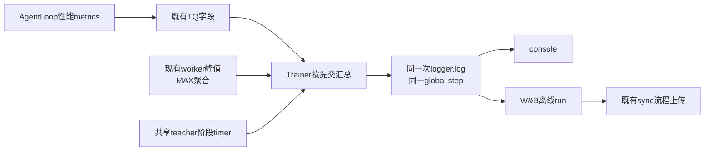

# 训练流水线最小指标实现方案

第一版只补足决策所需的信息：固定工作量是否更快、student 生成是否缩短、共享 teacher 的评分与搬运成本，以及内存或 KV 是否成为限制。指标通过现有 trainer logger 同时写 console 和 W&B，不新增监控服务、事件总线或 worker 独立 run。四项常规性能指标已实现，随对应执行路径默认采集，不依赖 OPD 配方或额外开关；共享 teacher 的两个阶段计时仍待流水线实现。设计审阅基点为 `f5c017eae`，验收范围见第 8 节。

现有数值和采样边界只引用[现状与测量](2026-10-20-现状与测量.md)，共享 teacher 的调用顺序只引用[流水线方案](2026-10-20-同步共享八卡实现方案.md)。本文定义指标、口径和传输路径。

## 1. 保留与新增

保留 `timing_s/{step,gen,old_log_prob,update_actor,update_weights,testing}`、`perf/total_num_tokens`、回答长度、验证分数与现有 loss/gradient 指标。`gen` 继续保持原含义，不能改名为纯 decode。常驻 profiler、TTFT/TPOT 分位数、逐层/NCCL/TQ/CPU worker 分解暂不加入。

完整方案包含五个标量；旧模式再有一个请求诊断量。当前先实现生成跨度、FSDP 显存峰值、preemption 与旧 teacher 请求延迟四项。字段名称以下表为准，适用范围之外省略，不用 0 假装没有成本。

| 字段 | 定义与范围 | 第一版用途 |
| --- | --- | --- |
| `timing_s/rollout_batch` | 一次提交前至该提交所有 student 请求返回的跨度；含调度、排队和推理，不含返回后的 verifier/teacher | 比较 4/8 卡的生成阶段 |
| `timing_s/teacher_forward` | 共享模式的整批评分调用，等待实际结果完成；含 RPC、分批前向与返回，不含显式 onload/offload | 衡量新增串行评分成本 |
| `timing_s/teacher_transfer` | 共享模式中显式 teacher onload 与 offload 的完成等待时间之和 | 判断切换是否抵消收益 |
| `memory/fsdp_worker_peak_allocated_gib_max` | FSDP worker 进程的累计 PyTorch allocated 高水位，取所有 rank 最大值 | 保守判断可用余量，辅助 micro-batch 对照 |
| `rollout/preemptions` | 本提交中全部 student 请求的已知 preemption 次数之和 | 发现推理容量不足导致的重算 |
| `teacher/request_latency_s/mean`，仅旧模式 | 每条回答调用 teacher client 的往返耗时，按请求数求均值 | 判断独立 teacher 的延迟；不可与共享模式整批时间直接相减 |

### 显存取舍

第一版沿用累计高水位，明确不是当步、不是整卡，也不是单独 teacher 或 actor 的峰值。共置 worker 可能处于同一进程，PyTorch peak counter 是进程/设备共享状态。为分离阶段而随处调用 `reset_peak_memory_stats()`，会改变现有 `perf/max_memory_allocated_gb` 的统计口径，还需要维护跨角色历史值。

因此不新增两个名不副实的“阶段峰值”，也不引入全局 peak tracker。需要确定某个新 micro-batch 的真实峰值时，用短的单变量运行及现成 memory profiler 定点测量。新的 rank-max 字段保留 MAX 语义；既有字段和聚合行为保持兼容。实现中在每次 FSDP training update 的全部 mini-batch 完成后，用一次标量 `all_reduce(MAX)` 汇总 FSDP worker group，再以 `Metric("max", ...)` 返回。所有 rank 都参与，包括 sequence parallel 中不返回训练结果的 rank；只在输出 rank 上聚合会遗漏它们。此归约属于常规 worker 指标采集，不逐请求同步 GPU。Actor 保持表中名称；其他训练角色沿用各自 logger 前缀，例如 critic 的 `critic/memory/fsdp_worker_peak_allocated_gib_max`。

## 2. 复用入口与增量

| 现有入口 | 可以复用的内容 | 增量 |
| --- | --- | --- |
| [single_turn_agent_loop.py](../../../../verl/experimental/agent_loop/single_turn_agent_loop.py) | `generate_sequences` 请求耗时、`num_preempted` | 缺请求完成时刻，不能从单请求最大耗时还原整批跨度 |
| [agent_loop.py](../../../../verl/experimental/agent_loop/agent_loop.py) | `AgentLoopMetrics`、输出序列化、teacher RPC 调用点 | 为计时加入少量可选字段 |
| [agent_loop_tq.py](../../../../verl/trainer/ppo/v1/agent_loop_tq.py) | 将 `output.as_dict()` 包含的 metrics 写入 TQ | 不需要新队列或逐请求日志文件 |
| [trainer_base.py](../../../../verl/trainer/ppo/v1/trainer_base.py) | 提交、采样、`_compute_metrics()`、验证窗口及统一 logger | 从 TQ 收集和汇总指标 |
| [engine_workers.py](../../../../verl/workers/engine_workers.py) | 已记录 worker peak allocated/reserved | 在 `train_mini_batch()` 末尾采样累计 allocated 峰值，保留已有字段 |
| [metric_utils.py](../../../../verl/trainer/ppo/metric_utils.py) | 自动将 `timing_raw` 映射为 `timing_s/*` | 新阶段 timer 直接沿用 |

既有基线 run 的请求 metrics 没有进入标量 history；本实现增加 driver 聚合，覆盖普通训练和验证前的提交，离线记录验证见第 8 节。

## 3. 整批 rollout 计时

### 3.1 最小数据契约

这些指标属于训练流水线的基础观测，默认采集，不增加配置项。指标是否存在由执行路径和数据完整性决定：没有 teacher RPC 就没有 teacher 请求延迟，不支持完整提交计时的路径不发布该字段。完整 trace 和逐层 profiler 仍按原有显式配置使用。

对首版单机、同步、single-turn 配方：

1. Driver 在 `_submit_batch_to_rollout()` 的提交边界记录 `time.monotonic_ns()`，以可选非 tensor metadata 随提交发送；验证提交复用一个小的计时注入 helper。
2. Single-turn loop 在 `await ...generate()` 返回后立即记录 `generation_finished_at_ns`，早于 token 后处理、verifier 和 teacher 调用，放进 `AgentLoopMetrics`。
3. TQ 正常保存这些字段；trainer 仅在该提交全部结果完成后收集，计算最大完成时刻减去提交起点。

所有比较时刻必须来自同一主机、同一 monotonic clock domain；附带 Ray node 标识和 Linux `/proc/self/ns/time` 标识用于校验，不作为高基数 W&B 标量。跨节点、不同 clock domain 或多轮工具交互不发布这个整批指标，保留已有 `gen`。未来如需扩展，再采用 driver 完成通知；第一版不增加远程事件协议。

`max(generate_sequences)` 不能替代上述跨度：请求可能错峰进入服务。字段缺失、失败、取消或实际样本数不完整时，省略该提交指标并产生一次可诊断日志。首版不覆盖 DAPO 补样、跨 batch 预生成或异步采样，不能把“选中的子集”伪装成完整提交。

### 3.2 验证聚合

保持现有验证窗口不变。每窗口分别计算相同跨度；整轮可将各窗口跨度求和，记录为 `validation/timing_s/rollout_batch`。该值包含窗口内部排队，但不包含窗口之间的后处理/提交间隙；完整成本仍由既有 `timing_s/testing` 表示。

请求统计用 `validation/` 前缀。验证从未调用 teacher 时，不输出 teacher 评分为 0 的字段，以免让缺测和确实零成本混在一起。

## 4. Teacher 与 preemption

旧模式的 teacher 请求计时放在 `AgentLoopWorker._compute_teacher_logprobs()` 的 await 外层，写入 `final_output.metrics`。这能复用现有接口，不需要给 `teacher_manager.py` 返回值再附加一个 tuple，也不改 vLLM teacher 内核。它测量 RPC 往返，不能命名为纯 GPU forward。

共享模式由 trainer 的批评分 helper 用现有 `marked_timer` 包围完整调用和显式 `to()`。`teacher_forward` 从 `infer_batch()` 调用开始，到 `ray.get(output.futures)` 完成结束，包含 worker 的 TQ bridge 读写和返回；helper 在调用前准备 metadata、调用后转换字段的 driver 时间留在完整 step 中。必须等待实际计算完成，不能只计 RPC 提交时间，也不试图用重叠 timer 相加还原旧模式的 `gen`。

Preemption 优先复用 `TokenOutput.num_preempted`，不先依赖新 Prometheus 服务。当前代码以 -1 表示不可用；只有一个提交内全部请求均提供非负值时才发布总和。部分缺失时省略该指标并提示后端缺测，不能将 -1 截成 0。若当前 vLLM 版本不返回此字段，容量调参前用其已有服务统计做短时诊断，再决定是否补兼容读取。[^vllm-metrics]

## 5. W&B 路径与聚合



`_compute_metrics()` 在 TQ 清理前读请求字段。已有 `self.logger.log(data=metrics, step=self.global_steps)` 负责发布；worker 不初始化 W&B、不自行提交 step。均值通过 sum/count 计算，峰值使用 MAX，preemption 使用 SUM；不要先对各 worker 求均值再无权平均。

Worker 根据已有 engine strategy 自动采集 FSDP 峰值，不读取 trainer 配置，也不通过 extra-info 传递观测开关。保持现有 worker 方法签名与配置类型，不增加跨层全局配置依赖。

两种返回路径分别处理：AgentLoop metrics 是每条轨迹的 TQ 字段；TrainingWorker 的聚合 metrics 放在返回 metadata 的 `extra_info["metrics"]` 中。共享 helper 从等待完成的 worker 结果收集后者，不假设它们也存成同名 TQ tensor 字段。

公共入口已经是 `trainer.logger=[console,wandb]`，Hope 强制 `WANDB_MODE=offline`。新标量先进入本地 run，再通过现有同步流程上传云端。未同步不能声称云端实时可见，也不为本任务新增 uploader。入口见[公共脚本](../../_run_single_teacher_fsdp2.sh)和 [Hope run.sh](../../../../hope/mirroropd/run.sh)。

既有 `perf/throughput` 按 GPU 数归一化，当前同步模式分母与 actor 池有关；4+4 和共享 8 卡的资源口径不同。完整对照优先用已记录的总 token 数除以 `timing_s/step`，并按实际预留 8 卡计算 GPU 小时，而不修改旧指标定义。

## 6. 文件改动与实施顺序

| 文件 | 最小改动 |
| --- | --- |
| `verl/experimental/agent_loop/agent_loop.py` | 可选完成时间、teacher 耗时字段；teacher 调用计时 |
| `verl/experimental/agent_loop/single_turn_agent_loop.py` | 生成返回后记录时间；沿用 preemption 字段 |
| `verl/trainer/ppo/v1/trainer_base.py` | 提交 metadata、TQ 聚合、验证窗口聚合和 W&B 输出 |
| `verl/workers/engine_workers.py` | 每次 FSDP training update 末尾在全体 rank 归约一次峰值，以 `Metric` / MAX 返回 |
| `verl/utils/pipeline_metrics.py` | 时钟域校验、请求聚合和验证窗口求和；不保存调度状态 |

`agent_loop_tq.py` 保持原样，CPU 测试已覆盖 `AgentLoopOutput` 到现有 TQ 写入参数的序列化；trainer 用 `tu.get()` 读取非 tensor 字段，兼容 TensorDict 的自动解包行为。`teacher_model.py` 的 profiler 转发、reward worker 细计时和 TQ 底层改造不属于第一版。

旧 4+4 的新增字段已接入现有 logger，之后由共享方案复用。共享 teacher 的两个 timer 在流水线 helper 中落地，不由指标任务单独创建一个评分调度器。

## 7. 验收

| 检查 | 可判定结果 |
| --- | --- |
| 默认运行 | 没有额外配置、没有 distillation 的训练也采集适用指标 |
| 模拟错峰请求 | 整批跨度按实际提交与最后返回计算，不等于最大单请求耗时 |
| 缺测/失败 | 不发布虚假的 0 或完整 batch 统计 |
| 聚合 | 多 worker 不同请求数的均值正确；rank 峰值取 MAX |
| 日志 | mock logger 确认新增标量只由 driver 同一 step 发出；一次短运行在离线 run 中可见，sync 后云端可见 |
| 性能 | 不逐请求 CUDA 同步，不每步导出 trace；用相同工作量检查观测开销 |

数值概率/梯度的验收由[流水线方案](2026-10-20-同步共享八卡实现方案.md)负责。旧报告中完整观测清单作为诊断候选保留，不作为首版必须实现的清单。

## 8. 已实现范围与运行入口

公共配方直接运行即可，V1 trainer 默认收集适用的性能指标：

```bash
bash examples/mirroropd/run_math_deepseek_r1_1_5b_fsdp2.sh
```

直接调用 V1 trainer 或经 Hope 启动也无需额外指标配置。Teacher 延迟随实际 RPC 调用采集；整批 rollout 时间只在 driver 提供完整提交信息时采集；FSDP 峰值随 worker 的训练更新采集。

训练完整提交发布表中的四项适用指标；验证只发布 `validation/timing_s/rollout_batch` 和后端支持时的 `validation/rollout/preemptions`。验证跨度逐窗口相加，任一窗口缺测则省略该整轮字段。训练多个提交混合、DAPO 过滤/失败补样、异步或多轮轨迹不发布完整 batch 指标；teacher 延迟只对当前收集到的请求求均值，部分请求缺延迟时省略均值。FSDP 峰值只在 `fsdp`、`fsdp2`、`fsdp_turbo` 更新路径发布。`teacher_forward` 和 `teacher_transfer` 尚未实现，不输出占位 0。

新增测试位于 [test_pipeline_metrics_on_cpu.py](../../../../tests/trainer/ppo/v1/test_pipeline_metrics_on_cpu.py)，覆盖错峰请求、缺失/重复/多轮结果、跨节点/时钟域、未知 preemption、padding 去重、teacher 计时边界、TQ 序列化、FSDP 非输出 rank 的归约参与、验证窗口求和，以及 driver 同一 step 的 W&B 离线记录。GPU 和分布式计算在 CPU 单测中使用替身；W&B 测试使用真实 SDK 并解析离线 `.wandb` history。启动脚本测试还核对没有新增的指标配置项。

默认采集行为及相关回归共 130 项 CPU 测试通过，包括无 distillation 配置的正常训练、异步提交和真实 W&B 离线记录；测试使用 PyTorch 2.6、隔离安装的 TensorDict 0.10 / TransferQueue 0.1.11，以及 W&B 0.23.1。Ruff、配置再生成、语法、设备 API 和 docstring 检查通过。仓库默认目录检查仍会报告已有的 `tests/examples` 两个文件；显式允许该目录后通过。

GPU 稳定步性能、NCCL 归约、实际 vLLM preemption 字段与云端同步仍须在部署后的短运行中验收。CPU 测试不能代替这几项；原有 `timing_s/step` 和质量指标仍是是否改善训练的最终对照。

### 参考文献

[^vllm-metrics]: vLLM contributors. Optimization and Tuning，v0.25.1，preemption 与服务统计。[官方说明](https://docs.vllm.ai/en/v0.25.1/configuration/optimization/)。
