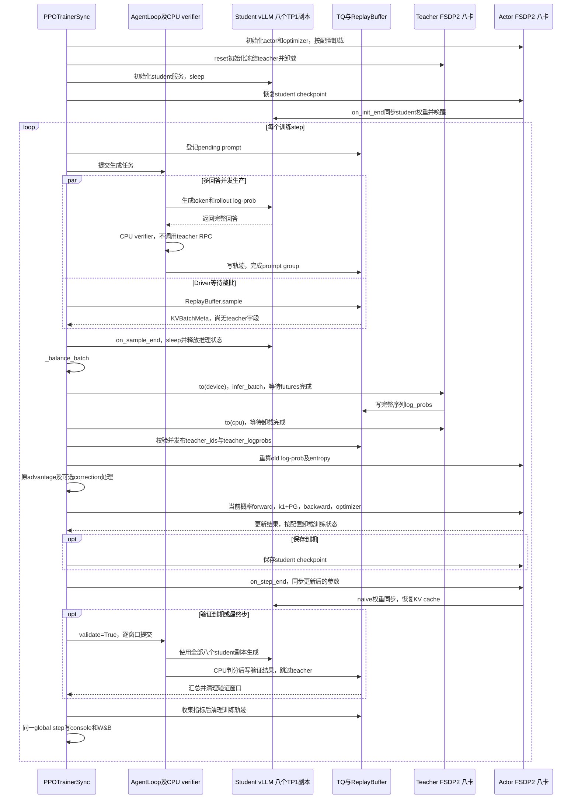

# 共享八卡运行与架构

共享方案已在 `5188828d2` 实现。本页按 `5b3ccdd30` 的源码整理当前行为。公共领域配方默认 `shared_sync`，通用 verl 配置仍默认 `standalone`；两者都使用 `PPOTrainerSync`。代码实现、已报告的测试与目标八卡端到端验收分开记录，测试证据集中在[指标与验收](2026-10-21-指标与验收.md#已完成的验证)。

当前默认运行方式是：八个 student TP1 副本生成整批回答，释放推理状态，冻结 teacher 使用同一八卡池做 FSDP2 前向并卸载，再由 actor 更新 student，最后同步八个推理副本。验证直接复用这八个 student 副本。原 4+4 保留为对照和回退路径。

## 启动与配置

环境和模型数据准备完成后，从仓库根目录运行：

```bash
# 默认 shared_sync，共享八卡。
CUDA_VISIBLE_DEVICES=0,1,2,3,4,5,6,7 \
  bash examples/mirroropd/run_math_deepseek_r1_1_5b_fsdp2.sh

# 恢复 standalone 4+4。
DISTILLATION_EXECUTION_MODE=standalone \
  CUDA_VISIBLE_DEVICES=0,1,2,3,4,5,6,7 \
  bash examples/mirroropd/run_math_deepseek_r1_1_5b_fsdp2.sh

# 不启动 GPU/Ray、不创建实验目录的配置预览。
DRY_RUN=1 bash examples/mirroropd/run_math_deepseek_r1_1_5b_fsdp2.sh
CONFIG_ONLY=1 bash examples/mirroropd/run_math_deepseek_r1_1_5b_fsdp2.sh
```

Math、code、IF 共用 [_run_single_teacher_fsdp2.sh](../../_run_single_teacher_fsdp2.sh)。领域入口、数据、verifier 和训练/验证预算只在[训练配方](../训练配方.md)维护。系统切换保留 batch64、rollout n1、mini-batch64、epoch1 及原 `k1 + PG`，不同时改变算法或工作量。

代码领域直接使用 `run_code_deepseek_r1_1_5b_fsdp2.sh`，选择DeepCoder teacher、TACO和LCBv6。2026-10-21本机仅完成资产与CONFIG_ONLY检查：原始TACO24701行、LCBv6 175行；未执行该领域的GPU训练。代码判分还含CPU程序执行成本，数学生成的测量不能代替code验收。

### 从565a1fda2到5b3ccdd30的脚本差异

`565a1fda2`时已经是shared八卡、FSDP2、V1/TQ；不能把更早的4+4迁移归入这个commit区间。math/code领域入口没有变化，公共脚本的变化均来自`5b3ccdd30`：

| 项目 | 565a1fda2 | 5b3ccdd30 |
| --- | --- | --- |
| `ROLLOUT_ENFORCE_EAGER` | 默认True | 默认False，开启编译＋Graph |
| `VAL_BATCH_SIZE` | 默认16 | 默认32 |
| Graph capture sizes | 不显式传入 | 按并发上限派生，默认`[1,2,4,8,16,32]` |
| 并发输入校验 | 未检查该字段 | 检查`ROLLOUT_MAX_NUM_SEQS`为正整数 |
| 退出保护 | 运行至文件末尾 | 将pipeline与exit一并解析，防止运行期间源码变化后重入 |

配套Python改动是V0/V1验证不请求无用概率，以及V1初始验证增加已有`timing_s/testing`。训练prompt/mini64、epoch1、学习率、长度、验证n16、引擎并发32/token8192/memory0.5均未改变。`benchmark_decode.py`是新增独立诊断工具，不在正常训练调用链上。

优势/IS消融仍未接入：当前`DistillationLossConfig`只接受`policy_loss_mode=vanilla`，没有`advantage_source`和实际optimizer执行计数。既有Hydra参数`actor_rollout_ref.actor.ppo_epochs=4`能重复执行旧算法，但拟议的`PPO_EPOCHS`、`OPD_ADVANTAGE_SOURCE`等环境变量尚未被脚本读取。范围和文件清单见[实施方案](../opd-objective/2026-10-21-优势与IS消融及更新计数实现方案.md)。

### 共享与独立池配置

| 环境变量 / 配置 | shared_sync | standalone |
| --- | --- | --- |
| `DISTILLATION_EXECUTION_MODE` | 公共配方默认 | 显式选择；通用 `DistillationConfig` 的默认 |
| `STUDENT_GPUS` → `trainer.n_gpus_per_node` | 默认 8，代表整个共享池 | 默认 4，代表 student 池 |
| `TEACHER_GPUS` → `distillation.n_gpus_per_node` | 必须 0，`nnodes=0`，不建独立 teacher 池 | 默认 4，`nnodes=1` |
| `ROLLOUT_TP` | 必须 1，默认八个副本 | 默认 1，副本数依池大小与并行配置推导 |
| `TEACHER_FSDP_TOKEN_BUDGET` | 每卡动态前向预算 32768，至少容纳完整训练序列 | 不用于 vLLM teacher |
| `TEACHER_FSDP_DTYPE` | 默认 BF16，同时控制存储与前向参数精度 | 不用于 vLLM teacher |
| `PARAM_OFFLOAD` / `OPTIMIZER_OFFLOAD` | 必须 True | 按原配方配置 |
| `teacher_models.teacher_model.model_path` | 唯一冻结 teacher 的来源 | 独立 teacher 服务的来源 |
| `TEACHER_TP`、`TEACHER_TOKEN_BUDGET` 等 vLLM 参数 | 不构造 teacher 服务，不据此推导副本 | 控制独立 teacher 服务 |

`TEACHER_GPUS=0` 不表示没有 teacher。共享 teacher 的 FSDP world size 从 actor 池派生；不能再把它加到八卡总数上。建议通过环境变量选择模式，让脚本一起派生资源配置；直接追加 Hydra override 修改模式时，也必须提供一致的池和 engine 参数。

## Hope 直连入口

**决策：Hope 直接执行随源码发布的领域脚本，不再维护 `hope/mirroropd/run.sh`。** 旧包装脚本固定导出 4+4，曾与新默认 shared_sync 冲突；由于 `hope/` 不进入源码包，解包代码不能修正接收端旧包装脚本。

在开发机本地 `hope/mirroropd/mirroropd.hope` 的 `[roles]` 中一次性替换：

```ini
worker.script = bash -lc 'CUDA_VISIBLE_DEVICES="${CUDA_VISIBLE_DEVICES:-0,1,2,3,4,5,6,7}" VERL_USE_UV=0 exec bash "/mnt/dolphinfs/hdd_pool/docker/user/hadoop-hmart-poistar/fanghaotian/MirrorOPD-verl/examples/mirroropd/run_${DOMAIN:-math}_deepseek_r1_1_5b_fsdp2.sh"'
```

这是任务容器内的共享挂载路径，不是本机 `/mnt/tidalfs-bdsz01/...` 路径。脚本自行定位仓库，无需依赖平台工作目录。已有 `CUDA_VISIBLE_DEVICES` 原样保留，缺省时使用该八卡作业内的逻辑设备 `0..7`；原生模式固定 `VERL_USE_UV=0`。

Hope 只维护队列、镜像、资源申请、挂载路径、领域和显式实验覆盖。默认领域为 math；在 worker 环境设置 `afo.role.worker.env.DOMAIN = code` 或 `if` 可切换领域，IF 另需 `OPENCOMPASS_ROOT` 和 `NLTK_DATA`。Standalone 对照设置 `DISTILLATION_EXECUTION_MODE=standalone`。公共配方维护 `.venv-native/bin/python`、默认离线 W&B、`TOKENIZERS_PARALLELISM=false`、`OMP_NUM_THREADS=1` 和训练日志，支持既有显式环境覆盖。

依赖检查用 `make native-check`，资产检查用 `make assets-check`；更换镜像或环境后在目标 GPU 容器单独验收 GPU 运算。旧包装脚本的依赖解压和逐卡矩阵乘法不再每次自动执行。

接收新版源码后，检查本地 `.hope` 已直连，移除不属于 standalone 实验的固定 `STUDENT_GPUS=4` / `TEACHER_GPUS=4` 覆盖，再执行 `make opd-submit`。旧 `run.sh` 不再被调用，可以删除；源码解包保留 `hope/`，不会替用户完成这次修改。后续入口更新随源码发布，通常不再改 worker 命令。打包/解包与日志上传统一见[人工传输说明](../../../../meituan/README.md)。

## 共享训练调度

图中分开的逻辑角色使用同一组物理八卡。CPU verifier、AgentLoop、TransferQueue（TQ）和 driver 不另申请 GPU；actor 与 teacher 的分片模型彼此独立，vLLM 有自己的推理进程、权重和 KV cache。



生成提交在 `prepare_step()` 中开始；AgentLoopManager 的提交返回不表示回答生成完成，真正交接由 ReplayBuffer/TQ 完成。默认 `gen` timer 包含等齐生成/CPU 判分和 student sleep。共享 teacher 在 `_balance_batch()` 后、old-log-prob 前评分；不会插入 optimizer update 或变更生成版本。

Standalone 的生成与各回答 teacher RPC 可以重叠，ReplayBuffer 返回时 teacher 字段已经齐全；之后沿相同 actor、同步与验证链执行。独立 teacher 在 actor 更新和验证时无新评分工作，验证仍只用 student 四卡。其完整拓扑图见[方案 S0](2026-10-21-调度备选与模型扩展.md#s0固定-44同步执行)。

## 代码职责与生命周期

| 入口 | 已实现职责 |
| --- | --- |
| [DistillationConfig](../../../../verl/workers/config/distillation.py) | 模式解析、共享 teacher engine 配置、资源与算法约束；共享模式跳过 vLLM 副本和预算改写 |
| [PPOTrainer](../../../../verl/trainer/ppo/v1/trainer_base.py) | `_setup()` 共池注册；`_make_shared_teacher_config()` 创建独立模型配置及 tokenizer 校验；`_compute_shared_teacher_log_probs()` 批评分与字段适配 |
| [PPOTrainerSync](../../../../verl/trainer/ppo/v1/trainer_sync.py) | 初始化/更新后同步；采样完成后休眠 student；没有复制训练循环 |
| [AgentLoopWorker](../../../../verl/experimental/agent_loop/agent_loop.py) / [TQ worker](../../../../verl/trainer/ppo/v1/agent_loop_tq.py) | Standalone 请求 teacher RPC；共享模式保留蒸馏配置但不创建 teacher client，沿原生成/判分/TQ 路径执行 |
| [TrainingWorker](../../../../verl/workers/engine_workers.py) / [BaseEngine](../../../../verl/workers/engine/base.py) | 复用 `reset()`、`infer_batch()`、`to()`；teacher 无 optimizer，经 `torch.no_grad()` 前向 |
| [FSDP engine](../../../../verl/workers/engine/fsdp/transformer_impl.py) / [迁移工具](../../../../verl/utils/fsdp_utils.py) | 共享 teacher 整阶段迁移、root/层级 reshard；显式迁移完成后才返回 |
| [CheckpointEngineManager](../../../../verl/checkpoint_engine/base.py) | 管理 student 推理副本；teacher 不接收 student 权重、不进入 student checkpoint |

初始化按 actor 初始化并卸载 → teacher 初始化并卸载 → student vLLM 初始化 → 恢复 student checkpoint → 首次权重同步进行。Teacher 与 actor 注册在同一 global pool，复用既有 `create_colocated_worker_cls()` 和 RayWorkerGroup，没有新增调度器、teacher manager、worker 子类或 replay 状态。

Teacher 使用自己的 `HFModelConfig`，不复用 student 已缓存的模型配置。除 token-to-ID 词表一致外，还检查 BOS/EOS/PAD ID 相同。固定 teacher 从配置路径初始化，不混入 student checkpoint；冻结依靠 forward-only、无 optimizer、无梯度执行及训练入口约束，测试检查多轮切换后输出不变。

FSDP2 的逐层 CPU policy 条件是 `offload_policy or (forward_only and forward_only_cpu_offload)`。共享 teacher 设置两项为 False、`param_offload=True`、`reshard_after_forward=True`，使整批评分期间驻留 GPU，在批边界显式迁移。其他 forward-only 路径的默认逐层 offload 语义保留。

评分 RPC 设置 `disable_auto_offload=True`，driver 等待 `ray.get(output.futures)` 后再 `to("cpu")`。成功卸载且结果校验通过后，才发布 teacher 字段。异常时尽力卸载并保留原异常，终止当前更新；NCCL/rank 故障不承诺自动恢复。重新启动沿 student checkpoint 恢复并重新生成未完成批次。

## 数据契约与因果对齐

| 数据 | 来源与使用 |
| --- | --- |
| `input_ids`、`position_ids`、`response_mask/loss_mask`、UID/session | Student 原始轨迹和 TQ；teacher 与 actor 读取同一轨迹 |
| `rollout_log_probs` | vLLM 生成侧记录；不包含可供 FSDP 复用的 KV 或 hidden states |
| 临时 `log_probs` | Teacher `infer_batch()` 经既有 TQ bridge 写入；转换后允许 actor 重算覆盖 |
| `teacher_ids`、`teacher_logprobs` | 固定 teacher 完整序列的 next-token 监督；IDs 为 int32，概率为 FP32，末维为 1 |
| `old_log_probs` | Actor 更新前独立重算；作为现有策略梯度比例的分母 |
| 当前 student log-prob | 每次训练 forward 计算，在蒸馏 loss 中构造 current-policy k1 advantage |

Teacher 输入使用独立 `KVBatchMeta` 和 `extra_info`，沿用原 trajectory keys；温度固定 1，关闭 entropy、top-k 和 loss。它不会把 teacher metadata 泄漏到 actor，也不让原 batch 更换身份。Shared 模式的 prompt finished 只表示生成与 verifier 完成；teacher helper 成功返回后才允许 actor 消费，没有新增 `scored` 队列状态。

FSDP 的位置 $i$ 已计算 $x_{i+1}$ 的概率，和独立 vLLM prompt-logprob 适配后的布局一致：

$$
\text{teacher\_logprobs}[i,0]=\log T(x_{i+1}\mid x_{\le i}).
$$

Helper 仅补末维并将每条序列末尾 dummy 置零；`teacher_ids[i,0]=x[i+1]`，最后一项为 0。Prompt `[u,v]`、response `[a,b]` 对应目标 `[v,a,b,dummy]`，loss 取位置 1、2。不能再 shift 一次，不能先裁成 response-only 后再套完整序列 padding helper；不同序列的末尾也不能形成交叉监督。

## Actor 更新调用链

Teacher 插入后，actor 仍从 token 重新 forward，`use_cache=False`，不依赖 vLLM KV。每批一次更新的默认配置没有改变；八卡主要改变 DP 分发、每卡 token 工作量与通信。Loss 推导和固定/重算 advantage 的取舍只在[OPD 目标文档](../opd-objective/README.md)维护。

```text
_compute_old_log_prob(batch)
├─ actor_rollout_wg.compute_log_prob(batch) → Ray / TQ bridge 分发
│  └─ ActorRolloutRefWorker.compute_log_prob()
│     └─ self.actor.infer_batch() [TrainingWorker]
│        ├─ engine.eval_mode()：按配置加载 actor 参数
│        ├─ BaseEngine.infer_batch()：torch.no_grad()
│        │  └─ FSDPEngine.forward_backward_batch(forward_only=True)
│        │     ├─ prepare_micro_batches()
│        │     └─ FSDPEngineWithLMHead.forward_step()
│        │        ├─ prepare_model_inputs()
│        │        ├─ self.module(..., use_cache=False)
│        │        └─ prepare_model_outputs()：log_probs / entropy
│        └─ 退出 eval context；按配置 offload；结果返回 CPU / TQ
└─ response_from_nested(log_probs, response_mask) → TQ old_log_probs

_compute_advantage(batch)
└─ 沿原代码计算 task-reward 相关字段与可选 rollout correction
   （当前蒸馏 PG 使用的 advantage 在下面 distillation_loss 内计算）

_update_actor(batch)
└─ actor_rollout_wg.update_actor(batch) → Ray / TQ bridge 分发
   └─ ActorRolloutRefWorker.update_actor()
      └─ self.actor.train_mini_batch() [TrainingWorker]
         ├─ engine.train_mode()：按配置加载 actor / optimizer
         ├─ 遍历 epochs 与 mini-batch
         │  └─ TrainingWorker.train_batch()
         │     ├─ BaseEngine.train_batch()
         │     │  ├─ optimizer_zero_grad()
         │     │  ├─ FSDPEngine.forward_backward_batch(forward_only=False)
         │     │  │  ├─ prepare_micro_batches()
         │     │  │  └─ 遍历 micro-batch
         │     │  │     ├─ FSDPEngineWithLMHead.forward_step()
         │     │  │     │  ├─ prepare_model_inputs()
         │     │  │     │  ├─ self.module(..., use_cache=False)
         │     │  │     │  ├─ prepare_model_outputs()：当前 student log_probs
         │     │  │     │  └─ distillation_ppo_loss()
         │     │  │     │     ├─ distillation_loss()
         │     │  │     │     │  ├─ compute_distillation_loss_reverse_kl_estimator()
         │     │  │     │     │  │  └─ k1 = log p_current - log p_teacher
         │     │  │     │     │  └─ compute_policy_loss_vanilla()
         │     │  │     │     │     └─ A = -k1.detach()；ratio = p_current / p_old
         │     │  │     │     └─ ppo_loss()：当前仍算诊断；use_task_rewards=False 时清零其 loss
         │     │  │     └─ loss.backward()：累积梯度；按 FSDP 策略同步
         │     │  └─ optimizer_step()：梯度裁剪、AdamW.step
         │     └─ 在指定最后一次迭代推进 lr_scheduler
         └─ 汇总 metrics；退出 train context；按配置 offload
```

权重同步沿 `CheckpointEngineManager.update_weights()` → actor worker `update_weights(mode="naive")` → 导出 actor 参数、IPC 更新 vLLM、清理旧 KV、设置版本 → actor 卸载 → 恢复 KV cache。它是内存传参，不是每步从磁盘重读 checkpoint。

验证不调用 `_step_once()`，不做 teacher forward、old-log-prob 或 actor update，也不逐窗口同步参数；它使用本步已经同步的 student 版本，teacher 留在 CPU。固定验证窗口和窗口长尾仍然存在，新增八卡资源不等于已实现跨窗口连续投喂。

## 当前支持范围

共享路径支持单机、V1 sync、一个 dense text causal-LM teacher、相同 DP world size 的 FSDP2、student TP1、single-turn 和 sampled-token `k1 + PG`。Actor 参数与 optimizer offload 开启，teacher 无 optimizer，teacher token budget 至少容纳一条完整训练序列。

配置校验当前拒绝多机、异步、TP/SP/PP 扩展、多 teacher、MoE、多模态、LoRA、MTP/QAT、top-k 蒸馏、critic/reference/learned reward、custom sampler、DAPO 过滤、rollout skip，以及不兼容的 tokenizer。Actor/teacher 使用非 fused 的兼容路径。扩大模型、切换并行或融合 kernel 前，应先检查这些实际约束；候选设计不等于可直接传参启用。

目标环境已观察到共享八卡短训练，见[两次运行对照](measurements/2026-10-21-八卡历史运行对照.md)；后续重点是完整验证、恢复和固定预算周期成本，具体通过条件与证据见[指标与验收](2026-10-21-指标与验收.md)。上游组件的取舍和论文 baseline 来源仍在[调研记录](2026-10-21-上游实现与论文基线.md)，不再重复一份待实施文件清单。
