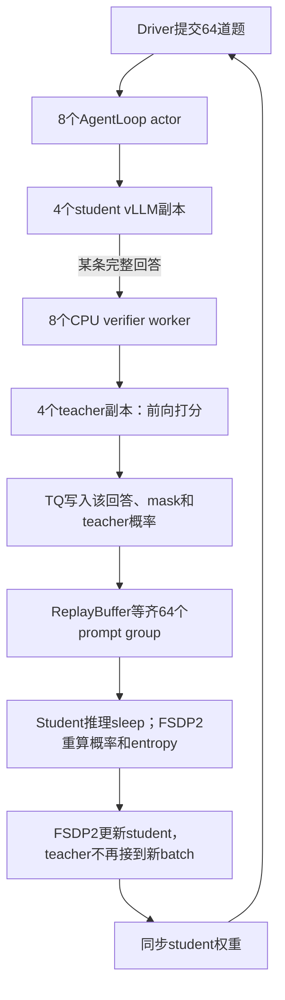
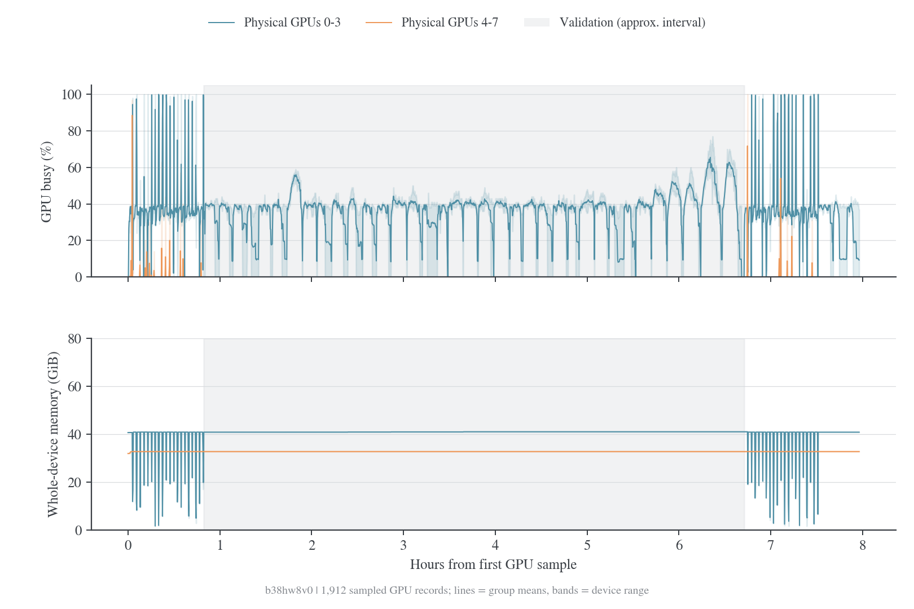

# 4+4 基线测量：b38hw8v0

本文保存旧 standalone 4+4 的历史测量，数据快照为 2026-10-20。文中的“当前”和“本 run”均指该历史运行，不表示现在的共享八卡默认实现；新增指标及端到端验收见[指标与验收](2026-10-21-指标与验收.md)。

本报告重新对齐 run `b38hw8v0` 的训练 timer、逐卡系统采样和 replay-buffer 状态日志，回答各组件什么时候工作、什么时候等待，以及现有指标能支持多细的结论。验证题目、采样次数、长度、频率与提交窗口均保持当前配置；本文不以减少验证工作量换取加速。

## 数据范围与时钟

| 证据 | 范围 | 精度与限制 |
| --- | --- | --- |
| [W&B history](../data/b38hw8v0-api-20261020/history.jsonl) | Global step 1–38，含 step 20 完整验证 | 阶段 timer 可用于总时间，未记录子组件独立耗时 |
| W&B run 文件 output.log | 39 条完整 step 指标行；提取结果见[last-console-step](../data/b38hw8v0-pipeline-20261020/last-console-step.json) | Stdout/stderr 在文件内顺序不完全按时间排列，不能靠行位置对齐 |
| [Replay 状态](../data/b38hw8v0-pipeline-20261020/replay-status.jsonl) | 436 个时间戳状态，覆盖完整 step 20 验证及后续部分验证 | 约每 60 秒打印一次，状态是 prompt group，不是 token/单条回答 |
| [系统 stream](../data/b38hw8v0-api-20261020/system-sampled.jsonl.gz) | 3825 行，其中 1912 行含 GPU 指标 | GPU 约 15 秒一个观测点；API sampled export，不是 kernel trace |
| [实际配置](../data/b38hw8v0-api-20261020/config.json) | V1 sync，4+4，naive 权重同步 | global_profiler.tool/steps 为 null，未启用 RLInsight |

2026-10-20 重新查询时，服务端 history 仍只有 38 行并标记 finished。Console 文件却已打印 step 39，后续日志在 11:33–11:34 出现 64 组训练请求，在 11:36 后转为 16 组验证请求。结合每 20 步验证的循环，上传快照已进入 step 40 验证，至少该轮更新已完成。这是快照内的进度证据，不能据此确定 Hope 在查询时仍运行或已结束。

本地日志时间按 Asia/Shanghai 解析，与 history 的 Unix `_timestamp` 对应。`_runtime` 不能和本行 `_timestamp` 混用：连续 37 对记录中，`timestamp[i+1] - runtime[i]` 几乎是常数，最大差仅约 1.7 ms，表现为 runtime 在下一次显式 step log 时才最终提交。直接用本行 runtime 对齐 GPU 会错开约一个训练步，遇到验证更会错开数小时。分析统一使用 `_timestamp` 与 timer，不将这个现象直接判为 SDK bug。

可复算数据见 [pipeline-analysis.json](../data/b38hw8v0-pipeline-20261020/pipeline-analysis.json)、[阶段窗口](../data/b38hw8v0-pipeline-20261020/inferred-stage-windows.jsonl)和[来源记录](../data/b38hw8v0-pipeline-20261020/source.json)。

## 组件清单与数据依赖

| 组件 | 本 run 配置 / 位置 | 工作内容 | 可观测情况 |
| --- | --- | --- | --- |
| TaskRunner / trainer controller | CPU driver | 取数据、提交、等待、更新调度、指标聚合 | 有阶段 timer；W&B process RSS 主要描述它 |
| AgentLoopWorkerTQ | 8 个 CPU Ray actor | Prompt/token 构造、调用 student、后处理、调用 verifier/teacher、写 TQ | 请求内有部分 metrics，未进入本 run 标量 history |
| Student vLLM | 4 个 TP=1 副本，student 4 卡 | Prefill、逐 token decode、rollout log-prob | 逐卡 busy/显存可见；未开服务统计，缺 TTFT/TPOT、队列与 KV 用量 |
| RewardLoopWorker | 8 个 CPU worker | 数学 verifier、结果和格式指标 | 缺该 run 的独立服务时间与排队统计 |
| Teacher vLLM | 4 个相同 teacher、TP=1，另 4 卡 | 对完整 prompt+response 前向，返回 sampled token 概率 | 没有请求 timer；有整卡指标；不参与验证 |
| TransferQueue | Controller + 8 个 SimpleStorage unit，CPU | 标签、token 张量、log-prob 与 batch 数据交换 | 有 prompt group 状态；缺全程每 unit RSS/带宽/读写延迟 |
| Student FSDP2 actor | 4 rank，与 student rollout 复用 GPU | Old-log-prob、entropy、训练 forward/backward、优化器 | 外层 timer 与内部 MFU；缺各 rank 的 micro-batch/算子计时 |
| CheckpointEngineManager | naive backend | 将 actor 新权重同步给 vLLM | update_weights timer；不是每步落盘 checkpoint |
| 验证汇总与输出线程 | Driver CPU / 共享文件系统 | 收集答案、排序、输出 JSONL、bootstrap 指标 | 提交与指标计算在 testing，后台写入可跨出；缺独立 timer |
| Reference / critic / learned reward model | 关闭 | 当前不执行这些模型的前向 | `critic/score/*` 是诊断命名，不能据此推断加载了 critic |

TQ 使用 SimpleStorage，SSD offload 关闭；没有用 MooncakeStore 作为当前数据后端。Actor 参数与优化器状态 offload 到 CPU，Teacher 独立卡上的 vLLM 权重/cache 仍常驻。它们不是每步读写磁盘。源码入口为 [V1 trainer](../../../../verl/trainer/ppo/v1/trainer_base.py)、[AgentLoop TQ](../../../../verl/trainer/ppo/v1/agent_loop_tq.py)、[Teacher client](../../../../verl/experimental/teacher_loop/teacher_manager.py)与[权重同步](../../../../verl/checkpoint_engine/base.py)。



这是逐回答流水：不同回答的生成、CPU verifier、teacher 打分可以重叠；同一回答的后处理按 verifier→teacher→TQ 顺序。当前整个 batch 没准备好就不进入 actor 更新，也没有跨 batch 预生成。`gen` 因而混合了生成、评分、排队、后处理、TQ 等待及末尾 sleep，不能被命名为纯 decode 时间。

## 阶段耗时与资源使用

Step 2–38 剔除首步预热，37 步的算术均值如下：

| 阶段 | 秒 / step | 比例 | Student 池 | Teacher 池 |
| --- | ---: | ---: | --- | --- |
| gen / 等待样本 / sleep | 124.176 | 85.66% | VLLM 生成；训练态 offload | 陆续打分，间歇等待 |
| old_log_prob | 5.753 | 3.97% | 加载 actor 参数，前向计算概率和 entropy | 无当前 batch 的新评分工作 |
| adv | 0.106 | 0.07% | 主要是 CPU/TQ 张量处理 | 空闲 |
| update_actor | 12.802 | 8.83% | 参数/优化器状态载入、FSDP2 训练与卸载 | 空闲 |
| update_weights | 2.092 | 1.44% | 参数同步、vLLM 唤醒与准备 | 空闲 |
| 计时残差 | 0.039 | 0.03% | 数据提交、平衡、调度等未拆分工作 | 无法仅从残差细分 |
| 完整训练 step | 144.967 | 100% | 不含 testing | — |

首步为 216.867 秒，其中约 55.1 秒不在上述子 timer 中，属于未分解的首次启动成本，不能全部当作 JIT。

### GPU probe 的对齐方法

令 history 的记录时间为 $e$，testing 耗时为 $v$，训练 step 耗时为 $t$。训练区间的近似起点为 $e-v-t$，各子阶段按源码执行顺序累加 timer。所有未解释时间的残差不强行归给某个阶段；选样时剔除可能包含残差的边界，再加 2 秒 guard。详见 [audit_pipeline.py](../scripts/audit_pipeline.py)。

这是 timer 推导窗口，不是 profiler 原始事件。NVML busy 自身也是一个采样窗口统计；2 秒 guard 只能减少边界混入，不能恢复连续 kernel 活动。每个结果都报告 probe 数，零 probe 表示缺数据，不能写成 GPU 利用率为零。


| 阶段 | 保留下来的 GPU probe 行 | GPU 0–3 busy 均值 | GPU 4–7 busy 均值 | GPU 0–3 显存均值 | GPU 4–7 显存均值 |
| --- | ---: | ---: | ---: | ---: | ---: |
| gen | 298 | 34.56% | 0.97% | 40.81 GiB | 32.67 GiB |
| old_log_prob | 2 | 样本不足 | 两次均为 0 | 样本不足 | 32.67 GiB |
| adv | 0 | 无法估计 | 无法估计 | 无法估计 | 无法估计 |
| update_actor | 21 | 76.30% | 0.00% | 18.19 GiB | 32.67 GiB |
| update_weights | 0 | 无法估计 | 无法估计 | 无法估计 | 无法估计 |
| step 20 验证 | 1413 | 35.92% | 0.00% | 40.89 GiB | 32.67 GiB |

GPU 0–3 的行为与 student 池一致，4–7 与 teacher 池一致；物理映射还应在下一次启动时打印确认。一个 probe 行包含该时点 8 张卡的观测，不是 8 个独立时间样本。

Actor 更新的 student 平均功率约 306.5 W，gen 为 133.2 W；其内部 GPU 工作明显更密集。改变 guard 为 0/1/3 秒后，actor busy 样本均值约为 70.7%/79.4%/78.2%，gen 约为 33.9%/34.4%/34.7%。因此 actor 的“约七到八成 busy”相对稳健，old-log-prob 的样本则太少，不适合下同样判断。

更新期间的整卡显存观测峰值约 22.09 GiB，生成时约 40.98 GiB。Actor 的 `max_memory_allocated_gb` 是 PyTorch 进程峰值，经 rank 指标聚合后也不必然是全局最大卡；既不是当前值，也不包括另一个 vLLM 进程。不能将它和 vLLM 预算机械相加，或把两者差值全当作碎片。

### Teacher 空闲的精确与非精确部分

源码依赖关系确认：同步配方的 teacher 在 actor 更新、old-log-prob、权重同步、验证期间没有新 batch 可评分。Actor 更新内部选中的 21 个 probe 行里，teacher 对应四卡的 busy 全为 0，与这个判断一致。

全部 38 步 actor 更新 timer 合计 490.46 秒，即 8.17 分钟。固定占用四张 teacher 卡，对应约 0.545 GPU 小时的阶段预留；old-log-prob 另约 0.247 GPU 小时，权重同步另约 0.090 GPU 小时。完整 step 20 验证期间，teacher 四卡空闲预留更达到 **23.556 GPU 小时**。这些是分配时长，不是 measured idle-kernel time 或电量。

Gen 内 teacher 有多空闲则不能精确积分：约 15 秒采样可能漏掉短促 teacher forward。需要请求开始/结束、排队和 kernel trace，不能直接将 0.97% 的样本均值当成 teacher 用时占比。当前没有证据证明 teacher 排队是主要瓶颈，也不能仅凭低采样均值证明 1 卡一定够用。

### Actor 更新还混合了哪些工作

`update_actor` 包含 CPU/GPU 参数与优化器状态搬运、动态 micro-batch、checkpoint 重计算、FSDP all-gather/梯度通信、反向和 optimizer step。`optimizer_offload=True` 表示状态在阶段间放 CPU，不表示本 run 的 AdamW 必然在 CPU 计算；engine train context 会按配置将其载入 GPU。

当前每 rank 约处理 10 万有效 token，token budget=32768，因此至少需要约 4 个动态 micro-batch；实际 packing 数和每批长度未记录。总 token 平衡后的 rank 差异不到约 0.54%，没有明显的总 token 严重失衡证据，但不能排除长度平方项、micro-batch 数或通信差异。

Entropy coefficient=0、actor.calculate_entropy=False，所以更新阶段不为了 entropy bonus 计算熵；old-log-prob 阶段却明确请求 `calculate_entropy=True` 以记录诊断。这能帮助区分输出头/entropy 优化应该测哪个阶段。

MFU 内部 timer 不覆盖完整 load/offload context，且日志 MFU 有 rank 聚合、序列长度平方项未保留。不能反推一个内部时间后，把外层差值全部记为 PCIe 搬运。要拆分这些部分，需要 profiler 中的 memcpy、NCCL、forward/backward 和 optimizer 标记。

## 验证阶段的窗口长尾

验证固定 570 题、每题 16 个回答，总共 9120 条请求；val_batch_size=16 将它分为 35 个 16 题窗口和最后一个 10 题窗口，共 36 个。源码等待每个窗口所有 prompt group 完成后，才提交下一窗口。运行中最多 4×32=128 条 student 活跃序列，而不是一次连续喂入全部 9120 条。

从 331 条完整验证状态日志中，恢复到的窗口恰好是 `[16×35, 10]`。`running=4, finished=12` 表示这个窗口只剩四道题的整组回答/后处理未完成，不代表恰好还有四条回答正在 GPU decode。


按同一窗口内完成数单调增加、失败/待提交为零的条件，统计相邻状态都落在阈值内的连续观测跨度。这个算法不外推首次观测前和最后观测后的时间；在上述条件下可作保守下界。

| 剩余 prompt group 阈值 | 连续观测跨度 | 占 353.35 分钟 testing | 此时最多未完成回答数 |
| --- | ---: | ---: | ---: |
| ≤1 | 8.01 分钟 | 2.27% | 16 |
| ≤2 | 37.04 分钟 | 10.48% | 32 |
| ≤4 | **113.13 分钟** | **32.02%** | 64 |
| ≤7 | 190.22 分钟 | 53.83% | 112 |

阈值互相包含，不能相加。未完成回答还可能在 CPU verifier/TQ 后处理，而非解码，因此真实在 GPU 上运行的数量只能更小。至少约三分之一验证时间的连续日志观测跨度内，最多只有 64 条未完成回答，不超过当前 128 条推理并发容量的一半；下一窗口却还没提交。

这支持一个更直接的系统优化：保持题目、n、长度、频率不变，采用有界的跨窗口连续投喂，在一部分请求完成后补入后续请求，减少等待最慢回答时的空档。这改变的是调度实现与在途窗口数，不减少验证工作量。仅把 student 从 4 卡增为 7/8 卡，不能自动消除这个窗口 barrier；尾部仍可能只有一张卡在做最后一条长回答。

## 验证结束的 CPU / 后处理区间


验证末尾先出现仅 GPU 2 仍忙、其他卡为零的观测；随后 10:45:03–10:46:35 的最后 7 个 GPU probe，student 四卡均为 0，覆盖约 91.99 秒。Testing timer 在 10:46:47 才结束。

这段观测与等待 verifier、收集/排序输出、JSONL dump、bootstrap 指标聚合等 CPU/后处理相符，但不能从 sparse probe 精确计算这些组件各用了多少秒。当前 validation aggregation 每题对 best/majority 等做 1000 次 bootstrap，driver 上确有需要计时的 CPU 工作。不能把整个 testing 时长全归给 vLLM decode，也不能把这 92 秒直接命名为某一个 CPU 函数的耗时。这段观测跨度相比 353 分钟 testing 较小，现有证据仍更支持优先处理长 decode 与窗口长尾，而不是先优化指标汇总代码。

W&B driver RSS 在验证中的样本均值约 1777 MiB、观测最大约 1926 MiB，不是整机内存 100+ GiB，也不包含 8 个 verifier worker、8 个 AgentLoop worker 和 8 个 TQ storage 的 RSS。现有 CPU 指标缺逐组件采集，无法判断哪个 worker 或文件系统占用了剩余主机内存与 CPU 时间。

## 启动、保存与离线记录

Ray/TQ actor 创建、模型与 tokenizer 加载、数据过滤、vLLM 的 KV profiling 和首次 kernel 编译没有分别记录 timer。首步 216.867 秒及其 55.1 秒子 timer 残差只能描述部分首次成本；启动中发生在第一个 step 之前的耗时另算，不能用 steady step 或实验名称里的时间戳反推各组件初始化耗时。

保存频率为 50，当前 38 行 history 没有 checkpoint 保存样本，不能估计写盘代价。每步 update_weights 是内存中的参数同步，与保存 checkpoint 不同。验证 JSONL dump 由线程池异步执行，提交与排序在验证路径上，实际后台写入可能跨越 testing 结束；它与 bootstrap/后续工作可能重叠，需要独立线程事件才能分开计账。

W&B 在 TaskRunner 中离线记录，系统采样后台执行；后续上传快照的服务端 finished 状态不是训练循环完成的充分证据。现有 console 没有该快照中的异常退出信息，也没有完整 epoch 完成标记，因此不补造结束原因。

## 基线快照缺失的观测

| 子阶段 / 组件 | 当前能测到 | 尚缺证据 |
| --- | --- | --- |
| Student prefill / decode | 整体 gen 和逐卡稀疏 busy | TTFT、TPOT、prefill/decode token 数、running/pending、KV usage、preemption |
| Teacher | 逐卡采样与源码调用顺序 | Queue wait、RPC/forward/序列化分段、每请求与每副本 p50/p95 |
| Verifier | CPU worker 数与调用位置 | 排队、Math-Verify 服务时间、timeout/fallback、进程级 CPU/RSS |
| TQ | Group 状态与后端配置 | Tag 同步、tensor put/get、字节数、每 storage 的内存/延迟 |
| Actor | 外层更新时间、局部 MFU | 每 rank 的 micro-batch、recompute、memcpy、NCCL、optimizer 时间 |
| 权重同步 | update_weights timer | 参数导出、IPC、wake、KV 重建、cache reset 的各自时间 |
| 验证汇总 | testing timer 与末尾 GPU probes | 最后一条 GPU 完成、verifier 全完成、dump、bootstrap 的明确边界 |

AgentLoopOutput 已有 generate_sequences / compute_score 等字段，但本 run 的 W&B history 没有它们；teacher 还缺自己的请求 timer。数据没有记录就无法通过下载更多同一 history 字段补出这些时间。

## 基线的 profiling 边界

当前 teacher manager 不在 V1 默认 profiling manager 列表；训练 step 的停止点在随后验证之前。仅启用 teacher profiler 或将 step20 列入 steps，都不足以证明录到了 teacher 或完整验证。具体上游状态见[profiling 调研](2026-10-21-上游实现与论文基线.md#profiling-与可观测性)。现在已按[指标与验收](2026-10-21-指标与验收.md)实现常规指标和共享 teacher 阶段计时；上面的完整缺口用于后续定点诊断，不要求全部实现。

## 整卡与进程 allocator 指标




系统 API 返回 3825 行，1912 行含 GPU 采样，采样间隔中位数 15.003 秒。下表使用样本均值，验证区间由 `_timestamp` 和 `timing_s/testing` 近似定位。

| 区间 | 物理 GPU 组 | Busy 均值 | 整卡显存均值 / 最大值 | 功率均值 |
| --- | --- | ---: | ---: | ---: |
| 训练，排除首步前与验证 | 0–3 | 39.58% | 37.04 / 40.98 GiB | 150.40 W |
| 同上 | 4–7 | 0.81% | 32.67 / 32.86 GiB | 99.25 W |
| 验证近似区间 | 0–3 | 35.92% | 40.89 / 40.98 GiB | 153.22 W |
| 同上 | 4–7 | 0.00% | 32.67 / 32.86 GiB | 95.53 W |

0–3 的行为与 student 一致，4–7 与专用 teacher 一致；实际 Ray rank→物理 GPU 映射仍应在试验启动时打印确认。15 秒采样可能漏掉 teacher 的短促 kernel，不能从 0.81% 倒算精确评分耗时。即便如此，验证时有整组卡不参与计算、训练中两组 busy 相差很大，这些事实足以支持重新设计资源分配。

$$
\mathrm{GPU\ busy}=100\frac{t_{\rm kernel\ active}}{t_{\rm sample\ window}},\qquad M_{\rm GiB}=\frac{M_{\rm allocated\ bytes}}{2^{30}}.
$$

Busy 衡量窗口内至少有一个 kernel 执行的时间比例，不代表所有 SM/Tensor Core 的平均满载度。`system.gpu.*.memoryAllocatedBytes` 是整卡字节数，`memoryAllocated` 是容量占比，而 `memory` 是内存读写忙碌率。[^nvidia]

Actor 的 PyTorch 高水位为 allocated=19.815 GiB、reserved=20.852 GiB，是另一个进程 allocator 的统计，不能拿它代替整卡占用。主机内存 74.39→110.01 GiB 是整机 `psutil.virtual_memory().used`，不足以证明 actor 泄漏。Actor 内部 MFU 稳态约 38.98%，分母只含 4 张 actor 卡和内部训练 timer，计算边界见 [MFU 文档](../2026-10-20-MFU计算.md)。


## 可复算命令

使用同一 run 的 W&B output.log 或接收端完整 train.log；解析器会提取指标和时间戳状态，不将完整日志和私密路径发布到仓库。

```bash
python3 examples/mirroropd/docs/scripts/audit_pipeline.py \
  --api-data examples/mirroropd/docs/data/b38hw8v0-api-20261020 \
  --console-log /本地日志目录/output.log \
  --out examples/mirroropd/docs/data/b38hw8v0-pipeline-20261020

export FIGURE_VIZ_HOME=/figure-viz/skill/实际目录
"$PYTHON" examples/mirroropd/docs/scripts/plot_pipeline_audit.py \
  --data examples/mirroropd/docs/data/b38hw8v0-pipeline-20261020 \
  --api-data examples/mirroropd/docs/data/b38hw8v0-api-20261020 \
  --out examples/mirroropd/docs/figures/b38hw8v0-pipeline-20261020
```

计算程序额外保存 guard=0/1/3 秒的敏感性结果，防止把短阶段的少量样本当成稳定结论。图表直接使用保存的观测，输出 PNG/矢量 PDF，调用 figure-viz audit 后再目检；没有插值补出不存在的 GPU 工作时间。

### 参考文献

[^nvidia]: NVIDIA. NVIDIA System Management Interface. [Utilization 与显存定义](https://docs.nvidia.com/deploy/nvidia-smi/index.html)。
