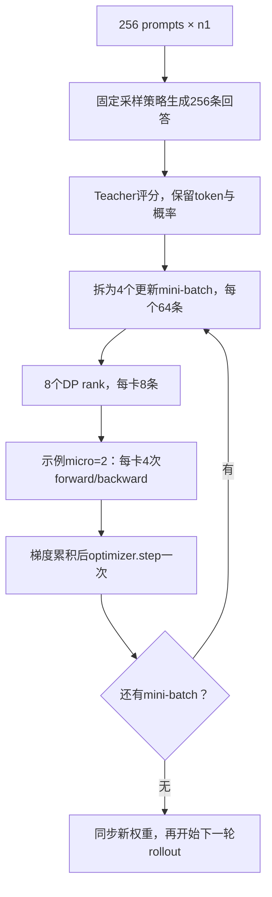
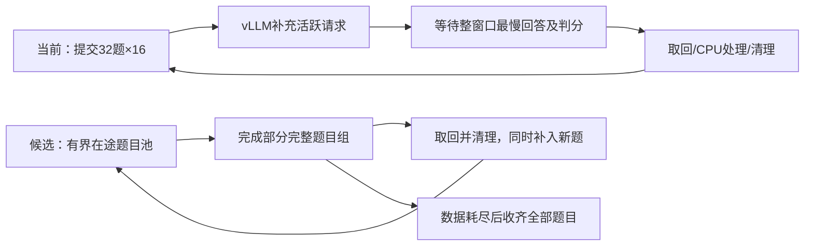

# 批量大小与 GPU 利用率调优

符号遵循[统一约定](../符号约定.md)；代码字段、论文原名与历史数据键保留原样。

本页统一维护 RLVR/OPD 的 batch 调研、GPU 利用率解释和调优顺序。优化目标是在相同质量与工作预算下缩短训练时间；显存容量用于约束可行配置，GPU busy 用于定位等待，两者都不能单独作为验收目标。八卡调度架构见[运行与架构](2026-10-21-共享八卡运行与架构.md)，已实现指标及 W&B 路径见[指标与验收](2026-10-21-指标与验收.md)，4+4/shared 实测数值见[速度与显存对照](measurements/2026-10-21-八卡历史运行对照.md)。

## 1. Batch 的口径与更新次数

| 记号 | 名称 | 控制的工作 | 当前 math 配方 |
| --- | --- | --- | --- |
| $B_{\rm prompt}$ | prompt batch | 一轮收集的题目数 | 64 |
| $n_{\rm resp}$ | 每题采样数 | 一个 prompt 产生的回答数 | 1 |
| $B_{\rm rollout}=B_{\rm prompt}n_{\rm resp}$ | rollout batch | 一轮得到的回答数 | 64 |
| $B_{\rm mini}$ | 更新 mini-batch | 全部数据并行 rank 在一次 optimizer step 中消费的回答数 | 64 |
| $E_{\rm PPO}$ | 更新 epoch | 同一批回答遍历次数 | 1 |
| $B_{\rm micro}$ | 每卡 micro-batch | 一次 forward/backward 的回答数；动态分批时以 token 预算约束 | 动态，32768 tokens |
| $C_{\rm seq}$ | 推理活跃并发 | 一个 vLLM 引擎当前调度的序列数 | 上限 32，实际动态变化 |

若没有过滤、padding 或丢弃尾批，且 $B_{\rm rollout}$ 可被 $B_{\rm mini}$ 整除，每轮 rollout 的更新次数为：

$$
N=E_{\rm PPO}\frac{B_{\rm rollout}}{B_{\rm mini}}.
$$

固定 micro-batch、各卡处理量一致时，数据并行度 $G_{\rm DP}$、累积次数 $n_{\rm accum}$ 满足：

$$
B_{\rm mini}=G_{\rm DP}B_{\rm micro}n_{\rm accum},\qquad n_{\rm accum}=\frac{B_{\rm mini}}{G_{\rm DP}B_{\rm micro}}.
$$

$G_{\rm DP}$ 是数据并行度，不是包含 TP/PP/SP 的总设备数。当前 TP1、八卡数据并行时 $G_{\rm DP}=8$。Micro-batch 用于分割显存中的计算规模；梯度累积期间参数不变，完成整个更新 mini-batch 后才执行 optimizer step。把同一个 $B_{\rm mini}$ 拆成更多 micro-batch 不增加策略滞后，但会增加执行轮数。数学等价要求正确的样本/token 权重；不同长度 micro-batch 的平均 loss 不能无权平均。

当前 [V1 trainer](../../../../verl/trainer/ppo/v1/trainer_base.py) 将配置中的 `actor.ppo_mini_batch_size` 乘以 `rollout.n`，得到本页的 $B_{\rm mini}$。例如配置 mini32、n4 对应 128 条回答。FSDP 在拆分 micro-batch 前汇总全局 loss token 数；动态分批由长度和预算决定，不能从 `ppo_micro_batch_size_per_gpu=1` 推断实际始终每次一条。



图中后续 mini-batch 使用的是先前采样策略的回答。它与每更新 64 条就重新采样的流程不同。相关 advantage 刷新、IS 和固定 prefix 的目标仅在[目标推导](../opd-objective/2026-10-21-固定前缀下的优势估计与重要性采样.md)维护。

## 2. RLVR 与 OPD 的公开设置

### 2.1 RLVR

表中统一以回答数表示 $B_{\rm rollout},B_{\rm mini}$。公开配方是参考点，不是八卡通用推荐值。

| 工作 | $B_{\rm prompt}$ | $n_{\rm resp}$ | $B_{\rm rollout}$ | $B_{\rm mini}$ | 更新方式与长度 |
| --- | --- | --- | --- | --- | --- |
| DeepSeek-R1-Zero，论文 v2 | 512，按 8192/16 推算 | 16 | 8192 | 512 | 一遍，16 次更新；输出上限 32K，后期 64K |
| DAPO | 保留 512 个题目组 | 16 | 保留 8192 | 512 | 16 次更新；输出上限 20480，含 4096 软惩罚区间 |
| Dr. GRPO 作者八卡示例 | 128 | 8 | 1024 | 128 | 按公开 Oat 配方推算 8 次更新；一遍，输出上限 3000 |

R1 的数值来自后续 v2 披露，不能倒推为初版已公布的设置。[^r1] DAPO 的当前公开脚本配置 `train_prompt_bsz=512`、`n_resp_per_prompt=16`、`train_prompt_mini_bsz=32`，展开后一次更新 512 条；动态过滤使实际生成量可能超过保留量，当前配方的 `gen_prompt_bsz` 为 1536。[^dapo] [^dapo-code] Dr. GRPO 的八卡示例使用 Qwen2.5-Math-1.5B 和 8×A100，`train_batch_size=128`、每卡 micro1、`rollout_batch_size=128`、`num_samples=8`；不同框架的同名字段不能直接横向相乘。[^dr-grpo] [^dr-grpo-code]

### 2.2 OPD

| 工作或配方 | 收集与更新设置 | 对照边界 |
| --- | --- | --- |
| GKD，ICLR2024 | GSM8K、XSum 训练 batch32 | T5 实验输出上限分别 320、64；短输出、分布蒸馏，不代表长推理预算 |
| MiniLLM，ICLR2024 | 一次收集 256 条；更新 mini64；同批遍历 4 遍，即 16 次更新 | 最大长度 512，算法与当前 sampled-token 配置不同 |
| Thinking Machines 原文默认/个性化 | 64 prompts×4 回答=256 条 | sampled-token teacher 监督；不能等同于数学推理配方 |
| Thinking Machines 当前数学配方 | 512 prompts×默认 4 回答=2048 条；默认`num_substeps=1` | 当前 LoRA 配方，输出 16K；原文模型已更新 |
| 2610.11291 主实验 | 128 prompts×1 回答；global batch128 | sampled-token reverse KL；thinking 训练上限 16K |
| NeMo RL 默认数学蒸馏 | 128 prompts×1 回答；更新 global batch64 | 两次更新；默认 teacher top64 和 mixed KL |
| NeMo RL 32B→1.7B 单机八卡 | 64 prompts×1 回答；更新 global batch32 | 两次更新；reverse KL、top-k 分布蒸馏 |

GKD 和 MiniLLM 的数字分别取附录 A 和 B.1。[^gkd] [^minillm] Thinking Machines 原文与当前 cookbook 分开记录：当前数学启动命令指定 512 组，代码默认每组 4 条，不能把 512 误读为回答总数。[^tml] [^tinker-recipe] [^tinker-code] 2610.11291 明确写 128 题、每题一条；其模型配对、teacher/student 重合度和离线算法结论见[上游与论文基线](2026-10-21-上游实现与论文基线.md#论文-261011291-的设置与比较边界)。[^semi-opd] NeMo 配置中的收集量与训练 global batch 独立，worker 按 global batch 循环并执行 optimizer step。[^nemo-config] [^nemo-eight] [^nemo-worker]

### 2.3 算法上的选择依据

二元正确性奖励的组内相对优势依赖组内差异。忽略其他奖励项，若单次成功概率为 $p_{\rm succ}$、同题独立采样 $n_{\rm resp}$ 次，同时出现成功和失败的概率为：

$$
p_{\rm mixed}=1-p_{\rm succ}^{n_{\rm resp}}-(1-p_{\rm succ})^{n_{\rm resp}}.
$$

例如 $p_{\rm succ}=0.1$ 时，$n_{\rm resp}=2,8,16$ 对应 18.0%、57.0%、81.5%。总回答预算固定时，增大 $n_{\rm resp}$ 会减少不同题目的覆盖。零方差过滤还能让“生成量”和“有效更新量”分离。这个简化模型只解释二元任务奖励的组内差异，不表示所有 RLVR 都必须使用 GRPO 或多回答。

当前 OPD 直接使用 teacher 的 token 级反馈，$n_{\rm resp}=1$也有训练信号；全部回答最终都错不意味着 token 优势为零。因此扩容实验先增加 $B_{\rm prompt}$、保持 $n_{\rm resp}=1$，再单独研究同题多次采样。密集 token 反馈仍有轨迹内相关性，64 条回答的约 40 万总 token 不能当作 40 万个独立样本。Thinking Machines 也将小 batch 有效性与较强初始化关联，teacher/student 差距较大的推理实验需要更多样本。[^tml]

增加 $B_{\rm mini}$ 会降低每次更新的噪声，也会减少相同样本预算下的更新次数。增加 $B_{\rm rollout}$、保持 $B_{\rm mini}$ 则增加同一采样策略上的更新次数。两者都需要评估学习效果，不能只看 GPU 吞吐。

### 2.4 Batch 扩大的研究结论

| 研究 | 已报告结果 | 使用边界 |
| --- | --- | --- |
| When Do Larger Batches Help Scale LLM Reinforcement Learning? | 固定硬件上，学习率重调后可改善达标时间；不重调的对照可在吞吐更高时仍更慢 | 2026 预印本；报告的最大 29% 达标时间改善不是本项目预测 |
| Two Clocks | 主实验每题 8 条、每批 8 次更新；rollout512 至 8192 条，较大 batch 在其缩放规则下可损害样本效率 | 近期预印本，主要数学任务；不能直接作为 OPD 定律 |
| ScaleRL | 大 batch 可能早期较慢、长期性能上限更高；固定总量下每题 8/16/24/32 的部分对照差异较小 | 大规模预算与本项目八卡短训不同；不据此直接选最大 batch |

这些结果分别讨论了学习率、更新次数和预算对结论的影响。[^batch-scaling] [^two-clocks] [^scalerl] PPO 的 batch 变化还可能同时改变行为策略修正和近端更新约束；已有工作通过区分两种策略研究 batch 不变性。[^ppo-invariance]

以参与训练的新回答数 $n_{\rm new}$ 为统一计数，定义达到同一验证目标所需数量 $n_{\rm new}^*$，端到端有效吞吐 $v_{\rm eff}=n_{\rm new}^*/\mathsf t$，则：

$$
\mathsf t=\frac{n_{\rm new}^*}{v_{\rm eff}},\qquad
\frac{\mathsf t_2}{\mathsf t_1}=\frac{n_{\rm new,2}^*/n_{\rm new,1}^*}{v_{\rm eff,2}/v_{\rm eff,1}}.
$$

吞吐的时间分母应包含被过滤样本的生成、teacher 和更新成本；按完整作业评估时还应包含相同预算的验证。回答长度变化时同时报告生成 token、训练 token 和墙钟。仅比较相同 optimizer step 数，会让大 batch 实验获得更多数据。

## 3. 显存、GPU busy 与阶段瓶颈

NVML GPU utilization 表示采样窗口内有 kernel 执行的时间比例；memory utilization 表示显存读写活跃时间比例。两者均不等同于峰值 FLOPs 或 HBM 带宽利用率。Nsight Compute 的计算/内存吞吐指标才能进一步区分 kernel 内部瓶颈。[^nvml] [^nsight]

| 调整 | 容量影响 | 时间影响 |
| --- | --- | --- |
| 增大 actor micro-batch/token预算 | 激活和临时张量增多 | 可能减少执行轮数、提高矩阵效率；收益有平台 |
| micro 不变，增加梯度累积 | 激活峰值通常不按次数增长；全批数据仍有存储开销 | 总计算增加，不保证单位时间效率改善 |
| 增加实际 rollout 并发 | 活跃 KV 增加 | 小并发区间可能提高权重复用和吞吐 |
| 只增加`max_num_seqs` | 依引擎预分配而异 | 请求不足时没有额外工作可调度 |
| 提高`gpu_memory_utilization` | 增大引擎预算/KV 池 | 不会直接提高 GPU busy；容量本来足够时可能无收益 |

普通 decode 每条活跃序列每轮通常处理一个新 token。`max_num_batched_tokens=8192`约束本轮处理的新 token，不是全部历史 KV 长度之和。Prefill 可并行处理多个已有 token，chunked prefill 可与 decode 混合调度。[^vllm]

历史A800对照均为eager，共享池未获得整步加速；后续H800本机decode、完整训练和验证子集已确认编译/Graph收益。数字与证据边界统一见[八卡历史对照](measurements/2026-10-21-八卡历史运行对照.md)和[本机实测](measurements/2026-10-21-本机训练与验证优化.md)。

GPU 持续忙碌与计算高效需要分开验证。CUDA Graph 可减少重复 kernel 发射成本；更大的实际 batch 可改善计算规模和权重复用；窗口末尾没有新请求时还会出现供给不足。Graph 本身也有 capture 成本和常驻内存，必须比较预热后的无 profiler 计时。[^cuda-graph]

## 4. 调试顺序：先统计，再短 trace，再做单变量对照

第4节保留可复用诊断入口；eager/Graph与短trace已完成，不再是待办。实验数值集中到[本机实测](measurements/2026-10-21-本机训练与验证优化.md)。当前待测优先级以第5节为准。

### 4.1 恢复轻量引擎统计

保留原有 GPU、模型、数据和输出目录设置，在领域脚本后追加：

```bash
actor_rollout_ref.rollout.disable_log_stats=False \
++ray_kwargs.ray_init.runtime_env.env_vars.VLLM_LOGGING_LEVEL=INFO
```

`disable_log_stats=False`开启统计，`INFO`允许周期日志输出。使用 Ray runtime environment 明确覆盖默认 WARN；设置需要在新启动进程中生效。短诊断可在 driver 启动前设置`RAY_DEDUP_LOGS=0`，保留不同引擎日志。常规训练的已实现性能标量仍默认采集，无需新增`OPD_METRICS`开关。[^vllm-metrics]

| 观测 | 后续动作 |
| --- | --- |
| Running 低、Waiting 接近 0、KV 使用率低 | 检查上游请求供给；单纯提高并发上限无效 |
| Running 顶到 max_num_seqs、Waiting 持续非零、KV 有余量 | 单测并发上限 |
| KV 接近满或出现 preemption | 调整容量、并发、长度；不能把缺测当作零抢占 |
| 有足够 Running 但 GPU busy 低 | 采集 decode trace，区分 kernel 间隙、主机等待与 GPU 工作量 |

这些开关恢复 console 统计，不会自动新增 W&B 曲线。已有 vLLM server `snapshot()`可读取 Running/Waiting/KV，后续若接入 W&B 应复用统一 logger；不先增加常驻全量 trace 或逐 token 日志。Worker 的统计不能等同于 ReplayBuffer 题目组计数。

### 4.2 采集稳态 decode 短 trace

先确认真实模型能生成，再在预热之后单独采集。优先使用 vLLM 已有 Torch profiler：跳过前 32 个引擎迭代，记录后 40 个迭代，关闭 stack/shape/memory 和 frontend profiling 以控制开销。迭代不是严格的输出 token 编号；固定短 prompt、无新增请求的诊断中，这段通常位于 decode，仍需检查 trace 的实际操作。[^vllm-profiler]

trace 验收必须确认存在 CUDA kernel 事件，而不只是 CPU 调用。Torch profiler 使用 CUPTI，环境中的 NVTX 注入器可能提前占用 subscriber；仓库已在 Torch profiler 路径处理该问题，独立诊断也设置不可加载的`NVTX_INJECTION64_PATH`。查看 GPU kernel 之间的空白、CUDA API 等待、同步和采样开销；只有需要 kernel 内部带宽/计算计数时，再使用 Nsight Compute。不要把 profiler 中的绝对耗时用于正式吞吐对照。

### 4.3 固定 checkpoint 的执行效率矩阵

| 顺序 | 保持条件 | 唯一主要变化 | 判断 |
| --- | --- | --- | --- |
| A | 当前 batch64、长度、采样、TP1 | 恢复统计、取得 eager trace | 得到可解释的基线 |
| B | 与 A 相同工作量 | `ROLLOUT_ENFORCE_EAGER=False` | 确认编译/Graph 实际生效，比较稳态生成耗时 |
| C | 固定 checkpoint、使用 B 执行模式 | rollout 回答数 64→128→256 | 找到吞吐收益开始减弱的并发区间 |
| D | 更新 global batch 固定 | actor token 预算 32768→49152→65536 | 比较 update 时间与峰值；数值是待测候选 |
| E | 验证 checkpoint、题目与 n 固定 | 有界跨窗口持续投喂 | 减少尾部等待；属于后续调度实现 |

`enforce_eager=False`会同时恢复默认编译优化和 CUDA Graph，因此 B 是执行模式联合对照，不能把全部差值归因于 Graph 单一机制。没有 KV 压力前不先提高显存预留。当前共享模式必须保留必要 offload，且不直接启用未支持的 fused 路径。激活重算开关可以在独立对照中测试，须记录峰值；更大模型与并行策略见[模型扩展](2026-10-21-调度备选与模型扩展.md)。

### 4.4 学习效果矩阵

执行效率通过后，再比较算法设置。初始保持 $n_{\rm resp}=1,E_{\rm PPO}=1$、长度/采样/loss 不变：

| 实验 | $B_{\rm prompt}$ | $B_{\rm mini}$，回答数 | $N$ | 解释 |
| --- | --- | --- | --- | --- |
| 基线 | 64 | 64 | 1 | 当前设置 |
| 大更新 batch | 128 | 128 | 1 | 优先候选；改变更新方差与频率 |
| 大收集 batch | 128 | 64 | 2 | 独立对照；第二次更新消费旧策略样本 |
| 后续扩展 | 256 | 64 或 128 | 4 或 2 | 仅在吞吐继续改善且策略偏移可接受时测试 |

领域脚本默认将`TRAIN_BATCH_SIZE`同时传给 prompt batch 和更新 mini-batch，因此只改为 128 得到“大更新 batch”。可用末尾 Hydra override 单独覆盖`actor_rollout_ref.actor.ppo_mini_batch_size=64`，得到“大收集 batch”；无需先改框架。先以 lr1e-6 做对照，再把平方根缩放作为学习率候选，不能视为 OPD 定律。

验证频率按累计样本对齐：当前 64 题×20 步=1280 题，batch128 应每 10 步验证，batch256 每 5 步验证。保存和学习率调度也应明确按 rollout step、optimizer step 还是累计 token 计数。比较相同样本/token 预算的质量和包含验证的 GPU 小时，不把减少验证次数记成训练加速。


## 5. 验证rollout调度优化

### 训练预算与验证预算分开

`prompt/mini64→128→256`属于学习配置实验，改变一次更新的数据量和同一数据预算下的更新次数。当前默认仍为64/64。验证窗口只控制同一个冻结checkpoint下的请求供给，没有optimizer更新；优先优化验证时，不需要改训练prompt、mini、学习率或epochs。

Global描述跨DP rank的统计范围，mini描述一次optimizer update所使用的数据，两者不冲突。本页的$B_{\rm mini}$就是全局更新mini-batch。NeMo的`train_global_batch_size=64`对应$B_{\rm mini}=64$，其每轮收集量可以是128；R1每轮8192回答与每次更新512也不能混为一项。2610.11291的128题、n1、global batch128则是$B_{\rm prompt}=B_{\rm rollout}=B_{\rm mini}=128$。论文设置见第2节；本仓配置mini先乘rollout.n后得到$B_{\rm mini}$。

以当前n1、E1为例，相同6400条新回答，64/64对应100轮采样和100次更新，128/128对应50和50，256/256对应25和25；256/64对应25轮采样和100次更新，后续mini使用较早策略的样本。调整micro只改变计算拆分，不能消除以上算法变化。

### 请求数、token预算与显存

| 层次 | 当前控制项 | 单位与作用 |
| --- | --- | --- |
| 训练收集 | `data.train_batch_size=64`、`rollout.n=1` | 题目数和每题回答数，产生本轮轨迹 |
| Actor更新 | `ppo_mini_batch_size=64`、`ppo_epochs=1` | 一次全局更新的样本量及重复使用次数 |
| 每卡forward/backward | 动态micro预算32768 | 完整prompt＋response的有效token，按长度拆分并累积梯度；静态micro1不决定当前切分 |
| 验证提交 | `VAL_BATCH_SIZE=32`、`VAL_N=16` | 每窗口512条请求，与训练mini/micro无关 |
| 推理并发 | 每副本`max_num_seqs=32` | 活跃序列上限，八个TP1副本合计最多256 |
| 推理迭代 | 每副本`max_num_batched_tokens=8192` | 单次调度处理的新token；prefill可以占多token，普通decode每条通常占1token |
| 推理容量 | `gpu_memory_utilization=0.5` | vLLM预算/KV空间，不是actor显存上限或GPU busy目标 |

例如32条纯decode请求一轮通常只处理约32个新token；把8192改成16384不会让每条回答每轮自动生成两个token。已有2万个历史token主要增加attention读取KV的工作，而不占2万个“新token”预算。当前训练prompt平均约100token、回答数千token，decode占主导，先增加请求供给比盲目扩大prefill预算更有依据。训练和验证共用引擎级并发、token预算、Graph与KV设置；验证独立覆盖n、温度和response长度。[^vllm]

Actor的32768 token预算与vLLM的8192预算含义不同。以DP8、mini64、每条完整序列6300token为例，每rank8条共50400token，可拆两个4条micro；mini128则每rank16条，可拆四个4条micro，末尾仍一次optimizer.step。真实拆分按长度平衡并协调DP上的micro数量；不是固定accumulation次数。激活受micro控制，梯度缓冲、模型状态、通信和输出头另占空间。

单份BF16 dense logits在32768token、151936词表时约9.27GiB，token预算翻倍后约18.55GiB；这不是总峰值公式，fused/chunked/dtype会改变实际物化方式。更大micro需独立测update时间和显存，KV及模型扩展估算见[容量边界](2026-10-21-调度备选与模型扩展.md#当前-gqa-架构的-kv-预算)。

### 当前等待点与TQ的职责

两套本地代码的全局路由均采用较少在途请求优先并支持sticky session；One-Shot通过等待并拼接DataProto返回结果，本仓通过TQ发布完成状态和轨迹。TQ不参与逐token decode，引擎内部仍由vLLM动态组batch。CPU AgentLoop worker收到的chunk也不是固定GPU batch。

差异在外层：历史One-Shot实际run的`val_batch_size=null`，一次提交570×16；我们当前每32题等待整窗口完成，再取回、padding、解码、清理，才提交下一窗口。ReplayBuffer默认每2秒轮询完成状态。小窗口会反复进入队列耗尽后的长尾；这不代表TQ要求使用小窗口。



运行计数支持优先处理供给与长尾：本机窗口32的生成采样中约24%的时点四卡活跃请求合计少于16，约66%的时点等待队列全空；未观测到一副本完全闲置同时另一副本仍有waiting的采样。具体分母、样本数与限制见[引擎队列实测](measurements/2026-10-21-本机训练与验证优化.md#验证队列与并发退化)。它们是采样比例，不是连续GPU时间积分。

### 推荐的下一组八卡实验

当前没有空闲卡时，仅确定以下待测顺序，不将候选值改为默认：

| 顺序 | 保持不变 | 比较项 | 判断依据 |
| --- | --- | --- | --- |
| 1 | 同checkpoint、同题目、n16、长度31744、Graph、并发32/token8192/memory0.5 | 验证窗口32/64/128 | 完整testing、实际输出TPS、队列排空和长尾；至少128题，最终570题 |
| 2 | 固定足量工作队列 | 并发32/64 | 运行中是否长期顶到上限，TPS是否增加；观察KV/preemption |
| 3 | 选定窗口与并发 | token预算8192/16384 | Prefill积压与混跑是否改善；长decode为主时收益可能较小 |
| 4 | 同评测预算 | 有界持续投喂 | 减少反复窗口barrier，并控制CPU/TQ在途结果量 |
| 5 | 已定位的收尾路径 | 少传验证不消费的字段、避免全窗口padding、完成通知/轮询 | 先区分verifier、TQ、CPU解码和sleep，再改具体实现 |

窗口32/64/128/256/570分别提交512/1024/2048/4096/9120条请求，570题对应18/9/5/3/1个窗口。等待请求不会全部同时占用活跃KV，但完成轨迹、token张量和CPU输出会积累；9120×31744的int64 response padding单份约2.16GiB。全量提交可作参照，不直接作为默认。

32题子集无法区分窗口64与128。运行应排除首次编译影响，同时报告整个作业含启动的墙钟；自然停止生成的总token会变，需报告输出token总量/总时间，重复对照后再确定默认值。上一轮窗口32下并发64未明显缩短总时间，不排除在持续供给条件下有收益。

### 持续投喂的最小实现边界

优先复用`trainer_base.py::_validate()`与既有TQ异步发布，维护有上限的inflight prompt集合，完整题目组结束后取回并补入新题。消费以实际UID为准，完成全部570×16后才计算完整指标；失败、重复、漏项不能靠提前结束掩盖。权重在验证期间固定；该方案不引入训练off-policy预生成。

原结果处理可以抽成一个小helper，保持原聚合、verifier与输出格式。若减少TQ字段，再局部修改`agent_loop_tq.py::_agent_loop_postprocess()`，先核实每个消费者；没有证据前不重写路由器或TQ底层。

计时也需适配：现有`pipeline_metrics.py`只接受一个完整single-turn submission，验证汇总对非重叠窗口跨度求和。持续投喂后不能将相互重叠的窗口跨度相加，应以整个testing墙钟为主，按实际提交归集完整指标或计算覆盖区间。不能为了保留曲线而把缺失完整性的跨度当有效值。

测试覆盖完整UID×session计数、乱序完成、最后部分窗口、慢请求、失败组、TQ清理和重叠计时。GPU验证比较TPS、完整评测工作量和输出完整性。随机顺序与执行形状变化可能改变逐token结果，预算与目标相同不等于浮点逐位相同。

## 6. 已落地默认值与参数试验

当前默认及相对`565a1fda2`的变化只在[运行与架构](2026-10-21-共享八卡运行与架构.md#从565a1fda2到5b3ccdd30的脚本差异)维护。训练prompt/mini仍为64/64，batch128仅完成短性能试验；micro预算、并发32、调度token8192、显存比例0.5均未提高。

若独立研究训练batch128，应同步设mini128，并按累计样本对齐验证频率20→10、保存频率50→25。若只扩大收集量而保留mini64，后续更新使用同一采样策略的旧回答，是另一组学习实验。完整配置仍由既有领域脚本和末尾Hydra参数表达，不维护新的run.sh。

FSDP1/2的区别主要在训练状态表示、分片、内存生命周期与通信控制。FSDP2用DTensor表示逐参数分片，FSDP1使用flat parameter；两者都需要为计算取得完整模块参数。它影响actor、old log-prob、teacher和同步，不逐token参与vLLM decode。官方说明强调更明确的内存管理与相近吞吐，不能把切换版本当作倍数加速保证。我们最初4+4已经是FSDP2，One-Shot才是FSDP1对照。[^fsdp2]

### 参考文献

[^r1]: DeepSeek-AI. DeepSeek-R1, v2. arXiv 2026. [§2.1 及附录 B.4](https://arxiv.org/html/2501.12948v2)。
[^dapo]: Yu et al. DAPO: An Open-Source LLM Reinforcement Learning System at Scale. arXiv 2025. [论文](https://arxiv.org/html/2503.14476v2)。
[^dapo-code]: verl contributors. DAPO Qwen2.5-32B recipe, 2026-10-21 读取。[公开脚本](https://github.com/verl-project/verl-recipe/blob/main/dapo/run_dapo_qwen2.5_32b.sh)。
[^dr-grpo]: Liu et al. Understanding R1-Zero-Like Training: A Critical Perspective. COLM 2025. [论文](https://arxiv.org/pdf/2503.20783)。
[^dr-grpo-code]: SAIL-SG. Dr. GRPO example, commit dfca49dd. [作者代码](https://github.com/sail-sg/understand-r1-zero/blob/dfca49dd460ee7cc8e4a5a162c876a7fd6993b87/README.md#training)。
[^gkd]: Agarwal et al. On-Policy Distillation of Language Models: Learning from Self-Generated Mistakes. ICLR 2024. [附录 A](https://arxiv.org/pdf/2306.13649)。
[^minillm]: Gu et al. MiniLLM: On-Policy Distillation of Large Language Models. ICLR 2024. [附录 B.1](https://arxiv.org/pdf/2306.08543)。
[^tml]: Kevin Lu and Thinking Machines Lab. On-Policy Distillation. 2025. [原文](https://thinkingmachines.ai/blog/on-policy-distillation/)。
[^tinker-recipe]: Thinking Machines Lab. Model Distillation, 2026-10-21 读取。[当前配方](https://tinker-docs.thinkingmachines.ai/cookbook/recipes/distillation/)。
[^tinker-code]: Thinking Machines Lab. On-policy recipe, commit ad3b5c54. [group_size 与 num_substeps](https://github.com/thinking-machines-lab/tinker-cookbook/blob/ad3b5c541cd383b05d1c301e8ccc2d9cc0c5f774/tinker_cookbook/recipes/distillation/on_policy_distillation.py)。
[^semi-opd]: Zhao et al. When Do We Need On-Policy Distillation? Distilling on Offline Student Rollouts Is Often Better. arXiv 2026. [附录 A](https://arxiv.org/pdf/2610.11291)。
[^nemo-config]: NVIDIA. NeMo RL distillation_math, commit d1e23adb. [默认配置](https://github.com/NVIDIA-NeMo/RL/blob/d1e23adb3df33dedd0e9c6edd9482430a2e5e8ad/examples/configs/distillation_math.yaml)。
[^nemo-eight]: NVIDIA. NeMo RL 32B to 1.7B 1n8g, commit d1e23adb. [八卡配置](https://github.com/NVIDIA-NeMo/RL/blob/d1e23adb3df33dedd0e9c6edd9482430a2e5e8ad/examples/configs/recipes/llm/distillation-qwen3-32b-to-1.7b-base-1n8g-automodel.v1.yaml)。
[^nemo-worker]: NVIDIA. AutomodelPolicyWorker.train, commit d1e23adb. [更新循环](https://github.com/NVIDIA-NeMo/RL/blob/d1e23adb3df33dedd0e9c6edd9482430a2e5e8ad/nemo_rl/models/policy/workers/automodel_policy_worker.py#L467)。
[^batch-scaling]: Li et al. When Do Larger Batches Help Scale LLM Reinforcement Learning? arXiv 2026. [论文](https://arxiv.org/html/2608.29296v1)。
[^two-clocks]: Two Clocks: Why Larger Rollout Batches Learn Slower but Fail on Schedule in Reinforcement Learning with Verifiable Rewards. arXiv 2026. [论文](https://arxiv.org/html/2610.18853v1)。
[^scalerl]: Khatri et al. The Art of Scaling Reinforcement Learning Compute for LLMs. ICLR 2026. [论文](https://arxiv.org/pdf/2510.13786)。
[^ppo-invariance]: Hilton, Cobbe and Schulman. Batch Size-Invariance for Policy Optimization. NeurIPS 2022. [论文](https://arxiv.org/abs/2110.00641)。
[^nvml]: NVIDIA. NVML Utilization. [定义](https://docs.nvidia.com/deploy/archive/R470/nvml-api/structnvmlUtilization__t.html)。
[^nsight]: NVIDIA. Nsight Compute Profiling Guide. [计算与内存吞吐](https://docs.nvidia.com/nsight-compute/ProfilingGuide/index.html)。
[^cuda-graph]: NVIDIA. CUDA Graph Best Practice. [原理](https://docs.nvidia.com/dl-cuda-graph/cuda-graph-basics/cuda-graph.html)。
[^vllm]: vLLM contributors. Optimization and Tuning, v0.25.1. [官方调优说明](https://docs.vllm.ai/en/v0.25.1/configuration/optimization/)。
[^vllm-metrics]: vLLM contributors. Metrics, v0.25.1. [官方指标说明](https://docs.vllm.ai/en/v0.25.1/design/metrics/)。
[^vllm-profiler]: vLLM contributors. ProfilerConfig, v0.25.1. [延迟与窗口配置](https://github.com/vllm-project/vllm/blob/v0.25.1/vllm/config/profiler.py)。
[^fsdp2]: PyTorch contributors. FSDP2 fully_shard，PyTorch2.11. [官方说明](https://docs.pytorch.org/docs/2.11/distributed.fsdp.fully_shard.html)。
