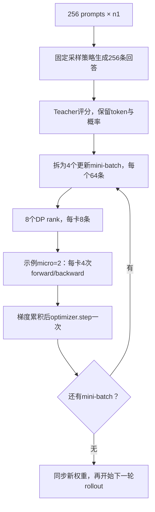

# 批量大小与 GPU 利用率调优

本页统一维护 RLVR/OPD 的 batch 调研、GPU 利用率解释和调优顺序。优化目标是在相同质量与工作预算下缩短训练时间；显存容量用于约束可行配置，GPU busy 用于定位等待，两者都不能单独作为验收目标。八卡调度架构见[运行与架构](2026-10-21-共享八卡运行与架构.md)，已实现指标及 W&B 路径见[指标与验收](2026-10-21-指标与验收.md)，4+4/shared 实测数值见[速度与显存对照](../2026-10-21-训练管线速度与显存对照.md)。

## 1. Batch 的口径与更新次数

| 记号 | 名称 | 控制的工作 | 当前 math 配方 |
| --- | --- | --- | --- |
| $P$ | prompt batch | 一轮收集的题目数 | 64 |
| $G$ | 每题采样数 | 一个 prompt 产生的回答数 | 1 |
| $R=PG$ | rollout batch | 一轮得到的回答数 | 64 |
| $M$ | 更新 mini-batch | 全部数据并行 rank 在一次 optimizer step 中消费的回答数 | 64 |
| $E$ | 更新 epoch | 同一批回答遍历次数 | 1 |
| $m$ | 每卡 micro-batch | 一次 forward/backward 的回答数；动态分批时以 token 预算约束 | 动态，32768 tokens |
| $C$ | 推理活跃并发 | 一个 vLLM 引擎当前调度的序列数 | 上限32，实际动态变化 |

若没有过滤、padding 或丢弃尾批，且 $R$ 可被 $M$ 整除，每轮 rollout 的更新次数为：

$$
K=E\frac{R}{M}.
$$

固定 micro-batch、各卡处理量一致时，数据并行度 $D$、累积次数 $A$ 满足：

$$
M=DmA,\qquad A=\frac{M}{Dm}.
$$

$D$ 是数据并行度，不是包含 TP/PP/SP 的总设备数。当前 TP1、八卡数据并行时 $D=8$。Micro-batch 用于分割显存中的计算规模；梯度累积期间参数不变，完成整个更新 mini-batch 后才执行 optimizer step。把同一个 $M$ 拆成更多 micro-batch 不增加策略滞后，但会增加执行轮数。数学等价要求正确的样本/token 权重；不同长度 micro-batch 的平均 loss 不能无权平均。

当前 [V1 trainer](../../../../verl/trainer/ppo/v1/trainer_base.py) 将配置中的 `actor.ppo_mini_batch_size` 乘以 `rollout.n`，得到本页的 $M$。例如配置 mini32、n4 对应128条回答。FSDP 在拆分 micro-batch 前汇总全局 loss token 数；动态分批由长度和预算决定，不能从 `ppo_micro_batch_size_per_gpu=1` 推断实际始终每次一条。



图中后续 mini-batch 使用的是先前采样策略的回答。它与每更新64条就重新采样的流程不同。相关 advantage 刷新、IS 和固定 prefix 的目标仅在[目标推导](../opd-objective/2026-10-20-固定前缀下的优势估计与重要性采样.md)维护。

## 2. RLVR 与 OPD 的公开设置

### 2.1 RLVR

表中统一以回答数表示 $R,M$。公开配方是参考点，不是八卡通用推荐值。

| 工作 | $P$ | $G$ | $R$ | $M$ | 更新方式与长度 |
| --- | --- | --- | --- | --- | --- |
| DeepSeek-R1-Zero，论文v2 | 512，按8192/16推算 | 16 | 8192 | 512 | 一遍，16次更新；输出上限32K，后期64K |
| DAPO | 保留512个题目组 | 16 | 保留8192 | 512 | 16次更新；输出上限20480，含4096软惩罚区间 |
| Dr. GRPO 作者八卡示例 | 128 | 8 | 1024 | 128 | 按公开Oat配方推算8次更新；一遍，输出上限3000 |

R1 的数值来自后续 v2 披露，不能倒推为初版已公布的设置。[^r1] DAPO 的当前公开脚本配置 `train_prompt_bsz=512`、`n_resp_per_prompt=16`、`train_prompt_mini_bsz=32`，展开后一次更新512条；动态过滤使实际生成量可能超过保留量，当前配方的 `gen_prompt_bsz` 为1536。[^dapo] [^dapo-code] Dr. GRPO 的八卡示例使用 Qwen2.5-Math-1.5B 和8×A100，`train_batch_size=128`、每卡micro1、`rollout_batch_size=128`、`num_samples=8`；不同框架的同名字段不能直接横向相乘。[^dr-grpo] [^dr-grpo-code]

### 2.2 OPD

| 工作或配方 | 收集与更新设置 | 对照边界 |
| --- | --- | --- |
| GKD，ICLR2024 | GSM8K、XSum训练batch32 | T5实验输出上限分别320、64；短输出、分布蒸馏，不代表长推理预算 |
| MiniLLM，ICLR2024 | 一次收集256条；更新mini64；同批遍历4遍，即16次更新 | 最大长度512，算法与当前sampled-token配置不同 |
| Thinking Machines原文默认/个性化 | 64 prompts×4回答=256条 | sampled-token teacher监督；不能等同于数学推理配方 |
| Thinking Machines当前数学配方 | 512 prompts×默认4回答=2048条；默认`num_substeps=1` | 当前LoRA配方，输出16K；原文模型已更新 |
| 2610.11291主实验 | 128 prompts×1回答；global batch128 | sampled-token reverse KL；thinking训练上限16K |
| NeMo RL默认数学蒸馏 | 128 prompts×1回答；更新global batch64 | 两次更新；默认teacher top64和mixed KL |
| NeMo RL 32B→1.7B单机八卡 | 64 prompts×1回答；更新global batch32 | 两次更新；reverse KL、top-k分布蒸馏 |

GKD 和 MiniLLM 的数字分别取附录A和B.1。[^gkd] [^minillm] Thinking Machines 原文与当前 cookbook 分开记录：当前数学启动命令指定512组，代码默认每组4条，不能把512误读为回答总数。[^tml] [^tinker-recipe] [^tinker-code] 2610.11291 明确写128题、每题一条；其模型配对、teacher/student重合度和离线算法结论见[上游与论文基线](2026-10-21-上游实现与论文基线.md#论文-261011291-的设置与比较边界)。[^semi-opd] NeMo 配置中的收集量与训练global batch独立，worker按global batch循环并执行optimizer step。[^nemo-config] [^nemo-eight] [^nemo-worker]

### 2.3 算法上的选择依据

二元正确性奖励的组内相对优势依赖组内差异。忽略其他奖励项，若单次成功概率为 $p$、同题独立采样 $G$ 次，同时出现成功和失败的概率为：

$$
P_{\mathrm{mixed}}=1-p^G-(1-p)^G.
$$

例如 $p=0.1$ 时，$G=2,8,16$ 对应18.0%、57.0%、81.5%。总回答预算固定时，增大 $G$ 会减少不同题目的覆盖。零方差过滤还能让“生成量”和“有效更新量”分离。这个简化模型只解释二元任务奖励的组内差异，不表示所有RLVR都必须使用GRPO或多回答。

当前OPD直接使用teacher的token级反馈，$G=1$也有训练信号；全部回答最终都错不意味着token优势为零。因此扩容实验先增加 $P$、保持 $G=1$，再单独研究同题多次采样。密集token反馈仍有轨迹内相关性，64条回答的约40万总token不能当作40万个独立样本。Thinking Machines 也将小batch有效性与较强初始化关联，teacher/student差距较大的推理实验需要更多样本。[^tml]

增加 $M$ 会降低每次更新的噪声，也会减少相同样本预算下的更新次数。增加 $R$、保持 $M$ 则增加同一采样策略上的更新次数。两者都需要评估学习效果，不能只看GPU吞吐。

### 2.4 Batch扩大的研究结论

| 研究 | 已报告结果 | 使用边界 |
| --- | --- | --- |
| When Do Larger Batches Help Scale LLM Reinforcement Learning? | 固定硬件上，学习率重调后可改善达标时间；不重调的对照可在吞吐更高时仍更慢 | 2026预印本；报告的最大29%达标时间改善不是本项目预测 |
| Two Clocks | 主实验每题8条、每批8次更新；rollout512至8192条，较大batch在其缩放规则下可损害样本效率 | 近期预印本，主要数学任务；不能直接作为OPD定律 |
| ScaleRL | 大batch可能早期较慢、长期性能上限更高；固定总量下每题8/16/24/32的部分对照差异较小 | 大规模预算与本项目八卡短训不同；不据此直接选最大batch |

这些结果分别讨论了学习率、更新次数和预算对结论的影响。[^batch-scaling] [^two-clocks] [^scalerl] PPO的batch变化还可能同时改变行为策略修正和近端更新约束；已有工作通过区分两种策略研究batch不变性。[^ppo-invariance]

以参与训练的新回答数 $N$ 为统一计数，定义达到同一验证目标所需数量 $N^*$，端到端有效吞吐 $q=N^*/T$，则：

$$
T=\frac{N^*}{q},\qquad
\frac{T_2}{T_1}=\frac{N_2^*/N_1^*}{q_2/q_1}.
$$

吞吐的时间分母应包含被过滤样本的生成、teacher和更新成本；按完整作业评估时还应包含相同预算的验证。回答长度变化时同时报告生成token、训练token和墙钟。仅比较相同optimizer step数，会让大batch实验获得更多数据。

## 3. 显存、GPU busy与阶段瓶颈

NVML GPU utilization表示采样窗口内有kernel执行的时间比例；memory utilization表示显存读写活跃时间比例。两者均不等同于峰值FLOPs或HBM带宽利用率。Nsight Compute的计算/内存吞吐指标才能进一步区分kernel内部瓶颈。[^nvml] [^nsight]

| 调整 | 容量影响 | 时间影响 |
| --- | --- | --- |
| 增大actor micro-batch/token预算 | 激活和临时张量增多 | 可能减少执行轮数、提高矩阵效率；收益有平台 |
| micro不变，增加梯度累积 | 激活峰值通常不按次数增长；全批数据仍有存储开销 | 总计算增加，不保证单位时间效率改善 |
| 增加实际rollout并发 | 活跃KV增加 | 小并发区间可能提高权重复用和吞吐 |
| 只增加`max_num_seqs` | 依引擎预分配而异 | 请求不足时没有额外工作可调度 |
| 提高`gpu_memory_utilization` | 增大引擎预算/KV池 | 不会直接提高GPU busy；容量本来足够时可能无收益 |

普通decode每条活跃序列每轮通常处理一个新token。`max_num_batched_tokens=8192`约束本轮处理的新token，不是全部历史KV长度之和。Prefill可并行处理多个已有token，chunked prefill可与decode混合调度。[^vllm]

已获取的A800运行显示：共享池八卡均参与生成，但每卡batch减小，生成阶段busy未提高，且运行日志确认eager关闭CUDA Graph。这个证据支持检查请求供应与kernel间隙，尚不能把全部耗时归因于CPU发射或HBM饱和。完整数据、窗口和采样局限只在[实测报告](../2026-10-21-训练管线速度与显存对照.md)维护。

GPU持续忙碌与计算高效需要分开验证。CUDA Graph可减少重复kernel发射成本；更大的实际batch可改善计算规模和权重复用；窗口末尾没有新请求时还会出现供给不足。Graph本身也有capture成本和常驻内存，必须比较预热后的无profiler计时。[^cuda-graph]

## 4. 调试顺序：先统计，再短trace，再做单变量对照

### 4.1 恢复轻量引擎统计

保留原有GPU、模型、数据和输出目录设置，在领域脚本后追加：

```bash
actor_rollout_ref.rollout.disable_log_stats=False \
++ray_kwargs.ray_init.runtime_env.env_vars.VLLM_LOGGING_LEVEL=INFO
```

`disable_log_stats=False`开启统计，`INFO`允许周期日志输出。使用Ray runtime environment明确覆盖默认WARN；设置需要在新启动进程中生效。短诊断可在driver启动前设置`RAY_DEDUP_LOGS=0`，保留不同引擎日志。常规训练的已实现性能标量仍默认采集，无需新增`OPD_METRICS`开关。[^vllm-metrics]

| 观测 | 后续动作 |
| --- | --- |
| Running低、Waiting接近0、KV使用率低 | 检查上游请求供给；单纯提高并发上限无效 |
| Running顶到max_num_seqs、Waiting持续非零、KV有余量 | 单测并发上限 |
| KV接近满或出现preemption | 调整容量、并发、长度；不能把缺测当作零抢占 |
| 有足够Running但GPU busy低 | 采集decode trace，区分kernel间隙、主机等待与GPU工作量 |

这些开关恢复console统计，不会自动新增W&B曲线。已有vLLM server `snapshot()`可读取Running/Waiting/KV，后续若接入W&B应复用统一logger；不先增加常驻全量trace或逐token日志。Worker的统计不能等同于ReplayBuffer题目组计数。

### 4.2 采集稳态decode短trace

先确认真实模型能生成，再在预热之后单独采集。优先使用vLLM已有Torch profiler：跳过前32个引擎迭代，记录后40个迭代，关闭stack/shape/memory和frontend profiling以控制开销。迭代不是严格的输出token编号；固定短prompt、无新增请求的诊断中，这段通常位于decode，仍需检查trace的实际操作。[^vllm-profiler]

trace验收必须确认存在CUDA kernel事件，而不只是CPU调用。Torch profiler使用CUPTI，环境中的NVTX注入器可能提前占用subscriber；仓库已在Torch profiler路径处理该问题，独立诊断也设置不可加载的`NVTX_INJECTION64_PATH`。查看GPU kernel之间的空白、CUDA API等待、同步和采样开销；只有需要kernel内部带宽/计算计数时，再使用Nsight Compute。不要把profiler中的绝对耗时用于正式吞吐对照。

### 4.3 固定checkpoint的执行效率矩阵

| 顺序 | 保持条件 | 唯一主要变化 | 判断 |
| --- | --- | --- | --- |
| A | 当前batch64、长度、采样、TP1 | 恢复统计、取得eager trace | 得到可解释的基线 |
| B | 与A相同工作量 | `ROLLOUT_ENFORCE_EAGER=False` | 确认编译/Graph实际生效，比较稳态生成耗时 |
| C | 固定checkpoint、使用B执行模式 | rollout回答数64→128→256 | 找到吞吐收益开始减弱的并发区间 |
| D | 更新global batch固定 | actor token预算32768→49152→65536 | 比较update时间与峰值；数值是待测候选 |
| E | 验证checkpoint、题目与n固定 | 有界跨窗口持续投喂 | 减少尾部等待；属于后续调度实现 |

`enforce_eager=False`会同时恢复默认编译优化和CUDA Graph，因此B是执行模式联合对照，不能把全部差值归因于Graph单一机制。没有KV压力前不先提高显存预留。当前共享模式必须保留必要offload，且不直接启用未支持的fused路径。激活重算开关可以在独立对照中测试，须记录峰值；更大模型与并行策略见[模型扩展](2026-10-21-调度备选与模型扩展.md)。

### 4.4 学习效果矩阵

执行效率通过后，再比较算法设置。初始保持 $G=1,E=1$、长度/采样/loss不变：

| 实验 | $P$ | $M$，回答数 | $K$ | 解释 |
| --- | --- | --- | --- | --- |
| 基线 | 64 | 64 | 1 | 当前设置 |
| 大更新batch | 128 | 128 | 1 | 优先候选；改变更新方差与频率 |
| 大收集batch | 128 | 64 | 2 | 独立对照；第二次更新消费旧策略样本 |
| 后续扩展 | 256 | 64或128 | 4或2 | 仅在吞吐继续改善且策略偏移可接受时测试 |

领域脚本默认将`TRAIN_BATCH_SIZE`同时传给prompt batch和更新mini-batch，因此只改为128得到“大更新batch”。可用末尾Hydra override单独覆盖`actor_rollout_ref.actor.ppo_mini_batch_size=64`，得到“大收集batch”；无需先改框架。先以lr1e-6做对照，再把平方根缩放作为学习率候选，不能视为OPD定律。

验证频率按累计样本对齐：当前64题×20步=1280题，batch128应每10步验证，batch256每5步验证。保存和学习率调度也应明确按rollout step、optimizer step还是累计token计数。比较相同样本/token预算的质量和包含验证的GPU小时，不把减少验证次数记成训练加速。

## 5. 本机前四卡诊断

### 5.1 运行范围与环境

2026-10-21本机GPU0–3为H800 80GB，启动前空闲；GPU4–7有其他任务。所有诊断仅使用0–3，不修改驱动或停止其他进程。本机与目标A800在硬件、同机其他负载和运行入口上不同，结果只用于验证机制和工具。

独立环境位于`/root/.local/share/mirroropd/venvs/profile-cu128`。Python3.12.11、PyTorch2.11.0+cu128、vLLM0.25.1+cu129、Transformers5.12.1，TorchCodec固定0.14.0，避免默认安装包的CUDA13依赖。前四卡BF16矩阵运算、真实生成和CUDA trace均已通过。GPU驱动报告550.163.01，进程继承本机现有CUDA兼容库；没有修改宿主驱动。日志确认H800选择FlashAttention3，A800的backend不能据此推定。

```bash
uv venv --python 3.12 /root/.local/share/mirroropd/venvs/profile-cu128
uv pip install --python /root/.local/share/mirroropd/venvs/profile-cu128/bin/python \
  'torch==2.11.0+cu128' 'torchvision==0.26.0+cu128' 'torchaudio==2.11.0+cu128' \
  --index https://download.pytorch.org/whl/cu128
uv pip install --python /root/.local/share/mirroropd/venvs/profile-cu128/bin/python \
  'https://github.com/vllm-project/vllm/releases/download/v0.25.1/vllm-0.25.1%2Bcu129-cp38-abi3-manylinux_2_28_x86_64.whl' \
  'transformers==5.12.1' 'torchcodec==0.14.0' pyarrow
```

该命令用于本机独立诊断环境，不替换开发机原生安装约定。版本清单保存为[requirements.freeze.txt](../data/local-decode-20261021/requirements.freeze.txt)，逐次计时、NVML统计、配置、关键日志及trace摘要保存为[measurements.json](../data/local-decode-20261021/measurements.json)，NVML原始样本另存为[gpu-samples.jsonl.gz](../data/local-decode-20261021/gpu-samples.jsonl.gz)。完整日志与原始trace留在`outputs/local-decode-20261021/`，不将模型、虚拟环境或大trace加入源码。

### 5.2 可复现的单副本工具

[benchmark_decode.py](../../benchmark_decode.py)只启动一个TP1副本，显式指定物理GPU0–3之一；设备已使用超过1GiB时拒绝启动。它读取本地DAPO prompt，固定生成长度、忽略EOS、保留sampled-token log-prob，使用已预热的prefix cache，逐batch预热后重复计时。固定长度用于控制工作量，不是训练或质量评测。

从仓库根目录执行，输出目录必须尚不存在：

```bash
/root/.local/share/mirroropd/venvs/profile-cu128/bin/python \
  examples/mirroropd/benchmark_decode.py \
  --device 0 --mode eager \
  --model ../models/DeepSeek-R1-Distill-Qwen-1.5B \
  --data ../MD-OPD/data/math/DAPO/train.parquet \
  --batches 8 16 32 --tokens 1024 --repeats 3 \
  --out outputs/local-decode-20261021/eager-gpu0 --trace
```

Graph对照使用`--mode graph`和新的输出目录。每卡batch8/16/32对应八副本均衡时全局64/128/256的局部规模，不代表已经运行八副本。脚本的NVML采样均值不能当作计算吞吐；`batch_wall_ms_per_output_position`包含整个生成调用，不命名为TPOT。Trace在单独一轮生成中采集，不进入`results.json`的吞吐计时。长上下文诊断可使用`--tokens 7168 --trace-start 4096 --trace-iterations 40`。

### 5.3 实测状态

短输出诊断使用相同初始student、真实DAPO prompt、每条固定1024输出token。Eager在GPU0/2各测3次，编译/Graph在GPU1/3各测3次。表中每格为6次调用，吞吐按输出token总数除以总墙钟计算，busy为各调用采样均值的平均；没有做同一设备交叉换模式的随机实验，保留设备和同时运行的主机负载差异。

| 每卡并发 | Eager墙钟秒 | 编译/Graph墙钟秒 | Eager输出token/s | 编译/Graph输出token/s | Eager busy | 编译/Graph busy |
| --- | --- | --- | --- | --- | --- | --- |
| 8 | 10.807 | 2.634 | 758.0 | 3110.5 | 29.45% | 94.17% |
| 16 | 11.148 | 2.740 | 1469.6 | 5978.5 | 29.35% | 96.35% |
| 32 | 11.502 | 2.960 | 2848.9 | 11069.0 | 30.09% | 96.11% |

同并发下的短输出调用提速约3.89–4.10倍。两种模式的整卡显存采样峰值分别约40.79和40.51–40.62GiB。Graph日志报告capture约1秒、额外graph内存约0.17GiB；编译/模型加载与capture不包含在稳态调用时间中。模式间整卡占用小幅差异涉及引擎预分配，不能解释为Graph减少了模型显存。

引擎统计已恢复，观察到Running=8/16/32、Waiting=0、低KV使用率；Graph例的KV池约35.36GiB、132万token容量。在这组固定短输出中，并发上限和KV容量未造成排队。Eager把并发从8加到32，吞吐提高约3.76倍，但busy仍约30%；这直接说明增大batch可以改善单位时间处理量，却不一定消除执行间隙。

补充7168-token固定输出对照，每个组合只计时一次，分别运行于GPU0/1，用于检查长上下文趋势，不能给出重复实验的置信区间：

| 每卡并发 | Eager墙钟秒 | 编译/Graph墙钟秒 | 调用提速 | Eager busy | 编译/Graph busy |
| --- | --- | --- | --- | --- | --- |
| 8 | 77.19 | 19.75 | 3.91× | 31.31% | 98.56% |
| 16 | 78.52 | 22.21 | 3.54× | 33.88% | 99.74% |

该对照保留了小batch下eager较低的GPU活跃比例，编译/Graph收益延伸到7168输出。每卡16条比8条的总吞吐更高，即使Graph两者的busy都接近100%；busy达到100%仍不代表吞吐已达到平台。实验输出全部强制到上限，不能与真实训练约62%达到上限的分布直接比较。

### 5.4 Decode trace证据

四份短trace都包含40个`execute_context_0(0)_generation_32(32)`标记，确认记录的是32条序列的纯decode迭代。下表使用首个到最后一个GPU活动的时间包络，计算跨stream区间并集，不把重叠kernel时间相加。

| 模式/设备 | GPU活动包络 | kernel活跃区间并集 | GPU活动覆盖比例，含memcpy/memset | kernel数 |
| --- | --- | --- | --- | --- |
| Eager GPU0 | 631.81ms | 105.25ms | 16.75% | 14395 |
| Eager GPU2 | 628.12ms | 106.28ms | 17.01% | 14395 |
| 编译/Graph GPU1 | 125.68ms | 101.81ms | 81.55% | 14395 |
| 编译/Graph GPU3 | 125.08ms | 102.20ms | 82.24% | 14395 |

相同decode迭代数和kernel数量下，GPU执行工作量接近，但编译/Graph模式的包络显著缩短，支持减少kernel间隙是主要收益来源。Trace自身会增加开销，表中的16.75%不是无profiler运行的GPU busy，也不能用包络比代替上节的真实吞吐比。这个结果没有测量SM占用或HBM带宽饱和度。

[summarize_decode_trace.py](../scripts/summarize_decode_trace.py)可复算每份trace，CPU测试覆盖跨stream重叠、按设备隔离以及拒绝CPU-only trace。原始trace位于各运行目录的`trace/`，可在Perfetto或Chrome tracing中查看。

7168-token补充运行从第4096次引擎迭代后记录40次，两份trace都包含40个`execute_context_0(0)_generation_16(16)`标记、14388个kernel。Eager的GPU活动包络657.09ms、kernel并集131.12ms、活动覆盖20.04%；编译/Graph分别为130.73ms、120.40ms、92.61%。较长KV上下文下仍观察到执行间隙的显著减少。上述包络仍受profiler开销影响，性能判断使用无profiler的77.19/19.75秒等计时。

### 5.5 结果适用范围与下一步

独立诊断不覆盖Ray/TQ、teacher、actor更新、模型sleep/refit和完整八卡训练。固定输出、预热prefix cache和初始checkpoint也不同于真实训练。H800使用FlashAttention3，不能把约四倍的局部收益直接写成A800整步加速。

本机证据把执行模式对照提升为优先项：在真实共享训练中保持batch64，恢复统计后测试`ROLLOUT_ENFORCE_EAGER=False`，验证capture、sleep/wake、权重同步和多步稳定性，再比较整步与完整验证。仅当这项成立后，再扩batch并重调学习参数；目标环境仍按[八卡验收](2026-10-21-指标与验收.md#八卡端到端验收)执行。

### 参考文献

[^r1]: DeepSeek-AI. DeepSeek-R1, v2. arXiv 2026. [§2.1及附录B.4](https://arxiv.org/html/2501.12948v2)。
[^dapo]: Yu et al. DAPO: An Open-Source LLM Reinforcement Learning System at Scale. arXiv 2025. [论文](https://arxiv.org/html/2503.14476v2)。
[^dapo-code]: verl contributors. DAPO Qwen2.5-32B recipe, 2026-10-21读取. [公开脚本](https://github.com/verl-project/verl-recipe/blob/main/dapo/run_dapo_qwen2.5_32b.sh)。
[^dr-grpo]: Liu et al. Understanding R1-Zero-Like Training: A Critical Perspective. COLM 2025. [论文](https://arxiv.org/pdf/2503.20783)。
[^dr-grpo-code]: SAIL-SG. Dr. GRPO example, commit dfca49dd. [作者代码](https://github.com/sail-sg/understand-r1-zero/blob/dfca49dd460ee7cc8e4a5a162c876a7fd6993b87/README.md#training)。
[^gkd]: Agarwal et al. On-Policy Distillation of Language Models: Learning from Self-Generated Mistakes. ICLR 2024. [附录A](https://arxiv.org/pdf/2306.13649)。
[^minillm]: Gu et al. MiniLLM: On-Policy Distillation of Large Language Models. ICLR 2024. [附录B.1](https://arxiv.org/pdf/2306.08543)。
[^tml]: Kevin Lu and Thinking Machines Lab. On-Policy Distillation. 2025. [原文](https://thinkingmachines.ai/blog/on-policy-distillation/)。
[^tinker-recipe]: Thinking Machines Lab. Model Distillation, 2026-10-21读取. [当前配方](https://tinker-docs.thinkingmachines.ai/cookbook/recipes/distillation/)。
[^tinker-code]: Thinking Machines Lab. On-policy recipe, commit ad3b5c54. [group_size与num_substeps](https://github.com/thinking-machines-lab/tinker-cookbook/blob/ad3b5c541cd383b05d1c301e8ccc2d9cc0c5f774/tinker_cookbook/recipes/distillation/on_policy_distillation.py)。
[^semi-opd]: Zhao et al. When Do We Need On-Policy Distillation? Distilling on Offline Student Rollouts Is Often Better. arXiv 2026. [附录A](https://arxiv.org/pdf/2610.11291)。
[^nemo-config]: NVIDIA. NeMo RL distillation_math, commit d1e23adb. [默认配置](https://github.com/NVIDIA-NeMo/RL/blob/d1e23adb3df33dedd0e9c6edd9482430a2e5e8ad/examples/configs/distillation_math.yaml)。
[^nemo-eight]: NVIDIA. NeMo RL 32B to 1.7B 1n8g, commit d1e23adb. [八卡配置](https://github.com/NVIDIA-NeMo/RL/blob/d1e23adb3df33dedd0e9c6edd9482430a2e5e8ad/examples/configs/recipes/llm/distillation-qwen3-32b-to-1.7b-base-1n8g-automodel.v1.yaml)。
[^nemo-worker]: NVIDIA. AutomodelPolicyWorker.train, commit d1e23adb. [更新循环](https://github.com/NVIDIA-NeMo/RL/blob/d1e23adb3df33dedd0e9c6edd9482430a2e5e8ad/nemo_rl/models/policy/workers/automodel_policy_worker.py#L467)。
[^batch-scaling]: Li et al. When Do Larger Batches Help Scale LLM Reinforcement Learning? arXiv 2026. [论文](https://arxiv.org/html/2608.29296v1)。
[^two-clocks]: Two Clocks: Why Larger Rollout Batches Learn Slower but Fail on Schedule in Reinforcement Learning with Verifiable Rewards. arXiv 2026. [论文](https://arxiv.org/html/2610.18853v1)。
[^scalerl]: Khatri et al. The Art of Scaling Reinforcement Learning Compute for LLMs. ICLR 2026. [论文](https://arxiv.org/pdf/2510.13786)。
[^ppo-invariance]: Hilton, Cobbe and Schulman. Batch Size-Invariance for Policy Optimization. NeurIPS 2022. [论文](https://arxiv.org/abs/2110.00641)。
[^nvml]: NVIDIA. NVML Utilization. [定义](https://docs.nvidia.com/deploy/archive/R470/nvml-api/structnvmlUtilization__t.html)。
[^nsight]: NVIDIA. Nsight Compute Profiling Guide. [计算与内存吞吐](https://docs.nvidia.com/nsight-compute/ProfilingGuide/index.html)。
[^cuda-graph]: NVIDIA. CUDA Graph Best Practice. [原理](https://docs.nvidia.com/dl-cuda-graph/cuda-graph-basics/cuda-graph.html)。
[^vllm]: vLLM contributors. Optimization and Tuning, v0.25.1. [官方调优说明](https://docs.vllm.ai/en/v0.25.1/configuration/optimization/)。
[^vllm-metrics]: vLLM contributors. Metrics, v0.25.1. [官方指标说明](https://docs.vllm.ai/en/v0.25.1/design/metrics/)。
[^vllm-profiler]: vLLM contributors. ProfilerConfig, v0.25.1. [延迟与窗口配置](https://github.com/vllm-project/vllm/blob/v0.25.1/vllm/config/profiler.py)。
