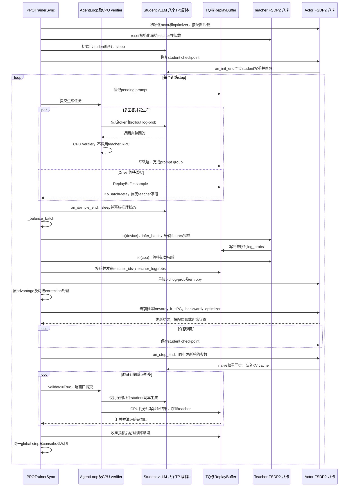

# 共享八卡运行与架构

符号遵循[统一约定](../符号约定.md)；代码字段、论文原名与历史数据键保留原样。

共享方案已在 `5188828d2` 实现。本页于 2026-10-22 按 `7fe4f830d` 核对源码及公共数学配方的 `CONFIG_ONLY=1` 输出。公共领域配方默认 `shared_sync`，通用 verl 配置仍默认 `standalone`；两者都使用 `PPOTrainerSync`。代码实现、已报告的测试与目标八卡端到端验收分开记录，当前指标测试证据见[完整指标实现与验收](../archive/metric-implementation/2026-10-22-完整指标实现与验收.md)。

当前默认运行方式是：八个 student TP1 副本生成整批回答，释放推理状态，冻结 teacher 使用同一八卡池做 FSDP2 前向并卸载，再由 actor 更新 student，最后同步八个推理副本。验证直接复用这八个 student 副本。原 4+4 保留为对照和回退路径。

## 启动与配置

环境和模型数据准备完成后，从仓库根目录运行：

```bash
# 默认 shared_sync，共享八卡。
DISTILLATION_EXECUTION_MODE=shared_sync STUDENT_GPUS=8 TEACHER_GPUS=0 \
CUDA_VISIBLE_DEVICES=0,1,2,3,4,5,6,7 \
  bash examples/mirroropd/run_math_deepseek_r1_1_5b_fsdp2.sh

# 恢复 standalone 4+4。
DISTILLATION_EXECUTION_MODE=standalone STUDENT_GPUS=4 TEACHER_GPUS=4 \
  CUDA_VISIBLE_DEVICES=0,1,2,3,4,5,6,7 \
  bash examples/mirroropd/run_math_deepseek_r1_1_5b_fsdp2.sh

# 不启动 GPU/Ray、不创建实验目录的配置预览。
DRY_RUN=1 bash examples/mirroropd/run_math_deepseek_r1_1_5b_fsdp2.sh
CONFIG_ONLY=1 bash examples/mirroropd/run_math_deepseek_r1_1_5b_fsdp2.sh
```

Math、code、IF 共用 [\_run_single_teacher_fsdp2.sh](../../launchers/_run_single_teacher_fsdp2.sh)。领域入口、数据、verifier 和训练/验证预算只在[训练配方](../训练配方.md)维护。系统切换保持所选配方的算法和工作预算不变。

代码领域直接使用 `run_code_deepseek_r1_1_5b_fsdp2.sh`，选择DeepCoder teacher、TACO和LCBv6。2026-10-21本机仅完成资产与CONFIG_ONLY检查：原始TACO24701行、LCBv6 175行；未执行该领域的GPU训练。代码判分还含CPU程序执行成本，数学生成的测量不能代替code验收。

### 验证执行配置与四卡八卡启动

领域默认值与速度/显存 profile 统一见[训练配方](../训练配方.md#推理执行配置)，E 系列编号和预算见[消融预设](../experiments/sampled-ablation/README.md)。本节只维护资源覆盖与执行方法。数学默认由公共脚本派生，不需要在任务脚本重复导出一套训练和验证参数。

```bash
# 八卡 shared-sync；只填写已经分配给作业的设备。
export CUDA_VISIBLE_DEVICES=0,1,2,3,4,5,6,7
export STUDENT_GPUS=8
export TEACHER_GPUS=0
export DISTILLATION_EXECUTION_MODE=shared_sync
export VERL_USE_UV=0
export ROLLOUT_TP=1

# 检查同一作业的命令和合成配置，不启动 Ray/GPU。
DRY_RUN=1 bash examples/mirroropd/run_math_opd_ablation_fsdp2.sh E10
CONFIG_ONLY=1 bash examples/mirroropd/run_math_opd_ablation_fsdp2.sh E10

# 正常训练；更换编号时读取配方中的相应预算。
bash examples/mirroropd/run_math_opd_ablation_fsdp2.sh E10
```

仅做初始模型验证时，沿用资源环境并显式开启 val-only；这些 trainer 开关不放入正常训练环境：

```bash
bash examples/mirroropd/run_math_deepseek_r1_1_5b_fsdp2.sh \
  trainer.val_only=True trainer.val_before_train=True
```

四卡运行只调整资源；数学低显存 profile 另显式覆盖两个推理参数：

```bash
export CUDA_VISIBLE_DEVICES=0,1,2,3
export STUDENT_GPUS=4

# 可选：数学低显存 profile，保持题目、采样数和长度预算。
export ROLLOUT_MAX_NUM_SEQS=96
export ROLLOUT_GPU_MEMORY_UTILIZATION=0.5
```

`VAL_BATCH_SIZE` 接受 `null` 或正整数；前者全量提交，后者按窗口提交。末尾 `data.val_batch_size=...` 仍是原生 Hydra 覆盖。Graph capture sizes 根据并发上限生成 2 的幂并包含上限；末尾 Hydra 参数可覆盖现有字段。不要同时维护相互矛盾的环境变量和任务脚本默认值。

| 资源或工作量 | 四卡到八卡的迁移规则 |
| --- | --- |
| `CUDA_VISIBLE_DEVICES`、`STUDENT_GPUS` | 增加已分配设备及整个 shared 池的大小 |
| `TEACHER_GPUS` | 保持 0；teacher 分时使用共享池 |
| `ROLLOUT_TP` | 保持 1，增加独立副本数 |
| 单引擎并发、显存比例和调度 token 预算 | 保持选定 profile；全机并发由副本数量推导 |
| 全局训练 batch、每题回答数、更新次数和完整评测量 | 保持所选配方预算，不随卡数翻倍 |
| 每卡 actor/teacher micro-token 预算 | 先保持，按目标设备实测调整 |

八卡增加副本，但长回答仍有串行 decode 依赖，速度不保证翻倍。已完成的四卡条件与质量检查见[完整验证实测](2026-10-22-训练与验证性能实测.md#1-完整验证与参数对照)；目标 A100/A800 八卡的完整周期、refit 峰值和 CPU 判分压力仍需单独验收。配置解析通过不能替代这些 GPU 测量。

### 通用运行合同

默认使用本仓库 `.venv-native/bin/python` 的绝对路径，同时设置 driver 和 Ray worker 的解释器，无需依赖终端是否激活环境。已有其他独立环境可设置 `PYTHON_BIN=/absolute/path/to/python`；环境需具备当前 verl 的 V1/TransferQueue 和 verifier 依赖。上游锁文件环境只在显式设置 `VERL_USE_UV=1` 时启用。正式启动要求显式设置 `CUDA_VISIBLE_DEVICES`，并检查所选领域的数据文件；数学默认对应一个训练 parquet 和三个验证 parquet。

`RUN_DIR` 必须是新目录，默认在 `outputs/` 下；保存实际命令、Git commit、相对 HEAD 的工作区 patch、解析配置、checkpoint 和验证输出。CLI 末尾参数仍是原生 Hydra overrides。改变训练步数时还要给足 `TOTAL_EPOCHS`，因为外层训练同时受 epoch 与 total step 限制。

正式运行会将 stdout/stderr 同时显示在终端并保存到 `$RUN_DIR/train.log`，默认路径为 `outputs/<实验名>/train.log`。Python 使用无缓冲输出；训练失败时保留非零退出码。启动时打印日志的完整路径，可用 `tail -f <日志完整路径>` 跟踪。`DRY_RUN=1` 和 `CONFIG_ONLY=1` 不创建日志或实验目录。

通过人工源码包部署、没有 `.git` 的目录同样可以启动；此时 `source_commit.txt` 标记版本不可用，`source_changes.patch` 为空。开发机已有本地 Hope 配置时，可通过 `make opd-submit` 提交单机 8 卡任务；`hope/` 不随源码包同步，完整操作见 [Hope 说明](../../../../hope/README.md)。

配方默认记录 console 与离线 W&B。SDK 写入根目录固定为本仓库，实际 run 位于 `wandb/offline-run-*/`；Ray 训练进程使用同样的路径和模式。可用 `make sync-log-pack` 打包后人工下载，完整流程见 [美团开发机同步说明](../../../../meituan/README.md)。

检查 `trainer.n_gpus_per_node`、teacher 池、TP、验证窗口和 Graph 尺寸时，同时核对[配方预算](../训练配方.md)。已有同名环境变量会覆盖脚本预设；最终 Hydra 参数优先级最高。

带计数的 checkpoint 恢复例子如下。路径须替换为自己的已保存目录；恢复后的 E 编号和预算应与实验设计一致。

```bash
TOTAL_TRAINING_STEPS=200 \
  bash examples/mirroropd/run_math_opd_ablation_fsdp2.sh E1 \
  trainer.resume_mode=resume_path \
  trainer.resume_from_path=/实际目录/checkpoints/global_step_32
```

计数恢复与旧 checkpoint 的兼容边界见[实施记录](../opd-objective/2026-10-21-优势与IS消融及更新计数实现方案.md#6-日志scheduler-与-checkpoint)。

### 从565a1fda2到5b3ccdd30的脚本差异

`565a1fda2`时已经是shared八卡、FSDP2、V1/TQ；不能把更早的4+4迁移归入这个commit区间。math/code领域入口没有变化，公共脚本的变化均来自`5b3ccdd30`：

| 项目 | 565a1fda2 | 5b3ccdd30 |
| --- | --- | --- |
| `ROLLOUT_ENFORCE_EAGER` | 默认True | 默认False，开启编译＋Graph |
| `VAL_BATCH_SIZE` | 默认16 | 默认32 |
| Graph capture sizes | 不显式传入 | 按并发上限派生，默认`[1,2,4,8,16,32]` |
| 并发输入校验 | 未检查该字段 | 检查`ROLLOUT_MAX_NUM_SEQS`为正整数 |
| 退出保护 | 运行至文件末尾 | 将pipeline与exit一并解析，防止运行期间源码变化后重入 |

配套Python改动是V0/V1验证不请求无用概率，以及V1初始验证增加已有`timing_s/testing`。训练prompt/mini64、epoch1、学习率、长度、验证n16、引擎并发32/token8192/memory0.5均未改变。`benchmark_decode.py`是新增独立诊断工具，不在正常训练调用链上。

### 后续实现与当前配置

优势/IS 消融已接入，算法与配置提交为 `d40950fc6`，更新计数与恢复提交为 `f274a24f6`。公共脚本读取 `PPO_EPOCHS`、`OPD_ADVANTAGE_SOURCE`、`OPD_POLICY_LOSS_MODE` 和 `OPD_CLIP_EPS`；默认和 E 系列覆盖统一见[训练配方](../experiments/sampled-ablation/README.md)，配置合同与恢复语义见[实施记录](../opd-objective/2026-10-21-优势与IS消融及更新计数实现方案.md)。

第一版 V1 指标在 `7eed88db9`、`4a70b9229` 和 `5edacea9b` 接入，区分 `step/outer`、`step/update` 与 `step/optimizer`，并保留逐更新记录。后续 policy-v3 的字段与 FSDP2 四卡实测范围以[训练指标](../internals/metrics.md)及[完整验收](../archive/metric-implementation/2026-10-22-完整指标实现与验收.md)为准；目标八卡配置的验收边界仍按本页的配置与硬件条件单独判断。

Actor 执行默认值集中在[训练配方](../训练配方.md#actor-执行配置)；激活重算、动态 micro 与延后同步的候选比较见[调优矩阵](2026-10-22-批量大小与GPU利用率调优.md#73-actor-重算micro-与梯度同步联合筛选)。

延后同步的代码位于 [FSDP engine](../../../../verl/workers/engine/fsdp/transformer_impl.py) 的 `_gradient_sync_context()`。`FSDPEngineConfig` dataclass 默认 True，但 [engine YAML](../../../../verl/trainer/config/engine/fsdp.yaml) 显式设为 False，公共配方继承 YAML；判断实际行为应读取合成配置。开启后需要保留未分片梯度，性能与显存取舍按[调优矩阵](2026-10-22-批量大小与GPU利用率调优.md#7-分层筛选与四卡到八卡验收)测试。

### 共享与独立池配置

| 环境变量 / 配置 | shared_sync | standalone |
| --- | --- | --- |
| `DISTILLATION_EXECUTION_MODE` | 公共配方默认 | 显式选择；通用 `DistillationConfig` 的默认 |
| `STUDENT_GPUS` → `trainer.n_gpus_per_node` | 默认 8，代表整个共享池 | 默认 4，代表 student 池 |
| `TEACHER_GPUS` → `distillation.n_gpus_per_node` | 必须 0，`nnodes=0`，不建独立 teacher 池 | 默认 4，`nnodes=1` |
| `ROLLOUT_TP` | 必须 1，默认八个副本 | 默认 1，副本数依池大小与并行配置推导 |
| `TEACHER_FSDP_TOKEN_BUDGET` | 每卡动态前向预算，取值见训练配方，须容纳完整训练序列 | 不用于 vLLM teacher |
| `TEACHER_FSDP_DTYPE` | 默认 BF16，同时控制存储与前向参数精度 | 不用于 vLLM teacher |
| `PARAM_OFFLOAD` / `OPTIMIZER_OFFLOAD` | 必须 True | 按原配方配置 |
| `teacher_models.teacher_model.model_path` | 唯一冻结 teacher 的来源 | 独立 teacher 服务的来源 |
| `TEACHER_TP`、`TEACHER_TOKEN_BUDGET` 等 vLLM 参数 | 不构造 teacher 服务，不据此推导副本 | 控制独立 teacher 服务 |

Standalone 的 student 与 teacher 资源相加；默认 4+4，也可通过 `TEACHER_GPUS=1` 配成 4+1。Shared-sync 中 `TEACHER_GPUS=0` 不表示没有 teacher。共享 teacher 的 FSDP world size 从 actor 池派生；不能再把它加到八卡总数上。建议通过环境变量选择模式，让脚本一起派生资源配置；直接追加 Hydra override 修改模式时，也必须提供一致的池和 engine 参数。

## Hope 直连入口

**决策：Hope 直接执行随源码发布的领域脚本，不再维护 `hope/mirroropd/run.sh`。** 旧包装脚本固定导出 4+4，曾与新默认 shared_sync 冲突；由于 `hope/` 不进入源码包，解包代码不能修正接收端旧包装脚本。

在开发机本地 `hope/mirroropd/mirroropd.hope` 的 `[roles]` 中一次性替换：

```ini
worker.script = bash -lc 'CUDA_VISIBLE_DEVICES="${CUDA_VISIBLE_DEVICES:-0,1,2,3,4,5,6,7}" VERL_USE_UV=0 exec bash "/mnt/dolphinfs/hdd_pool/docker/user/hadoop-hmart-poistar/fanghaotian/MirrorOPD-verl/examples/mirroropd/run_${DOMAIN:-math}_deepseek_r1_1_5b_fsdp2.sh"'
```

这是任务容器内的共享挂载路径，不是本机 `/mnt/tidalfs-bdsz01/...` 路径。脚本自行定位仓库，无需依赖平台工作目录。已有 `CUDA_VISIBLE_DEVICES` 原样保留，缺省时使用该八卡作业内的逻辑设备 `0..7`；原生模式固定 `VERL_USE_UV=0`。

Hope 只维护队列、镜像、资源申请、挂载路径、领域和显式实验覆盖。默认领域为 math；在 worker 环境设置 `afo.role.worker.env.DOMAIN = code` 或 `if` 可切换领域，IF 另需 `OPENCOMPASS_ROOT` 和 `NLTK_DATA`。Standalone 对照设置 `DISTILLATION_EXECUTION_MODE=standalone`。公共配方维护 `.venv-native/bin/python`、默认离线 W&B、`TOKENIZERS_PARALLELISM=false`、`OMP_NUM_THREADS=1` 和训练日志，支持既有显式环境覆盖。

依赖检查用 `make native-check`，资产检查用 `make assets-check`；更换镜像或环境后在目标 GPU 容器单独验收 GPU 运算。旧包装脚本的依赖解压和逐卡矩阵乘法不再每次自动执行。

接收新版源码后，检查本地 `.hope` 已直连，移除不属于 standalone 实验的固定 `STUDENT_GPUS=4` / `TEACHER_GPUS=4` 覆盖，再执行 `make opd-submit`。旧 `run.sh` 不再被调用，可以删除；源码解包保留 `hope/`，不会替用户完成这次修改。后续入口更新随源码发布，通常不再改 worker 命令。打包/解包与日志上传统一见[人工传输说明](../../../../meituan/README.md)。

## 共享训练调度

图中分开的逻辑角色使用同一组物理八卡。CPU verifier、AgentLoop、TransferQueue（TQ）和 driver 不另申请 GPU；actor 与 teacher 的分片模型彼此独立，vLLM 有自己的推理进程、权重和 KV cache。



生成提交在 `prepare_step()` 中开始；AgentLoopManager 的提交返回不表示回答生成完成，真正交接由 ReplayBuffer/TQ 完成。默认 `gen` timer 包含等齐生成/CPU 判分和 student sleep。共享 teacher 在 `_balance_batch()` 后、old-log-prob 前评分；不会插入 optimizer update 或变更生成版本。

Standalone 的生成与各回答 teacher RPC 可以重叠，ReplayBuffer 返回时 teacher 字段已经齐全；之后沿相同 actor、同步与验证链执行。独立 teacher 在 actor 更新和验证时无新评分工作，验证仍只用 student 四卡。其完整拓扑图见[方案 S0](2026-10-21-调度备选与模型扩展.md#s0固定-44同步执行)。

## 代码职责与生命周期

当前模块职责、教师上卡／卸载、评分发布和异常清理统一见[教师评分与资源生命周期](../internals/teacher.md)。跨模块执行顺序见[架构总览](../architecture.md)。本页保留启动配置和运行环境说明。

## 数据契约与因果对齐

TQ 的 `sample_keys/sample_partition`、预测位置、response 布局及 mask 分母统一见[样本身份、张量布局与归一化](../internals/data-and-loss.md)。Teacher 直接对 student 原始 token 序列评分；sampled 概率协议见[教师走读](../internals/teacher.md#输入与-sampled-输出协议)。

## Actor 更新调用链

当前调用链、mini/micro-batch、批内复用及 scheduler 推进位置统一见[训练循环](../internals/training-loop.md)。目标计算分别见[Sampled OPD](../internals/sampled-opd.md)和[Full-vocab](../internals/full-vocab.md)，更新事实与恢复见[进度说明](../internals/progress-checkpoint.md)。

## 当前支持范围

共享路径支持单机、V1 sync、一个 dense text causal-LM teacher、相同 DP world size 的 FSDP2、student TP1、single-turn 和 sampled-token `k1 + PG`。Actor 参数与 optimizer offload 开启，teacher 无 optimizer，teacher token budget 至少容纳一条完整训练序列。

配置校验当前拒绝多机、异步、TP/SP/PP 扩展、多 teacher、MoE、多模态、LoRA、MTP/QAT、top-k 蒸馏、critic/reference/learned reward、custom sampler、DAPO 过滤、rollout skip，以及不兼容的 tokenizer。Actor/teacher 使用非 fused 的兼容路径。扩大模型、切换并行或融合 kernel 前，应先检查这些实际约束；候选设计不等于可直接传参启用。

目标环境已观察到共享八卡短训练，见[两次运行对照](../archive/2026-10-23-历史八卡与One-Shot运行对照.md#4-八卡历史与one-shot对照)；后续重点是完整验证、恢复和固定预算周期成本，具体通过条件与证据见[指标与验收](2026-10-21-指标与验收.md)。上游组件的取舍和论文 baseline 来源仍在[调研记录](2026-10-21-上游实现与论文基线.md)，不再重复一份待实施文件清单。
