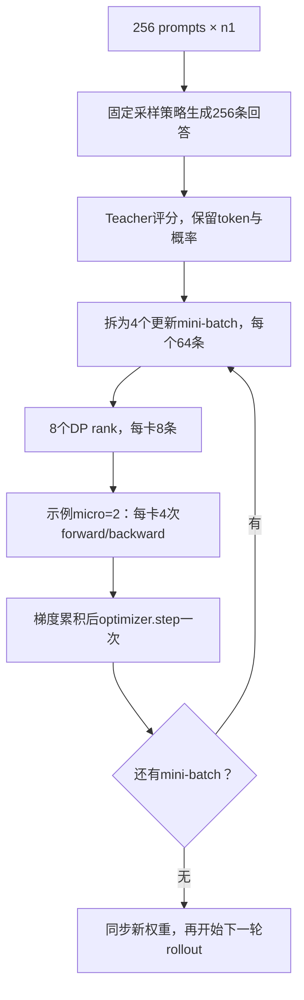
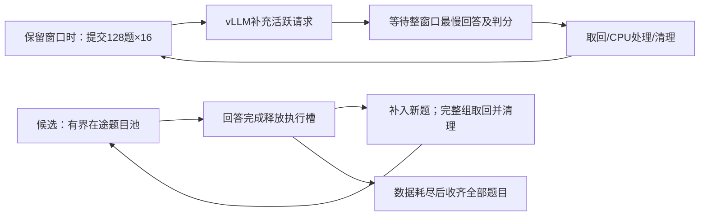

# 批量大小与 GPU 利用率调优

符号遵循[统一约定](../符号约定.md)；代码字段、论文原名与历史数据键保留原样。

更新日期为 2026-10-22，源码核对基点为 `7fe4f830d`。训练分层计划按当前配置解释；验证参数现已补入冻结版本 `b51794179` 的完整四卡对照，以及当前模型的容量推算。

本页统一维护 RLVR/OPD 的 batch 调研、GPU 利用率解释和调优顺序。优化目标是在相同质量与工作预算下缩短训练时间；显存容量用于约束可行配置，GPU busy 用于定位等待，两者都不能单独作为验收目标。八卡调度架构见[运行与架构](2026-10-22-共享八卡运行与架构.md)，已实现指标及 W&B 路径见[指标与验收](2026-10-21-指标与验收.md)，4+4/shared 实测数值见[速度与显存对照](measurements/2026-10-21-八卡历史运行对照.md)。

## 1. Batch 的口径与更新次数

| 记号 | 名称 | 控制的工作 | 当前 math 配方 |
| --- | --- | --- | --- |
| $B_{\rm prompt}$ | prompt batch | 一轮收集的题目数 | 64 |
| $n_{\rm resp}$ | 每题采样数 | 一个 prompt 产生的回答数 | 1 |
| $B_{\rm rollout}=B_{\rm prompt}n_{\rm resp}$ | rollout batch | 一轮得到的回答数 | 64 |
| $B_{\rm mini}$ | 更新 mini-batch | 全部数据并行 rank 在一次 optimizer step 中消费的回答数 | 64 |
| $E_{\rm PPO}$ | 更新 epoch | 同一批回答遍历次数 | 1 |
| $B_{\rm micro}$ | 每卡 micro-batch | 一次 forward/backward 的回答数；动态分批时以 token 预算约束 | 动态，32768 tokens |
| $C_{\rm seq}$ | 推理活跃并发 | 一个 vLLM 引擎当前调度的序列数 | 数学默认上限64，实际动态变化；完整验证候选96/128 |

若没有过滤、padding 或丢弃尾批，且 $B_{\rm rollout}$ 可被 $B_{\rm mini}$ 整除，每轮 rollout 的更新次数为：

$$
N=E_{\rm PPO}\frac{B_{\rm rollout}}{B_{\rm mini}}.
$$

固定 micro-batch、各卡处理量一致时，数据并行度 $G_{\rm DP}$、累积次数 $n_{\rm accum}$ 满足：

$$
B_{\rm mini}=G_{\rm DP}B_{\rm micro}n_{\rm accum},\qquad n_{\rm accum}=\frac{B_{\rm mini}}{G_{\rm DP}B_{\rm micro}}.
$$

$G_{\rm DP}$ 是数据并行度，不是包含 TP/PP/SP 的总设备数。当前 TP1、八卡数据并行时 $G_{\rm DP}=8$。Micro-batch 用于分割显存中的计算规模；梯度累积期间参数不变，完成整个更新 mini-batch 后才执行 optimizer step。把同一个 $B_{\rm mini}$ 拆成更多 micro-batch 不增加策略滞后，但会增加执行轮数。数学等价要求正确的样本/token 权重；不同长度 micro-batch 的平均 loss 不能无权平均。

当前 [V1 trainer](../../../../verl/trainer/ppo/v1/trainer_base.py) 将配置中的 `actor.ppo_mini_batch_size` 乘以 `rollout.n`，得到本页的 $B_{\rm mini}$。例如配置 mini32、n4 对应 128 条回答。FSDP 在拆分 micro-batch 前汇总全局 loss token 数；动态分批由长度和预算决定，不能从 `ppo_micro_batch_size_per_gpu=1` 推断实际始终每次一条。



图中后续 mini-batch 使用的是先前采样策略的回答。它与每更新 64 条就重新采样的流程不同。相关 advantage 刷新、IS 和固定 prefix 的目标仅在[目标推导](../opd-objective/2026-10-21-固定前缀下的优势估计与重要性采样.md)维护。

## 2. RLVR 与 OPD 的公开设置

### 2.1 RLVR

表中统一以回答数表示 $B_{\rm rollout},B_{\rm mini}$。公开配方是参考点，不是八卡通用推荐值。

| 工作 | $B_{\rm prompt}$ | $n_{\rm resp}$ | $B_{\rm rollout}$ | $B_{\rm mini}$ | 更新方式与长度 |
| --- | --- | --- | --- | --- | --- |
| DeepSeek-R1-Zero，论文 v2 | 512，按 8192/16 推算 | 16 | 8192 | 512 | 一遍，16 次更新；输出上限 32K，后期 64K |
| DAPO | 保留 512 个题目组 | 16 | 保留 8192 | 512 | 16 次更新；输出上限 20480，含 4096 软惩罚区间 |
| Dr. GRPO 作者八卡示例 | 128 | 8 | 1024 | 128 | 按公开 Oat 配方推算 8 次更新；一遍，输出上限 3000 |

R1 的数值来自后续 v2 披露，不能倒推为初版已公布的设置。[^r1] DAPO 的当前公开脚本配置 `train_prompt_bsz=512`、`n_resp_per_prompt=16`、`train_prompt_mini_bsz=32`，展开后一次更新 512 条；动态过滤使实际生成量可能超过保留量，当前配方的 `gen_prompt_bsz` 为 1536。[^dapo] [^dapo-code] Dr. GRPO 的八卡示例使用 Qwen2.5-Math-1.5B 和 8×A100，`train_batch_size=128`、每卡 micro1、`rollout_batch_size=128`、`num_samples=8`；不同框架的同名字段不能直接横向相乘。[^dr-grpo] [^dr-grpo-code]

### 2.2 OPD

| 工作或配方 | 收集与更新设置 | 对照边界 |
| --- | --- | --- |
| GKD，ICLR2024 | GSM8K、XSum 训练 batch32 | T5 实验输出上限分别 320、64；短输出、分布蒸馏，不代表长推理预算 |
| MiniLLM，ICLR2024 | 一次收集 256 条；更新 mini64；同批遍历 4 遍，即 16 次更新 | 最大长度 512，算法与当前 sampled-token 配置不同 |
| Thinking Machines 原文默认/个性化 | 64 prompts×4 回答=256 条 | sampled-token teacher 监督；不能等同于数学推理配方 |
| Thinking Machines 当前数学配方 | 512 prompts×默认 4 回答=2048 条；默认`num_substeps=1` | 当前 LoRA 配方，输出 16K；原文模型已更新 |
| 2610.11291 主实验 | 128 prompts×1 回答；global batch128 | sampled-token reverse KL；thinking 训练上限 16K |
| NeMo RL 默认数学蒸馏 | 128 prompts×1 回答；更新 global batch64 | 两次更新；默认 teacher top64 和 mixed KL |
| NeMo RL 32B→1.7B 单机八卡 | 64 prompts×1 回答；更新 global batch32 | 两次更新；reverse KL、top-k 分布蒸馏 |

GKD 和 MiniLLM 的数字分别取附录 A 和 B.1。[^gkd] [^minillm] Thinking Machines 原文与当前 cookbook 分开记录：当前数学启动命令指定 512 组，代码默认每组 4 条，不能把 512 误读为回答总数。[^tml] [^tinker-recipe] [^tinker-code] 2610.11291 明确写 128 题、每题一条；其模型配对、teacher/student 重合度和离线算法结论见[上游与论文基线](2026-10-21-上游实现与论文基线.md#论文-261011291-的设置与比较边界)。[^semi-opd] NeMo 配置中的收集量与训练 global batch 独立，worker 按 global batch 循环并执行 optimizer step。[^nemo-config] [^nemo-eight] [^nemo-worker]

### 2.3 算法上的选择依据

二元正确性奖励的组内相对优势依赖组内差异。忽略其他奖励项，若单次成功概率为 $p_{\rm succ}$、同题独立采样 $n_{\rm resp}$ 次，同时出现成功和失败的概率为：

$$
p_{\rm mixed}=1-p_{\rm succ}^{n_{\rm resp}}-(1-p_{\rm succ})^{n_{\rm resp}}.
$$

例如 $p_{\rm succ}=0.1$ 时，$n_{\rm resp}=2,8,16$ 对应 18.0%、57.0%、81.5%。总回答预算固定时，增大 $n_{\rm resp}$ 会减少不同题目的覆盖。零方差过滤还能让“生成量”和“有效更新量”分离。这个简化模型只解释二元任务奖励的组内差异，不表示所有 RLVR 都必须使用 GRPO 或多回答。

当前 OPD 直接使用 teacher 的 token 级反馈，$n_{\rm resp}=1$也有训练信号；全部回答最终都错不意味着 token 优势为零。因此扩容实验先增加 $B_{\rm prompt}$、保持 $n_{\rm resp}=1$，再单独研究同题多次采样。密集 token 反馈仍有轨迹内相关性，64 条回答的约 40 万总 token 不能当作 40 万个独立样本。Thinking Machines 也将小 batch 有效性与较强初始化关联，teacher/student 差距较大的推理实验需要更多样本。[^tml]

增加 $B_{\rm mini}$ 会降低每次更新的噪声，也会减少相同样本预算下的更新次数。增加 $B_{\rm rollout}$、保持 $B_{\rm mini}$ 则增加同一采样策略上的更新次数。两者都需要评估学习效果，不能只看 GPU 吞吐。

### 2.4 Batch 扩大的研究结论

| 研究 | 已报告结果 | 使用边界 |
| --- | --- | --- |
| When Do Larger Batches Help Scale LLM Reinforcement Learning? | 固定硬件上，学习率重调后可改善达标时间；不重调的对照可在吞吐更高时仍更慢 | 2026 预印本；报告的最大 29% 达标时间改善不是本项目预测 |
| Two Clocks | 主实验每题 8 条、每批 8 次更新；rollout512 至 8192 条，较大 batch 在其缩放规则下可损害样本效率 | 近期预印本，主要数学任务；不能直接作为 OPD 定律 |
| ScaleRL | 大 batch 可能早期较慢、长期性能上限更高；固定总量下每题 8/16/24/32 的部分对照差异较小 | 大规模预算与本项目八卡短训不同；不据此直接选最大 batch |

这些结果分别讨论了学习率、更新次数和预算对结论的影响。[^batch-scaling] [^two-clocks] [^scalerl] PPO 的 batch 变化还可能同时改变行为策略修正和近端更新约束；已有工作通过区分两种策略研究 batch 不变性。[^ppo-invariance]

以参与训练的新回答数 $n_{\rm new}$ 为统一计数，定义达到同一验证目标所需数量 $n_{\rm new}^*$，端到端有效吞吐 $v_{\rm eff}=n_{\rm new}^*/\mathsf t$，则：

$$
\mathsf t=\frac{n_{\rm new}^*}{v_{\rm eff}},\qquad
\frac{\mathsf t_2}{\mathsf t_1}=\frac{n_{\rm new,2}^*/n_{\rm new,1}^*}{v_{\rm eff,2}/v_{\rm eff,1}}.
$$

吞吐的时间分母应包含被过滤样本的生成、teacher 和更新成本；按完整作业评估时还应包含相同预算的验证。回答长度变化时同时报告生成 token、训练 token 和墙钟。仅比较相同 optimizer step 数，会让大 batch 实验获得更多数据。

## 3. 显存、GPU busy 与阶段瓶颈

NVML GPU utilization 表示采样窗口内有 kernel 执行的时间比例；memory utilization 表示显存读写活跃时间比例。两者均不等同于峰值 FLOPs 或 HBM 带宽利用率。Nsight Compute 的计算/内存吞吐指标才能进一步区分 kernel 内部瓶颈。[^nvml] [^nsight]

| 调整 | 容量影响 | 时间影响 |
| --- | --- | --- |
| 增大 actor micro-batch/token预算 | 激活和临时张量增多 | 可能减少执行轮数、提高矩阵效率；收益有平台 |
| micro 不变，增加梯度累积 | 激活峰值通常不按次数增长；全批数据仍有存储开销 | 总计算增加，不保证单位时间效率改善 |
| 增加实际 rollout 并发 | 活跃 KV 增加 | 小并发区间可能提高权重复用和吞吐 |
| 只增加`max_num_seqs` | 依引擎预分配而异 | 请求不足时没有额外工作可调度 |
| 提高`gpu_memory_utilization` | 增大引擎预算/KV 池 | 不会直接提高 GPU busy；容量本来足够时可能无收益 |

普通 decode 每条活跃序列每轮通常处理一个新 token。`max_num_batched_tokens=8192`约束本轮处理的新 token，不是全部历史 KV 长度之和。Prefill 可并行处理多个已有 token，chunked prefill 可与 decode 混合调度。[^vllm]

历史 A800 对照均为 eager，共享池未获得整步加速；后续 H800 本机 decode、完整训练和验证子集已确认编译/Graph 收益。数字与证据边界统一见[八卡历史对照](measurements/2026-10-21-八卡历史运行对照.md)和[本机实测](measurements/2026-10-21-本机训练与验证优化.md)。

GPU 持续忙碌与计算高效需要分开验证。CUDA Graph 可减少重复 kernel 发射成本；更大的实际 batch 可改善计算规模和权重复用；窗口末尾没有新请求时还会出现供给不足。Graph 本身也有 capture 成本和常驻内存，必须比较预热后的无 profiler 计时。[^cuda-graph]

## 4. 调试顺序：先统计，再短 trace，再做单变量对照

第 4 节保留可复用诊断入口；eager/Graph 与短 trace 已完成，不再是待办。实验数值集中到[本机实测](measurements/2026-10-21-本机训练与验证优化.md)。第 5 节维护验证调度候选，第 7 节维护最新代码基线、actor 联合筛选与目标八卡验收顺序。

### 4.1 恢复轻量引擎统计

保留原有 GPU、模型、数据和输出目录设置，在领域脚本后追加：

```bash
actor_rollout_ref.rollout.disable_log_stats=False \
++ray_kwargs.ray_init.runtime_env.env_vars.VLLM_LOGGING_LEVEL=INFO
```

`disable_log_stats=False`开启统计，`INFO`允许周期日志输出。使用 Ray runtime environment 明确覆盖默认 WARN；设置需要在新启动进程中生效。短诊断可在 driver 启动前设置`RAY_DEDUP_LOGS=0`，保留不同引擎日志。常规训练的已实现性能标量仍默认采集，无需新增`OPD_METRICS`开关。[^vllm-metrics]

| 观测 | 后续动作 |
| --- | --- |
| Running 低、Waiting 接近 0、KV 使用率低 | 检查上游请求供给；单纯提高并发上限无效 |
| Running 顶到 max_num_seqs、Waiting 持续非零、KV 有余量 | 单测并发上限 |
| KV 接近满或出现 preemption | 调整容量、并发、长度；不能把缺测当作零抢占 |
| 有足够 Running 但 GPU busy 低 | 采集 decode trace，区分 kernel 间隙、主机等待与 GPU 工作量 |

这些开关恢复 console 统计，不会自动新增 W&B 曲线。已有 vLLM server `snapshot()`可读取 Running/Waiting/KV，后续若接入 W&B 应复用统一 logger；不先增加常驻全量 trace 或逐 token 日志。Worker 的统计不能等同于 ReplayBuffer 题目组计数。

### 4.2 采集稳态 decode 短 trace

先确认真实模型能生成，再在预热之后单独采集。优先使用 vLLM 已有 Torch profiler：跳过前 32 个引擎迭代，记录后 40 个迭代，关闭 stack/shape/memory 和 frontend profiling 以控制开销。迭代不是严格的输出 token 编号；固定短 prompt、无新增请求的诊断中，这段通常位于 decode，仍需检查 trace 的实际操作。[^vllm-profiler]

trace 验收必须确认存在 CUDA kernel 事件，而不只是 CPU 调用。Torch profiler 使用 CUPTI，环境中的 NVTX 注入器可能提前占用 subscriber；仓库已在 Torch profiler 路径处理该问题，独立诊断也设置不可加载的`NVTX_INJECTION64_PATH`。查看 GPU kernel 之间的空白、CUDA API 等待、同步和采样开销；只有需要 kernel 内部带宽/计算计数时，再使用 Nsight Compute。不要把 profiler 中的绝对耗时用于正式吞吐对照。

### 4.3 固定 checkpoint 的执行效率矩阵

| 顺序 | 保持条件 | 比较项 | 判断 |
| --- | --- | --- | --- |
| A，已有历史证据 | batch64、长度、采样、TP1 | 恢复统计、取得 eager trace | 定位原有执行间隙 |
| B，已有历史证据 | 与 A 相同工作量 | `ROLLOUT_ENFORCE_EAGER=False` | 已确认本机编译/Graph 收益；最新代码仍需建立基线 |
| C | 固定 checkpoint、使用 B 执行模式 | rollout 回答数 64→128→256 | 找到吞吐收益开始减弱的并发区间 |
| D | 更新 global batch 固定 | 重算、actor token 预算与延后梯度同步 | 按第 7 节分轮筛选；比较 update 时间、梯度与峰值 |
| E | 验证 checkpoint、题目与 n 固定 | 有界跨窗口持续投喂 | 减少尾部等待；属于后续调度实现 |

`enforce_eager=False`会同时恢复默认编译优化和 CUDA Graph，因此 B 是执行模式联合对照，不能把全部差值归因于 Graph 单一机制。没有 KV 压力前不先提高显存预留。当前共享模式必须保留必要 offload，且不直接启用未支持的 fused 路径。激活重算开关可以在独立对照中测试，须记录峰值；更大模型与并行策略见[模型扩展](2026-10-21-调度备选与模型扩展.md)。

### 4.4 学习效果矩阵

执行效率通过后，再比较算法设置。初始保持 $n_{\rm resp}=1,E_{\rm PPO}=1$、长度/采样/loss 不变：

| 实验 | $B_{\rm prompt}$ | $B_{\rm mini}$，回答数 | $N$ | 解释 |
| --- | --- | --- | --- | --- |
| 基线 | 64 | 64 | 1 | 当前设置 |
| 大更新 batch | 128 | 128 | 1 | 优先候选；改变更新方差与频率 |
| 大收集 batch | 128 | 64 | 2 | 独立对照；第二次更新消费旧策略样本 |
| 后续扩展 | 256 | 64 或 128 | 4 或 2 | 仅在吞吐继续改善且策略偏移可接受时测试 |

领域脚本默认将`TRAIN_BATCH_SIZE`同时传给 prompt batch 和更新 mini-batch，因此只改为 128 得到“大更新 batch”。可用末尾 Hydra override 单独覆盖`actor_rollout_ref.actor.ppo_mini_batch_size=64`，得到“大收集 batch”；无需先改框架。先以 lr1e-6 做对照，再把平方根缩放作为学习率候选，不能视为 OPD 定律。

验证频率按累计样本对齐：当前 64 题×20 步=1280 题，batch128 应每 10 步验证，batch256 每 5 步验证。保存和学习率调度也应明确按 rollout step、optimizer step 还是累计 token 计数。比较相同样本/token 预算的质量和包含验证的 GPU 小时，不把减少验证次数记成训练加速。

## 5. 验证 rollout 调度优化

### 训练预算与验证预算分开

`prompt/mini64→128→256`属于学习配置实验，改变一次更新的数据量和同一数据预算下的更新次数。当前默认仍为 64/64。验证窗口只控制同一个冻结 checkpoint 下的请求供给，没有 optimizer 更新；优先优化验证时，不需要改训练 prompt、mini、学习率或 epochs。

Global 描述跨 DP rank 的统计范围，mini 描述一次 optimizer update 所使用的数据，两者不冲突。本页的$B_{\rm mini}$就是全局更新 mini-batch。NeMo 的`train_global_batch_size=64`对应$B_{\rm mini}=64$，其每轮收集量可以是 128；R1 每轮 8192 回答与每次更新 512 也不能混为一项。2610.11291 的 128 题、n1、global batch128 则是$B_{\rm prompt}=B_{\rm rollout}=B_{\rm mini}=128$。论文设置见第 2 节；本仓配置 mini 先乘 rollout.n 后得到$B_{\rm mini}$。

以当前 n1、E1 为例，相同 6400 条新回答，64/64 对应 100 轮采样和 100 次更新，128/128 对应 50 和 50，256/256 对应 25 和 25；256/64 对应 25 轮采样和 100 次更新，后续 mini 使用较早策略的样本。调整 micro 只改变计算拆分，不能消除以上算法变化。

### 请求数、token 预算与显存

| 层次 | 当前控制项 | 单位与作用 |
| --- | --- | --- |
| 训练收集 | `data.train_batch_size=64`、`rollout.n=1` | 题目数和每题回答数，产生本轮轨迹 |
| Actor 更新 | `ppo_mini_batch_size=64`、`ppo_epochs=1` | 一次全局更新的样本量及重复使用次数 |
| 每卡 forward/backward | 动态 micro 预算 32768 | 完整 prompt＋response 的有效 token，按长度拆分并累积梯度；静态 micro1 不决定当前切分 |
| 数学验证提交 | `VAL_BATCH_SIZE=128`、`VAL_N=16` | 每窗口 2048 条请求，与训练 mini/micro 无关 |
| 数学推理并发 | 每副本`max_num_seqs=64` | 活跃序列上限，八个 TP1 副本合计最多 512；Coding/IF默认仍为32 |
| 推理迭代 | 每副本`max_num_batched_tokens=8192` | 单次调度处理的新 token；prefill 可以占多 token，普通 decode 每条通常占 1token |
| 推理容量 | `gpu_memory_utilization=0.5` | vLLM 预算/KV 空间，不是 actor 显存上限或 GPU busy 目标 |

例如 32 条纯 decode 请求一轮通常只处理约 32 个新 token；把 8192 改成 16384 不会让每条回答每轮自动生成两个 token。已有 2 万个历史 token 主要增加 attention 读取 KV 的工作，而不占 2 万个“新 token”预算。当前训练 prompt 平均约 100token、回答数千 token，decode 占主导，先增加请求供给比盲目扩大 prefill 预算更有依据。训练和验证共用引擎级并发、token 预算、Graph 与 KV 设置；验证独立覆盖 n、温度和 response 长度。[^vllm]

Actor 的 32768 token 预算与 vLLM 的 8192 预算含义不同。以 DP8、mini64、每条完整序列 6300token 为例，每 rank8 条共 50400token，可拆两个 4 条 micro；mini128 则每 rank16 条，可拆四个 4 条 micro，末尾仍一次 optimizer.step。真实拆分按长度平衡并协调 DP 上的 micro 数量；不是固定 accumulation 次数。激活受 micro 控制，梯度缓冲、模型状态、通信和输出头另占空间。

单份 BF16 dense logits 在 32768token、151936 词表时约 9.27GiB，token 预算翻倍后约 18.55GiB；这不是总峰值公式，fused/chunked/dtype 会改变实际物化方式。更大 micro 需独立测 update 时间和显存，KV 及模型扩展估算见[容量边界](2026-10-21-调度备选与模型扩展.md#当前-gqa-架构的-kv-预算)。

### 当前等待点与 TQ 的职责

两套本地代码的全局路由均采用较少在途请求优先并支持 sticky session；One-Shot 通过等待并拼接 DataProto 返回结果，本仓通过 TQ 发布完成状态和轨迹。TQ 不参与逐 token decode，引擎内部仍由 vLLM 动态组 batch。CPU AgentLoop worker 收到的 chunk 也不是固定 GPU batch。

差异在外层：历史 One-Shot 实际 run 的`val_batch_size=null`，一次提交570×16；本仓默认窗口仍为128题，但既有`data.val_batch_size=null`全量路径已经完成570题实测。保留窗口时，仍等待整窗口完成，再取回、padding、解码、清理，才提交下一窗口。Coding/IF默认仍为32题。ReplayBuffer 默认每 2 秒轮询完成状态。小窗口会反复进入队列耗尽后的长尾；这不代表 TQ 要求使用小窗口。



运行计数支持优先处理供给与长尾：本机窗口 32 的生成采样中约 24% 的时点四卡活跃请求合计少于 16，约 66% 的时点等待队列全空；未观测到一副本完全闲置同时另一副本仍有 waiting 的采样。具体分母、样本数与限制见[引擎队列实测](measurements/2026-10-21-本机训练与验证优化.md#验证队列与并发退化)。它们是采样比例，不是连续 GPU 时间积分。

### 已验证配置与后续扩展

四卡完整570题、并发64/96/128、比例0.5/0.65，以及子集8192/16384预算的对照已完成，数值与质量边界见[完整实测](measurements/2026-10-22-全量验证与推理参数对照.md)。全量提交/并发128/比例0.65/token8192是已测最快且零抢占的候选；并发96/比例0.5在显存几乎不增加时提高TPS。正式默认仍为窗口128/并发64/比例0.5，不将实测候选写成已经落地的默认。

主要参数的入口与作用如下。表中候选值来自已完成的四卡valid实验，不改变正式默认。

| 启动参数 | 对应配置或作用 | 对TPS和内存的主要影响 |
| --- | --- | --- |
| `VAL_BATCH_SIZE` / 末尾 `data.val_batch_size=null` | 验证提交窗口；候选全量570题 | 减少窗口等待；扩大CPU/TQ在途结果，活跃KV仍受引擎约束 |
| `ROLLOUT_MAX_NUM_SEQS` | `rollout.max_num_seqs`；候选96/128 | 提高每副本活跃上限；增加KV需求和迭代工作量 |
| `ROLLOUT_GPU_MEMORY_UTILIZATION` | `rollout.gpu_memory_utilization`；候选0.5/0.65 | 预留更大的KV池；容量充足时不直接提高TPS |
| `ROLLOUT_TOKEN_BUDGET` | `rollout.max_num_batched_tokens`；保留8192 | 控制每轮新token和prefill混跑，影响profile/临时内存 |
| `MAX_VAL_RESPONSE_LENGTH` | `rollout.val_kwargs.max_tokens=31744` | 限制每条回答的生成工作和最长KV；改变它会改变评测预算 |
| `VAL_N` | `rollout.val_kwargs.n=16` | 总回答数为题目数乘n；不等于每卡并发 |
| `ROLLOUT_ENFORCE_EAGER` | 当前False，使用编译/Graph | 减少重复发射开销，Graph本身需要常驻内存 |
| `ROLLOUT_TP` | 当前1，每卡一个副本 | 改变权重/KV布局及通信；shared_sync当前要求TP1，不能只改值扩展 |

在已设置正确 GPU、Python、模型和数据路径的数学入口上，可用现有参数表达验证配置：

```bash
# 仅验证：速度优先；全量窗口用末尾 Hydra override，不能用 VAL_BATCH_SIZE=null。
ROLLOUT_MAX_NUM_SEQS=128 ROLLOUT_GPU_MEMORY_UTILIZATION=0.65 \
ROLLOUT_TOKEN_BUDGET=8192 \
bash examples/mirroropd/run_math_deepseek_r1_1_5b_fsdp2.sh \
  data.val_batch_size=null trainer.val_only=True trainer.val_before_train=True

# 显存优先：同一命令改为并发96、比例0.5。
```

`val_before_train=True` 在这里用于启动独立验证；它不修改正式训练中关闭初始验证的约定。训练与验证共用引擎级参数，若把这些值用于完整训练，需要另验收 sleep/refit、teacher 与 actor 的阶段切换。

后续以128/0.65为对照，保持570题、n16、长度与采样配置不变：

| 顺序 | 每引擎并发 | 显存比例 | token预算 | 目的与状态 |
| --- | ---: | ---: | ---: | --- |
| 参照 | 128 | 0.65 | 8192 | 已测；后续最好交错复跑参照 |
| A | 128 | 0.75 | 8192 | 待测；只增加缓存，分离容量效应 |
| B | 160 | 0.75 | 8192 | 待测；沿用 A 的缓存预算，提高并发 |
| C | 160 | 0.85 | 8192 | 待测；为下一档并发建立相同缓存预算的对照 |
| D | 192 | 0.85 | 8192 | 待测；检查更高并发是否仍有收益 |

没有实测依据直接推荐256/0.9。下面的容量推算显示，该组合即使显存接近满额，仍可能在相近的活跃长度分布下不足。各档同步增加对应 Graph capture size，避免因为没有覆盖新并发形状而混入执行方式变化；公共启动脚本会生成覆盖上限的列表，应检查 resolved config。

128题适合排查启动、Graph与明显内存问题，最终性能和抢占以完整集确认。测试记录完整墙钟、成功输出token、KV峰值/抢占、整卡峰值、活跃/等待队列、功耗和收尾；不因速度快而漏收回答或减少n。若相邻档仅有几个百分点差异，交错重复至少参照与候选后再决定；测试期间固定其他GPU工作负载。

### 当前模型的 KV 与显存计算

模型结构与实际参数量在[MFU文档](2026-10-22-MFU与利用率口径.md#模型结构与参数量)维护：28层、12个query head、2个KV head、head dimension128、BF16，参数约1.777B，关闭sliding-window attention。以下按TP1、未量化KV计算，GiB为 $2^{30}$ bytes。

每个缓存token在各层保存K、V两个向量：

$$
b_{\rm KV}=2\times28\times2\times128\times2
=28{,}672\ \mathrm{bytes}=28\ \mathrm{KiB}.
$$

前两个2分别对应K/V和KV head数，最后一个2是BF16字节数。每条活跃序列 $i$ 的 $L_i$ 包含prompt和已经生成的response。忽略共享前缀与页粒度取整时：

$$
M_{\rm KV,live}\simeq b_{\rm KV}\sum_{i=1}^{C_{\rm active}}L_i,
\qquad
C_{\rm feasible}\lesssim\frac{M_{\rm KV,pool}}{b_{\rm KV}\bar L_{\rm active}}.
$$

后式只给容量估计，还受每引擎的并发上限、等待请求、调度预算等约束。Prefix caching共享部分物理页；页分配、保留的缓存块和临时空间改变实际需求。应以引擎池占用与抢占校验，不能把上述估计当作启动保证。

| 每条活跃上下文长度 | 一条的KV GiB | 128条的KV GiB | 192条的KV GiB |
| ---: | ---: | ---: | ---: |
| 8192 | 0.21875 | 28.00 | 42.00 |
| 16384 | 0.43750 | 56.00 | 84.00 |
| 31744 | 0.84766 | 108.50 | 162.75 |
| 35841，引擎长度上限 | 0.95706 | 122.50 | 183.76 |

31744这一行把它当作总上下文长度做算例；真实回答到31744时，还需加prompt。设置并发128并不保证128条最长序列能同时驻留。已完成回答的平均长度也不等于时刻上的活跃平均长度：长回答会在活跃池中停留更久。完整验证平均输出约6.2k token，不能据此按每个活跃序列只有3.1k或6.2k token分配容量。

模型参数数据本身约 $1{,}777{,}088{,}000\times2/2^{30}=3.31$ GiB；运行日志的model loading allocation约3.45 GiB。128/0.65的KV池约47.22 GiB，Graph capture日志约0.20 GiB，整卡峰值55.49 GiB。55.49是整卡观测，不是活跃KV数据量，也不是纯模型权重。池在初始化时预分配；未占用的KV槽位仍计入显存分配。整卡峰值减KV池约8.27 GiB，包含权重、各进程CUDA/allocator、workspace等，现有数据没有把这些余量逐项剥离。

vLLM按设备容量乘显存比例建立预算，再减去profile中的非KV空间。[^vllm-worker-0251] 以运行日志约79.10 GiB的容量口径、0.65时47.22 GiB的KV池为锚点，在非KV开销不变的条件下：

$$
\widehat M_{\rm KV,pool}(u_{\rm mem})
=47.22+79.10(u_{\rm mem}-0.65)\quad\mathrm{GiB}.
$$

同样固定128并发及其他进程开销，整卡峰值的一阶外推为：

$$
\widehat M_{\rm peak}(u_{\rm mem})
=55.49+79.10(u_{\rm mem}-0.65)\quad\mathrm{GiB}.
$$

| 显存比例 | KV池GiB | 理论缓存token容量 | 整卡峰值GiB，固定128并发 |
| ---: | ---: | ---: | ---: |
| 0.50 | 35.36，已测 | 约132万 | 43.63，已测 |
| 0.65 | 47.22，已测 | 约177万 | 55.49，已测 |
| 0.75 | 55.13，外推 | 约206万 | 63.40，外推 |
| 0.80 | 59.09，外推 | 约221万 | 67.36，外推 |
| 0.85 | 63.04，外推 | 约236万 | 71.31，外推 |
| 0.90 | 67.00，外推 | 约251万 | 75.27，外推 |

日志实际报告的池容量为1,323,606和1,767,724 tokens；表中按四舍五入GiB换算，差异来自页取整及容量统计方式。NVML可见容量约79.65 GiB，与运行时容量口径不同。55.49 GiB相对整卡仍有约24 GiB余量；这支持继续试验更高比例，但增加并发也会改变activation/profile与Graph内存，不能把外推峰值当作新组合的实测值。

128/0.65的KV峰值为83.21%，对应约 $47.22\times0.8321=39.29$ GiB的已占用池空间。如果活跃长度分布与前缀共享情况保持近似不变，按并发比例外推峰值需求：

$$
\widehat M_{\rm KV,live}(C)=39.29\frac{C}{128}\quad\mathrm{GiB}.
$$

| 待测组合 | 峰值KV需求外推 | KV池容量外推 | 比值 |
| --- | ---: | ---: | ---: |
| 160/0.75 | 49.11 GiB | 55.13 GiB | 89.1% |
| 192/0.80 | 58.94 GiB | 59.09 GiB | 99.7% |
| 192/0.85 | 58.94 GiB | 63.04 GiB | 93.5% |
| 256/0.90 | 78.58 GiB | 67.00 GiB | 117.3% |

这些是压力筛选估计：观测峰值可能发生在不同引擎和不同活跃数，改变并发会改变长度分布与缓存共享。它们支持优先试160/0.75，并为192留出更多缓存；不证明192/0.85能零抢占。模型与全部计算可放入显卡，也不保证这一负载下每个并发档都有效。

[容量脚本](../data/valid-parameters-20261022/calculate_capacity.py)与[计算结果](../data/valid-parameters-20261022/capacity-estimates.json)可在CPU复算上述数值。更大模型和不同TP的原则见[模型扩展](2026-10-21-调度备选与模型扩展.md#当前-gqa-架构的-kv-预算)。

### TPS 的计算与增长边界

普通自回归decode在一次调度中，每条活跃序列通常产生一个新token。忽略prefill混跑和请求完成边界，以四个TP1副本为例：

$$
\mathrm{TPS}_{\rm decode}\approx
\frac{4C_{\rm active}}{\Delta t_{\rm iteration}(C_{\rm active},\{L_i\})}.
$$

提高并发增加分子，也会提高每轮工作量和token间隔。参数读取可被更多token摊薄，但历史KV读取、attention计算和工作区随活跃上下文增加；最终受实际kernel效率、带宽与计算吞吐限制。没有kernel测量，模型尺寸和剩余显存只能估容量，不能精确推出最大TPS。

完整集96/0.5的引擎token间隔均值约9.51ms，128/0.65约11.39ms。将它们仅作为每轮耗时的示意近似，$4\times96/0.00951\approx40.4$k、$4\times128/0.01139\approx45.0$k tokens/s，已经不是按并发比值增长33%。这些histogram均值不是严格的iteration计时；实测近满并发区间约39.86k/44.26k，完整valid进一步降到34.70k/36.50k，因为包含prefill、调度、收尾与评分。不能拿忙碌区间吞吐替代完整验证墙钟。

`max_num_batched_tokens=8192`为每轮新token预算。128条普通decode一轮通常只需要128个新token槽位，剩余预算可给prefill；历史KV即使累计百万token，也不是百万个“本轮新token”。预算增大可改变prefill与decode混跑及profile内存，但不会让一个请求在一次普通decode中自动输出8192个token。显存比例决定池容量，长度分布决定池需求，并发决定多少序列一起执行，三者需要分别观测。[^vllm]

验证窗口决定上游供给；570题×16形成9120条总任务，当前四卡/128并发合计最多512条活跃序列。增加 `VAL_N` 或减少最大回答长度会改变评测预算，不作为这轮的执行优化。训练的 `TRAIN_BATCH_SIZE`、PPO mini/epochs 和 actor micro预算不参与这里的valid容量推导。

### 持续投喂的最小实现边界

570题全量路径已有实测收益，CPU内存可接受时先复用既有配置。更大数据集需要限制在途结果量时，再考虑复用`trainer_base.py::_validate()`与既有TQ异步发布，维护有上限的inflight集合。执行槽按回答完成释放，启动新题仍需为其采样数预留槽位；完整题目组用于聚合与清理，不必作为唯一补题触发条件。消费以实际 UID 为准，完成全部 570×16 后才计算完整指标；失败、重复、漏项不能靠提前结束掩盖。权重在验证期间固定；该方案不引入训练 off-policy 预生成。

原结果处理可以抽成一个小 helper，保持原聚合、verifier 与输出格式。若减少 TQ 字段，再局部修改`agent_loop_tq.py::_agent_loop_postprocess()`，先核实每个消费者；没有证据前不重写路由器或 TQ 底层。

计时也需适配：现有`pipeline_metrics.py`只接受一个完整 single-turn submission，验证汇总对非重叠窗口跨度求和。持续投喂后不能将相互重叠的窗口跨度相加，应以整个 testing 墙钟为主，按实际提交归集完整指标或计算覆盖区间。不能为了保留曲线而把缺失完整性的跨度当有效值。

测试覆盖完整 UID×session 计数、乱序完成、最后部分窗口、慢请求、失败组、TQ 清理和重叠计时。GPU 验证比较 TPS、完整评测工作量和输出完整性。随机顺序与执行形状变化可能改变逐 token 结果，预算与目标相同不等于浮点逐位相同。

## 6. 已落地默认值与参数试验

当前默认见[训练配方](../训练配方.md)，相对`565a1fda2`的历史变化见[运行与架构](2026-10-22-共享八卡运行与架构.md#从565a1fda2到5b3ccdd30的脚本差异)。训练 prompt/mini 仍为 64/64，batch128 仅完成短性能试验；micro预算32768、调度token8192、显存比例0.5保持原值；数学验证窗口改为128、推理并发改为64，四卡筛选与确认见[实测](measurements/2026-10-22-四卡验证窗口与并发优化.md)，目标八卡仍需复测。Coding/IF不随此次数学优化改默认。

若独立研究训练 batch128，应同步设 mini128，并按累计样本对齐验证频率 20→10、保存频率 50→25。若只扩大收集量而保留 mini64，后续更新使用同一采样策略的旧回答，是另一组学习实验。完整配置仍由既有领域脚本和末尾 Hydra 参数表达，不维护新的 run.sh。

FSDP1/2的区别主要在训练状态表示、分片、内存生命周期与通信控制。FSDP2用DTensor表示逐参数分片，FSDP1使用flat parameter；两者都需要为计算取得完整模块参数。它影响 actor、old log-prob、teacher 和同步，不逐 token 参与 vLLM decode。官方说明强调更明确的内存管理与相近吞吐，不能把切换版本当作倍数加速保证。我们最初 4+4 已经是 FSDP2，One-Shot 才是 FSDP1 对照。[^fsdp2]

## 7. 分层筛选与四卡到八卡验收

Aleph Alpha 的预训练报告采用小规模广泛搜索、profile 判断瓶颈、扩大规模后局部复测的方法。[^aleph-hierarchical] 本项目将它用于同步 OPD 的分阶段筛选：单副本诊断、共享四卡短训与验证子集、目标八卡完整周期。预训练报告的具体 MFU、显存占用和 FSDP/DP 配比不作为本项目验收阈值。

### 7.1 按完整周期收益分配实验预算

本机 Graph 短训的阶段分解见[逐阶段耗时](measurements/2026-10-21-本机训练与验证优化.md#逐阶段耗时)。用其中的整步 35.926 秒和 actor 更新 5.801 秒作固定工作量估算，假设只有 actor 耗时减半、其他阶段完全不变，则整步加速比为：

$$
S=\frac{35.926}{35.926-5.801+5.801/2}\approx1.088.
$$

这是根据既有 timer 推导的收益示例，不是新的加速实测。生成仍占该窗口约 67.4%，验证另有队列耗尽后的长尾。因此最新代码基线通过后，优先比较验证窗口与请求供给，再做 actor 小矩阵；长期质量实验放在执行配置筛选之后。数据仅代表该 H800 四卡窗口，不能替代目标 A800 上的阶段占比。

### 7.2 最新代码基线与小规模筛选

旧 Graph 运行早于新的逐更新指标实现。2026-10-22已在四张H800上完成当前代码的4步/64次实际更新基线，并测试128题×16回答的窗口与并发对照，见[实测](measurements/2026-10-22-四卡验证窗口与并发优化.md)。这验证了该配置下的实际计数、有限指标和同步生命周期；没有关闭/开启新指标的同轨迹计时对照，因此尚未单独量化指标开销。新旧数据按实际字段版本解析，不能直接依赖旧字段名或把批量写出的 W&B 时间戳当成内部更新耗时。

筛选中的每个候选使用相同代码、环境、初始 checkpoint、数据与算法配置。冻结 actor 执行对照的轨迹、teacher/old log-prob 和初始优化器状态，覆盖典型长度及接近训练上限的长度；重放仅用于执行诊断，不进入正式在线学习结论。预热后重复无 profiler 计时，trace 另采；自然生成同时报告实际输出 token 数与完整墙钟。只把少量候选带到目标八卡，避免在目标资源上遍历完整笛卡尔积。

### 7.3 Actor 重算、micro 与梯度同步联合筛选

固定 global mini64、n1、epoch1、loss 与完整序列长度分布，参数/优化器 offload 保持共享模式要求。当前 actor 配置为激活重算开启、micro token 预算32768、延后梯度同步关闭。选择性重算没有现成配方入口，先使用已有开关：

| 轮次 | 比较项 | 固定条件与选择依据 |
| --- | --- | --- |
| 第一轮 | `GRADIENT_CHECKPOINTING=True/False` × `PPO_MAX_TOKEN_LEN_PER_GPU=32768/49152` | 延后同步保持 False；比较 actor 墙钟、实际 micro 数量、显存峰值及梯度一致性 |
| 第二轮 | 第一轮胜出配置附近测试预算65536 | 显存允许时测试；收益停滞或容量不足时结束扩展 |
| 第三轮 | `actor_rollout_ref.actor.fsdp_config.use_no_sync_for_gradient_accumulation=False/True` | 固定候选 micro 与重算设置，确认存在多个 micro；检查通信次数、更新一致性与新增显存 |
| 后续实现候选 | 逐算子 selective-AC，或累积期间保留完整权重 | 仅在 trace 显示重算或反复 all-gather 位于关键路径时设计，不作为现有支持能力 |

`_gradient_sync_context()` 已实现最后一个 micro-batch 才同步梯度的路径。`FSDPEngineConfig` dataclass 默认 True，但公共配方继承的 engine YAML 显式 False；2026-10-22 的 `CONFIG_ONLY=1` 已确认后者生效。源码与配置位置见[运行与架构](2026-10-22-共享八卡运行与架构.md#后续实现与当前配置)。

文章主要延后副本间的 `all_reduce`；本仓 FSDP2 路径调用 `set_requires_gradient_sync(False)`，会推迟梯度归约并暂存未分片梯度。PyTorch 对 HSDP 的该接口同时控制 reduce-scatter 与 all-reduce，另有仅控制 all-reduce 的接口。[^fsdp2] 两种优化的显存与通信成本不同，应按实际 trace 判断。micro 增大后累积次数减少，延后同步的收益也需重新测量；如果每 rank 只剩一个 micro，开关没有非末步同步可省。

峰值记录至少区分 actor 阶段 allocated/reserved、整卡占用及现有 FSDP 累计高水位。当前日志的累计峰值不能冒称单步 actor 峰值；必要时在独立诊断中增加阶段测量。显存空余可用于减少重算或通信，但不要求把占用推到某个百分比。长序列与大词表 logits 的容量约束仍按第 5 节估算。

### 7.4 扩容时分开比较延迟与容量

固定 rollout64、TP1 时，四卡平均每副本16条请求，八卡平均8条。增加副本会降低每卡工作量，且不缩短最长回答的自回归依赖链。因此目标八卡验收包含两类不同问题：

| 对照 | 固定条件 | 目标 |
| --- | --- | --- |
| 实际训练配方的四卡/八卡对照 | 全局 prompt/mini64、学习与验证预算相同 | 比较整步、完整周期墙钟和预留 GPU 小时 |
| 冻结 checkpoint 的容量诊断 | 每副本请求数及输出长度受控，随副本数增加总工作量 | 比较总吞吐扩展性与单卡效率；不推导训练质量 |

训练预算扩大到128/128的学习结论仍按第 4.4 节独立评估。H800 小规模结论只能用于筛选，胜出配置须在目标 A800 重测；共享 teacher 的当前分片约束、TP1 和同步生命周期均按配置校验执行，不直接照搬预训练的并行组合。

### 7.5 目标八卡完成条件

最终候选应完成完整570×16验证，以及含保存、恢复和后续更新的训练周期。报告实际生成/训练 token、完整验证数量、失败数、墙钟与预留 GPU 小时；启动、预热和清理单列，保持比较两侧的验证与保存预算一致。系统吞吐通过后再按相同样本/token预算和验证目标判断学习效果。默认参数只在相应证据补齐后更新。

本节的actor联合筛选与目标八卡验收仍为待测计划；四卡完整valid参数实验已在第5节及对应measurements报告更新。可用GPU以启动时的设备状态和资源分配为准。

### 参考文献

[^aleph-hierarchical]: Jordan Sassoon. Scaling Pre-Training in Practice: A Hierarchical Approach. Aleph Alpha, 2026-09-30. [原文](https://aleph-alpha.com/en/blog/scaling-pre-training-in-practice-a-hierarchical-approach/)。

[^r1]: DeepSeek-AI. DeepSeek-R1, v2. arXiv 2026. [§2.1 及附录 B.4](https://arxiv.org/html/2501.12948v2)。

[^dapo]: Yu et al. DAPO: An Open-Source LLM Reinforcement Learning System at Scale. arXiv 2025. [论文](https://arxiv.org/html/2503.14476v2)。

[^dapo-code]: verl contributors. DAPO Qwen2.5-32B recipe, 2026-10-21 读取。[公开脚本](https://github.com/verl-project/verl-recipe/blob/main/dapo/run_dapo_qwen2.5_32b.sh)。

[^dr-grpo]: Liu et al. Understanding R1-Zero-Like Training: A Critical Perspective. COLM 2025. [论文](https://arxiv.org/pdf/2503.20783)。

[^dr-grpo-code]: SAIL-SG. Dr. GRPO example, commit dfca49dd. [作者代码](https://github.com/sail-sg/understand-r1-zero/blob/dfca49dd460ee7cc8e4a5a162c876a7fd6993b87/README.md#training)。

[^gkd]: Agarwal et al. On-Policy Distillation of Language Models: Learning from Self-Generated Mistakes. ICLR 2024. [附录 A](https://arxiv.org/pdf/2306.13649)。

[^minillm]: Gu et al. MiniLLM: On-Policy Distillation of Large Language Models. ICLR 2024. [附录 B.1](https://arxiv.org/pdf/2306.08543)。

[^tml]: Kevin Lu and Thinking Machines Lab. On-Policy Distillation. 2025. [原文](https://thinkingmachines.ai/blog/on-policy-distillation/)。

[^tinker-recipe]: Thinking Machines Lab. Model Distillation, 2026-10-21 读取。[当前配方](https://tinker-docs.thinkingmachines.ai/cookbook/recipes/distillation/)。

[^tinker-code]: Thinking Machines Lab. On-policy recipe, commit ad3b5c54. [group_size 与 num_substeps](https://github.com/thinking-machines-lab/tinker-cookbook/blob/ad3b5c541cd383b05d1c301e8ccc2d9cc0c5f774/tinker_cookbook/recipes/distillation/on_policy_distillation.py)。

[^semi-opd]: Zhao et al. When Do We Need On-Policy Distillation? Distilling on Offline Student Rollouts Is Often Better. arXiv 2026. [附录 A](https://arxiv.org/pdf/2610.11291)。

[^nemo-config]: NVIDIA. NeMo RL distillation_math, commit d1e23adb. [默认配置](https://github.com/NVIDIA-NeMo/RL/blob/d1e23adb3df33dedd0e9c6edd9482430a2e5e8ad/examples/configs/distillation_math.yaml)。

[^nemo-eight]: NVIDIA. NeMo RL 32B to 1.7B 1n8g, commit d1e23adb. [八卡配置](https://github.com/NVIDIA-NeMo/RL/blob/d1e23adb3df33dedd0e9c6edd9482430a2e5e8ad/examples/configs/recipes/llm/distillation-qwen3-32b-to-1.7b-base-1n8g-automodel.v1.yaml)。

[^nemo-worker]: NVIDIA. AutomodelPolicyWorker.train, commit d1e23adb. [更新循环](https://github.com/NVIDIA-NeMo/RL/blob/d1e23adb3df33dedd0e9c6edd9482430a2e5e8ad/nemo_rl/models/policy/workers/automodel_policy_worker.py#L467)。

[^batch-scaling]: Li et al. When Do Larger Batches Help Scale LLM Reinforcement Learning? arXiv 2026. [论文](https://arxiv.org/html/2608.29296v1)。

[^two-clocks]: Two Clocks: Why Larger Rollout Batches Learn Slower but Fail on Schedule in Reinforcement Learning with Verifiable Rewards. arXiv 2026. [论文](https://arxiv.org/html/2610.18853v1)。

[^scalerl]: Khatri et al. The Art of Scaling Reinforcement Learning Compute for LLMs. ICLR 2026. [论文](https://arxiv.org/pdf/2510.13786)。

[^ppo-invariance]: Hilton, Cobbe and Schulman. Batch Size-Invariance for Policy Optimization. NeurIPS 2022. [论文](https://arxiv.org/abs/2110.00641)。

[^nvml]: NVIDIA. NVML Utilization. [定义](https://docs.nvidia.com/deploy/archive/R470/nvml-api/structnvmlUtilization__t.html)。

[^nsight]: NVIDIA. Nsight Compute Profiling Guide. [计算与内存吞吐](https://docs.nvidia.com/nsight-compute/ProfilingGuide/index.html)。

[^cuda-graph]: NVIDIA. CUDA Graph Best Practice. [原理](https://docs.nvidia.com/dl-cuda-graph/cuda-graph-basics/cuda-graph.html)。

[^vllm]: vLLM contributors. Optimization and Tuning, v0.25.1. [官方调优说明](https://docs.vllm.ai/en/v0.25.1/configuration/optimization/)。

[^vllm-metrics]: vLLM contributors. Metrics, v0.25.1. [官方指标说明](https://docs.vllm.ai/en/v0.25.1/design/metrics/)。

[^vllm-profiler]: vLLM contributors. ProfilerConfig, v0.25.1. [延迟与窗口配置](https://github.com/vllm-project/vllm/blob/v0.25.1/vllm/config/profiler.py)。

[^fsdp2]: PyTorch contributors. FSDP2 fully_shard，PyTorch2.11. [官方说明](https://docs.pytorch.org/docs/2.11/distributed.fsdp.fully_shard.html)。

[^vllm-worker-0251]: vLLM v0.25.1. GPUWorker.determine_available_memory；本机安装源码已核对。[gpu_worker.py](https://github.com/vllm-project/vllm/blob/v0.25.1/vllm/v1/worker/gpu_worker.py)。
