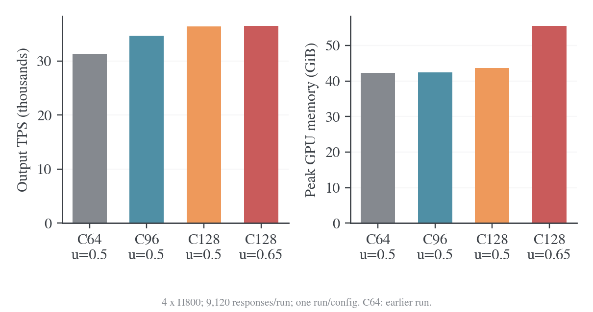

# 训练与验证性能实测

更新日期：2026-10-22。本页维护 H800 本机完整验证、子集筛选和训练优化的冻结测量。八卡旧运行与 One-Shot 对照已单独归档；当前训练指标从 E15 报告进入。各测量章节中的“当前”“待验证”以实验日期与源码版本为准。

## 阅读与比较边界

| 章节 | 回答的问题 | 证据范围 |
| --- | --- | --- |
| [完整验证与参数对照](#1-完整验证与参数对照) | 全量提交、并发、显存比例与token预算的实际收益 | H800四卡、初始checkpoint、完整570题×16及筛选子集 |
| [验证窗口筛选与多轮更新基线](#2-验证窗口筛选与多轮更新基线) | 窗口32→128、并发32→64和epochs16训练基线 | H800四卡、128题×16、4步/64次更新 |
| [本机编译与训练优化](#3-本机编译与训练优化) | eager/Graph、概率输出、batch128与decode trace | H800诊断与短训练，计时范围逐项说明 |

当前推荐参数及四卡/八卡启动方法统一见[运行与架构](2026-10-22-共享八卡运行与架构.md#验证执行配置与四卡八卡启动)。参数机制和KV容量推导见[调优文档](2026-10-22-批量大小与GPU利用率调优.md)，MFU定义见[利用率口径](2026-10-22-MFU与利用率口径.md)。本页集中维护测量证据，不维护第二份运行默认值。原始数据、图表和分析脚本仍分别位于 `docs/data/`、`docs/figures/`、`docs/scripts/`。

## 1. 完整验证与参数对照

### 1.1 条件与结论

2026-10-22 在本机 GPU0–3 的四张 H800 上完成全量提交对照及后续参数筛选。源码固定在 `b517941798ab617bb3d2609988391115f8ba27ad`，使用独立 checkout，避开并行开发中的指标改动；结果适用于这个冻结版本和初始 student checkpoint。GPU4–7 保持原任务运行。实验没有修改正式启动默认值，也没有接入新的调度 PR。

Student 为 DeepSeek-R1-Distill-Qwen-1.5B；shared_sync、四个 TP1 推理副本、BF16、CUDA Graph、chunked prefill 和 prefix caching 开启。每题采样 16 条，temperature=0.7、top-p=0.9，回答上限 31744、引擎上下文上限 35841，验证不返回 log-prob。完整集为 MATH-500 500 题、AMC23 40 题、AIME25 30 题，共 570 题、9120 条回答。筛选子集仍为前一报告中的 112/8/8 题，共 2048 条回答。

速度优先候选是全量提交、每副本并发 128、显存比例 0.65、调度 token 预算 8192。相对此前全量提交/并发 64，TPS 提高 16.55%，完整验证耗时下降 14.57%。显存预算较紧时，并发 96/比例 0.5 提供 10.79% TPS 改善，单卡峰值显存几乎不变。每个配置只完成一次自然生成；完整集的 64 并发是前一轮基线，不能把小幅差异解释为已验证的稳定优势，也不能据此宣称吞吐上限。

### 1.2 全量提交的独立收益

保持并发 64、显存比例 0.5、token 预算 8192，只改变外层验证提交窗口：

| 窗口 | 完整 valid 秒数 | 输出 token 数 | 四卡输出 TPS | GPU busy 均值 | 单卡峰值 GiB | TaskRunner 峰值 RSS GiB |
| --- | ---: | ---: | ---: | ---: | ---: | ---: |
| 128 题 | 2045.03 | 55,896,266 | 27,332.71 | 91.42% | 41.90 | 2.19 |
| 全部 570 题 | 1805.09 | 56,535,980 | 31,320.30 | 93.85% | 42.31 | 4.62 |

全量提交缩短 11.73% 的验证时间、提高 14.59% TPS，CPU 进程 RSS 增加约 2.43 GiB。两组均完成 9120 条回答且无抢占。全量通过现有 `data.val_batch_size=null` 表达；它把整套题目交给既有流程，GPU 活跃 batch 仍由 vLLM 动态调度。请求入队不等于同时为 9120 条回答分配最大长度 KV。

### 1.3 参数筛选与完整集确认

128 题子集全部一次提交，显存比例均为 0.5：

| 每副本并发 | token 预算 | valid 秒数 | 输出 token 数 | 四卡 TPS | 峰值 KV 池占用 | 抢占数 |
| ---: | ---: | ---: | ---: | ---: | ---: | ---: |
| 64 | 8192 | 513.21 | 13,108,052 | 25,541.31 | 56.75% | 0 |
| 96 | 8192 | 432.16 | 12,617,310 | 29,195.69 | 68.03% | 0 |
| 128 | 8192 | 429.08 | 12,792,644 | 29,813.89 | 76.72% | 0 |
| 128 | 16384 | 421.64 | 12,313,472 | 29,203.84 | 84.39% | 0 |

预算加倍的运行耗时稍短，但回答总长度也更短，输出 TPS 下降约 2.05%。该单次筛选没有支持把 16384 设为更优配置；它没有排除其他负载或重复测量下的收益。

完整 570 题确认使用 token 预算 8192：

| 每副本并发 | 显存比例 | valid 分钟 | 输出 token 数 | 四卡 TPS | 单卡峰值 GiB | 峰值 KV 池占用 | 抢占数 |
| ---: | ---: | ---: | ---: | ---: | ---: | ---: | ---: |
| 64，前一轮基线 | 0.50 | 30.08 | 56,535,980 | 31,320.30 | 42.31 | 62.82% | 0 |
| 96 | 0.50 | 27.14 | 56,507,846 | 34,699.91 | 42.39 | 90.61% | 0 |
| 128 | 0.50 | 26.33 | 57,513,459 | 36,412.45 | 43.63 | 100.00% | 1325 |
| 128 | 0.65 | 25.70 | 56,291,141 | 36,503.35 | 55.49 | 83.21% | 0 |



图中 C 为每个引擎的 `max_num_seqs`，u 为 `gpu_memory_utilization`；每个条件一次运行，64 并发来自此前全量验证。柱状图从零开始，数据源为[对照表](../data/valid-parameters-20261022/comparison.csv)。

128/0.5 在子集没有抢占，完整集出现 1325 次；只看子集会漏掉中段缓存压力。将比例提高到 0.65 消除了抢占，但归一化 TPS 只增加 0.25%，同时增加约 11.87 GiB 峰值显存。抢占次数不能换算成相同比例的性能损失；这些自然生成实验也没有隔离重算的独立耗时。

128/0.65 比 96/0.5 快约 5.20% TPS，完整验证少 86.39 秒，多用 13.11 GiB 显存。后者为低显存候选，前者为已测最快且零抢占的候选。

### 1.4 延迟、利用率与收尾

| 完整集配置 | GPU busy | 单卡平均功率 W | 输出 token 能耗 J/token | token 间隔均值 ms | 活跃序列合计均值 | 最后 10% 回答完成跨度秒 |
| --- | ---: | ---: | ---: | ---: | ---: | ---: |
| 64/0.50，前一轮 | 93.85% | — | — | — | 226.00 | 540.93 |
| 96/0.50 | 92.93% | 569.27 | 0.06555 | 9.51 | 329.41 | 272.74 |
| 128/0.50 | 91.71% | 590.45 | 0.06475 | 11.57 | 417.88 | 343.11 |
| 128/0.65 | 90.30% | 582.02 | 0.06370 | 11.39 | 416.36 | 331.06 |

能耗为四卡 NVML 功率采样积分除以输出 token，排除启动，未计 CPU/整机能耗。token 间隔是引擎 Prometheus histogram 的 sum/count，不能直接等同于每次调度的固定耗时。采样中的 GPU busy 没有随 TPS 单调增长；busy 不是 FLOPs 或 HBM 带宽利用率。

“最后 10%”指成功完成数从 8208 到 9120 的跨度，仍包含 912 条回答的有效生成，不是可全部消除的空闲时间。各组回答长度不同，不能把跨度差额全部归因于调度浪费。增加并发会增加同时在跑的回答，也会增加单条回答的 token 间隔，因此 TPS 不随并发线性增长。所有完整集采样均未见某实例完全闲置、同时其他实例还有 waiting 的组合；这一采样结果不证明不存在短时负载不均。

### 1.5 正确性与证据

后续参数实验共 7 组、35,552 条回答，全部进程退出 0，题目数及每题 16 条回答完整，评分失败数为 0。与前一轮全量 64 并发相比，96/0.5、128/0.5、128/0.65 的平均分差分别为 +0.12、−0.32、+0.16 个百分点；按题目配对的 10000 次 bootstrap 95% 区间分别为 [−0.57,+0.81]、[−1.02,+0.38]、[−0.46,+0.78]。这不是多随机种子非劣检验。

[证据目录](../data/valid-parameters-20261022)归档两轮完整集、四个子集的统计、配置、退出码、W&B 历史、压缩引擎/NVML 采样、质量配对结果，以及模型配置和容量复算。原始回答、完整 console、离线 W&B 文件与实验启动脚本分别保留在仓库根目录 `outputs/full-validation-20261022/` 和 `outputs/valid-parameters-20261022/`。归档不包含完整回答正文。

```bash
# 在仓库根目录，无需 GPU，独立复算计时、成功计数、TPS、抢占和显存。
python examples/mirroropd/docs/data/valid-parameters-20261022/verify_evidence.py
python examples/mirroropd/docs/data/valid-parameters-20261022/calculate_capacity.py

# 本机复现实验：固定测速源码，原生 Python，仅使用 GPU0–3。
bash outputs/valid-parameters-20261022/run_valid.sh
VALID_PRESET=balanced bash outputs/valid-parameters-20261022/run_valid.sh
```

本机实验脚本会重建冻结 checkout，并检查显卡占用；`outputs/` 不随源码包默认传输。跨机器复测使用既有领域入口和[参数覆盖](2026-10-22-批量大小与GPU利用率调优.md#已验证配置与后续扩展)，按目标机器设置资产与原生 Python 路径。实验当时保留旧默认；后续落地的数学默认及覆盖方法以[训练配方](../训练配方.md)为准，冻结实验数据保持原值。训练后 checkpoint、目标 A100/A800 八卡和完整训练/验证切换尚未按这些新候选验收。

## 2. 验证窗口筛选与多轮更新基线


### 2.1 实验目标与固定条件

2026-10-22 使用本机 GPU0–3 的四张 H800 80GB，GPU4–7 保持其他任务运行。源码基点为 `fb169fa7f`。实验先验收当前逐更新指标下的 shared_sync 短训练，再比较冻结 checkpoint 的验证请求供给；训练 prompt/mini64、更新算法、学习率和生成长度不作为验证调优变量。

最新云端 E8–E11 使用 epochs16，A100/A800 八卡整步约 118–119 秒，actor 约 74 秒、rollout 批次约 32 秒；前 100 步的两次验证占训练加验证时间约 35%–36%。这些数据用于决定优化优先级，不能替代本机同条件对照。原始云端参照见 E10 运行。[^wandb-e10]历史 eager/Graph 和验证窗口 16/32 的结果见[前一轮测量](#3-本机编译与训练优化)。

| 项目 | 固定值 |
| --- | --- |
| Student / teacher | DeepSeek-R1-Distill-Qwen-1.5B / JustRL-DeepSeek-1.5B |
| 资源 | shared_sync，四个 TP1 student 副本，独立 teacher pool0 |
| 环境 | Torch2.11.0+cu128、vLLM0.25.1+cu129、Transformers5.12.1、Ray2.56.1、TransferQueue0.1.11、FlashAttention2.8.3 |
| Rollout | 编译与 CUDA Graph；推理 token 预算 8192；GPU memory utilization0.5 |
| 验证预算 | MATH-500 112 题、AMC23 8 题、AIME25 8 题；每题 16 次，共 2048 条回答 |
| 验证采样 | temperature0.7、top-p0.9、top-k 关闭、response 上限 31744 |
| 生成概率 | 验证不返回 log-prob；训练保留实际行为概率 |
| 观测 | 离线 W&B、每秒四卡 NVML、约每两秒四引擎 Prometheus |

子集使用 NumPy `default_rng(42)`，按 MATH-500、AMC23、AIME25 顺序无放回选择 112/8/8 行，再按源行号排序。选中行号和软件版本保存在[数据目录](../data/rollout-tuning-20261022)。每个条件重新初始化同一个 student checkpoint；不加载短训后的权重。

### 2.2 计时与验收

验证速度以完整 `_validate()` 墙钟和四个引擎累计的实际输出 token 数计算。该 timer 包含窗口等待、生成、判分、CPU 解码与结果聚合，不包含模型和 Ray 初始化。独立作业墙钟另列。自然停止的回答长度会随调度变化，须同时比较完成时间和 token/s。

完整性要求 2048 条最终回答、128 个题目 UID 组、每组恰好 16 条；四个引擎成功计数之和必须也是 2048，累计 generation token 与 request generation token sum 一致。NVML GPU busy 表示采样窗口内设备工作的时间比例；actor MFU 只描述训练阶段，验证提速不等于 actor MFU 提高。

实验矩阵依次为窗口 32/并发 32、窗口 128/并发 32、窗口 128/并发 64。提高窗口增加等待请求的供给；提高并发改变每个引擎同时运行的序列上限。两者独立比较，保持词表概率、评测题目和回答次数不变。

### 2.3 当前代码的四卡训练基线

E10 短训使用 epochs16、D0，关闭验证与保存，完成 4 个外层 step、64 次实际 optimizer 更新。逐更新坐标连续且 attempts 等于实际更新数，非有限概率比例为 0；进程退出码为 0。首步 145.16 秒包含预热，第 2～4 步作为主窗口。

| 第 2～4 步平均指标 | 实测值 |
| --- | ---: |
| 完整训练 step | 98.55 秒 |
| rollout batch 跨度 | 21.25 秒 |
| rollout 整体流程 | 24.89 秒 |
| teacher forward / transfer | 1.29 / 0.94 秒 |
| old-log-prob | 2.75 秒 |
| actor 阶段，16 次更新 | 67.06 秒 |
| actor 阶段平均每次更新 | 4.19 秒 |
| actor MFU | 30.43% |
| 新 response token/训练秒 | 3895.48 |
| FSDP 累计 allocated 高水位最大值 | 19.85GiB |
| actor reserved 高水位 | 20.78GiB |

MFU 使用 H800 的 989TFLOP/s 查表分母，与 A100/A800 的 312TFLOP/s 不同，不能直接用百分数高低比较两台机器的实际速度。Rollout 跨度与整体流程重叠，不能相加。第 4 步生成后收尾较长，完整 step 高于第 2、3 步；保留全部稳态步骤，不仅报告最快点。

离线 W&B 为`9jua8ru3`，含启动和清理的作业墙钟 708.52 秒。[原始配置、history、NVML 及退出状态](../data/rollout-tuning-20261022/train-baseline)可复核。训练结束后有 W&B 退出回调的 ConnectionResetError，退出码仍为 0，64 次更新记录完整；该清理问题未在此轮修改。

第一次启动因 Ray 临时目录过长而在 GPU 计算前失败，日志保留在`outputs/rollout-tuning-20261022/rollout-tuning-train-graph-20261022-baseline/`；成功重跑将临时目录缩短为`/tmp/rt22-t-b2`。失败启动不纳入上述性能统计。

### 2.4 验证窗口与并发的结果

所有运行完整完成 2048 条回答、128 个题目组、每组 16 条，四个引擎成功计数与导出结果一致；generation token 计数等于 request generation token sum，评分失败数为 0。前三组筛选后，按完整验证墙钟选择窗口 128/并发 64，再独立重跑一次确认。四组退出码均为 0。

| 窗口 / 单引擎并发 | 验证秒数 | 实际输出 token | 输出 token/s | GPU busy 均值 | 整卡显存峰值 GiB | KV 占用峰值 | 抢占次数 |
| --- | ---: | ---: | ---: | ---: | ---: | ---: | ---: |
| 32 / 32 | 812.82 | 12,767,515 | 15,708 | 82.99% | 41.83 | 35.11% | 0 |
| 128 / 32 | 637.85 | 13,101,320 | 20,540 | 90.81% | 41.85 | 39.25% | 0 |
| 128 / 64 | 507.30 | 12,974,433 | 25,575 | 90.76% | 41.95 | 60.19% | 0 |
| 128 / 64，确认 | 476.09 | 12,504,799 | 26,266 | 87.10% | 41.92 | 49.50% | 0 |

窗口 128/并发 64 的两次运行平均验证耗时为 **491.70 秒**，相对窗口 32/并发 32 的 812.82 秒降低 **39.51%**。用两次输出 token 总量除以总时间，吞吐为 **25,910 token/s**，相对基线提高 **64.95%**。独立作业含启动/清理的平均墙钟为 750.90 秒，基线为 1074.45 秒，整体加速 1.43 倍。正式训练中的周期验证不重复支付这部分模型与 Ray 初始化成本。


图中胜出配置的验证耗时和 busy 取两次运行均值；TPS 用总 token/总时间；显存取两次观察最大值。单次自然停止生成的输出量不同，没有把生成长度减少直接计作执行加速。原始每次结果见上表。

#### 2.4.1 请求供给与最后的长尾

基线四个窗口的“90% 回答完成到全部完成”分别为 76.7、93.5、79.1、72.1 秒。窗口 128 只保留一个窗口边界，减少反复排空；但同一窗口中最长回答仍需完成。窗口 128/并发 32 的尾部为 146.5 秒，并发 64 首次为 164.2 秒。不能直接相加这些尾部当成可完全消除的时间，因为窗口大小和请求集合不同。

| 配置 | 采样时四卡活跃请求均值 | 全部等待队列为空的采样比例 | 活跃请求总数小于 16 的比例 | 至少一个副本空闲的比例 |
| --- | ---: | ---: | ---: | ---: |
| 32 / 32 | 67.65 | 63.61% | 24.85% | 26.92% |
| 128 / 32 | 101.01 | 24.06% | 12.78% | 12.78% |
| 128 / 64 | 176.23 | 40.67% | 12.44% | 12.44% |
| 128 / 64，确认 | 171.31 | 41.21% | 14.07% | 17.09% |

这些比例来自约每两秒的完整四引擎采样，不是精确连续时间积分。引擎最终的抢占计数为 0，较大窗口确实增加了等待请求，但没有将全部等待请求变成活跃 KV。KV pool 仍按 memory utilization0.5 预留，实际 KV 使用增加不等于整卡预留显存按同样比例增加。

窗口 128/并发 32 与窗口 128/并发 64 首次的 GPU busy 都约 91%，TPS 仍从 20540 提高到 25575。增加活跃序列改善每次执行承载的工作量，busy 本身不能区分这项效率收益。这里没有定义或报告推理 MFU；actor MFU 仍只引用前述短训基线 30.43%，不将验证 busy 改名为 MFU。

#### 2.4.2 输出与质量边界

固定初始 student checkpoint、题目、采样参数、回答次数和长度上限；未使用训练后 checkpoint。执行调度和 batch 形状变化会改变随机生成，回答不逐 token 相同。下表按相同输入题目配对，以题目为单位进行 10000 次 bootstrap，仅描述该子集的随机差异，不是非劣性检验，也不证明模型质量提升。

| 配置 | 子集平均正确率 | 相对基线差值，百分点 | 题目配对 bootstrap 95% 区间，百分点 |
| --- | ---: | ---: | --- |
| 128 / 32 | 79.10% | -1.37 | [-2.83, +0.10] |
| 128 / 64 | 79.59% | -0.88 | [-2.05, +0.24] |
| 128 / 64，确认 | 80.62% | +0.15 | [-1.22, +1.51] |

基线子集正确率 80.47%。完整 570 题、训练后 checkpoint 和目标 A100/A800 八卡尚需独立复测；不能把这里的 H800 四卡倍数直接承诺给目标八卡。模型更大、上下文更长或显存更小时也需重新测量。

### 2.5 默认参数与使用

数学入口默认改为`VAL_BATCH_SIZE=128`、`ROLLOUT_MAX_NUM_SEQS=64`，Graph capture sizes 自动覆盖 64；显存比例 0.5 和推理 token 预算 8192 保持原配置。训练 batch、mini-batch、epochs、loss 和评测频率由各自配方控制；E7–E12 仍使用 epochs16、200 步、50 步评估、100 步保存、无初始验证。Coding 和 IF 入口保留窗口 32/并发 32，因为这轮没有测试其判分压力和长尾。

```bash
# 原数学/E系列入口自动使用新的执行默认值。
bash examples/mirroropd/run_math_opd_ablation_fsdp2.sh E10

# 同一配方回退到本轮基线。
VAL_BATCH_SIZE=32 ROLLOUT_MAX_NUM_SEQS=32 \
  bash examples/mirroropd/run_math_opd_ablation_fsdp2.sh E10

# 仅增加验证供给窗口，保留并发32。
VAL_BATCH_SIZE=128 ROLLOUT_MAX_NUM_SEQS=32 \
  bash examples/mirroropd/run_math_opd_ablation_fsdp2.sh E10
```

### 2.6 证据与复现

[数据目录](../data/rollout-tuning-20261022)包含题目选择行号、软件版本、训练基线、验证运行的 launch/exit/history/config、压缩 NVML 和 Prometheus 采样、配置 diff、质量配对结果及绘图输入。完整生成文本和终端日志保留在本机`outputs/rollout-tuning-20261022/`，不放入源码包。运行脚本限定 GPU0–3，并在启动前检查显存；结束只清理自己创建且 PID 身份匹配的子进程，没有执行全局`ray stop`或操作 GPU4–7。

复算脚本保存在数据目录的`scripts/`。`python examples/mirroropd/docs/data/rollout-tuning-20261022/scripts/verify_evidence.py`无需 GPU 或原始生成文本，可独立核对已归档的计数、评分、token 总量、TPS 和退出状态。实验启动脚本保留本机路径，应按目标机器调整模型、数据和 Python 位置。原始运行目录布局下使用`analyze_validation.py`导出统计，`check_configs.py`核对配置差异、完整回答数和评分失败数，`quality_check.py`做题目配对。绘图脚本读取`analysis.json`，生成 PNG/PDF 并执行图形审计。离线 W&B 历史通过原生 SDK 读取，实验没有上传云端。

80 项启动配置 CPU 测试通过；四个验证 run 的配置差异、UID/session 计数、评分失败数、引擎 token 计数和 TPS 均通过独立复算；Bash 语法、Markdown 链接和图形审计通过。已有 W&B 进程退出回调连接重置仍可能打印在正常结束之后，本轮四个验证 run 的退出码、回答完整性和历史记录均通过检查，未改动该清理路径。

## 3. 本机编译与训练优化

### 3.1 共享四卡训练对照

本机前四张 H800 的完整 `shared_sync` 短训练已通过两组各 5 步对照。排除首步后，整步均值从 **94.36 秒降到 35.93 秒，提速 2.63 倍、耗时降低 61.93%**。按实际有效 token 总量除以训练时间归一化，吞吐提高 2.62 倍；两组平均 token 量仅差 0.16%。主要变化在 student 生成，teacher、old log-prob、actor 更新和权重同步时间基本相同。

生成阶段 GPU busy 样本均值从 31.71% 升到 88.92%，整卡显存均值仅从 41.89 增到 42.08GiB。结合[独立 decode trace](#3114-decode-trace证据)，证据支持 eager 执行间隙是原有低吞吐的重要原因。`enforce_eager=False`同时启用默认编译优化和 CUDA Graph，这里报告的是联合执行模式收益。

本页集中维护本机decode、完整短训练、batch128和验证子集的测量；各实验的计时范围独立。Batch概念、论文调研与后续建议见[批量大小与利用率调优](2026-10-22-批量大小与GPU利用率调优.md)，A800 目标环境的 4+4/shared 八卡数据仍见[原运行对照](#4-八卡历史与one-shot对照)。本机四卡结果不能替代目标八卡的验证。

### 3.2 对照条件与完成范围

| 项目 | 两组共同设置 |
| --- | --- |
| 硬件 | 本机 GPU0–3，4×H800 80GB；GPU4–7 保持其他任务运行 |
| 训练源码 | `05bcb330152dc5172ac87c4279ca8e5c67546e90`；工作区已有文档排版修改，不影响执行代码 |
| 环境 | Python3.12.11、Torch2.11.0+cu128、vLLM0.25.1+cu129、Transformers5.12.1、Ray2.56.1、TransferQueue0.1.11、FlashAttention2.8.3、W&B0.28.1 |
| Attention | FSDP 使用本机编译的 FA2；vLLM 在 H800 上选择 FA3 |
| 模型 | DeepSeek-R1-Distill-Qwen-1.5B student、JustRL-DeepSeek-1.5B teacher |
| 数据 | 相同本地 DAPO 文件，读取并过滤后 17917 题；相同 shuffle seed42 |
| 资源布局 | `shared_sync`，student pool4、独立 teacher pool0、rollout TP1 |
| 算法预算 | prompt batch64、n1、更新 mini64、ppo_epochs1；lr1e-6、常数调度、无 warmup |
| 长度与采样 | prompt 上限 4096、训练 response 上限 7168；T1、top-p1、top-k 关闭 |
| 运行时 | vLLM memory0.5、max_num_seqs32、调度 token 预算 8192；FSDP 动态 token 预算 32768；保留参数/优化器 offload 和激活重算 |
| 测试边界 | 各运行 5 步；关闭周期验证和 checkpoint 保存；没有启用 profiler |
| 观测 | 默认 trainer 指标和离线 W&B；开启 vLLM 统计与 INFO；外部约 1 秒逐卡 NVML 采样 |

解析后的配置逐字段比较，除实验名称、输出/Ray 临时目录及派生 trace 名称外，唯一不同的训练配置是 `actor_rollout_ref.rollout.enforce_eager=True/False`。两组都指定 capture sizes `[1,2,4,8,16,32]`，eager 模式会禁用 capture。完整差异保存在[analysis.json](../data/local-shared4-20261021/analysis.json)。

两组均正常完成 5 次生成、teacher 评分、actor 更新和权重同步，退出码为 0。Graph 日志确认四个副本均成功 capture，每副本报告约 0.17GiB 图内存；后续多轮 sleep/wake 与权重同步完成，所有训练标量有限。没有执行 checkpoint 恢复、完整验证或长期稳定性测试，也没有独立验证参数更新前后的逐 token 数值等价。

### 3.3 逐阶段耗时

主窗口为 step2–5，每组 4 步。首步包含 worker 首次使用、JIT 及其他初始化开销，单独列出。所有时间为调用/阶段墙钟，不是纯 kernel 时间。

| 阶段 | Eager 秒/步 | 编译/Graph 秒/步 | 变化 |
| --- | --: | --: | --: |
| `gen`：生成等待、后处理完成与 sleep | 82.761 | 24.197 | −58.564 |
| teacher 搬入/搬出 | 0.884 | 0.877 | −0.007 |
| teacher forward | 1.323 | 1.303 | −0.020 |
| old log-prob | 2.758 | 2.702 | −0.056 |
| advantage | 0.085 | 0.081 | −0.004 |
| actor update | 5.625 | 5.801 | +0.176 |
| 权重同步 | 0.829 | 0.871 | +0.042 |
| 未分解剩余时间 | 0.095 | 0.093 | −0.002 |
| **完整 step** | **94.360** | **35.926** | **−58.434** |

`gen`缩短 3.42 倍，actor 更新没有提速。原 step 约 87.7% 时间在`gen`，因此改善生成足以降低整步成本；Graph 后`gen`仍约占 67.4%。

| 补充口径                          |     Eager | 编译/Graph |
| --------------------------------- | --------: | ---------: |
| `rollout_batch`均值，独立跨度     | 80.009 秒 |  21.178 秒 |
| 平均有效 prompt+response token/步 | 405865.75 |  405209.25 |
| 全局有效 token/s，按总量/总时间   |   4301.26 |   11279.04 |
| 平均 response 长度                |   6234.51 |    6224.25 |
| response 达到上限的比例           |    66.80% |     66.02% |
| 首步耗时                          | 146.94 秒 |   87.15 秒 |
| 5 步训练 timer 合计               | 524.38 秒 |  230.85 秒 |
| 从启动到清理的观测墙钟            | 780.18 秒 |  504.52 秒 |

整段短作业的墙钟仅改善约 1.55 倍，因为两组还有约 256/274 秒的启动、日志和清理时间未计入 step。该差值不是纯编译时间；固定成本在更长训练中的占比会下降。没有把安装依赖、编译 FlashAttention 的时间记入训练 timer。

每步时间保留如下，避免只展示最好的一步：

| Step    | Eager 秒 | 编译/Graph 秒 |
| ------- | -------: | ------------: |
| 1，预热 |   146.94 |         87.15 |
| 2       |    93.53 |         33.69 |
| 3       |    91.80 |         41.55 |
| 4       |    92.56 |         34.58 |
| 5       |    99.55 |         33.88 |

#### 3.3.1 计时边界与生成后收尾

`rollout_batch`从 driver 提交边界到最后一个 student generate 返回；`gen`从`prepare_step()`之后开始，等待完整题目组完成并执行 sleep。二者重叠但不保证包含关系，不能相加，也不能无条件把差值叫作 verifier 时间。

首步的`rollout_batch`可大于`gen`：eager 为 108.50/98.24 秒，Graph 为 50.03/44.25 秒，原因是提交和首次准备发生在`gen`计时开始之前。主窗口的分解来自各自独立 timer，GPU 阶段反推只使用可相加的阶段，未重复加`rollout_batch`。

Graph step3 的`rollout_batch`为 20.76 秒，`gen`为 30.20 秒；其余 Graph 稳态步的`gen-rollout_batch`约 0.62–1.10 秒。Eager step5 也出现约 8.09 秒差距。现象指向生成后判分/TQ/完成状态汇总/sleep 路径的长尾；代码中数学判分存在秒级超时机制，但现有指标无法将这 9.44 秒完全归因于某个判分函数。后续应在该路径定点加计时，再决定是否调整调度。

### 3.4 GPU 与显存

按 W&B `_timestamp`和互斥阶段 timer 反推阶段，扣除未分解残差并在两端各留 1 秒 guard；每个采样时刻汇总四张卡。约 1 秒采样仍不能捕获所有瞬时峰值，也不是 SM occupancy 或 FLOP 利用率。

| 阶段与指标                                   |    Eager | 编译/Graph |
| -------------------------------------------- | -------: | ---------: |
| 生成阶段有效采样时刻                         |      304 |         83 |
| 生成阶段 GPU busy 均值                       |   31.71% |     88.92% |
| 生成阶段每卡整卡显存均值                     | 41.89GiB |   42.08GiB |
| 生成阶段整卡显存观测最大值                   | 41.99GiB |   42.25GiB |
| actor 更新阶段有效采样时刻                   |       14 |         12 |
| actor 更新阶段 GPU busy 均值                 |   91.00% |     94.58% |
| actor 更新阶段整卡显存观测最大值             | 23.61GiB |   23.04GiB |
| FSDP 全 rank 进程累计 allocated 高水位最大值 | 19.87GiB |   18.57GiB |

Graph 显存增加约 0.19GiB/卡，GPU busy 明显提高。FSDP 高水位与 vLLM 独立进程的整卡占用是不同口径；两组随机回答和动态打包不同，不能把 FSDP 高水位的差异归因于 Graph 节省了反向传播显存。Teacher 和权重同步阶段太短，在保守窗口内没有有效采样；old log-prob 也仅 2/3 个采样时刻，不据此比较其 GPU 效率。

vLLM 运行日志中的最大 Waiting 均为 0，KV 使用率观测最大值为 7.4%/6.6%。`rollout/preemptions`仍因后端未完整提供计数而缺测，不能记为 0 次抢占。这里支持的是未见排队/KV 容量压力，不是 GPU 计算或带宽已经达到理论上限。

### 3.5 数值与指标完整性

| 主窗口指标                           |    Eager | 编译/Graph |
| ------------------------------------ | -------: | ---------: |
| sampled-token distillation loss 均值 |  0.11019 |    0.11130 |
| actor grad norm 均值                 |  1.22949 |    1.22751 |
| actor entropy 均值                   |  0.87657 |    0.87492 |
| rollout/FSDP k3 KL 均值              | 0.000601 |   0.000631 |
| distillation pg_clipfrac             |        0 |          0 |
| 训练 verifier score 均值             |  0.35938 |    0.31250 |

两组 5 步全部标量有限，没有出现 loss/梯度的明显数值异常。K3 KL 描述两种概率计算后端之间的偏差，不是独立的参数同步正确性证明。没有使用 bitwise 确定性采样，四个稳态 batch 也不足以评估质量优劣；训练 verifier 分数的差异不能解释为 Graph 降低模型质量。两组没有运行验证集。

离线 W&B 分别为`cy5nr43p`和`tzzdwjer`，各自 5 条 history 已从`.wandb`文件读取并核对。尚未上传云端。两组在 W&B 输出 run summary 之后，都出现退出回调中的`ConnectionResetError`；它发生在训练完成和指标保存之后，命令退出码均为 0。短训练可用性已验证，退出清理仍保留这项已知问题。

### 3.6 四卡训练复现命令

沿用现有领域脚本。以下命令仅用于明确已分配的本机 GPU0–3，切换模式时使用新的实验名和输出目录：

```bash
CUDA_VISIBLE_DEVICES=0,1,2,3 STUDENT_GPUS=4 TEACHER_GPUS=0 \
  MODEL_ROOT=/mnt/tidalfs-bdsz01/dataset/llm_dataset/zkn_data/fht_data/models \
  DATA_ROOT=/mnt/tidalfs-bdsz01/dataset/llm_dataset/zkn_data/fht_data/MD-OPD/data \
  PYTHON_BIN=/root/.local/share/mirroropd/venvs/profile-cu128/bin/python \
  ROLLOUT_ENFORCE_EAGER=False TEST_FREQ=-1 SAVE_FREQ=-1 \
  EXPERIMENT_NAME=local-shared4-graph-new WANDB_MODE=offline RAY_DEDUP_LOGS=0 \
  bash examples/mirroropd/run_math_deepseek_r1_1_5b_fsdp2.sh \
  trainer.total_training_steps=5 \
  actor_rollout_ref.rollout.disable_log_stats=False \
  'actor_rollout_ref.rollout.cudagraph_capture_sizes=[1,2,4,8,16,32]' \
  ++ray_kwargs.ray_init.runtime_env.env_vars.VLLM_LOGGING_LEVEL=INFO \
  ++ray_kwargs.ray_init.num_gpus=4 \
  ++ray_kwargs.ray_init.num_cpus=64 \
  ++ray_kwargs.ray_init.include_dashboard=False \
  ++ray_kwargs.ray_init.object_store_memory=4294967296 \
  ++ray_kwargs.ray_init._temp_dir=/tmp/local-shared4-graph-new-ray
```

完整命令和显式环境覆盖保存在每组`launch.json`。本机额外安装了训练、TransferQueue、判分依赖，并以当前 Torch 源码编译 FlashAttention2.8.3，设置`CUDA_HOME=/usr/local/cuda`、`FLASH_ATTN_CUDA_ARCHS=90`、`NVCC_THREADS=2`。BF16 packed GQA 前向/反向和 Ray 四卡隔离均先行通过。本机 sm90 构建只用于 H800，不作为 A800 离线安装包。版本清单见[requirements.freeze.txt](../data/local-shared4-20261021/requirements.freeze.txt)。

后续验收与调参顺序统一见[批量大小与GPU利用率调优](2026-10-22-批量大小与GPU利用率调优.md)。公共配方已在`5b3ccdd30`将Graph设为默认；这里记录的两组历史运行仍以各自冻结配置为准。

### 3.7 证据位置

| 内容 | 位置 |
| --- | --- |
| 汇总、配置差异、GPU 阶段样本统计 | [analysis.json](../data/local-shared4-20261021/analysis.json) |
| Eager 离线 history、解析配置、命令、退出状态和 GPU 样本 | [eager 目录](../data/local-shared4-20261021/eager) |
| Graph 离线 history、解析配置、命令、退出状态和 GPU 样本 | [graph 目录](../data/local-shared4-20261021/graph) |
| Eager/Graph关键生命周期与引擎统计 | [eager 证据](../data/local-shared4-20261021/eager/runtime-evidence.txt)、[graph 证据](../data/local-shared4-20261021/graph/runtime-evidence.txt) |
| 完整本机日志、监控与复算脚本 | `outputs/local-shared4-20261021/` |

两组结束后 GPU0–3 均释放至约 1MiB、busy0；GPU4–7 继续原有任务。未连接远端训练机，也未启动八卡作业。

### 3.8 验证对照的设计与测量

32题×16子集的testing从804.66降至177.53秒，按实际输出token归一化吞吐4.31倍；独立作业含启动为2.45倍。完整570题和目标八卡的收益仍未测到。

所有正式对照通过现有数学领域脚本启动 V1 shared_sync trainer，使用 GPU 0–3、四个 TP1 student 推理副本、同一个初始 DeepSeek-R1-Distill-Qwen-1.5B checkpoint。配置为 `val_before_train=True`、`val_only=True`；actor 和 teacher 正常初始化，未执行参数更新。环境沿用本页共享四卡训练的 Python 3.12、PyTorch 2.11.0、vLLM 0.25.1、H800 环境。

固定子集从 MATH-500、AMC23、AIME25 中分别取 28、2、2 题，行号保存在[selection.json](../data/validation-optimization-20261021/selection.json)。每题采样 16 次，temperature=0.7、top-p=0.9、top-k=-1；prompt 上限 4096，response 上限 31744。完整覆盖校验为 32 个题目 UID 组，每组 16 条，共 512 条。各引擎的完成请求计数之和也为 512，输出 token 计数与请求输出长度累计相等。

引擎 `max_num_batched_tokens=8192`、`gpu_memory_utilization=0.5`；除最后一项并发试验外，`max_num_seqs=32`。所有 Graph 试验同时启用 vLLM 编译，不能将结果解释成只开 CUDA Graph、其他编译行为完全不变。

| 正式运行 | 执行方式 | 窗口题数 | 单引擎并发上限 | 返回概率 | 验证时间（秒） | 输出 token | 输出 token/s | GPU busy 均值 | GPU 显存峰值（GiB） |
| --- | --- | --: | --: | --- | --: | --: | --: | --: | --: |
| A | eager | 16 | 32 | 是 | 804.66 | 2,623,755 | 3,261 | 33.97% | 41.65 |
| B | 编译＋Graph | 16 | 32 | 是 | 300.21 | 2,655,694 | 8,846 | 79.25% | 41.82 |
| C | 编译＋Graph | 32 | 32 | 是 | 206.98 | 2,766,943 | 13,368 | 82.64% | 41.80 |
| D | 编译＋Graph | 32 | 32 | 否 | 177.53 | 2,496,643 | 14,063 | 73.16% | 41.79 |
| E | 编译＋Graph | 32 | 64 | 否 | 178.46 | 2,612,812 | 14,641 | 72.50% | 42.05 |

`testing` 是 `_validate()` 的墙钟时间，包含 CPU 调度、首批等待、生成、判分和结果聚合；不包含进入函数之前的模型初始化。吞吐定义为实际输出 token 总数除以 testing，不是引擎忙碌时的瞬时速度。GPU busy 来自约每秒一次的 NVML 采样，在 testing 区间内取四卡均值；它表示采样窗口内 GPU 有工作的时间比例，不表示 Tensor Core FLOPs 利用率。GPU 显存是 NVML 进程共存期间的整卡用量，不能与后文 FSDP allocator 峰值直接相减。

从整个独立进程启动到退出，A/B/C/D/E 分别耗时 1065.82/552.59/467.64/435.30/469.98 秒。A→D 的独立作业总时间加速为 **2.45 倍**，小于验证函数内的4.53倍。启动包含Ray、teacher/actor/vLLM初始化和Graph准备，且这些重复实验复用本机缓存，不是每次清空编译缓存的冷启动测量；正式训练中的周期验证也不会每轮重建这些进程。

#### 3.8.1 各项优化的贡献

**编译＋Graph 是最大收益来源。** A→B 的输出量接近，总时间减少 62.7%，输出吞吐提高到 2.71 倍。此前短 CUDA trace 已观察到 eager 的 kernel 发射间隙；这里的验证实验与该机制一致。模型初始化和编译成本不在这张表内，正式长训练应同时计入一次性启动成本。

**增加提交窗口降低反复排空的成本。** B→C 将每窗口从 16×16=256 条回答改为 32×16=512 条，四个引擎的总活跃上限仍为 128；增加的是等待队列，不是每张卡同时处理的序列上限。时间减少 31.1%，输出量增加 4.2%，输出吞吐提高 51.1%。当前 trainer 等上一窗口全部结束后才提交下一窗口，窗口中的长回答会让已空闲的引擎等待。

每两秒采样一次完成计数估算的“窗口内 90% 回答完成到全部完成”的尾部时间，在 A 的两个窗口分别为 239.6/201.4 秒，在 B 为 77.0/66.7 秒，C 的单个大窗口为 88.8 秒。该测量支持减少窗口边界等待的解释；输出长度本身也有变化，不能将全部差值归因于窗口大小。当前没有实现跨窗口持续投喂。

**验证不返回概率，固定工作量实验约有 5% 收益。** C→D 的总时间下降 14.2%，但输出 token 同时减少约 9.8%；归一化吞吐只增加 5.2%。为分离生成长度影响，另做了单卡固定工作量实验：同 32 题，每条强制 2048 token、忽略 EOS、关闭 detokenize，为每条请求固定 seed，顺序为“有、无、无、有、有、无”概率，两个路径都预热。六次生成的 token ID 逐个相同；保留概率平均 6.7392 秒，不返回概率平均 6.4099 秒，吞吐提高 5.14%。原始重复数据见[fixed-logprobs.json](../data/validation-optimization-20261021/fixed-logprobs.json)。

vLLM 0.25.1 在 `processed_logprobs` 模式下，原生采样路径仍可能计算中间 log-softmax；禁用请求概率主要省去 gather、结果输出及后续传输，不能声称消除了全部概率计算。[^vllm-sampler] 本仓不修改 vLLM sampler，不改变训练所需的概率语义。

**max_num_seqs=64 暂不设为默认。** D→E 的 token 吞吐增加约 4.1%，总时间为 177.53→178.46 秒，单次测量不足以确认稳定收益。E 的排队峰值由每引擎 80 降到 44，但验证尾部仍约 76.5 秒。五项正式运行均无 KV preemption，采样到的 KV 占用峰值为 10.7%–17.2%。当前瓶颈不是已经耗尽 KV 容量；直接把显存比例加到 0.75 没有对应证据。

#### 3.8.2 保留的异常与证据边界

首次“不返回概率＋窗口32”观察得到 **280.39 秒、2,848,256 个输出 token**，比 C 慢。该次验证完成后，调试期间修改了正在执行的 Bash 源文件，导致 shell 在 Python 退出后继续读取新位置的代码并意外再次启动训练；第二次启动被取消。第一段验证记录保存在[exploratory observation](../data/validation-optimization-20261021/valid-graph-w32-20261021-2/observation.json)，未混入正常退出的五项正式对照。

这次较慢观察包括明显更长的首个 token 前等待，无法仅凭已有记录确定等待来自哪一层。它说明单次自然停止生成的 testing 不能独立证明概率开关的因果收益。因此同时保留该观察、干净重跑 D，以及固定 seed、固定 token 数的重复实验。launcher 已增加退出保护，并用会在子进程运行期间追加源码的 CPU 测试复现旧问题、验证修复。

这些实验仍有边界：正式表每配置一次，checkpoint 为初始模型；小子集不代表完整验证长度分布；改变 batch 调度会改变随机采样结果，平均答题得分约 0.775–0.795 仅用于检查明显异常，不能判定精度提升或统计等价。完整 570×16 验证、训练后 checkpoint 的验证，以及目标八卡环境尚需独立测量。部分成功运行在 W&B 退出清理时打印连接重置，历史记录完整且主进程退出码为 0；没有把这些日志当作 GPU 算子失败。

### 3.9 四卡训练 batch64→128 的实测

比较相同编译＋Graph 路径，保持每卡 actor/teacher token budget=32768、训练 n=1、ppo_epochs=1。batch64 的稳态窗口取旧实验 step2–5，batch128 取新实验 step2–3；两侧各生成 256 条回答。排除各自首步的一次性成本。batch128 的三步均完成，标量指标均有限；未在这个短训练里执行验证和 checkpoint 保存。

| 阶段或指标 | batch64、mini64 | batch128、mini128 |
| --- | --: | --: |
| 单步总时间（秒） | 35.926 | 47.404 |
| rollout gen（秒） | 24.197 | 28.186 |
| teacher transfer（秒） | 0.877 | 0.947 |
| teacher forward（秒） | 1.303 | 2.400 |
| old log-prob 重算（秒） | 2.702 | 4.458 |
| actor update（秒） | 5.801 | 10.284 |
| 更新 rollout 权重（秒） | 0.871 | 0.860 |
| 每步有效 token（prompt＋response） | 405,209 | 819,469 |
| 有效 token/s，按总时间计算 | 11,279 | 17,287 |
| FSDP 累计各 rank 最大 allocated 峰值（GiB） | 18.574 | 19.217 |

数值见[batch-comparison.json](../data/validation-optimization-20261021/batch-comparison.json)。阶段 timer 的语义沿用[指标与验收](2026-10-21-指标与验收.md)，不要把存在包含或重叠关系的所有 timer 相加推算总时间。

batch128 每卡名义生成请求从 16 增到 32，rollout 时间只增加 16.5%，生成量约翻倍；teacher 与 actor 需要处理更多 token，耗时接近相应增加。权重同步等固定成本被更多样本分摊。micro token 预算保持不变，因此通过增加内部 micro-batch 数量处理更多数据，显存峰值只增加约 0.64 GiB。两侧的采样策略轨迹和数据窗口不同，短测只能支持执行效率结论。

### 3.10 验证队列与并发退化

对已有正式验证的四个TP1引擎采样重新分析，从首次观测到输出token开始，到512条请求完成之前，按四引擎一轮聚合。使用约两秒周期的有效采样轮；比例是采样点比例，不是连续时间积分，首token前等待另计。复算数据见[validation-queue-analysis.json](../data/oneshot-comparison-20261021/validation-queue-analysis.json)。

| 运行 | 有效采样轮 | 四卡活跃请求均值 / 最大 | 四卡合计活跃少于16的采样比例 | 等待队列全空的采样比例 |
| --- | --: | --: | --: | --: |
| B：窗口16、并发32、保留概率 | 109 | 36.06 / 128 | 44.95% | 89.91% |
| D：窗口32、并发32、省略概率 | 58 | 64.43 / 128 | 24.14% | 65.52% |
| E：窗口32、并发64、省略概率 | 58 | 72.55 / 256 | 18.97% | 93.10% |

D确实曾填满128条活跃并发，随后队列耗尽并进入长尾；E虽一度达到256条，绝大部分采样已无waiting，扩大执行上限没有持续工作量可承接。三组均未观测到某副本完全idle、另一副本仍有waiting的采样轮；这只排除了已采样时点的该种失衡，不能证明路由永远最优。

这些数据支持先扩大验证请求窗口，再在供给充足时复测并发。窗口32下并发64未缩短总时间，不能外推为更大队列下也必然无收益。生成长度、概率输出和采样区间同时变化，均值差异不能作为严格单变量因果估计。

### 3.11 独立decode与trace

#### 3.11.1 独立诊断环境

2026-10-21 本机 GPU0–3 为 H800 80GB，启动前空闲；GPU4–7 有其他任务。所有诊断仅使用 0–3，不修改驱动或停止其他进程。本机与目标 A800 在硬件、同机其他负载和运行入口上不同，结果只用于验证机制和工具。

独立环境位于`/root/.local/share/mirroropd/venvs/profile-cu128`。Python3.12.11、PyTorch2.11.0+cu128、vLLM0.25.1+cu129、Transformers5.12.1，TorchCodec 固定 0.14.0，避免默认安装包的 CUDA13 依赖。前四卡 BF16 矩阵运算、真实生成和 CUDA trace 均已通过。GPU 驱动报告 550.163.01，进程继承本机现有 CUDA 兼容库；没有修改宿主驱动。日志确认 H800 选择 FlashAttention3，A800 的 backend 不能据此推定。

```bash
uv venv --python 3.12 /root/.local/share/mirroropd/venvs/profile-cu128
uv pip install --python /root/.local/share/mirroropd/venvs/profile-cu128/bin/python \
  'torch==2.11.0+cu128' 'torchvision==0.26.0+cu128' 'torchaudio==2.11.0+cu128' \
  --index https://download.pytorch.org/whl/cu128
uv pip install --python /root/.local/share/mirroropd/venvs/profile-cu128/bin/python \
  'https://github.com/vllm-project/vllm/releases/download/v0.25.1/vllm-0.25.1%2Bcu129-cp38-abi3-manylinux_2_28_x86_64.whl' \
  'transformers==5.12.1' 'torchcodec==0.14.0' pyarrow
```

该命令用于本机独立诊断环境，不替换开发机原生安装约定。版本清单保存为[requirements.freeze.txt](../data/local-decode-20261021/requirements.freeze.txt)，逐次计时、NVML 统计、配置、关键日志及 trace 摘要保存为[measurements.json](../data/local-decode-20261021/measurements.json)，NVML 原始样本另存为[gpu-samples.jsonl.gz](../data/local-decode-20261021/gpu-samples.jsonl.gz)。完整日志与原始 trace 留在`outputs/local-decode-20261021/`，不将模型、虚拟环境或大 trace 加入源码。

#### 3.11.2 单副本复现工具

[benchmark_decode.py](../../benchmark_decode.py)只启动一个 TP1 副本，显式指定物理 GPU0–3 之一；设备已使用超过 1GiB 时拒绝启动。它读取本地 DAPO prompt，固定生成长度、忽略 EOS、保留 sampled-token log-prob，使用已预热的 prefix cache，逐 batch 预热后重复计时。固定长度用于控制工作量，不是训练或质量评测。

从仓库根目录执行，输出目录必须尚不存在：

```bash
/root/.local/share/mirroropd/venvs/profile-cu128/bin/python \
  examples/mirroropd/benchmark_decode.py \
  --device 0 --mode eager \
  --model ../models/DeepSeek-R1-Distill-Qwen-1.5B \
  --data ../MD-OPD/data/math/DAPO/train.parquet \
  --batches 8 16 32 --tokens 1024 --repeats 3 \
  --out outputs/local-decode-20261021/eager-gpu0 --trace
```

Graph 对照使用`--mode graph`和新的输出目录。每卡 batch8/16/32 对应八副本均衡时全局 64/128/256 的局部规模，不代表已经运行八副本。脚本的 NVML 采样均值不能当作计算吞吐；`batch_wall_ms_per_output_position`包含整个生成调用，不命名为 TPOT。Trace 在单独一轮生成中采集，不进入`results.json`的吞吐计时。长上下文诊断可使用`--tokens 7168 --trace-start 4096 --trace-iterations 40`。

#### 3.11.3 固定输出decode对照

短输出诊断使用相同初始 student、真实 DAPO prompt、每条固定 1024 输出 token。Eager 在 GPU0/2 各测 3 次，编译/Graph 在 GPU1/3 各测 3 次。表中每格为 6 次调用，吞吐按输出 token 总数除以总墙钟计算，busy 为各调用采样均值的平均；没有做同一设备交叉换模式的随机实验，保留设备和同时运行的主机负载差异。

| 每卡并发 | Eager 墙钟秒 | 编译/Graph 墙钟秒 | Eager 输出 token/s | 编译/Graph 输出 token/s | Eager busy | 编译/Graph busy |
| --- | --- | --- | --- | --- | --- | --- |
| 8 | 10.807 | 2.634 | 758.0 | 3110.5 | 29.45% | 94.17% |
| 16 | 11.148 | 2.740 | 1469.6 | 5978.5 | 29.35% | 96.35% |
| 32 | 11.502 | 2.960 | 2848.9 | 11069.0 | 30.09% | 96.11% |

同并发下的短输出调用提速约 3.89–4.10 倍。两种模式的整卡显存采样峰值分别约 40.79 和 40.51–40.62GiB。Graph 日志报告 capture 约 1 秒、额外 graph 内存约 0.17GiB；编译/模型加载与 capture 不包含在稳态调用时间中。模式间整卡占用小幅差异涉及引擎预分配，不能解释为 Graph 减少了模型显存。

引擎统计已恢复，观察到 Running=8/16/32、Waiting=0、低 KV 使用率；Graph 例的 KV 池约 35.36GiB、132 万 token 容量。在这组固定短输出中，并发上限和 KV 容量未造成排队。Eager 把并发从 8 加到 32，吞吐提高约 3.76 倍，但 busy 仍约 30%；这直接说明增大 batch 可以改善单位时间处理量，却不一定消除执行间隙。

补充 7168-token 固定输出对照，每个组合只计时一次，分别运行于 GPU0/1，用于检查长上下文趋势，不能给出重复实验的置信区间：

| 每卡并发 | Eager 墙钟秒 | 编译/Graph 墙钟秒 | 调用提速 | Eager busy | 编译/Graph busy |
| --- | --- | --- | --- | --- | --- |
| 8 | 77.19 | 19.75 | 3.91× | 31.31% | 98.56% |
| 16 | 78.52 | 22.21 | 3.54× | 33.88% | 99.74% |

该对照保留了小 batch 下 eager 较低的 GPU 活跃比例，编译/Graph 收益延伸到 7168 输出。每卡 16 条比 8 条的总吞吐更高，即使 Graph 两者的 busy 都接近 100%；busy 达到 100% 仍不代表吞吐已达到平台。实验输出全部强制到上限，不能与真实训练约 62% 达到上限的分布直接比较。

#### 3.11.4 Decode trace证据

四份短 trace 都包含 40 个`execute_context_0(0)_generation_32(32)`标记，确认记录的是 32 条序列的纯 decode 迭代。下表使用首个到最后一个 GPU 活动的时间包络，计算跨 stream 区间并集，不把重叠 kernel 时间相加。

| 模式/设备 | GPU 活动包络 | kernel 活跃区间并集 | GPU 活动覆盖比例，含 memcpy/memset | kernel 数 |
| --- | --- | --- | --- | --- |
| Eager GPU0 | 631.81ms | 105.25ms | 16.75% | 14395 |
| Eager GPU2 | 628.12ms | 106.28ms | 17.01% | 14395 |
| 编译/Graph GPU1 | 125.68ms | 101.81ms | 81.55% | 14395 |
| 编译/Graph GPU3 | 125.08ms | 102.20ms | 82.24% | 14395 |

相同 decode 迭代数和 kernel 数量下，GPU 执行工作量接近，但编译/Graph 模式的包络显著缩短，支持减少 kernel 间隙是主要收益来源。Trace 自身会增加开销，表中的 16.75% 不是无 profiler 运行的 GPU busy，也不能用包络比代替上节的真实吞吐比。这个结果没有测量 SM 占用或 HBM 带宽饱和度。

[summarize_decode_trace.py](../scripts/summarize_decode_trace.py)可复算每份 trace，CPU 测试覆盖跨 stream 重叠、按设备隔离以及拒绝 CPU-only trace。原始 trace 位于各运行目录的`trace/`，可在 Perfetto 或 Chrome tracing 中查看。

7168-token 补充运行从第 4096 次引擎迭代后记录 40 次，两份 trace 都包含 40 个`execute_context_0(0)_generation_16(16)`标记、14388 个 kernel。Eager 的 GPU 活动包络 657.09ms、kernel 并集 131.12ms、活动覆盖 20.04%；编译/Graph 分别为 130.73ms、120.40ms、92.61%。较长 KV 上下文下仍观察到执行间隙的显著减少。上述包络仍受 profiler 开销影响，性能判断使用无 profiler 的 77.19/19.75 秒等计时。

#### 3.11.5 独立诊断的适用边界

独立decode诊断不覆盖Ray/TQ和训练生命周期；同机完整训练及验证子集已在本页分别补齐。目标八卡完整周期仍未验收，后续顺序见[调优建议](2026-10-22-批量大小与GPU利用率调优.md)。

## 历史八卡对照入口

<a id="4-八卡历史与one-shot对照"></a>
<a id="41-44与共享八卡的历史对照"></a>
<a id="42-数据范围与可比性"></a>
<a id="421-对照使用的冻结快照"></a>
<a id="422-保持一致与实际改变的条件"></a>
<a id="43-44与共享的训练速度"></a>
<a id="44-显存与-gpu-忙碌程度"></a>
<a id="45-新指标已经提供了什么"></a>
<a id="46-验证质量与完整周期"></a>
<a id="47-one-shot历史训练与当前路径"></a>
<a id="471-同一早期窗口的阶段对照"></a>
<a id="472-系统采样与完整验证成本"></a>
<a id="48-44早期快照的细项审计"></a>
<a id="481-阶段耗时与资源使用"></a>
<a id="482-gpu-probe-的对齐方法"></a>
<a id="483-teacher-空闲的精确与非精确部分"></a>
<a id="484-actor-更新还混合了哪些工作"></a>
<a id="49-验证阶段的窗口长尾"></a>
<a id="410-验证结束的-cpu--后处理区间"></a>
<a id="411-启动保存与离线记录"></a>
<a id="412-基线快照缺失的观测"></a>
<a id="4121-基线的-profiling-边界"></a>
<a id="413-可复算命令"></a>

原第 4 节及细项已迁至[历史八卡与 One-Shot 运行对照](../archive/2026-10-23-历史八卡与One-Shot运行对照.md#4-八卡历史与one-shot对照)。这里保留旧章节锚点，原始数据与图表路径不变。

### 参考文献

[^wandb-e10]: W&B，MirrorOPD-verl 项目，E10，2026-10-22 同步快照。[运行 7eskp2oo](https://forge.coreweave.com/wandb/wncfht/MirrorOPD-verl/runs/7eskp2oo)。

[^vllm-sampler]: vLLM contributors. TopKTopPSampler and Sampler，v0.25.1，2026. [topk_topp_sampler.py](https://github.com/vllm-project/vllm/blob/v0.25.1/vllm/v1/sample/ops/topk_topp_sampler.py)，[sampler.py](https://github.com/vllm-project/vllm/blob/v0.25.1/vllm/v1/sample/sampler.py).
