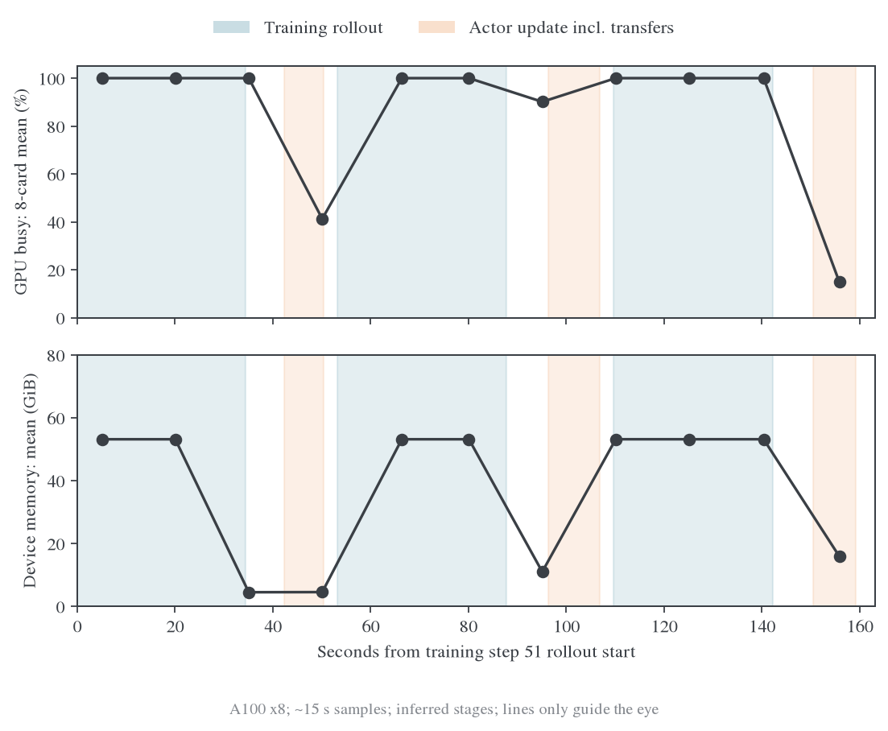

# E15 训练 Rollout 资源分析

## 结论

W&B run `wncfht/MirrorOPD-verl/krkmq098` 的现有数据足以排除“训练 rollout 时八张卡大面积空转”这一解释，也支持“当前显存容量不紧张”。它不支持宣称 Tensor Core 已满载或已经达到生成速度物理上限，也没有实际 HBM GB/s 数据来证明纯带宽饱和。[^run]

E15 的配置、软件与全程指标统一见[训练动态与指标分析](../experiments/full-kl-comparison/2026-10-23-E15训练动态与指标分析.md)。本文专门维护同一 run 的阶段窗口、设备采样及 guard 敏感性；E15 使用 sampled-token，不属于 Full-KL 算子测量。

## 数据与时间对齐

只读 API 导出得到 600 条历史记录、200 次训练更新，以及 1899 个具有逐卡 GPU 指标的系统采样时刻；相邻 GPU 采样间隔中位数约 15.004 秒。系统接口采用 sampled history，缺失值不补零。原始导出保留在 `outputs/krkmq098-resource-analysis-20261023`，59 MB 的历史正文没有重复放入 Git。

每个 outer step 有更新前、更新后和完整步三条记录。Actor 窗口使用更新前后时间戳；其长度与记录的 update_actor timer 的最大差约 5.4 ms。训练 rollout 的末端由更新前时间戳减去 teacher transfer/forward、old log-prob 和 advantage 时间得到，起点再减 rollout pipeline 时间。验证窗口使用完整步时间戳和 validation timer。使用原始 `_timestamp`，不用离线同步后服务器的 run 创建时间。

这些是应用层阶段窗口，不是 CUDA kernel 边界。对训练 rollout 另外去除首尾各 3、5、8 秒，检查切换边界是否影响结论。第 1 步预热不纳入训练 rollout 统计。

## 分阶段实测

| 窗口 | 采样时刻数 | 逐卡 GPU busy 均值 | 每卡设备显存均值 | 每卡功耗均值 |
| --- | ---: | ---: | ---: | ---: |
| 完整训练 rollout | 453 | 92.67% | 52.66 GiB | 255.2 W |
| Rollout 去首尾各 3 秒 | 378 | 99.01% | 53.17 GiB | 267.9 W |
| Rollout 去首尾各 5 秒 | 331 | 99.88% | 53.18 GiB | 270.1 W |
| Rollout 去首尾各 8 秒 | 238 | 99.95% | 53.17 GiB | 271.8 W |
| 完整验证窗口 | 1153 | 91.32% | 53.95 GiB | 309.5 W |

五秒边界排除后的 331 个时刻覆盖全部 199 个非首步训练 batch，共 2648 个设备读数；其中 329 个时刻八张卡同时达到至少 90% busy。各卡均值均约 99.7%–100%，不是少数 GPU 满载把均值抬高。

GPU busy 是采样期间有 kernel 执行的时间比例，不能解释为理论 FLOPs 利用率。NVML memory utilization 反映内存读写活动，不能直接当成已达到理论带宽的比例。[^nvml] 本次 rollout 中段 `system.gpu.*.memory` 均值为 53.71%，没有 HBM 实际 GB/s、SM Active 或 Tensor Core Active 时间序列，不能据此精确分类 kernel 瓶颈。

图中仅展示训练 step 51–53，没有验证。蓝色背景为 rollout，橙色为 actor 更新及其上下卡，空白包含 teacher、概率重算与同步。点是实际系统采样，连线仅辅助阅读，不能据此重建采样间的瞬时变化。

## 当前主要工作是持续 decode

全程终止原因统计见[E15 主报告](../experiments/full-kl-comparison/2026-10-23-E15训练动态与指标分析.md#优化与蒸馏信号)。用于解释 decode 的 199 个非首步 batch 中：

- 平均 prompt 约 95.8 token，平均 response 约 5807 token。
- 每个 batch 的 response 最大值和 P95 都是 7168。
- 先前日志统计的 rollout batch 中位耗时约 32.05 秒，rollout pipeline 中位耗时约 34.49 秒。

短 prompt、长输出、每批都有大量回答达到上限，再结合中段逐卡近 100% busy，表明生成阶段主要在连续自回归 decode，而不是等待请求。7168/32.05 约为每条长回答 224 token/s 的批次关键路径粗折算，不是直接记录的 inter-token latency。

不能通过缩短 response cap 来冒充纯 infra 优化；这会改变训练数据。相同引擎配置下，验证每轮有 9120 条请求，训练只有 64 条，故实际批处理规模、尾部和权重复用不同。验证更高的总 tokens/s 不等于单条回答更快。

## 显存容量与算力利用分开判断

Rollout 约 53.18 GiB 的设备占用与 vLLM 0.65 显存预算相容，它包含缓存预留，不能当成实际活跃 KV 大小。训练只有约 8 条请求/卡；按当前模型的 BF16 KV 布局和平均输入长度粗估，活跃 KV 需求量级约 1.3 GiB/卡，明显小于整个预留池，但这只是容量估算。

完整历史中的 `perf/memory/fsdp_allocated_peak_gib` 最大值为 14.42 GiB。它是 FSDP/PyTorch 分配口径，不是整卡所有进程的显存峰值，也不能定位 forward/backward 的具体最高点。这个数据不支持“当前八卡训练被 backward 显存容量卡住”的笼统判断。

Actor MFU 与 allocator 曲线统一见[E15 主报告](../experiments/full-kl-comparison/2026-10-23-E15训练动态与指标分析.md#时间开销验证生成与资源)。四卡是否更高效，应该测试相同 64 条数据下每卡并发 8→16 后的完成时间和 GPU 小时。已有数据支持开展这项资源效率对照，不支持预先宣称四卡一定更快。

## 复核入口

- [硬件元数据](profile/data/krkmq098/hardware.json)
- [导出来源与采样说明](profile/data/krkmq098/source.json)
- [分阶段完整统计与窗口](profile/data/krkmq098/phase-analysis.json)
- [结论使用的指标摘要](profile/data/krkmq098/analysis.json)
- `python examples/mirroropd/docs/infra/profile/scripts/analyze_rollout_resources.py --data outputs/krkmq098-resource-analysis-20261023`
- `python examples/mirroropd/docs/infra/profile/scripts/plot_rollout_resources.py --data outputs/krkmq098-resource-analysis-20261023 --output /目标目录/train-rollout-resources`

### 参考文献

[^run]: W&B. MirrorOPD-verl run krkmq098，2026-10-23 只读 API 导出。[运行页面](https://forge.coreweave.com/wandb/wncfht/MirrorOPD-verl/runs/krkmq098).
[^nvml]: NVIDIA. NVML utilization structure，GPU 与 memory 的采样定义。[官方文档](https://docs.nvidia.com/deploy/archive/R535/nvml-api/structnvmlUtilization__t.html).
