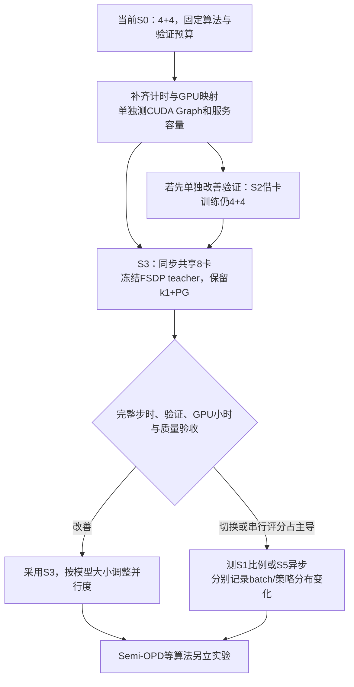

# 八卡 OPD 基础设施优化

在总共 8 张 A800 80GB 上，保留当前 sampled-token OPD 数学复现，推荐的目标结构是：**student 生成、冻结 teacher 前向和 student 更新分阶段复用同一个八卡池**。验证直接使用这个池的全部 student 推理资源。当前 1.5B→1.5B 配方先保留 batch=64、每题一条训练回答和一次更新，以完整步时、固定验证耗时和 GPU 小时决定是否采用。

这是待实现、待测量的推荐，不是已经获得加速的配置。当前正式入口仍是 V1 sync、FSDP2、student 4 卡加独立 teacher 4 卡。已有测量足以证明 teacher 专用卡大量闲置，但没有证明任一新拓扑一定更快。

## 文档边界

| 文档 | 唯一负责的内容 |
| --- | --- |
| 本页 | 约束、推荐方案、阅读入口和决策顺序 |
| [现状与测量](2026-10-20-现状与测量.md) | 当前链路、原始指标、阶段资源使用、验证长尾、测量缺口 |
| [八卡调度方案](2026-10-20-八卡调度方案.md) | 每种拓扑的完整训练/验证 Mermaid 图、收益条件、模型变大后的选择 |
| [上游实现与论文基线](2026-10-20-上游实现与论文基线.md) | verl issue/PR 状态与源码、NeMo RL、One-Shot/ResOPD、2610.11291 及 baseline 开源审计 |
| [实施与验收](2026-10-20-实施与验收.md) | 实现接口、对照实验、参数调优、计时与数值/质量验收 |

实验结果仍在[数学基线记录](../2026-10-20-sampled-token-OPD数学基线-b38hw8v0.md)，模型 FLOPs 推导仍在 [MFU 计算](../2026-10-20-MFU计算.md)。数据、图和重建脚本保留在上一级 `data/`、`figures/`、`scripts/`，本目录引用它们，不另存一套。原来分散的“显存与速度”“上游调度”“NeMo 小模型”报告已合并到本目录，旧文件不再保留。

## 固定条件

- 总资源是 8 张物理 GPU，所有 teacher / actor / rollout 池相加必须在这个预算内；共置进程不能再算成额外物理卡。
- 保留 sampled-token `k1 + PG`、current-policy advantage、固定 teacher、task reward 不进入训练目标；无 critic/reference 模型。
- 保留现有验证：570 题、n=16、temperature=0.7、top-p=0.9、response≤31744、每 20 步验证。基线提交窗口为 16 题；后续持续补充请求是单独的调度对照，保持全部评测请求。
- 不以重复安装 vLLM 或迁移整套训练框架作为调度优化的前置条件；先适配当前 V1/FSDP2。
- Async、Semi-OPD、prefix-only、teacher 介入生成和 top-k/full-vocab 损失分别记录为不同实验，避免和保留当前算法的系统改动混报。

## 方案选择

| 方案 | 8 卡布局 / 用法 | 当前定位 |
| --- | --- | --- |
| S0 固定 4+4 | Student hybrid 4，teacher 4 | 已运行的比较基线 |
| S1 固定 7+1 / 6+2 | 更多 student 卡，减少 teacher 预留 | 改动较小的资源比例对照；仍有 teacher 卡不能参与验证 |
| S2 仅验证借卡 | 训练保留 4+4，验证临时 student 8 | 若先解决验证资源闲置，可单独实现；不改善训练 actor 的 4 卡限制 |
| S3 同步全池共置 | 8 卡按生成→teacher 前向→student 更新轮换 | **当前模型的推荐目标**，保留同步算法 |
| S4 同卡双推理常驻 | Student/teacher 推理共用 8 卡，显存分预算 | 待设计备选；并发干扰、峰值和更新切换需额外验证 |
| S5 动态异步 4+3+1 | Hybrid 4，独立生成 3，teacher 1；空闲 actor 借给生成 | 当前 V1 有主要调度组件；引入旧策略样本，作为后续异步实验 |
| S6 固定异步 3+4+1 | Actor 3，生成 4，teacher 1 | 分池参照，无法让验证自动用满 8 卡；当前小模型优先级较低 |
| A0–A3 算法替代 | 离线缓存、SFT 后离线、prefix-only、teacher 介入 | 代码值得研究，另立算法实验；不代替 S3 的系统验收 |

每行对应的完整调度、验证路径和可实现状态见[方案正文](2026-10-20-八卡调度方案.md)。S1、S5、S6 的卡数是具体候选，不是对所有模型大小固定的最佳比例。

## 推荐实施顺序

先补齐 teacher/CPU verifier/服务队列的细计时，并完成单变量 CUDA Graph 对照，保留 S0 作为可复现参照。随后实现 S3 的冻结 FSDP teacher 和共享池：先固定轨迹核对 teacher 概率及 loss，再跑短训练，最后做相同完整验证。将 teacher 前向新增串行时间和 CPU 搬运都计入完整步时。

如果 S3 的开发周期较长，且希望先单独解决当前 5.89 小时验证中的闲卡问题，可以先交付 S2。S2 仍需要可靠的权重版本、路由和恢复管理；不能把它称为只改一个参数。S2 与跨窗口请求补充分别测试，以区分“多了卡”和“减少窗口等待”的收益。

S1 适合快速估计 teacher 是否能缩到 1–2 卡，但 7/6 个 actor rank 与当前 batch=64 的整除关系需要处理。改变 global batch 会同时改变优化行为，不应将这种结果作为纯基础设施消融。S5 可以保留 actor DP4 和 batch64，但必须加上策略版本与重要性采样验收。

## 模型变大后的决策原则

只考虑这 8 卡。Teacher 变大时，优先评估在同一八卡池上分片前向，避免永久拿走大半 student 生成资源；若 teacher 打分与生成已经形成均衡且切换成本较大，固定 4+4 或 6+2 也可能更快。Student 变大时，先保障训练状态、激活和推理 KV 能在相应阶段放下，再决定 TP/CP/FSDP 并行度，不能从“小模型用 TP1 副本”推导所有规模都使用 TP1。

共享池满足的是各阶段分别可容纳；同时常驻需要满足各模型工作集之和可容纳。某个模型连单独使用全 8 卡、允许的 CPU offload 后仍放不下时，GPU 调度无法解决容量问题。需要另行选择更小模型、PEFT 或经验证的量化/优化器方案；这些会改变实验设置。具体内存预算、适用组合和决策树只在[模型规模章节](2026-10-20-八卡调度方案.md#八卡内的模型规模与显存边界)展开。

## 调研与验证范围

资料核对日期为 2026-10-20。既有 W&B 快照与本地代码、上游 PR/issue 的状态、作者代码和第三方 baseline 实现分别标注；PR closed 不视为 merged，示例声明不视为 GPU 性能测试，模型/框架相同不视为作者使用了相同调度。

本目录交付的是调研、重构文档、配置与来源记录。没有切换运行中的 Hope 任务，没有应用未合并 PR，也没有把源码阅读或配置解析写成训练加速实测。
