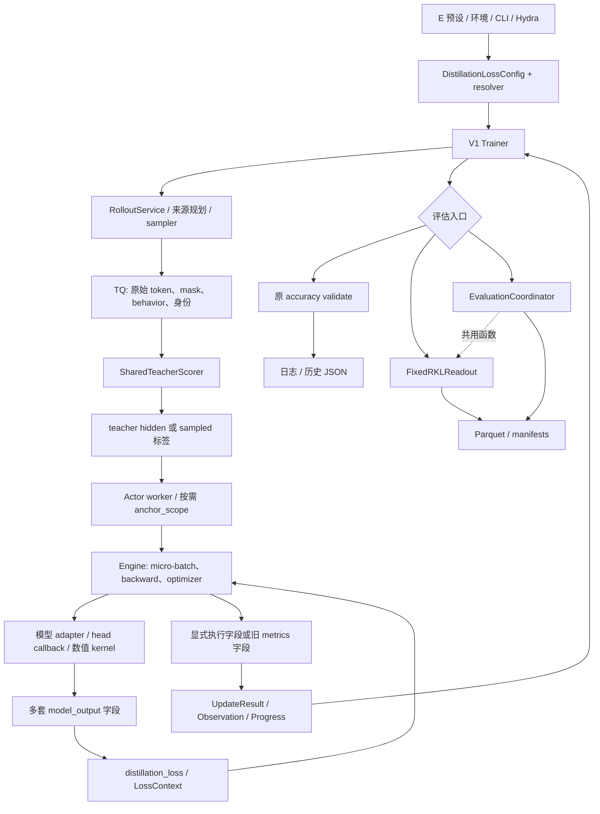
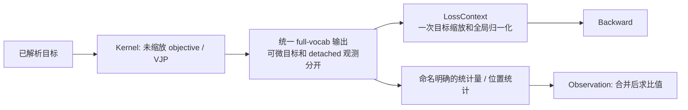
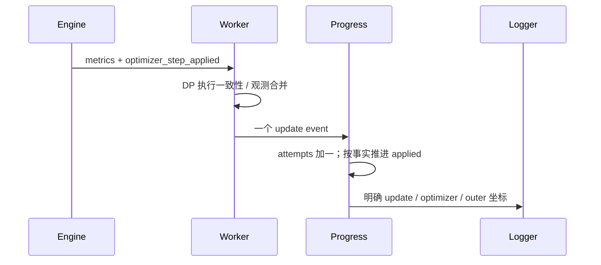
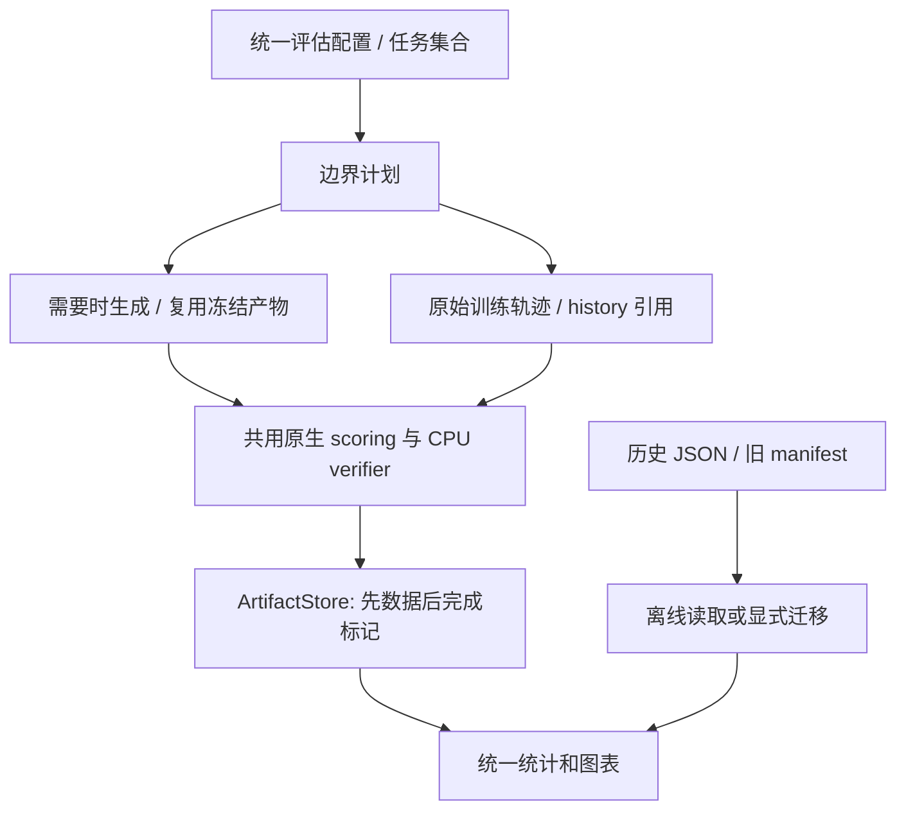

# 运行合同审计与重构方案

更新日期：2026-11-01。审计基线为 `402f6353`，范围是 MirrorOPD 从实验入口到生成、蒸馏更新、评估和产物发布的原生执行链。本文先记录重构前的结构与历史依据，再给出修改边界和验收要求；实施状态在文末维护。它不把旧实验的配置或观测改写成当前默认值。

结论是收敛内部合同，而非消除所有分支：同一算法只保留一种内部表示；静态配置、调用级归一化、执行事实、统计观测和产物身份分别归属；真正不同的目标、资源拓扑和数值算法继续显式表达。旧文件读取可以独立存在，新训练不应依靠历史字段自动猜测行为。

## 1. 审计范围与证据等级

深入核对的链路包括 launcher 与目标解析、sampled/full loss、teacher/anchor 生命周期、位置布局和 TQ、FSDP 更新与 AMP、更新事件和进度、rollout 来源规划、固定 RKL 与统一评估、模型与产物身份、profile 工具。扫描范围还包括相关 engine/config/utils，逐项判断兼容候选是否有实际消费者。扫描结果不是“所有命中都是问题”，也不等于逐行验证了全部上游、多模态、Megatron 或第三方实现。

| 证据层           | 用途                                     | 限制                                     |
| ---------------- | ---------------------------------------- | ---------------------------------------- |
| 当前文档         | 定位职责、科学协议、历史验收及已有提案   | 文档中的“当前”必须结合日期和源码核对     |
| 基线代码与调用者 | 确定执行分支、字段生产消费、资源所有权   | 静态调用关系不证明速度或分布式正确性     |
| Git 提交内容     | 解释某个适配层为何引入、原先解决什么问题 | 提交说明中的测试不是新版本的测试结果     |
| 本轮回归         | 验证修改后的具体合同                     | CPU 通过不替代 CUDA、FSDP 或自然生成验收 |

[基线清单](data/runtime-contracts-20261101/inventory.json)保存 113 个源码／配置文件及 243 处候选行，便于按冻结版本复核；候选数量不代表问题数量。

共享主工作区另有动作空间、模型配对与评估提取的未提交改动。它们是并行演进边界，不纳入基线的已实现能力，也不直接复制为本轮成果。集成时逐项合并并重跑受影响检查。

阅读入口包括[训练循环](training-loop.md)、[数据与归一化](data-and-loss.md)、[教师生命周期](teacher.md)、[Sampled 目标](sampled-opd.md)、[Full-vocab](full-vocab.md)、[指标](metrics.md)、[进度与恢复](progress-checkpoint.md)、[Rollout 来源与组合](../rollout/fusion/README.md)、[统一评估](../../../../../verl/trainer/evaluation/README.md)和[性能方法](../performance/full-vocab/methodology.md)。

## 2. 代码怎样形成现在的结构

以下提交均由本地 Git 核对。哈希标识对应实现来源，不表示这些提交之间没有其他修改；合并后的等价提交可能与历史报告中的原分支哈希不同。

| 提交                   | 引入的责任                                             | 留到今天的约束或债务                                                           |
| ---------------------- | ------------------------------------------------------ | ------------------------------------------------------------------------------ |
| `ef138884`             | sampled advantage、IS 等对照                           | current/rollout、vanilla/IS/PPO 是算法差异，不能合并成同一种梯度               |
| `06820b3a`             | shared FSDP2 Full-RKL、独立 teacher head、head adapter | 必须保留 root/head hooks、全局 token 分母和空 rank 梯度连接                    |
| `2c9d4bb5`             | 按 micro-batch 运输 hidden                             | TQ 身份与 position 跟随重排；不能为简化改成完整 logits 长期缓存                |
| `63594adf`             | opt-in fused precompute                                | CPU/FP64 reference 与 CUDA fast path 并存有验证用途，但实际 backend 必须可观察 |
| `91dd21c6`             | 统一预测坐标与 response 坐标                           | `prediction_positions` 旧导入位置的转导出可在消费者迁移后删除                  |
| `1e6e3ea9`             | `LossContext` 与静态目标元数据                         | 浅复制 config 保护共享状态；`bind_legacy_config` 是迁移桥梁，不是理想终态      |
| `85ece0a0`             | 执行事实与观测分离                                     | 原 metrics 携带执行事实的 fallback 仍保留；新 engine 已有显式字段              |
| `3be00adb`             | `SharedTeacherScorer`                                  | 保留单一 teacher 生命周期所有者，不在 loss 内操作 worker 或设备                |
| `48915607`             | sampled/full MDPO、full BPO、调用级 anchor             | η=1 复用 KL endpoint；只在 loss 层施加一次 1/η                                 |
| `4771eb66`             | target/diagnostics 融合                                | 性能分支应共用目标和 VJP 合同，不再建立新训练循环                              |
| `3d4243b9`、`2bbbb2fd` | 近目标稳定差分、小量余项、pivot VJP                    | 这些是数值正确性，不是待删除的历史兼容                                         |
| `5e5f8007`、`64e2b561` | FP16 VJP 与 loss scale 顺序                            | 未缩放 VJP 必须保持足够精度，不能提前转 FP16                                   |
| `cb890d2e`             | EOS 合并 MDPO                                          | 引入全词表 FP64 reference 和 fused 限制，形成后来的慢路径                      |
| `4e95a18b`             | EOS 补偿融合与统一停止类映射                           | 已解决主要行代数回退；重构不能丢弃 remainder 或改变 EOS 目标                   |
| `0b8d0981`             | 模型资产归一与历史位置投影                             | 资产别名在应用边界解析；内核运行不需要旧路径软链接                             |
| `69607488`、`ff5e73e6` | rollout 绑定解析、schema 2、公共采样合同               | 旧来源字段和旧恢复语义显式拒绝，是已经收敛的边界                               |
| `b6298e99`             | 来源留出/history 的固定 RKL 读出                       | 创建第二条 `_validate` 行为；后来演进为更完整评估协调器                        |
| `80d15713`             | 统一评估、Parquet 产物与最终模型导出                   | 新协调器仍依赖旧 readout 的共享函数，旧配置和调度继续并存                      |

`git show <hash> -- <path>` 可复核引入差异；当前实现的入口仍由各主题文档负责。这里保留影响重构决策的历史，不复制全部提交流水。

## 3. 重构前的整体执行图

图中有些分支表达不同能力，有些只是不同年代的接口。重构的目标是让调用者依赖前者的明确合同，而不依赖后者的字段名称或类是否恰好存在某个方法。

## 4. 配置与目标元数据

### 4.1 当前事实

`DistillationLossConfig` 同时承载模式、policy 参数、full-vocab 设置、mirror 参数、运行时填入的 `loss_settings` 与旧 `global_batch_info`。`DistillationLossSettings` 用 `payload_kind/use_topk/use_estimator` 多个字段描述同一数据需求；resolver 允许注册式旧 loss 名称及 mirror 配置。Full-RKL 的新 launcher 使用 MDPO/η=1，而旧 full_reverse_kl 仍解析到相同内部语义。

`distillation_loss` 仍在 hot path 上接受“已有 spec 或重新 resolve”。这有利于旧测试传入轻量对象，却使生产初始化失败与测试 fixture 缺字段拥有相同兜底行为。

### 4.2 方向

配置输入边界可以理解 Hydra 和 dataclass，内部使用已经解析的目标。Payload 类型是唯一事实源，top-k/estimator 等关系派生；常量目标元数据不可被一个调用者修改后污染 registry。旧公开名称若继续作为科学配方名称存在，只在入口解析一次，不传播到 worker 的控制流。

不把 sampled vanilla、token-IS、token-PPO、reinforce 或其 guard 参数合并成“同一种 OPD”；不改变 E 编号历史配置，不把 backend 升级偷偷写回旧实验。

## 5. 目标输出、归一化与指标

### 5.1 当前事实

Engine 为 RKL、FKL、一般 mirror 分别写入 `full_kl_sum/full_forward_kl_sum/mirror_objective_sum`，EOS 另外使用 `termination_kl_sum`。Loss 先检查部分字段是否出现，再根据 spec 分派。普通 KL 行值有时是诊断，有时与优化目标相同；EOS 下两者不同，接口名称没有明确体现这种区别。

训练 scalar、日志 numerator、position sums 的缩放不同：反向需要 DP 与全局 token 分母，MDPO/BPO 需要一次 1/η；日志按合并 sum/count 还原；teacher/anchor/target 诊断不除 η。`LossContext` 已把调用级分母独立出来，但部分 policy 函数仍从 config.global_batch_info 读取，调用者需要浅复制配置。

### 5.2 方向

采用一个显式内部输出合同；kernel 的自定义 autograd 返回张量 tuple 仍可保留，不为形式统一增加无用 tensor 包装。Engine 只负责坐标、模型接入与打包，目标指标命名和缩放放在目标边界。Loss 不再检查旧键决定算法。

Policy API 将归一化 context 作为显式调用参数，保留原全局总体分母。拒绝采样后的 mask 不能重新定义总体；任务 PPO、蒸馏 PPO 和旧 worker 的调用者需要一起迁移，不能删除适配后只改一条路径。

## 6. 执行事实、进度与恢复

`BaseEngine.train_batch` 已在输出中发布 `optimizer_step_applied`。FSDP 的 AMP 和 finite 检查填写 True/False；未提供该能力的 engine 仍显式表达未知 None。`update_records.py` 又接受旧 metrics 中的同名事实并核对冲突，worker 模块还转导出历史函数供测试使用。

方向是只接受独立执行字段。None 继续表示未知，不强行改成成功、失败或 0；一致性由 DP consensus 检查。所有 engine producer、worker consumer、测试 fixture 一起迁移。不得用梯度范数、scheduler 状态或日志是否存在猜测更新成功。

旧 checkpoint 缺失进度元数据时标记未知，是历史证据不足的表达，并不是将错误状态静默修成成功。它与“当前 engine 忘记返回必要字段”不同，不能按字符串 legacy 一并删除。恢复的参数、Adam、scheduler、rollout sampler 身份和 optimizer 计数分别检查。

## 7. Teacher、anchor、TQ 与模型 adapter

Teacher scorer 管理 teacher 上卡、评分 futures、卸载和发布；actor worker 管理冻结 teacher head 的 GPU 缓存；anchor_scope 管理调用级 q、head 快照与 version。HiddenBatchIO 按 micro-batch 从 TQ 读取，inline payload 用于直接 worker 调用。两种运输载体不等于两种数学目标，不应强迫所有单元测试启动 TQ，也不应在生产里把整轮 logits 搬入 CPU。

现有 anchor 推理退出后会卸载，再进入 actor train context。这是可能优化的资源往返，但改变驻留次序涉及峰值显存和异常清理，先 profile 再决定。对 q/T head 跨 reuse 的投影缓存也必须先证明收益，避免新增 version、shuffle 和位置失效状态。

Model adapter 的实例级 forward 改写绕过普通 LM logits 输出，但保留 root/head FSDP hooks。不能直接调用裸 backbone/head 代替 hooks；tied embeddings、FP16 VJP、空本地 mask 均为必要支持。模型家族 capability、tokenizer、词表与 EOS 校验保留在初始化边界；不靠 hidden 宽度相同推断协议相同。

## 8. Rollout、资产、模型身份

Rollout 已采用 ModelRef→ModelBinding→执行计划，应用资产别名在规划前解析，旧字段显式报错，schema 2 绑定采样和恢复语义。该层已经体现“严格边界、内部单一表示”，不为全仓风格统一再造 planner。

需要检查的交叉边界是评估生成与训练生成是否共用有效 sampler 身份、模型内容身份和支持集。生成支持、训练概率空间、评估概率空间是三个明确选择，不能把 common support 条件化当作兼容修补。历史银行若生成协议不同，应保留原身份或重新生成，不能只补 manifest 字段伪装成新产物。

Standalone teacher 与 shared-sync teacher 是不同资源拓扑；研究用 HF fusion 与生产 vLLM 后端是不同执行能力。是否缩小支持范围需另有使用证据，不在这次接口整理中直接删除。

## 9. 评估的重复路径与迁移约束

### 9.1 当前事实

固定 RKL 读出先在训练初始化时生成 source bank，复用旧 val_files/val_kwargs，再维护 history。统一协调器要求事先 bootstrap initial/source/teacher 与 accuracy 产物，验证内容 hash，按 source/history/banks/bench 调度，最终导出模型。基线中的统一 coordinator/scoring 仍从旧 readout 导入 history 与 TQ 函数，形成新模块依赖旧编排模块。

因此两者并非可直接换类名的相同协议。旧每轮 source/history 方案不应为了迁入协调器，被迫生成额外公共 benchmark 或 teacher accuracy。`readout_callback_class` 还服务 NativeRKLProbe，删除动态入口前必须迁移这个实际调用者。

### 9.2 方向

先把共享轨迹、history 选择和 native scoring 边界归到 evaluation 所有，不从具体旧 callback 导入。再用明确的 callback 合同表达初始、更新记录、同步前、outer 完成和验证事件，初始化阶段检查能力，Trainer 不逐处猜测方法是否存在。

完整删除旧 fixed 编排需要 source-only 计划与初始化协议的等价迁移：同题、同 token、同 history 成员、同 denominator、同触发时刻、同最终完成边界。具备这些条件后删除旧运行入口；历史产物读取保留在分析工具。若只能通过强制新增 bootstrap 工作实现“统一”，应暂保留显式执行模式，不宣称已经去除这项债务。

## 10. 兼容候选的处理清单

| ID  | 候选                                      | 判断及修改边界                                   | 关键验收                                       |
| --- | ----------------------------------------- | ------------------------------------------------ | ---------------------------------------------- |
| C01 | `hidden.prediction_positions` 转导出      | 迁移存活测试/调用者后删除                        | 坐标、mask 空洞、因果 shift 不变               |
| C02 | `_consume_optimizer_step_status` 导入别名 | 测试改用执行合同，删除别名                       | 分区不一致、缺字段、未知状态                   |
| C03 | metrics 携带执行事实 fallback             | 显式字段成为唯一运行协议                         | AMP skip、跨 rank、进度事件                    |
| C04 | registry 返回可变共享 spec                | 用不可变、独立的静态记录                         | 多配置互不污染，派生 payload/anchor 一致       |
| C05 | hot-path spec 重新解析                    | 在构建配置时完成，测试用真实配置                 | 缺配置尽早报错；所有目标支持矩阵               |
| C06 | full-vocab 多套输出字段                   | 一个内部 envelope，明确 objective 与 observation | 原指标值、梯度、位置统计和 η 缩放              |
| C07 | config 中的运行时分母                     | 显式 LossContext，迁移所有 policy 调用者         | task/OPD PPO、拒绝采样、跨 micro-batch         |
| C08 | 新评估依赖旧 readout helper               | 迁移公共 native/history 原语的所有权             | history 配额、padding、TQ 清理                 |
| C09 | 可选 callback 方法探测                    | 明确生命周期接口；具体实现声明能力               | 事件顺序、失败后不发布完成、最终导出           |
| C10 | 两套 RKL 编排                             | source-only 等价迁移后退役旧运行入口             | 不额外生成、不改变银行身份与频率               |
| C11 | 多种指标表示与重命名                      | 先保留上游 producer 边界；新业务用 Observation   | SUM/MEAN/MAX 与未知值不可混淆                  |
| C12 | dense/recompute/streaming 等 backend      | 按数学参考和容量用途保留；实际选择可观察         | 独立 oracle、OOM 边界和数值预算                |
| C13 | FP64 局部差分、EOS remainder              | 保留，属于精度合同                               | 小信号、公共偏移、AMP 与生产词表               |
| C14 | DTensor/普通 tensor、不同 engine 能力     | 边界适配保留；禁止未经验证的全局删 fallback      | FSDP hooks 与其他存活 engine 不回退            |
| C15 | benchmark 硬编码与旧候选入口              | 使用生产解析结果；历史脚本保持冻结证据身份       | backend/precision/diagnostics/no-sync 明确记录 |
| C16 | checkpoint 和历史结果格式读取             | 离线边界保留；新运行严格 schema                  | 不伪造未知进度，不篡改旧实验                   |

“保留”不是永久免于检查，而是该分支现在有明确语义或消费者。不能以删行数、减少文件数或没有 legacy 字样作为重构完成指标。

## 11. 实施分段与验收门槛

先提交本文，再修改实现。每段是可以独立审查的提交，记录实际测试和迁移方式；不同时更换目标、采样器、精度或实验预算。

1. 运行事实与静态目标：C01–C05。删除已没有生产需求的双表示，显式保留未知能力；验证现有配置矩阵和跨调用隔离。
2. Full-vocab 输出与归一化：C06–C07。迁移 engine、loss、测试和 profiler 消费者，保留所有观测语义及数学实现；如果某类上游 policy API 尚需迁移，列出具体消费者，不用隐藏适配器掩盖未完成。
3. 评估生命周期与依赖：C08–C10。共享原语先独立，具体模式后迁移；保持 source-only 和统一公共评估的工作量边界。
4. 工具与文档：C11–C16 按用途收敛；更新当前代码走读和迁移说明，历史报告不改结果。重测矩阵沿性能方法执行，不在架构重构里无条件增加长程实验。

| 层级     | 必须核对的行为                                                                            |
| -------- | ----------------------------------------------------------------------------------------- |
| 配置     | 所有现存目标解析、非法组合拒绝、默认值和 E 预设身份、只解析不启动 GPU                     |
| 数值     | loss、hidden/head VJP、冻结 q/T、η endpoint、EOS raw/coarse 区分、小梯度与非单位 upstream |
| 分布式   | 全局分母、空 rank、tied head、micro-batch 累积、AMP skip、参数/Adam/scheduler 恢复        |
| 生命周期 | teacher 与 anchor 清理、TQ key/position/version、同步与评估顺序、失败时无完成标记         |
| 观测     | 单 update 与 outer 不混合，未知与 0 不混合，原指标名称/聚合不静默改义                     |
| 产物     | 不可覆盖、内容身份、manifest 绑定、只读历史读取、模型导出与重载                           |
| 性能     | 同源码、同输入、同配置的固定对照；profiler 与正常计时分离；不宣称未实测的加速             |

资源拓扑和 kernel 未变的结构调整先做 CPU 合同回归；涉及 tensor 图、模型 hooks 或分布式生命周期的修改需要对应 GPU 验收。无法执行的层级明确列为未验证，不用 CPU 通过替代。

## 12. 当前实施状态

文档基线已先提交为 `6945292a`。C01–C07 已在隔离工作树实现，训练侧扩大回归 549 项 CPU 检查通过；包括数值、统一输出、policy 归一化、更新状态和相关分布式 CPU 归约。修正 pytree 输出合同后，EOS BF16 累积/恢复、EOS FP16、η=1 endpoint、BPO 和 sampled MDPO 五组双卡验收全部通过，共 60 次有效更新。EOS BF16 的融合/参考最大参数差为 0，endpoint 更新逐位一致；原始命令、失败和复跑日志保留在 runs/runtime-contracts-20261101，摘要见[验收记录](data/runtime-contracts-20261101/acceptance.json)。这些短程检查不等同于所有模型后端或 50 outer 正式实验。

### 新运行接口迁移

- Engine 和 worker 必须返回独立的 `optimizer_step_applied`，未知能力显式填 None；旧 metrics 中的 `_optimizer_step_applied` 拒绝使用。
- Policy loss 新增显式 `context: LossContext`。普通本地调用默认使用本地总体；分布式和拒绝采样调用必须传原始全局分母。删除 actor/distillation 配置中的 `global_batch_info`，不要用 config 注入运行状态。
- Full-vocab 模型回调返回 `{"full_vocab": FullVocabOutput}`；RKL/FKL/MDPO/BPO 统一由 spec 与结果合同表达，旧输出字段不再接受。日志指标名称与含义保留。
- `prediction_positions` 从 `verl.workers.utils.padding` 导入。测试和插件调用正式模块，不依赖旧转导出。
- 目标注册元数据的 names 是不可变 tuple，payload_kind 是唯一存储的数据类型；use_topk/use_estimator 为派生属性，不作为独立构造参数。

历史运行恢复使用对应冻结代码；原日志、配置和产物不被此迁移重写。

### 评估迁移的最终取舍

调用者审计确认 `ScientificReadout` 是通用回调接口的实际消费者，source/history 与公共评估又有不同的初始化协议。因此实施采用一个显式 `ReadoutCallback` 生命周期、一个 native 轨迹层和一个 `score_native_rows` 执行器，保留两种具名的科学编排。没有为了只有一个 coordinator 类而强制 source-only 使用公共 bootstrap。

旧 FixedRKLReadout 运行模块已退役；`SourceHistoryReadout` 位于 evaluation 内，配置改为 source_history_readout，公共函数不再从具体 callback 导入。新旧结果格式兼容仅留在离线 audit 工具。source/history 的银行复用、独立频率、失败发布边界及离线读取 10 项 CPU 检查通过，生命周期扩展也覆盖 NativeRKLProbe、HFReloadReadout 和 ScientificReadout。

GPU 验收发现普通 dataclass 不能自动成为 FSDP pytree：root hook 遍历输出时看不到可微分子。结果结构改用原生 NamedTuple，并增加 pytree 回归；修正前的失败日志保留，不能将 CPU 数值通过当作 hooks 通过。这属于本轮重构引入并在验收中修复的回归。

### 性能工具的入口收敛

EOS actor benchmark 的 diagnostics、termination IDs 和梯度累积 no-sync 改为显式参数并写入执行记录；MDPO/BPO head benchmark 的 κ、η 也由参数声明。默认值保留原测量条件，历史计时不因接口扩展而重写。工具继续调用原生 worker 和目标解析，不增加第二套训练实现。新参数组合的吞吐需按性能重测矩阵另测，CLI 与配置可用不等于所有组合已经得到速度结果。

### 保留边界

C11 的 Metric/Observation 分别表达已有上游归约和新统计原语；C12 的参考/容量 backend、C13 的稳定数值、C14 的模型/engine 差异、C16 的历史只读与未知进度均保留。它们有独立语义或实际消费者。Source-only 与公共评估保留不同初始化协议，但不再保留旧运行类名和重复 scorer。纯接口兼容的清理不能扩大为未验证的算法、资源拓扑或恢复语义变更。

### 归一化审阅发现的行为缺口

GMPO 的 geo_mean 分支原来直接对当前 micro-batch 的序列 loss 求均值，没有使用全局 batch 分母；这与其他 policy API 的显式归一化合同不同。不等大小 micro-batch 的 loss/梯度相加会改变序列权重。该分支保持原几何比值和序列级目标，归约改用相同 LossContext 的 sequence-sum/global-sequence-count；本地默认调用仍等价于原序列均值。新增不等大小 micro-batch 的 loss/VJP 对照，防止接口统一后仍保留这个总体不一致问题。

### 提交与最终检查

| 提交       | 交付                                                      |
| ---------- | --------------------------------------------------------- |
| `6945292a` | 实施前的审计文档、四张 Mermaid 图与历史依据               |
| `08d00a6a` | 统一目标输出、静态元数据、执行事实与显式归一化            |
| `cb5d30d2` | FSDP pytree hook 修正和迁移 fixture                       |
| `f1572b90` | GMPO 全局序列总体修正                                     |
| `af40b946` | 明确 readout 生命周期、共享 native scorer、退役旧运行模块 |
| `25f7e86f` | 显式 profiling 参数与实际配置记录                         |

最终组合回归包含 904 项：898 项直接通过，六个绕过 Trainer 构造器的旧 fixture 补齐显式 callback 默认值后复跑通过。另增加五个实际 callback 消费者合同和两个 GMPO 案例，去重共 911 项 CPU／配置检查通过。计数不重复累加 targeted rerun。双卡五组共 60 次有效更新通过，所有占用资源已归还；细分结果、源码 hash 和提交身份见验收记录。

Ruff、格式化、mypy、配置生成、源码产物政策和提交 hooks 已随各提交检查。文档检查验证当前文件、锚点和源码符号；隔离 worktree 缺少的仓外冻结证据由检查器单独列出，未声称逐份复核其内容。早期 Ray 扩大测试在本机启动阶段停滞的记录，以及首次 FSDP 输出封装失败均保留，不计为通过。

代码交付分支为 `refactor/runtime-contracts-20261101`，工作树为 `.worktrees/architecture-refactor`。共享主工作区的并行动作空间修改没有被覆盖；它们不在这份基线的验收声明中。后续合并须将分布空间的新增观测接到统一输出合同，不能恢复旧键名分派来消除冲突。完整 profiling、其他 engine／模型扩展和正式长程实验仍按其独立协议执行，本文不据短程验收承诺长期效果或速度倍率。
