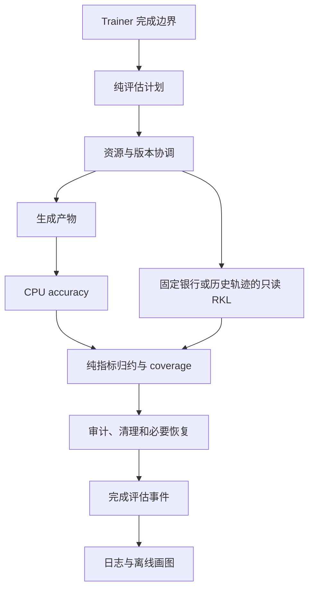

# 评估与训练执行重构计划

状态：A 阶段的公共 RKL coverage 与文档合同已实施；B 阶段已移除 trainer 的 raw 目标回退并复用配置解析的分布声明，C 阶段已明确服务接口并修复失败后的驻留与 pending 发布边界；D 阶段已迁出默认验证流程，默认协议与各科学协议共用 owner 调用边界；E 阶段已补齐 CUDA、真实 FSDP2、head 与完整 actor 配对，以及默认／public／source-history 验收；混合精度差异已用独立 AdamW 复算解释，原严格参数门槛仍失败；其余配置与编排精简及后续阶段待实施。代码走读基线为 `91b4e748`，核对日期为 2026-11-04。本文面向实施与审查，规定修改顺序、职责边界、回归条件和证据归属。后续由实施者在每阶段完成时更新状态；实施期间复查日期与代码基线，完成后将当前合同归入对应架构参考，设计理由与验收证据保留在本文。

优先修复评估结果的覆盖与完成合同，再集中执行配置、统一 validation 入口和资源生命周期，随后复用计算骨架并清理旧接口。GPU 验收在资源空闲后执行；CPU 结果不能替代 CUDA、真实 FSDP2 或吞吐结论。

阅读入口：[已有基线](#1-已有实现与不变量) → [优先级](#2-优先级与依赖) → [分阶段修改](#3-分阶段修改) → [验收与提交](#4-验收与提交) → [文档归属](#5-文档同步与实验交接)。

## 1. 已有实现与不变量

### 1.1 已完成的修复

以下内容已实施，不再列为待开发功能：

| 提交       | 已完成内容                                                                                         | 当前代码与文档                                                                                                                                                                                         |
| ---------- | -------------------------------------------------------------------------------------------------- | ------------------------------------------------------------------------------------------------------------------------------------------------------------------------------------------------------ |
| `a420f7d5` | Full-vocab 的五种 aggregate 通过 trainer 初始化、评估约束与 update 入口；sampled mirror 保持原约束 | [trainer_base.py](../../../../../verl/trainer/ppo/v1/trainer_base.py)、[聚合与未来信用](full-vocab.md#聚合与未来信用)                                                                                  |
| `2151aa83` | Future 分支校验真实 teacher/anchor 张量、支持集和分块参数，移除用空张量递归校验的路径              | [full_vocab.py](../../../../../verl/trainer/distillation/full_vocab.py)、[trajectory.py](../../../../../verl/trainer/distillation/trajectory.py)                                                       |
| `91b4e748` | 显式区分 local objective 与训练 surrogate，结果类型不再猜测或回退诊断分子                          | [FullVocabObjectiveResult](../../../../../verl/trainer/distillation/full_vocab.py#L454)、[FullVocabOutput](../../../../../verl/trainer/distillation/output.py)、[指标口径](../../settings/指标口径.md) |

Future 已支持 `dense`、`precompute`、`precompute_fused`；生产路径在回答内逆序访问 token 块，复用当前 student 投影，将 local 与 score 的 logits 梯度合成后累积 `dH/dW`。Future 的 suffix 与 score 修正尚未整体融合到 Triton。实现依据为 [trajectory_rows / trajectory_blocks](../../../../../verl/trainer/distillation/trajectory.py#L49)，数值和性能待验收范围由[现有实现计划](2026-11-03-Full-vocab聚合与未来信用实现计划.md)及[训练性能](../performance/full-vocab/training.md)维护。

### 1.2 必须保持的行为

- 默认仍为 `future=none` 与原训练 aggregate；PPO、reuse、anchor 冻结边界和 optimizer 语义沿用已有实现。
- Future 不增加 λ。当前 token 的 local 项与严格未来项按既有数学合同组合，η 对完整 surrogate 统一作用一次。完整推导保留在[聚合与未来信用实现计划](2026-11-03-Full-vocab聚合与未来信用实现计划.md#3-未来信用的数学合同)。
- 评估不使用训练 aggregate、future 或 η。RKL 先逐题 token 平均，history 再按批等权，public 总体按 domain 等权；accuracy 的 avg@n 是题内样本平均后按题平均。定义分别见 [reporting.py](../../../../../verl/trainer/evaluation/reporting.py)、[metrics.py](../../../../../verl/trainer/evaluation/metrics.py)、[summarize_accuracy](../../../../../verl/trainer/evaluation/accuracy.py#L160)。
- FSDP 包装 head 的调用和可微 pytree 返回保持有效；teacher/anchor 不进入 student optimizer 或 rollout 同步。
- 未完成 RPC 的 fail-stop、TQ 清理、RNG 恢复、rollout 权重恢复与最终同步所有权继续有效。
- 活动训练、冻结运行源码、旧实验配置和原始证据保持原状。旧 artifact 适配放在离线入口，身份校验不自动升级。

## 2. 优先级与依赖

| 顺序 | 优先级 | 修改主题                           | 排序依据                                      | 依赖                             |
| ---- | ------ | ---------------------------------- | --------------------------------------------- | -------------------------------- |
| A    | P0     | 评估事件、coverage、指标与文档合同 | 直接影响实验结果的完整性与可解释性            | 无                               |
| B    | P0     | 集中执行配置与能力要求             | 消除跨层重复解释，为后续分层提供稳定输入      | 可独立开始                       |
| C    | P1     | 资源与恢复生命周期                 | validation 迁移前明确 GPU、模型版本和完成责任 | A；消费 B 的能力描述             |
| D    | P1     | 统一 validation 调用架构           | 缩小 trainer，减少协议间执行重复              | A、C                             |
| E    | P1     | Aggregate/future GPU 验收          | 为计算层重构建立数值与性能基线                | GPU 空闲；不阻塞 A–D 的 CPU 工作 |
| F    | P2     | 复用 VJP 公共骨架                  | 降低梯度累积和 dtype 维护成本                 | B、E                             |
| G    | P2     | 拆分 engine 执行角色               | 分离 capture、readout、training 的职责        | B、F；真实 FSDP2 验收            |
| H    | P2     | 规范指标生产链                     | 去掉内部 legacy 名称往返转换                  | 可独立实施                       |
| I    | P3     | 小型重复与旧接口清理               | 收益局部，避免提前扩大核心变更范围            | 对应消费者完成迁移               |

C 排在 D 之前，先明确所有权再迁移入口。E 的 GPU 任务独立排队；没有测量证据时不删除 backend，也不改变生产默认值。

## 3. 分阶段修改

### 3.1 A：统一评估事件与覆盖合同

已实施：[公共覆盖检查](../../../../../verl/trainer/evaluation/coverage.py)在两种读出归约前核对选择集合、trajectory 身份和已知 mask 计数，事件记录总计与逐 bank coverage 及选择集合 hash；公共 suite 同时记录 outer/optimizer 进度。日志和现有离线曲线继续读取事件中的同一份 metrics。新增[事件覆盖与恢复边界测试](../../../../../tests/trainer/distillation/test_evaluation_coverage_on_cpu.py)，覆盖缺失、额外、重复、跨银行引用、无效行、空选择、恢复失败与 before-sync 延迟完成。文档已移除过时的 aggregate 限制并补齐两种目录布局。以下走读保留实施前基线，当前字段以评估包合同为准。

当前 [EvaluationCoordinator.validate](../../../../../verl/trainer/evaluation/coordinator.py#L211) 发布 metrics、timing 和 aliases；[SourceHistoryReadout](../../../../../verl/trainer/evaluation/source_history.py#L297) 还显式发布 coverage。[summarize_rkl](../../../../../verl/trainer/evaluation/metrics.py#L9) 会拒绝重复 ID，并在返回行无效时省略科学均值，但 reducer 本身没有计划任务全集。现有 scorer 已有窗口匹配检查；这里补充事件级 expected/observed 合同，不据此认定已有漏评分故障。

修改内容：

1. 复用现有 plan 和 artifact 身份，定义公共事件结果，承载模型版本、outer/optimizer 进度、任务、measure/verifier 身份、coverage、metrics、timing 和产物引用。
2. 每任务绑定预期与实际记录集合。计数之外还要校验身份集合；同一 trajectory 进入多个 bank 时沿用现有任务/选择身份，不能仅凭裸 trajectory ID 错判重复。
3. 统一 `expected / observed / valid / invalid / missing` 的表达，并明确额外记录的失败规则。保留无效样本及失败原因，按现有协议决定主科学均值是否可发布。
4. 区分文件和引用完整、科学读数完整、必要资源恢复完成。事件仅在其要求的审计、清理和恢复完成后发布完成状态。
5. 日志与离线图消费同一事件归约结果，不分别实现科学聚合。

产物继续由 [ArtifactStore](../../../../../verl/trainer/evaluation/artifacts.py#L137) 管理不可变 shard、hash 和 manifest。沿用生成 token/mask、选择引用、RKL sum/count、accuracy 行与 verifier 来源、update 记录及导出审计；不存 full-vocab logits 或 hidden。更换 verifier 可以复用生成产物，更改生成合同必须产生相应的新身份。

同步修正[评估包合同](../../../../../verl/trainer/evaluation/README.md)：移除公共 suite 的过时 `token-mean` 限制，更新产物目录示例，区分通用合同和组件特有限制。事件 coverage 实施前，不将拟议字段描述为已有能力。

验收：完整、缺失、额外、重复、零 token、非有限值、部分任务失败、outer0 alias、恢复失败与延迟完成均有合同测试。主要复用 [evaluation metrics](../../../../../tests/trainer/distillation/test_evaluation_metrics_on_cpu.py)、[产物测试](../../../../../tests/trainer/distillation/test_evaluation_artifacts_on_cpu.py)、[unified evaluation](../../../../../tests/trainer/distillation/test_unified_evaluation_on_cpu.py) 和 [Parquet readout](../../../../../tests/trainer/distillation/test_parquet_readout_on_cpu.py) 测试。

### 3.2 B：集中执行配置与能力要求

部分实施：Trainer 统一读取 `_setup()` 的 typed 目标元数据，移除 raw loss-name fallback；FullVocabConfig 解析一次分布声明并由 engine compile。Hydra 输入保持原状。请求配置与派生 rollout engine 配置的彻底分离、评估模型元数据重复读取及其余跨层能力归并仍待后续修改。以下为基线走读和完整范围。

当前 [FullVocabConfig](../../../../../verl/workers/config/distillation.py#L37) 多次解析 distribution；[full_vocab.py](../../../../../verl/trainer/distillation/full_vocab.py)、[trajectory.py](../../../../../verl/trainer/distillation/trajectory.py)、[evaluation.py](../../../../../verl/trainer/distillation/evaluation.py) 仍有 raw/typed 输入分支。Trainer 的 `_uses_*` 判断分布于初始化、评分和更新，初始化还通过 `policy_engine_config` 改写 rollout 配置。

修改内容：

- 在初始化边界解析不可变的执行配置，包含目标、分布、aggregate、future、backend 和 teacher/anchor/action/payload 要求；具体类型名在实施时按现有 resolver 结构确定。
- 严格区分用户请求、解析后合同与 engine 派生配置。移除跨层重新解释和热路径隐式 fallback。
- Worker 可以各自构造本进程对象；目标是统一解释规则，不要求跨进程共享 Python 实例。
- 支持集仍须在模型词表和停止 ID 已知后 compile。配置语法校验和模型相关校验分别发生在各自有足够信息的边界。
- 明确 full-vocab 与 sampled 的专属字段，拒绝不支持的组合；保留一个 Hydra override 通道，核对最终 resolved config。

验收：现有合法配置解析结果不变；不合法组合在资源分配前或最早拥有必要模型信息的阶段失败。复用 [distribution contract](../../../../../tests/trainer/distillation/test_distribution_contract_on_cpu.py)、[full-vocab reduction](../../../../../tests/trainer/distillation/test_full_vocab_reduction_on_cpu.py) 与 launcher 配置测试。配置键如需退役，同步更新[迁移指南](runtime-migration.md)。

### 3.3 C：显式资源与恢复生命周期

已实施：RolloutService 将 `ensure_current / park` 声明为抽象合同，coordinator 移除方法存在性探测；同步、sampler 安装或休眠失败时驻留版本失效。公共 suite 与 source/history 的 before-sync 事件均等待正常同步后的 on_readout 完成，延迟事件在 manifest 发布成功后才移出 pending 集合。现有 active/complete manifest 与内存 pending 状态继续表达执行边界，不增加未验证的跨进程恢复状态机。失败仍终止当前执行，不能据版本失效自动重试远程操作。以下保留基线与验收约束。

[RolloutService 基类](../../../../../verl/experimental/rollout_policy/service.py#L13) 尚未声明 coordinator 所需的完整同步评估能力，后者使用 `hasattr(ensure_current)` 检查。[coordinator.py](../../../../../verl/trainer/evaluation/coordinator.py) 的 `pending_events` 则保留等待正常同步后再完成事件的必要语义。

先明确同步评估服务的类型/能力合同，再统一 `ensure_current / park / restore` 的调用责任。事件生命周期明确表示执行中、等待恢复、完成和失败；最终权重同步只允许一个责任方。具体状态是否需要持久化，以现有 manifest 恢复合同为准，不引入自动恢复未验证的远程状态。

[score_native_rows](../../../../../verl/trainer/evaluation/scoring.py#L20) 已负责完整轨迹窗口、只读评分、RNG 和只读审计及未完成 RPC 的失败处理。这些原语继续复用。CPU 判分可以跟随已发布生成 shard 并行执行，GPU 阶段切换仍须等待远程请求结束。

历史提交 `8093a201` 修复了生成和 rollout 所有权；移除动态探测时必须保留其语义。验收覆盖正常恢复、before-sync 延迟完成、最终同步唯一归属、异常 drain、sleep 后 sampler 重装与 optimizer 不变，复用 [readout lifecycle](../../../../../tests/trainer/distillation/test_readout_lifecycle_on_cpu.py)、[generation contract](../../../../../tests/trainer/distillation/test_generation_contract_on_cpu.py) 和 rollout service 测试。

### 3.4 D：统一 validation 入口与执行结构

部分实施：原生默认验证迁入 [DefaultEvaluator](../../../../../verl/trainer/evaluation/default.py)，Trainer 仅选择协议 owner 并调用 validate。搬迁代码通过 AST 对照确认除参数名外与原协议相同；CPU 测试覆盖最终 session、已有 reward 聚合、两种 dump、colocated reward 的 sleep/restore、缺少验证集及自定义 owner。公共 suite 的 coordinator 进一步精简与 batch 能力拆分仍待后续实施。

[PPOTrainer._validate](../../../../../verl/trainer/ppo/v1/trainer_base.py#L1303) 在 callback 接管与内置验证大流程之间分支；[ReadoutCallback](../../../../../verl/trainer/ppo/readout_callback.py#L12) 已有统一 `_target_` 构造边界及能力声明，保留这个入口。

目标结构：



把内置验证迁入默认 evaluator，trainer 负责触发、传入上下文和接收结果。沿用 [compile_plan](../../../../../verl/trainer/evaluation/plan.py#L16)、generation、scoring、reporting、artifacts，让 coordinator 只编排。将 batch 约束与 validation 所有权分别表达，避免一个标志隐含多个职责。

公共 suite、source/history 与 HF reload 保留各自科学协议和预算。共享执行能力，不为轻量 readout 隐式增加公共 benchmark 生成，也不构建新的通用插件框架。默认验证中的 reward、日志、dump 和返回指标必须逐项迁移。

验收：默认验证、无评估配置、各 callback 协议和空计划均保持行为；固定输入下指标和 artifacts 一致，触发次数及最终同步次数不增加。复用 [optional readouts](../../../../../tests/trainer/distillation/test_optional_readouts_on_cpu.py)、[strict evaluation](../../../../../tests/trainer/distillation/test_strict_evaluation_on_cpu.py) 和 [调度测试](../../../../../tests/trainer/distillation/test_evaluation_scheduler_on_cpu.py) 测试。

### 3.5 E：Aggregate/future GPU 数值与性能验收

2026-11-04 已完成 CUDA 数值矩阵、双卡 FSDP2 主矩阵及 weighted-future 补充检查、四卡 checkpoint、72 组 head 遍历/future 对照，以及两卡真实 Qwen3 的两轮训练和三次默认验证。发现并修复指标 CPU/CUDA 混拼与训练入口 full-vocab 聚合限制。[验收记录](../numerics/full-vocab/validation.md#聚合与未来信用验收2026-11-04)保留混合精度 MDPO backend 参数对比失败；[性能记录](../performance/full-vocab/operators.md#聚合与未来信用复测2026-11-04)区分独立 dense 门控、大规模系统一致性和 OOM。追加的 P0/P1 取证已完成：A/A 参数差为零，独立 FP64 AdamW 复算解释小梯度放大；public suite 与独立 source/history 均完成两轮、4 次有效更新，包含重复 validate 和一次本地发布失败重试；[完整 actor 配对](../performance/full-vocab/training.md)覆盖短／长／混合长度及五个单项对照。原混合精度严格参数门槛仍失败且未放宽，不把取证完成写成零失败验收；未模拟未完成远端 GPU RPC，也未重测最终 HF 导出。

历史上 `precompute_fused` 的 head 测量优于若干对照，但测量版本、模型尺寸和条件不同；head 加速不等于 actor 整步加速。原始比较由[算子性能](../performance/full-vocab/operators.md)和[训练性能](../performance/full-vocab/training.md)维护，不跨 cohort 合并。

在固定 token、模型和 optimizer 初态、精度、EOS 设置、chunk 与 DP 布局下比较：

1. `precompute` 与 `precompute_fused` 的值、梯度和显存；dense/FP64 小规模参考提供独立校验。
2. 无 future 的正向/逆向访问，隔离遍历顺序的影响。
3. 按回答切块与原连续分块，隔离短回答小 GEMM 开销。
4. Future suffix 与 score VJP 的增量成本；覆盖 sum/mean/discount/sequence 代表模式。
5. 不同 aggregate、长短混合、mask 空洞、EOS、空 rank、tied head 和真实 FSDP2。

记录投影次数、数值误差、峰值 allocated/reserved 显存、head 时间与完整 actor step；预热和重复次数明确，失败与 OOM 保留。验收入口为 [trajectory GPU tests](../../../../../tests/trainer/distillation/test_trajectory_on_gpu.py) 和 [FSDP2 integration](../../../../../tests/special_distributed/test_full_vocab_fsdp2.py)。不预设性能通过阈值；测量前按同一 cohort 对照确定接受标准并记录理由，不能用旧版本结果替代。

### 3.6 F：复用 full-vocab 的公共 VJP 骨架

[PrecomputedKL](../../../../../verl/trainer/distillation/full_vocab.py#L240) 与 [TrajectoryVJP](../../../../../verl/trainer/distillation/trajectory.py#L105) 都在 forward 预计算梯度，再在 backward 接收标量上游。这里的向量—雅可比积（VJP）包含从 logits 梯度到 hidden/head 梯度的传播；aggregate 行权重和 future score 必须在 `dH/dW` 合并之前生效，不能事后归约 detached 行值补救。

抽取共同的结果合同、梯度累积、dtype、空输入与 backward 缩放处理。保留不同 objective 的数学公式，以及 dense、recompute、precompute 的计算策略。无 future 连续块与 future 回答内反向块保留不同调度，避免强制逐回答处理导致默认路径退化。当前 teacher/anchor 的 head 投影和归一化仍每次 reuse 重算，缓存优化另以有界显存与性能证据立项。

验收：独立枚举/概率参考与有限差分继续有效，五种 aggregate、future、η、EOS 与 micro-batch/DP 归一化通过；GPU 数值及 E 的性能对照无未解释变化。参考 [trajectory VJP CPU tests](../../../../../tests/trainer/distillation/test_trajectory_vjp_on_cpu.py) 与 [future credit tests](../../../../../tests/trainer/distillation/test_future_credit_on_cpu.py)。

### 3.7 G：拆分 engine 的 capture、readout 与 training

[FSDPEngineWithLMHead._full_vocab_output](../../../../../verl/workers/engine/fsdp/transformer_impl.py#L1284) 承担多种角色。保留薄分发入口，将 hidden capture、无梯度 readout 和训练 surrogate/VJP 拆成职责明确的实现，共享输入坐标与模型支持检查。

Readout 不建立训练梯度，capture 不执行目标计算；训练通过包装 head 的 callback 暴露可微 tensor。不得直接访问未包装 head 来绕过 FSDP2 hooks。验收覆盖 tied/untied head、teacher/anchor 生命周期及真实分布式参数更新；CPU mock 只能证明编排。

### 3.8 H：清理指标内部的 legacy 转换

[OptimizerProgress.legacy_metrics](../../../../../verl/trainer/ppo/v1/progress.py#L43) 仍由 trainer 调用。内部改为传递结构化事实，在日志出口统一生成规范名称；历史日志适配留在离线分析入口。[update_records.py](../../../../../verl/workers/update_records.py) 是现有执行事实边界，历史提交 `85ece0a0` 的拆分继续沿用。

验收保持 attempts、实际 applied step 和跳步的区别；未知 checkpoint 计数仍为 `None`，缺字段仍报错。指标 producer 迁移后更新[指标系统](metrics.md)、[进度与恢复](progress-checkpoint.md)和[指标口径](../../settings/指标口径.md)，不重命名旧实验数据冒充新口径。

### 3.9 I：小型重复与旧接口

- Greedy 参数处理目前散布于 [trainer_base.py](../../../../../verl/trainer/ppo/v1/trainer_base.py#L115)、[agent_loop_tq.py](../../../../../verl/trainer/ppo/v1/agent_loop_tq.py#L41) 和 [agent_loop.py](../../../../../verl/experimental/agent_loop/agent_loop.py)。集中为一个解析 helper，覆盖 greedy 与显式采样 override 优先级。
- [fused_mirror_rows](../../../../../verl/trainer/distillation/full_vocab_triton.py#L286) 仍有 GPU 测试和精度工具消费者。先迁移所有活动消费者，再删除旧接口；冻结快照保持不动。
- [distillation_ppo_loss](../../../../../verl/trainer/distillation/losses.py) 在部分无 task reward 的 vanilla 配置下先算 PPO 再丢弃。核对副作用和所需观测后跳过冗余计算，PPO 算法和生效训练目标不变。
- 清理 plan 的不可达分支、重复配置说明和旧目录示例。删除 backend 前检查当前使用者、数值参考价值和同条件 GPU 证据。

每项单独提交并运行对应测试，避免与科学默认值调整混在一起。

## 4. 验收与提交

每阶段采用“代码和合同测试 + 当前文档 + 验收证据”交付。A 的文档纠错与公共事件合同可以分两个提交；C 的能力声明与 D 的入口迁移分别提交；F/G 在 E 基线后实施。每个提交可独立审查，消息使用 Conventional Commits。

CPU 验收使用现有环境，示例命令从仓库根运行：

```bash
CUDA_VISIBLE_DEVICES='' OMP_NUM_THREADS=2 MKL_NUM_THREADS=2 \
  /mnt/tidalfs-bdsz01/dataset/llm_dataset/zkn_data/fht_data/envs/mirroropd-fusion/bin/python \
  -m pytest tests/trainer/distillation/test_evaluation_metrics_on_cpu.py \
  tests/trainer/distillation/test_evaluation_artifacts_on_cpu.py \
  tests/trainer/distillation/test_unified_evaluation_on_cpu.py
```

该命令是 A 的拟定测试入口，本文编写不运行实现验收；各阶段按实际变更增选相关测试。Python 修改执行仓库要求的 Ruff 和 Ruff format，文档执行 `make docs-format` 与 `make docs-check`。检查失败须说明属于变更还是既有问题，未完成项保持待验收状态。

GPU 工作使用独立冻结源码与输入身份，资源空闲后再执行，不影响活动训练。结果分别报告 CUDA 数值、真实 FSDP2 生命周期和性能，不能以单项通过替代其他项目。

### 4.1 首批实施与 CPU 验收

首批实现截止 `e26acb75`；以下提交均通过仓库提交检查，配置迁移见[内部调用者](runtime-migration.md#内部调用者和扩展)。

| 提交       | 交付内容                                                          |
| ---------- | ----------------------------------------------------------------- |
| `96df8b61` | 两种评估的公共 RKL coverage 与产物文档                            |
| `11cda89d` | Trainer 仅消费 typed 目标配置，engine 复用已解析分布声明          |
| `663617ef` | 显式 RolloutService 接口、失败后的驻留失效与 pending 发布保护     |
| `3fbb5290` | 默认验证迁入 DefaultEvaluator，保留 reward、session 与 JSONL 协议 |
| `c507768e` | Source/history before-sync 事件延迟至正常同步后完成               |
| `80c10a4e` | 绕过构造函数的 CPU fixture 显式初始化目标配置和 rollout 服务      |
| `e26acb75` | 等待同步期间重复 validate 不重新创建事件                          |

最终回归为 **1529 passed、18 skipped**，耗时 250.19 秒；18 项是非 discount 模式与非 1 gamma 的不适用组合。范围为蒸馏、V1 Trainer 和 rollout policy 的 91 个 CPU 测试文件，包含显式四核、零 GPU 的真实 TransferQueue 与双 rank Gloo 测试。另一次定向回归 83 项通过，覆盖迁移后的 fixture、profiler、日志与真实队列；它是重叠验证，不与大组数量相加。

最初全量选择中的 `test_reissue_inflight_on_cpu.py` 与 `test_replay_buffer_on_cpu.py` 使用默认 `tq.init()`，运行停在默认 Ray 启动阶段后结束了该测试及其子进程。最终大组显式排除这两个模块，不将其计为通过；没有修改它们的实现或增加跳过标记。最终选择命令如下，环境与前述 CPU 命令相同：

```bash
mapfile -t mirror_cpu_tests < <(
  rg --files tests/trainer/distillation tests/trainer/ppo/v1 tests/experimental/rollout_policy \
    | rg 'on_cpu.py$' \
    | rg -v 'test_(reissue_inflight|replay_buffer)_on_cpu.py$' \
    | sort
)
CUDA_VISIBLE_DEVICES='' OMP_NUM_THREADS=2 MKL_NUM_THREADS=2 \
  /mnt/tidalfs-bdsz01/dataset/llm_dataset/zkn_data/fht_data/envs/mirroropd-fusion/bin/python \
  -m pytest -q "${mirror_cpu_tests[@]}"
```

Ruff、Ruff format、mypy、文档格式与链接/符号检查及提交 hooks 通过。上述首批 CPU 验收当时不覆盖 GPU/CUDA、真实 FSDP2 和吞吐；后续补验收由 E 节链接的数值与性能记录维护。B 的剩余请求/派生 rollout 边界、评估元数据与 D 的 coordinator/batch 精简仍留待后续；F/G/H/I 未实施。当前 P0/P1 没有顺带启动计算层重构、kernel 优化或科学消融。现有科学默认值、PPO 与数值 kernel 没有变更。

## 5. 文档同步与实验交接

| 内容                                            | 正式归属                                                                     | 更新时机               |
| ----------------------------------------------- | ---------------------------------------------------------------------------- | ---------------------- |
| 评估事件、指标、artifacts、失败和恢复合同       | [评估包 README](../../../../../verl/trainer/evaluation/README.md)            | A、C、D 各阶段         |
| 跨模块职责和调用结构                            | [架构入口](README.md)、[训练循环](training-loop.md)、[代码走读](代码走读.md) | B、C、D、G             |
| 配置退役与迁移                                  | [runtime-migration](runtime-migration.md)                                    | 发生对外变化时         |
| Full-vocab 数据流、VJP 与支持矩阵               | [full-vocab](full-vocab.md)、[kernel 走读](full-kl-kernel-walkthrough.md)    | B、F、G                |
| 数值和性能证据                                  | [full-vocab 性能目录](../performance/full-vocab/README.md)                   | E 与计算层变更验收后   |
| 指标与 optimizer 进度                           | [指标](metrics.md)、[进度](progress-checkpoint.md)                           | H                      |
| TOP-D、aggregate、future 与 batch size 科学消融 | [weighted targets](../../experiments/learning-signal/weighted-targets.md)    | 工程验收完成后另行设计 |

Aggregate、future 和 batch size 的效果消融单独控制变量；工程重构不同时改变科学默认值。TOP-D 的原文与 aggregate 对照继续引用[平均方式调研](../../literature/learning-signal/2026-10-31-Full-RKL的平均方式与MOPD及verl实现对照.md)，完整数学推导继续由原 future 计划维护，避免形成第二套定义。
