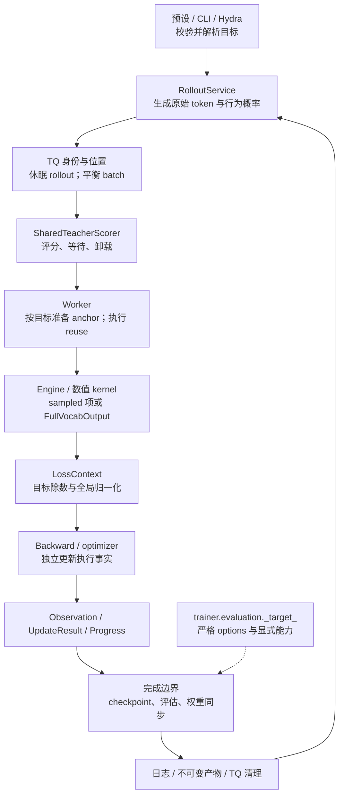
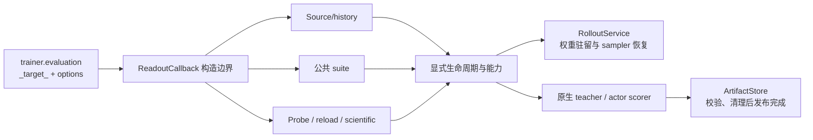

# MirrorOPD 当前架构

本文说明当前单教师 OPD（On-Policy Distillation）的模块职责及跨模块执行顺序。详细源码从[代码走读索引](代码走读.md)进入；数学定义见[理论目录](../../theory/README.md)，实验预算和启动默认值见[训练配方](../../settings/训练设置.md)。根目录 `docs/` 是 verl 上游文档，本目录维护 MirrorOPD 的实现说明。

当前接口以本页及下方专题为准；旧配置和开发调用者按[迁移指南](runtime-migration.md)升级。[重构报告](../../archive/engineering/2026-11-01-运行合同审计与重构方案.md)保存代码来源、设计取舍和验收范围，不作为另一份当前配置手册。

当前聚合与 future 的支持、执行方式及验收入口见 [Full-vocab 数据流](full-vocab.md#聚合与未来信用)。设计理由与未完成提案进入 Agent Notes：[聚合与未来信用](../../../.agents/notes/proposed/architecture/2026-11-03-Full-vocab聚合与未来信用实现计划.md)、[评估与训练执行](../../../.agents/notes/proposed/architecture/2026-11-04-评估与训练执行重构计划.md)、[KL 后端统一执行与 VJP 重构](../../../.agents/notes/proposed/architecture/2026-11-04-KL后端统一执行与VJP重构.md)。提案不作为当前接口手册。

## 模块职责

| 层                       | 负责的内容                                                                                             | 详细定义                                                     |
| ------------------------ | ------------------------------------------------------------------------------------------------------ | ------------------------------------------------------------ |
| 统一实验入口与配置       | 声明式 ModelPair/Budget/Preset 生成 LaunchPlan，method 选择算法，resolver 描述 teacher/anchor 数据需求 | [配置到执行](training-loop.md#配置入口)                      |
| V1 Trainer               | 采样、评分、更新、验证、checkpoint 和权重同步的编排                                                    | [训练循环](training-loop.md)                                 |
| 教师协调                 | shared-sync 教师上卡、评分、等待、卸载和发布                                                           | [教师生命周期](teacher.md)                                   |
| TransferQueue 与布局工具 | 按样本身份传递数据，将模型预测位置映射到 response target                                               | [数据与归一化](data-and-loss.md)                             |
| Worker 与 Engine         | 分布式分发、微批执行、反向、optimizer 和执行事实                                                       | [训练循环](training-loop.md#从一次-actor-调用到实际更新)     |
| 目标与拟合               | Weighted teacher 构造、sampled surrogate、full MDPO/BPO 行归约；共用 LossContext                       | [Sampled OPD](sampled-opd.md)、[Full-vocab](full-vocab.md)   |
| 指标与进度               | 合并观测、逐次更新日志、尝试与成功计数、恢复                                                           | [指标系统](metrics.md)、[进度与恢复](progress-checkpoint.md) |
| 评估与产物               | 一个 `_target_` 构造边界、组件 options、只读 scoring 与不可变产物                                      | [评估合同](../../../../../verl/trainer/evaluation/README.md) |

默认 student 来源的 shared-sync 路径如下。非默认来源、initial/checkpoint 绑定及双模型混合的控制与验收由[Rollout 实现](../rollout/README.md)维护；其学习效果与工程验收分别报告。

## 一轮 shared-sync 训练

Teacher 对 student 的原始 token 序列评分。Full-vocab 缓存 teacher hidden；weighted MDPO/BPO 还按需缓存 anchor hidden/head，actor 每次更新仍重新执行当前 student backbone。计算图、权重状态和统计观测分别由对应模块管理。

## 扩展边界

现有 sampled、Full-KL、MDPO/BPO 共用[统一实验入口](../../../run_math_opd_ablation_fsdp2.sh)。Full-KL 只使用 MDPO/full_vocab/eta=1 的运行表达；sampled 的信号、IS/PPO 和 guard 保持各自算法含义。新增目标先确定数据类型和数学定义，再复用 sampled/hidden 数据流。只有新目标确实需要不同数据时，才扩展数据协议。新增逐 token 指标使用公共位置统计及 Observation，并由业务层选择 namespace。

Shared-sync 的当前支持边界由 [DistillationConfig.validate_shared_sync](../../../../../verl/workers/config/distillation.py) 校验：单节点、V1 sync、FSDP2、单轮文本生成、同一资源池轮流执行师生。Standalone 使用已有独立教师管理路径。完整词表模式当前要求 shared-sync；静态 registry 中存在某种数据类型，不表示它在所有执行模式下都可用。

## 当前运行合同

| 对象            | 唯一职责与约束                                                                             |
| --------------- | ------------------------------------------------------------------------------------------ |
| 目标元数据      | 构造阶段解析；mirror 参数只读，loss_settings 不接受配置输入                                |
| FullVocabOutput | 可微 objective_sum、目标 divisor 与 detached observations 分开；NamedTuple 保持 FSDP hooks |
| LossContext     | 承载调用级 DP／token／sequence 分母，不注入静态 config                                     |
| 更新事件        | optimizer_step_applied 独立于 metrics；None 是未知，缺字段是错误                           |
| 数值后端        | fused 必须运行支持的 CUDA 实现；CPU/FP64 参考显式选择 precompute/dense                     |
| 银行身份        | 绑定 checkpoint 内容、输入和生效生成合同；旧身份不自动升级                                 |

## 评估与资源所有权

所有 readout 从同一构造边界进入，组件自己验证 options 和协议。Source/history 在训练内建立银行；公共 suite 使用 bootstrap。两种协议共用原生 scoring 和产物存储，不互相增加生成工作量。

Trainer 的 `_validate()` 将验证委派给协议 owner；未接管时使用评估包的 `DefaultEvaluator`，保留原生 reward 与 JSONL 协议。`handles_validation` 决定验证入口归属，`requires_full_batch` 声明训练 batch 约束，`owns_final_weight_sync` 声明最终同步责任。Trainer 和 RolloutService 不再根据配置是否存在推断模式。Source/history 与 suite 的 current single-model 限制、分组调度和失败恢复见评估包合同。

## 验证和历史

[架构重构验收](../../archive/engineering/2026-10-25-架构重构实施与验收.md)记录归一化、布局、生命周期与恢复的检查；[主分支四卡验收](../../archive/engineering/2026-10-25-主分支四卡验收.md)记录四卡集成和真实模型短训练。覆盖范围以报告为准，不从短训练推断长期收敛或所有后端的兼容性。

Mirror 的实现、已通过测试与[剩余验证范围](../numerics/mirror-objectives/reference.md#remaining-validation)单独列明。当前说明随源码维护，不记录提交经过。设计取舍、旧实现和冻结实验留在对应历史文档，通过[维护约定](代码走读.md#维护约定)保持单一入口。

## 四域评估与模型扩展

当前评估使用、产物与证据从[评估入口](../evaluation/README.md)进入，局部 API 以评估包合同为准。共同支持、EOS 和模型输入由[动作空间](../model-compatibility/action-space.md)维护；MiMo、Olmo3 等接入各自保留模型与负载验收。

原设计、分阶段代码走读与版本快照见[历史依据](../maintenance/history.md)。旧研究读出、短程集成与完整科研运行不能互相替代，工作区或 main 的旧状态标签不用于推断当前部署。
