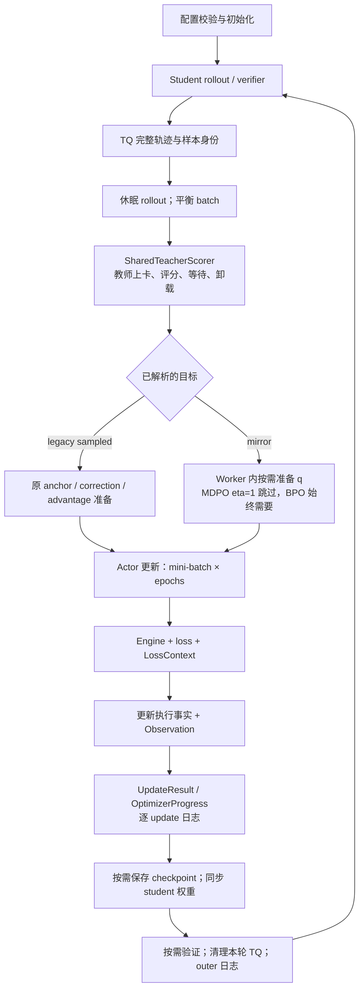

# MirrorOPD 当前架构

本文说明当前单教师 OPD（On-Policy Distillation）的模块职责及跨模块执行顺序。详细源码从[代码走读索引](代码走读.md)进入；数学定义见[理论目录](../../theory/README.md)，实验预算和启动默认值见[训练配方](../../settings/训练设置.md)。根目录 `docs/` 是 verl 上游文档，本目录维护 MirrorOPD 的实现说明。

## 模块职责

| 层 | 负责的内容 | 详细定义 |
| --- | --- | --- |
| 统一实验入口与配置 | 声明式 ModelPair/Budget/Preset 生成 LaunchPlan，method 选择算法，resolver 描述 teacher/anchor 数据需求 | [配置到执行](training-loop.md#配置入口) |
| V1 Trainer | 采样、评分、更新、验证、checkpoint 和权重同步的编排 | [训练循环](training-loop.md) |
| 教师协调 | shared-sync 教师上卡、评分、等待、卸载和发布 | [教师生命周期](teacher.md) |
| TransferQueue 与布局工具 | 按样本身份传递数据，将模型预测位置映射到 response target | [数据与归一化](data-and-loss.md) |
| Worker 与 Engine | 分布式分发、微批执行、反向、optimizer 和执行事实 | [训练循环](training-loop.md#从一次-actor-调用到实际更新) |
| 目标与拟合 | Weighted teacher 构造、sampled surrogate、full MDPO/BPO 行归约；共用 LossContext | [Sampled OPD](sampled-opd.md)、[Full-vocab](full-vocab.md) |
| 指标与进度 | 合并观测、逐次更新日志、尝试与成功计数、恢复 | [指标系统](metrics.md)、[进度与恢复](progress-checkpoint.md) |

## 一轮 shared-sync 训练

Teacher 对 student 的原始 token 序列评分。Full-vocab 缓存 teacher hidden；weighted MDPO/BPO 还按需缓存 anchor hidden/head，actor 每次更新仍重新执行当前 student backbone。计算图、权重状态和统计观测分别由对应模块管理。

## 扩展边界

现有 sampled、Full-KL、MDPO/BPO 共用[统一实验入口](../../../run_math_opd_ablation_fsdp2.sh)。Full-KL 规范化为 MDPO/full_vocab/eta=1；旧 sampled 的信号与估计器保持原义。新增目标先确定数据类型和数学定义，再复用 sampled/hidden 数据流。只有新目标确实需要不同数据时，才扩展数据协议。新增逐 token 指标使用公共位置统计及 Observation，并由业务层选择 namespace。

Shared-sync 的当前支持边界由 [DistillationConfig.validate_shared_sync](../../../../../verl/workers/config/distillation.py) 校验：单节点、V1 sync、FSDP2、单轮文本生成、同一资源池轮流执行师生。Standalone 使用已有独立教师管理路径。完整词表模式当前要求 shared-sync；静态 registry 中存在某种数据类型，不表示它在所有执行模式下都可用。

## 验证和历史

[架构重构验收](../../archive/engineering/2026-10-25-架构重构实施与验收.md)记录归一化、布局、生命周期与恢复的检查；[主分支四卡验收](../../archive/engineering/2026-10-25-主分支四卡验收.md)记录四卡集成和真实模型短训练。覆盖范围以报告为准，不从短训练推断长期收敛或所有后端的兼容性。

Mirror 的实现、已通过测试与[剩余验证范围](../numerics/mirror-objectives/实现方案.md#remaining-validation)单独列明。当前说明随源码维护，不记录提交经过。设计取舍、旧实现和冻结实验留在对应历史文档，通过[维护约定](代码走读.md#维护约定)保持单一入口。
