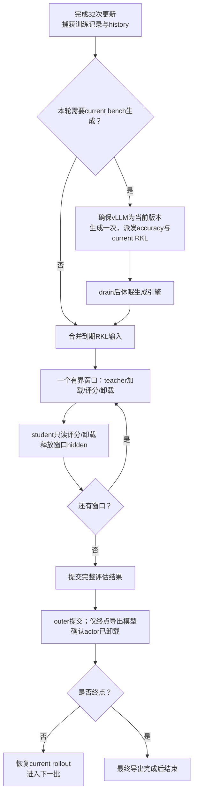

# 验证执行、轨迹存储与可观测性

本页描述执行、存储和观测的设计合同。Parquet、history 引用、多任务公共评估、串行评分和最终导出已有短程集成验收；实际 API 以[评估包合同](../../../../../../verl/trainer/evaluation/README.md)为准，规模证据与剩余缺口由[代码走读](代码走读与实施计划.md)区分。模型兼容和分布语义的后续改进见[动作空间与模型兼容](动作空间与模型兼容.md)。科学参数引用[四域协议](../../../experiments/teacher-transfer/transfer-mechanism/2026-10-31-四域单域训练与RKL评估协议.md)；配置对象见[配置与调度](配置与调度.md)。

## 1. GPU 生命周期只有一个所有者

扩展现有 RolloutService／ExecutionContext／PreparedPhase 边界，不在 bench、bank 和 history 任务里各写一套 sleep／load／sync。Coordinator 请求阶段，底层所有者执行并返回已准备的模型版本、资源和释放句柄。

需要区分`actor_version`与`resident_weights_valid`。同版本在 level-2 sleep 之后也必须重新恢复权重；只判断版本号会错误地跳过加载。vLLM 的 level1 保存 CPU 权重副本，level2 丢弃权重和 KV，官方接口也将恢复 weights 与 KV 分开。[^sleep]

默认 GPU 阶段仍串行：



Bench 节点通常需要两次同版本权重恢复：生成前一次，RKL 之后一次。它们之间发生了深度休眠，不能把第二次算成无条件可删除的重复同步。可以删除的是没有休眠或版本变化时，多个回调重复调用 ensure-current。是否改用 level1 保留当前权重备份，须另测 CPU 占用与完整窗口收益，首版不增加这条分支。

CPU verifier 和 I/O 可以与同一事件中的 GPU 工作重叠；GPU 模型仍遵守共享池所有权。退出评估边界前收齐必需结果。请求取消只取消等待者不等于后端停止，必须确认全部写入者 drain 才清理 TQ 或启动下一个模型；无法确认时停止该运行，保留诊断，不猜测 GPU 已经释放。

## 2. 合并评分不等于一次缓存全部 hidden

RKL 任务按以下兼容键合并：student 快照、teacher 身份、token 对齐／支持集、评分温度、数值执行口径。Domain、bank 来源和 generation temperature 由记录携带，不必分别做一轮模型切换。Source/history 与公共 bank 使用相同 RKL 定义时可进入同一窗口，结果仍分开聚合。

CPU teacher payload 的基本估算是有效位置数乘以`hidden_size × dtype_bytes`，另计 positions、TQ 序列化、写入／预取副本，以及尚未清理的当前训练 payload。GPU 推理 token budget、CPU 窗口字节 budget 和 head token chunk 是三个不同限制。

窗口规划先读取轻量长度与身份列，再按预算装入完整轨迹。可以使用 first-fit-decreasing，之后在窗口内部做推理专用 DP 平衡；无需求解通用最优调度。不能为了满足窗口预算把长回答切成失去前缀的独立短输入。单条完整输入都不满足模型／资源限制时，应在启动前拒绝该配置。

当前 Trainer 的 balancer 使用训练 mini-batch 整除条件，新评分适配层必须复用底层平衡／padding 工具并明确`multiple=DP size`。Padding 具有独立的物理 key 和零有效 mask，不能进入科学题数、sum/count、history 或分母；returned logical IDs 必须与请求集合完全一致。支持评估 padding 不代表已支持 batch128 的六卡训练。

对当前公共 32K 和来源／history7K 的上限，单份公共 512 加本地 256 共有 18,612,224 个 response 位置；两份公共 bank 合计 1,280 条、35,389,440 个位置。以下是 BF16 teacher hidden 本体，不是峰值显存或进程 RSS：

| Teacher    | hidden size | 一份公共 bank＋来源/history（GiB） | 两份公共 bank＋来源/history（GiB） |
| ---------- | ----------: | ---------------------------------: | ---------------------------------: |
| R1-1.5B    |        1536 |                              53.25 |                             101.25 |
| Qwen3-1.7B |        2048 |                                 71 |                                135 |
| Qwen3-4B   |        2560 |                              88.75 |                             168.75 |
| R1-7B      |        3584 |                             124.25 |                             236.25 |
| Qwen3-8B   |        4096 |                                142 |                                270 |

若 bench 节点再加入 512 条 current 轨迹，Qwen3-8B teacher 的本体上限达到 398GiB。因此首版必须分块，不能把所有 teacher hidden 先算完再开始 student。16GiB 只是配置探针的逻辑 payload 预算；实机按可用 host RAM 扣除模型 CPU 状态、训练 payload 和系统余量，再计序列化／预取副本，校准能安全容纳的窗口。只有一个窗口活跃，窗口内部复用现有单 pending write 与微批 prefetch；不提前预取第二个完整大窗口。

一个窗口需要一次 teacher 阶段和一次 student 阶段，若有 W 个窗口就至少有约 2W 个模型评分阶段。合并任务的目标是让相容输入共同填满窗口，避免每个任务独立切换；不能同时承诺固定内存和任意大集合只切换两次。CPU 设计探针在“所有回答达到 cap、8B hidden、16GiB payload 窗口”的合成条件下，独立任务 29 窗口、合并 26 窗口；这只是装箱与预算检查，不是吞吐结果，也不是全局最优证明，旧 512 题 accuracy 候选下的[CPU 探针结果](data/design-review-20261031/proposal-probe.json)保留了当时的逻辑计数；本次全集 accuracy 改为 6703 条，RKL 窗口计数不变。

当前训练 TQ 由 Trainer 拥有，首版不提前清空整批训练 key，因为后续指标还要读取它。评估只清理自己分区；窗口预算要扣除已存活的训练 payload。未来如要提前释放 teacher 字段，应单独明确 TQ 字段级所有权与原指标消费者，不顺手破坏旧路径。

### 当前 TQ 位置与训练复用成本

默认 TransferQueue 配置为 SimpleStorage、8 个 storage unit、SSD offload 关闭；既有验收采用该配置。StorageUnitData 在存储进程 CPU 内存中按样本／字段持有数据，经 ZMQ 传输。TQ 不是 CPU／GPU 之外的另一种内存；新运行必须保存实际 resolved 配置。

训练当前 128×7168 位置的 teacher BF16 hidden，Qwen3-1.7B／4B／8B 分别约 3.5／4.375／7GiB。reuse32 的全作业 H2D 累计约 112／140／224GiB，另有 TQ 副本和微批 prefetch。当前没有默认整批 GPU 缓存；后续可测 actor 侧本批 CPU 缓存以减少 TQ 访问，或本 rankGPU 缓存以减少 H2D，两者仍只在当前 outer 存活。

词表 151936、chunk256 的单份 FP32 logits 约 148.4MiB，双份约 296.8MiB，另有归约工作区。此前单 H800、Qwen3-1.7B student FP32＋8B teacher BF16、prompt256／response7168／microbatch1 的共驻原型峰值 allocated 约 25.14GiB，只证明该短设置可行。完整备选性能证据留在[实测页](../../performance/full-vocab/training.md)，本轮不重开共驻／分池路线。

## 3. 不同模型需要不同执行 profile

生成时缓存的 KV 与评分的 teacher hidden 不同。以 BF16 KV、无前缀共享、无 TP 分片估算：

$$
B_{KV}=2\,L\,n_{KV}\,d_{head}\,2\,T.
$$

这里 $T$ 是 prompt＋已生成 token 的总长度。必须读取显式`head_dim`，不能总用 hidden size 除 attention heads。已读取[六个本地配置及哈希](data/design-review-20261031/model-kv-estimates.json)得到：

| 模型       | 层数 | KV heads | head dim | 32,768 总 token 的单序列 KV（GiB） |
| ---------- | ---: | -------: | -------: | ---------------------------------: |
| R1-1.5B    |   28 |        2 |      128 |                              0.875 |
| Qwen3-1.7B |   28 |        8 |      128 |                                3.5 |
| Qwen3-4B   |   36 |        8 |      128 |                                4.5 |
| Qwen3-8B   |   36 |        8 |      128 |                                4.5 |
| R1-7B      |   28 |        4 |      128 |                               1.75 |
| R1-14B     |   48 |        8 |      128 |                                6.0 |

回答 cap32K 还要加 prompt，因此上表不是完整请求的最坏值。TP 可分摊权重与 KV，但 KV heads 复制、框架布局与临时 buffer 会影响真实份额。参数量相近的 R1-1.5B 和 Qwen3-1.7B 具有四倍 KV 差异，不能给所有模型机械使用相同 max_num_seqs。

建议分别记录：

- **模型生成 profile**：TP／副本拓扑、max_model_len、max_num_seqs、max_num_batched_tokens、KV bytes／显存比例、请求在途上限、graph／eager 策略。
- **RKL 执行 profile**：teacher 与 student 各自的完整输入 token 微批预算、head chunk、窗口字节预算、I/O 预取开关、精度与支持集。
- **Verifier profile**：CPU 并行度、代码执行时限／内存限制、版本和隔离实现；不让它继承 GPU 并发值。

并发 profile 改变不能修改 n、cap、T 或问题选择。资源 capacity 预检发生在任务执行之前，已请求 32K 不能被 server 裁成更短后仍标作 32K 评估。vLLM 的 chunked prefill 可允许 prefill token budget 小于单条 max_model_len；FSDP 整条输入的微批预算则必须容纳其实际长度，这两者不能混用。[^tuning]

### 已测与待测

既有 Qwen3-1.7B／8B 的 768 条真实轨迹原型，在原生低精度乘法／FP32 输出下串行中位 75.8s、2＋2 为 92.7s；原型不含训练 optimizer 和 vLLM 冷启动。原生 JustRL→R1-1.5B 的 7K 两轮训练也已通过，单轮约 6 分钟。完整数字及源码快照见[性能页](../../performance/full-vocab/training.md)。

公共 32K、其他模型组合、不同 TP 与新的执行协调层尚未验收。候选评分预算可先从能覆盖最长完整输入的 49K 量级起，再比较 64K／96K；head chunk 比较 256／512／1024。生成并发按 KV 估算给起点，再测实际长度分布、prefill/decode 吞吐、preemption、峰值和完整窗口；不把 128 当所有模型的默认最优。

同卡双模型共驻与分池是历史备选。共驻小模型可按题分给独立 worker；7B／14B 曾讨论同一 2 卡组内共同分片、不同组分题；容量不足再考虑 3 卡组或完整 FSDP 组。独立 teacher 组／student 组则按完整耗时平衡并传 hidden。这些布局都需要明确 mesh 和资源所有权，不能只在_validate 里改 GPU 数量；当前没有把它们纳入默认实现。R1-7B／14B 的 BF16 tensor 数据量分别为 15,231,233,024／29,540,067,328 字节；R1-7B student FP32＋14B teacher BF16 仅权重约 55.88GiB，反向约 69.21GiB，两者 BF16 约 41.70GiB，还未计额外 head 和激活。这说明只按模型 B 数选布局不够，但当前计划不重新打开并行路线选择。

## 4. 轨迹与结果存储

新协议统一采用 PyArrow／Parquet＋Zstd 保存轨迹和逐题结果；history 仅保存引用。`FixedRKLReadout`已改用 Parquet 并只在`self.batches`保留轻量引用，不再保存完整 history token 副本。旧结果保留原样，由只读 adapter 读取。实际增量配置、当前目录和功能边界见[组件说明](../../../../../../verl/trainer/evaluation/README.md)。

`ArtifactStore`首版是进程内的薄库，提供分批写入、按引用读取、选取 bank 和发布产物，不新增数据库、RPC 或常驻存储服务。运行时 TensorDict／TQ 和磁盘 Parquet 共享字段语义，通过 adapter 转换，不要求使用相同物理格式。

按仓库约定，新运行放在`runs/`，共享模型／环境及历史运行保持原位。目录简化为：

```text
runs/teacher-transfer/
  banks/<bank-id>/
    manifest.json
    trajectories-000.parquet
  datasets/<dataset-id>/
    manifest.json
    questions.parquet
  runs/<run-id>/
    manifest.json
    resolved_config.yaml
    attempts/<attempt-id>/
      training/outer-0001.parquet
      history/outer-0001.parquet
      evaluation/<event-id>/
        manifest.json
        generations/part-000.parquet
        rkl/part-000.parquet
        accuracy/part-000.parquet
      updates/outer-0001.parquet
      metrics.jsonl
      traces/events-<pid>.jsonl
    checkpoints/final/
      model/
      manifest.json
    reports/
```

### 哪些数据保存成表

| 内容               | 保存方式与必要字段                                                                                                                  |
| ------------------ | ----------------------------------------------------------------------------------------------------------------------------------- |
| 实际训练／评估轨迹 | Parquet：question/sample/trajectory ID、模型版本引用、原始 prompt／response int32 列表、mask、长度、finish_reason；按 byte 预算分片 |
| History 成员       | Parquet 小表：轨迹引用、原始 batch、配额、随机优先级；不复制 token 数组                                                             |
| 固定 bank          | 物化选中轨迹的紧凑 Parquet，保留原 generation artifact／sample 来源；独立于完整 accuracy 产物保留                                   |
| 逐题 RKL           | Parquet：轨迹引用、被评分 student 版本、teacher/support 身份、rkl_sum、token_count、status；均值与降幅由统一聚合器生成              |
| Accuracy           | Parquet：question/sample 引用、得分、verifier 身份、答案提取／执行状态；原始回答引用生成表                                          |
| 逐更新日志         | 每 outer 提交 32 条实际 update 记录，含 outer/inner/attempted/applied、loss、LR、grad norm 与计数；不额外做 inner RKL 前向          |
| 少量配置与进度     | YAML／小 JSON 元数据；既有 logger 的标量 JSONL 与 WandB 出口保留，不在其中塞 token、逐题数组或 hidden                               |

Parquet 支持变长列表、压缩及 row group。[^arrow] Writer 按批次或字节上限写入，reader 按所需列和 row group 读取；不要先收齐 6703 条长回答转成 Python 列表后才写文件，也不为每条轨迹建立独立文件。History 只保留轻量索引，读取时按 shard 归并请求；训练结束的 6400 条 token 不常驻 driver Python 对象。

只保存每条轨迹的必要原始数据和标量，不长期保存 teacher hidden、全词表概率、KV 或逐 token RKL 数组。最终模型与大轨迹文件不进 Git；配置、代码、小型审计摘要及精选图可入 Git。新 recipe 显式将输出、最终权重、validation、timeline 和 logger 路径收拢到 runs，旧运行不迁移。

### Manifest 的必要信息与最小边界

Manifest 只是“这份产物是什么”的小清单，不是数据库或训练恢复状态。必要的是可解释与可验证的元信息；它不一定非要成为独立 JSON 文件。若产物永远是一个自包含 Parquet，可以放进 Parquet metadata；本项目有分片银行、共享 bank、多个结果表和独立最终模型，所以推荐保留一个对象级小 manifest。

只为 run、可独立复用的 dataset/bank、一次评估事件和最终模型维护 manifest；每条轨迹、每个微批不各建一个。单个训练／history shard 的行数、hash 与完成信息由所属 run manifest 记录，无须每 shard sidecar。银行自行携带生成者与生成协议身份，run 引用 bank-id，不要求保留其生产运行才能解释银行。

| 最小字段组                        | 用途                                                                                                                           |
| --------------------------------- | ------------------------------------------------------------------------------------------------------------------------------ |
| schema_version、kind、artifact_id | 确认对象类型和可读格式版本                                                                                                     |
| provenance／protocol 引用或值     | 模型 revision 或 current 模型版本、tokenizer/template/mode、数据版本、n/T/p/k/cap/seed、RKL 支持与聚合口径；按对象保存适用字段 |
| files                             | 相对路径、文件角色、row count、byte size、内容 hash；题目 ID 和成员列表仍在 Parquet，不再在 JSON 重复一份                      |
| coverage／status                  | expected/observed/failed计数及任务状态；记录产物写完不等于科学样本齐全，主表另检查完整性                                       |

Run 的 resolved_config 保存完整运行配置，manifest 引用其 hash，不再复制一遍配置树。模型初始 revision 和最终导出 hash 在绑定时记录；中间 student 以 run/attempt/outer 及真实更新版本标识，不为生成 manifest 每轮重算全模型 hash。

Manifest 防止三种具体错误：将 7K 或另一种模式的 bank 当作 32K 银行复用；漏掉某个分片仍发布完整指标；将不同 student 版本或不同轨迹来源的结果合并。文件名和目录名不足以稳定表达这些信息。配置 YAML 只说明打算执行什么，产物 manifest 还记录实际生成了哪些文件和完成到什么程度。

### 简化发布与所有权

取消上一版并列的`manifest.json`／`complete.json`／`result.json`和默认`plan.json`；完成状态与任务覆盖合入单个 manifest。计划只在 dry-run 或诊断时导出，数值结果只有 Parquet 一份事实来源，WandB／CSV／图片是派生出口。

首版按单节点 POSIX 接口实现：单 writer 写临时 shard，关闭并校验后 rename；所有引用文件就绪后，原子替换所属 manifest 作为发布点。新 event／bank 无已发布 manifest 时不可复用；run 增量 manifest 只列出已发布分片。该方式不构成训练恢复包，也不自动证明底层文件系统的断电持久性；若需要断电保证须另验收 fsync 与挂载语义。共享 bank 按配方加构建锁，锁内复查已有产物；不建立通用事务框架。

固定模型／输入／协议构成配方身份，实际 token 和 mask 另有内容 hash；同配方不保证在线生成逐 token 一致，运行绑定具体 bank-id。每个 logical sample 只发布一个成功产物，失败 attempt 另记；相同轨迹的不同 student 版本 RKL 不可复用。首版不自动 GC 共享 bank，最终模型只引用它们，不重复打包。

## 5. 最终模型导出与评估提交

当前实际验收已通过原生 FSDP 最终 model-only 保存和 CPU 读回；下面的统一 HF 导出及重载 RKL 对齐仍是待实施目标。详见[四卡验收](../../performance/full-vocab/training.md#parquet-基础链路的四卡-gpu-验收)。

用户已选择仅保存一个最终 model-only，不保存 optimizer 或中间 checkpoint。本轮移除周期保存、latest 轮转和完整训练恢复事务的实施要求。Adam 在训练期间正常使用，但不落盘；不保存 scheduler／RNG／data 游标作为恢复包。历史轨迹、逐题指标和评估完成记录仍保留。

最终导出包含 student 权重、模型配置、tokenizer 及输入／bank／代码身份 manifest，先写临时目录并校验，再发布标记完整的 manifest。首版只输出一种可独立加载的权重格式，不同时保留 FSDP 和 HF 两套副本；复用已有流式 HF 导出能力，显式保留实际参数精度，不隐式把 FP32 改成 BF16。导出后重载并核对固定输入 RKL 及权重精度，完成标记晚于所有 rank 写入。

保存器可能重新将 actor 加载到 GPU，因此最终导出在 rollout 仍休眠时执行；完成后结束运行，无需为下一训练批唤醒 vLLM。中途失败保留完整评估产物和诊断，训练分支需从原始 student 重新运行；只拿模型重置 Adam 属于新条件，不称同条件续训。

此前走读发现的 checkpoint 早于 history、keep1 只覆盖 actor 提交等问题，保留为现有代码事实及未来恢复能力的前置条件，不再作为本轮必做功能。若以后恢复该需求，需要模型、Adam、RNG、游标和 history 的完整 outer 事务，不能直接打开 resume 开关。DCP 等保存格式的迁移亦暂缓。[^dcp]

## 6. 指标与可观测性

### 已有基础

原生已有逐次更新的 loss／grad norm／lr／applied 与 skipped 计数，rollout／teacher／update／sync 阶段耗时，预期与实际 session 数量、finish_reason 和部分请求延迟，vLLM KV／waiting／running 快照，以及可选 host timeline 和 torch profiler。当前 update records 通常在整个 actor 调用返回后提交；它们是完整账本，不是实时 inner 进度。

现有回调已保存逐题 sum/count、bank hash、history 引用和可用的 finish_reason；source bank 校验本地 tokenizer／模板配置 hash 与输入参数。缺失终止原因保留空值。公共逐请求协议仍待接入；评分 manifest 已把关闭审计标记为 not_requested，不将底层 unchanged 字段当哈希证据。

### 新报告的数据维度

运行级固定模型／协议身份，事件级固定 ActorVersion；逐行保留 dataset、question、sample、trajectory origin、bank-id、support-id 和执行状态。不要把问题 ID、路径或每条请求 ID 塞进 WandB／Prometheus 指标名字。

| 指标层     | 内容                                                                                  | 解释边界                                                                              |
| ---------- | ------------------------------------------------------------------------------------- | ------------------------------------------------------------------------------------- |
| 训练       | loss、LR、grad norm、attempts/applied、tokens、每次 update 与 outer 时钟              | 换批 loss 跳变含状态变化；scheduler 当前在 actor 调用末步进，不能顺手改为每 inner     |
| RKL        | 各题 sum/count、题内 token 均值后按题平均、绝对风险与相对降幅                         | 不混 initial／teacher／current 来源；history 另外给共同轨迹配对变化；零基线降幅不定义 |
| Accuracy   | 各 bench 逐题 avg@n、strict IF、题数与生成数、CI                                      | 不按 n 放大题目权重；不默认输出 best-of-n 作为主成绩                                  |
| 长度与终止 | prompt/response长度分布、真实finish_reason、cap命中、最终答案缺失                     | 不把 len 等于 padding 宽度当截断；requested/effective cap 分别记录                    |
| 完整性     | expected／observed／failed／retried，缺失字段 availability                            | missing 不是零；部分成功不发布为完整主表                                              |
| 执行       | teacher／actor 加载次数，cold／warm 生成、FSDP forward、投影、归约、I/O、保存及总时间 | 请求延迟均值不等于 batch wall；CUDA 区间含等待，不直接当算术 kernel 时间              |
| 资源       | GPU allocated/reserved、NVML、KV占用、请求队列、TQ逻辑bytes与CPU副本估算              | RSS、payload 与峰值 GPU 不是同一量；不把不可用 preemption 补零                        |

vLLM 官方提供 TTFT、输出 token 时间、请求总时长与队列／KV 指标；本地已能读到哪些字段仍以服务版本和返回值为准。[^metrics] 保留现有`VERL_E2E_TIMELINE_DIR`的跨进程 clock-domain 标识；常规观测不加逐 kernel 同步。需要内部 CUDA 分解时用独立 profile 窗口，不把 profile 开销混进吞吐主表。

建议增加低频 inner 进度事件和 eval 任务进度，复用 timeline／日志基础，不再新增另一套监控服务。GPU worker 的临时进度供观察，最终更新账本与 eval manifest 中的完成状态 才决定是否完成。每个任务有 planned、running、complete、failed 状态；日志能定位正在生成哪个模型、多少 sample 完成、当前哪个 RKL 窗口以及等待哪种资源。

### 主指标与展示规则

科学读出频率只由[四域协议第 6 节](../../../experiments/teacher-transfer/transfer-mechanism/2026-10-31-四域单域训练与RKL评估协议.md#6-生成参数与读出时间)维护。指标白名单如下：

| 对象                                         | 默认记录／展示                                                                  | 聚合与解释                                                                         |
| -------------------------------------------- | ------------------------------------------------------------------------------- | ---------------------------------------------------------------------------------- |
| 训练当前批                                   | 每 update 的 RKL loss、LR、grad norm、有效 token、applied/skipped               | loss 使用全局 token-mean，是更新前读数；不冒充更新后的评估 RKL                     |
| 来源 heldout、公共 initial/teacher 固定 bank | 绝对 RKL、相对同 bank 初值的绝对下降和百分比下降                                | 先每题 sum/count 再按题平均；公共四域再等权，来源与 origin 分别报告                |
| 动态 history                                 | 绝对 RKL；相邻读出共同轨迹的配对变化与共同样本数                                | 批内按题平均、外层按 batch 等权；不拿不同成员集合的均值比称为固定样本降幅          |
| 公共 current 轨迹                            | 当前访问状态上的绝对 RKL，和同节点任务成绩并列                                  | 轨迹随权重变化，其风险变化含状态分布变化，不与固定 bank 曲线混称同状态拟合         |
| Accuracy                                     | 各 bench 全集 avg@n；代码为采样 pass@1；IF 为 strict prompt-level；teacher 基线 | 先每题平均 n 次，再按题平均；不输出默认 best-of-n 总榜，不合并成无解释的四域总 acc |

固定 bank 相对降幅是 1−终点集合均值/初始集合均值，不平均逐题百分比；初值为零时不定义。长度和终止率在生成时记录，固定 bank 长度只需保存一次；后续评分不重新生成它来记录 length。

主要图包括训练 loss（标记 outer 边界）、source/history、公共三种 origin 的四域 RKL 面板、accuracy 各 bench 曲线，以及执行耗时分解。每题 RKL 分位数、问题级配对 bootstrap 区间、共同 history 轨迹变化可离线从原始表生成，不增加 GPU 前向。公开榜优先共享 initial-student 前缀；teacher/current 前缀单列。RKL 仍是唯一分布距离，FKL／TV／JS／熵不新增。

训练和评估的 outer、实际 optimizer 更新数、墙钟是三个明确轴。Logger 接收聚合标量；逐题与逐 sample 明细留 Parquet，避免把数千条明细变成 WandB 指标名。阶段耗时、tokens/s、加载次数、TQ 读写 bytes／等待和 CPU/GPU 峰值用于定位性能；TTFT 等请求指标只在后端实际提供时记录。常规日志不加每 kernel 同步，内部 CUDA 分解属于单独 profile。

### 失败语义

正常输出但答错、无法解析或达到 cap 没有答案，按固定 verifier 规则记分；GPU／服务／基础设施失败不是同一类。现有聚合器有“缺失主分数按预算计零”的既有口径，新科学主表建议先要求完整任务，基础设施失败按相同 logical sample 有限重试，仍不完整则报告缺失与 coverage，不发布伪完整 acc/RKL。原预算成功率可保留为另一个明示诊断，不全局改变旧实验行为。

### 绘图复用

旧 fixed_transfer reader 硬编码 H1024、0–320 和三域，保持历史定义。新 native reader 从 manifest／长表构建训练、source、history、公共三种 origin 和 accuracy 面板，显式支持 outer 及 optimizer 两个轴与 Science。复用纯绘图原语、模型标签、相同 size 样式、源 hash 与图审计；不要直接放宽旧 MAX_DISPLAY_UPDATES 或偷偷换旧分母。

新的总榜只对同一 origin、支持集与聚合口径做四域等权汇总。模型名、尺寸、thinking/instruct 和谱系从 registry 统一解析。每个 run 的图、CSV、覆盖清单和源 hash 留在 reports；缺失面板标缺失，不画零值。

### 参考文献

[^sleep]: vLLM contributors. Sleep Mode，v0.25.1. [官方文档](https://docs.vllm.ai/en/v0.25.1/features/sleep_mode/).

[^tuning]: vLLM contributors. Optimization and Tuning，v0.25.1. [官方文档](https://docs.vllm.ai/en/v0.25.1/configuration/optimization/).

[^arrow]: Apache Arrow. ParquetWriter，26.0.0. [官方 API](https://arrow.apache.org/docs/python/generated/pyarrow.parquet.ParquetWriter.html).

[^dcp]: PyTorch. Distributed Checkpoint，2.11. [官方文档](https://docs.pytorch.org/docs/2.11/distributed.checkpoint.html).

[^metrics]: vLLM contributors. Metrics，核验于 2026-10-31；字段需与安装版本核对。[官方文档](https://docs.vllm.ai/en/latest/design/metrics/).
