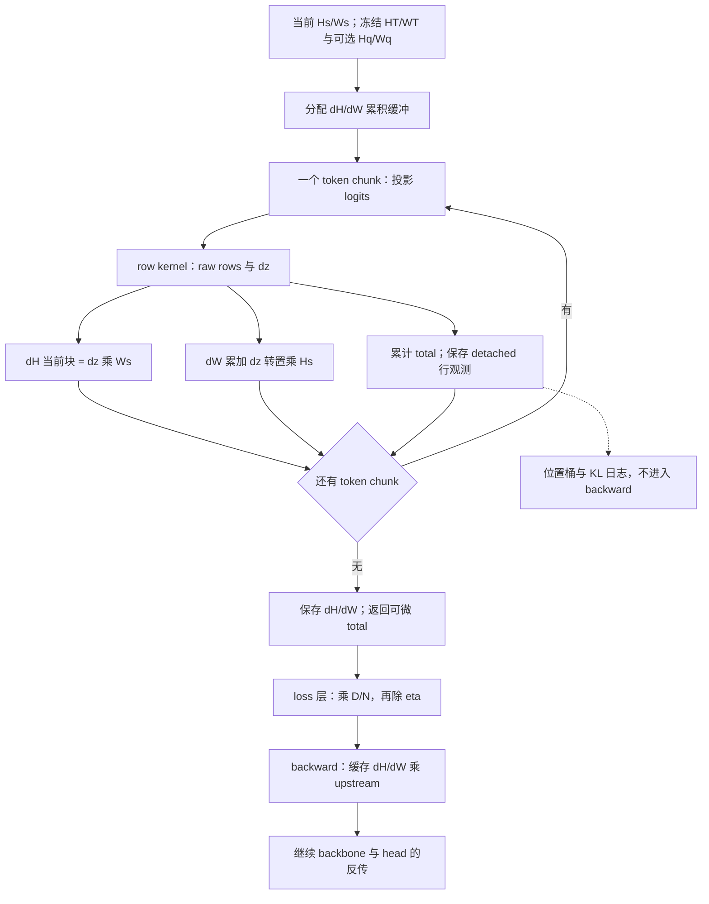
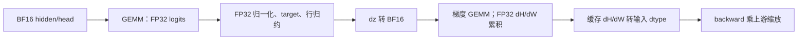

# Full-vocab OPD、MDPO、BPO 走读：算子、分块 VJP 与数值实现

本文承接[目标与梯度](full-kl-walkthrough.md)和[训练执行](full-kl-execution-walkthrough.md)，逐段解释 `full_vocab.py`、`objectives.py`、`targets.py` 与 `full_vocab_triton.py`。源码基点与行级引用约定统一见[目标篇说明](full-kl-walkthrough.md)。符号沿用主篇；本篇的 G、dH、dW 默认都是 **未除 eta、未乘 DP/token 缩放** 的 raw objective 梯度。

## 1. Dispatcher 的逐段阅读

入口是 [full_vocab_objective_result](../../../../../verl/trainer/distillation/full_vocab.py#L359)，359–402 行。返回 `FullVocabObjectiveResult(loss_sum, token_objective, token_diagnostics)`，定义位于同文件 310–315 行。

| 行区间 | 处理 | 阅读时核对 |
| --- | --- | --- |
| 363–367 | `teacher_only_kl` 委托 `full_reverse_kl_result` | MDPO eta=1 与普通 OPD 共用原 API；四项 mirror 诊断为空 |
| 368–373 | 验证 objective、hidden payload、backend、anchor | BPO eta=1 仍不能省 q |
| 374–385 | 验证 2D 形状、token 行数、支持集、hidden/head 宽度 | $V_q=V_s$，$V_t\geq V_s$ |
| 386–390 | 正 chunk、非空词表、局部零有效行处理 | 局部空行可返回连接 student 图的零 |
| 391–393 | dense reference | 普通 autograd 对 rows.sum 求导 |
| 395–400 | precompute 或 fused precompute | 共用 PrecomputedKL，只替换 row kernel |
| 401–402 | detached 行值与命名诊断 | 行观测不提供训练梯度 |

一般 mirror 的 [_mirror_rows](../../../../../verl/trainer/distillation/full_vocab.py#L321)，321–356 行先在 `torch.no_grad()` 下处理 T/q，再在有需要的计算图中投影当前 student：

$$
\log T=\operatorname{logsoftmax}(H_TW_T^\top)\big|_{\mathcal V_s},\quad
\log q=\operatorname{logsoftmax}(H_qW_q^\top),\quad
b=\operatorname{build\_log\_weights}(\log T,\log q),\quad
z=H_sW_s^\top.
$$

没有诊断时，MDPO 可释放 log q 与 log T 临时量；BPO 保留 log q 作为方差权重。Frozen hidden/head 会在每个 chunk 再投影，缓存的是输入，不是整个词表 target。

## 2. Dense reference 与解析 logits VJP

[full_vocab_rows](../../../../../verl/trainer/distillation/objectives.py#L42)，42–78 行是最短的数学参考。它同时返回 raw row loss、解析 dz 和 detached 诊断。

行值与 logits 梯度的完整公式只在[OPD](full-kl-walkthrough.md#4-full-kl-opd从-kl-到每个-logit-的梯度)、[MDPO](full-kl-walkthrough.md#5-mdpo向-weighted-target-做-scaled-reverse-kl)和[BPO](full-kl-walkthrough.md#6-bpo冻结-q-加权的中心化残差方差)各节维护。这里核对 dense autograd 与优化路径如何消费这些结果。

OPD 的 dense reference 单独在 [dense_rows](../../../../../verl/trainer/distillation/full_vocab.py#L55)，55–58 行。Dense dispatcher 对 row sum 使用正常 autograd；解析 dz 主要供优化路径使用。这样可以用独立 autograd 检查手写 VJP，避免只用同一个解析表达式验证自身。

诊断位于 [full_vocab_rows](../../../../../verl/trainer/distillation/objectives.py#L71)，71–78 行：target KL 使用 raw reverse residual 加 log Z；teacher KL 使用完整 teacher 归一化后的 log T；anchor KL 使用 log q。BPO 的 `target_kl` 也是 $\mathrm{KL}(p\Vert m)$，不是 BPO 方差加 log Z。

## 3. 从 logits 梯度到 hidden 与 head 梯度

### 3.1 线性 head 的两个反传出口

令 $H\in\mathbb R^{n\times d}$、$W\in\mathbb R^{V\times d}$，$Z=HW^\top$。若 $G=\partial L_{\rm raw}/\partial Z$，则从微分内积可得：

$$
\begin{aligned}
dL_{\rm raw}
&=\operatorname{tr}(G^\top dZ)\\
&=\operatorname{tr}(G^\top dH W^\top)+\operatorname{tr}(G^\top H dW^\top)\\
&=\langle GW,dH\rangle+\langle G^\top H,dW\rangle.
\end{aligned}
$$

因此：

$$
\boxed{dH=GW,\qquad dW=G^\top H.}
$$

dH 继续沿 index-select 和 backbone 图反传，dW 交给模型 head 的 autograd/FSDP 路径。T/q 没有这些梯度出口。

若 head 与输入 embedding 共享参数，head 的 dW 是该参数的一路梯度，backbone 使用输入 embedding 还会贡献另一路；正常 autograd 累加共享参数的贡献，不应手动重复加一次 head 梯度。

### 3.2 token chunk 的累积关系

将有效 token 行分为块 c，记该块 hidden 和 logits 梯度为 $H_c,G_c$。则：

$$
dH_c=G_cW,\qquad
dW=\sum_cG_c^\top H_c,\qquad
L_{\rm raw}=\sum_c\sum_{i\in c}R_i.
$$

Head 梯度跨 token chunk 累加，hidden 梯度写入对应行块。数学上没有除 chunk 数。源码 [PrecomputedKL.forward](../../../../../verl/trainer/distillation/full_vocab.py#L183)，193–206 行正是这个循环。

## 4. Precompute 的前向与反向分工

### 4.1 Forward 已计算 raw 一阶 VJP

[PrecomputedKL](../../../../../verl/trainer/distillation/full_vocab.py#L179)，179–219 行的关键顺序：

1. 185–192 行分配 FP32（FP64 输入时为 FP64）dH/dW、total、行观测和诊断缓冲。
2. 193–199 行逐 token chunk 调用 endpoint 或 mirror row kernel，获得 raw row 和 dz。
3. 200–205 行累计 loss sum、逐行结果、dH 与 dW。
4. 207 行将 dH/dW 转回输入 dtype，保存给 backward。
5. 208–212 行将 token rows 与 diagnostics 标为不可微，只保留 total 的自定义反传入口。

### 4.2 Backward 才应用上游系数

外层 loss 为 $L=\alpha L_{\rm raw}$，其中当前训练 $\alpha=D/(N\eta)$。`PrecomputedKL.backward` 的 216–219 行返回：

$$
\frac{\partial L}{\partial H_s}=\alpha\,dH_{\rm cached},\qquad
\frac{\partial L}{\partial W_s}=\alpha\,dW_{\rm cached}.
$$

这里 upstream 就是 autograd 传入的标量导数。即使调用者对 total 再套一个可微标量函数，链式缩放仍由 upstream 承担。Forward 提前算 VJP 不代表提前执行 optimizer，也不代表 teacher/anchor 开始训练。

此接口只保存 **sum 对所有行统一权重** 的 VJP。返回的 token_objective 已 detached，调用者不能随后乘逐 token 权重并期待正确反传；若要引入逐 token 可变权重，必须修改 row VJP 的形成/累积协议。`once_differentiable` 同时限定优化路径只提供一阶梯度，不支持直接拿缓存 VJP 做二阶求导。

### 4.3 Precompute 的显存规模

令 C 为 token chunk，n 为 micro-batch 有效 token 数。主要数值工作区包括：

| 对象 | 规模 | 说明 |
| --- | --- | --- |
| 单块 student logits、b、dz | $O(CV_s)$ | 不保存全部 n 行的完整词表图 |
| 单块 teacher 投影 | $O(CV_t)$ | 一般 mirror 必须含 teacher 额外行 |
| q hidden/head | $O(nd_s)$、$O(V_sd_s)$ | q 需要时存在；hidden 还有 TQ/CPU 生命周期 |
| dH 累积 | $O(nd_s)$ | 每行对应一份 |
| dW 累积 | $O(V_sd_s)$ | 完整 head 梯度，FP32 累积 |
| 行观测/诊断 | $O(n)$ | 少量标量通道 |

这只描述 head-loss 部分，不包含 backbone activation、FSDP gather、optimizer 和 allocator 缓存。缩小 C 降低 logits 工作区，但不能消除完整 head 梯度缓冲。

## 5. Backend 的实际差别

Endpoint 分派在 [full_reverse_kl_result](../../../../../verl/trainer/distillation/full_vocab.py#L254)，254–306 行。一般 MDPO/BPO 只支持最后一列标“是”的三类；MDPO eta=1 使用 endpoint 支持集。

| Backend | Forward | Backward | 一般 mirror |
| --- | --- | --- | --- |
| `dense` | 完整选中行 logits，普通 autograd 图 | 正常自动求导 | 是 |
| `recompute` | token 分块、每块完整词表，保存行统计及 H/W | 再投影当前块，重建 G，再算 dH/dW | 否 |
| `streaming` | token 与 vocab 双重分块，在线归约 | 双重分块重算 | 否 |
| `cached` | 双重分块投影到当前 token 块的完整 logits 缓冲 | 仍重算，不保留 logits 到 backward | 否 |
| `precompute` | token 分块，普通 PyTorch row kernel，累计 dH/dW | 只乘 upstream | 是 |
| `precompute_fused` | CUDA BF16 时替换为融合 row kernel | 共用 PrecomputedKL | 是 |
| `liger` | 外部 fused linear JSD 配成 reverse KL，均值转 sum | 外部算子实现 | 否 |

`precompute_fused` 的 CUDA BF16 判断在 endpoint 292–298 行、mirror 397–400 行；其他设备或 dtype 回退普通 precompute。这意味着 CPU 上把 backend 写成 fused 的测试只覆盖 dispatcher 和回退，不覆盖 Triton GPU 数值。

`vocab_chunk_size` 不会让一般 mirror/precompute 自动按词表流式处理：其 `_mirror_rows` 仍投影整个词表。该参数用于 endpoint streaming/cached 及额外 teacher 支持修正。调小 vocab chunk 后显存没有明显下降时，先确认走的是哪条 backend。

`liger` 当前返回 `token_kl=None`，因此没有行级位置观测；该缺测不等于零 KL。其余本地 endpoint 后端返回 detached 行值，供上层复用。

### 5.1 Streaming 的稳定归约

[row_statistics](../../../../../verl/trainer/distillation/full_vocab.py#L62)，79–93 行维护 student 的 running maximum m、指数和 s、gap 加权和 g。对新词表块 $\mathcal B$：

$$
\begin{aligned}
m'&=\max(m,\max_{i\in\mathcal B}z_i),\\
s'&=e^{m-m'}s+\sum_{i\in\mathcal B}e^{z_i-m'},\\
g'&=e^{m-m'}g+\sum_{i\in\mathcal B}e^{z_i-m'}(z_i-u_i).
\end{aligned}
$$

所有块完成后，$A(z)=m+\log s$，$\mathbb E_p(z-u)=g/s$；teacher 用独立 running maximum/sum 得到 $A(u)$。于是 $K=g/s-A(z)+A(u)$。Backward 在 [RecomputedKL.backward](../../../../../verl/trainer/distillation/full_vocab.py#L109)，109–127 行使用已存行统计恢复 p 和中心化 gap。

## 6. Target 与小残差的数值稳定性

### 6.1 Target 在 kappa 接近零时的求值

[mirror_signal](../../../../../verl/trainer/distillation/targets.py#L10)，15–21 行令 $x=\kappa(\log T-\log q)$，计算：

$$
\log[(1-\eta)+\eta e^x]
=\log[1+\eta(e^x-1)].
$$

当 $|x|<0.5$，`expm1` 和 `log1p` 避免先把接近 1 的量相减；其他位置用 `logaddexp(x+log eta, log(1-eta))`。PyTorch 分支通过索引只计算所选分支，避免另一分支先产生溢出。

编码 target 的兼容路径对应 [_target_weights](../../../../../verl/trainer/distillation/full_vocab_triton.py)。GPU 两分支可能都求值，因此小区间的 expm1 输入先夹在 [-0.5,0.5]，再由 `tl.where` 选择最终结果。这个 clamp 只保护未选中的数值分支，不是截断蒸馏信号或 PPO ratio。

[fused_log_weights](../../../../../verl/trainer/distillation/full_vocab_triton.py) 传入 `log_teacher.stride(0)`，因为完整 teacher log-softmax 截取 student 行后不一定 contiguous。忽略这个 stride 会在 teacher 有额外输出行时读错下一 token 的起点。

### 6.2 BPO 方差先中心化再平方

BPO 直接计算 $\sum_iq_i(d_i-\mu_q)^2/2$。若改成 $[\mathbb E_qd^2-(\mathbb E_qd)^2]/2$，当 d 大体是一个大常数加很小的变化时，会从两个大数相减中丢失小方差。

当前实现通过 [weighted_rows](../../../../../verl/trainer/distillation/full_vocab_triton.py) 的 `variance=True` 分支处理。[_weighted_partials](../../../../../verl/trainer/distillation/full_vocab_triton.py) 在每个 tile 内选择 pivot，再求相对 residual 的加权矩；[_weighted_reduce](../../../../../verl/trainer/distillation/full_vocab_triton.py) 将各 tile 平移到同一参考点并合并。[_weighted_apply](../../../../../verl/trainer/distillation/full_vocab_triton.py) 先中心化再平方，[_weighted_finish](../../../../../verl/trainer/distillation/full_vocab_triton.py) 合并方差并用非 pivot 梯度之和重建 pivot 梯度。

生产入口 [fused_mirror_logits](../../../../../verl/trainer/distillation/full_vocab_triton.py) 在 BPO 时用 anchor logits 提供权重。兼容入口 [fused_bpo_rows](../../../../../verl/trainer/distillation/full_vocab_triton.py) 也调用同一套加权归约；它接收已编码的 target，无法恢复编码时已经舍掉的小增量。

### 6.3 MDPO 的大行常数与小梯度

MDPO 理论梯度为 $p_i[(z_i-b_i)-\mathbb E_p(z-b)]$。直接先形成带有大行常数的 $z-b$、再减均值，可能丢掉很小的 token 差异。令 a 是参考 token，定义相对 residual：

$$
r_i=(z_i-z_a)-(b_i-b_a),\qquad
c_i=r_i-\mathbb E_p r.
$$

则梯度仍为 $G_i=p_i c_i$，并且归一化 target KL 可以表示为：

$$
K=\log\mathbb E_p[e^{-c}].
$$

[difference](../../../../../verl/trainer/distillation/full_vocab_triton.py) 的 kernel 用 FP64 中间减法形成普通师生或 anchor/teacher 相对 gap，再写入 residual buffer。一般 MDPO/BPO 的生产分支通过 [_split_residual](../../../../../verl/trainer/distillation/full_vocab_triton.py) 直接读取 student、anchor 和 teacher 原始 logits；它按 eta/kappa 构造分离 target 的 residual，不需要先把小增量加回一份完整 log-target。

`weighted_rows` 的归约统计中保留最大 logit、相对归一化量、中心化矩与参考 residual。近相等时，`_weighted_apply` 与 `_weighted_finish` 用 `expm1`、`log1p` 及去除一阶项的余项计算 KL，避免两个接近的归一化常数相减。远离目标时则使用稳定的 log-sum-exp 分支。

这些改写保持精确算术中的目标和一阶梯度，减少归约与 target 表示中的有限精度误差。BF16 投影输入已经丢失的信息仍需要通过输入或执行精度控制研究，不能由后续归约恢复。

## 7. Triton 融合了哪些工作

### 7.1 普通 OPD endpoint

[fused_kl_rows](../../../../../verl/trainer/distillation/full_vocab_triton.py) 仍调用 `project` 完成 student/teacher GEMM，然后将 logits 交给 [fused_rows](../../../../../verl/trainer/distillation/full_vocab_triton.py)。后者先形成相对师生 gap，再进入统一的 `weighted_rows`。

| Kernel | 工作 |
| --- | --- |
| `_weighted_partials` | 按 4096 列形成 tile 的最大值、尾部质量与相对 residual 矩 |
| `_weighted_reduce` | 合并行归一化和中心化统计，并定位全局 pivot |
| `_weighted_apply` | 计算非 pivot 梯度与 KL/方差的分块统计 |
| `_weighted_finish` | 合并标量结果，用梯度零和约束重建 pivot 梯度 |

普通 endpoint 与一般 MDPO/BPO 共享加权归约；一般路径另外处理 anchor、target 的形状和支持集归一化。共享归约不代表两个入口具有相同的 target 构造成本。

### 7.2 一般 MDPO/BPO 与诊断

[fused_mirror_logits](../../../../../verl/trainer/distillation/full_vocab_triton.py) 调度生产路径。`_split_residual` 按 1024 列生成 residual 和需要的 target normalizer 统计；随后 MDPO 用 student、BPO 用 anchor 作为 `weighted_rows` 的权重来源。MDPO 的优化标量再减去 target 的 `log_z`。

启用 diagnostics 后，生产路径额外计算 target KL、anchor KL 和原生 teacher KL；诊断不改变 BPO 的方差目标。[fused_mirror_rows](../../../../../verl/trainer/distillation/full_vocab_triton.py) 保留给已经编码 b 的调用者，它是兼容路径。

投影与 dH/dW 矩阵乘仍使用 PyTorch/cuBLAS；这里的融合主要处理 residual、行统计、loss 和 logit 梯度，不表示 backbone 或全部反传都进入了同一个 Triton kernel。

## 8. 精度、支持集与异常输入

### 8.1 CUDA BF16 路径的精度链

[project](../../../../../verl/utils/linear.py)对 CUDA BF16 调用 `torch.mm(..., out_dtype=torch.float32)`；需要正常 autograd 时用 [ProjectionFP32](../../../../../verl/utils/linear.py)的自定义线性 VJP。[add_product](../../../../../verl/trainer/distillation/full_vocab.py#L47)，47–52 行将 BF16 输入的梯度 GEMM 直接累计到 FP32 storage。PrecomputedKL 的 207 行再保存输入 dtype 的梯度。

所以 FP32 loss 不代表全 FP32 训练。CPU BF16 或其他回退也不自动获得 CUDA `out_dtype` 行为。生产配置没有给 full loss clamp 成非负数，小负值和极小梯度应结合 dtype、backend、误差尺度分析。

### 8.2 Teacher 支持修正的实现

当 $V_t>V_s$，endpoint 的 [teacher_support_correction](../../../../../verl/trainer/distillation/full_vocab.py#L223)，232–243 行分别累计公共支持、额外支持的 log-normalizer：

$$
\Delta=\log\frac{Z_{T,\mathrm{shared}}+Z_{T,\mathrm{extra}}}{Z_{T,\mathrm{shared}}}
=\operatorname{softplus}(\log Z_{T,\mathrm{extra}}-\log Z_{T,\mathrm{shared}}).
$$

随后 endpoint 递归对公共支持计算 KL，并把 $\Delta$ 加回 scalar 与 token rows；修正对学生无梯度。一般 mirror 使用完整 teacher log-softmax 再截取，不能套用同一个“先裁再加常数”的处理。详细推导见[主篇第 8 节](full-kl-walkthrough.md#8-teacher-额外输出行的影响)。

### 8.3 形状校验与语义校验分别负责什么

Kernel 验证行数、hidden/head 宽度、支持覆盖、非空词表和正 chunk。它不知道某行来自哪条生成轨迹；样本 key、预测位置和 anchor version 由上层校验。直接单测调用 kernel 时，调用者必须自己保证 token ID 对齐和 frozen hidden/head 的对应关系。

有限 logits、正确 q 归一化是公式的条件；不能把所有非有限情况都理解成 dispatcher 会提前拦截。实际 optimizer 对非有限梯度的处理位于 engine，损失数值检查、计算图正确和更新成功是三件不同的事。

## 9. 验证入口与本文检查范围

### 9.1 现有测试对应的论断

| 需要验证的性质 | 现有源码入口 |
| --- | --- |
| Power-mean target 与 sampled 期望/梯度一致 | [test_targets_and_sampled_expectation](../../../../../tests/trainer/distillation/test_mirror_on_cpu.py#L44) |
| MDPO/BPO scalar、hidden/head VJP、teacher extra rows、q/T 无梯度 | [test_full_value_and_both_vjps](../../../../../tests/trainer/distillation/test_mirror_on_cpu.py#L60) |
| eta=1 MDPO 精确委托 endpoint，无 anchor；BPO 仍需 anchor | [test_endpoint_uses_original_kernel_without_anchor](../../../../../tests/trainer/distillation/test_mirror_on_cpu.py#L94) |
| BPO 小方差及常数平移不变性 | [test_dense_rows_and_stable_small_bpo](../../../../../tests/trainer/distillation/test_mirror_on_cpu.py#L114) |
| 诊断开关不改变训练梯度 | [test_diagnostics_do_not_change_loss_or_gradients](../../../../../tests/trainer/distillation/test_mirror_on_cpu.py#L192) |
| MDPO 小残差、大行常数 | [test_mdpo_gradient_ignores_large_row_constant](../../../../../tests/trainer/distillation/test_mirror_numerics_on_cpu.py#L12) |
| Endpoint 各 backend 的值与 VJP | [test_value_and_vjp](../../../../../tests/trainer/distillation/test_full_vocab_on_cpu.py#L18) |
| CUDA BF16 实际融合路径 | [test_real_bf16_fused_value_and_head_hidden_vjp](../../../../../tests/trainer/distillation/test_mirror_on_gpu.py#L17)、[test_fused_mirror_rows_and_diagnostics](../../../../../tests/trainer/distillation/test_mirror_on_gpu.py#L73) |
| FSDP2、TQ、checkpoint 集成 | [test_mirror_fsdp2.py](../../../../../tests/special_distributed/test_mirror_fsdp2.py)、[test_mirror_tq_on_cpu.py](../../../../../tests/trainer/ppo/v1/test_mirror_tq_on_cpu.py) |

CPU backend 名称包含 fused，不意味着执行过 GPU kernel；数学单测通过也不证明多 rank hooks、TQ 乱序或真实模型训练通过。历史验收与仍待验证的范围继续以[实现方案](../numerics/mirror-objectives/实现方案.md#validation)为准。

### 9.2 文档检查方式

链接、符号、示例与 Mermaid 的检查约定统一见[自动检查](代码走读.md#自动检查)。初稿的三个现有 CPU 测试文件 `test_mirror_numerics_on_cpu.py`、`test_full_vocab_on_cpu.py`、`test_mirror_on_cpu.py` 共 90 项通过；独立二分类例子和梯度核对通过。这里保留数值检查事实，不固化会随文档整理变化的链接、公式和图形计数。此次整理只调整正文归属与引用，不新增性能测量或 GPU 验收结论。
