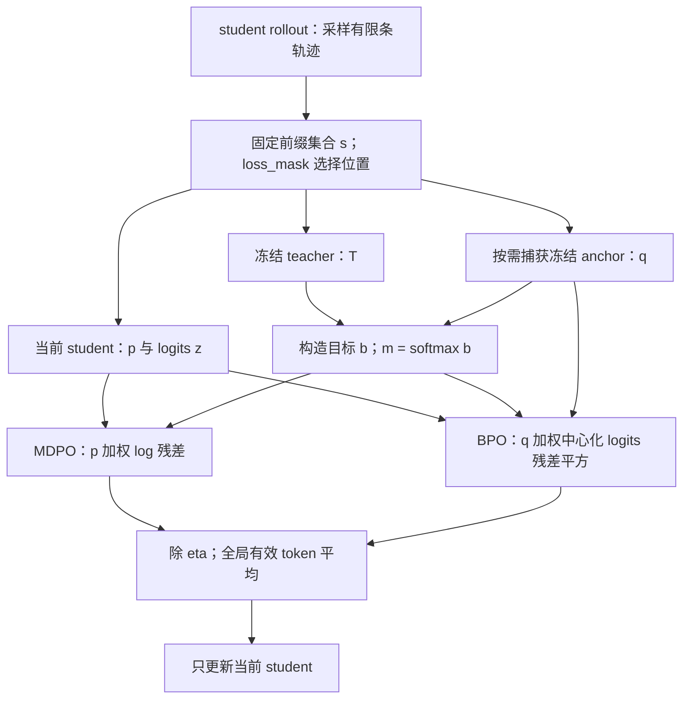

# Full-vocab OPD、MDPO、BPO 走读：目标与梯度

本文从当前实现反推数学目标，再将每个关键表达式对应到源码。读者需要熟悉 softmax、反向传播和语言模型的 next-token 训练。完整走读分成三篇：

1. 本篇：固定前缀上的目标、weighted target、OPD/MDPO/BPO 梯度、相同点与差异。
2. [执行源码阅读路线](full-kl-execution-walkthrough.md)：按真实调用顺序进入已有训练、教师、数据、指标与恢复专题。
3. [算子、分块 VJP 与数值实现](full-kl-kernel-walkthrough.md)：从 dense reference 到 precompute/Triton，以及支持集和精度边界。

源码复核日期为 **2026-10-26**，基点为 `7f1c9ad9ecca636d6e103a749b90e0b3b1df1d0e`。初稿所依据的 `objectives.py`、`full_vocab_triton.py` 数值修改现已包含在该提交中。源码链接保留函数名，并以 `#L起始行` 标出入口，正文写出阅读区间；行号随代码修改会漂移，定位时同时核对符号。本文解释实现及由其导出的性质，不声称复现了某篇外部论文的全部算法。

## 1. 三种方法共用的计算对象

### 1.1 一条生成轨迹提供多个固定前缀

令 prompt 为 $x$，student rollout 得到 $y=(y_1,\ldots,y_L)$。第 $t$ 个训练状态是已有前缀 $s_t=(x,y_{<t})$。在这个状态上，full-vocab 路径计算所有输出 token 的概率，而不只读取已经生成的 $y_t$。

| 符号         | 定义                                               | actor 调用内是否变化                      |
| ------------ | -------------------------------------------------- | ----------------------------------------- |
| $\beta$      | 实际生成这些轨迹的行为策略                         | 轨迹已固定，full loss 不消费行为 log-prob |
| $q$          | actor 开始更新前捕获的学生 anchor                  | 需要时建立，整个调用冻结                  |
| $p=p_\theta$ | 本次 forward 的当前学生条件分布                    | 每次 optimizer 更新后重算                 |
| $T$          | 固定教师的条件分布                                 | 参数冻结，在相同 token 前缀上评分         |
| $z$          | 当前 student 的 logits                             | 有梯度，$p=\operatorname{softmax}(z)$     |
| $b$          | 由 $q,T,\kappa,\eta$ 构造的未归一化目标 log-weight | 无梯度；同一前缀、同一次 actor 调用内固定 |
| $m$          | 归一化目标，$m=\operatorname{softmax}(b)$          | 同上                                      |

下文先省略状态下标，并假设 student 输出集合 $\mathcal V_s$ 上 $p_i,q_i,T_i>0$、logits 有限。Teacher 可以具有额外输出行；此时 $T$ 在完整 teacher 词表上归一化，$\sum_{i\in\mathcal V_s}T_i\leq1$。$p,q,m$ 都在 student 支持上归一化。额外行的影响见第 8 节。

数据依据：[PPOTrainer._update_actor](../../../../../verl/trainer/ppo/v1/trainer_base.py#L2200)，2200–2255 行；full 路径只传 token、mask、身份等字段，不传 `rollout_log_probs`。[anchor_scope](../../../../../verl/trainer/distillation/anchor.py#L40)，40–97 行，规定 q 的调用级生命周期。[FSDPEngineWithLMHead._full_vocab_output](../../../../../verl/workers/engine/fsdp/transformer_impl.py#L1217)，1232–1307 行，将这些对象对齐到同一预测位置。

### 1.2 Full 的范围是动作词表

一次 mini-batch 的经验目标为：

$$
\widehat J(\theta;\mathcal D)
=\frac{1}{N}\sum_{(a,t)\in\mathcal I(\mathcal D)}\ell\bigl(p_\theta(\cdot\mid s_{a,t});q,T\bigr),
\qquad N=|\mathcal I(\mathcal D)|.
$$

$\mathcal I$ 是原始 `loss_mask` 选中的有效 response target 集合；$a$ 是样本索引。优化时视 $\mathcal D$ 为常量。Full-vocab 消除了给定前缀上对动作的单样本估计，前缀本身仍来自有限条 rollout。

如果另行定义一个随当前策略变化的前缀分布 $d_\theta$，则一般有：

$$
\nabla_\theta\mathbb E_{s\sim d_\theta}[\ell_\theta(s)]
=\mathbb E_{d_\theta}[\nabla_\theta\ell_\theta(s)]
+\mathbb E_{d_\theta}[\ell_\theta(s)\nabla_\theta\log d_\theta(s)].
$$

当前实现对固定样本执行左侧内层条件 loss 的梯度，不计算右边第二项的前缀分布导数，也没有给 full loss 乘轨迹重要性权重。Reuse 更新改变 $p$，保持前缀和 q/T 不变。对应控制流是 [PPOTrainer._step_once](../../../../../verl/trainer/ppo/v1/trainer_base.py#L684)，684–736 行，以及 [TrainingWorker.train_mini_batch](../../../../../verl/workers/engine_workers.py#L297)，331–383 行。



图中的 OPD 对应 MDPO 的 $\eta=1$ 分支，此时构造 b 不需要 q。

## 2. 从配置识别实际目标

数学比较以本文第 7 节为准。配置如何形成 `objective/payload_kind/anchor_payload/teacher_only_kl`，按[执行路线第 1–3 项](full-kl-execution-walkthrough.md#阅读顺序)核对；普通 Full-KL 的 endpoint 分派逐行解释在[算子篇](full-kl-kernel-walkthrough.md#1-dispatcher-的逐段阅读)。

## 3. Weighted target 的完整构造

### 3.1 从教师与 anchor 的对数比开始

定义：

$$
r_i=\log T_i-\log q_i,
\qquad
f_{\kappa,\eta}(r)=
\begin{cases}
\eta r,&\kappa=0,\\
\dfrac{\log\left((1-\eta)+\eta e^{\kappa r}\right)}{\kappa},&\kappa>0.
\end{cases}
$$

实现保留 canonical log-weight：

$$
b_i=\log q_i+f_{\kappa,\eta}(r_i),
\qquad
Z=\sum_{j\in\mathcal V_s}e^{b_j},
\qquad
m_i=\frac{e^{b_i}}{Z}.
$$

这是 [mirror_signal](../../../../../verl/trainer/distillation/targets.py#L10)，10–21 行和 [build_log_weights](../../../../../verl/trainer/distillation/targets.py#L24)，24–31 行的直接数学形式。`build_log_weights` 返回 b，未执行 `log_softmax`，并 detach q/T。

对 $\kappa>0$，将 $r_i$ 代回即可得到 power-mean 形式：

$$
\begin{aligned}
e^{b_i}
&=q_i\left((1-\eta)+\eta(T_i/q_i)^\kappa\right)^{1/\kappa}\\
&=\left((1-\eta)q_i^\kappa+\eta T_i^\kappa\right)^{1/\kappa}.
\end{aligned}
$$

### 3.2 三个边界情形

当 $\kappa\to0$，使用 $e^{\kappa r}=1+\kappa r+O(\kappa^2)$ 和 $\log(1+u)=u+O(u^2)$：

$$
\lim_{\kappa\to0}f_{\kappa,\eta}(r)
=\lim_{\kappa\to0}\frac{\eta\kappa r+O(\kappa^2)}{\kappa}
=\eta r.
$$

所以 $\kappa=0$ 对应几何插值：

$$
b_i=(1-\eta)\log q_i+\eta\log T_i,
\qquad e^{b_i}=q_i^{1-\eta}T_i^\eta.
$$

当 $\kappa=1$，得到算术插值：

$$
e^{b_i}=(1-\eta)q_i+\eta T_i.
$$

只有师生支持相同且 T 在该支持归一化时，上式才必有 $Z=1$。当 $\eta=1$，所有合法 $\kappa$ 都有 $b_i=\log T_i$；源码直接返回 teacher，跳过 q，避免无意义的计算。BPO 此时仍需要 q 作为方差权重。

参数范围由 [MirrorConfig](../../../../../verl/workers/config/distillation_spec.py#L11)，19–27 行限制为 $\kappa\in[0,1]$、$\eta\in(0,1]$。$\eta=0$ 不是合法配置，讨论零附近的行为时应使用极限。

### 3.3 冻结的是目标函数的输入，不是每次都缓存完整 target

本文对 b 求导时将其视为常量。q/T 的捕获与复用协议见[anchor 生命周期](teacher.md#anchor-准备与模型驻留)；每块重建 b 的代码见[dispatcher 与 row kernel](full-kl-kernel-walkthrough.md#1-dispatcher-的逐段阅读)，稳定求值见[target 数值实现](full-kl-kernel-walkthrough.md#6-target-与小残差的数值稳定性)。

## 4. Full-KL OPD：从 KL 到每个 logit 的梯度

### 4.1 固定前缀上的反向 KL

普通 OPD full loss 为：

$$
K(p,T)=\sum_i p_i(\log p_i-\log T_i).
$$

求和权重是当前学生 p。对照 [dense_rows](../../../../../verl/trainer/distillation/full_vocab.py#L55)，55–58 行：`lp = student.log_softmax`、`lt = teacher.log_softmax`、`lp.exp() * (lp-lt)`，再沿词表求和。Teacher 投影输入被 detach。

### 4.2 Softmax 求导中的中心化项

令 $g_i=\log p_i-\log T_i$。Softmax 的 Jacobian 是：

$$
\frac{\partial p_i}{\partial z_j}=p_i(\delta_{ij}-p_j).
$$

因为 T 冻结，$\partial K/\partial p_i=g_i+1$。将链式法则展开：

$$
\begin{aligned}
\frac{\partial K}{\partial z_j}
&=\sum_i (g_i+1)p_i(\delta_{ij}-p_j)\\
&=p_j(g_j+1)-p_j\sum_i p_i(g_i+1)\\
&=p_j\left(g_j-\sum_i p_i g_i\right)\\
&=p_j(g_j-K).
\end{aligned}
$$

加一项抵消依赖 $\sum_i p_i=1$。因此梯度是 **p 加权的中心化 log-prob 残差**。其各分量之和为零，符合 logits 加同一个常数不改变 softmax 的性质。

令教师 logits 为 $u$，$A(z)=\log\sum_i e^{z_i}$。在同支持情形，$g_i=z_i-u_i-A(z)+A(u)$。中心化消去行常数：

$$
\frac{\partial K}{\partial z_i}
=p_i\left[(z_i-u_i)-\mathbb E_p(z-u)\right].
$$

对应 [precompute_kl_rows](../../../../../verl/trainer/distillation/full_vocab.py#L160)，166–175 行使用 log-prob 残差；[RecomputedKL.backward](../../../../../verl/trainer/distillation/full_vocab.py#L109)，118–125 行使用 logits gap。二者在精确算术中等价，有限精度路径可能不同。

## 5. MDPO：向 weighted target 做 scaled reverse KL

### 5.1 源码返回的 raw 行值

[full_vocab_rows](../../../../../verl/trainer/distillation/objectives.py#L42)，50–57 行实现：

$$
R_{\mathrm{MD}}(p;b)=\sum_i p_i(\log p_i-b_i).
$$

由 $\log m_i=b_i-\log Z$：

$$
\begin{aligned}
\mathrm{KL}(p\Vert m)
&=\sum_i p_i(\log p_i-b_i+\log Z)\\
&=R_{\mathrm{MD}}+\log Z,\\
\ell_{\mathrm{MD}}
&=\frac{R_{\mathrm{MD}}}{\eta}
=\frac{\mathrm{KL}(p\Vert m)-\log Z}{\eta}.
\end{aligned}
$$

`token_objective` 和 `loss_sum` 保留 raw 行值；[distillation_loss](../../../../../verl/trainer/distillation/losses.py#L234)，234–250 行才应用 $1/\eta$。$\log Z$ 对当前 student 无梯度，去掉它不改变梯度，但会改变打印出的 loss。当前 `target_kl` 诊断会把它加回来，并且不除 eta。

在本文允许的 $\kappa\in[0,1]$ 下，逐项 power mean 不超过算术 mean，故 $Z\leq(1-\eta)\sum_iq_i+\eta\sum_iT_i\leq1$。于是精确算术中的 $R_{\mathrm{MD}}\geq0$；“与 KL 相差常数”本身不能推出此实现的 MDPO loss 可以任意为负。小幅负数仍需区分浮点误差与错误。

### 5.2 MDPO 的梯度

由于 b 冻结，上一节的 KL 求导可直接复用。定义 $a_i=\log p_i-b_i$：

$$
\frac{\partial\ell_{\mathrm{MD}}}{\partial z_i}
=\frac{p_i}{\eta}\left(a_i-\mathbb E_p a\right)
=\frac{p_i}{\eta}\left[(z_i-b_i)-\mathbb E_p(z-b)\right].
$$

源码中的 `rows = (p * gap).sum(-1)` 是 $\mathbb E_pa$，`dz = p * (gap - rows[:, None])` 是未除 eta 的梯度。当前工作区优先形成 `gap=log_softmax(z)-b`，减少直接 `z-b` 中大行常数对小梯度的影响。

### 5.3 kappa 为零时的精确 KL 分解

代入 $b=(1-\eta)\log q+\eta\log T$：

$$
\begin{aligned}
\ell_{\mathrm{MD}}
&=\frac1\eta\sum_i p_i[\log p_i-(1-\eta)\log q_i-\eta\log T_i]\\
&=\mathrm{KL}(p\Vert T)+\frac{1-\eta}{\eta}\mathrm{KL}(p\Vert q).
\end{aligned}
$$

这是当前实现的恒等式，不需要忽略任何常数。$\eta=0.3$ 时 anchor KL 系数为 $7/3$。固定 q 后，reuse 会同时受到向教师靠近和偏离 q 的惩罚；每个 actor 调用结束后，下次调用再重建 q。

在自由概率单纯形上，还可以由约束优化推导最优目标。对 $R_{\mathrm{MD}}+\lambda(\sum_i p_i-1)$ 求导：

$$
\log p_i+1-b_i+\lambda=0
\quad\Longrightarrow\quad p_i\propto e^{b_i}
\quad\Longrightarrow\quad p^*=m.
$$

这说明 weighted target 是该条件目标的精确最优分布；训练神经网络时，各状态共享参数，有限 optimizer 步并不保证每个状态都达到 m。

### 5.4 eta 同时控制 target 与目标尺度

调小 eta 会让 target 更靠近 q，同时将 raw loss 除以 eta。因此不能把它等同于“仅缩小 learning rate”。在 $\kappa=0$ 且 $p=q$ 时，anchor KL 的一阶梯度为零：

$$
\left.\nabla_z\ell_{\mathrm{MD}}\right|_{p=q}
=\left.\nabla_z\mathrm{KL}(p\Vert T)\right|_{p=q},
\qquad 0<\eta\leq1.
$$

eta 不缩小这个起点的一阶方向，但会改变离开 q 后的目标和曲率。这个结论要求实际分布满足 $p=q$；anchor 的确定性检查和独立 head 快照正是使该条件有明确含义的工程保证。

## 6. BPO：冻结 q 加权的中心化残差方差

### 6.1 消去 student 的归一化常数

从 log-prob 残差定义：

$$
a_i=\log p_i-b_i,
\qquad
\ell_{\mathrm{BPO}}=\frac{1}{2\eta}\mathbb E_q[(a-\mathbb E_qa)^2].
$$

记 $d_i=z_i-b_i$。由于 $a_i=d_i-A(z)$，而 q 归一化：

$$
a_i-\mathbb E_qa
=d_i-A(z)-[\mathbb E_qd-A(z)]
=d_i-\mathbb E_qd.
$$

所以代码可以完全不计算 student softmax：

$$
\ell_{\mathrm{BPO}}=\frac{1}{2\eta}\sum_iq_i(d_i-\mu_q)^2,
\qquad \mu_q=\sum_iq_id_i.
$$

对照 [full_vocab_rows](../../../../../verl/trainer/distillation/objectives.py#L58)，58–68 行：`q=exp(log_q.detach())`，`d=z-b`，`residual=d-(q*d).sum`，`rows=(q*residual.square()).sum/2`。只有打开 KL 诊断时才额外计算 p。

### 6.2 方差求导

因为 $q,b$ 冻结，$\partial\mu_q/\partial z_j=q_j$。令 $c_i=d_i-\mu_q$，则：

$$
\begin{aligned}
\frac{\partial\ell_{\mathrm{BPO}}}{\partial z_j}
&=\frac1\eta\sum_iq_ic_i(\delta_{ij}-q_j)\\
&=\frac1\eta\left[q_jc_j-q_j\sum_iq_ic_i\right]\\
&=\frac{q_j}{\eta}(d_j-\mu_q),
\end{aligned}
$$

最后一步使用 $\sum_iq_ic_i=0$。对应源码 `dz = q * residual`，除 eta 在外层完成。

这种中心化还使目标对 $z\mapsto z+c\mathbf1$、$b\mapsto b+c'\mathbf1$ 不变。它学习的是相对 logits 差异，不要求 student logits 的绝对常数与 b 相等。

### 6.3 BPO 在 logits 空间的几何性质

定义矩阵：

$$
C(q)=\operatorname{diag}(q)-qq^\top.
$$

则：

$$
\ell_{\mathrm{BPO}}=\frac1{2\eta}(z-b)^\top C(q)(z-b),
\quad
\nabla_z\ell_{\mathrm{BPO}}=\frac1\eta C(q)(z-b),
\quad
\nabla_z^2\ell_{\mathrm{BPO}}=\frac1\eta C(q).
$$

对任意向量 v，$v^\top C(q)v=\operatorname{Var}_q(v)\geq0$，故它是 logits 上的凸二次目标。若所有 $q_i>0$，零空间只有常数方向，最优解为 $z=b+c\mathbf1$，从而 $p=m$。映射回网络参数 $\theta$ 后仍不能据此断言整体训练是凸优化。

MDPO 则有 $\nabla_z\ell_{\mathrm{MD}}=C(p)(z-b)/\eta$。两者梯度形式的差别是当前 p 与冻结 q。这里的 $C(p)$ 是 softmax Jacobian；MDPO 的完整 Hessian 还包括 $C(p)$ 对 z 的导数，不能直接把它写成 $C(p)/\eta$。

### 6.4 eta 为一时 BPO 仍与 OPD 不同

当 $\eta=1$，b 退化为 $\log T$，但 BPO 仍优化：

$$
\ell_{\mathrm{BPO},\eta=1}
=\tfrac12\operatorname{Var}_q(\log p-\log T).
$$

它仍依赖 q，训练 loss 也不等于 $\mathrm{KL}(p\Vert T)$。配置 resolver 因而只给 **MDPO eta=1** 设置 `teacher_only_kl=True`，见 [DistillationLossSettings.teacher_only_kl](../../../../../verl/workers/config/distillation_spec.py#L47)。

## 7. 三种方法放到同一次更新中比较

### 7.1 梯度与极小值对照

| 项目                   | Full-KL OPD                         | Full MDPO       | Full BPO                      |
| ---------------------- | ----------------------------------- | --------------- | ----------------------------- |
| 目标 log-weight        | $b=\log T$                          | power-mean b    | 与 MDPO 相同                  |
| 梯度使用的权重         | 当前 p                              | 当前 p          | 冻结 q                        |
| 中心化总体             | p                                   | p               | q                             |
| anchor 依赖            | 无                                  | $\eta<1$ 时需要 | 包括 $\eta=1$ 都需要          |
| 自由 logits 下最优分布 | teacher 在 student 支持上的条件分布 | m               | q 严格正时为 m                |
| 最小 loss              | 同支持时为 0                        | $-\log Z/\eta$  | 0                             |
| 训练时 student softmax | 需要                                | 需要            | objective 不需要；KL 诊断需要 |

MDPO 与 BPO 的最优分布可相同，loss 值与离开 q 后的梯度仍不同。对于同一 b，当 $p=q$ 时：

$$
\left.\nabla_z\ell_{\mathrm{MD}}\right|_{p=q}
=\left.\nabla_z\ell_{\mathrm{BPO}}\right|_{p=q}.
$$

再加上 $\kappa=0$，它们还与 OPD 在该起点的一阶梯度相同。若同一数据、同一初始参数和 optimizer 状态、无 dropout 且忽略浮点差异，首次更新可以一致；reuse 后 $p\neq q$，两者权重和中心化总体开始不同。这是研究 reuse 差异时可以直接检验的性质，不是三者整个训练过程等价。

### 7.2 一个可手算的二分类例子

取 $q=(0.5,0.5)$、$T=(0.8,0.2)$、$\kappa=0$、$\eta=0.5$。则：

$$
e^b=(\sqrt{0.4},\sqrt{0.1}),\quad
Z=\sqrt{0.4}+\sqrt{0.1}\approx0.9486832981,\quad
m=(2/3,1/3).
$$

在 $p=q$ 时，三种方法的 logits 梯度都是：

$$
\nabla_z\ell=(-0.3465735903,\;0.3465735903).
$$

梯度下降会提高第一个 token 的相对 logit。此时 OPD loss 和 MDPO loss 都是 $\log(1.25)\approx0.2231435513$，而 BPO loss 为 $(\log 2)^2/4\approx0.1201132535$。同梯度不要求同 loss。

当 p 已到达 $m=(2/3,1/3)$，MDPO 与 BPO 梯度均为 0。MDPO loss 仍为 $-\log Z/\eta\approx0.1053605157$，BPO loss 为 0，OPD 梯度则仍非零，因为其目标分布是 T。

下面代码独立重建这些目标，可在有 PyTorch 的环境中执行；它不加载模型或启动训练：

```python
import torch

dtype = torch.float64
q = torch.tensor([0.5, 0.5], dtype=dtype)
t = torch.tensor([0.8, 0.2], dtype=dtype)
eta = 0.5
b = (1 - eta) * q.log() + eta * t.log()
m = b.softmax(-1)
for name, start in (("anchor", q), ("target", m)):
    z = start.log().detach().requires_grad_(True)
    lp = z.log_softmax(-1)
    p = lp.exp()
    d = z - b
    losses = {
        "opd": (p * (lp - t.log())).sum(),
        "mdpo": (p * (lp - b)).sum() / eta,
        "bpo": (q * (d - (q * d).sum()).square()).sum() / (2 * eta),
    }
    for method, loss in losses.items():
        grad = torch.autograd.grad(loss, z, retain_graph=True)[0]
        print(name, method, float(loss), grad.tolist())
```

### 7.3 与 sampled current-IS 的精确联系

令动作 $a\sim\beta$，并要求 $\beta_i>0$ 覆盖 p 的支持。使用冻结 b 和每次刷新、随后 detach 的信号 $A_i=b_i-\log p_i$，定义单样本 surrogate：

$$
\widehat\ell(a)
=-\frac1\eta\frac{p_a}{\beta_a}\operatorname{stopgrad}(A_a).
$$

对这个计算图求导并对动作取期望：

$$
\begin{aligned}
\mathbb E_\beta[\nabla\widehat\ell]
&=\frac1\eta\sum_i p_i(\log p_i-b_i)\nabla\log p_i\\
&=\nabla\left[\frac1\eta\sum_i p_i(\log p_i-b_i)\right],
\end{aligned}
$$

因为完整求导中额外的 $\sum_i p_i\nabla\log p_i=\nabla\sum_i p_i=0$。源码为 [mdpo_sampled_terms](../../../../../verl/trainer/distillation/objectives.py#L34)，34–39 行及其调用的 `sampled_policy_terms`，8–31 行。这里要求未截断 IS、正确行为概率、固定前缀和足够支持。PPO clipping、log-ratio guard、冻结旧信号都可能破坏这个等式；它也没有补上前缀分布变化的梯度。

## 8. Teacher 额外输出行的影响

Teacher 与 student 的 tokenizer token→ID 映射必须相同，但模型 head 可能有不同的额外行数。设 teacher 在 student 支持上的质量为 $c=\sum_{i\in\mathcal V_s}T_i$，定义条件化教师 $\bar T_i=T_i/c$。则：

$$
\mathrm{KL}(p\Vert T)
=\mathrm{KL}(p\Vert\bar T)-\log c.
$$

普通 OPD 的梯度与使用 $\bar T$ 相同，但 loss 与位置指标必须保留 $-\log c$。源码 [teacher_support_correction](../../../../../verl/trainer/distillation/full_vocab.py#L223)，223–244 行计算此常数；[full_reverse_kl_result](../../../../../verl/trainer/distillation/full_vocab.py#L277)，277–283 行把它加回。

一般 mirror 则先在完整 teacher 支持上 `log_softmax`，再截取 student 对应行，见 [_mirror_rows](../../../../../verl/trainer/distillation/full_vocab.py#L325)，325–330 行。对于 $\kappa=0$，把 T 条件化只给 b 增加一个行常数：MDPO loss 改变，MDPO/BPO 梯度保持不变；BPO 方差值也不变。对于 $\kappa>0$、$\eta<1$，缩放 T 会改变它与 q 的混合比例，一般连 m 和梯度也改变。因此不能通用地“先裁 teacher head 再归一化”。

这也解释了 OPD 在 $V_t>V_s$ 时最小值可能大于零：student 无法为自己不存在的输出行分配质量。

## 9. 对应到当前 E44–E47 配方

算法与预算只在[训练配方的正式对照表](../../settings/训练设置.md#mirror-comparison)维护；从该表选定 kappa/eta 后，按本文的目标公式解释其含义。预设合并与覆盖顺序见[配置入口](training-loop.md#配置入口)。

## 10. 继续走读的具体落点

掌握本篇后，沿[执行篇](full-kl-execution-walkthrough.md)追踪一次 actor 调用中 q/T/p 的生命周期，再沿[算子篇](full-kl-kernel-walkthrough.md)确认 `dz → dH/dW → loss.backward()`。逐段复核时应能解释：b 为何未归一化，eta 在哪里只除一次，BPO 为何需要 q，p=q 时哪些梯度相同，以及 `token_objective` 为什么不能拿来再次做可微 token 加权。

数学实现的现有检查入口包括 [test_targets_and_sampled_expectation](../../../../../tests/trainer/distillation/test_mirror_on_cpu.py#L44)、[test_full_value_and_both_vjps](../../../../../tests/trainer/distillation/test_mirror_on_cpu.py#L60)、[test_endpoint_uses_original_kernel_without_anchor](../../../../../tests/trainer/distillation/test_mirror_on_cpu.py#L94)。检查内容与实际执行范围见[算子篇的验证记录](full-kl-kernel-walkthrough.md#9-验证入口与本文检查范围)。
