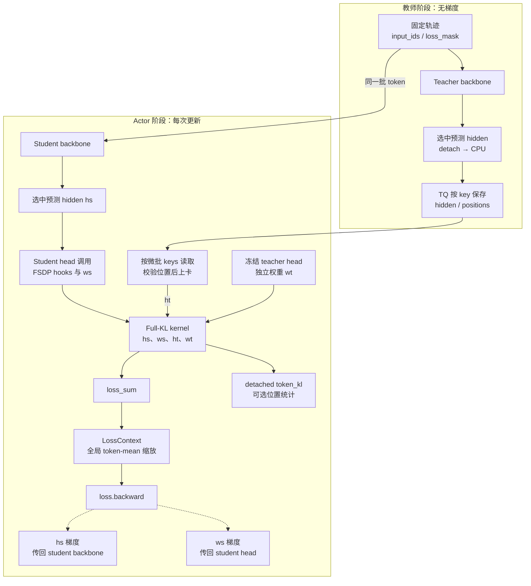

# Full-vocab 数据流与目标算子

Full-vocab reverse KL（下称 Full-KL）在 student rollout 得到的固定前缀上，对 student 的完整输出词表求条件反向 KL。Teacher 提供每个前缀的 hidden，actor 更新时使用冻结 teacher head 恢复教师分布，再与当前 student 分布比较。轨迹来自 student，KL 的动作求和覆盖全部输出行；无需再由单个 sampled token 估计这个动作期望。

本文沿实际 head-loss 路径展开。公共训练循环见[训练循环](training-loop.md)，与 sampled current-IS 的关系见[梯度推导](sampled-opd.md#与-full-kl-的梯度关系)。

## 统一目标分派

方法与数学目标的对应关系见[三方法比较](full-kl-walkthrough.md#71-梯度与极小值对照)；配置解析和数值分派分别沿[执行路线第 2 项](full-kl-execution-walkthrough.md#阅读顺序)与[算子 dispatcher](full-kl-kernel-walkthrough.md#1-dispatcher-的逐段阅读)阅读。本页维护 full-vocab 在 engine 中的接入合同、hidden 运输和 head 调用边界。

### 训练行值与诊断的分工

训练 objective、四项 mirror 诊断以及 eta 缩放的字段定义统一见[指标矩阵](metrics.md#当前目标的指标矩阵)。行值的数学含义见[目标与梯度](full-kl-walkthrough.md)，从 row kernel 到 detached 诊断的代码对应见[数值参考](full-kl-kernel-walkthrough.md#2-dense-reference-与解析-logits-vjp)。

## 接口与运行约束

[full_reverse_kl_result](../../../../../verl/trainer/distillation/full_vocab.py) 返回 [FullKLResult](../../../../../verl/trainer/distillation/full_vocab.py)：可反传的 `loss_sum` 以及可选、detached 的 `token_kl`。兼容入口 `full_reverse_kl` 只返回前者。Kernel 不承担分布式通信、训练归一化、TQ 读取或日志命名。

设一个 micro-batch 中选出的有效预测行数为 $n$：

| 参数 | 形状         | 来源                           | 是否参与 student 反传 |
| ---- | ------------ | ------------------------------ | --------------------- |
| `hs` | `[n, d_s]`   | 当前 student backbone 的选中行 | 是                    |
| `ws` | `[V_s, d_s]` | 当前 student LM head           | 是                    |
| `ht` | `[n, d_t]`   | TQ 中的冻结 teacher hidden     | 否                    |
| `wt` | `[V_t, d_t]` | 独立加载的冻结 teacher head    | 否                    |

一般 MDPO/BPO 还传入冻结 `hq[n,d_s]` 与 `wq[V_s,d_s]`；调用方按样本身份和版本读取它们，kernel 再检查 token 行数、head 宽度及 anchor/student 支持相同。

师生 hidden 宽度可以不同；前缀与 token ID 必须对齐，且 $V_t\ge V_s$。Tokenizer 的 token→ID 词表相同，不要求模型 head 的总行数相同：head 可以包含 tokenizer 常规词表之外的额外输出行。

| 约束                                                                                                                                | 执行检查的位置                                                                                         |
| ----------------------------------------------------------------------------------------------------------------------------------- | ------------------------------------------------------------------------------------------------------ |
| `use_policy_gradient=False`、`use_task_rewards=False`、`policy_loss_mode=vanilla`、`advantage_source=current`，两个 clamp 为 `null` | [DistillationLossConfig](../../../../../verl/workers/config/distillation.py)                           |
| `execution_mode=shared_sync`、V1 sync、单节点、FSDP2、无 ref/critic，师生轮流使用同池                                               | [DistillationConfig.validate_shared_sync](../../../../../verl/workers/config/distillation.py)          |
| Qwen2/Qwen3/Qwen3-MoE、无 bias 的 student head                                                                                      | [install_full_vocab_adapter](../../../../../verl/models/transformers/full_vocab.py)                    |
| Qwen2/Qwen3/Qwen3-MoE safetensors teacher head                                                                                      | [FrozenTeacherHead](../../../../../verl/trainer/distillation/hidden.py)                                |
| 温度为 1，无 entropy、sum-pi-squared 或 score-centering 计算                                                                        | [FSDPEngineWithLMHead._full_vocab_output](../../../../../verl/workers/engine/fsdp/transformer_impl.py) |
| `loss_agg_mode=token-mean`                                                                                                          | [distillation_loss](../../../../../verl/trainer/distillation/losses.py)                                |

这些检查分布在配置解析、模型构建与运行时，不能把 Hydra 配置解析成功视为全部通过。`use_fused_kernels=False` 是通用模型 forward 路径的限制，与下面专用 `precompute_fused` KL backend 是不同开关。

## 从教师 hidden 到 student head

以下 endpoint 图中实线表示前向数据流，虚线表示 student 的反向梯度。上下两阶段按顺序执行：教师 payload 写入完成且 teacher 卸载后，actor 才开始更新。冻结 teacher head 是 actor 单独加载的副本。

### 教师只发布有效预测行

[PPOTrainer._compute_shared_teacher_log_probs](../../../../../verl/trainer/ppo/v1/trainer_base.py) 根据静态目标元数据选择 hidden payload。[SharedTeacherScorer.score](../../../../../verl/trainer/distillation/shared_teacher.py) 将 teacher 上卡，以 `full_vocab_teacher=True` 调用 `infer_batch`；worker 不计算 loss，也不计算普通 sampled log-prob。

[FSDPEngineWithLMHead._full_vocab_output](../../../../../verl/workers/engine/fsdp/transformer_impl.py) 用 `prediction_positions(input_ids, loss_mask)` 同时得到每条序列的局部预测下标与拼接序列的 packed 下标。Teacher backbone 仍看到完整的 prompt+response，随后只取 mask 有效 target 对应的预测 hidden 行。Teacher 的 LM head 在这个 forward 中不执行完整投影。

完整的 shift 公式、mask 空洞与 packed 坐标例子统一见[预测坐标](data-and-loss.md#两种布局与预测坐标)。

选中 hidden 立即 detach、转到 CPU，按样本拆分并由 [HiddenBatchIO.publish](../../../../../verl/trainer/distillation/hidden_io.py) 写入 TQ。Worker 返回轻量 `teacher_payload_ready` 标记，避免在整轮推理结果中继续持有所有 hidden。Actor 阶段仍需等全部 teacher futures 完成及 teacher 成功卸载。

### 按 actor micro-batch 读取

[PPOTrainer._update_actor](../../../../../verl/trainer/ppo/v1/trainer_base.py) 只把 `input_ids/position_ids/loss_mask/response_mask/prompts/responses` 交给普通 bridge，同时设置 `retain_sample_identity=True`。`sample_keys/sample_partition` 随数据进入 worker，并跟随 shuffle、mini-batch 和 micro-batch 切分移动。

[`HiddenBatchIO.__iter__`](../../../../../verl/trainer/distillation/hidden_io.py) 在 actor micro-batch 执行前按这些 key 取回 `teacher_hidden/teacher_positions`，结束后从 micro-batch 容器移除 payload。Full mirror 通过 `full_vocab_sources=("teacher", "anchor")` 让同一 IO 对象同时读取两类 payload；engine 校验它们的位置、anchor version 和 head holder 一致。Student engine 校验保存的每条位置数组与当前 `loss_mask` 推导的位置完全一致。Teacher 与 actor 可以采用不同的动态分批边界，不能用“第几个 teacher micro-batch”匹配 student。

每次 reuse 都重新读取冻结 teacher 和存在的 anchor hidden，再计算当前 student backbone。q/T backbone 不会重跑，但它们的 head 投影、归一化及 b 构造仍随每次 inner update 重做。当前没有整轮 hidden GPU 驻留缓存或 target/logits cache。

### Head adapter 与 FSDP hooks

[full_vocab_forward](../../../../../verl/models/transformers/full_vocab.py) 在收到回调时直接调用 `model.model` backbone，将最后层 hidden 与 `lm_head` 交给 engine；未提供回调时仍调用原始 forward。这样避免先产生整个输入序列的 `[tokens,V]` logits，再从中挑选 response。

Actor 选中 `hs` 后通过 `head(selected, full_vocab_callback=compute)` 调用包装后的 head。[full_vocab_head_forward](../../../../../verl/models/transformers/full_vocab.py) 再将 hidden 与 `self.weight` 交给 kernel。必须经过 head module 的调用边界，才能触发 FSDP2 all-gather/backward hooks；在外层直接取分片 head weight 做矩阵乘法会破坏这个协议。

Kernel 返回 `loss_sum`，engine 附上有效行数 `full_kl_count`，可用时将 detached `token_kl` 转为位置统计。最终 `distillation_loss` 使用 `LossContext.normalize_token_sum` 得到训练标量，随后普通 engine 调用 `loss.backward()`、梯度裁剪和 optimizer。Full-KL 使用的是同一套 student optimizer，backbone 与 head 都更新。

## 冻结 head 与 IO 生命周期

[FrozenTeacherHead](../../../../../verl/trainer/distillation/hidden.py) 从 teacher checkpoint 单独读取输出权重；tied head 读取 `model.embed_tokens.weight`，否则读取 `lm_head.weight`。CPU 副本长期保留，第一次 actor KL 计算时创建与 student hidden 的 device/dtype 匹配的 GPU 缓存。每个 actor rank 持有完整 teacher head；它没有注册到 student module，不进入 optimizer、student checkpoint 或 rollout 权重同步。

[ActorRolloutRefWorker.update_actor](../../../../../verl/workers/engine_workers.py) 在整个 mini-batch/epochs 迭代结束后通过 `finally` 释放 teacher head 的 GPU 引用。同一次 actor 调用内部可以复用该缓存。Teacher scorer 只管理 teacher 模型驻留，不能在 actor 更新前释放 actor 自己拥有的 head。

Full mirror 的 [FrozenAnchorHead](../../../../../verl/trainer/distillation/anchor.py) 则来自当前 student wrapped head 的独立复制，CPU/GPU 缓存都属于一次 anchor scope；不是长期存活的 teacher checkpoint 副本。它在普通 Full-KL endpoint 中完全省略，具体准备与释放见[anchor 生命周期](teacher.md#anchor-准备与模型驻留)。

| 开关                     | 实际重叠的工作                                               | 没有改变的边界                                                            |
| ------------------------ | ------------------------------------------------------------ | ------------------------------------------------------------------------- |
| `full_vocab.async_write` | 上一个 teacher/anchor micro-batch 的 CPU→TQ 写与后续评分计算 | D2H 在提交写之前执行；提交下一笔写之前等待上一笔，正常退出 flush 最后一笔 |
| `full_vocab.prefetch`    | 下一 actor micro-batch 的 TQ→CPU 读与当前 actor 计算         | payload 随 `micro_batch.to(device)` 上卡，没有专用 CUDA H2D stream        |

两者使用单线程 executor，限制待处理 IO 数量；不会使 teacher 和 student backbone 同时在 GPU 上执行。详细异常与卸载行为见[教师评分顺序](teacher.md#评分顺序)。

Teacher hidden 运输规模约为有效预测行数乘 $d_t$；需要 full anchor 时，再增加有效行数乘 $d_s$ 的 payload 和位置/version。运输 hidden 避免了跨阶段传递有效行数乘词表大小的 logits。Actor 阶段仍需容纳当前 student 激活、完整冻结 teacher head、按需存在的 anchor head、目标临时块与 student 梯度；不能仅按 hidden payload 大小估计训练显存。

## 梯度与精度

### 条件 KL 与 logit 梯度

完整 softmax 求导维护在[OPD 梯度推导](full-kl-walkthrough.md#4-full-kl-opd从-kl-到每个-logit-的梯度)；MDPO/BPO 的推导紧随其后。由 logits 梯度到 hidden/head 的链式法则见[线性 head 的两个反传出口](full-kl-kernel-walkthrough.md#31-线性-head-的两个反传出口)。

### Precompute 的前反向分工

逐行代码、分块流程图与 upstream 缩放见[Precompute 的前向与反向分工](full-kl-kernel-walkthrough.md#4-precompute-的前向与反向分工)。

### 生产精度

投影、归约、梯度 GEMM 与缓存 dtype 的完整链条见[CUDA BF16 精度链](full-kl-kernel-walkthrough.md#81-cuda-bf16-路径的精度链)；target、小方差及 MDPO 小残差的稳定求值见[数值稳定性](full-kl-kernel-walkthrough.md#6-target-与小残差的数值稳定性)。

## Backend 与输出支持

### Backend 的实际工作分配

各 backend 的 forward/backward 分工、支持矩阵和 chunk 参数含义维护在[Backend 对照](full-kl-kernel-walkthrough.md#5-backend-的实际差别)。

### 教师多出的输出行

支持修正的数学关系及其对 MDPO/BPO 的影响见[Teacher 额外输出行](full-kl-walkthrough.md#8-teacher-额外输出行的影响)；分块 softplus 实现见[支持修正实现](full-kl-kernel-walkthrough.md#82-teacher-支持修正的实现)。

### 默认值与空行

默认值取决于调用层，以下均指没有额外覆盖时：

| 入口                                                                    | Backend          | Token chunk | Hidden async write / prefetch            |
| ----------------------------------------------------------------------- | ---------------- | ----------- | ---------------------------------------- |
| `FullVocabConfig`；原 `full_reverse_kl/full_reverse_kl_result` 数值 API | recompute        | 512         | 配置类为 False/False；数值 API 不管理 IO |
| `full_vocab_objective_result` 数值 API                                  | precompute       | 512         | 不管理 IO                                |
| 统一入口 `custom --method full_kl/mdpo/bpo` 的 full-vocab 设置          | precompute       | 512         | False/False                              |
| E13–E43 中的 full 预设                                                  | precompute       | 512         | True/True                                |
| E44–E47                                                                 | precompute_fused | 128         | True/True                                |

这些入口的 vocab chunk 默认都是 8192，其实际用途仍受 backend 限制。当前 E44–E47 的完整设置见[训练配方](../../settings/训练设置.md#mirror-comparison)；环境与 Hydra 可以覆盖，最终以解析配置为准。

某个 rank 没有有效预测行时，kernel 返回 `hs.sum()*0 + ws.sum()*0`，保留 student 两路梯度连接，让它参与同一次分布式更新。整个 mini-batch 的全局有效 token 数为零则由 engine 拒绝训练。有效 token mask 和 DP 缩放见[数据与归一化](data-and-loss.md#三种-mask-与分母)。

## 验证入口

新增 weighted target 与 BPO 的 CPU/CUDA/FSDP/真实短训练证据见[验收结果](../numerics/mirror-objectives/实现方案.md#validation)，未覆盖范围见[验证缺口](../numerics/mirror-objectives/实现方案.md#remaining-validation)。下表保留原 Full-KL 基础设施的验证入口。

| 检查对象                                                                | 测试入口                                                                                                           |
| ----------------------------------------------------------------------- | ------------------------------------------------------------------------------------------------------------------ |
| 不同 backend 的 KL 与 hidden/head VJP、额外 teacher 支持                | [test_full_vocab_on_cpu.py](../../../../../tests/trainer/distillation/test_full_vocab_on_cpu.py)                   |
| Qwen adapter、正常 forward 回退与 head 回调                             | [test_full_vocab_adapter_on_cpu.py](../../../../../tests/trainer/distillation/test_full_vocab_adapter_on_cpu.py)   |
| 行值到相对 response 位置诊断                                            | [test_full_vocab_position_on_cpu.py](../../../../../tests/trainer/distillation/test_full_vocab_position_on_cpu.py) |
| 真实 FSDP2 分片、head 更新、不等长/空 rank、checkpoint 与下一次更新等价 | [test_full_vocab_fsdp2.py](../../../../../tests/special_distributed/test_full_vocab_fsdp2.py)                      |

CPU 数学测试不等同于 CUDA BF16/Triton 精度验收。已有 GPU 证据见[主分支四卡验收](../../archive/engineering/2026-10-25-主分支四卡验收.md)，性能测量从 [profile](../performance/full-vocab/README.md)进入。

共享训练入口对 Qwen3 MoE 的放行限定为 full-vocab teacher，采用与上述输出适配器一致的 `qwen3_moe` 类型；student 和其他 MoE 架构继续受共享入口原有限制。入口层回归测试覆盖正式 teacher 配置构建，补充独立 FSDP2 数值验收未覆盖的主训练初始化检查。
