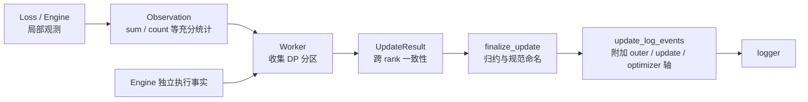

# 指标观测、位置分桶与更新出口

统一入口保留不同训练目标的统计含义：MDPO/BPO objective 包含规定的 $1/\eta$，target KL、原 teacher KL 和 anchor KL 单独记录且不除 eta。普通 Full-KL endpoint 保留 `distill/full_kl`。本页解释当前生产者、命名、归约和位置统计；固定字段的详细定义见[指标字典](../../settings/指标口径.md)，目标公式见[实现方案](../numerics/mirror-objectives/实现方案.md#metrics)，更新与恢复见[进度与 checkpoint](progress-checkpoint.md)。

## 按训练阶段解释日志

| 观测阶段              | 数据来源                                         | 能回答的问题                                         | 比较时的边界                                            |
| --------------------- | ------------------------------------------------ | ---------------------------------------------------- | ------------------------------------------------------- |
| Rollout/teacher       | 新生成轨迹、冻结教师评分                         | 生成长度、任务得分、教师阶段开销                     | 固定轨迹在 reuse 中不会重新生成                         |
| Legacy sampled anchor | Trainer 在更新前计算的 FSDP log-prob 与 behavior | 训练 engine 与 rollout 概率是否一致                  | 每批入口一次；不作为 mirror 的 q 准备入口               |
| Mirror anchor         | actor 调用内的 scalar 或 hidden/head capture     | q 准备时间、当前学生相对 q 的漂移                    | MDPO eta<1 与所有 BPO 需要；MDPO eta=1 跳过             |
| Sampled update        | current forward、teacher、behavior/anchor        | 当前信号、IS ratio、surrogate，以及旧模式的 clipping | 单动作 surrogate 不等于完整 KL；可能为负                |
| Full-vocab update     | kernel 的 objective sum、行值与可选诊断          | 固定前缀上的当前目标、KL 与位置差异                  | 来自产生本次梯度的 forward；不同目标不直接比较原始 loss |
| Optimizer             | engine 返回的执行事实和梯度范数                  | 是否实际 step、梯度是否有限                          | 不能从有限 loss 推断 optimizer 成功                     |
| 验证                  | 同步后的 student 重新生成                        | 新参数下的任务表现                                   | 使用独立采样温度、长度和样本预算                        |

例如一次 outer step 有四次 reuse 更新，四条 update 记录使用同一批 teacher 和存在的 anchor，却对应四组 student 参数。第 4 条描述第 4 次更新之前的 forward；更新之后的验证会重新生成轨迹，不属于同一参数时刻或前缀总体。

训练标量带有 `dp_size/batch_num_tokens` 的反向缩放，日志均值则通过跨 DP 合并 sum/count 得到。Mirror objective 的日志 numerator 已除 eta，但没有乘 DP 大小；不要拿单个 rank/micro-batch 返回的局部 loss 代替全局观测。

## 从局部观测到日志



[Observation](../../../../../verl/utils/metric/observations.py) 保存可合并统计。均值先合并 numerator/denominator 再相除，不能平均 token 数不同的 micro-batch 或 rank 的均值。[TrainingWorker._postprocess_output](../../../../../verl/workers/engine_workers.py) 汇集分区观测与独立更新事实；[finalize_update](../../../../../verl/workers/update_records.py) 归约、调用 [canonical_name](../../../../../verl/utils/metric/schema.py) 统一命名，再拆出 update 记录和 outer 指标。旧 Metric 和旧 worker 表示仅在边界适配。

Loss 侧的 `distillation/...` 经规范命名变成日志中的 `distill/...`，例如 `distillation/mdpo/objective_position/p00_10/mean` 变为 `distill/mdpo/objective_position/p00_10/mean`。动态后缀被保留，不依赖全局字段白名单。

[metric_axis](../../../../../verl/utils/metric/schema.py) 将 `distill/*` 绑定到 `step/update`，`eval/*` 绑定到 `step/optimizer`，阶段耗时等绑定到 `step/outer`。[_WandbMetricAdapter](../../../../../verl/utils/tracking.py) 在字段首次出现时声明横轴；W&B 的内部 `_step` 只表示传输记录次序，不是 optimizer 次数。更新记录与 outer 记录可以拥有相同 outer 坐标而分次写入。字段首次声明时若缺少首选坐标，adapter 回退到 `step/outer`；已经声明的横轴后来缺失时会警告，不伪造未知的 optimizer 计数。

逐 update loss 描述产生该次梯度的 forward。不能跨多个 update 求平均后仍标成某一次 optimizer 的观测。旧 worker 只提供 batch totals 时，以 batch 范围字段保留，不伪装成逐次观测。

## 当前目标的指标矩阵

以下是当前代码的生成能力。一个历史 run 是否具有这些字段，要查它实际部署的版本、配置和 history，不能由当前代码反推。

| 路径                          | 全局目标                                      | Full-vocab KL 诊断                                             | 自动位置分桶                                                            |
| ----------------------------- | --------------------------------------------- | -------------------------------------------------------------- | ----------------------------------------------------------------------- |
| 普通 Full-KL，包括 MDPO eta=1 | `distill/full_kl`                             | 此标量已经是原教师 KL；不准备 anchor，也不增加 mirror 四项诊断 | `distill/full_kl_position/*`，前提是 backend 返回行值；Liger 当前不返回 |
| Full MDPO，eta<1              | `distill/mdpo/objective`                      | diagnostics 开启时生成下表四项                                 | `distill/mdpo/objective_position/*`                                     |
| Full BPO，包括 eta=1          | `distill/bpo/objective`                       | diagnostics 开启时生成下表四项                                 | `distill/bpo/objective_position/*`                                      |
| Sampled MDPO                  | `distill/mdpo/objective`，行为 IS 估计        | 不计算完整词表 KL 或 target log Z                              | 当前未接入                                                              |
| Legacy sampled OPD            | sampled estimator / surrogate，字段随模式而异 | 单动作 log-gap 不等于 full-vocab KL                            | 当前未接入                                                              |

令 p 为当前学生、q 为本轮冻结 anchor、T 为原教师，b 为冻结的未归一化目标 log-weight，$Z_m=\sum_a e^{b_a}$、$m_a=e^{b_a}/Z_m$。每个固定前缀上的原始目标为：

$$
\ell_{\mathrm{MDPO}}=\frac{\mathrm{KL}(p\Vert m)-\log Z_m}{\eta},\qquad
\ell_{\mathrm{BPO}}=\frac{\operatorname{Var}_q[\log p-b]}{2\eta}.
$$

| Full mirror 诊断       | 含义                                          | 缩放     |
| ---------------------- | --------------------------------------------- | -------- |
| `distill/teacher_kl`   | $\mathrm{KL}(p\Vert T)$，保留教师完整输出支持 | 不除 eta |
| `distill/target_kl`    | $\mathrm{KL}(p\Vert m)$                       | 不除 eta |
| `distill/anchor_kl`    | $\mathrm{KL}(p\Vert q)$                       | 不除 eta |
| `distill/target_log_z` | $\log Z_m$，本轮每个前缀的冻结量              | 不除 eta |

例如 κ=0 时，full MDPO objective 等于 $\mathrm{KL}(p\Vert T)+(1/\eta-1)\mathrm{KL}(p\Vert q)$；它的位置均值不能直接当作原教师 KL 的位置均值。MDPO 与 BPO 使用同一 target 时，目标函数和当前梯度也可能不同。Sampled MDPO 只有动作期望对应上述 raw MDPO；有限样本的日志还含采样误差。

显式 sampled 路径另按需记录 `policy/current_behavior/*`、`policy/current_anchor/*` 和 `advantage/*`；旧 sampled 模式还记录 guard/clip 等观测。Full-vocab 不走单动作 IS，不生成这些 sampled-policy 指标。没有字段表示未生成或未记录，不能补成零。

## 相对位置统计

公共模块 [position.py](../../../../../verl/utils/metric/position.py) 接收任意逐 token 标量，不依赖目标定义。调用者先选择有效 token，并提供它在原始 response 中的零基坐标 $r$ 与实际长度 $L$。十分桶编号为：

$$
b_{\mathrm{pos}}=\left\lfloor 10\frac{r+1/2}{L}\right\rfloor.
$$

位置以 response 为范围，不含 prompt，也不按配置中的 response cap 归一化。实际 EOS 若在有效 mask 内，按普通 response token 处理；mask 空洞保留原坐标，不先压紧有效 token 再编号。

[FSDPEngineWithLMHead._full_vocab_output](../../../../../verl/workers/engine/fsdp/transformer_impl.py) 先调用 `response_target_coordinates` 将预测 state 换成 response target 坐标，再将 `token_objective` 交给 [relative_position_bins](../../../../../verl/utils/metric/position.py) 和 [position_statistics](../../../../../verl/utils/metric/position.py)。后者累计 detached FP64 sum 和 token count。Loss 侧的 [distillation_loss](../../../../../verl/trainer/distillation/losses.py) 对 mirror sums 除 eta，然后通过 [position_observations](../../../../../verl/utils/metric/position.py) 发布各桶的 `sum/token_count/mean`。

桶名为 `p00_10`、`p10_20`，依次到 `p90_100`。一个 objective 最多生成 10×3=30 个字段。例如：

```text
distill/mdpo/objective_position/p00_10/sum
distill/mdpo/objective_position/p00_10/token_count
distill/mdpo/objective_position/p00_10/mean
```

各桶按有效 token 汇总，长回答会贡献更多 token。空桶保留 sum/count，均值使用缺测语义；日志边界过滤无法写出的非有限均值，不填零。前 30% 的均值可从前三桶重建：

$$
\bar x_{<30\%}=\frac{S_0+S_1+S_2}{N_0+N_1+N_2},\qquad
\bar x_{\mathrm{all}}=\frac{\sum_{j=0}^{9}S_j}{\sum_{j=0}^{9}N_j}.
$$

只有分母非零时才有均值。不能平均各桶均值来重建总体，也不能从 sum/count 反推出分位数、最大值或方差。由于 kernel 与日志采用不同精度和归约顺序，重建的总体均值与单独记录的 objective 可以有浮点误差。

当前自动分桶覆盖 Full-KL、full MDPO 与 full BPO 的训练目标。四项 mirror 诊断虽然已有逐 token 数值，engine 当前只将它们求和为 `mirror_statistics`；尚未发布 `teacher_kl_position`、`target_kl_position`、`anchor_kl_position` 或 `target_log_z_position`。Entropy、NLL、advantage、clip 指示量及 sampled objective 也尚未自动接入。扩展时可复用相同 bins，但必须由相应生产者明确提供标量和总体；不得把现有 objective 桶改名后冒充另一指标。

在 W&B 查找 MDPO 位置曲线时，搜索 `mdpo/objective_position`，选择 `step/update` 横轴；已有 `full_kl_position` 面板不会自动切换到 MDPO namespace。判断记录是否缺失时依次核对实际配置/backend、history 字段、有效桶计数和面板筛选。Summary 中的不同字段可能来自不同记录，应以同一 update 的 history 重建指标。

## 非有限值、缺测与执行事实

[finite_metrics](../../../../../verl/utils/metric/schema.py) 负责日志边界的数值过滤；[finalize_update](../../../../../verl/workers/update_records.py) 在此前记录 loss 和梯度范数的非有限状态。缺失观测不等于零，有限梯度也不等于更新已执行；执行事实来自 engine。

当前 raw response 指标接入由 Trainer 按已验证策略选择。不能将未验证的 CP/TP 分片当作完整 response 统计，也不能把其他后端已有 legacy 指标消失解释为零。Outer 完成度与云端 run 状态的解释见[进度证据](progress-checkpoint.md#完成进度与云端状态)。

## 验证入口

[test_position_metrics_on_cpu.py](../../../../../tests/utils/test_position_metrics_on_cpu.py) 验证短序列、空桶、mask 空洞和不同分区；[test_full_vocab_position_on_cpu.py](../../../../../tests/trainer/distillation/test_full_vocab_position_on_cpu.py) 验证 Full-KL 行值与位置观测；[test_mirror_on_cpu.py](../../../../../tests/trainer/distillation/test_mirror_on_cpu.py) 和 [test_mirror_on_gpu.py](../../../../../tests/trainer/distillation/test_mirror_on_gpu.py) 验证 mirror 目标、缩放及 kernel 诊断。[test_update_records_on_cpu.py](../../../../../tests/workers/test_update_records_on_cpu.py) 与 [test_policy_metrics_pipeline_on_cpu.py](../../../../../tests/workers/test_policy_metrics_pipeline_on_cpu.py) 覆盖更新出口。上述检查分别检验位置工具、目标数值和记录链路，不能相互代替；实际集成证据见[mirror 验收](../numerics/mirror-objectives/实现方案.md#validation)。

## 采集频率与验收证据

`mirror.diagnostics` 只控制 full mirror 的四项 KL/normalizer 诊断，不控制 objective 的位置分桶。普通 Full-KL endpoint 沿用旧指标；sampled MDPO 不因这个布尔值而得到完整词表诊断。该开关目前没有按 update 间隔采样的选项。

训练分位数由 `trainer.metrics_quantile_interval` 控制；评测重采样由 `trainer.eval_metrics_resamples` 控制。它们不改变 objective、位置 sum/count 或 KL 诊断的上述采集规则。完整日志与 Console 展示分别处理，不通过删除原始字段来限制面板数量。

`perf/anchor/prepare_seconds_max` 是需要 q 时的准备耗时，跨 DP 取最大值；Trainer 的 `perf/timing/update_actor_seconds` 已包含这段准备，二者不能相加。该指标的耗时范围见[anchor 生命周期](teacher.md#anchor-准备与模型驻留)。FSDP 的 allocated/reserved 高水位来自进程累计计数，不自动等于当前阶段峰值；阶段内存应结合 profiler 或独立采样解释。

字段定义和比较口径统一由[实验指标](../../settings/metrics/README.md)维护。2026-10-22 的 policy-v3 实现、E3 与 IS/RS 验收、旧字段映射和设计背景归入[指标工程档案](../../archive/README.md#指标系统历史)，其数值只描述当时的代码和测试范围。实时训练进度与分数属于 run 记录，不在本页维护会随同步变化的状态表。
