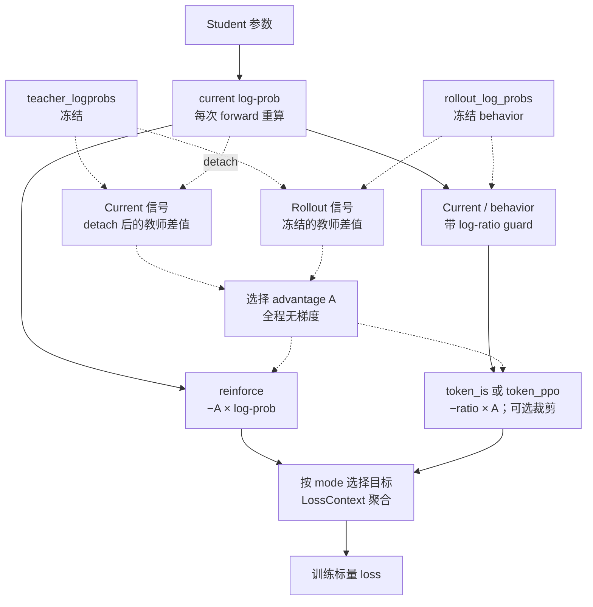

# Sampled OPD 与 MDPO 的目标和梯度路径

Sampled OPD 在 student 已生成的动作上读取 teacher 概率，并在 actor 更新时构造蒸馏信号。Teacher 不另生成标准答案；训练使用的是 student 访问过的前缀。本文把实际字段、分支与梯度对应起来，完整理论背景见[固定前缀目标](../../theory/2026-10-22-固定前缀下的OPD目标与梯度.md)，跨文档符号见[符号约定](../../theory/符号约定.md)。

## 四种概率

令 $s_t=(x,y_{<t})$ 为一条已采样轨迹中的前缀，$a_t=y_t$ 为该位置实际生成的 token。以下所有概率均以同一个 $s_t$ 为条件：

| 概率 | 字段或来源 | 同一批复用时 | 用途 |
| --- | --- | --- | --- |
| 行为策略 $\beta$ | `rollout_log_probs`，生成时记录 | 固定 | 显式 IS/PPO 分母、rollout advantage |
| 更新前锚点 $q$ | `old_log_probs`，通常由 actor 在更新前重算 | 固定 | vanilla PPO 分母、旧模式诊断，以及 sampled MDPO 的冻结目标 |
| 当前 student $p_\theta$ | `model_output['log_probs']`，本次 forward | 随参数变化 | 可微 loss 输入、current advantage 的数值 |
| Teacher $T$ | `teacher_logprobs`，冻结 teacher 评分 | 固定 | 蒸馏监督 |

Behavior 与 anchor 即使来自同一份 student 参数，也分别由 vLLM 和训练 engine 计算，数值不保证完全相同。`bypass_mode=True` 才会显式将 `old_log_probs` 赋为 rollout 概率；Legacy 显式 sampled 与 sampled MDPO 都禁止 bypass；vanilla 保留这条兼容路径。

显式 sampled 配置要求训练采样 `temperature=1, top_p=1, top_k=-1, do_sample=True, repetition_penalty=1`，并记录 `processed_logprobs`。这些约束使分母对应实际的无截断 token 采样分布，避免把另一种采样器的概率直接代入 IS。校验入口为 [validate_sampled_token_distillation](../../../../../verl/utils/config.py)；它还禁止外部 rollout IS/RS、ref/critic、额外 entropy/KL 目标及自定义 logits processor。数值实现差异仍应通过 anchor/behavior 指标检查。

## 入口与模式分流

[ActorRolloutRefWorker.init_model](../../../../../verl/workers/engine_workers.py) 将 [distillation_ppo_loss](../../../../../verl/trainer/distillation/losses.py) 注册为 actor loss。该函数调用 [distillation_loss](../../../../../verl/trainer/distillation/losses.py)，后者的分支顺序为：

1. Full objective 输出：按 spec 归一化 head 返回的 endpoint KL 或 mirror objective sum。
2. Sampled MDPO：`_mirror_sampled_loss` 构造冻结目标 b 与当前 residual，经未截断 IS 求梯度。
3. Legacy 非 vanilla：`_sampled_token_loss` 选择 current/rollout 信号及 token PPO/token IS/reinforce。
4. Legacy vanilla：先计算注册的 KL estimator，再用其负值调用原 policy loss。

`_sampled_inputs` 统一显式 OPD/MDPO 的 response 对齐与 padding 清理；[sampled_policy_terms](../../../../../verl/trainer/distillation/objectives.py) 统一 stopped-signal surrogate。Legacy token-IS/PPO 显式传 guard=20，MDPO 传 None；vanilla 保留原上游 PPO 函数的 anchor 分母和 dual-clip。

Legacy sampled 路径要求 `loss_mode=k1`、`use_policy_gradient=True`、`use_task_rewards=False`。非 vanilla 还要求两个 clamp 都是 `null`；`advantage_source` 仅接受 `current/rollout`，冻结信号的配置值是 `rollout`。`vanilla` 只支持 `current`。

两个同名配置属于不同入口：`actor_rollout_ref.actor.policy_loss.loss_mode` 配置通用任务 PPO；本文讨论的是 `distillation.distillation_loss.policy_loss_mode`。当前 shared-sync 不使用任务目标，修改前者不能替代修改后者。

## Sampled MDPO

`--method mdpo --estimator sampled` 使用 b=log q+f(log T-log q)，每次更新构造 h=log p-b。训练项为 `(p/beta) * stopgrad(h) / eta`，只让 ratio 求导。eta<1 的 q 在 worker 调用内冻结，eta=1 直接令 b=log T，无需 anchor 评分。

当前实现保留 1/eta，不使用 PPO clip、NoIS 或 ±20 guard。其期望梯度在正确行为概率及支持条件下对应 full MDPO。固定前缀上，surrogate 的动作期望为 $(\mathrm{KL}(p\Vert m)-\log Z_m)/\eta$；实际有限样本日志还有采样误差，不能把每条 sampled loss 都解释成精确 target KL 减去冻结常数。完整目标与范围见[实现说明](../numerics/mirror-objectives/实现方案.md#objectives)。当前所有 mirror 设置均要求 `token-mean`；后文 legacy sampled 的其他聚合选择不能直接套到 sampled MDPO。

## 显式 sampled 分支

### 从模型输出到 response 张量

`_sampled_inputs` 与目标分支按以下顺序执行，全部参与计算的 response 张量最终都为 `[micro_batch_size, max_response_len]`：

1. 将完整预测位置上的 student 和 teacher log-prob 经过 `no_padding_2_padding` 切到 response target；teacher 再去掉大小为 1 的末维。
2. 对已经 response-aligned 的 behavior 和 mask 只做 `as_padded_response`，不再次 shift。
3. 转成 FP32，detach teacher 和 behavior，检查 shape 一致。
4. 用 mask 将无效位置的三组 log-prob 先置零，再计算差值、指数和乘积。这能防止 padding 中的 NaN/Inf 污染梯度；不负责修复有效 token 上的非有限值。
5. 构造 advantage、surrogate，并交给 [LossContext.aggregate](../../../../../verl/workers/utils/loss_context.py) 用调用级全局分母聚合。

坐标例子和 TQ 字段由[数据与归一化](data-and-loss.md)统一维护。这里不读取 Trainer 的任务 `advantages`；OPD 信号由下面的表达式即时构造。

### 信号与 surrogate

记 $\ell=\log p_\theta(a\mid s)$、$\ell_\beta=\log\beta(a\mid s)$、$\ell_T=\log T(a\mid s)$，定义：

$$
A_{current}=\operatorname{stopgrad}(\ell_T-\ell),\qquad
A_{rollout}=\ell_T-\ell_\beta.
$$

两种 advantage 均无梯度。`current` 每次 forward 更新数值，`rollout` 在数据复用期间保持不变。Teacher 更偏好当前动作时 $A>0$，最小化下面的 loss 会推动该动作概率上升；$A<0$ 则相反。

| `policy_loss_mode` | 每个有效 token 的 surrogate | 对 $\ell$ 的导数，未触发保护/裁剪时 |
| --- | --- | --- |
| `reinforce` | $-A\ell$ | $-A$ |
| `token_is` | $-rA$ | $-rA$ |
| `token_ppo` | $\max(-rA,-\operatorname{clip}(r,1-\epsilon_l,1+\epsilon_h)A)$ | 活跃未裁剪分支为 $-rA$，严格裁剪区间为 0 |

实现中的比值带有数值保护：

$$
r=\exp\left(\operatorname{clip}(\ell-\ell_\beta,-20,20)\right).
$$

这个 log-ratio clamp 在边界外会截断比值的梯度，与 PPO 的概率比值裁剪不同；因此无保护条件下的理论等式不能直接用于触发 guard 的 token。`reinforce` 不计算比值，也不使用 PPO clip 参数。

对 `token_ppo`，$A>0$ 且 $r>1+\epsilon_h$ 才会由上侧裁剪限制继续增大概率；$A<0$ 且 $r<1-\epsilon_l$ 才会由下侧裁剪限制继续减小概率。仅仅落在 clip 区间外不一定使梯度为零。例如 $A<0,r>1+\epsilon_h$ 时仍保留惩罚当前动作的梯度。实现用 `clipped_loss > loss_mat` 统计严格生效的裁剪事件；该模式没有 vanilla 的 dual-clip。

`clip_ratio_low/high` 非空时优先使用它们，设为 `null` 才回退到 `clip_ratio`。只改变 `clip_ratio` 而保留显式 low/high 不会改变实际区间。公共 launcher 的 `OPD_CLIP_EPS` 同时设置三者。

### detach 的作用

下图只画 legacy 显式 sampled 分支。实线表示保留梯度连接的计算，虚线表示只传入数值的监督或 detach 后的信号；沿实线反向追踪即可看到 student 梯度来源。`old_log_probs` 仅供这条分支的诊断，不进入图中的目标。

以 current reinforce 为例，前向显示的值为 $-(\ell_T-\ell)\ell$，但反向只对最后的 $\ell$ 求导，得到 $\ell-\ell_T$。若删去 detach，导数会变成 $2\ell-\ell_T$，训练目标随之改变。

这条 sampled loss 只读取已采样动作的 log-prob，但 softmax 的归一化仍会把梯度传到全部 student logits。它与 Full-KL 的差别在于监督和动作期望的计算范围，不能理解为“只有一个输出 head 行会更新”。

## 与 Full-KL 的梯度关系

固定前缀、正确 behavior 概率、支持覆盖且无 ratio guard/PPO clipping 时，current token-IS 的动作期望梯度等于 full MDPO；令 b=log T 即为普通 Full-KL。完整求导统一见[与 sampled current-IS 的精确联系](full-kl-walkthrough.md#73-与-sampled-current-is-的精确联系)。有限 batch 的梯度不会逐次相同；复用固定动作也不会产生新的独立样本。

其他组合在复用时有不同含义：

| 组合 | 固定前缀、无裁剪时的含义 |
| --- | --- |
| current + `reinforce` | 梯度等于 $\frac12\mathbb E_\beta[(\log p_\theta-\log T)^2]$ 的梯度；在 $p_\theta=\beta$ 的点与 reverse-KL 梯度一致，离开该点后缺少动作 IS |
| rollout + `reinforce` | 固定系数 $\log T-\log\beta$ 乘当前 score；信号不会因 current 已追上 teacher 而自动改变 |
| rollout + `token_is` | 梯度对应 $\mathbb E_{a\sim p_\theta}[\log\beta(a\mid s)-\log T(a\mid s)]$；相当于优化冻结信号，不等于持续重算 current reverse-KL |
| 任一信号 + `token_ppo` | 进一步加入 PPO 裁剪，改变已触发裁剪的梯度 |

例如一个已采样动作的 `teacher=-2, behavior=-3`。初次 current 为 `-3` 时两种 advantage 都为 `+1`；若后续 current 变为 `-1.5`，current advantage 为 `-0.5`，rollout advantage 仍为 `+1`。这对应 `advantage_sign_flip_count` 的观测情形。

上述期望只针对固定 $s$ 的动作。训练前缀仍来自 behavior rollout，代码不会对离散生成历史反传，也没有用 token IS 修正整条前缀的状态分布。Full-KL 同样在这些缓存前缀上训练；“full”指该位置的完整输出词表，不表示枚举了所有后续轨迹。

## Vanilla 分支

[compute_distillation_loss_reverse_kl_estimator](../../../../../verl/trainer/distillation/losses.py) 对 `k1` 返回 $\ell-\ell_T$。`distillation_loss` 可先对该值做 `loss_max_clamp`，再取负并 detach，传给 [compute_policy_loss_vanilla](../../../../../verl/trainer/ppo/core_algos.py)。公共 shared launcher 将 clamp 关闭。

Vanilla 比值的分母为 anchor：

$$
r_{old}=\exp\left(\operatorname{clip}(\log p_\theta-\log q,-20,20)\right).
$$

先定义普通 PPO token loss $u=\max(-r_{old}A,-\operatorname{clip}(r_{old},1-\epsilon_l,1+\epsilon_h)A)$。现有 vanilla 还对负 advantage 应用 dual-clip：

$$
\ell_{vanilla}=\begin{cases}
\min(-cA,u),& A<0,\\
u,& A\ge0,
\end{cases}
\qquad c=3\ \text{（当前默认）}.
$$

若 Trainer 提供 `rollout_is_weights`，还会在聚合前乘入这组外部权重；rollout rejection 则通过 `response_mask` 生效。外部 correction 比较 anchor 与 behavior，显式 `token_is` 比较 current 与 behavior，两者不能混用或用一个名字概括。当前非 vanilla 校验会禁止这种叠加。

Vanilla 的 `old_log_probs` 在 batch 入口计算一次，current advantage 在每次 micro-batch forward 重算。其名称并不意味着无 clipping，也不意味着使用冻结 rollout advantage。它与显式 `token_ppo` 的分母、dual-clip 和外部 correction 能力均有差别。

## 观测与扩展

Sampled surrogate、单动作 $\log p_\theta-\log T$ 和完整词表 KL 是不同观测。Sampled 值允许为负，reinforce 的显示值也不是上述 log-prob MSE 的函数值，虽然 detach 后的梯度可与 MSE 一致。不能仅比较这些模式的 `loss` 高低来判定蒸馏质量。

`_sampled_token_loss` 记录有效 token 数、current/rollout 信号异号数、IS guard 数和生效的 PPO clip 数；启用原始观测时还记录 current/behavior/anchor/teacher 的差异。逐 update 指标来自产生该次梯度的 forward，参数更新后没有自动在同一 batch 上再测一遍。规范字段与统计出口分别见[指标字典](../../settings/指标口径.md)和[指标系统](metrics.md)。

Sampled MDPO 的 `distill/mdpo/objective` 已除 eta；按需采集 current/behavior、存在的 current/anchor 和 `advantage/mdpo/*`。它没有完整词表的 teacher/target/anchor KL 或 target log Z，也没有自动位置分桶。不要将 sampled pair 的 log-ratio 估计与 full-vocab 精确条件 KL 混用。当前 full MDPO/BPO 的位置 namespace 与诊断开关见[指标矩阵](metrics.md#当前目标的指标矩阵)。

新增 sampled 变体应复用现有布局、mask、detach 和 `LossContext`。若改变数据采样、比值分母或教师信号，需同时修改配置约束与梯度测试，不能只改一个 mode 名称。

## 验证入口

[test_sampled_token_loss_on_cpu.py](../../../../../tests/trainer/distillation/test_sampled_token_loss_on_cpu.py) 覆盖六种显式组合、teacher/behavior detach、anchor 不参与显式 loss、current-IS 的动作期望梯度与 Full-KL 一致、reinforce 梯度、PPO 生效条件、ratio guard、mask NaN 和不等长布局。[test_shared_teacher_fsdp2.py](../../../../../tests/special_distributed/test_shared_teacher_fsdp2.py) 覆盖真实 shared teacher、current-IS、rollout-PPO、重复更新与恢复。

数学等价性以公式和小词表梯度测试为依据；短训练 loss 升降不能替代这类核对。
