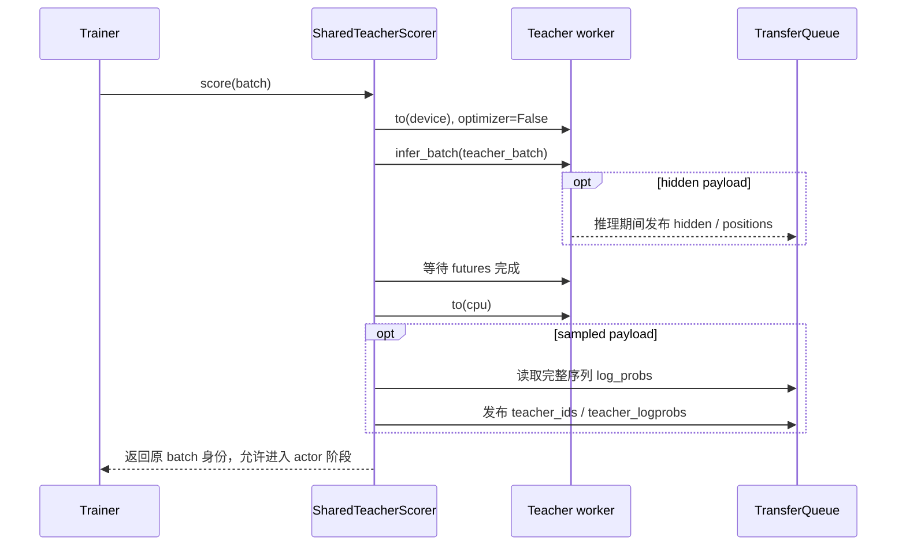

# 教师评分与资源生命周期

教师在 student 生成的完整 token 序列上提供冻结监督。本文负责教师阶段的资源协议；hidden 的跨阶段读取和 student 持有的冻结 head 见 [Full-vocab](full-vocab.md)。

## 两种执行方式

| 方式          | 入口                                                                                   | 职责                                        |
| ------------- | -------------------------------------------------------------------------------------- | ------------------------------------------- |
| `shared_sync` | [SharedTeacherScorer](../../../../../verl/trainer/distillation/shared_teacher.py)      | 师生共用资源池，teacher 与 actor 分阶段执行 |
| `standalone`  | [teacher_manager.py](../../../../../verl/experimental/teacher_loop/teacher_manager.py) | 既有独立教师服务与请求路径                  |

[PPOTrainer._make_shared_teacher_config](../../../../../verl/trainer/ppo/v1/trainer_base.py) 创建独立 teacher 模型配置，校验 tokenizer 协议；`_compute_shared_teacher_log_probs` 是调用协调器的薄入口。Teacher 采用 forward-only engine，没有 optimizer；推理在无梯度上下文中执行。共享路径的配置约束由 [DistillationConfig.validate_shared_sync](../../../../../verl/workers/config/distillation.py) 负责。

Shared-sync 中 `distillation.n_gpus_per_node=0, nnodes=0` 表示不分配独立 teacher 池，teacher 仍在 actor 的共享 GPU 池执行。Teacher 使用 FSDP2 分片、参数卸载、remove-padding、动态 token batching；当前限制无 sequence parallel、无 QAT、无通用 fused model kernel。其 forward token 预算必须容纳一条最大训练序列。

Standalone 继续使用独立 teacher 服务，并在 agent postprocess 阶段取得教师输出；它不遵循下面的 shared teacher 上下卡时序。`teacher_models.*.inference` 配置面向该服务，shared-sync 的实际 forward 由 `distillation.shared_teacher` 控制。普通 Full-KL 和所有 mirror 设置（含 sampled MDPO）当前都要求 shared-sync。

## 评分顺序

[SharedTeacherScorer.score](../../../../../verl/trainer/distillation/shared_teacher.py) 创建独立 `KVBatchMeta`，沿用样本 keys 和 partition，只选择 `input_ids`、`position_ids`、`loss_mask` 等教师需要的字段。临时 metadata 不复用为 actor 的执行配置。

Hidden 数据在 worker 推理过程中发布，但 actor 的阶段边界仍是 futures 完成且教师成功卸载之后。Teacher 评分异常时尽力卸载并保留主异常；正常评分后的卸载失败也会阻止返回。这个清理协议不承诺 NCCL/rank 故障自动恢复。

## 输入与 sampled 输出协议

Teacher 消费 student 原始 `input_ids`，不使用教师 chat template 重新编码。初始化严格比较 `tokenizer.get_vocab()`，要求 token-to-ID 映射完全相同；允许 EOS、PAD 等特殊 token 的默认角色不同。Teacher 在这里不生成、不决定停止位置，也不重新 padding，因此其默认 EOS 角色不需要替代 student 的生成协议。输出 head 的额外词表行由 Full-KL 单独处理。

FSDP 的位置 `i` 已对应下一个 token `x[i+1]` 的 log-prob。协调器只替换最后一项 dummy，并生成同样对齐的 `teacher_ids`；不会把概率再左移一次。每条完整序列的输出末维为 1，IDs 使用 int32，log-prob 转为 FP32；有效预测概率必须有限。

例如 `[p0,p1,r0,r1]` 的监督 targets 是 `[p1,r0,r1,dummy]`。Response target `r0` 对应预测位置 1。模型预测布局与 response 布局的转换由[公共布局工具](data-and-loss.md#两种布局与预测坐标)处理。

Sampled teacher 计算 teacher forcing 下的下一 token log-prob：整条输入送入模型，但因果 attention 确保预测 `r0` 时只看到此前的 prompt。Full-vocab teacher 为普通 Full-KL、MDPO/BPO 返回相同预测位置的 hidden，省去教师阶段的 head 投影。这两种 payload 不互相替代；loss 的静态元数据决定分支。

## Anchor 准备与模型驻留

Legacy sampled 的 `old_log_probs` 由 Trainer 的更新前评分步骤产生。Mirror 跳过该步骤，在 [ActorRolloutRefWorker.update_actor](../../../../../verl/workers/engine_workers.py) 内通过 [anchor_scope](../../../../../verl/trainer/distillation/anchor.py) 复用现有 student engine 的 `infer_batch`，不增加第三个模型或独立 worker。

| 设置                                    | Anchor 准备                                                   | actor 调用期间保留                                 |
| --------------------------------------- | ------------------------------------------------------------- | -------------------------------------------------- |
| MDPO eta=1，sampled/full 均适用         | 跳过                                                          | 不建立 q                                           |
| Sampled MDPO eta<1                      | 完整序列的无梯度 log-prob，再按 response 对齐                 | 冻结的 `old_log_probs`                             |
| Full MDPO eta<1 / Full BPO 任意合法 eta | 选中 hidden/positions，并在 wrapped head callback 内复制 head | TQ 的 anchor payload、version 和调用级 head holder |

[FrozenAnchorHead](../../../../../verl/trainer/distillation/anchor.py) 对完整 head 做独立 CPU 副本，首次使用时再创建 GPU 缓存；它不能引用随后会被 optimizer 改写的 student 权重。位置和 version 在每次消费时检查，scope 的 `finally` 释放 holder 并移除调用级字段。实际 TQ payload 随 outer step 的样本 keys 一起清理。当前实现要求相关 dropout 为零，q 在整个 actor 调用内冻结，下一次调用重新建立。

[BaseEngineCtx](../../../../../verl/workers/engine/base.py) 管理评分和训练的 load/offload。当前 mirror anchor 推理退出后会卸载 student，随后 `train_mini_batch` 的 train context 再加载模型及所需训练状态。这一段还有一次额外的模型往返；但所有 epochs/mini-batches 已经处于同一个 train context，内层 `train_batch` 使用 `disable_auto_offload=True`，不会每次 reuse 都重新卸载整个模型。细节见[更新驻留周期](training-loop.md#从一次-actor-调用到实际更新)。

`perf/anchor/prepare_seconds_max` 覆盖 scope 从准备输入到 anchor 评分/输出处理完成的时间，包含当中的 engine 搬运和 hidden 发布等待，不是纯 backbone CUDA 时间；它是 Trainer `update_actor` 耗时中的子阶段。

## 资源所有权

教师 scorer 只管理 teacher backbone 的阶段性驻留。Student engine 的 `FrozenTeacherHead` 由 actor worker 在 `update_actor` 的 `finally` 中释放 GPU 缓存，不能交给 scorer 提前释放。教师标签和 hidden 保存在 TQ 中，按原样本身份被复用；Trainer 在本轮结束时清理。

| 阶段                 | 主要 GPU 执行者                                                                | 保留用于后续训练的数据                                                                           |
| -------------------- | ------------------------------------------------------------------------------ | ------------------------------------------------------------------------------------------------ |
| Rollout              | student vLLM 副本                                                              | 原始 token、mask、可选 behavior log-prob                                                         |
| Teacher 评分         | 冻结 teacher FSDP2                                                             | sampled 标签或选中 hidden/positions                                                              |
| Anchor（按目标选择） | student FSDP2 无梯度 forward                                                   | legacy/scalar anchor 的 `old_log_probs`，或 full mirror 的 hidden/positions/version 与 head 快照 |
| Actor 更新           | student FSDP2；full-vocab 另驻留冻结 teacher head，需要 q 时还驻留 anchor head | student 参数、optimizer/scheduler 状态；q/T 在调用内固定                                         |
| 同步与验证           | 权重同步后使用 student rollout 副本                                            | 指标、checkpoint 和可选生成记录                                                                  |

这里说明执行阶段与主要状态所有权，不表示某阶段只存在一份模型内存。Offload、FSDP 分片、rollout sleep 和 allocator 缓存共同影响实际显存；阶段性能应结合[性能记录](../performance/full-vocab/README.md)核对。

## 验证入口

[test_shared_teacher_on_cpu.py](../../../../../tests/trainer/ppo/v1/test_shared_teacher_on_cpu.py) 覆盖配置、协议和清理；[test_shared_teacher_fsdp2.py](../../../../../tests/special_distributed/test_shared_teacher_fsdp2.py) 覆盖真实 FSDP2 teacher/actor 切换与重复更新。[test_mirror_on_cpu.py](../../../../../tests/trainer/distillation/test_mirror_on_cpu.py)、[test_mirror_tq_on_cpu.py](../../../../../tests/trainer/ppo/v1/test_mirror_tq_on_cpu.py) 和 [test_mirror_fsdp2.py](../../../../../tests/special_distributed/test_mirror_fsdp2.py) 补充覆盖 anchor 生命周期、真实 TQ 与多步恢复。运行命令继续维护在[共享运行说明](../training/2026-10-22-共享八卡运行与架构.md#启动与配置)。
