# 代码走读文档库

这里维护当前工作区的单教师 OPD、weighted teacher、MDPO/BPO 源码走读，覆盖统一实验入口、rollout、评分、loss、分布式反传、日志与恢复。历史重构基点与上游差异见[改动地图](upstream-changes.md)，当前验证范围见[实现说明](../numerics/mirror-objectives/实现方案.md#validation)。

阅读目标是能从一份训练配置追到产生梯度的具体表达式，并解释一批数据复用时每个字段何时产生、何时变化。先从本页[端到端流程总图](#端到端流程总图)建立整体顺序，再沿[架构总览](README.md)、[训练循环](training-loop.md)及各专题深入。公式推导、指标字典、运行命令和历史证据通过链接引用。

本文库用 full-vocab 表示在固定前缀上对完整 student 词表求和；Full-KL 专指原教师 reverse-KL，即 full MDPO 的 eta=1 endpoint。一般 full MDPO 与 full BPO 共享计算框架，但训练 objective 不等于原教师 KL。

## Full-KL OPD、MDPO、BPO 专题走读

需要按公式和源码逐段走读三种 full-vocab 方法时，按以下顺序阅读。专题将公式、数值实现和执行阅读路线分开维护；公共训练机制沿路线链接到所属页面，避免重复正文。源码版本与行级引用约定统一见目标篇。

| 顺序 | 专题 | 内容 |
| --- | --- | --- |
| 1 | [目标与梯度](full-kl-walkthrough.md) | 固定前缀、power-mean target、OPD/MDPO/BPO 求导、eta/kappa、首次更新与 reuse 差异、额外 teacher 支持 |
| 2 | [执行源码阅读路线](full-kl-execution-walkthrough.md) | 20 个按调用顺序排列的行级源码入口，以及每项机制的唯一正文位置 |
| 3 | [算子、分块 VJP 与数值实现](full-kl-kernel-walkthrough.md) | Dense reference、dH/dW 推导、precompute、backend 差异、Triton 相对坐标、小残差与精度、验证入口 |

## 训练路径的共同部分与分流

所有方法先由 student 生成轨迹，并在固定前缀上训练；reuse 期间不重新生成 token。Shared-sync 轮流使用同一 GPU 池执行 rollout、teacher 和 actor。配置先解析为目标与数据需求，再决定准备阶段。

| 方法 | Teacher payload | Anchor | 实际训练目标 |
| --- | --- | --- | --- |
| Legacy sampled OPD | 动作 log-prob | vanilla 的 ratio 分母；显式模式用于旧诊断 | current/rollout 信号 × vanilla/token PPO/token IS/NoIS |
| Sampled MDPO | 动作 log-prob | eta<1 时在 actor 调用内准备 scalar；eta=1 跳过 | weighted target 的未截断 IS 梯度估计 |
| 普通 Full-KL | 有效 hidden/head | 无 | MDPO eta=1，$\mathrm{KL}(p\Vert T)$ |
| Full MDPO | 有效 hidden/head | eta<1 时准备 hidden/head | 到 weighted target 的 scaled reverse KL，减冻结常数 |
| Full BPO | 有效 hidden/head | 始终准备 hidden/head，包括 eta=1 | q 加权中心化 log-residual 方差 |

Teacher/anchor 在一次 actor 调用内冻结，当前 student 每次更新重算。三种 mirror 设置共用 anchor scope、target 构造、LossContext 与 optimizer；full 设置共用投影和 precompute 累计。显式旧 sampled 与 MDPO 共用输入对齐和 surrogate primitive，但各自的信号、clipping 和 ratio guard 保持独立。

“On-policy”描述轨迹生成来源。Current sampled IS 与 Full-KL 的联系要求固定前缀、正确提案概率和支持条件；旧 guard 触发后不再与未截断 MDPO 等价。公式见[统一目标定义](../numerics/mirror-objectives/实现方案.md#objectives)。

## 端到端流程总图

本节展开当前 V1、单节点 FSDP2、`shared_sync`、纯蒸馏主线。图中 `T` 是固定教师，`beta` 是实际生成行为策略，`q` 是本轮需要时才建立的学生锚点，`p` 是每次更新重新计算的学生。Full-KL 指 full MDPO 的 eta=1 endpoint；通用 ref/critic、混合任务奖励、异步 stale rollout 和 standalone teacher 不属于这张图的运行条件。

本页保留两张调度图：[整轮控制流](#整轮控制流) → [actor 内部时序](#actor-内部时序)。数值与指标图分别由[算子篇](#full-vocab-数值路径)和[指标页](#指标与持久状态出口)维护。实线表示顺序、调用或数据依赖，虚线表示配置、冻结输入或观测旁路；图中的虚线本身不表示异步线程或并发执行。

### 整轮控制流

```mermaid
%%{init: {"flowchart": {"wrappingWidth": 300, "nodeSpacing": 35, "rankSpacing": 45, "curve": "linear"}}}%%
flowchart TB
    subgraph INIT["A. 配置与初始化：每次启动一次"]
        CLI["统一 shell 入口<br/>E 预设或 custom，加覆盖参数"]
        PLAN["math_experiment.build_plan<br/>合并模型、预算、方法与运行环境"]
        HYDRA["main_ppo 与 Hydra<br/>解析最终配置；校验资源和目标约束"]
        SPEC["resolve_distillation_spec<br/>确定 objective、payload_kind<br/>anchor_payload 与 teacher_only_kl"]
        SETUP["PPOTrainer._setup<br/>数据集、tokenizer、共享资源池、TQ<br/>actor/rollout worker 与 teacher worker"]
        MODEL["初始化模型与 loss 回调<br/>actor 有 optimizer/scheduler<br/>teacher 仅 forward；full 路径安装 head adapter"]
        RESTORE["按配置恢复 checkpoint<br/>学生、optimizer、scheduler、Trainer 进度<br/>恢复可用的队列状态"]
        SEEDSYNC["on_init_end<br/>将初始或恢复后的学生参数同步到 rollout"]
        VAL0["按需做初始验证<br/>E44–E47 默认关闭"]
        REJECT["静态校验失败，停止启动<br/>不自动切换算法或资源模式"]
        CLI --> PLAN --> HYDRA
        HYDRA -->|通过| SPEC --> SETUP --> MODEL --> RESTORE --> SEEDSYNC --> VAL0
        HYDRA -->|失败| REJECT
    end

    subgraph SAMPLE["B. 一个 outer step：生成并固定本轮轨迹"]
        PROMPT["Dataloader / ReplayBuffer / AgentLoop<br/>取 prompt；用 student 模板编码"]
        GEN["student vLLM 生成 response<br/>按需返回 behavior log-prob beta<br/>verifier 计算任务分数"]
        PUBLISH["AgentLoopWorkerTQ 发布到 train partition<br/>input_ids、position_ids、prompts、responses<br/>loss_mask、response_mask、可选 rollout_log_probs<br/>key = uid + session_id + index"]
        TAKE["ReplayBuffer.sample 返回 KVBatchMeta<br/>Trainer 固定本轮样本 keys"]
        SLEEP["on_sample_end 休眠 rollout<br/>补齐需要的 colocated reward<br/>按 token 工作量平衡 DP batch"]
        PROMPT --> GEN --> PUBLISH --> TAKE --> SLEEP
    end
    VAL0 --> PROMPT

    subgraph TEACH["C. 共享教师评分：本轮一次，无梯度"]
        TLOAD["SharedTeacherScorer.score<br/>teacher 上卡，使用原 student token 序列<br/>不重套 teacher chat template"]
        KIND{"payload_kind"}
        TS["sampled：完整序列的下一 token log-prob<br/>教师阶段执行 head 投影"]
        TH["hidden：只选 loss_mask 对应预测 hidden<br/>发布 teacher_hidden / teacher_positions<br/>此时不做完整词表 head 投影"]
        TUNLOAD["等待所有评分 futures / hidden 写入完成<br/>teacher 卸载，释放共享 GPU 给 actor"]
        LABELS["sampled 输出再对齐并发布<br/>teacher_ids / teacher_logprobs<br/>hidden 路径保留已发布 payload"]
        TLOAD --> KIND
        KIND -->|sampled| TS
        KIND -->|hidden| TH
        TS --> TUNLOAD
        TH --> TUNLOAD
        TUNLOAD --> LABELS
    end
    SLEEP --> TLOAD
    SPEC -.-> KIND

    subgraph UPDATE["D. 准备目标与更新学生"]
        ROUTE{"目标是否具有 mirror objective<br/>包括普通 Full-KL endpoint"}
        LEGACY["Legacy sampled 的 Trainer 准备<br/>old_log_probs；vanilla 可选 correction<br/>通用任务 advantages 仅兼容保留"]
        MIRROR["Mirror 跳过 Trainer 的旧 anchor / advantage<br/>payload 和 key 保持原样<br/>q 由 actor scope 按需准备"]
        CALL["PPOTrainer._update_actor<br/>分发本轮固定轨迹、监督与身份<br/>附 mini-batch、epochs、seed、version"]
        ACTOR["ActorRolloutRefWorker.update_actor<br/>按需准备 q → 执行所有 reuse 更新<br/>finally 清理 anchor holder 与 teacher head GPU 缓存<br/>详见下一张时序图"]
        RECORD["返回逐 update 观测和执行事实<br/>Trainer 推进 attempts / applied<br/>写入带业务坐标的更新记录"]
        ROUTE -->|否：legacy sampled| LEGACY --> CALL
        ROUTE -->|是：MDPO / BPO / Full-KL| MIRROR --> CALL
        CALL --> ACTOR --> RECORD
    end
    LABELS --> ROUTE
    SPEC -.-> ROUTE

    subgraph FINISH["E. 正常 outer 收尾：更新记录之后仍有工作"]
        CKPT["save_freq 大于 0 且命中周期或最后一步<br/>保存学生与 optimizer/scheduler<br/>记录 Trainer 与可用队列状态"]
        SYNC["PPOTrainerSync.on_step_end<br/>将新学生权重同步到 rollout<br/>teacher 与 anchor 不参与同步"]
        EVAL["test_freq 大于 0 且命中周期或最后一步<br/>新参数重新生成验证回答<br/>判分并归约 eval 指标"]
        CLEAR["汇总 outer 指标与按需导出生成记录<br/>清理本轮 TQ keys，包括 q/T payload<br/>写 outer 日志"]
        MORE{"还有训练预算"}
        DONE["排空生成记录写入任务<br/>正常结束"]
        CKPT --> SYNC --> EVAL --> CLEAR --> MORE
        MORE -->|否| DONE
    end
    RECORD --> CKPT
    MORE -->|是：下一轮重新生成与评分| PROMPT

    classDef config fill:#edf2f7,stroke:#64748b,color:#172033;
    classDef frozen fill:#f2eafa,stroke:#8064a2,color:#30203f;
    classDef data fill:#e9f2ff,stroke:#5079a8,color:#142d49;
    classDef compute fill:#e8f5ee,stroke:#538b67,color:#173b25;
    classDef observe fill:#fff3dc,stroke:#ac833b,color:#483519;
    class CLI,PLAN,HYDRA,SPEC,SETUP,MODEL,RESTORE,SEEDSYNC,VAL0,REJECT config;
    class PROMPT,GEN,PUBLISH,TAKE,SLEEP data;
    class TLOAD,TS,TH,TUNLOAD,LABELS frozen;
    class LEGACY,MIRROR,CALL,ACTOR compute;
    class RECORD,CKPT,SYNC,EVAL,CLEAR,DONE observe;
```



初始化中的 token-to-ID 校验、资源约束与模型支持检查发生在各自模块；失败时停止该次启动，不自动退回另一算法。图中的 checkpoint、初始验证和周期验证都是条件步骤，未启用时直接通过。Shared-sync 的 `parameter_sync_step=1`，本轮同步后才进入下一轮生成；一次 actor 调用中的 reuse 不重新采样。恢复任务在首次进入训练循环前还会通过 `_reissue_inflight_prompts` 重发持久状态中的未完成 prompt；独立 val-only 调用则在初始验证后返回，不进入本图的训练循环。

Verifier 分数会记录，但当前 `use_task_rewards=False`，不进入 OPD/MDPO/BPO 的最终目标。Legacy vanilla 仍有兼容的任务 advantage/PPO 调用；任务 loss 最终被舍弃。Mirror 则直接跳过 Trainer 的任务 advantage 和旧 anchor 准备。

对应源码：[PPOTrainer._setup](../../../../../verl/trainer/ppo/v1/trainer_base.py)、[PPOTrainer.fit](../../../../../verl/trainer/ppo/v1/trainer_base.py)、[PPOTrainer._step_once](../../../../../verl/trainer/ppo/v1/trainer_base.py)、[SharedTeacherScorer.score](../../../../../verl/trainer/distillation/shared_teacher.py)、[PPOTrainerSync.on_step_end](../../../../../verl/trainer/ppo/v1/trainer_sync.py)。

### Actor 内部时序

下图继续展开总图 D。`D` 表示 DP 大小，`N` 表示当前 mini-batch 的原始全局有效 loss token 数。Legacy sampled 的 anchor 已在 Trainer 中产生；图中的可选准备阶段专指 mirror 的 q。

```mermaid
%%{init: {"sequence": {"wrap": true, "useMaxWidth": true}}}%%
sequenceDiagram
    autonumber
    participant T as Trainer
    participant W as Actor worker
    participant E as FSDP Engine
    participant Q as TQ
    participant L as Head / Loss
    participant O as Optimizer / Scheduler

    T->>W: update_actor(固定轨迹、监督、keys、epochs、anchor version)
    W->>W: 进入 anchor_scope
    alt full MDPO eta 小于 1，或任意 full BPO
        W->>E: infer_batch，eval context 加载 student，无梯度
        loop Anchor 动态 micro-batches，覆盖整批本地样本
            E->>E: Backbone forward；按 loss_mask 选 hidden
            opt 本次 scope 尚无 head 快照
                E->>L: 通过 wrapped head 触发 FSDP hooks
                L-->>E: 返回 hidden；engine 保留独立 head 快照与 version
            end
            E->>Q: 写 anchor_hidden / positions / version
        end
        E-->>W: 等待发布完成，退出 eval context 并卸载
    else sampled MDPO eta 小于 1
        W->>E: 无梯度 infer_batch，取得动作 log-prob
        E-->>W: 完整预测布局输出；退出 eval context
        W->>W: 对齐为 response old_log_probs，作为固定 q
    else MDPO eta 等于 1，或 legacy sampled
        W->>W: 此 scope 不准备新 q
    end
    W->>E: 进入一次 train_mode，加载模型及训练状态
    Note over W,E: 所有 epochs 和 mini-batches 共用这次训练驻留

    loop 每个 epoch：复用同一批固定轨迹
        loop 当前 epoch 的每个 mini-batch
            W->>W: 同步切分数据和 sample keys；收集 token 工作量
            W->>E: train_batch，disable_auto_offload=True
            E->>O: zero_grad
            E->>E: all-reduce 原始 loss_mask 计数，得到全局 N
            Note over E,O: 全局 N 为 0 则报错；局部空 rank 仍保留零梯度连接
            loop 按输入 token budget 切出的 micro-batches
                alt full-vocab 路径
                    E->>Q: 按当前 keys 读取 teacher，以及需要的 anchor payload
                    Q-->>E: frozen hidden / positions / version
                    E->>E: H2D；检查样本位置与 anchor version
                    E->>L: Current backbone → 选中 hidden → wrapped head callback
                    L->>L: 分块 head 投影、目标、VJP；见数值路径图
                    L-->>E: raw objective sum、detached 行值与诊断
                    E->>E: objective 行值做位置 sum/count；四项诊断做全局 sum
                else sampled 路径
                    E->>E: Current forward 取得完整预测布局 log_probs
                    E->>L: 对齐 response；mask 无效 padding；构造信号/target
                    L-->>E: legacy surrogate 或未截断 sampled MDPO 项
                end
                E->>L: LossContext 使用同一个 mini-batch 全局分母
                L-->>E: token-mean 主线按 D/N 缩放，mirror 再除 eta 一次
                E->>E: loss.backward；累计本 micro-batch 梯度
                Note over E,O: FSDP 按配置归约梯度；q/T 不反传
                opt 当前 micro-batch 注入了 hidden payload
                    E->>E: 移除临时 payload，释放本块引用
                end
            end
            E->>O: 梯度裁剪与非有限检查；尝试 optimizer.step
            O-->>E: applied / skipped / unknown 与梯度范数
            E-->>W: 本次局部 loss、观测与执行事实
            opt 整次 actor 调用的最后一个 mini-batch
                W->>O: lr_scheduler_step
            end
            W->>W: _postprocess_output 合并 DP 观测
            W->>W: 保存本次 worker 输出；profiler.step
            Note over W,O: 成功更新后 p 改变；q/T/beta 保持本轮固定
        end
    end

    W->>W: UpdateResult / finalize_update 整理各次更新记录
    W->>E: 退出 train context，卸载训练状态
    W->>W: anchor_scope finally 释放 q holder 和调用级字段
    W->>W: update_actor finally 释放 teacher head GPU 缓存
    opt 本次准备了 mirror anchor
        W->>W: 跨 DP 取 anchor 准备耗时最大值
    end
    W-->>T: update_records、更新计数、outer 观测
    Note over T,Q: TQ 中持久 payload 此时仍属本轮；由 Trainer 正常收尾清理 keys
```



每次 mini-batch 的观测先保存在 worker 输出中，`train_mini_batch` 整理整个调用的 update_records 后交还 Trainer，再由 Trainer 逐条写日志。因此云端缺少某条尾部记录，也可能是输出或同步尚未完整，不能直接反推该次计算尚未执行。

当前 anchor 的 eval context 与后面的 train context 分开，因此仍有一次额外卸载/加载；16 次 reuse 本身不会导致 16 次整模型搬运。`FrozenAnchorHead` 在 CPU 保存独立副本，首次训练消费时再创建 GPU 缓存；teacher head 来自固定 checkpoint，其 CPU 副本可以跨 actor 调用保留。两种 head 的 GPU 引用均由本轮作用域释放。

需要 mirror q 的设置在准备前校验相关 dropout 为零，并检查没有遗留的 anchor holder。

Teacher/anchor 的位置数组是样本内部预测 state 下标，key 决定“是哪条样本”，version 决定“是哪一轮 anchor”；三者都正确才可消费。Teacher、anchor 和 actor 的 micro-batch 划分可以不同，不能靠 micro-batch 序号对齐它们。

若全局 batch 为 B 个 prompt、每题 n 条轨迹、配置 mini-batch 为 M 个 prompt、reuse 为 E，则在完整且可整除的批次下：

$$
\text{轨迹数}=Bn,\qquad
\text{每次更新的全局轨迹数}=Mn,\qquad
\text{每个 outer 的更新尝试数}=E\frac{B}{M}.
$$

E44–E47 的默认 B=M=64、n=1、E=16，所以每轮尝试 16 次更新；四卡时每次更新每个 DP rank 分到 16 条序列，再按 token budget 切 micro-batch。成功更新数还要扣除 skipped；scheduler 在整个 actor 调用的最后一次 mini-batch 后调用一次，不能从 reuse 次数推断 scheduler 次数。

对应源码：[anchor_scope](../../../../../verl/trainer/distillation/anchor.py)、[TrainingWorker.train_mini_batch](../../../../../verl/workers/engine_workers.py)、[TrainingWorker.train_batch](../../../../../verl/workers/engine_workers.py)、[BaseEngine.train_batch](../../../../../verl/workers/engine/base.py)、[FSDPEngine.forward_backward_batch](../../../../../verl/workers/engine/fsdp/transformer_impl.py)。

### 同一批轨迹上的 loss 分派

Full-vocab 三方法的目标、梯度和关系见[目标篇](full-kl-walkthrough.md)；sampled 的信号、surrogate、detach 与 clipping 维护在[Sampled OPD](sampled-opd.md)。

### Full-vocab 数值路径

Head-loss 的分块计算与 backward 流程图统一见[Precompute 数值路径](full-kl-kernel-walkthrough.md#4-precompute-的前向与反向分工)。

### 指标与持久状态出口

Observation 的归约图与字段矩阵见[指标系统](metrics.md#从局部观测到日志)；更新坐标及持久状态见[进度与 checkpoint](progress-checkpoint.md)。

### 状态生命周期与异常边界

Teacher/anchor/actor 资源所有权见[教师生命周期](teacher.md#资源所有权)，冻结 head 与 IO 引用见[full-vocab 接入](full-vocab.md#冻结-head-与-io-生命周期)，checkpoint 保存与重建见[恢复分工](progress-checkpoint.md#保存和恢复的分工)。

## 阅读顺序与问题索引

| 顺序 | 文档 | 解决的问题 |
| --- | --- | --- |
| 0 | [相对上游的改动](upstream-changes.md) | verl 基线已有哪些机制，本仓在什么位置新增或改变行为 |
| 1 | [训练循环](training-loop.md) | 一批数据如何进入训练，reuse、micro-batch 与权重同步怎样组织 |
| 2 | [教师生命周期](teacher.md) | shared 与 standalone 的职责，教师资源和评分发布顺序 |
| 3 | [数据与归一化](data-and-loss.md) | TQ 身份、预测位置、response 布局、三种 mask 和全局分母 |
| 4 | [Sampled OPD](sampled-opd.md) | behavior、anchor、current 的区别，current/frozen 信号与 IS/PPO |
| 5 | [Full-vocab](full-vocab.md) | hidden IO、冻结 head、算子与 VJP、词表支持和精度 |
| 6 | [指标系统](metrics.md) | Observation 跨卡归约、位置分桶、逐 update 日志 |
| 7 | [进度与 checkpoint](progress-checkpoint.md) | 更新是否执行、计数未知、scheduler 和恢复状态 |

预算和字段定义分别由[训练配方](../../settings/训练设置.md)及[指标字典](../../settings/指标口径.md)维护。

按图走读可依次查看：[训练分流](training-loop.md#从采样到更新) → [mini/micro-batch 更新时序](training-loop.md#从一次-actor-调用到实际更新) → [sampled 梯度连接](sampled-opd.md#detach-的作用)或 [Full-KL 数据与反传](full-vocab.md#从教师-hidden-到-student-head) → [mask 与全局归一化](data-and-loss.md#三种-mask-与分母)。教师上下卡和指标出口另有[教师时序图](teacher.md#评分顺序)与[指标归约图](metrics.md#从局部观测到日志)。

## 按实际调用顺序打开源码

| 路线 | 阅读顺序 |
| --- | --- |
| 公共主线 | launcher → `main_ppo` → `PPOTrainer._setup/fit/_step_once` → `ActorRolloutRefWorker.update_actor` → `TrainingWorker.train_mini_batch` → `BaseEngine.train_batch` |
| Sampled 教师 | `SharedTeacherScorer.score` → teacher `infer_batch` → FSDP 下一 token log-prob → TQ `teacher_logprobs` |
| Sampled loss | student `forward_step` → `distillation_ppo_loss` → `distillation_loss` → `_mirror_sampled_loss`、`_sampled_token_loss` 或 vanilla estimator + PPO → `LossContext` |
| Full-KL 教师 | teacher `forward_step` → `_full_vocab_output` → `full_vocab_forward` → 选 hidden → `HiddenBatchIO.publish` |
| Full-vocab actor | `HiddenBatchIO.__iter__` → student `_full_vocab_output` → `full_vocab_head_forward` → `full_vocab_objective_result` → endpoint KL 或 MDPO/BPO rows → `LossContext.normalize_token_sum / eta` |
| Anchor scope | `update_actor` → `anchor_scope` → 可选整批 scalar/hidden 评分 → 原 train_mini_batch → finally 清理 |
| 更新出口 | `backward` → `optimizer_step` → `UpdateResult/finalize_update` → `OptimizerProgress/update_log_events` → checkpoint、rollout 同步 |

这些符号的可点击源码入口分别集中在对应章节，避免在索引中重复维护完整链接列表。需要快速定位问题时，可直接按下面的证据查找：

| 需要解释的现象 | 首先检查 |
| --- | --- |
| `GRPO` 配置存在，任务得分却不影响 OPD | [两套 advantage 的消费者](training-loop.md#两套-advantage-的消费者) |
| 多次 reuse 后 current 与 rollout 信号异号 | [信号与 surrogate](sampled-opd.md#信号与-surrogate) |
| MDPO 位置曲线在 Full-KL 面板中找不到 | [当前指标矩阵](metrics.md#当前目标的指标矩阵)、[位置 namespace 与重建](metrics.md#相对位置统计) |
| 多次 reuse 是否每次都搬运整模型 | [Anchor 与训练驻留](teacher.md#anchor-准备与模型驻留) |
| E44–E47 的算法和预算如何确定 | [配置入口](training-loop.md#配置入口)、[正式对照](../../settings/训练设置.md#mirror-comparison) |
| loss 数值不能跨 sampled/Full-KL 比较 | [sampled 观测](sampled-opd.md#观测与扩展)、[指标阶段](metrics.md#按训练阶段解释日志) |
| mask、EOS 或不等长序列出现错位 | [预测坐标例子](data-and-loss.md#两种布局与预测坐标) |
| 改 GPU 数或 micro-batch 后梯度尺度变化 | [全局分母推导](data-and-loss.md#三种-mask-与分母) |
| Full-KL 的 cached/precompute 显存与耗时不同 | [backend 分工](full-vocab.md#backend-的实际工作分配) |
| teacher head 行数更大，但 tokenizer 相同 | [教师多出的输出行](full-vocab.md#教师多出的输出行) |
| 云端最后 update 与完整 outer/验证进度不同 | [完成进度与云端状态](progress-checkpoint.md#完成进度与云端状态) |
| optimizer、scheduler 和 outer step 计数不相等 | [更新预算](training-loop.md#从一次-actor-调用到实际更新)、[进度](progress-checkpoint.md) |

## 维护约定

修改接口、控制流、字段或默认行为时，在同一提交更新所属走读；若行为没有变化，也应核对源码引用是否仍指向实际实现。走读使用稳定文件名，Git 记录版本；实验报告和验收记录保留日期及当时设置。

同一机制只维护一份正文：目标与梯度归目标篇，数值 kernel 归算子篇，执行路线只保留导航；公共训练、teacher、数据、指标和恢复归各自专题。其他页面用章节链接引用，不重复公式、表格或流程图。每篇说明所属模块的职责与验证入口。跨模块过程归架构总览，模块细节归对应走读。源码链接的标签使用实际 `Class.method` 或函数名，不依赖易漂移的行号；指向整个文件时使用文件名。

Full-KL OPD/MDPO/BPO 专题同时提供行级引用，并声明核对日期、HEAD 与未提交修改边界。维护这些专题时，保留符号入口，并随实现同步复核 `#L` 行号和正文阅读区间。

历史文章可以保留原内容，但必须明确其时间范围，并将当前读者导向这里。旧路径和章节锚点保留，避免破坏已有引用。研究中的建议、未实现方案和冻结测量不作为当前接口定义。

## 自动检查

在仓库根目录执行：

```bash
make docs-check
```

检查器仅依赖 Python 标准库，检查本库、架构总览和主导航的本地链接及 Markdown 锚点；对以 Python 符号命名的源码链接检查 AST 定义，对这些页面的 Python 示例检查语法。它不导入训练框架、不读取模型、不启动 GPU，也不校验 Mermaid 语法、布局或文字与代码的语义一致性。流程图修改后还应实际渲染，核对分支、数据依赖和执行顺序；语义变化仍需作者走读和相关测试。

检查已接入 pre-commit；现有训练测试负责实际行为。历史实验目录不纳入当前文档的符号一致性要求。

## 内容来源与边界

| 原资料 | 当前说明的归属 |
| --- | --- |
| Full-KL 全流程走读 | training-loop、teacher、data-and-loss、full-vocab |
| 共享八卡运行与架构 | 架构总览、teacher；运行命令仍留 infra |
| KL 计算与公共位置指标分层 | full-vocab 与 metrics |
| 架构重构实施与验收 | data-and-loss、metrics、progress-checkpoint；验收留 refactoring |
| 优势与 IS 实现方案 | sampled-opd；方案和旧预算仍留 opd-objective |
| OPD 实现验收与对齐诊断 | teacher 的输入协议、full-vocab 的输出支持；实验仍留 failure-reproduction |
| 精度误差模型与诊断接口走读 | full-vocab 的生产精度说明；误差推导和探针仍留 research |

网站发布若以后引入，应直接读取这些正文，不复制另一套 Markdown。现阶段以仓库内链接和源码为阅读入口。
