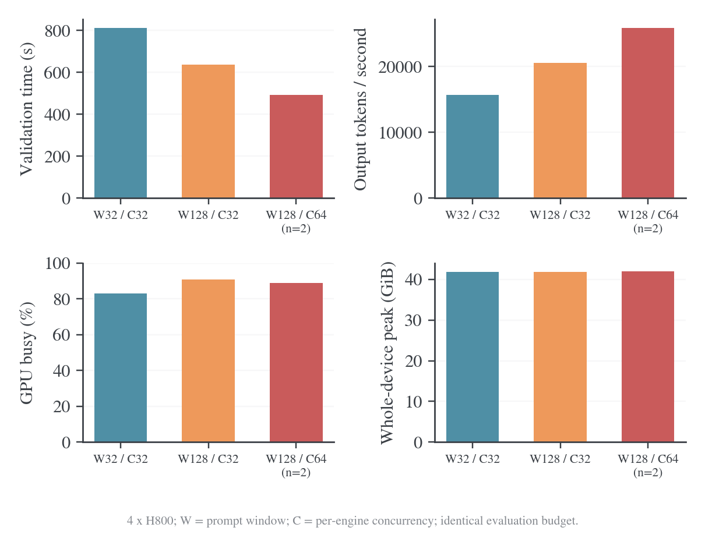

# 四卡验证窗口与并发优化

## 实验目标与固定条件

2026-10-22 使用本机 GPU0–3 的四张 H800 80GB，GPU4–7 保持其他任务运行。源码基点为 `fb169fa7f`。实验先验收当前逐更新指标下的 shared_sync 短训练，再比较冻结 checkpoint 的验证请求供给；训练 prompt/mini64、更新算法、学习率和生成长度不作为验证调优变量。

最新云端 E8–E11 使用 epochs16，A100/A800 八卡整步约 118–119 秒，actor 约 74 秒、rollout 批次约 32 秒；前 100 步的两次验证占训练加验证时间约 35%–36%。这些数据用于决定优化优先级，不能替代本机同条件对照。原始云端参照见E10运行。[^wandb-e10]历史 eager/Graph 和验证窗口16/32的结果见[前一轮测量](2026-10-21-本机训练与验证优化.md)。

| 项目 | 固定值 |
| --- | --- |
| Student / teacher | DeepSeek-R1-Distill-Qwen-1.5B / JustRL-DeepSeek-1.5B |
| 资源 | shared_sync，四个 TP1 student 副本，独立 teacher pool0 |
| 环境 | Torch2.11.0+cu128、vLLM0.25.1+cu129、Transformers5.12.1、Ray2.56.1、TransferQueue0.1.11、FlashAttention2.8.3 |
| Rollout | 编译与 CUDA Graph；推理 token 预算8192；GPU memory utilization0.5 |
| 验证预算 | MATH-500 112题、AMC23 8题、AIME25 8题；每题16次，共2048条回答 |
| 验证采样 | temperature0.7、top-p0.9、top-k关闭、response上限31744 |
| 生成概率 | 验证不返回 log-prob；训练保留实际行为概率 |
| 观测 | 离线 W&B、每秒四卡 NVML、约每两秒四引擎 Prometheus |

子集使用 NumPy `default_rng(42)`，按 MATH-500、AMC23、AIME25 顺序无放回选择112/8/8行，再按源行号排序。选中行号和软件版本保存在[数据目录](../../data/rollout-tuning-20261022)。每个条件重新初始化同一个 student checkpoint；不加载短训后的权重。

## 计时与验收

验证速度以完整 `_validate()` 墙钟和四个引擎累计的实际输出 token 数计算。该 timer 包含窗口等待、生成、判分、CPU解码与结果聚合，不包含模型和Ray初始化。独立作业墙钟另列。自然停止的回答长度会随调度变化，须同时比较完成时间和 token/s。

完整性要求2048条最终回答、128个题目UID组、每组恰好16条；四个引擎成功计数之和必须也是2048，累计 generation token 与 request generation token sum 一致。NVML GPU busy 表示采样窗口内设备工作的时间比例；actor MFU只描述训练阶段，验证提速不等于actor MFU提高。

实验矩阵依次为窗口32/并发32、窗口128/并发32、窗口128/并发64。提高窗口增加等待请求的供给；提高并发改变每个引擎同时运行的序列上限。两者独立比较，保持词表概率、评测题目和回答次数不变。

## 当前代码的四卡训练基线

E10短训使用epochs16、D0，关闭验证与保存，完成4个外层step、64次实际optimizer更新。逐更新坐标连续且attempts等于实际更新数，非有限概率比例为0；进程退出码为0。首步145.16秒包含预热，第2～4步作为主窗口。

| 第2～4步平均指标 | 实测值 |
| --- | ---: |
| 完整训练step | 98.55秒 |
| rollout batch跨度 | 21.25秒 |
| rollout整体流程 | 24.89秒 |
| teacher forward / transfer | 1.29 / 0.94秒 |
| old-log-prob | 2.75秒 |
| actor阶段，16次更新 | 67.06秒 |
| actor阶段平均每次更新 | 4.19秒 |
| actor MFU | 30.43% |
| 新response token/训练秒 | 3895.48 |
| FSDP累计allocated高水位最大值 | 19.85GiB |
| actor reserved高水位 | 20.78GiB |

MFU使用H800的989TFLOP/s查表分母，与A100/A800的312TFLOP/s不同，不能直接用百分数高低比较两台机器的实际速度。Rollout跨度与整体流程重叠，不能相加。第4步生成后收尾较长，完整step高于第2、3步；保留全部稳态步骤，不仅报告最快点。

离线W&B为`9jua8ru3`，含启动和清理的作业墙钟708.52秒。[原始配置、history、NVML及退出状态](../../data/rollout-tuning-20261022/train-baseline)可复核。训练结束后有W&B退出回调的ConnectionResetError，退出码仍为0，64次更新记录完整；该清理问题未在此轮修改。

第一次启动因Ray临时目录过长而在GPU计算前失败，日志保留在`outputs/rollout-tuning-20261022/rollout-tuning-train-graph-20261022-baseline/`；成功重跑将临时目录缩短为`/tmp/rt22-t-b2`。失败启动不纳入上述性能统计。

## 验证窗口与并发的结果

所有运行完整完成2048条回答、128个题目组、每组16条，四个引擎成功计数与导出结果一致；generation token计数等于request generation token sum，评分失败数为0。前三组筛选后，按完整验证墙钟选择窗口128/并发64，再独立重跑一次确认。四组退出码均为0。

| 窗口 / 单引擎并发 | 验证秒数 | 实际输出token | 输出token/s | GPU busy均值 | 整卡显存峰值GiB | KV占用峰值 | 抢占次数 |
| --- | ---: | ---: | ---: | ---: | ---: | ---: | ---: |
| 32 / 32 | 812.82 | 12,767,515 | 15,708 | 82.99% | 41.83 | 35.11% | 0 |
| 128 / 32 | 637.85 | 13,101,320 | 20,540 | 90.81% | 41.85 | 39.25% | 0 |
| 128 / 64 | 507.30 | 12,974,433 | 25,575 | 90.76% | 41.95 | 60.19% | 0 |
| 128 / 64，确认 | 476.09 | 12,504,799 | 26,266 | 87.10% | 41.92 | 49.50% | 0 |

窗口128/并发64的两次运行平均验证耗时为 **491.70秒**，相对窗口32/并发32的812.82秒降低 **39.51%**。用两次输出token总量除以总时间，吞吐为 **25,910 token/s**，相对基线提高 **64.95%**。独立作业含启动/清理的平均墙钟为750.90秒，基线为1074.45秒，整体加速1.43倍。正式训练中的周期验证不重复支付这部分模型与Ray初始化成本。



图中胜出配置的验证耗时和busy取两次运行均值；TPS用总token/总时间；显存取两次观察最大值。单次自然停止生成的输出量不同，没有把生成长度减少直接计作执行加速。原始每次结果见上表。

### 请求供给与最后的长尾

基线四个窗口的“90%回答完成到全部完成”分别为76.7、93.5、79.1、72.1秒。窗口128只保留一个窗口边界，减少反复排空；但同一窗口中最长回答仍需完成。窗口128/并发32的尾部为146.5秒，并发64首次为164.2秒。不能直接相加这些尾部当成可完全消除的时间，因为窗口大小和请求集合不同。

| 配置 | 采样时四卡活跃请求均值 | 全部等待队列为空的采样比例 | 活跃请求总数小于16的比例 | 至少一个副本空闲的比例 |
| --- | ---: | ---: | ---: | ---: |
| 32 / 32 | 67.65 | 63.61% | 24.85% | 26.92% |
| 128 / 32 | 101.01 | 24.06% | 12.78% | 12.78% |
| 128 / 64 | 176.23 | 40.67% | 12.44% | 12.44% |
| 128 / 64，确认 | 171.31 | 41.21% | 14.07% | 17.09% |

这些比例来自约每两秒的完整四引擎采样，不是精确连续时间积分。引擎最终的抢占计数为0，较大窗口确实增加了等待请求，但没有将全部等待请求变成活跃KV。KV pool仍按memory utilization0.5预留，实际KV使用增加不等于整卡预留显存按同样比例增加。

窗口128/并发32与窗口128/并发64首次的GPU busy都约91%，TPS仍从20540提高到25575。增加活跃序列改善每次执行承载的工作量，busy本身不能区分这项效率收益。这里没有定义或报告推理MFU；actor MFU仍只引用前述短训基线30.43%，不将验证busy改名为MFU。

### 输出与质量边界

固定初始student checkpoint、题目、采样参数、回答次数和长度上限；未使用训练后checkpoint。执行调度和batch形状变化会改变随机生成，回答不逐token相同。下表按相同输入题目配对，以题目为单位进行10000次bootstrap，仅描述该子集的随机差异，不是非劣性检验，也不证明模型质量提升。

| 配置 | 子集平均正确率 | 相对基线差值，百分点 | 题目配对bootstrap 95%区间，百分点 |
| --- | ---: | ---: | --- |
| 128 / 32 | 79.10% | -1.37 | [-2.83, +0.10] |
| 128 / 64 | 79.59% | -0.88 | [-2.05, +0.24] |
| 128 / 64，确认 | 80.62% | +0.15 | [-1.22, +1.51] |

基线子集正确率80.47%。完整570题、训练后checkpoint和目标A100/A800八卡尚需独立复测；不能把这里的H800四卡倍数直接承诺给目标八卡。模型更大、上下文更长或显存更小时也需重新测量。

## 默认参数与使用

数学入口默认改为`VAL_BATCH_SIZE=128`、`ROLLOUT_MAX_NUM_SEQS=64`，Graph capture sizes自动覆盖64；显存比例0.5和推理token预算8192保持原配置。训练batch、mini-batch、epochs、loss和评测频率由各自配方控制；E7–E12仍使用epochs16、200步、50步评估、100步保存、无初始验证。Coding和IF入口保留窗口32/并发32，因为这轮没有测试其判分压力和长尾。

```bash
# 原数学/E系列入口自动使用新的执行默认值。
bash examples/mirroropd/run_math_opd_ablation_fsdp2.sh E10

# 同一配方回退到本轮基线。
VAL_BATCH_SIZE=32 ROLLOUT_MAX_NUM_SEQS=32 \
  bash examples/mirroropd/run_math_opd_ablation_fsdp2.sh E10

# 仅增加验证供给窗口，保留并发32。
VAL_BATCH_SIZE=128 ROLLOUT_MAX_NUM_SEQS=32 \
  bash examples/mirroropd/run_math_opd_ablation_fsdp2.sh E10
```

## 证据与复现

[数据目录](../../data/rollout-tuning-20261022)包含题目选择行号、软件版本、训练基线、验证运行的launch/exit/history/config、压缩NVML和Prometheus采样、配置diff、质量配对结果及绘图输入。完整生成文本和终端日志保留在本机`outputs/rollout-tuning-20261022/`，不放入源码包。运行脚本限定GPU0–3，并在启动前检查显存；结束只清理自己创建且PID身份匹配的子进程，没有执行全局`ray stop`或操作GPU4–7。

复算脚本保存在数据目录的`scripts/`。`python examples/mirroropd/docs/data/rollout-tuning-20261022/scripts/verify_evidence.py`无需GPU或原始生成文本，可独立核对已归档的计数、评分、token总量、TPS和退出状态。实验启动脚本保留本机路径，应按目标机器调整模型、数据和Python位置。原始运行目录布局下使用`analyze_validation.py`导出统计，`check_configs.py`核对配置差异、完整回答数和评分失败数，`quality_check.py`做题目配对。绘图脚本读取`analysis.json`，生成PNG/PDF并执行图形审计。离线W&B历史通过原生SDK读取，实验没有上传云端。

80项启动配置CPU测试通过；四个验证run的配置差异、UID/session计数、评分失败数、引擎token计数和TPS均通过独立复算；Bash语法、Markdown链接和图形审计通过。已有W&B进程退出回调连接重置仍可能打印在正常结束之后，本轮四个验证run的退出码、回答完整性和历史记录均通过检查，未改动该清理路径。

### 参考文献

[^wandb-e10]: W&B，MirrorOPD-verl项目，E10，2026-10-22同步快照。[运行7eskp2oo](https://forge.coreweave.com/wandb/wncfht/MirrorOPD-verl/runs/7eskp2oo)。
