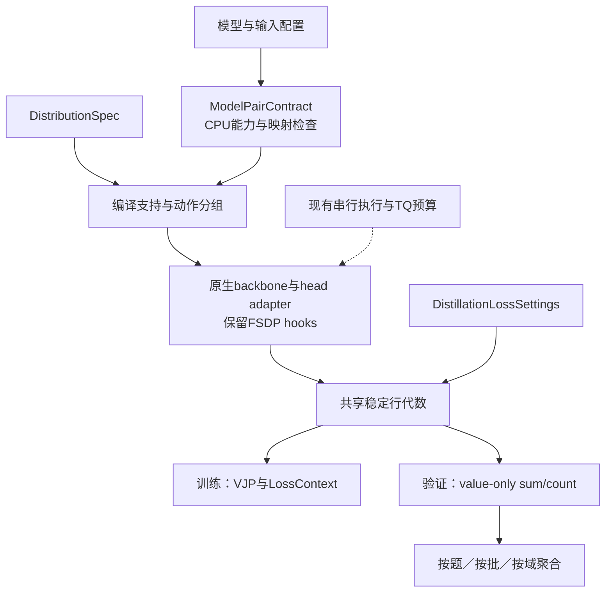

# 蒸馏与评估的动作空间和模型兼容

训练与评估现在共用`DistributionSpec`和`ModelPairContract`，由既有 FSDP head 路径执行。V1 训练循环、RolloutService、SharedTeacherScorer、HiddenBatchIO 和 Parquet 产物层保持原有职责；新增模型或输出支持不再另写训练器。

科学设置仍由[四域协议](../../experiments/teacher-transfer/protocols/online-four-domain.md)维护；已完成的正式结果见[JustRL 数学蒸馏与跨域 RKL](../../experiments/teacher-transfer/fixed-state-results.md#r1-15b-student)。本页先保留设计历史与数值依据，再说明当前接口和验收。

当前实现包括：显式条件支持及排除质量、raw/coarse 具名读出、Llama 线性 head、等价 token ID 一一映射、启动前模型检查、共享 checkpoint 身份、生成与判分身份分离、公共 TQ 轨迹适配和按真实 forward dtype 规划的窗口。不同分词边界、bias／softcap／量化 head 仍需独立 adapter。实际接口见[评估包合同](../../../../../verl/trainer/evaluation/README.md#分布模型与输入适配)。

## 1. 历史形成的边界

| 提交                   | 当时解决的问题                                      | 现在应保留的约束                                                          |
| ---------------------- | --------------------------------------------------- | ------------------------------------------------------------------------- |
| `06820b3a`             | 引入 shared FSDP2 full-vocab RKL 与多种计算 backend | 保留 root 和 head 的 FSDP hooks；teacher hidden 按有效预测位置传递        |
| `4945a967`             | Qwen3 tied head、较宽 teacher 支持与位置诊断        | token→ID 一致与 head 行数相等是两回事；teacher 额外支持不能丢失归一化质量 |
| `91dd21c6`             | 分开 prediction 坐标与 response target 坐标         | 不能用 micro-batch 序号代替样本身份，也不能再实现一套 shift               |
| `1e6e3ea9`、`3be00adb` | 拆出 LossContext 和 shared teacher 运输             | 数学核不负责 DP 分母、Ray 调度或 TQ 生命周期                              |
| `48915607`、`2bbbb2fd` | 统一 MDPO/BPO 并修复近目标小信号                    | Full-KL 是 MDPO 的端点；保留分离增量、稳定归约和独立 FP64 参考            |
| `7ebb1cda`、`64e2b561` | EOS 动作合并及 FP16 缩放梯度                        | 合并目标与 raw 词表诊断有意分开；不能用改名消除差异                       |
| `cb890d2e`             | MDPO 也能在合并停止动作上构造目标                   | 先聚合 anchor/teacher，再构造目标；次序会改变数学对象                     |
| `ff5e73e6`             | 统一 single 模型的 top-p 边界与有效 token 支持      | sampler 规则、tokenizer 支持 mask 与返回 log-prob 口径是完整合同          |
| `b6298e99`             | 加入独立只读 RKL readout                            | 复用投影与稳定行公式，避免构造无用 VJP；旧诊断仍是 raw 支持               |

这些提交可用`git show <commit> -- <path>`复查。[当前 full-vocab 合同](../architecture/full-vocab.md)、[数值模块](../../../../../verl/trainer/distillation/numerics.py)、[目标配置](../../../../../verl/workers/config/distillation_spec.py)是对应的源码入口。EOS 融合已接入`precompute_fused`；[早期精度／性能比较](../performance/full-vocab/2026-11-01-EOS精度与速度权衡.md)与[实现及 actor 验收](../performance/full-vocab/2026-11-01-EOS融合实现与训练验收.md)分别记录证据，head 倍率不直接当作整轮加速。

旧研究后端能处理某些模型，不代表原生路径已经支持它们。例如研究侧通过`get_output_embeddings()`取得 head；原生[head adapter](../../../../../verl/models/transformers/full_vocab.py)和[FrozenTeacherHead](../../../../../verl/trainer/distillation/hidden.py)已按线性 head 合同支持 Qwen2／Qwen3／Qwen3-MoE／Llama。研究代码与原生路径的职责不能因“已经跑过 Llama”而混同。

## 2. 审查基线与实现方向

| 优先级 | 审查时的事实                                                                                | 改进方向                                                                                                                                                        |
| ------ | ------------------------------------------------------------------------------------------- | --------------------------------------------------------------------------------------------------------------------------------------------------------------- |
| P0     | bootstrap 原先只安装共同 sampler，未调用训练端的`policy_engine_config`注入 TokenizerSupport | 两个生成入口共用配置解析，并记录实际支持、EOS、输入 tokenizer 与 sampler 合同；银行按其实际生成条件标识                                                         |
| P1     | `score_rkl_rows`固定 raw 支持；训练 EOS 路径优化 coarse 目标，但仍返回 raw 诊断             | 显式声明每个 measure 的概率空间；保留 raw 诊断，再增加与训练空间相同的 RKL                                                                                      |
| P2     | 训练和 readout 都拒绝 student 输出行数大于 teacher                                          | 实现明确的 common-conditioned 空间，并同时记录双方排除质量                                                                                                      |
| P4     | 能否加载 backbone、取得 head 和生成 token 的检查分散                                        | 启动 GPU 前形成逐角色能力报告；Llama 不靠扩大一个白名单接入                                                                                                     |
| P1     | `get_vocab()`相同尚不能证明编码／解码／模板完全相同                                         | fingerprint tokenizer 实现、特殊 token 属性和 renderer；验证真实 prefix token                                                                                   |
| P1     | evaluation 另有`model_identity`，与 rollout 的 checkpoint 索引识别逻辑重复                  | 复用[checkpoint_files/checkpoint_identity](../../../../../verl/experimental/rollout_policy/identity.py)，再分离输入与权重身份；checkpoint 身份只接受当前 schema |
| P1     | `answer_channel`进入 GenerationProtocol 身份，换判分方式也改变生成 ID                       | 分开 generation 合同与 verifier 合同；同一回答允许多次独立判分                                                                                                  |
| P1     | bootstrap 从 student 配置 deepcopy 后换 teacher 路径                                        | 只共享明确的输入协议与资源字段，teacher 的 RoPE／结构 override 独立解析                                                                                         |
| P2     | 新 scorer 仍引用旧 FixedRKLReadout 的 TQ 转换函数                                           | 提取小型 native trajectory adapter；SourceHistoryReadout 与套件显式共用适配器，移除旧回调入口                                                                   |
| P2     | 协调器直接拿 trainer 私有方法和 worker handles，当前预算也硬编码 BF16 宽度                  | 用一个薄 native execution adapter 承接现有 worker；预算从实际 payload dtype／shape 推导                                                                         |
| P2     | 多个来源的指标已有，但缺少完整的 distribution-id                                            | 支持集、动作分组、数值口径写入 measure 身份，禁止混用基线或同列排序                                                                                             |

这里的 P0/P1/P2 是实现顺序，不是科研模型的分级。现有同步串行方案已有实机依据，应继续保留。没有证据要求改成新 GPU 池、后台评估集群或通用 DAG。

## 3. 三种词表不能混用

1. **Head 输出行**：线性投影实际输出的数值坐标，包含可能没有 tokenizer 映射的填充行。
2. **Tokenizer 有效 ID**：真实词表与 added token 映射到的 ID 集合，不一定覆盖全部 head 行。
3. **生成动作支持**：还经过有效 ID mask、禁用项、温度、top-k/top-p 和停止规则处理。

本地已锁定快照的配置与`tokenizer.json`给出以下数量；逐模型 revision 和文件 hash 见[支持集合证据](../architecture/evaluation/data/action-space-review-20261101/model-support.json)：

| 模型                             | Head 行数 | 有效 ID 数 | 无映射行数 |
| -------------------------------- | --------: | ---------: | ---------: |
| DeepSeek-R1-Distill-Qwen-1.5B    |    151936 |     151665 |        271 |
| DeepSeek-R1-Distill-Qwen-7B／14B |    152064 |     151665 |        399 |
| Qwen3-1.7B                       |    151936 |     151669 |        267 |
| Qwen3-1.7B-Base                  |    151936 |     151665 |        271 |

因此，已经批准的 R1 跨尺寸`C151936`是**共同输出行条件分布**，包含 271 个无 tokenizer 映射的共同输出行。改成 151665 个有效 ID 是另一项实验条件，不能当作等价重构。生成时屏蔽无效 ID，与损失仍衡量 raw head 分布可以同时存在，但两种支持必须分别记录。

### 原生、条件化与额外质量

令学生和教师分布分别为 $P,Q$，共同集合为 $C$，$\alpha=P(C)$、$\beta=Q(C)$，条件分布为 $P_C=P/\alpha$、$Q_C=Q/\beta$。条件 RKL 为

$$
K_C=D_{\mathrm{KL}}(P_C\Vert Q_C).
$$

当 student 只支持 $C$、teacher 还有额外行时，$\alpha=1$。把 $Q_i=\beta Q_C(i)$ 代入求和得

$$
D_{\mathrm{KL}}(P\Vert Q)=K_C-\log\beta.
$$

当前 native kernel 保留这个修正，所以即使共同集合内完全匹配，原生 RKL 仍可能有 $-\log\beta$ 的下限。它不是单纯的容量或优化问题。反过来，若 student 在 teacher 支持外有正质量，而 teacher 对应概率为零，原生 RKL 为无穷大。把两侧截成`min(Vs,Vt)`得到的是新条件分布；把 teacher 缺失项补成零 logit 更是赋予了新概率，均不能当作原生 KL 的实现修复。

必须报告 $1-\alpha$ 和 $1-\beta$。仅优化 $K_C$ 时，被排除 student logits 的直接梯度为零；backbone 更新仍可能间接改变这些 logits。因此，条件 RKL 接近零不保证被排除质量也接近零。

将所有排除动作合成 OTHER 也不是同一指标。两侧该桶质量都为正时，合并后的 KL 为

$$
K_{\mathrm{bucket}}=\alpha K_C+
D_{\mathrm{KL}}\bigl(\operatorname{Bern}(\alpha)\Vert\operatorname{Bern}(\beta)\bigr).
$$

Teacher 桶质量为零、student 桶质量为正时仍为无穷大；不能靠“增加 OTHER”自动解决。

### EOS 合并

对停止类 $E$，先把类内概率求和，保留其他动作。由 $P_i=P(E)P(i\mid E)$ 展开可得

$$
K_{\mathrm{raw}}=K_{\mathrm{coarse}}+
P(E)D_{\mathrm{KL}}\bigl(P(\cdot\mid E)\Vert Q(\cdot\mid E)\bigr).
$$

所以 coarse 目标为零而 raw 诊断非零完全可能。应同时标明两个 RKL 的定义，不强制它们数值相等。EOS 组还必须对应所声明生成环境中的真实停止动作，不能把任意低概率 token 并入 EOS。

条件化与分组只有在保留集合由完整动作类组成时才可交换。首版拒绝只保留停止组部分成员的配置。MDPO 则必须先在声明的动作空间聚合 anchor 和 teacher，再构造 power-mean 目标；“先混合再合并”通常得到另一个目标。

## 4. CPU 数值核对

[可复现脚本](../../../research/checks/objectives/verify_distribution_spaces.py)用独立概率公式和当前生产入口作 CPU/FP64 检查，没有加载模型或使用 GPU。修复前的结果与源码身份保留在[审查证据](../architecture/evaluation/data/action-space-review-20261101/oracle.json)和[来源清单](../architecture/evaluation/data/action-space-review-20261101/provenance.json)；当前结果见[实现后验算](../architecture/evaluation/data/compatibility-implementation-20261101/oracle.json)。

| 例子                              | 实测结果                                                                            | 含义                               |
| --------------------------------- | ----------------------------------------------------------------------------------- | ---------------------------------- |
| $P=(0.6,0.4),Q=(0.3,0.2,0.5)$     | 条件 RKL=0；native RKL=0.693147                                                     | teacher 额外质量的修正不能丢       |
| Student 有 0.4 质量在共同集合外   | 条件参考 RKL=0.620289；排除 logit 梯度=0；当前训练与 readout 均明确拒绝 native 调用 | 必须显式选择条件目标并报告排除质量 |
| 两个 EOS 分配互换、总停止质量不变 | coarse 训练值=0；raw 训练诊断与 readout 均=0.878890                                 | 现状是历史上的有意分工             |
| Geometric 目标和 EOS 分组换序     | 分组后混合得 $(0.9,0.1)$；反序得 $(0.849779,0.150221)$                              | 操作次序必须由语义层统一           |
| 两个动作的 ID 换序                | 错按行对齐 RKL=0.081093；按映射对齐=0                                               | 张量 shape 相同不等于动作相同      |
| 仅改 answer channel               | sampling 参数与 generation protocol-id 均相同；verifier 另有身份                    | 生成与判分身份已拆分               |

这些例子验证接口应维护的数学关系，不估计真实模型发生问题的频率。

生成修补另有[CPU 与四卡验收记录](../architecture/evaluation/data/action-space-review-20261101/validation.json)。JustRL→R1-1.5B 使用 GPU2／3／4／5、batch4／reuse1／1outer、response cap128，完成一次真实更新及更新前后的全部读出。四 rank 的参数／Adam 只读审计通过；initial 与 current 的实际 prefix token 和 engine contract 相同，8 条生成回答的 token 均在合法支持内。该小样本验收检查执行合同，不用于模型学习效果比较。正式 50outer 使用新银行重新初始化。

## 5. 当前结构与扩展边界

### 5.1 模型配对与分布合同

[ModelPairContract](../../../../../verl/trainer/distillation/compatibility.py)在 GPU 分配前检查实际 head 清单与 shape、逐角色结构、tokenizer 分词／解码／特殊 token 语义、上下文和停止动作；权重内容身份复用 rollout 的`checkpoint_identity`。Llama 动态日期模板要求显式固定日期，训练与所有评估协议使用同一个值。

[DistributionSpec](../../../../../verl/trainer/distillation/distribution.py)实现 native／common-conditioned。条件支持通过`common_vocab_size`或成对`student_ids`／`teacher_ids`声明，basis 为实际 head 行，不自动取 tokenizer 交集。停止组由现有`termination_token_ids`传入同一编译计划，评分温度仍固定为 1。连续同 ID 支持走 slice，ID 重排走索引向量，不构造 $V\times V$ 矩阵。

训练方法继续使用现有`DistillationLossSettings`和`resolve_distillation_spec`。评估请求显式选择 measure，不把方法名、动作空间、归一化与执行 backend 塞进同一个字符串。

统一的是概率语义和编译入口，不是强行让 readout 调用构造 dH/dW 的训练函数。只读分支继续避免 VJP；raw 诊断和训练空间诊断可共享投影。Identity/native 快速路径应保持已有数值、显存与吞吐。

### 5.2 结果合同

结果现明确区分`loss_sum`、`objective_rows`与具名`token_diagnostics`。当 objective_rows 可用时，其和必须对应同一个未缩放 loss_sum；eta 与 DP 全局分母仍只由现有 loss 层施加一次。旧`token_kl`／`token_objective`混用 raw/coarse 的接口，通过兼容适配器迁移，不重写历史图表。

验证可以选择：原生输出行 RKL、共同集合条件 RKL、与训练空间相同的 RKL。仍然只增加 RKL 口径，不因此引入 JS／TV／FKL 主指标。每条结果携带 distribution-id、模型版本、输入 bank 和数值 profile；report-id 再加入聚合规则。只有这些身份和固定轨迹均一致，才能计算相对下降或排序。

### 5.3 模型 adapter

Adapter 提供 backbone 输出、head 定位、tied 权重关系与投影规则。Qwen 和 Llama 已共用线性 head 能力记录。使用公共 HF 访问器能减少硬编码，但必须验证结构，不能仅看到`get_output_embeddings()`就宣称支持任意模型。

以下差异必须显式处理：head bias、logit scaling/softcap、量化权重、tied参数、模型额外forward参数、RoPE与位置buffer精度。新增Llama需要tiny配置的value/VJP对照、真实checkpoint head 读取、FSDP hooks 和实际更新验收。Bias 或 softcap 模型在实现其投影语义前保持不支持。

### 5.4 Tokenizer 支持分级

| 级别 | 范围                                            | 建议                                                         |
| ---- | ----------------------------------------------- | ------------------------------------------------------------ |
| A    | 同编码语义，head 宽度不同或有 padding 行        | 已实现；覆盖 R1 小 teacher→7B student                        |
| B    | 可证明等价的 token 集合／分词，只是 ID 一一置换 | 已实现显式输入／输出映射，校验实际 prefix 与梯度 scatter     |
| C    | 特殊 token 语义冲突，或只有部分输出动作可比     | 先定义共同输入与动作条件，逐 pair 验收；不能只裁 head        |
| D    | BPE／SentencePiece 等真正不同的分词边界         | 另立文本／序列层协议；不能直接按 token 字符串交集声称严格 KL |

相同 decoded 文本也不自动提供相同的下一步分类事件。跨分词边界时，teacher 一个 token 可能对应 student 多个 token；不同路径还可能生成相同文本。必须先定义概率事件与对齐方法，首版不承诺自动跨 tokenizer full-vocab KL。

## 6. 执行与缓存的改进

- **生成合同**：bootstrap 与 current 共用同一引擎配置入口；记录实际 support processor、sampler、输入 tokenizer、EOS 与覆盖项。P0 修补已加入`generation_contract.py`和 v3 样本身份；旧未声明 mask 的银行会被拒绝作为新主条件。
- **身份拆分**：generation-id 由权重／输入／sampling／sample seed 形成；verifier-id 另含答案通道、parser 和 checker 版本。改判分规则能复用原 token。变更 schema 时显式迁移，旧产物不原地改写。
- **缓存范围**：继续只长期保存真实轨迹与结果。Teacher hidden 仅在训练 reuse 或一个评分窗口内复用；不新建全集 logit 缓存。
- **执行所有权**：RolloutService 管理驻留与权重版本，协调器管理完整边界，scorer 负责一次有界只读计算。用一个薄 adapter 替代协调器对 trainer 私有属性的散落依赖，不增加第二套模型池。
- **预算**：从实际 teacher hidden dtype／宽度估算 TQ bytes；区分 payload 预算、CPU 模型／Adam 常驻内存和 GPU 微批。保留整条轨迹边界与 padding 排除。
- **可观测性**：保留最终逐 update 账本，并补低频 inner 进度；分别记录生成、CPU 判分等待、teacher/actor 加载、RKL 投影／归约和恢复。仅在 profile 模式加细粒度同步。
- **性能验证**：先复用现有稳定 kernel 与流式运输。EOS 融合候选作为显式 backend 能力接入，只有通过 value/VJP、近零、混合精度与 FSDP 实机检查后才替换默认；不把一次 head 微基准当作整轮速度。

## 7. 迁移顺序与验收

| 阶段              | 范围                                                                  | 可观察验收                                                                    |
| ----------------- | --------------------------------------------------------------------- | ----------------------------------------------------------------------------- |
| P0 生成一致性     | 共用 policy_engine_config、有效协议身份、旧银行拒绝、真实 prefix 检查 | 两入口在同权重时合同一致；mask/EOS 改变必换条件；没有正式参数更新前修复       |
| P1 语义抽取       | DistributionSpec、当前 native 行为等价迁移、具名结果                  | 旧 native value/VJP不变；readout不构造VJP；旧指标保留原义                     |
| P2 共同支持       | 先实现已批准的 C151936 及双方排除质量                                 | R1-1.5B→R1-7B、JustRL-1.5B→R1-7B 真实训练与 readout；初始／最终同口径         |
| P3 停止类         | 同一编译计划供训练与验证选择                                          | raw/coarse恒等式、组内ID交换、近目标小信号、操作次序、FP16缩放与BF16/FSDP更新 |
| P4 模型与 ID 映射 | Llama adapter，再扩展等价 ID 置换                                     | tied/untied、参数与buffer精度、输入／输出映射、hooks、梯度、导出回读          |
| P5 整理执行层     | 显式评估组件、身份复用、薄 execution adapter、进度与 profile          | 旧路径回归、同边界一次执行、window/chunk/DP 变化不改变逻辑样本与指标          |

不在迁移过程中同时改变 LR、reuse、题池、rollout 刷新或训练分母。每个阶段先给 CPU/FP64 参考，再做所需的最小 GPU 检查，最后回到同一份已锁定配置。当前正式任务先统一生成协议；其既有 raw-head 回答保留为独立旧条件，不混作新协议的 initial bank。

## 8. 方案选择

| 选择                                         | 优点                                           | 代价与结论                                                   |
| -------------------------------------------- | ---------------------------------------------- | ------------------------------------------------------------ |
| 在各调用点继续加 slice、EOS 参数和模型白名单 | 改动局部、短期快                               | 语义分叉继续增加；不推荐作为长期结构                         |
| 共享纯语义编译，复用现有执行层               | 数学定义与性能实现分开，可保留快路径和历史结果 | 需要一次显式结果／身份迁移；推荐                             |
| 重建通用蒸馏／评估框架和统一 DAG             | 能表达更多未来流程                             | 重复已有 V1、RolloutService 和 TQ 能力，验收面大；当前不采用 |

已确定的科学条件继续保持：R1 跨尺寸优先 C151936、训练 token-mean、评估题内 token 均值后按题均值、teacher hidden 临时复用、最终 model-only。真正不同分词、OTHER 桶、任意 softcap/量化 head、跨节点恢复等是独立扩展，需要明确的定义和实测后再纳入。

## 9. 已实现接口与小规模验收

- `FullVocabConfig.distribution`选择 native 或显式共同支持；配置为 C151936 时保留已批准的共同输出行口径。
- `input_id_mapping=token_semantics`只接受经核验的同一分词语义。Teacher 前向独立映射输入，生成请求同时映射输入／停止 ID 并将输出映回 student 坐标；保存的 student 轨迹不重编码。
- 生产 precompute 路径从本次投影复用条件 RKL 和双方排除质量。排除质量使用内／外分区的稳定比例，避免小质量被`1-sum(p)`舍入为 0。非连续共同支持在融合行核前显式整理。
- `score.objective_space`控制是否采用训练配置的停止动作分组，仍计算 student／teacher RKL。评分表 schema2 附 measure-id；数值 profile 与分布定义一同绑定，聚合拒绝不同口径混用。
- 新权重身份复用既有 checkpoint 清单并区分版本；`answer_channel`不再进入生成 ID，verifier 协议单独保存。旧产物按已记录版本读取，不修改旧 manifest。
- `native.py`承接共同轨迹/TQ 转换和 history 抽样；`NativeEvaluationExecution`集中私有 Trainer 调用。Hidden 字节预算从实际 forward 精度推导，已有串行驻留与故障处理继续复用。

CPU 检查包含独立概率／梯度参考、排除梯度、极小排除质量、EOS 分解、非同 ID 输入与输出、日期固定和旧原生路径回归。CUDA 检查覆盖 BF16／FP16／FP32、AMP、非连续和重新编号的支持、EOS 分组；FSDP 检查覆盖 Qwen／Llama、tied／untied、空局部 mask、实际更新和 checkpoint 回读。真实 checkpoint 全链验收只用 4 题／1 更新／64token，不构成新增科研预算；状态与证据由[实施页](../../archive/engineering/evaluation/2026-11-01-分阶段代码走读与验收.md#10-共同支持与模型兼容实现)维护。
