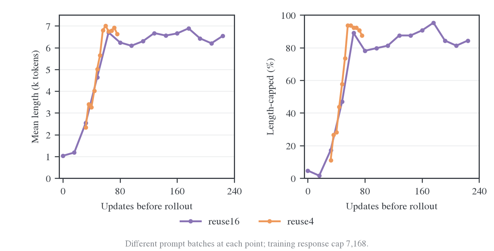
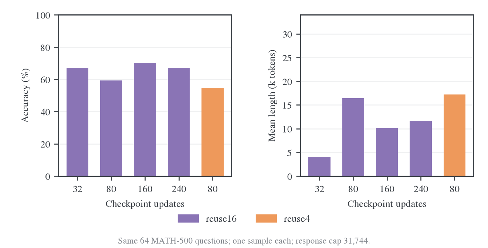
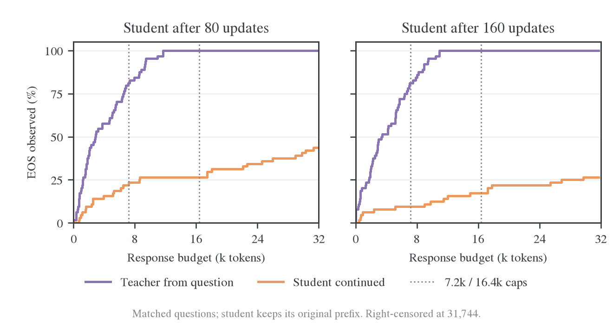
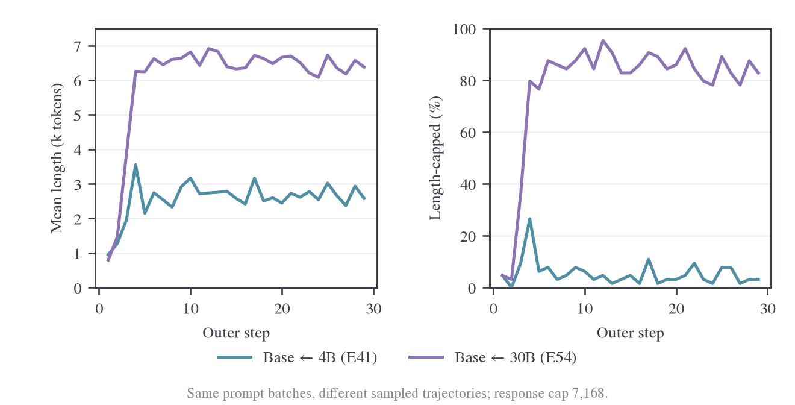
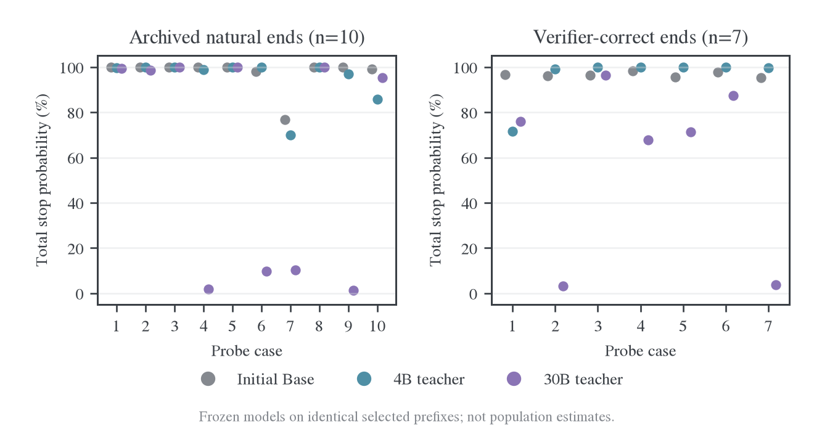

# E54 长度膨胀诊断：证据、机制与修复路线

更新日期：2026-10-29。研究对象为 **Qwen3-1.7B-Base ← Qwen3-30B-A3B-Instruct-2507** 的 full-vocab 蒸馏。本文区分原始失效运行、正确 RoPE 下的训练对照和冻结推理；不把不同硬件、checkpoint 或输入状态的结果混成一条学习曲线。

阅读入口：[已完成的 cap 对照](#2-训练-cap-对照覆盖增加但未修复完成质量)、[状态与梯度机制](#5-状态与条件目标最值得继续检验的机制)、[修复路线](#7-修复路线长程验证与状态来源对照)、[支撑证据](#8-证据与复算索引)。

## 1. 结论与证据边界

长度膨胀是实际的完成质量问题，但并非模型普遍失去了停止能力。若干被判对回答的固定结束前缀仍有接近 1 的停止概率；在另一些反复前缀上，teacher 自己也强烈倾向继续核查。十组 MDPO 短程实验表明，约束 learner 相对冻结 anchor 的更新并调整目标形状，可以缓解长尾；仍有全部参数都无法结束的题目，状态与条件目标的机制证据继续成立。

训练 cap 对照已经完成。16,384 在未参与训练的 DAPO 子集上有改善迹象，MATH 子集未同步改善，长 cap 训练本身也仍大量触顶。扩大 cap 补到了少量较晚的 EOS 位置，却没有补出大量被判对的完整轨迹。它可以作为后续统一长度上限的候选，不能作为已验证修复。

| 判断                           | 已有证据                                                                            | 仍不能推出的结论                                        |
| ------------------------------ | ----------------------------------------------------------------------------------- | ------------------------------------------------------- |
| EOS 身份与停止判定已修正       | 两种停止 ID 均生效，实际 loss 使用终止等价类，原始 IDs 记录与 finish reason 对应    | 每个状态都应有高停止概率                                |
| 旧 teacher RoPE 舍入是实际缺陷 | 只恢复原始频率，选定生产评分位置即与 HF 基本一致                                    | 它是长度膨胀的唯一原因；修复后仍复现膨胀                |
| 7k 对 teacher 的正常长尾偏紧   | 原生 teacher 的 320 条训练题输出中，67 条超过 7,168，样本均在 16,384 内结束         | Student 只要获得相同长度就会走到相同结束状态            |
| 16k 训练未解决不收束           | 四卡、共同 checkpoint/Adam/数据状态的配对训练与同题评测均已完成                     | 16k 永远无效，或小样本 DAPO 改善已经可推广              |
| 更久训练有部分恢复             | 八卡主线第 5→10 步的固定题目长度和触顶率改善                                        | 后面必然恢复；第 10→15 步没有持续改善的证据             |
| 降低 reuse 不足以解决          | 相同累计 80 次更新下，reuse4 没有观察到改善                                         | reuse、归一化或学习率完全无关                           |
| 状态来源仍待因果验证           | 正确答案后的某些 student 前缀使 teacher 也偏向继续；正常 teacher 自生成轨迹则能结束 | 已经证明冻结 rollout 或 trajectory mixture 可以修复 E54 |

MDPO 的完整参数对照见[独立报告](2026-10-29-MDPO参数对照与长度恢复.md)。共同 η=0.1 是后续长程的实验选择，既不是所有 κ 的已证最优点，也不是完整修复结论。

所有小样本正确率均来自项目 verifier，不保证推导正确。若回答已经出现正确答案却继续到截断，也可能被判对，因此同时报告“判对且正常停止”。本文的机制病例不是总体发生率估计。

### 实验条件与可比范围

共同算法为 batch64、每题一个 response、学习率 1e-6、teacher 冻结、合并停止类 `[151643,151645]`。除明确标注的模板反事实外，已完成训练均保留原 Base 空思考段前缀。训练采样为温度 1、top-p 1；独立评测的温度按题集注明。

| 证据组                      | 实际条件                                                                        | 用途                                         |
| --------------------------- | ------------------------------------------------------------------------------- | -------------------------------------------- |
| 原 E54 失效运行             | 旧 RoPE 加载，八卡，reuse16；30 outer／480 更新，完整验证到 20                  | 描述原始症状；不能代替修复后的因果对照       |
| 正确 RoPE 主线与 reuse 对照 | 八卡；主线到 15 outer／240 更新，reuse4 分支到累计 80 更新                      | 检验短期恢复与重复更新；保留固定输入评分证据 |
| 训练 cap 对照               | 四卡，共同 2 outer 预热；两臂恢复同一 checkpoint 后各更新 48 次，最终均为 80 次 | 直接比较 7,168／16,384 的训练 cap            |
| Teacher 长度与冻结续写      | 320 道随机训练题及 128 道匹配题；108 条 student 截断轨迹                        | 区分正常长度覆盖和既有轨迹的可恢复性         |
| 固定前缀评分                | 选定原始 IDs 或明确标注的文本重编码前缀                                         | 区分状态、模板和局部梯度；不估计总体频率     |

各组的原始配置、输入、结果和执行源码见文末证据索引。四卡 cap 对照与八卡主线的 checkpoint 不互换；旧八卡第 2 步的验证成绩不是四卡共同预热 checkpoint 的成绩。

## 2. 训练 cap 对照：覆盖增加，但未修复完成质量

### 2.1 设计与完整性

四卡公共预热使用 7,168 cap 完成 2 outer。两臂均重启生成服务，恢复同一份四卡权重、Adam 和 dataloader 状态，再以 7,168／16,384 完成第 3–5 步。两臂最终都是 80 次实际 optimizer 更新；唯一独立改变为训练 response cap，相关 teacher response/context 长度随之派生。正确 RoPE、模板、batch、学习率、reuse16、seed42 及其他采样参数一致。

两臂的训练题目逐批一致。第一个分叉批次的 64 条短输出，没有一条与长臂输出的相应前缀逐 token 完全一致；相同 seed 不等于恢复相同的 vLLM 请求随机流。因此不能把逐条生成差异都确定归因于 cap，结论限定为单 seed 的参数对照。

两臂都完成训练和评测，未跳过 optimizer 更新。评测使用相同的 MATH-500 64 题与 DAPO 64 题，后者排除了这组训练用到的题目。每题一次、验证 cap 均为 31,744、并发 16；MATH 温度/top-p 为 0.7/0.9，DAPO 为 1/1。共 256 条回答全部完成判分。

### 2.2 同题评测

| 题集          | 训练 cap | 正确率 | 平均长度 | 中位长度 |  触顶 | 判对且正常停止 |
| ------------- | -------: | -----: | -------: | -------: | ----: | -------------: |
| MATH-500 子集 |    7,168 | 59.38% |   16.22k |   16.98k | 32/64 |          30/64 |
| MATH-500 子集 |   16,384 | 53.12% |   15.76k |    2.15k | 31/64 |          31/64 |
| DAPO 子集     |    7,168 | 12.50% |   25.46k |   31.74k | 47/64 |           7/64 |
| DAPO 子集     |   16,384 | 18.75% |   22.67k |   31.74k | 38/64 |           9/64 |

DAPO 的触顶回答少了 9 条、判对且正常结束多了 2 条，属于改善迹象；MATH 没有对应的正确率改善。MATH 的中位长度显著变小，但均长只下降约 0.47k、触顶只少 1 条，反映的是短答案与极长尾的混合分布，不能仅凭中位数宣布解决。

按相同题目配对 bootstrap，16k 减 7k 的 DAPO 正确率差为 +6.25 pp，95% 区间 [-3.13,+15.63]；触顶率差为 -14.06 pp，区间 [-28.13,0.00]。MATH 正确率差为 -6.25 pp，区间 [-17.19,+4.69]。这些区间都没有排除零差异，不包含训练 seed 方差，也不支持宣布某个 cap 稳定更优。

### 2.3 新覆盖的 EOS 位置不等于鼓励停止的监督

| 分叉后的训练统计，第 3–5 步    | 7,168 cap | 16,384 cap |
| ------------------------------ | --------: | ---------: |
| 轨迹数                         |       192 |        192 |
| Response token 总数            |     0.99M |      1.98M |
| 超过原 7,168 边界的 token 占比 |         0 |     50.27% |
| 在原边界之后自然结束的轨迹     |         0 |         10 |
| 上述轨迹中答案被判对           |         0 |          2 |
| 第 5 批平均长度                |     6.04k |     14.43k |
| 第 5 批在各自训练 cap 处触顶   |     47/64 |      54/64 |

两种训练触顶率对应不同上限，不能直接当作相同停止事件的效果量；统一上限的比较在上一表。长臂确实新增了结束位置，但其最后一批仍普遍不收束。

在这 10 个新增 EOS 末端的首次更新前，5 个位置的 teacher 停止概率仅为 5.1×10⁻¹⁰ 至 3.9×10⁻⁶；另 5 个位置上 teacher 概率超过 99.95%，student 也已超过 99.999%。10 个位置的局部停止 logit 导数均为正，即沿该自由 logit 方向优化会略微或明显抑制停止；其中高概率组的导数量级仅约 10⁻⁷–10⁻⁵，不能夸大成强制禁止 EOS。

所以，采样到 EOS 不会像硬标签交叉熵那样自动带来“提高 EOS 概率”的目标：full-vocab reverse-KL 跟随的是 teacher 分布。这项检查只覆盖新增的 10 个已采样 EOS 末端，不覆盖 7k 之后所有位置；未采样 EOS 的位置同样可能提供正向停止监督。Response token 占比也不等于参数梯度贡献比例。

这些结果降低了“只需补足长度上限就会修复”的可信度，但没有排除长 cap 的辅助价值。没有在本实验中执行状态来源或损失方向干预。

详细结果、逐点 EOS 概率和配对区间见[训练 cap 汇总](../../../../../../../wandb-logs/MirrorOPD-verl/analysis/e54-cap-controlled4-20261028/evaluation/summary.json)与[独立复算](../../../../../../../wandb-logs/MirrorOPD-verl/analysis/e54-cap-controlled4-20261028/evaluation/paired-audit.json)。

## 3. 训练时长与 reuse：部分恢复，不是充分修复

这是八卡正确 RoPE 主线的证据，不与上一节四卡 checkpoint 混用。

### 3.1 条件与预算

两个分支均使用正确 RoPE、原共同模板及原 full-vocab reverse-KL。续训从第 5 步恢复模型、Adam 状态和数据位置，保持 reuse16，完成到第 15 步。对照从同一主线第 2 步恢复，仅改 reuse4，完成到第 14 步；新增 48 次更新，与原主线第 2→5 步的更新数相同。

| Checkpoint        | 累计更新数 | 累计训练 prompt 数 | 新增部分                   |
| ----------------- | ---------: | -----------------: | -------------------------- |
| reuse16，第 2 步  |         32 |                128 | 共同起点                   |
| reuse16，第 5 步  |         80 |                320 | 第 2 步后 3 批 × 16 次更新 |
| reuse16，第 10 步 |        160 |                640 | 主线续训                   |
| reuse16，第 15 步 |        240 |                960 | 主线续训                   |
| reuse4，第 14 步  |         80 |                896 | 第 2 步后 12 批 × 4 次更新 |

恢复后的题目位置已核验：reuse16 的第 6 批与历史对应批次 64 题一致；reuse4 的第 3、4 批与主线对应题目逐批一致。但恢复服务并不保证逐请求 RNG 轨迹相同，首批 response IDs 并非逐条配对；两臂也只有一个训练 seed。因此这是匹配更新预算的初步对照，不是多 seed 的最终算法排名。

### 3.2 训练长度

reuse16 新增的第 6–15 批共 640 条回答，平均长度 6.46k，544 条触顶，即 85.0%。reuse4 最后一批平均 6.63k、56/64 触顶；同为累计 80 次更新的主线第 5 批是 6.70k、57/64。两者末批题目不同，只作为训练状态描述，性能比较使用下一节的固定题目。

说明：横轴为生成该批回答之前已完成的 optimizer 更新数，非 outer 编号。reuse4 从共同第 2 步、累计 32 次更新处分支。每点为不同批次的 64 道训练题；连线只连接实际记录，没有平滑，也不是固定验证集的学习曲线。

### 3.3 固定题目上的恢复程度

从 MATH-500 用固定 seed 20261028 无放回抽取 64 题，选题不读取模型结果；各 checkpoint 使用相同 prompt IDs、逐题 seed、原模板、温度 0.7、top-p 0.9、top-k=-1、回答 cap31,744，每题一次。为避免长回答占满 KV cache，诊断使用单卡并发 16、显存预算 0.8；不修改训练并发。所有 320 条回答和判分均完成，沿用项目 scorer，没有过滤空答或截断回答。这是小样本诊断，不是完整 MATH-500 avg@16 成绩，也不代表 AIME 表现。

| 设置              | 正确率 | 平均长度 | 中位长度 |  触顶 | 判对且正常停止 |
| ----------------- | -----: | -------: | -------: | ----: | -------------: |
| reuse16，第 2 步  | 67.19% |    4.08k |    0.56k |  7/64 |          43/64 |
| reuse16，第 5 步  | 59.38% |   16.44k |   19.07k | 32/64 |          27/64 |
| reuse16，第 10 步 | 70.31% |   10.15k |    0.95k | 19/64 |          43/64 |
| reuse16，第 15 步 | 67.19% |   11.65k |    1.14k | 21/64 |          40/64 |
| reuse4，第 14 步  | 54.69% |   17.21k |   31.74k | 34/64 |          28/64 |

说明：每柱对应一个保存的 checkpoint；横轴数字为累计更新数，颜色区分 reuse。数值均为单次采样描述，不能把柱高差直接解释为稳定增益。

第 5→10 步平均长度下降 6.29k，按题目配对 bootstrap 的 95% 区间为 [-9.62k,-2.93k]；触顶率下降 20.31 个百分点，区间为 [-31.25,-9.38]。继续训练确有部分恢复，不能仅凭第五批就推断后续必然越来越差。

但第 10→15 步没有显示持续改善，且第 15 步相对第 2 步仍多生成平均 7.57k token，区间为 [4.37k,10.90k]；触顶率高 21.88 个百分点，区间为 [10.94,32.81]。文中这些准确率对照的区间均跨过 0，不能据 64 题确认几百分点的稳定提升。Bootstrap 重采样的是这 64 道题，不包含训练 seed 方差。

第 5 步有 11 条回答虽被判对，却生成到截断；第 10 步有 2 条，第 15 步有 3 条。正确率没有要求自然停止，也不验证完整推导，因此需要同时看完成率。相同 80 次更新下，reuse4 的正确率、长度和触顶均没有观察到改善；不能将它作为已验证修复。

主线仅覆盖 960 个训练 prompts。更长预算是否继续恢复尚未验证，不能从这些有限点推断永不恢复。

## 4. Teacher 长度与冻结续写

### 4.1 抽样与推理协议

从实际 DAPO 训练文件的 17,917 条记录中，用固定 seed 20261028 无放回抽取 320 道题；320 个 prompt 均不同且满足原训练的 1,024-token 提示上限。Teacher 分别使用原生模板与原训练共同前缀作答，问题和逐题 seed 相同。另对第 6、11 批的 128 道实际训练题使用原共同前缀生成 teacher 回答，用于与 student 对照。

所有生成均为冻结权重，使用训练采样温度 1、top-p 1、top-k=-1，EOS 为 151643／151645，最大 response 为 31,744。较短 cap 的结果由同一条长输出在 7,168、16,384 处截断并重新判分，不重新抽样，判分沿用项目 scorer。

Student 选择第 6 批的全部 50 条截断轨迹及第 11 批的全部 58 条截断轨迹，分别加载实际生成它们的第 5、10 步 checkpoint。保留原始 7,168 个 response token，再生成到总 response 31,744。续写使用新记录的随机 seed，不宣称恢复了原 vLLM sampler 的 RNG 状态。原 7,168-token 前缀重新判分与训练记录在 108/108 条上相同。

### 4.2 正常 teacher 长尾

主结果采用 teacher 原生模板，320 条输出均正常 EOS，无空答或角色标记泄漏。

| 观测长度指标 | Teacher 原生模板 |
| ------------ | ---------------: |
| 平均         |            4.00k |
| 中位数       |            3.09k |
| P90          |            8.39k |
| P95          |            9.77k |
| P99          |           10.75k |
| 最大值       |           14.71k |

| Response cap |        已到达 EOS |              判对 | 判对且已到达 EOS |
| ------------ | ----------------: | ----------------: | ---------------: |
| 7,168        | 253/320（79.06%） | 247/320（77.19%） |          237/320 |
| 16,384       |           320/320 | 283/320（88.44%） |          283/320 |
| 31,744       |           320/320 | 283/320（88.44%） |          283/320 |

67/320 条 teacher 输出超过原 cap，16,384 才保留它们的结束状态。这些数字支持“7,168 对正常 teacher 长尾偏紧”，不是只根据平均长度作判断。16,384 覆盖的是这组样本，不是 teacher 在所有训练题上的绝对长度上界。

原训练共同前缀下，平均长度为 3.89k、P95 为 9.70k，69/320 超过 7,168，仍支持相同的 cap 判断。但该前缀有 29 条空答、46 条角色标记泄漏，不能用它偏低的均值证明 teacher 本身更短；非空回答均长为 4.28k。原生模板结果避免了这个混淆。这也不意味着模板差异已经被证明是整个长度膨胀的主因。

### 4.3 已截断 student 轨迹的续写

下表只统计原本已经触顶的 108 条轨迹，分母不包含原本正常结束的回答。

| Student checkpoint   | 原截断轨迹 | 到 16,384 时自然结束 | 到 31,744 时自然结束 | 到 31,744 时判对且结束 |
| -------------------- | ---------: | -------------------: | -------------------: | ---------------------: |
| 第 5 步，80 次更新   |         50 |                 3/50 |                14/50 |                   5/50 |
| 第 10 步，160 次更新 |         58 |                 5/58 |                11/58 |                   6/58 |
| 合计                 |        108 |                8/108 |               25/108 |                 11/108 |

16,384 新增的 8 条 EOS 中有 6 条被判对；31,744 时仍有 83/108 条未结束。同样这 108 道题，teacher 从原题独立回答平均约 4.54k token，全部在 16,384 内结束，其中 87 条被判对。这里对齐了问题，但没有把 teacher 自己的生成状态和 student 的既有前缀当成同一种条件。

说明：每个面板包含同一批 64 道题。Teacher 从问题开始生成；student 曲线由原本正常结束的轨迹和截断后的冻结续写合成，因此分母与上表的条件子集不同。31,744 处未结束的轨迹仍按未观察到 EOS 处理，没有把右截断记成结束。

若把原本已结束的 20 条轨迹也计入，两批共 128 条回答的结果如下。

| 总 response cap | 平均生成量 | 已结束 |   判对 | 判对且结束 |
| --------------- | ---------: | -----: | -----: | ---------: |
| 7,168           |      6.45k | 20/128 | 20/128 |     11/128 |
| 16,384          |     13.84k | 28/128 | 25/128 |     17/128 |
| 31,744          |     24.77k | 45/128 | 27/128 |     22/128 |

在这批固定轨迹上，16,384 的生成 token 量约为原来的 2.15 倍，判对且结束的回答增加 6 条；31,744 的 token 量约为 3.84 倍，增加 11 条。这是生成 token 量，不是训练 FLOPs 或墙钟。EOS 位置数量增加了，但其每千 token 的密度从 0.0242 降到 0.0158、0.0142；这个密度同样不等于 full-vocab 的全部停止监督强度。

样本显示两类情况确实共存。一条素数计数轨迹在 8.65k 才输出判对的 31 并结束，7,168 确实漏掉了它的结束状态；teacher 在同题上用 6.46k 结束。另一条电话号码计数题，teacher 用 358 token 正确回答并停止；student 延长到 31,744 后仍未结束，`boxed{8}` 从原前缀的 37 次增至 388 次。后者不能解释为题目本身需要很长推导。

### 4.4 推理预算与训练监督范围

Full-vocab KL 在每个纳入 loss 的状态上都比较 EOS 概率；没有采样到 EOS token，不等于没有 EOS 监督。但 cap 之后的状态确实没有进入原训练目标，因此“某些正常长推导的结束状态缺少监督”是有依据的待验证假设。

本节表格只来自冻结模型的生成与续写，不是 7,168／16,384 的匹配训练结果。增加解码预算不更新参数；增加训练 cap 则会让新状态进入 teacher 评分和反向传播，并改变后续 rollout。冻结续写大多未结束，不能据此断言更长 cap 的训练无效。

Teacher 的自然长度不能直接决定 student 的结束状态覆盖：完整前缀的内容也属于状态。更长 cap 会增加有用末端，也会增加错误／循环状态；其实际训练效果见第 2 节。

## 5. 状态与条件目标：最值得继续检验的机制

### 5.1 正确答案后的条件目标仍可能偏向继续

从续训第 6 批中取全部“判对、截断且含 boxed”的回答，共 2 条；另 2 条判对截断回答没有 boxed，未纳入此边界探针。第一条题目要求从 2–9 选择 7 个递增数字作为电话号码后七位，正确答案为 8。Student 已正确列出 8 种情况，却在同一回答中写出 37 次 `\boxed{8}`。第二条同余题的答案 43 被判对，但推导中写出了“216 除以 43 余 44”等错误，因此不能把所有复查都视为无意义。

保留原始 token IDs，在第一次和最后一次 boxed 附近各取 4 个预测位置，共 16 个位置；冻结 teacher 与三个训练 checkpoint 分别评分。边界按实际 token 解码核验，区分数学闭合符、句号／空行与下一段的起始，未把仍需补齐数学定界符的位置误称为应立即停止的位置。

在计数题第一次完整答案及空行之后、下一 token 为 `But` 的状态上：

| 分布                       | EOS 总概率 | 最高概率动作                 |
| -------------------------- | ---------: | ---------------------------- |
| 第 5 步 student            | 6.07×10⁻¹⁰ | `But`                        |
| 第 15 步 student           | 5.24×10⁻¹² | `But`                        |
| 冻结 teacher，训练前缀     |  5.43×10⁻⁷ | `But`：91.67%；`Wait`：8.30% |
| 冻结 teacher，去掉空思考段 | 8.93×10⁻¹³ | `But`：92.50%                |

最后一次 boxed 后，原训练前缀下 teacher 的 `But` 概率达到 99.70%，EOS 为 2.16×10⁻⁸。即使 student 在这些状态上精确匹配 teacher，也不会因此高概率结束。Teacher 从原题独立生成的高正确率，与它在反复 student 前缀上的下一 token 分布，是两种不同条件。

删除空思考段没有逆转这两个既定前缀的继续核查偏好。这是冻结状态下的局部检查，不是否定模板对完整 rollout 或早期学习的所有影响。

也存在 teacher 比 student 更愿意停止的状态：同余题第一次 boxed 后的空行处，teacher EOS 为 0.00479，student 为 1.59×10⁻⁹。按第 5.3 节公式，合并停止类的局部 logit 梯度约为 -2.37×10⁻⁸，方向鼓励停止，但直接分量很弱。这里使用未做 batch/token 归一化的单位置梯度；它不是共享参数更新后的总效果。

这些证据支持两条同时存在的机制：部分反复状态上的 teacher 目标本身倾向继续；另一些状态上 teacher 的停止概率虽然更高，student 极小的停止概率使 reverse-KL 的直接停止梯度很弱。Full-vocab 只保证词表求和完整，不会自动改变条件状态或 reverse-KL 的概率权重。在固定状态上，改变 KL 方向不会把偏向继续的 teacher 目标改成停止；其完整训练效果尚未测试。

### 5.2 同一前缀的跨 checkpoint 变化

为避免只比较各批新采样 EOS 位置造成的选择变化，固定第 1、3 批全部 128 条轨迹的原始 IDs，给 initial、outer1、outer3、outer5 四个模型相同输入，共每模型 170 个选定预测位置。所有模型使用 BF16 参数、FP32 RoPE、FP32 输出投影及 FP64 归一化，未重新套模板或重新采样。以下均为相同末端前缀上的总停止概率。

| 固定状态集合                    |   Initial |    Outer1 |    Outer3 |    Outer5 |
| ------------------------------- | --------: | --------: | --------: | --------: |
| 第 1 批已结束的 61 条，均未判对 |    23.62% |    23.48% |    20.14% |    12.87% |
| 第 3 批判对且结束的 12 条       |    99.99% |   >99.99% |   >99.99% |    99.91% |
| 第 3 批未判对但结束的 41 条     |    97.01% |    97.26% |    97.07% |    92.21% |
| 第 3 批截断的 11 条             | 6.65×10⁻⁶ | 6.80×10⁻⁶ | 1.97×10⁻⁷ | 1.03×10⁻⁸ |

末行使用概率而非百分比。初始 HF 与生产 packed 前向在第 1 批所测位置的停止概率绝对差，平均 0.00105、最大 0.01259；此跨后端检查不能宣称逐位一致。表内训练前后变化由同一 HF 评分路径计算，且已保留逐点结果。第 3 批判对集合只有 12 条，不能外推为所有正确答案都能稳定结束。

停止概率下降最大的几个已结束回答本身未判对：一条把不确定的数值近似当最终答案，一条输出未执行的 Python 代码后写出函数调用上限提示，另一条几何推导连续改变公式。在这些位置抑制 EOS 并不自动意味着监督错误；需要同时检验 student 是否有能力修正后结束。

### 5.3 停止概率的局部梯度

令 $P_E$、$Q_E$ 分别为 student、teacher 的总停止概率，$L$ 为合并终止事件后的 reverse-KL。对两个 student 停止 logits 同时增加标量 $u$，解析导数为：

$$
\frac{\partial L}{\partial u}=P_E\left[\log\frac{P_E}{Q_E}-L\right].
$$

令 $a$ 为合并后的动作类别，$P_a,Q_a$ 为两模型在该类上的概率，则 $L=\sum_a P_a\log(P_a/Q_a)$。固定输入前缀和 teacher，同时平移两个停止 logits 后，$\partial P_E/\partial u=P_E(1-P_E)$；其余类别满足 $\partial P_a/\partial u=-P_EP_a$。因此：

$$
\begin{aligned}
\frac{\partial L}{\partial u}
&=P_E(1-P_E)\left(\log\frac{P_E}{Q_E}+1\right)
-P_E\sum_{a\ne E}P_a\left(\log\frac{P_a}{Q_a}+1\right)\\
&=P_E\left(\log\frac{P_E}{Q_E}-L\right).
\end{aligned}
$$

正导数表示沿该局部 logit 方向做梯度下降会抑制停止，负导数表示鼓励停止。7 个判对前缀上的 FP64 autograd 核验最大绝对误差为 3.45×10⁻¹⁵。

在 7 个判对结束前缀、固定初始 Base 下，4B teacher 对 1/7 个前缀给出正导数，30B 对 6/7 给出正导数。第一批短回答集合中则分别为 16/36、15/36，仍不支持全局一致的 EOS 压制。这个实验说明旧修复之后仍可能出现真实的“继续核查”监督；它不是 E54 第 30 步网络的梯度，也不能把自由 logit 方向等同于共享参数更新后的实际概率变化。

补充冻结模型病例的定义、停止概率和续写结果见附录 B。

### 5.4 工作假设与尚缺的因果证据

有依据的工作假设是：训练先改变展开推导和复查的方式，student 随后更常访问错误、反复或未完成的前缀；teacher 在部分这些前缀上也偏向继续。局部模仿损失下降并不保证独立生成更常走到正确结束状态。Full-vocab 增加了给定前缀上的动作覆盖，并未自动提供未访问过的良好推理状态。

长回答在 token-mean 目标中占据更多位置，可以放大这种状态偏移；reuse4 和 cap16k 的结果说明，不能把某一个预算旋钮单独当作根因。已有选定状态上的直接证据，还不足以证明它主导了全部训练退化；需要只改变状态来源的训练干预。

短程正确 RoPE 主线第 3、4、5 批的触顶回答分别贡献 48.52%、72.47%、95.24% 的 response token。采样到的 EOS 目标位置密度从第一批每千 token 0.924 个降至第五批 0.016 个，约少 57 倍；这不是全部 EOS 监督量，也不是各轨迹的参数梯度范数占比。第 3 批 11 条截断回答中有 10 条没有 boxed，既有过长枚举，也有反复推翻解法。

还需区分真正的优化问题和状态反馈。如果固定的良好 teacher 状态上仍无法拟合关键动作，就应检查学习率、参数更新、梯度干扰和损失方向；不能仅凭观察到坏轨迹，就把所有优化问题排除。

## 6. 工程前提与兼容性边界

### 6.1 终止动作与采样停止

核验对象为 E54 的独立运行源码和 resolved config，未用共享工作区的后续修改代替实际运行版本：

- Base 原生 EOS 为 151643，额外 stop ID 为 151645，`ignore_eos=False`；训练与验证共用同一注入入口。
- 在本机 vLLM 的 CPU 停止判定中，两种 ID 均返回正常停止，普通 token 继续生成。
- Full-KL 的终止等价类为 `[151643,151645]`，实际优化合并后的概率，而不是原始 EOS 身份差异。
- 第 320 次更新的 raw KL 为 0.290358、对齐 KL 为 0.290149，实际 loss 为 0.290149；全部 480 次更新的最大 loss 对齐误差约 6.1×10⁻⁸。

原始 token IDs 未保存在这次完整训练的文本日志中，且导出文本删除了特殊 token；不能通过“文本没有 EOS 字样”证明 sampler 漏掉 EOS。第 10 步验证有 5,186 条正常停止，也不符合停止功能全面失效的表现。

合并 EOS 身份后，目标仍然会比较总停止概率。若 teacher 在当前前缀上更倾向继续核查，合并操作不会把其总停止概率自动改高。此前修复解决的问题与受控证据见[E41 短程对照](../termination/README.md)。

### 6.2 旧加载流程的 RoPE 误差

E54 的独立运行源码在 FSDP 加载时执行 `module.to(torch_dtype)`。Teacher 参数使用 BF16，但旋转位置编码（RoPE）的 `inv_freq` 原本由模型配置初始化为 FP32；整模块转换会同时舍入这组频率。此后转回 FP32 不能恢复已经丢失的信息。当前主分支已有 `f8f1de53` 修复，改用保留 buffer 的 `cast_module_parameters`，但 E54 的旧源码快照不含该修复。机制与已有 dense 模型实验见[精度研究 §3.1](../../../experiments/teacher-transfer/optimizer-precision/mechanism/2026-10-27-MDPO反弹机制与浮点精度研究报告.md#31-教师-rope-buffer-被加载流程舍入已修复)。

在冻结的真实 30B 模型上，只改变 RoPE buffer，参数和输入保持不变。四个绝对位置窗口中，舍入后相对原生输出的平均 KL 为 2.20×10⁻⁴ 至 8.73×10⁻⁴；恢复原始频率后输出逐位一致，单独将参数转为 BF16 也保持一致。

随后直接导入 E54 的源码快照及 resolved config，调用实际 shared-sync teacher 构建、packed 输入、隐藏状态选取和 full-vocab 投影路径。核验使用四卡 FSDP，原训练为八卡；没有 actor、optimizer 或参数更新。检查 4 条归档原始 token 结束轨迹、4 条 E54 后期文本重编码轨迹，共 36 个预测位置，并逐一核验 teacher position。参考分布来自同一权重、同一前缀的原生 HF。

| 与原生 HF 的差异       | E54 旧加载流程 | 仅恢复原始 RoPE |
| ---------------------- | -------------: | --------------: |
| 平均 KL(HF ∥ worker)   |        0.00990 |      5.12×10⁻¹² |
| 最大 KL                |         0.2650 |      3.95×10⁻¹¹ |
| 最高概率 token 一致    |          35/36 |           36/36 |
| 最大绝对 log-prob 误差 |           6.04 |         0.00020 |

四个 rank 均观察到 BF16 频率，最大频率误差为 0.001172。这个干预确认旧 teacher 评分函数发生偏移，并且恢复 buffer 足以消除所测位置上的主要误差；不把四卡、八条选定轨迹当作所有八卡输入的全量验收。最大 log-prob 误差也可能来自低概率 token，不能直接解释为同等大小的概率质量变化。

这不是“统一压低 EOS”的证据。差异最大的首预测位置，旧流程总停止概率为 31.35%，HF 为 17.29%，方向反而是提高停止。E41/E43 使用的旧源码也包含整模块转换，因此该缺陷不是 E54 独有；不同模型对舍入的敏感性尚未做匹配量化。不能仅凭发现此缺陷就宣布长度根因已经唯一定位。此前原生 HF/vLLM 的正常生成核验没有经过该 FSDP 加载路径，不能替代这里的数值检查。

原始数据见 [30B buffer 干预](../../../../../../../wandb-logs/MirrorOPD-verl/analysis/e54-causal-audit-20261028/moe-rope.json)及[生产评分逐点结果](../../../../../../../wandb-logs/MirrorOPD-verl/analysis/e54-causal-audit-20261028/production-teacher.json)，源码为[buffer 探针](../../../../research/studies/termination/probe_teacher_rope.py)与[生产评分核验](../../../../research/studies/termination/audit_qwen_moe_teacher.py)。

### 6.3 共同模板的独立副作用

训练提示包含 `<think>\n\n</think>\n\n`；30B-Instruct-2507 的原生模板不追加这段。我们只删除这 4 个 token，其余问题、回答前缀和模型保持一致。

30B 在 E54 第一批短回答末端的中位停止概率为 78.32% → 79.00%，在 7 个判对末端为 71.26% → 81.95%，在旧 10 个结束前缀为 97.06% → 94.17%。变化没有统一方向，简单正确答案在两种提示下都能停止。[完整 teacher 验证与配对检查](../../../experiments/teacher-transfer/teacher-comparison/qwen-teachers/2026-10-28-Qwen3-30B教师原生模板验证.md)进一步确认旧前缀存在角色起始符泄漏和空答，不能把模板差异视为完全无害；但独立生成长度没有出现 E54 级别的膨胀，仍需只改变共同前缀的训练对照，也不应全局删除其他 Qwen3 模型需要的 non-thinking 控制段。

## 7. 修复路线：长程验证与状态来源对照

### 7.1 以 E55–E58 验证完整训练过程

正确 RoPE 和终止等价类作为固定前提。E55–E57 固定 η=0.1、κ=0/0.5/1，E58 是同协议的纯 Full-RKL 参考；均从初始 Base 权重开始，统一原生共同 assistant 前缀和训练 cap16,384，执行 100 outer、每 10 outer 完整验证五个 benchmark，不保存 checkpoint。实际参数与调用方法统一见[训练设置](../../../settings/训练设置.md#e55e58base-与-moe-的长程目标对照)。这些预设已注册，尚无这套百步协议的完成结果。

原生共同前缀可消除已观察到的空思考段副作用，但不是已证明的唯一修复。Base 的 `enable_thinking=null` 在 630 道验证题与 320 道训练题上与 teacher 原生 prompt IDs 对齐；这只证明序列化一致，仍需核验 trainer 实际提交的 IDs。该设置仅针对这个配对，不全局删除其他 Qwen 模型需要的 non-thinking 控制。

短程 MDPO 使用旧共同前缀和两步预热，不作为新协议的严格对照。保留同协议 E58，是为了区分共同模板/工程修复与 MDPO 目标的贡献。若仍不稳定，再执行下面的状态来源对照；不在首次长程验证里同时更换 rollout 来源、reuse 与目标。

### 7.2 最小状态来源对照

以下为长程仍不稳定时的机制实验设计，尚未作为 E55–E58 的组成部分运行。

以同一输入协议、同一代码版本产生的四卡预热 checkpoint 的权重、Adam 和数据位置作为共同起点，固定问题顺序、batch64、n=1、学习率 1e-6、reuse16 和 cap16k。先做原失效窗口内的短程对照，再将有效候选延长到原来已发生膨胀的训练区间。四卡第 2 步尚不能借用旧八卡第 2 步的 67.19% 成绩，需独立验证其质量。

| 臂                 | 生成状态的来源                                 | Learner 和 loss                          | 用于区分什么                         |
| ------------------ | ---------------------------------------------- | ---------------------------------------- | ------------------------------------ |
| A：当前 student    | 随更新变化的 learner rollout                   | 当前 learner、同一 full-vocab reverse-KL | 同版本参考                           |
| B：冻结第 2 步模型 | 同一预热权重的固定策略，每批仍生成新回答       | 同 A                                     | 在线状态反馈是否是必要环节           |
| C：teacher         | Teacher 从同一问题独立生成，保留失败和截断样本 | 同 A；不切换成硬标签 SFT                 | 更好的推理路径和结束状态是否改善学习 |

为使 A/C 使用与 B 相同的新请求计划和采样 seed 规则，可分别采用 `trajectory_mixture` 的 `teacher_weight=0` 与 `teacher_weight=1` 端点。当前默认 single/current 会走原有快捷路径，不能仅凭同一个全局 seed 就假定它与新来源路径逐请求配对。计划中的稳定数据标识、collection step、response index 和逐请求 seed 应一致并落盘；仍不承诺不同 GPU 批形状下的自然生成逐 token 相同。

C 臂不额外按 verifier 或结束状态筛选数据，否则会同时改变来源与过滤规则。冻结生成器本来就不会随 learner 退化，所以不能以 B/C 的训练 rollout 更短宣称修复。主要读数必须来自当前 learner 独立生成：相同验证题、相同 cap 下的正确率、正常停止率、判对且停止、长度尾部和反复样本。延长训练预算前，预先固定与计划训练问题不重叠的验证集。

主比较匹配新题数和实际 optimizer 更新数，另报 response token 量与 GPU 时间。不要把这些预算同时视作相等。记录来源、权重版本、回答长度、完整结束状态，以及 teacher 偏好停止但 student 不偏好的位置；后者不能只在实际采到 EOS 的位置统计。

| 观察到的结果                                | 下一步解释与动作                                                      |
| ------------------------------------------- | --------------------------------------------------------------------- |
| B 稳定而 A 退化                             | 支持在线状态变化参与反馈；再确认独立 learner 的效果可持续             |
| B 仍退化、C 明显改善                        | 支持轨迹质量／teacher 状态覆盖比单纯冻结更重要                        |
| C 在 teacher 状态上拟合良好，但独立生成仍差 | 检验 teacher/student trajectory mixture 是否补足实际 student 状态覆盖 |
| C 在固定良好状态上也拟合不好                | 先定位参数更新与目标梯度，避免继续增加 rollout 工程复杂度             |

这些判据是研究问题的区分方式，不是新设定的固定数值验收门槛。

### 7.3 状态覆盖有效时的候选：trajectory mixture

若完整 teacher 轨迹显示有效，我优先试固定比例的 trajectory mixture：batch64 中先采用 32 条 current-student、32 条 teacher 轨迹，其他训练条件不变。它既提供从问题走到完整答案的 teacher 状态，也保留 learner 当前会遇到的状态，比强制在某个字符串后停止更直接检验路径学习。

50:50 是轨迹数比例，不是 token 或梯度比例。Student 的长失败回答可能仍占据大多数 token，因此要报告各来源 token 占比与 loss，不能只检查路由条数。若被稀释，应再单独测试来源或序列归一化；不要在第一次混合实验里同时更换 loss 归一化或加入重复惩罚。

只在短程通过后才扩大训练预算、验证题目和 seed。能让 teacher/frozen-source 的训练样本变短，或者只在一个小题集上提高分数，都不足以宣布 learner 的不收束已修复。

### 7.4 实现可复用范围与暂缓项

当前代码已有本地 checkpoint、teacher 单来源及 trajectory mixture 接口，见[来源计划](../../../../../../verl/experimental/rollout_policy/plan.py)、[运行时](../../../../../../verl/experimental/rollout_policy/runtime.py)和[实现验收记录](../../rollout/fusion/2026-10-28-Rollout双融合实现与验收记录.md)。应复用这些接口，不另写一套 Trainer。

固定第 2 步策略应使用 `rollout_policy.mode=single`、`rollout_policy.source=checkpoint`，并让 `rollout_policy.model_path` 指向包含实际权重的本地 HF 导出，不能只指向含配置和 tokenizer 的保存目录。`student=initial` 指 learner 初始化路径的原始模型，不会因恢复 checkpoint 自动变成第 2 步模型，两者不能混用。验证必须同步并使用当前 learner，而不是固定来源模型。

现有基础路径的短训练证明接口可用，但不能替代 E54 MoE、16k cap 下的来源切换、停止语义、资源释放与恢复验收。先确认这些边界，再解释学习曲线。这里没有把基础设施的 token-fusion 性能测量当作训练有效性证据。

Token mixture 仍是后续候选：从生成开头融合可能避免进入坏状态，但进入循环后两模型都偏向 `But` 的单点证据，既不能证明它必然救得回来，也不能证明从开头融合一定无效。当前更适合先用整轨迹来源验证机制，再引入逐 token 双模型推理的额外数值与性能变量。

若需改变 KL 方向，先在同一批固定状态上比较局部目标与实际参数更新。当前实现的 full forward-KL 不支持终止等价类，不能直接切换后把 EOS 身份冲突重新引入；需要先补齐同口径的停止类语义和数值核验。学习率或 sequence-mean 也应在固定状态下单独检验，不能把延迟膨胀误当作修复。

### 7.5 TOP-D reward 与 full-vocab MDPO 的受控比较

十组 MDPO 短程训练及 1,280 条最终评测已全部完成。κ=1、η=0.1 相比同 η 的 κ=0，将合并触顶由 23/128 降至 12/128、均长由 9.21k 降至 6.65k；正确率差的 95% 配对区间仍含零。κ=0.5 也有改善迹象，但存在参数取舍，且三道 MATH 题在全部十组均触顶。因此 MDPO 是长程候选，不能宣称长度问题已完全修复。

完整协议、十组结果、配对区间、训练曲线、正反样本及 κ=1 与 TOP-D 的公式关系，统一见 [MDPO 参数对照与长度恢复](2026-10-29-MDPO参数对照与长度恢复.md)。该报告保留 full-vocab MDPO 的 anchor KL 与整体缩放语义，不将本地实验称为完整 TOP-D 复现。

## 8. 证据与复算索引

MDPO 十组及相关短程对照的日志、配置、完整 token、判分和执行源码已[统一归档](../../../../../../../wandb-logs/MirrorOPD-verl/analysis/e54-mdpo-20261029/runs)。已完成实验的本地中间权重与评测导出已清理；文内 checkpoint 名称指当时的模型状态，不表示权重仍可直接加载。统计和图表可从保存的输出复算，重新执行模型前向或续训需要重新获得权重。

训练 cap 对照的[实际方案](../../../../../../../wandb-logs/MirrorOPD-verl/analysis/e54-cap-controlled4-20261028/protocol.json)、[四组同题评测汇总](../../../../../../../wandb-logs/MirrorOPD-verl/analysis/e54-cap-controlled4-20261028/evaluation/summary.json)、[配对区间及新 EOS 位置](../../../../../../../wandb-logs/MirrorOPD-verl/analysis/e54-cap-controlled4-20261028/evaluation/paired-audit.json)、[实际运行源码](../../../../../../../wandb-logs/MirrorOPD-verl/analysis/e54-cap-controlled4-20261028/runtime-source)和[训练题目的输入合同核验](../../../../../../../wandb-logs/MirrorOPD-verl/analysis/e54-cap-controlled4-20261028/input-contract-audit-20261029.json)已保存。对应[独立复算脚本](../../../../research/studies/termination/audit_e54_cap_training.py)只读取本地证据，不启动 GPU。

训练长度测量的[协议](../../../../../../../wandb-logs/MirrorOPD-verl/analysis/e54-training-cap-20261028/protocol.json)、[完整统计](../../../../../../../wandb-logs/MirrorOPD-verl/analysis/e54-training-cap-20261028/summary.json)、[正反两类样本及完整输出](../../../../../../../wandb-logs/MirrorOPD-verl/analysis/e54-training-cap-20261028/examples.json)和[完整性检查](../../../../../../../wandb-logs/MirrorOPD-verl/analysis/e54-training-cap-20261028/audit.json)独立保存。共 768 条 teacher 生成、108 条 student 续写、2,628 个前缀判分，均成功完成；原 student 前缀判分全部复核一致。源码为[生成与判分](../../../../research/studies/termination/measure_e54_training_lengths.py)、[汇总](../../../../research/studies/termination/summarize_e54_training_lengths.py)及[EOS 曲线](../../../../research/studies/termination/plot_e54_training_cap.py)，EOS 覆盖曲线提供 PNG、PDF 与[审计](figures/e54-training-cap-20261028/audit.json)。

训练时长与 reuse 对照的[统一汇总及配对区间](../../../../../../../wandb-logs/MirrorOPD-verl/analysis/e54-recovery-controls-20261028/summary.json)、[评测协议与题号](../../../../../../../wandb-logs/MirrorOPD-verl/analysis/e54-recovery-controls-20261028/evaluation/protocol.json)、[答案边界原始病例](../../../../../../../wandb-logs/MirrorOPD-verl/analysis/e54-recovery-controls-20261028/answer-boundaries/cases.json)、[teacher 边界分布](../../../../../../../wandb-logs/MirrorOPD-verl/analysis/e54-recovery-controls-20261028/answer-boundaries/probes/teacher.json)及[实际训练源码](../../../../../../../wandb-logs/MirrorOPD-verl/analysis/e54-recovery-controls-20261028/runtime-source)统一保存。目录内两臂分别保留实际配置、逐次更新指标、原始 token IDs、完整题目与回答；五个评测 checkpoint 均保留 64 条完整生成及判分。

对应源码为[对照准备](../../../../research/studies/termination/prepare_e54_followups.py)、[固定题目生成与判分](../../../../research/studies/termination/evaluate_e54_recovery.py)、[答案边界评分](../../../../research/studies/termination/probe_e54_answer_boundaries.py)、[统计与配对区间](../../../../research/studies/termination/summarize_e54_recovery.py)及[绘图](../../../../research/studies/termination/plot_e54_recovery.py)。训练动态与固定评测图同时提供 PNG、PDF 与[机器审计](figures/e54-recovery-20261028/audit.json)，均已目检。

五步修复短训的[汇总数据](../../../../../../../wandb-logs/MirrorOPD-verl/analysis/e54-rope-dynamics-20261028/debug/summary.json)、[跨 checkpoint 逐点评分](../../../../../../../wandb-logs/MirrorOPD-verl/analysis/e54-rope-dynamics-20261028/probes/fixed-states.jsonl)、[实际配置](../../../../../../../wandb-logs/MirrorOPD-verl/analysis/e54-rope-dynamics-20261028/resolved_config.yaml)及[执行源码](../../../../../../../wandb-logs/MirrorOPD-verl/analysis/e54-rope-dynamics-20261028/runtime-source)独立保存。诊断、准备、汇总与固定前缀评分源码分别为 [e54_dynamic_debug.py](../../../../research/studies/termination/e54_dynamic_debug.py)、[prepare_e54_debug.py](../../../../research/studies/termination/prepare_e54_debug.py)、[summarize_e54_debug.py](../../../../research/studies/termination/summarize_e54_debug.py)和 [probe_e54_checkpoints.py](../../../../research/studies/termination/probe_e54_checkpoints.py)。同目录保留实际执行时的诊断源码副本。

原始 `.wandb` 因人工终止保留不完整尾记录；统一解码器导出前面的 509 条完整 history，与 file logger 逐字段一致，覆盖全部 480 次更新。没有把缺失的退出事件或第 30 步验证补成完成。冻结日志、人工停止记录、配对样本、完整预测分布及生成结果统一保存在[诊断数据目录](../../../../../../../wandb-logs/MirrorOPD-verl/analysis/e54-length-diagnosis-20261028)。

- [文本诊断汇总](../../../../../../../wandb-logs/MirrorOPD-verl/analysis/e54-length-diagnosis-20261028/text-summary.json)、[逐批重复统计](../../../../../../../wandb-logs/MirrorOPD-verl/analysis/e54-length-diagnosis-20261028/text-repetition.csv)、[两条完整代表样本](../../../../../../../wandb-logs/MirrorOPD-verl/analysis/e54-length-diagnosis-20261028/sample-examples.json)。
- [固定前缀协议](../../../../../../../wandb-logs/MirrorOPD-verl/analysis/e54-length-diagnosis-20261028/probes/protocol.json)、[病例与 token 来源](../../../../../../../wandb-logs/MirrorOPD-verl/analysis/e54-length-diagnosis-20261028/probes/cases.json)、[配对停止梯度](../../../../../../../wandb-logs/MirrorOPD-verl/analysis/e54-length-diagnosis-20261028/probes/paired-stop-gradients.json)。
- [冻结前缀探针源码](../../../../research/studies/termination/probe_qwen_termination.py)、[teacher 续写源码](../../../../research/studies/termination/probe_qwen_continuation.py)。[文本统计与判分源码](../../../../research/studies/termination/summarize_e54_length.py)、[绘图源码](../../../../research/studies/termination/plot_e54_length.py)和[审计结果](figures/e54-diagnosis-20261028/audit.json)。这些探针只做冻结推理，不恢复 E54 训练；原始 `.wandb` 另归档到日志仓库。

所有概率、生成和文本诊断都明确选择范围，不报告为独立 benchmark 成绩。原始 stopper 与 loss 核验、固定模型反事实和训练后因果证据是三个层级，不能相互替代。

## 附录 A：原始失效运行的症状

以下为旧 RoPE 源码下的 E54，与正确 RoPE 的对照分别报告。原运行人工停止，完成 30 outer／480 次参数更新；完整验证到 20，未保存训练后 checkpoint。

### A.1 长度与任务成绩

模型、训练参数统一见[系列设置](../../../experiments/teacher-transfer/teacher-comparison/qwen-teachers/2026-10-28-E41与E43完整结果及论文对照.md#2-setting-与实验设计)。E41/E54 前 10 批的题目集合逐批一致，每批 64 题；生成的轨迹不同，不把两次运行当作逐 token 相同的受控随机实验。

| Outer | E41 平均长度 | E41 触顶条数 | E54 平均长度 | E54 触顶条数 |
| ----- | -----------: | -----------: | -----------: | -----------: |
| 1     |        0.95k |         3/64 |        0.79k |         3/64 |
| 2     |        1.28k |         0/64 |        1.47k |         2/64 |
| 3     |        1.96k |         6/64 |        3.86k |        23/64 |
| 4     |        3.56k |        17/64 |        6.26k |        51/64 |
| 5     |        2.15k |         4/64 |        6.25k |        49/64 |
| 10    |        3.17k |         4/64 |        6.81k |        59/64 |

说明：截至最后一个完整保存训练样本的第 29 批；第 30 批参数更新虽已完成，其验证和聚合日志没有完成，因此不补造该批 rollout 统计。

第 3 批在此前 32 次更新后生成，第 4 批在 48 次更新后生成。长度问题在第一次验证之前已出现，因此验证并发或验证等待不是其起点。E54 第 25–29 批平均长度 6.44k，84.06% 触顶；按同一窗口统计训练正确率为 12.81%，E41 为 23.44%。这些是训练题目得分，不是泛化评测。

最后一次完整验证如下。长度单位为千 token，cap 为 31,744。

| 基准     | 第 10 步正确率 | 第 20 步正确率 | 第 20 步平均长度 | 第 20 步触顶率 |
| -------- | -------------: | -------------: | ---------------: | -------------: |
| MATH-500 |         63.70% |         63.88% |           12.76k |         36.23% |
| AMC23    |         35.47% |         39.69% |           20.44k |         61.25% |
| AIME24   |          5.83% |          7.92% |           29.22k |         91.04% |
| AIME25   |          5.21% |          5.42% |           29.71k |         91.67% |
| AIME26   |          3.33% |          4.17% |           29.93k |         92.92% |

将窗口放宽到验证的 31.7k 后，AIME 仍大量触顶。因此不能把训练的 7,168 cap 解释为唯一原因，也不能只增加 cap 就宣称问题解决。

该运行第 480 次更新的原始 KL 为 0.2956，最后 10% 位置 KL 为 0.2450，并不是此前机械循环实验中尾部 KL 接近零的同一种数值形态。这里保留原运行的读数，不将其归给正确 RoPE 的后续对照。

### A.2 反复形式与文本样本

分析 E41/E54 各自第 25–29 批，共 320 条回答。长循环按既有规则定义：周期至多 128 token、连续跨度至少 128 token、至少重复 4 次。此次 token 来自保存文本重新编码，区别于旧 E41 短测保存的原始 IDs，因此结果明确标为文本重编码诊断。

| 指标                              |    E41 |    E54 |
| --------------------------------- | -----: | -----: |
| 严格连续长循环                    |  0.31% |  1.25% |
| 平均重复 8-gram 比例              | 18.47% | 26.80% |
| 完全没有 boxed 答案的回答         |  2.50% | 80.94% |
| 转折/自我修正词，每千重编码 token |   3.20 |  13.26 |

词计数使用 `wait/however/but/alternatively/reconsider/double-check` 及“等等、但是、不过、重新、检查”等显式模式。它只是可复算的语言特征，不是已验证的语义循环分类器。普通数学推导也会使用这些词；结论需要结合样本阅读。

代表性样本包括：

- 选取集合使任意差不是素数：反复提出“全选偶数”“按模 4 取数”，随后又推翻；后面甚至把 3 误认为与 1 同余模 4，再纠正回来，最后仍未给出答案。
- 直线与绝对值函数交点：多次重复推导两个交点，又反复混淆负数除以负数的符号，已经写出的正确位置被后文否定，直到截断。

这些回答常常每轮换一种说法或修改算式，所以严格连续重复检测未必命中。不能把 84% 的训练触顶率等同于 84% 的机械 token 循环；同样，严格循环率低也不意味着推理已经收束。

## 附录 B：冻结原始模型的补充对照

使用原始 Qwen3-1.7B-Base、Qwen3-4B、Qwen3-30B-A3B-Instruct-2507，在相同前缀上计算分布。Backbone 为 BF16，最后线性投影及归一化为 FP32。共 63 个有目的选取的病例、每模型 210 个预测位置；它们用于机制诊断，不估计全数据发生率。

病例包括旧实验的 10 个原始 token 结束前缀、E54 第一批的 36 个短回答末端、7 个 E41 verifier 判对的结束前缀、4 个简单正确答案，以及 6 个 E54 后期反复回答。除旧归档病例外，日志病例都明确标记为文本重编码。

### B.1 总停止概率

下表为 `P(151643)+P(151645)` 的中位数，使用实际训练的空思考段提示。

| 前缀集合                        | 初始 Base | 4B teacher | 30B teacher |
| ------------------------------- | --------: | ---------: | ----------: |
| 旧轨迹自然结束，10 条           |    99.94% |     99.85% |      97.06% |
| E54 第一批短回答末端，36 条     |    57.36% |     46.52% |      78.32% |
| E41 verifier 判对的结束处，7 条 |    96.52% |     99.87% |      71.26% |
| 简单正确 boxed 答案，4 条       |    93.63% |    99.996% |     99.999% |

说明：每个横坐标对应一个固定病例，分别给三个冻结模型相同前缀；散点不连成学习曲线。只展示两组有结束语义的选定病例，不将其当作总体发生率。

30B 在第一批短回答集合上的中位停止概率反而高于 4B。因此，“30B 对所有初始结束状态都压制 EOS”不符合数据。差异集中在部分已展开的解答末端，不能只取其中几个低值代表全部前缀。

### B.2 128-token 条件续写

在上述 10 个旧结束前缀和 7 个判对前缀上，分别让两个 teacher 贪心续写最多 128 token；停止列表一致：

| 结果                        |    4B |   30B |
| --------------------------- | ----: | ----: |
| 立即输出 EOS                | 17/17 | 11/17 |
| 128 token 内正常结束        | 17/17 | 12/17 |
| 达到本次 128-token 续写上限 |  0/17 |  5/17 |

30B 的额外内容包括“再检查是否还有解”“重新核对面积计算”和“验证一下”。7 条 verifier 判对回答中也有 2 条继续超过 128 token。Verifier 判对不保证推导完美，teacher 的复查可能有理由；问题在于这种局部继续信号被能力较弱的 student 学习后，是否能保留收束能力。128-token 截断本身也不能证明 teacher 会无限继续。两种 teacher 在全部 17 个前缀上的 HF top-1 与 vLLM 实际生成首 token 均一致，为这些独立推理结果提供了交叉核验；这不替代训练后 E54 checkpoint 的检查。

对另外 6 条有目的选取的 E54 反复前缀，4B 有 5 条、30B 有 6 条在续写 128 token 后仍未结束。30B 的一个续写先说组合数对称恒等式不成立，随后又说成立并重新推导。错误或反复前缀可以把 teacher 也牵引进局部核查；这不是只有小模型才会发生的现象，但六条选择病例不能外推为所有长回答。

### B.3 原题独立生成

取 E54 第一批题目按输入排序的前 16 题，让两个冻结 teacher 分别独立生成；每题一次，温度 1、top-p 1、cap7,168，相同题目使用对应 seed。两种提示只相差空思考段，不使用 student 已生成的解答。判分沿用项目数学 scorer。

| 模型与提示        | 平均长度 | 中位长度 |  触顶 |  判对 |
| ----------------- | -------: | -------: | ----: | ----: |
| 4B，训练提示      |    2.19k |    1.47k |  0/16 |  7/16 |
| 30B，训练提示     |    3.31k |    3.17k |  2/16 | 12/16 |
| 30B，去掉空思考段 |    3.29k |    3.10k |  2/16 | 14/16 |
| 4B，去掉空思考段  |    6.51k |    7.17k | 11/16 |  9/16 |

30B 在这组小样本上通常可以给出答案，独立输出更长、判对更多；长度异常并非所有 teacher 原始生成都会出现。去掉空思考段未改变其触顶数或显著缩短平均长度，支持“模板差异不足以单独解释 E54 膨胀”。但两题的正确率差没有多 seed 支持，不能作为模板优化已经生效的结论。

4B 的反事实提示不再提供原来的 non-thinking 控制，行为变化很大，不能将其视作另一个等价的 non-thinking 基线。这里的 16 题也不是第 25–29 批的题目，不能把 teacher 2/16 触顶与 student 后期 84.06% 直接相减当作配对效应。完整输出与计分见[独立生成摘要](../../../../../../../wandb-logs/MirrorOPD-verl/analysis/e54-length-diagnosis-20261028/probes/question-summary.json)。

## 附录 C：正确 RoPE 主线的前五批

### C.1 训练与观测协议

从 Qwen3-1.7B-Base 初始权重重新训练，teacher 为同一个 30B-Instruct-2507，使用八卡 shared-sync。直接采用保留原始 RoPE buffer 的加载修复，保持原共同模板、终止等价类、full-vocab reverse-KL、batch64、reuse16、学习率 1e-6、seed42、response cap7,168、rollout 并发 64 及显存预算 0.8。预算为 5 outer，每步保存完整 checkpoint，不做初始或周期验证。八个 rank 的 actor 和 teacher 均记录到 FP32 RoPE buffer。

诊断不改 loss、不调用随机数、不增加 backbone 前向。每批更新前保存原始 prompt/response IDs、mask、得分和末尾 token；每次更新前，在同一采样轨迹的选定位置计算停止概率与局部停止 logit 梯度。附加 head 投影在 no-grad 下运行，CPU 检查确认坐标、EOS 身份、RNG 状态和梯度隔离；解析停止梯度与独立 FP64 autograd 一致。诊断有额外开销，不把本运行当作吞吐基准。

| Outer | 平均长度 | 触顶条数 | 正常 EOS 条数 | 训练正确率 | 轮内 loss：首 → 末 |
| ----- | -------: | -------: | ------------: | ---------: | -----------------: |
| 1     |    1.03k |     3/64 |         61/64 |      0.00% |      0.475 → 0.419 |
| 2     |    1.18k |     1/64 |         63/64 |      9.38% |      0.337 → 0.253 |
| 3     |    2.54k |    11/64 |         53/64 |     18.75% |      0.256 → 0.206 |
| 4     |    4.64k |    30/64 |         34/64 |     14.06% |      0.224 → 0.167 |
| 5     |    6.70k |    57/64 |          7/64 |      6.25% |      0.223 → 0.183 |

全部正常结束回答的真实末 token 均为 151643，与 rollout 的 stop finish reason 条数一致；截断回答末尾为普通 token。第 1–5 步均完成 16 次更新，无非有限 loss。正确率来自不同训练题目批次，不是固定验证集上的学习曲线。初始采样与旧 E54 并非逐 token 一致，例如第一批旧运行平均 0.79k、新运行 1.03k；不能据此量化 RoPE 修复的独立收益。但“只修 RoPE 仍快速膨胀”在此运行中已直接复现。

### C.2 同一批结束前缀的轮内变化

下表只选择实际采样到 EOS 的位置。首／末分别指第 1／16 次更新前，覆盖中间 15 次更新；最后一次更新后的状态由 checkpoint 另测。Teacher hidden 与权重固定，所有配对位置的 teacher 停止概率差均为 0。

| 来源批次 | EOS 前缀数 | Student 首次停止概率 | Student 末次停止概率 | Teacher 停止概率 |
| -------- | ---------: | -------------------: | -------------------: | ---------------: |
| 1        |         61 |               23.65% |               23.86% |           23.50% |
| 2        |         63 |               71.54% |               67.94% |           63.60% |
| 3        |         53 |               97.96% |               97.76% |           96.60% |
| 4        |         34 |               99.42% |               98.51% |           90.98% |
| 5        |          7 |               86.04% |               82.37% |           68.55% |

部分结束状态受到继续生成方向的监督，但不是所有结束状态都失去停止概率。此表有条件选择：只有已成功采样到 EOS 的轨迹进入统计。因此不能用它排除截断轨迹或此前结束状态的退化。
