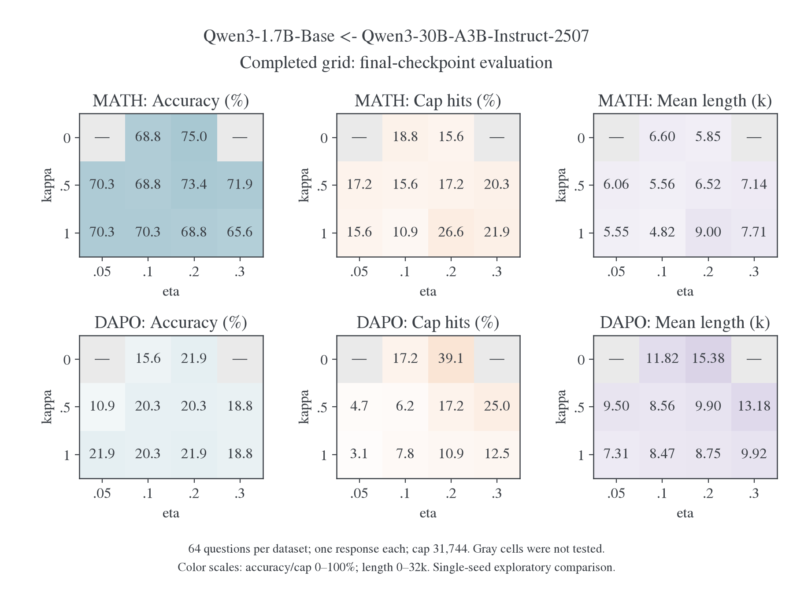
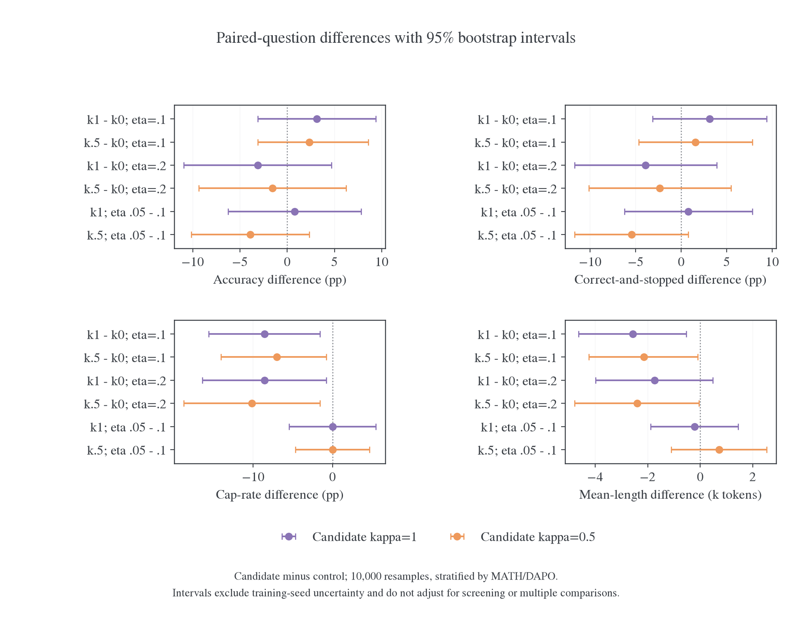
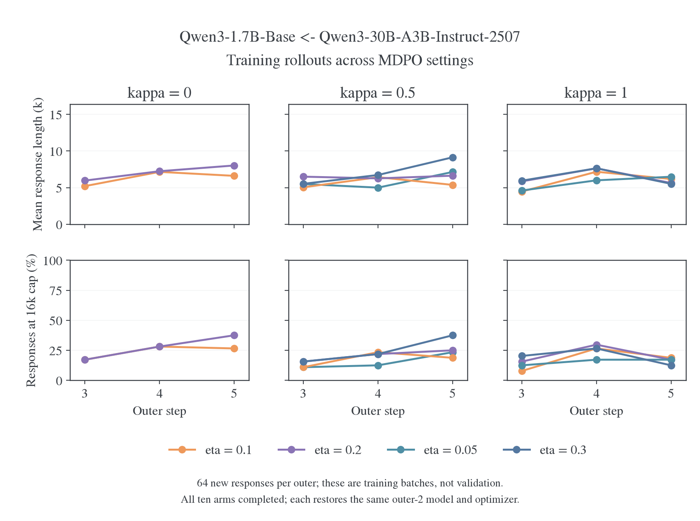
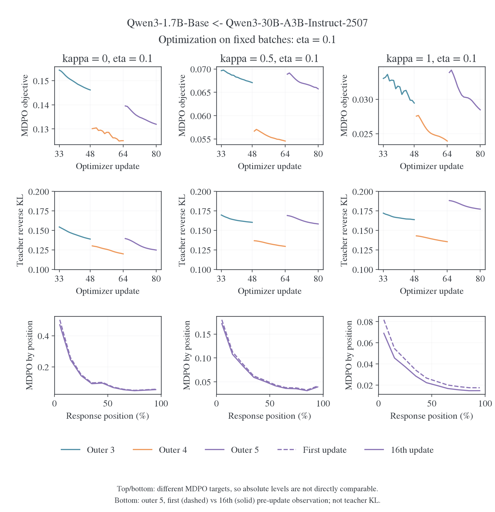

# Qwen3 Base ← MoE：MDPO 参数对照与长度恢复

更新日期：2026-10-29。模型为 **Qwen3-1.7B-Base ← Qwen3-30B-A3B-Instruct-2507**。十组短程训练和 1,280 条独立评测回答全部完成。本报告回答目标形状与强度是否缓解 E54 的长度膨胀；RoPE、EOS、模板及旧 Full-RKL 的失效证据统一见 [E54 长度诊断](2026-10-29-E54长度膨胀诊断.md)。

## 1. 结论与适用范围

**MDPO 是值得继续验证的修复候选，但长度问题没有被完全消除。** 在固定 η=0.1 的比较中，κ=1 相比 κ=0 减少了触顶、平均长度和重复；正确率改善的配对区间仍包含零。十组使用共同的两步预热模型，只新增三轮训练，不能替代从初始 Base 开始的百步验证。

| 判断                            | 依据                                                          | 边界                                          |
| ------------------------------- | ------------------------------------------------------------- | --------------------------------------------- |
| 非线性目标在 η=0.1 下改善长尾   | κ=1 的触顶由 23/128 降至 12/128，均长由 9.21k 降至 6.65k      | 同题仍有新出现的触顶和正确转错误样本          |
| 不能宣称准确率稳定提升          | κ=1 比 κ=0 净多判对 4 题，但 95% 配对区间为 −3.13 至 +9.38 pp | 单 seed、每题仅一次生成；同一小题集还参与筛参 |
| η=0.1 适合作为共同长程参数      | κ=0.5/1 在该点均有可用成绩和较短长尾                          | 它不是各 κ 的已确认最优值                     |
| κ=1、η=0.05 与 0.1 尚无明确胜负 | 前者判对且停止多 1 题，触顶相同；各配对区间均含零             | 不能按一题差异选择稳定赢家                    |
| 长程修复尚待验证                | 全部十组只到累计 80 次更新；仍有 3 道题全部触顶               | E55–E58 已注册，但这批结果不属于 E55–E58      |

所有正确率来自项目 verifier，不保证推导过程正确。重复 8-gram 是重复 token 窗口比例，也会计入数学表达与正常复查，不能直接当作病理循环发生率。

## 2. 实际训练和评测协议

| 项目           | 实际设置                                                                                     |
| -------------- | -------------------------------------------------------------------------------------------- |
| 共同起点       | 四卡 Full-RKL 的第 2 outer，预热 cap7,168；恢复同一模型、Adam、数据位置                      |
| 参数网格       | κ=0 的 η=0.1/0.2；κ=0.5/1 的 η=0.05/0.1/0.2/0.3，共 10 组                                    |
| 新增训练       | 第 3–5 outer，共 48 次更新；每组累计 80 次                                                   |
| 批与复用       | DAPO，batch=mini-batch=64，n=1，reuse16，token-mean                                          |
| 优化器         | AdamW，LR=1e-6，constant，weight decay=0.01，梯度裁剪=1                                      |
| Rollout        | 当前 student，temperature/top-p=1/1，seed42；每卡并发 64、显存预算 0.8                       |
| 长度           | Prompt cap1,024，训练 response cap16,384                                                     |
| 输入协议       | 保留旧共同前缀中的空 `<think>…</think>` 段；未切换原生前缀                                   |
| 固定修复与实现 | FP32 RoPE；EOS 等价类 `[151643,151645]`；四卡 shared-sync、full-vocab `precompute`、chunk512 |
| 验证           | 仅最终 outer5；MATH-500 与未用于这五批训练的 DAPO 各 64 题，每题一次，cap31,744              |
| 验证采样       | MATH temperature/top-p=0.7/0.9；DAPO=1/1                                                     |

十组第 3–5 批的训练题目集合一致，评测的 prompt IDs、题目 ID 和逐题 seed 一致。独立复算确认 480 次新增更新、1,280 条判分记录完整；没有跳步或非有限 loss，所有 `finish_reason=stop` 的回答都实际结束于两个合法 EOS ID 之一。空文本和角色起始 token 151644 在这 1,280 条回答中均为零；这个样本内结果不证明旧模板在所有状态上无副作用。

相同问题和 seed 不保证不同参数组生成相同轨迹，更不等于耦合了 vLLM 的随机流。因此，首批更新前的自然输出也存在差异；不同组的 teacher KL 是在各自生成的状态上测量，不能直接按横向绝对值排名。

参数扩展由先验固定的预算筛选触发：在首轮某个共同 η 下，正确总数不减、判对且停止至少增加 4 条、触顶至少减少 4 条，均长和重复不增加，单题集正确数最多减少 2 条。η=0.1 达到该条件后扩展了其余六组。该条件不是显著性检验；评测题目被重复用于筛选和排名，后续结论属于探索性比较。

## 3. 完整参数结果

下表的长度和重复比例对两题集等权平均。触顶与判对且停止的分母为 128；每题集正确率的分母为 64。1k=1,000 token。

|   κ |    η | MATH 正确率 | DAPO 正确率 | 合并平均长度 |   触顶 | 判对且停止 | 重复 8-gram |
| --: | ---: | ----------: | ----------: | -----------: | -----: | ---------: | ----------: |
|   0 |  0.1 |      68.75% |      15.63% |        9.21k | 23/128 |     54/128 |      39.29% |
|   0 |  0.2 |      75.00% |      21.88% |       10.62k | 35/128 |     61/128 |      40.72% |
| 0.5 | 0.05 |      70.31% |      10.94% |        7.78k | 14/128 |     49/128 |      36.06% |
| 0.5 |  0.1 |      68.75% |      20.31% |        7.06k | 14/128 |     56/128 |      35.23% |
| 0.5 |  0.2 |      73.44% |      20.31% |        8.21k | 22/128 |     58/128 |      35.77% |
| 0.5 |  0.3 |      71.88% |      18.75% |       10.16k | 29/128 |     56/128 |      38.38% |
|   1 | 0.05 |      70.31% |      21.88% |        6.43k | 12/128 |     59/128 |      34.45% |
|   1 |  0.1 |      70.31% |      20.31% |        6.65k | 12/128 |     58/128 |      32.40% |
|   1 |  0.2 |      68.75% |      21.88% |        8.87k | 24/128 |     56/128 |      34.99% |
|   1 |  0.3 |      65.63% |      18.75% |        8.82k | 22/128 |     54/128 |      33.66% |

灰格表示没有测试该组合，不以零补齐。κ=0、η=0.2 的合并正确数最高，为 62/128，但触顶 35 条、均长 10.62k；κ=1、η=0.05 的判对且停止为 59/128，触顶 12 条、均长 6.43k。二者体现了成绩与长尾的不同取舍，不宜仅以正确率或长度单指标选优。

对未来共同 η 的选择，我建议 0.1。κ=0.5 在 η=0.05 时 DAPO 仅 7/64 判对，η=0.1 时为 13/64；更大的 η=0.3 又伴随更长回答。κ=1 的 η=0.05 虽是有希望的单独候选，但相比 0.1 只多判对 1 题，且重复占比略高。当前证据不足以让三种 κ 都改用 0.05。

历史 16k Full-RKL 参考在同一题集上的合并均长为 19.21k、触顶 69/128、判对且停止 40/128；本轮十组的触顶为 12–35/128。这个变化比同 η 下改变 κ 的差异更大，但历史运行使用较旧的实现与数值路径，不作为严格的新增因果对照。尤其 κ=0 的 MDPO 也有 anchor 正则，不能把所有改善都归给 TOP-D 形状。E58 的作用正是补充同协议纯 Full-RKL 参考。

## 4. 配对不确定性与具体失败

按题目 ID 配对，在 MATH、DAPO 内分别有放回抽样，再等权合并；固定 seed20261029，重采样 10,000 次。下面是 κ=1 减 κ=0、η=0.1 的差异：

| 指标             |     差异 |      95% 配对区间 |
| ---------------- | -------: | ----------------: |
| 正确率           | +3.13 pp |  [−3.13,+9.38] pp |
| 判对且停止比例   | +3.13 pp |  [−3.13,+9.38] pp |
| 触顶率           | −8.59 pp | [−15.63,−1.56] pp |
| 平均长度         |   −2.56k |    [−4.63,−0.54]k |
| 重复 8-gram 比例 | −6.88 pp | [−12.10,−1.75] pp |

这些区间只量化已观测题目的抽样不确定性，不包含训练 seed 方差、同题多次采样方差，也没有对多重比较和筛参校正。长尾改善比正确率提升的证据更清楚，但不能据此宣布统计上普遍有效的修复。

κ=1、η=0.1 相比 κ=0、η=0.1，有 11 题由错变对、7 题由对变错；16 条原先触顶的回答变成正常停止，但其中只有 2 条同时被判对，另有 5 条原先未触顶的回答新增触顶。净触顶减少不等于这些题都被正确解决。

| 同题样本                           | κ=0、η=0.1                      | κ=1、η=0.1                      | 观察                                           |
| ---------------------------------- | ------------------------------- | ------------------------------- | ---------------------------------------------- |
| MATH-500:249，模 23 的逆元         | 31.74k，触顶，判错，重复 92.19% | 1.45k，EOS，判对，重复 14.79%   | 有限复查后给出 17 并结束                       |
| MATH-500:108，椭圆与相切圆         | 31.74k，触顶，判错，重复 91.55% | 2.94k，EOS，判对，重复 29.42%   | 给出 2 并结束；判分不保证推导完整正确          |
| MATH-500:470，带和约束的乘积最大化 | 2.22k，EOS，判对                | 20.10k，EOS，判错，重复 87.31%  | 错误方程推导被反复展开，停止也不代表答案完整   |
| DAPO train-3217，2018×4 染色       | 2.12k，EOS，判错                | 31.74k，触顶，判错，重复 87.25% | 后段仍在重复“标准杨表”说法，编号延伸到 Step464 |

这些是按结果选取的机制病例，不是总体发生率估计。完整评测中，MATH-500:110、352、422 在全部十组都触顶；这直接排除了“这组设置已完全消除不收束”的表述。选定病例的头尾摘录及其余 κ 的同题结果保存在[聚合数据](figures/e54-mdpo-20261029/data.json)，原始完整文本和 token 在证据归档中。

## 5. 训练目标下降与生成行为

每个 outer 都换成新问题和新生成回答。κ=1、η=0.1 的平均长度为 4.47k、7.17k、6.18k；κ=0.5、η=0.3 的最后一批达到 9.13k、24/64 触顶。短程没有统一的单调收缩趋势；模型仍可能在后续访问更长、更难收束的状态。

已完成十组都执行了 48 次新增更新。每批开始 anchor KL 为零，并随 learner 更新增加；目标归一化项在同一批保持恒定，符合冻结 anchor/teacher 的实现。κ=1、η=0.1 三批 MDPO objective 首尾分别下降 10.84%、13.13%、16.00%，teacher KL 也都下降。

当 κ<1 时，objective 包含常数项：

$$
L_{\mathrm{MDPO}}=\frac{KL_{\mathrm{target}}-\log Z}{\eta}.
$$

例如 κ=0.5、η=0.05 的最后一批 objective 只下降 1.50%，但 target KL 下降 21.82%。同一批的常数下界压低了 objective 的相对降幅；这不足以证明没有学习。跨 κ 的绝对 objective 与跨批的 loss 跳变也不直接可比。

底行记录的是 `distill/mdpo/objective_position`，不是 teacher KL 的分位置曲线。`p90_100` 表示每条回答最后 10% 的 token，而非单独 EOS。κ=1、η=0.1 的十个位置区间在三批中均首尾下降；κ=0、η=0.1 的第 4 批有两个后段区间小幅上升。给定状态上的拟合进展与独立生成质量是不同读数，需要同时保留。

十组 W&B run 均已结束；云端各有完整的 48 个更新点和 3 个长度点，MDPO objective、teacher KL、末段位置指标及长度与本地核对一致，见[云端核验](../../../../../../../wandb-logs/MirrorOPD-verl/analysis/e54-mdpo-20261029/wandb-final-audit.json)。最终独立评测没有回传 W&B；本轮也没有采集 teacher KL 的位置分桶，这两个观测缺口仍需在后续训练中处理。

## 6. 与 TOP-D 的关系和实现边界

TOP-D 的即时 reward 为 $\log(1-\alpha+\alpha T/q)$，其中 $q$ 是内层更新前的冻结 student，$T$ 是 teacher。论文还使用 PPO clipping、后续 token return 和归一化；其官方实现也提供只用即时 reward 的 `naive_topd` 路径。[^topd-paper][^topd-code] 这里检验 reward 形状，保持现有 full-vocab 求和与 MDPO 更新，不声称复现论文的完整算法。

固定一个输入状态，记当前 learner 分布为 $p$，冻结 anchor 为 $q$，teacher 为 $T$。MDPO 的信号与未归一化近端目标分别为：

$$
f_\kappa(q,T)=
\begin{cases}
\eta\log(T/q), & \kappa=0,\\
\kappa^{-1}\log\left[1-\eta+\eta(T/q)^\kappa\right], & \kappa\ne0,
\end{cases}
\qquad b_\kappa=q\exp(f_\kappa).
$$

当前 full-vocab MDPO 对每个有效位置优化：

$$
L_\kappa(p;q,T)=\frac{1}{\eta}\sum_a p_a\log\frac{p_a}{b_{\kappa,a}}
=\frac{1}{\eta}\left[\mathrm{KL}(p\Vert q)-\mathbb E_p f_\kappa(q,T)\right].
$$

$a$ 遍历合并终止类后的完整动作空间。一般的 $b_\kappa$ 未归一化；代码中的目标 KL 减去 $\log Z$ 与上式一致。Anchor 和 teacher 均停止梯度，在同一批的 16 次复用更新中保持不变。

当 $\kappa=1,\eta=\alpha$ 时，$f_1$ 就是 TOP-D 的即时 reward，且 $b_1=(1-\alpha)q+\alpha T$ 已归一化，因此：

$$
L_1=\frac{1}{\alpha}\mathrm{KL}\left(p\;\middle\Vert\;(1-\alpha)q+\alpha T\right).
$$

这给出直接复用 MDPO 的实现方式。但完整更新还包含 anchor KL 和 $1/\alpha$：在第一次更新 $p=q$ 处，anchor KL 的参数梯度为零，与 full-vocab 即时 reward 的期望梯度只差 $1/\alpha$；后续复用中二者一般不同。若与论文 sampled-token PPO 比较，还需计入采样估计、ratio clipping、return 及归一化差别。

非线性信号在 $T/q\to0$ 时有下界 $\log(1-\alpha)$，能限制 teacher 极不认可动作的负信号。MDPO 会整体除以 $\alpha$，所以实际解释不能只比较 reward 的原始幅值。另一方面，在 student 已几乎不给 EOS 概率的状态，reverse-KL 梯度仍含 student 的概率权重；该变化不保证补足缺失的停止状态。

κ=0 时，完整目标为：

$$
L_0=KL(p\Vert T)+\frac{1-\eta}{\eta}KL(p\Vert q).
$$

因此，即使 κ=0，η=0.1 也已经加入 9 倍 anchor KL 约束；它是目标形状对照，不是原 E54 纯 Full-RKL。共同 η 保持 anchor 项系数与整体缩放一致，但不同 κ 的非线性信号和生成状态仍会不同。

EOS 适配先分别汇总 student、anchor、teacher 的两个停止概率，再构造幂均值目标；不能对两个 EOS 各自混合后再求和，因为一般的幂均值不与合并交换。停止类梯度按当前 student 类内概率分回两个 logits。Teacher 与 anchor 不接收梯度，learner 的 hidden/head 梯度已用独立概率空间 FP64 参考及实际词表 BF16 CUDA 检查。MDPO 的 teacher/anchor KL 在合并后的动作空间统计，不能与旧原始词表 KL 直接拼图。

## 7. 长程验证与证据复算

E55、E56、E57 已注册为 κ=0、0.5、1，统一 η=0.1；E58 是 Full-RKL 参考。它们使用原始 Base 初始化、原生共同 assistant 前缀、100 outer、每 10 outer 验证五个完整 benchmark，并按要求不保存任何 checkpoint。实际配置只在[训练设置](../../../settings/训练设置.md#e55e58base-与-moe-的长程目标对照)维护。这里的短测使用旧空思考段和共享预热，不冒充原生模板或从头百步训练的结果。

长程需要确认后半程正确率、判对且停止、触顶与重复是否稳定，而不只看 loss。若新协议下纯 Full-RKL 也稳定，则模板、训练协议或其他共同修复已经足以解释部分恢复；若 MDPO 稳定而同协议 Full-RKL 继续退化，才更直接支持目标约束的贡献。若两者都退化，再按 E54 主文的状态来源对照继续定位，避免同时加入多项干预。

[独立复算脚本](../../../../research/studies/termination/summarize_e54_mdpo.py)从[完整归档](../../../../../../../wandb-logs/MirrorOPD-verl/analysis/e54-mdpo-20261029/runs)读取实际配置、逐次指标、训练题目、完整生成和判分，核对计数、EOS、重复率、配对关系并计算区间；[绘图脚本](../../../../research/studies/termination/plot_e54_mdpo.py)只读取[聚合数据](figures/e54-mdpo-20261029/data.json)。无需加载模型即可复算本报告的表格和图。

已完成实验的中间模型、优化器分片与评测导出权重已清理。配置、tokenizer、训练状态元数据、源码和全部文本证据保留；这些目录不再支持直接续训或重新执行模型前向。权重可用性见[清理记录](../../../../../../../wandb-logs/MirrorOPD-verl/analysis/e54-mdpo-20261029/checkpoint-cleanup.json)。后续 E55–E58 从原始模型开始，不依赖这些已清理权重。

图的 PDF：[参数网格](figures/e54-mdpo-20261029/final-evaluation.pdf)、[配对区间](figures/e54-mdpo-20261029/paired-intervals.pdf)、[训练长度](figures/e54-mdpo-20261029/training-length.pdf)、[优化与位置](figures/e54-mdpo-20261029/optimization.pdf)。

### 参考文献

[^topd-paper]: Zhengpeng Xie, Li Lyna Zhang, Zeke Xie, Mao Yang. Trust Region Policy Distillation. arXiv:2607.04751v2, 2026. [论文与 Algorithm 1](https://arxiv.org/html/2607.04751v2).

[^topd-code]: xie-lab-ml. TOP-D 官方实现，固定版本 9a2716cba22cab508825ad3be3f78327bb8139e5. [即时 reward 与 naive_topd / topd 优势计算](https://github.com/xie-lab-ml/TOP-D/blob/9a2716cba22cab508825ad3be3f78327bb8139e5/verl/verl/trainer/ppo/core_algos.py#L373-L509).
