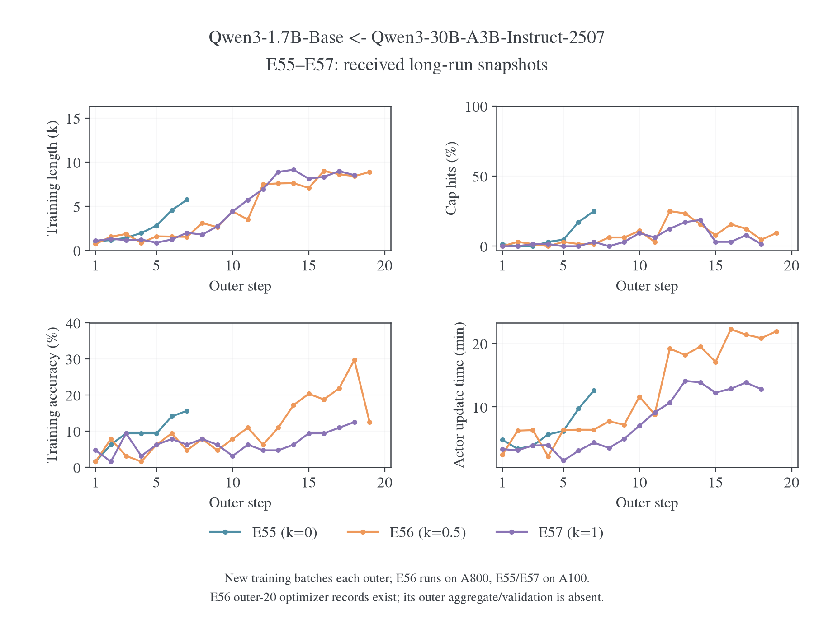
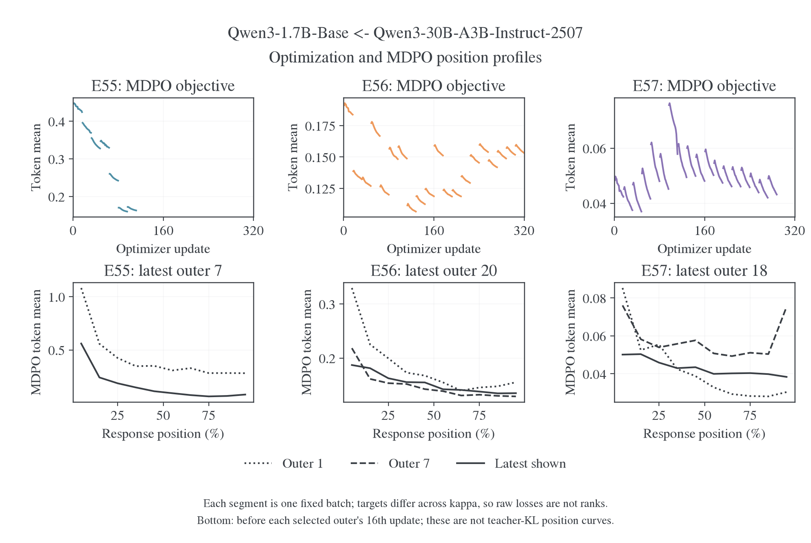
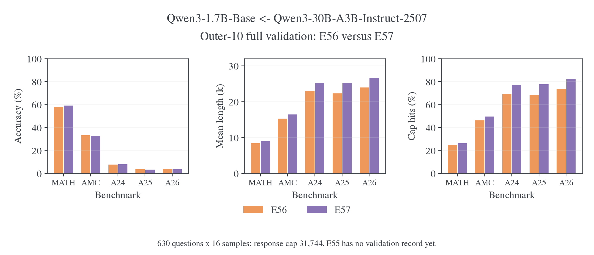

# E55–E57：长程训练快照与五基准验证

更新日期：2026-10-30。研究对象为 Qwen3-1.7B-Base ← Qwen3-30B-A3B-Instruct-2507，三组均使用 η=0.1，E55/E56/E57 的 κ 分别为 0/0.5/1。本文只分析已接收的完整日志记录，不把日志文件的结尾当作训练结束，也不把云端显示状态当作远端进程的实时状态。

## 1. 当前结论

**已有数据不支持“长度问题已完全修复”。** E56、E57 的第 10 步验证成绩接近，但三个 AIME 仍有约 69%–82% 的回答触顶；E57 的五个基准均长和触顶率都高于 E56。训练中没有已记录的非有限值或跳步，批内 MDPO 与 teacher KL 也在下降，说明优化执行正常与独立生成收束仍是两件事。

E55 还没有验证记录，不能对三种 κ 做完整排名。它在第 7 批已达到 5.75k 均长、16/64 触顶，早期长度增长快于另外两组；但其早期训练得分也更高，不能只用短回答判定另一组更优。

## 2. 日志范围与同步结果

| 实验      |   κ | 日志最后记录时间，上海 | 已记录更新 | 完整 outer 汇总 | 完整验证 |
| --------- | --: | ---------------------- | ---------: | --------------: | -------- |
| E55[^e55] |   0 | 2026-10-30 10:43:47    |        112 |             1–7 | 无       |
| E56[^e56] | 0.5 | 2026-10-30 09:56:13    |        320 |            1–19 | outer10  |
| E57[^e57] |   1 | 2026-10-30 10:49:13    |        288 |            1–18 | outer10  |

E56 已有第 20 批全部 16 次更新的记录，但没有该步完整的 outer 汇总或验证点，因此不能补造其验证成绩。三份文件均为 `partial_snapshot`，没有退出记录；它们可能尚在运行，也可能只是传输尚未完整，当前包不能区分。

原始日志仓库已拉取远端快照并保留本地分析提交。同步使用临时副本，原始 `.wandb` 文件未修改。云端核对了全部 720 个更新点、44 个 outer 汇总以及 E56/E57 的第 10 步五基准正确率，未发现缺失或重复；MDPO objective、teacher KL、末段位置指标和长度与本地一致。

W&B 同步器在读取截断尾记录时报告 `unexpected EOF`，三个云端 run 因导入状态显示为 `failed`。这不是远端训练失败的证据，run 备注已明确说明快照范围；分析仅使用之前成功解码的记录。[同步与云端核验记录](../../../../../../../wandb-logs/MirrorOPD-verl/analysis/e55-e57-long-20261030/cloud-verification.json)保留了每组的核对计数。

## 3. 实际设置与可比范围

三份配置记录的代码提交均为 `9fd276af`。共同设置是从初始 Base 开始、100 outer、batch=mini-batch64、reuse16、LR=1e-6、token-mean、训练 cap16,384；每 10 outer 完整验证五个 benchmark，n=16、验证 cap31,744；无初始验证、`save_freq=-1`。配置中 `enable_thinking=null`，full-vocab `precompute`、chunk512，EOS 等价类为 `[151643,151645]`。完整入口定义见[训练设置](../../../settings/训练设置.md#e55e58base-与-moe-的长程目标对照)。

E55、E57 的环境记录为八张 A100-SXM4-80GB，E56 为八张 A800-SXM4-80GB。不能把 wall time 差异全部归给 κ；模型生成的 token 数也不同。快照没有包含实际 prompt IDs、tokenizer 模板文件或源目录差异补丁，因此这里核对的是记录中的配置与 commit，不能进一步确认远端文件的逐字节一致性。

这批实验与[先前十组短测](2026-10-29-MDPO参数对照与长度恢复.md)不同：短测使用共同两步预热、旧空思考段、四卡，并只测 64 道 MATH 与 64 道 DAPO；这里从 Base 重新开始，声明采用原生前缀、八卡，验证是完整五基准 avg@16。不能把短测约 70% 的 MATH 子集分数与当前完整 MATH-500 分数直接当作学习曲线上的下降。

## 4. 训练长度和触顶

| 同一 outer 的读数 | E55           | E56            | E57            |
| ----------------- | ------------- | -------------- | -------------- |
| 第 7 批均长       | 5.75k         | 1.54k          | 2.00k          |
| 第 7 批触顶       | 16/64         | 1/64           | 2/64           |
| 第 7 批训练得分   | 15.63%        | 4.69%          | 6.25%          |
| 最后完整批次均长  | 5.75k，outer7 | 8.89k，outer19 | 8.54k，outer18 |
| 最后完整批次触顶  | 16/64         | 6/64           | 1/64           |

非线性目标延缓了早期长度快速增加，但 E56/E57 后续均长仍进入 8k–9k。第 14–18 批窗口中，E56 均长 8.16k、触顶 11.25%、训练得分 21.56%；E57 均长 8.63k、触顶 6.88%、训练得分 9.69%。E57 在该窗口触顶更少，却没有对应更高训练得分。

这不等于所有长回答都是循环。E56/E57 后期训练均长较高，但大部分回答仍在 16k 内停止；增长可能同时包含更长推理与低效展开。现有包没有训练回答正文、原始 response token 或重复率指标，也未提供 validation JSONL，不能据长度曲线确认重复发生率、正确答案后续写次数，或某一批的具体失效模式。

当前主要训练耗时在 actor 更新。以最后完整批次为例，E56 的 16 次更新约 21.94 分钟，E57 约 12.82 分钟；对应 rollout 约 1.69/1.61 分钟，teacher forward 约 10 秒。硬件和 token 量不一致，这些读数用于定位执行开销，不构成 κ 的吞吐基准。

上述仅为训练步。第 10 步完整验证还分别消耗 5.46/6.12 小时，才是当前已覆盖墙钟的最大部分；约 95% 的验证 token 来自触顶回答。EOS 分支的全词表 FP64、同步索引和重复诊断也存在实现开销，详细计时、证据边界及优化顺序见[长程耗时诊断](../../performance/full-vocab/2026-10-30-MDPO长程训练与验证耗时诊断.md)。

## 5. 优化和位置指标

全部已记录更新均无非有限 loss、非有限梯度或跳步。各完整复用批次的 MDPO objective 和 teacher KL 都有首尾下降。下表首尾分别指第 1 和第 16 次更新前，覆盖中间 15 次更新，不冒充最终更新后的精确值。

| 实验／批次   | MDPO objective  | Teacher KL      | Target KL 降幅 |
| ------------ | --------------- | --------------- | -------------: |
| E55，outer7  | 0.1723 → 0.1630 | 0.1723 → 0.1552 |          56.0% |
| E56，outer20 | 0.1590 → 0.1532 | 0.3849 → 0.3653 |          23.7% |
| E57，outer18 | 0.0490 → 0.0432 | 0.4574 → 0.4370 |          11.8% |

不同 κ 的目标和常数不同，不能用 E57 更低的 objective 判断它更接近 teacher。不同批次和不同实验访问的状态也不同，所以 teacher KL 的横向绝对值不是验证质量排名。κ<1 时，MDPO 还有同批固定的归一化常数；解释小幅 objective 下降应同时查看 `distill/target_kl`，公式见短测报告。

从第 10 到 18 批，E56 的末次更新前 teacher KL 从 0.2896 升至 0.3576，而每批内都下降；E57 则从 0.4491 略降至 0.4370。与此同时，两组生成均长都从约 4.42k 增至 8k 以上。这组观察与统一的数值发散不同，更需要关注新 rollout 状态的变化；它仍不能单独区分有用推理变长和无效重复。

位置图仍是 `distill/mdpo/objective_position`，不是 teacher KL 的分位置曲线。它按每条回答的相对位置分桶，最后 10% 不等于单独 EOS；不同批次回答长度变化时，物理 token 范围也随之改变。尾部目标值或其下降不能单独证明没有循环。

E55 的最大裁剪前梯度范数为 15.05，E56 为 3.44，E57 为 3.00；裁剪阈值均为 1。该数值是裁剪前范数，不能直接解释为实际参数更新放大了相同比例。结合已记录的更新计数和非有限标记，目前没有数值发散的证据。

## 6. 第 10 步五基准验证

两组都完整记录了 630 题、每题 16 次，共 10,080 条回答。下表使用 `acc/observed_mean`，不使用 pass@16。长度单位为千 token，触顶率按该题集实际回答数计算。

| 基准     | E56 正确率 | E57 正确率 | E56 均长 | E57 均长 | E56 触顶率 | E57 触顶率 |
| -------- | ---------: | ---------: | -------: | -------: | ---------: | ---------: |
| MATH-500 |     58.20% |     59.21% |    8.43k |    8.98k |     24.93% |     26.34% |
| AMC23    |     33.28% |     32.66% |   15.26k |   16.44k |     46.09% |     49.69% |
| AIME24   |      7.71% |      7.92% |   22.99k |   25.25k |     69.58% |     76.88% |
| AIME25   |      3.54% |      3.33% |   22.31k |   25.25k |     68.54% |     77.71% |
| AIME26   |      4.17% |      3.54% |   24.00k |   26.66k |     73.96% |     82.29% |

五基准等权平均正确率为 E56 的 21.38%、E57 的 21.33%，点估计几乎相同；E57 在所有题集上的均长和触顶率都更高。当前更支持“E56 在相近成绩下的长尾较轻”，而不支持“κ=1 已明显优于 κ=0.5”。只有一次验证、一个训练 seed，又缺少逐题回答数据，不能进行可靠的同题差异检验或宣布最终胜负。

两个实验的三个 AIME 中位长度均等于 31,744。它们在第 10 步仍存在很重的长尾，不能用训练第 18/19 步较低的触顶率替代后续验证。训练 cap16k 与验证 cap31.7k 不同，温度和题目分布也不同；更晚的训练统计没有证明更晚的 AIME 验证已经恢复。

## 7. 后续判断所需证据

优先补齐 E55 的第 10 步验证，以及 E56/E57 的第 20 步验证，再比较相同训练进度。若均长或触顶下降，需要同时看正确率和判对且正常停止，排除提前结束但答案错误的情况。当前包没有准确率与停止事件的逐题联合记录，不能从两项边际统计推算“判对且停止”。

下一次传输应包含验证 JSONL 中的问题、回答、得分、finish reason 和 token 长度；若保存了原始 response IDs，也应一并保留。这样才能直接复查重复、EOS 状态和具体长尾病例。此建议不要求保存 checkpoint，不改变已经确定的无 checkpoint 协议。

当前还没有 E58 的同协议纯 Full-RKL 日志。E55 本身是带 anchor 正则的 κ=0 MDPO，不能充当原 E54 纯 Full-RKL 的严格替代。是否已修复完整配对，需要结合 E58 及后续长期验证，而非只看当前 loss 下降。

## 8. 数据与复算

[来源版本](../../../../../../../wandb-logs/MirrorOPD-verl/analysis/e55-e57-long-20261030/provenance.json)记录了日志仓库提交和读取器版本；[冻结解码结果](../../../../../../../wandb-logs/MirrorOPD-verl/analysis/e55-e57-long-20261030/decoded)保留 run/config/history/summary/metric definitions。[分析脚本](../../../../research/studies/termination/analyze_e55_e57.py)只读完整 history，不采样、不补缺失点；图使用[聚合数据](figures/e55-e57-20261030/data.json)。

PDF：[训练动态](figures/e55-e57-20261030/training.pdf)、[优化与位置](figures/e55-e57-20261030/optimization.pdf)、[第 10 步验证](figures/e55-e57-20261030/validation.pdf)。

### 参考文献

[^e55]: W&B. E55，run j5uaal3j，2026. [训练快照](https://wandb.ai/wncfht/MirrorOPD-verl/runs/j5uaal3j).

[^e56]: W&B. E56，run zsnhqzts，2026. [训练快照](https://wandb.ai/wncfht/MirrorOPD-verl/runs/zsnhqzts).

[^e57]: W&B. E57，run 6j5knkmk，2026. [训练快照](https://wandb.ai/wncfht/MirrorOPD-verl/runs/6j5knkmk).
