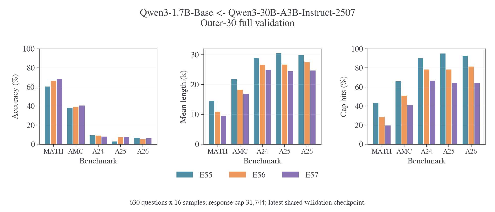
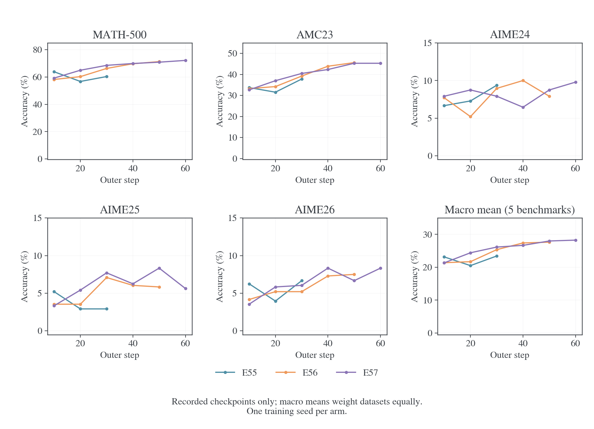
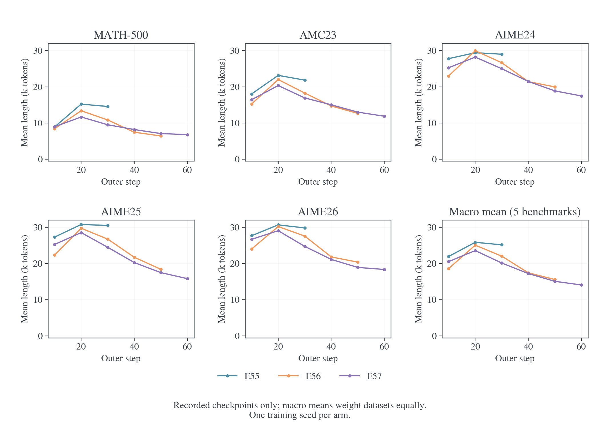
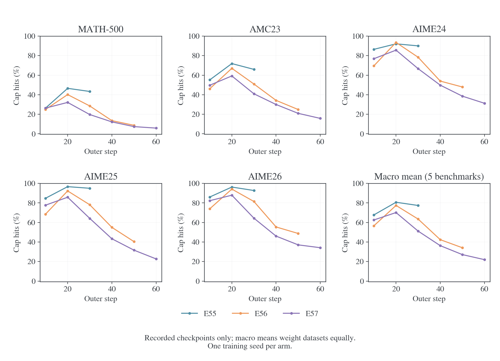
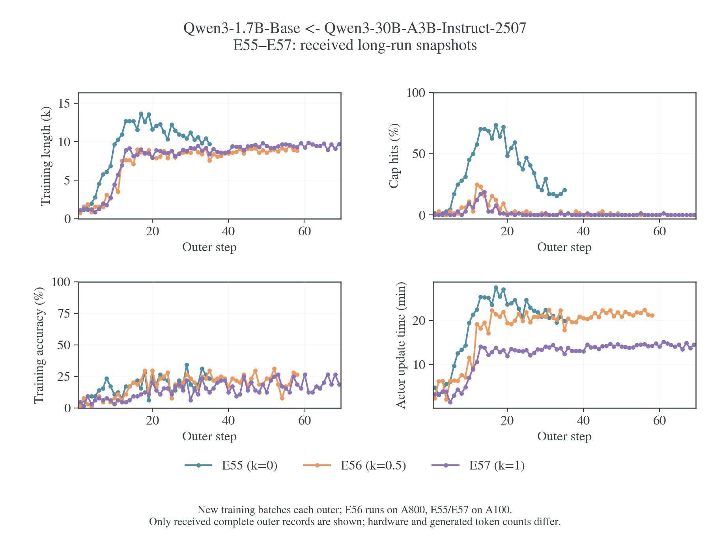
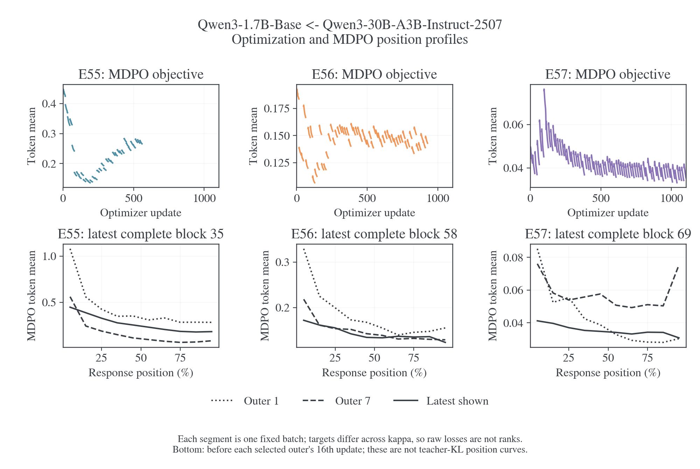

# E55–E57：长程训练、长度恢复与五基准验证

更新日期：2026-10-31。Qwen3-1.7B-Base ← Qwen3-30B-A3B-Instruct-2507 的三组长程日志已覆盖 E55/E56/E57 的 35/58/69 个 outer。固定 η=0.1，κ 分别为 0/0.5/1。E56/E57 后续验证的正确率与停止行为均有改善；E55 在共同 outer30 的长度长尾更重、五基准平均正确率更低。当前证据仍是单个训练 seed 的中途快照，不能据此宣布最终 κ 排名。

## 背景与实际设置

这组实验检验不同 MDPO 目标在独立生成时能否同时改善任务正确率和终止行为。批内固定 state 的目标下降只能说明局部拟合，验证回答的长尾需要独立测量。先前短测采用共同两步预热、旧空思考段、四卡和 MATH/DAPO 各 64 题；这里从 Base 重新训练，使用八卡和完整五基准，两个协议的成绩不能直接拼成学习曲线。

三份配置记录的代码提交均为 `9fd276af99b329d67f831881141b3b873b1cc428`。训练数据为 DAPO/train.parquet，data/actor seed 均为 42，optimizer 为 AdamW。共同配置为 batch=mini-batch64、reuse16、LR=1e-6、token-mean、训练 cap16,384、100 个计划 outer；每 10 outer 验证，n=16、验证 cap31,744、无初始验证、`save_freq=-1`、`resume_mode=disable`。配置中 `enable_thinking=null`，full-vocab 使用 `precompute`、chunk512，EOS 等价类为 `[151643,151645]`。训练 temperature/top-p 为 1/1，验证为 0.7/0.9；FSDP 配置记录 `model_dtype=fp32`、`dtype=bfloat16`、`forward_precision=null`，不能将这一原混合精度配置写成纯 FP32 前向。完整参数含义见[训练设置](../../../settings/训练设置.md#e55e58base-与-moe-的长程目标对照)。

E55/E57 的环境记录为八张 A100-SXM4-80GB，E56 为八张 A800-SXM4-80GB。κ、模型产生的状态和 token 数、硬件均影响耗时，墙钟差异不能全部归因于目标。日志没有提供模板文件、远端未提交补丁或逐题回答正文；配置与 commit 可核对，远端文件的逐字节一致性和具体重复病例仍不能确认。

## 证据范围

| 实验      |   κ | 快照最后记录，上海时间 | 已记录成功更新 | 完整 outer | 已有五基准验证         |
| --------- | --: | ---------------------- | -------------: | ---------: | ---------------------- |
| E55[^e55] |   0 | 2026-10-31 22:20:30    |            560 |       1–35 | 10、20、30             |
| E56[^e56] | 0.5 | 2026-10-31 22:27:38    |            928 |       1–58 | 10、20、30、40、50     |
| E57[^e57] |   1 | 2026-10-31 22:28:54    |           1104 |       1–69 | 10、20、30、40、50、60 |

三份解码状态均为 `partial_snapshot`，均无退出记录。560+928+1104=2592 个更新点、162 个 outer 汇总和 14 次五基准验证属于已经接收的证据；文件结尾不能证明训练完成、失败或仍在运行。日志来源为远端提交 `b199eb6`，与本地已有分析记录合并后的版本为 `1ed9849`。本轮没有新的 E53 或 E58 日志。

每个验证点覆盖 MATH-500 的 500 题、AMC23 的 40 题、AIME24/25/26 各 30 题，每题 16 次，共 10,080 条回答。下文正确率使用 `acc/observed_mean`，不是 pass@16。五基准宏平均给五个题集相同权重；全部回答加权平均会让 MATH-500 占 500/630 的权重，不能混用。各检查点来自同一训练轨迹，不是独立训练重复；日志中的单点区间也不能代替 κ 差异的逐题配对检验。

## 共同 outer30：κ=0 的长尾仍然最重

这是三组最新共有的验证位置。括号外是平均正确率，括号内是回答触顶率；触顶 cap 为 31,744。

| 基准               |         E55，κ=0 |       E56，κ=0.5 |         E57，κ=1 |
| ------------------ | ---------------: | ---------------: | ---------------: |
| MATH-500           | 60.35%（43.34%） | 66.29%（28.50%） | 68.55%（19.70%） |
| AMC23              | 37.81%（65.94%） | 39.22%（50.94%） | 40.47%（40.94%） |
| AIME24             |  9.38%（90.00%） |  8.96%（78.33%） |  7.92%（66.67%） |
| AIME25             |  2.92%（95.00%） |  7.08%（78.12%） |  7.71%（64.17%） |
| AIME26             |  6.67%（92.71%） |  5.21%（81.46%） |  6.04%（64.38%） |
| 五基准宏平均正确率 |           23.42% |           25.35% |           26.14% |
| 五基准宏平均触顶率 |           77.40% |           63.47% |           51.17% |
| 五基准宏平均长度   |           25.14k |           22.01k |           20.12k |



E55 在 outer10 的 MATH-500 为 63.86%，当时高于 E56/E57 的 58.20%/59.21%；但 outer20 回落到 56.75%，outer30 为 60.35%。对应三个 AIME 的平均触顶率为 85.76% → 95.00% → 92.57%。因此 E55 早期较高得分没有持续转化为更好的共同预算结果。

在 outer30，E56/E57 的宏平均正确率比 E55 高 1.93/2.71 个百分点，宏平均触顶率低 13.93/26.23 个百分点。这些观察支持后续优先跟踪 κ=0.5/1 的恢复过程；AIME24 仍是 E55 点估计最高，不能把整体趋势扩写为所有任务一致获益。

## 后续验证：E56/E57 有恢复，AIME 仍有限



| 实验与验证位置             | MATH-500 |  AMC23 | AIME24 | AIME25 | AIME26 | 五基准宏平均 |
| -------------------------- | -------: | -----: | -----: | -----: | -----: | -----------: |
| E55，outer30，当前最新     |   60.35% | 37.81% |  9.38% |  2.92% |  6.67% |       23.42% |
| E56，outer50，当前最新     |   71.29% | 45.62% |  7.92% |  5.83% |  7.50% |       27.63% |
| E57，outer50，共同步数对照 |   70.88% | 45.31% |  8.75% |  8.33% |  6.67% |       27.99% |
| E57，outer60，当前最新     |   72.17% | 45.31% |  9.79% |  5.62% |  8.33% |       28.25% |

E56 的 MATH-500 从 outer10 的 58.20% 升至 outer50 的 71.29%，AMC23 从 33.28% 升至 45.62%。E57 从 outer10 到 outer60 的对应变化为 59.21% → 72.17%、32.66% → 45.31%。两组的主要得分增长来自 MATH-500 与 AMC23；三个 AIME 的最新正确率仍只有约 6%–10%，相邻检查点有反复。

比较 E56/E57 应优先使用共同 outer50：宏平均正确率为 27.63%/27.99%，差 0.35 个百分点。E56 的 MATH/AMC 略高，E57 的 AIME24/25 略高；单个 seed 和缺少逐题配对数据的条件下，没有足够证据宣布 κ=1 的准确率优势。E57 的 outer60 是额外进展，不能算作与 E56 outer50 的等预算胜出。





两组验证长尾都先恶化后恢复。E56 的五基准宏平均触顶率在 outer20 达到 77.43%，到 outer50 降至 34.13%；E57 从 outer20 的 70.14% 降至 outer50 的 27.12%、outer60 的 21.95%。共同 outer50，E57 的宏平均触顶率比 E56 低 7.01 个百分点，宏平均长度为 15.07k/15.56k；E57 的 MATH/AMC 均长仍比 E56 高，平均优势主要来自三个 AIME。

AIME 长尾尚未消失。E56 在 outer50 的 AIME24/25/26 触顶率为 47.92%/40.42%/48.75%；E57 在 outer60 为 31.25%/22.71%/34.17%。相较最初约 69%–82% 的 E56/E57 AIME 触顶率，后期独立验证已有改善，但仍不能称为长度问题完全修复。准确率与停止的边际统计也不能推算“判对且正常停止”的联合比例。

## 训练长度与批内优化



| 训练窗口             | E55          | E56         | E57         |
| -------------------- | ------------ | ----------- | ----------- |
| outer7 均长与触顶    | 5.75k，16/64 | 1.54k，1/64 | 2.00k，2/64 |
| 最后 10 个完整 outer | 26–35        | 49–58       | 60–69       |
| 上述窗口均长         | 10.56k       | 8.93k       | 9.48k       |
| 上述窗口触顶率       | 23.59%       | 0.16%       | 0.16%       |
| 上述窗口训练得分     | 22.19%       | 21.41%      | 19.53%      |

最后 10 个 outer 的窗口位置不同，表格用于描述各自阶段；其中 E55 的训练得分并不低于另外两组，但验证表现和终止行为更差。训练 cap16k、采样条件及题目分布与验证不同，不能用 E56/E57 训练仅 0.16% 的触顶率代替 AIME 验证的 23%–49%。

所有 2592 个已记录更新的非有限 loss、非有限梯度和跳步标记均为零。162 个完整复用批次的 MDPO objective 和 teacher KL 都有首尾下降。首尾分别是第 1 与第 16 次更新前的观测，覆盖中间 15 次更新；日志没有记录第 16 次更新后的额外评分。

| 实验／最新完整批次 | MDPO objective 首尾 | Teacher KL 首尾 | Target KL 降幅 |
| ------------------ | ------------------- | --------------- | -------------: |
| E55，outer35       | 0.2767 → 0.2660     | 0.2767 → 0.2559 |         41.70% |
| E56，outer58       | 0.1481 → 0.1430     | 0.3625 → 0.3440 |         22.23% |
| E57，outer69       | 0.0402 → 0.0355     | 0.3993 → 0.3822 |         11.77% |



不同 κ 定义不同的目标，归一化常数也不同；上述 objective 和 Target KL 降幅不能作为跨 κ 的任务排名。不同 outer 访问的新 rollout state 也不同，teacher KL 绝对值随状态分布变化，不能只据其横向大小评价独立生成质量。E55 的 teacher KL 每批都下降而验证长尾仍重，已经给出了局部拟合与生成行为分离的直接例子。

E55/E56/E57 的最大裁剪前梯度范数分别为 15.05/3.44/3.00，裁剪阈值为 1。它不是裁剪后的更新幅度，结合非有限与跳步记录，目前没有已记录的数值发散证据。位置图为 `distill/mdpo/objective_position` 的相对位置分桶，不是 teacher KL 的位置分解，最后 10% 也不等于 EOS 单点。现有日志没有回答正文或 response IDs，不能仅凭曲线确认具体循环或重复模式。

## 验证成本随长尾恢复下降

| 实验 | 已有验证点 | 累计训练 outer 耗时，不含独立验证 | 累计验证生成耗时 | 首次 → 最新单次验证生成耗时     |
| ---- | ---------: | --------------------------------: | ---------------: | ------------------------------- |
| E55  |          3 |                           12.51 h |          24.02 h | outer10:6.26 h → outer30:8.66 h |
| E56  |          5 |                           19.25 h |          27.46 h | outer10:5.44 h → outer50:3.25 h |
| E57  |          6 |                           16.19 h |          28.34 h | outer10:6.11 h → outer60:2.78 h |

训练列求和 `perf/timing/outer_step_seconds`，验证列求和 `perf/timing/validation_rollout_seconds`；两者按日志各自计时，不包含未记录的启动或其他开销。更早报告中的 E56 outer10 总验证耗时约 5.46 h 包含额外验证处理，本表统一使用生成计时 5.44 h。

E56 的 outer20 验证生成约 8.23 h，到 outer50 降至 3.25 h；E57 从 outer20 的 7.08 h 降至 outer60 的 2.78 h。它们与回答均长及触顶率的下降同向。E55 的后两次验证仍约 9.10 h/8.66 h，验证成本与其长尾问题持续相伴。由于硬件和生成量不同，这些是各自曲线的执行读数，不构成 κ 的硬件吞吐排名。算子开销与早期计时分析见[长程耗时诊断](../../performance/full-vocab/2026-10-31-MDPO长程训练与验证耗时诊断.md)。

## 判断边界与后续证据

当前最强的证据是 E56/E57 在多次后续验证中同时提高 MATH/AMC 正确率并减少触顶；E55 到 outer30 仍有很重的长尾。E56/E57 共同 outer50 的准确率很接近，E57 的 AIME 触顶率更低。这支持继续跟踪两条轨迹，同时保留 E55 的长程对照；现有结果不要求追加新的训练或 GPU 实验。

需要继续接收 E55 outer40、E56 outer60、E57 outer70 及之后的原始日志。三组均未达到配置中的 100 个 outer。现有包没有 E58 的同协议纯 Full-RKL 记录，E55 是带 anchor 正则的 κ=0 MDPO，不能代替 E58。要判断具体失败类型，需要验证回答、得分、finish reason 和 token 长度的逐题联合记录；现有聚合量不能确认重复，也不能检验 κ 差异的逐题显著性。

## 数据与复算

原始事务日志位于同级 `wandb-logs/MirrorOPD-verl/wandb/`。每份原始文件的 SHA-256、字节数、日志仓库版本、实际配置摘要、全部更新点及验证点保留在[绘图输入](../../../../../../../wandb-logs/MirrorOPD-verl/analysis/e55-e57-long-20261031/plot-data.json)；[汇总数据](figures/e55-e57-20261031/summary.json)提供窗口与逐基准统计。来源与同步核对的机器记录归档在[证据目录](../../../../../../../wandb-logs/MirrorOPD-verl/analysis/e55-e57-long-20261031/)。10 月 30 日的[旧绘图输入](figures/e55-e57-20261030/data.json)和原冻结证据保留，用于复核早期窗口。

[分析脚本](../../../../research/studies/termination/analyze_e55_e57.py)只读完整 history，不采样、不平滑、不补未来点，检查输入缓存有效性、更新序列、重复 history step 和有限值；图表同时执行 figure-viz 审计。新增完整验证后，比较图自动选择所有有验证运行的最新共同检查点。

```bash
python -m examples.mirroropd.research.studies.production.refresh_tables --logs-repo ../wandb-logs
FIGURE_VIZ_MPL=/path/to/figure-viz/assets/mpl /usr/bin/python3 \
  -m examples.mirroropd.research.studies.termination.analyze_e55_e57 \
  --logs ../wandb-logs \
  --out examples/mirroropd/docs/infra/model-compatibility/qwen-e54/figures/e55-e57-20261031
```

可编辑源文件为上述 Python 模块。PDF：[训练动态](figures/e55-e57-20261031/training.pdf)、[优化与位置](figures/e55-e57-20261031/optimization.pdf)、[共同验证](figures/e55-e57-20261031/validation.pdf)、[正确率轨迹](figures/e55-e57-20261031/validation-accuracy.pdf)、[长度轨迹](figures/e55-e57-20261031/validation-length.pdf)、[触顶率轨迹](figures/e55-e57-20261031/validation-cap_rate.pdf)。

### 参考文献

[^e55]: W&B. E55，run j5uaal3j，2026. [训练快照](https://wandb.ai/wncfht/MirrorOPD-verl/runs/j5uaal3j).

[^e56]: W&B. E56，run zsnhqzts，2026. [训练快照](https://wandb.ai/wncfht/MirrorOPD-verl/runs/zsnhqzts).

[^e57]: W&B. E57，run 6j5knkmk，2026. [训练快照](https://wandb.ai/wncfht/MirrorOPD-verl/runs/6j5knkmk).
