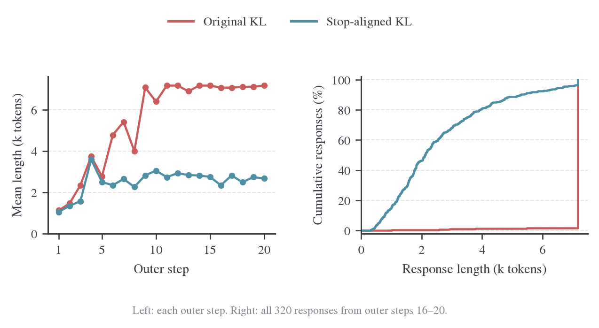
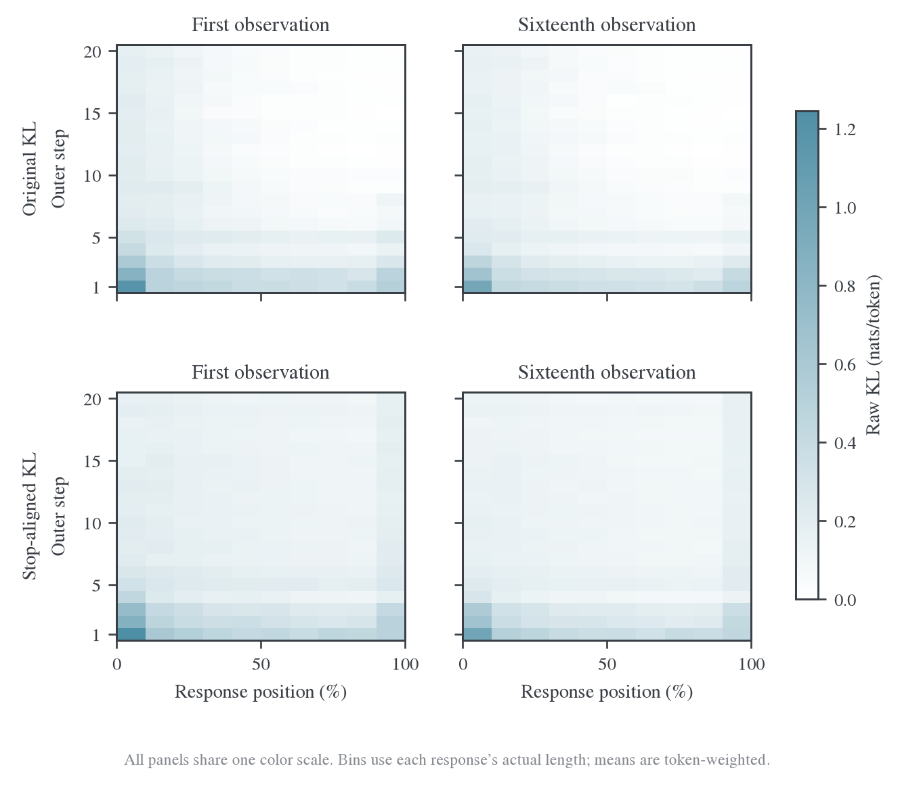
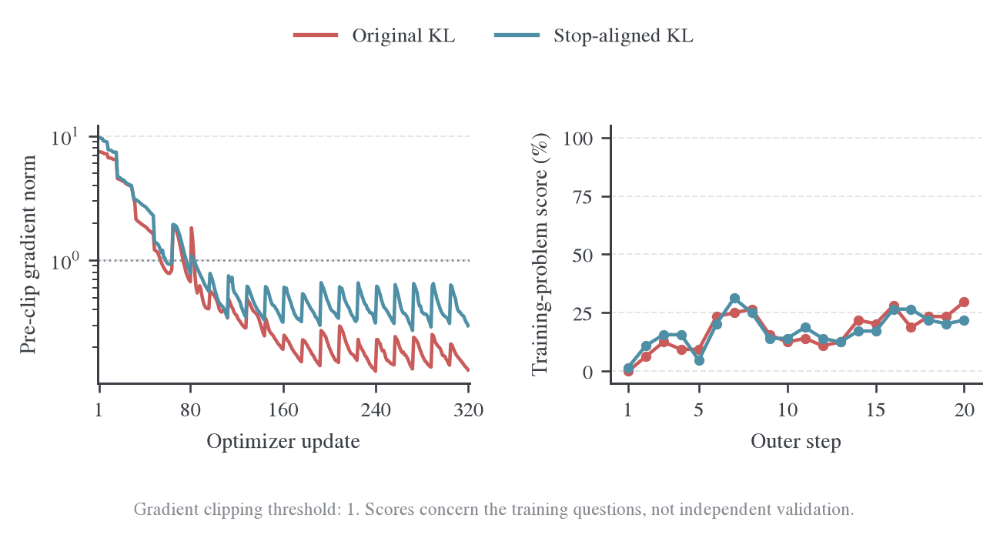

# 终止动作对齐与循环退化：受控实验

## 1. 背景与 motivation

Base student 与后训练 teacher 在同一单轮任务中使用不同结束 token。原始词表 KL 可能一边压低学生原有停止动作，一边未能充分学会 teacher 的停止动作。要区分这一语义问题与一般优化失败，应在同一批 prompt 上只改变终止动作是否合并，分别评价长度、循环和数学正确性。

## 2. Setting 与实验设计

| 项目             | 两组共同设置                                                          |
| ---------------- | --------------------------------------------------------------------- |
| 学生 / 教师      | Qwen3-1.7B-Base / Qwen3-4B                                            |
| 资源             | 四张 H800，shared_sync                                                |
| 数据             | DAPO，按 1 Ki token 的 prompt 上限过滤；20 批 prompt 逐步相同         |
| 预算             | 20 个 outer，batch64，reuse16，320 次更新                             |
| 优化器           | AdamW，学习率 1e-6，betas=(0.9,0.999)，weight decay=0.01，grad clip=1 |
| 生成资源         | 每卡并发 24，显存比例 80%，调度预算 8 Ki token                        |
| 训练采样         | temperature=1，top-p=1，top-k 关闭，无额外重复惩罚                    |
| 回答上限         | 7 Ki token；两个结束 ID 均能终止回答                                  |
| Teacher 评分预算 | 32 Ki token，BF16                                                     |
| Full-vocab 计算  | precompute，token chunk512，vocab chunk8192                           |
| 验证与保存       | 不做初始或周期 valid；第 20 步保存 checkpoint                         |

两组数据种子相同，但异步随机采样不保证逐 token 结果完全一致，首批 loss 也已有差异。本页将结果视为单次受控实验及机制证据，不进行统计显著性宣称。

## 3. 实验结果

## 长度与回答分布

左图显示原始实验逐渐接近 7 Ki token 上限，对齐实验则稳定在约 2–3 千 token。右图使用最后 5 步的全部回答绘制经验累积分布，保留了原实验在上限处的集中堆积。对齐组末 5 步没有少于 32token 的回答，长度改善并非靠大量空答或极短回答实现。

[逐步数据](data/outer-metrics.csv) · [逐回答数据](data/response-metrics.csv)

### 循环重复

“长循环”要求连续重复片段至少 128 个 token、周期不超过 128 个 token、至少重复 4 次。“重复 8-gram 比例”在每条回答内统计重复出现的连续 8-token 窗口，再对回答取平均。前者侧重机械循环，后者还会包含正常数学格式，因此不把二者混成一个质量分数。

原实验后期的循环比例接近 100%；对齐组大多数训练批没有长循环，但仍保留约 19% 的重复 8-gram，不能理解为所有重复表达都消失了。完整同题片段见[样本对照](2026-10-26-同题样本对照.md)。

### 原始 KL 与优化 loss

左图的 `distill/full_kl` 在两组中始终是同一个原始词表 KL。右图是实际优化 loss：原实验优化原始 KL，对齐实验优化停止动作等价类上的 KL；两条优化 loss 不是完全相同的目标，不能仅凭绝对值较低判断哪个模型更好。

原实验的原始 KL 更低，同时循环更多。这与“给定重复前缀时，教师也可能认为继续重复很合理”相容；低 KL 不直接衡量回答是否完整、正确或有用。

| 对齐实验的指标                                     | 含义                                          |
| -------------------------------------------------- | --------------------------------------------- |
| `distill/full_kl`                                  | 未修改的原始词表 KL，用于可比诊断             |
| `optim/actor/loss`、`distill/termination_equiv_kl` | 实际优化目标，两者在记录中一致                |
| `distill/eos_identity_kl`                          | 原始 KL 减去对齐目标，即结束 token 身份差异项 |

[640 次更新记录](data/update-metrics.csv) · [目标定义与梯度推导](2026-10-26-终止动作与循环退化诊断.md)

### 同批次复用中的 KL 变化

每条曲线对 5 个训练批等权平均，展示同一批固定前缀上的 16 次更新前观测。两个窗口使用相同纵轴范围。两组均在批次内继续降低原始 KL；原实验后期的低值同时伴随严重循环，不能把它解释为生成质量已经收敛。

[复用曲线数据](data/reuse-profiles.csv)

### Full-KL position：全程位置分布

每条回答按自身实际长度分成十段，统计有效 token 上的原始词表 KL，不包含 prompt。四个面板分别是两组实验在每批第 1 次和第 16 次更新前的观测，使用相同色标。结束 token 若属于有效回答，也计入位置统计。

对齐优化目标没有单独记录逐位置桶，不能从全局 loss 差额恢复，所以本图保留可比的原始词表 KL，不将它改名为对齐后的 position loss。

位置不是按 7 Ki token 上限或绝对 token 编号划分：短回答的“末 10%”与长回答的“末 10%”包含不同数量、不同内容的 token。各桶用 KL 之和除以 token 数；长回答权重更大，不能简单平均桶均值来重建总体 KL。

### Full-KL position：前后窗口与复用变化

每个面板汇总 5 个训练批，按 sum/count 加权。实线是第 1 次观测，虚线是第 16 次观测；二者都来自实际测量，不是预测。相同批次的前缀固定，两次观测之间包含 15 次更新。

末 5 步第 16 次观测中，回答前 30% 的 KL 相近：原实验约 0.132，对齐实验约 0.125；后 30% 则分别约 0.011 与 0.113。原实验低后缀 KL 与大量循环同时出现，不能解释为推理更好。两组生成内容和长度不同，位置桶本身也不足以将全部差异归因于某一类 token；固定前缀诊断提供另一层证据。

[全部 6,400 行位置统计](data/full-kl-position.csv) · [加权位置剖面](data/position-profiles.csv)

### 终止行为

左图是实际生成的触顶比例。右图在相同 10 个诊断前缀上比较初始学生、原始 KL 训练后的学生、对齐训练后的学生及教师；每个点是一条前缀，横线是中位数，纵轴为对数概率。前缀取自早期自然结束的回答，不用于估计所有输入上的停止概率。

初始学生与教师都几乎确定应该结束，但分别偏好不同的结束 token。原始 KL 训练破坏了这些前缀上的终止能力；对齐模型保留了它。对齐组末 5 步有 309 条回答使用学生原生结束 token 正常结束，11 条达到长度上限；没有替换实际生成 token 或缩短上限。

[逐前缀停止概率](data/fixed-prefix-stop.csv) · [完整诊断分布](data/README.md#固定前缀诊断)

### 训练稳定性与评分边界

左图是裁剪前梯度范数，虚线为裁剪阈值 1。两组 320 次更新全部执行，loss、梯度和 KL 均有限，没有用跳过更新掩盖数值故障。右图是每批训练题目的已有 verifier 得分，不是独立验证准确率。

对齐组末 5 步得分 23.4%，原实验 24.7%；没有证据表明数学正确率提高。单 seed 短训练也不能证明长程收敛、跨 seed 稳定性或泛化改善。

| 资源与执行                      | 原始词表 KL | 终止动作对齐 |
| ------------------------------- | ----------: | -----------: |
| 全程显存峰值（四卡中最大，GiB） |        66.1 |         66.0 |
| 作业墙钟（分钟）                |        48.5 |         27.4 |

墙钟包含初始化和最终保存；两组生成长度不同，耗时差异不能单独归因于计算内核加速。

### 循环前缀为何能产生低 KL

在相同 10 个后期循环样本上，比较重复 0、1、4、16、64 个周期后的条件预测；横轴按 log(1+ 重复次数) 布局。教师和两个学生看到的是相同的固定前缀，图中是 10 个样本的中位数。

教师在深循环前缀上预测下一个循环 token 的概率接近 100%；原实验学生也高度一致，原始 KL 降得很低。对齐模型在循环入口更不倾向继续该 token，但深度强制重复仍可让它受到前缀影响。这支持“避免破坏终止能力、减少进入循环”的解释，不意味着模型能从任意循环上下文中自行恢复。

右图保留未合并结束 token 的原始 KL，仍包含结束身份差异项，不能只按高低判断这些固定前缀上的行为好坏。

[循环前缀数据](data/loop-prefix.csv)

### 原始基线的阶段变化

两端窗口各 320 条新生成回答，均使用 7 Ki token 的相同上限。

| 指标                     | 第 1–5 步 | 第 16–20 步 |
| ------------------------ | --------: | ----------: |
| 平均长度（千 token）     |      2.28 |        7.11 |
| 达到长度上限             |     11.6% |       98.4% |
| 长循环回答               |      5.0% |       93.8% |
| 平均重复 8-gram 比例     |     21.1% |       68.5% |
| 各批首次 KL 观测均值     |    0.3107 |      0.0669 |
| 各批第 16 次 KL 观测均值 |    0.2508 |      0.0590 |

长循环规则与完整结果见[训练观察报告](README.md)。样本中既有反复出现的“Final Answer”和相同答案，也有长串数字、✅及标点。部分回答已经给出答案，随后仍持续生成。这比单看重复 n-gram 更直接地说明退化发生在回答的结束和续写行为上。

## 4. 机制分析与证据边界

### 已核查的实现问题

逐步检查确认，loss 位置统计中的 token 总数等于保存的实际回答 token 数，真实结束 token 没有因与 padding 同 ID 而丢失。教师与学生 token→ID 映射相同；教师 hidden 预测位置与学生 loss mask 在运行时有一致性检查。额外结束 ID151645 已传给生成器，原生结束 ID151643 也有效，因此不是简单漏配 stop token。

对第一个训练批的 64 条回答、71.6 千 token，使用原始 Hugging Face 模型、重建的相同 prompt 和实际 response 独立重算：

| 指标                               |     数值 |
| ---------------------------------- | -------: |
| 训练首次更新记录的 KL              | 0.485820 |
| 独立模型前向重算 KL                | 0.485792 |
| 相对差异                           |  0.0056% |
| 两种结束 token 身份差异项占整体 KL |    1.88% |

小差异与 BF16 及 packed/unpacked 执行路径的数值差异相容，未显示明显的目标错位或归一化错误。结束符身份项只占整体 loss 的一小部分，整体 loss 曲线容易掩盖局部终止行为的恶化。

### 同一前缀上的终止概率

诊断固定 26 个样本、138 个前缀位置，比较初始学生、20 步后的学生和教师。包括 10 个早期结束样本、10 个后期循环样本及 6 个早期无长循环且评分正确的样本。这是机制诊断样本，不用于估计所有回答中的发生率。

两种 token 分别是 151643（`<|endoftext|>`）和 151645（`<|im_end|>`）。在该单轮生成协议中，两者都会结束回答。以下为 10 个早期自然结束位置的中位数，三个模型看到完全相同的前缀：

| 指标                    |                 初始学生 |               训练后学生 |                    教师 |
| ----------------------- | -----------------------: | -----------------------: | ----------------------: |
| 任一结束 token 的总概率 |                   99.94% |                   0.084% |                  99.85% |
| 151643 概率             |                   99.94% |                   0.084% | 约 $4.7\times10^{-7}\%$ |
| 151645 概率             | 约 $6.0\times10^{-12}\%$ | 约 $3.6\times10^{-14}\%$ |                  99.85% |

初始学生与教师在行为上都几乎确定应该结束，只是选用的 token 不同。在这些位置，原始词表 KL 中位数约 18.94 nats；合并两种停止动作后的 KL 中位数约 0.009 nats。10 个位置中有 9 个，普通 KL 的局部 logit 梯度会降低停止动作，而合并后的梯度方向相反。

同一组结束前缀在训练后的原始 KL 中位数下降到 7.25 nats，但停止动作对齐后的 KL 反而升到 6.56 nats。即使固定前缀、排除换题和长度变化，原始指标仍然可以下降而终止行为变差。

这里的梯度是固定前缀上的 logit 梯度方向，不等价于包含共享参数、所有训练 token 和 Adam 状态的完整参数更新。结合训练后同一前缀上的停止概率大幅下降，它为“终止身份差异导致有害优化压力”提供了直接证据。

### 为什么容易先失去停止，再进入循环

普通 reverse KL 对学生 logit 的梯度为：

$$
K=\sum_i p_i\log\frac{p_i}{q_i},\qquad
\frac{\partial K}{\partial z_i}=p_i\left(\log\frac{p_i}{q_i}-K\right).
$$

教师给 151643 的概率很低，学生给 151645 的概率又极低。普通目标惩罚学生惯用的 151643；151645 对应的直接梯度受到极小学生概率的抑制。训练后的固定前缀结果表明，概率并未顺利转移到另一种结束方式，而是继续生成。

进入重复前缀后，教师的条件预测也会支持重复。在相同 10 个后期循环样本上，仅沿已有周期片段延长前缀：

| 已重复周期数 | 教师预测下一个循环 token 的概率中位数 | 训练后师生 KL 中位数（nats） |
| -----------: | ------------------------------------: | ---------------------------: |
|            0 |                                71.93% |                       0.2868 |
|           16 |                                99.88% |                     0.000809 |
|           64 |                               99.995% |                    0.0000532 |

这说明低 KL 可以对应高度一致的错误续写。`full_kl_position` 按实际回答长度分桶，长循环产生的大量后缀 token 会进入这些桶；不能把后缀 KL 很低直接解释为学会了更好的推理。现有位置指标没有逐样本标注循环区域，不能仅从桶均值证明全部 KL 下降都来自循环。

### 最小对照：仅对齐终止动作

令停止集合 $E=\{151643,151645\}$，合并概率为 $P_E=\sum_{i\in E}p_i$、$Q_E=\sum_{i\in E}q_i$。非停止 token 仍分别比较，优化目标改为：

$$
\bar K=\sum_{i\notin E}p_i\log\frac{p_i}{q_i}
+P_E\log\frac{P_E}{Q_E}.
$$

原始 KL 可以精确分解为：

$$
K=\bar K+P_E\,\mathrm{KL}\!\left(P(\cdot\mid E)\Vert Q(\cdot\mid E)\right).
$$

因此修改只去掉“停止时选哪个 token”的身份差异项。它没有删掉停止概率，没有强迫模型提前结束，也没有屏蔽循环样本或改变回答上限。若教师认为应继续生成，合并后的目标仍会降低学生不合适的停止概率。

身份差异为何会抑制“停止”本身，也可以直接推导。设同时给两个停止 logit 增加 $\alpha$，则停止集合内的条件分布不变，而 $\partial P_E/\partial\alpha=P_E(1-P_E)$。记结束身份的条件 KL 为 $D_E$，由上式得到：

$$
\frac{\partial K}{\partial\alpha}-\frac{\partial\bar K}{\partial\alpha}
=P_E(1-P_E)D_E\ge0.
$$

普通目标因此对停止总概率附加了一个向下的梯度压力，而不只是把概率从一种结束 token 搬到另一种。学生给教师惯用结束 token 的概率极小时，这种额外压力可以先破坏原有结束能力。该等式描述局部 logit 方向；真实训练的影响还需由同条件对照验证。

相应梯度为：

$$
\frac{\partial\bar K}{\partial z_i}=
\begin{cases}
p_i\left(\log\frac{P_E}{Q_E}-\bar K\right), & i\in E,\\
p_i\left(\log\frac{p_i}{q_i}-\bar K\right), & i\notin E.
\end{cases}
$$

实现只在独立实验快照中修改 3 个运行文件：计算该目标和梯度、保留原始 KL 诊断、分别发布优化目标与原始 KL。FP64 稠密参照检验了不同 chunk 大小下的目标和梯度，额外检查了停止身份交换不产生错误续写梯度、关闭开关恢复原目标，以及不支持的 backend 直接报错，共 6 项通过。

对照从相同初始模型重新训练 20 个 outer step，仍为 batch64、reuse16、LR1e-6、生成并发 24、显存 80%、7 Ki token 回答上限，关闭 valid。原始 `full_kl` 与 `full_kl_position` 保留；优化目标另记为 `termination_equiv_kl`。正式 E41 入口已接入相同数学目标，并提供可关闭的配置，见[配置与实现](2026-10-26-终止动作对齐的配置与实现.md)。

完整 20 步、320 次更新及后处理均已通过。20 个训练批的 prompt 集合与原实验逐步一致；日志中的优化 loss 与`termination_equiv_kl`一致，原始 KL 与结束身份差异项的分解也通过检查。末 5 步同批次优化 loss 的首次与第 16 次观测均值为 0.1315 与 0.1043，原始词表 KL 仍单独记录。

### 对照验收

两次实验均完成 20 个 outer、320 次真实更新和 1280 条回答，有限 loss／梯度、位置统计、无 valid 和 checkpoint 检查通过。下表比较末 5 步，各 320 条回答。

| 指标                         | 原始词表 KL 训练 | 终止动作对齐训练 |
| ---------------------------- | ---------------: | ---------------: |
| 平均长度（千 token）         |             7.11 |             2.61 |
| 长度中位数（千 token）       |             7.17 |             2.12 |
| 达到长度上限                 |            98.4% |             3.4% |
| 长循环回答                   | 93.8%（300/320） |    0.3%（1/320） |
| 平均重复 8-gram 比例         |            68.5% |            19.2% |
| 少于 32token 的回答          |               0% |               0% |
| 训练题目评分均值             |            24.7% |            23.4% |
| 固定结束前缀的停止概率中位数 |           0.084% |           99.95% |

对照末 5 步中，309 条回答以学生原生结束 token151643 结束，11 条达到长度上限；不是替换输出 token，也没有缩短上限。抽查样本可见推导和最终答案后正常结束，过短回答比例没有上升。固定前缀复测仍使用原来相同的 10 个早期结束位置，因此停止能力的差异不能仅用换题或回答长度变化解释。

训练题目评分没有显示提高，它也不是独立验证准确率。两个实验的新生成前缀分布不同，循环后缀可使原始 KL 非常低，因此不要求行为改善同时伴随更低的原始词表 KL。当前证据支持这项干预解决本实验的大部分终止和循环问题；单次、单 seed 训练不能证明跨 seed 稳定性、长程效果或数学泛化提升。

### 数据与代码

- [固定前缀诊断](data/baseline/prefix-results.json)
- [诊断样本及精确 token](data/prefix-cases.json.gz)
- [独立重算首批训练 loss](data/first-batch-reference.json)
- [实验性代码差异](code/termination-equivalence.patch)
- [两组配置](data/configuration.json)
- [训练与数据验收](data/audit.json)
- [完整对照结果](README.md)
