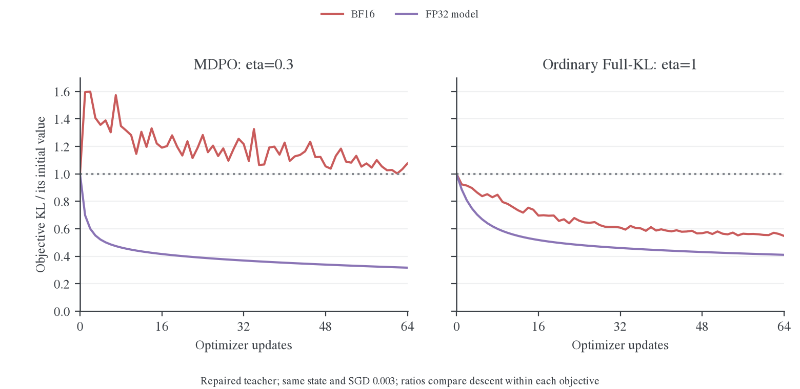
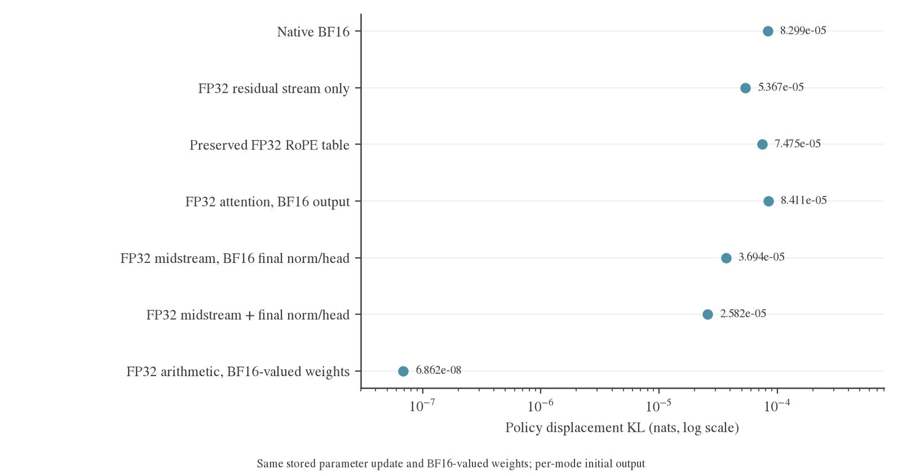
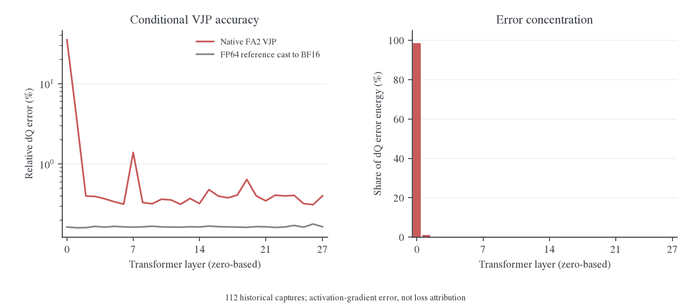
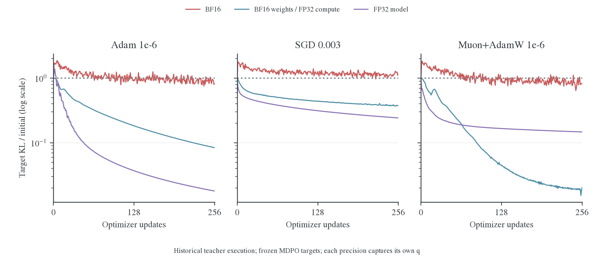
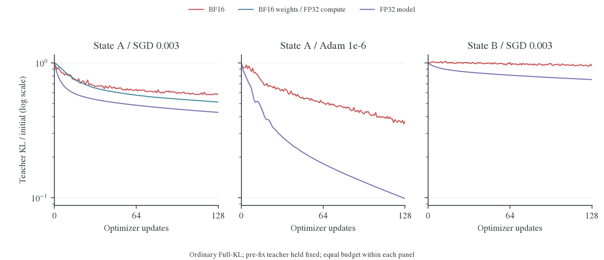

# 精度、优化器历史与实际策略更新

这些受控实验区分三种现象：optimizer 历史使当前梯度很小时仍产生位移；相同参数位移在不同前向精度下产生不同策略变化；有限步求解可能没有降低近目标 MDPO 子问题。实验还定位了教师 RoPE buffer 在加载时被舍入的问题。

主体使用真实 1.5B 师生、固定数学前缀和本机捕获的模型/Adam 状态；原 E45/E47 晚期 checkpoint 不可用。先定义目标分解，再依次查看 optimizer 与步幅、前向精度、多步求解和普通 OPD 的对照。长期结果见[正式训练报告](production.md)，执行配置与修复见[数值入口](../README.md)。

<a id="history"></a>
<a id="history-mdpo-优化器历史与前向精度因果对照"></a>
<a id="precision"></a>
<a id="precision-mdpo-与-opd-的精度问题机制验证与修复"></a>

<a id="precision-2-mdpo-的-kl-上升可以直接由目标分解解释"></a>

## 目标分解与诊断量

对一个固定前缀，记当前学生为 $p$，内层开始时冻结的旧策略为 $q$，冻结教师为 $T$。本文主对照取 $\kappa=0$、$\eta=0.3$。在相同正支持上，融合目标为

$$
\widetilde m_i=q_i^{1-\eta}T_i^\eta,\qquad
Z=\sum_i\widetilde m_i,\qquad m_i=\widetilde m_i/Z.
$$

将 $\log m_i=(1-\eta)\log q_i+\eta\log T_i-\log Z$ 代入 KL 定义，使用 $\sum_i p_i=1$，得到

$$
\begin{aligned}
\mathrm{KL}(p\Vert m)
&=(1-\eta)\mathrm{KL}(p\Vert q)+\eta\mathrm{KL}(p\Vert T)+\log Z,\\
J(p)&=\frac{\mathrm{KL}(p\Vert m)-\log Z}{\eta}
=\mathrm{KL}(p\Vert T)+\left(\frac1\eta-1\right)\mathrm{KL}(p\Vert q).
\end{aligned}
$$

同一内层中 $Z$ 与 $\eta$ 不变，比较 $J$ 和比较 target KL 的升降完全等价。$\eta=1$ 时，目标就是普通 Full-KL；$\eta=0.3$ 时，anchor KL 的系数为 $7/3$。

**修复教师加载后，仍有一个直接的数值例子。** 状态 A 的 BF16 SGD 在 64 次 MDPO 更新中，teacher KL 从 9.018e-4 降到 6.937e-4，改善 2.081e-4；anchor KL 从零增至 9.777e-5，乘 $7/3$ 后增加 2.281e-4。于是 $J$ 增加约 2.008e-5，target KL 从 7.900e-5 升到 8.502e-5。学生靠近了教师，但没有以足够小的策略位移完成这次学习。



图 1：同一状态 A、同一保真教师、SGD 0.003、64 次更新。每个面板内比较相同目标下的 BF16 与 FP32；纵轴以各自起点归一化，不能跨面板据此给算法排名。MDPO 的 BF16 target KL 上升，而普通 OPD 的 teacher KL 整体下降；提高学生执行精度后，两种目标均能下降。

在理想可微起点 $p=q$，

$$
\nabla_\theta\mathrm{KL}(p_\theta\Vert q)\big|_{\theta_0}
=\sum_i\nabla_\theta p_i[\log(p_i/q_i)+1]\big|_{\theta_0}
=\nabla_\theta\sum_i p_i=0.
$$

因此，减小 $\eta$ 不会自动缩小第一步的学习率，却提高了离开旧策略的代价。若令 $\ell=\log(T/q)$、$A(\eta)=\log\mathbb E_q e^{\eta\ell}$，则 $\mathrm{KL}(q\Vert m)=A(\eta)-\eta\mathbb E_q\ell$。由 $A'(0)=\mathbb E_q\ell$、$A''(0)=\operatorname{Var}_q\ell$，其二阶项为 $\eta^2\operatorname{Var}_q\ell/2$。目标距离会变得更小，而数值执行未必提供同样细的更新响应。

旧参数本身属于可行集合，所以子问题的全局最优值不会高于起点。返回更差的迭代点说明实际有限步求解没有达到这个标准；不能用精确 mirror descent 的理论结论替代内层求解验收。

<a id="history-setting-与实验设计"></a>

## 输入、checkpoint 与控制条件

<a id="history-1-固定条件与对照定义"></a>

<a id="1-固定条件与对照定义"></a>

### 固定条件与对照定义

四张 H800，实际 R1-Distill-Qwen-1.5B 学生及 JustRL-DeepSeek-1.5B 教师，生产 FSDP2。Checkpoint 已执行 144 次更新，339 个 Adam 条目的 step 均为 144。配置为 MDPO、κ=0、η=0.3、LR=1e-6、betas=(0.9,0.999)、eps=1e-8、weight_decay=0.01、clip norm=1。

每 rank 一条固定数学回答，完整输入始终保留前 128 个 response token。主实验使用全部位置；位置对照分别只启用前 64 或后 64 个 loss 位置，模型输入长度和 attention 分块条件保持不变。四条回答等长，因此这里的 token averaging 与 response averaging 一致。

对每个 loss mask，只执行一次真实 backward，保存裁剪后的同一份梯度 G、原始 FP32 master θ、Adam 状态 H 和实际更新 U(G;H)。所有其他更新都从 θ、H 的独立副本产生；不会把一条分支的状态带到下一条。三个 mask 的独立 optimizer 重放都与原生 FSDP2 更新逐参数完全一致，差分范数为零。

| 分支            | 定义                                  | 解释                                           |
| --------------- | ------------------------------------- | ---------------------------------------------- |
| 原 Adam         | U(G;H)                                | 实际更新                                       |
| 零当前梯度      | U(0;H)                                | 保留历史矩和 counter；grad 是零张量，不是 None |
| 仅 weight decay | g=0、m=0，保留 v/counter/weight_decay | 区分动量运动与衰减                             |
| 清一阶矩        | U(G; m=0,v,t)                         | 不清二阶矩与 counter                           |
| Fresh Adam      | 清 m/v/counter 后使用 G               | 原始步幅与匹配步幅均记录                       |
| 当前梯度增量    | U(G;H)−U(0;H)                         | 当前 G 对 Adam 更新的差分影响，包含 v 的变化   |
| 负梯度方向      | −cG                                   | 无历史的 SGD 方向，c 使参数步幅与原 Adam 匹配  |

范数匹配发生在全局 FP32 参数空间。考虑 θ 加法舍入后，实际匹配误差最大为 0.143%。这些是独立的一步干预，不是已定义好状态演化规则的新训练 optimizer。

<a id="history-实验结果"></a>

## 优化器历史、位移和算术精度

本节先给出一步控制，再给出多步 Adam/SGD/Muon、精度与返回策略的结果。新增结果表明 BF16 下可以找到更好点，部分长预算配置的末点也能下降；问题不是绝对的数值下限，而是近目标的数值响应与短内层求解不匹配。

一步对照确认了两个独立事实：保留 Adam 历史，即使把当前梯度设为零，也会产生接近原步幅的更新并使 target KL 上升；去掉历史、匹配参数更新范数，仍未解决 BF16 下的反弹。同一份参数更新在 FP32 前向中存在降低同一冻结目标的步长，而测试的 BF16 非零更新全部高于起点。因此，Adam 历史确实影响轨迹，但不是这份状态下反弹的唯一原因。

一步控制采集于 2026-10-26 晚，多步与集成实验采集于 2026-10-27。它继续使用[前一轮审计](2026-10-26-数值链路审计.md)构造的真实模型和 Adam，补齐 _From Gradients to Capabilities_ 的零梯度与范数匹配控制。[^history-mopd] 原 E45/E47 的晚期 checkpoint 仍不可用，不能将本机结果的比例直接移植到原 run。

<a id="history-2-当前梯度为零历史仍推动接近原步幅的更新"></a>

<a id="2-当前梯度为零历史仍推动接近原步幅的更新"></a>

### 当前梯度为零，历史仍推动接近原步幅的更新

全部 128 个位置上的结果：

| 更新                     | 全局参数位移范数 | 与原 Adam 更新的 cosine | 与负当前梯度的 cosine |
| ------------------------ | ---------------- | ----------------------- | --------------------- |
| 原 Adam                  | 0.00372461       | 1                       | 0.19061               |
| 零当前梯度               | 0.00337002       | 0.93985                 | 0.04921               |
| 清一阶矩，未匹配范数     | 0.00127877       | 0.43697                 | 0.42560               |
| 当前梯度增量，未匹配范数 | 0.00127895       | 0.43575                 | 0.42543               |
| Fresh Adam，未匹配范数   | 0.03497279       | 0.36483                 | 0.37026               |

零梯度步的范数是原更新的 90.48%；当前梯度增量的范数是原更新的 34.34%。这两个比例不能相加为百分比分解，因为向量并不平行。更不能把 90.48% 称为“90.48% 的 KL 反弹由动量造成”：权重舍入和模型前向是非线性的。

本状态下，仅 weight decay 的实际 FP32 位移为零；零梯度分支的可见运动来自保留的优化器历史。这个测量保留了原 weight_decay=0.01，没有通过把 grad 设为 None 而跳过整个 optimizer step。

<a id="history-3-去掉历史并匹配步幅bf16-目标仍反弹"></a>

<a id="3-去掉历史并匹配步幅bf16-目标仍反弹"></a>

### 去掉历史并匹配步幅，BF16 目标仍反弹

每条分支都重新从同一 θ 出发，q、T、m 完全冻结。测量使用原生前向投影和独立 FP64 行归约。

| 一步干预                   | 初始 target KL | 更新后 target KL |
| -------------------------- | -------------- | ---------------- |
| 原 Adam                    | 6.480e-5       | 1.172e-4         |
| 零当前梯度                 | 同上           | 1.059e-4         |
| 清一阶矩，匹配参数范数     | 同上           | 1.123e-4         |
| Fresh Adam，匹配参数范数   | 同上           | 1.120e-4         |
| 当前梯度增量，匹配参数范数 | 同上           | 1.069e-4         |
| 负梯度方向，匹配参数范数   | 同上           | 2.188e-4         |
| 仅 weight decay            | 同上           | 6.480e-5，不变   |

零梯度分支上升说明，这种反弹不需要当前这一步的 loss 梯度参与；历史中仍包含过去的学习信号。另一方面，无历史的负梯度方向也上升，说明保留 Adam 历史不是反弹的必要条件。两者可以同时成立。

位置对照保持完整 128-token 输入，仅改变 loss mask：

| Loss 位置 | 初始 target KL | 原 Adam  | 零当前梯度 | 清 m、匹配范数 | 负梯度、匹配范数 |
| --------- | -------------- | -------- | ---------- | -------------- | ---------------- |
| 全部 128  | 6.480e-5       | 1.172e-4 | 1.059e-4   | 1.123e-4       | 2.188e-4         |
| 前 64     | 3.831e-5       | 6.890e-5 | 8.358e-5   | 9.675e-5       | 2.431e-4         |
| 后 64     | 9.128e-5       | 1.333e-4 | 1.282e-4   | 1.530e-4       | 4.292e-4         |

零梯度步的范数相对各自原 Adam 分别为 90.48%、91.61%、80.63%，cosine 分别为 0.940、0.927、0.858。它们来自同一 checkpoint 的重叠位置控制，不是三个独立训练 seed。

<a id="history-4-固定更新缩放后bf16-与-fp32-的行为仍不同"></a>

<a id="4-固定更新缩放后bf16-与-fp32-的行为仍不同"></a>

### 固定更新缩放后，BF16 与 FP32 的行为仍不同

复用主实验保存的完全相同梯度与更新向量，测试 c∈{0,0.03,0.1,0.2,0.3,1}，直接构造 θ+cU，不重新执行 backward 或 Adam。覆盖原 Adam、零梯度步、匹配范数的清 m 方向及负梯度方向。

BF16 下，20 个非零候选没有一个低于初始 target KL=6.480e-5；更新后范围为 1.007e-4–2.188e-4。四个零倍数控制则与起点逐项完全一致。不能将这个有限扫描外推成“任意小步都不可能下降”。

再把每个候选的参数舍入到相同 BF16 权重值，以 FP32 前向评估。原始 q、T、m 仍冻结；FP32 起点相对于该 m 的 KL 为 1.855e-4，包含切换前向精度带来的静态偏差。因此下表比较各自精度下更新前后的变化，不直接比较两列的绝对高低。

| 同一份参数更新        | BF16：更新前 → 后   | FP32：更新前 → 后，同一冻结 m |
| --------------------- | ------------------- | ----------------------------- |
| 原 Adam ×0.1          | 6.480e-5 → 1.221e-4 | 1.855e-4 → 1.852e-4           |
| 清 m、匹配范数 ×0.3   | 6.480e-5 → 1.125e-4 | 1.855e-4 → 1.826e-4           |
| 负梯度、匹配范数 ×0.2 | 6.480e-5 → 1.032e-4 | 1.855e-4 → 1.808e-4           |

同时记录每种精度相对其自身初始策略的 KL，去掉静态精度偏差：原 Adam ×0.03 在 BF16 下为 8.591e-5，在 FP32 下为 6.332e-9。这个比较固定了参数更新和有效权重，变化发生在前向。前一轮进一步固定 SDPA math backend 的控制见原报告第 9.2 节，不能仅用 FlashAttention 后端差异解释。

同范数 SGD 更差也不证明梯度方向本身错误。在 FP32 前向下，完整范数的负梯度步引起 1.504e-4 的策略 KL，而原 Adam 只有 6.837e-6，相差约 22 倍。参数空间的欧氏范数没有控制策略空间的位移；缩小负梯度步后才出现下降。

额外记录的 `mode_target_kl` 为每种前向精度用自身初始策略重建的 target，仅用于补充分析。它与共同冻结 m 不同，不能混进上表。

<a id="history-7-多步求解器精度与返回策略"></a>

<a id="7-多步求解器精度与返回策略"></a>

### 多步求解器、精度与返回策略

本节最初实验基于 `fd5f4a479`，纳入 **58 个有效训练分支、3360 次成功更新**，另用 128 次普通 Full-KL 更新构造第二份状态。随后合入生产数值修复再做 4 个分支、80 次更新（7.9 节），合计 **62 个有效分支、3440 次求解器更新**。新增结果改变了仅凭短内层实验能够作出的判断：BF16 下并非找不到更好的参数；Muon、Adam 的部分长预算设置能降低末点 KL，但效果取决于状态、步长与预算。中间表示精度的干预更直接，而且可以在保持优化器不变时恢复下降。

<a id="history-71-实际多步更新与-muon-定义"></a>

<a id="71-实际多步更新与-muon-定义"></a>

#### 实际多步更新与 Muon 定义

这次每一步都重新计算当前策略梯度，持续演化 optimizer 状态，不再只是把一次保存的更新缩放后打分。所有分支从对应 checkpoint 独立恢复，同一内层期间 q、T、m 不变。独立评分使用原生模型投影与 FP64 行归约；256 步确认实验每步评分，并保存、恢复复测最佳模型和 optimizer 状态。

Muon 使用 PyTorch 2.11 的原生 Newton–Schulz 实现：momentum=0.95、Nesterov、5 次迭代、`match_rms_adamw` 缩放。196 个隐藏层二维参数（1,310,195,712 个元素）用 Muon；143 个 embedding/head/norm/bias 参数（466,892,288 个元素）用 AdamW。它是 **Muon+AdamW 混合优化器**，不是对所有参数直接套 Muon。[^history-torch-muon]

在 FSDP2 下先取得完整矩阵方向，再做原生正交化，最后分发回原分片；没有对各 rank 的局部切片分别做 Muon。四进程 CPU 与四卡 GPU 测试覆盖 13×7 / 7×13 两种矩阵方向、不等长分片、连续四次更新和状态恢复，与完整矩阵原生 Muon/AdamW 参考逐参数一致。Muon 的正交化内部仍使用原生 BF16；全模型 FP32 对照没有偷偷换掉它。

主实验优化器 weight decay 均为 0；保存的状态 A 来自前述历史训练。Adam 扫描区分保留原状态、清空状态，以及 β₁=0 但保留二阶矩/counter。SGD 不使用动量。

初版实验脚本曾在重建 scheduler 时误用 checkpoint 的 `initial_lr`，使七个 Adam 扫描项仍执行 LR=1e-6。这 **112 次更新不计入有效比较**，相关设置已重跑。最终脚本在构建 scheduler 前重置 `initial_lr`，并同时断言配置 LR 与逐更新实际 LR；数据中保留排除理由。这是本轮工具问题，不能拿来解释原训练反弹。

<a id="history-72-16-次更新换优化器名字仍不足以恢复下降"></a>

<a id="72-16-次更新换优化器名字仍不足以恢复下降"></a>

#### 16 次更新：换优化器名字仍不足以恢复下降

状态 A 的初始 target KL 均为 6.480e-5。下表报告有限扫描中最小的末次 KL，不宣称找到了全局最优学习率。

| 求解器           | 扫描 LR                 | 最好的扫描末点 | 对应 LR |
| ---------------- | ----------------------- | -------------- | ------- |
| Adam，保留状态   | 1e-7、3e-7、1e-6        | 7.944e-5       | 1e-7    |
| Adam，重新初始化 | 1e-7、3e-7、1e-6        | 8.290e-5       | 1e-7    |
| Adam，β₁=0       | 3e-8、1e-7、3e-7        | 8.064e-5       | 3e-7    |
| SGD，无动量      | 1e-4、1e-3、0.003、0.01 | 8.413e-5       | 0.003   |
| Muon+AdamW       | 1e-7、3e-7、1e-6        | 8.137e-5       | 1e-6    |

16 个设置的独立更新后评分都没有找到低于起点的点。这排除了“只换成 SGD 或 Muon，原 16-step 协议就自然修复”的解释。

<a id="history-73-延长到-256-步能够下降但末点会丢掉已有改善"></a>

<a id="73-延长到-256-步能够下降但末点会丢掉已有改善"></a>

#### 延长到 256 步：能够下降，但末点会丢掉已有改善

状态 A，初始 target KL=6.480e-5；下面各行是独立恢复后的求解，不能拼接成一条轨迹。

| 求解器 / LR              | 最佳更新编号 | 最佳 target KL | 第 256 次之后 | 末 32 次中低于起点 |
| ------------------------ | ------------ | -------------- | ------------- | ------------------ |
| Adam，保留状态，1e-6     | 85           | 6.281e-5       | 8.494e-5      | 0/32               |
| SGD，0.003               | 191          | 5.754e-5       | 7.214e-5      | 7/32               |
| Muon+AdamW，1e-6         | 171          | 5.070e-5       | 5.101e-5      | 27/32              |
| Muon+AdamW，独立进程重复 | 133          | 5.016e-5       | 6.314e-5      | 21/32              |
| Adam，重新初始化，1e-7   | 254          | 4.896e-5       | 6.702e-5      | 23/32              |
| Adam，保留状态，3e-7     | 221          | 5.121e-5       | 5.792e-5      | 8/32               |

最佳模型和对应 optimizer 状态已恢复；optimizer 状态逐值一致，重新评分与保存时的 KL 相符。因而这些改善不是训练读数误差。冷 Adam 在第 254 次找到更好点，随后两次又使结果高于起点，是“返回最后一步”丢失改善的直接例子。

早期 128-step 探针每四步做独立评分，曾漏掉 Adam 的较好中间点；上表改用每步评分后确认。原始训练读数与对齐的独立评分最大差异约 4.54e-8，远小于这些 KL 变化。

这并不支持 Muon 普遍优于 Adam，也不支持 BF16 存在严格不可突破的 KL 下限。有限预算、更新方向/尺度和最终选择的迭代点都影响结果。最佳状态的恢复目前是诊断功能，尚未接入生产 trainer 的返回策略；若在原 16 步内没有更好点，选择最佳只能退回起点，不能凭空创造学习进展。

<a id="history-74-冻结-backbone-与提高前向精度的控制"></a>

<a id="74-冻结-backbone-与提高前向精度的控制"></a>

#### 冻结 backbone 与提高前向精度的控制

同一状态 A、同一 BF16 策略与冻结目标，仅限制 optimizer 实际更新哪些参数。未更新参数均逐值检查保持不变。

| 更新范围 / 求解器 | LR / 更新数 | 起始 target KL | 末点           |
| ----------------- | ----------- | -------------- | -------------- |
| 全模型 Adam       | 1e-6 / 16   | 6.480e-5       | 8.876e-5       |
| 仅输出头 Adam     | 1e-6 / 16   | 同上           | 5.393e-5       |
| 仅输出头 Adam     | 1e-5 / 16   | 同上           | 3.005e-5       |
| 仅输出头 SGD      | 0.001 / 16  | 同上           | 5.728e-5       |
| 仅输出头 SGD      | 0.01 / 16   | 同上           | 3.880e-5       |
| 仅输出头 SGD      | 0.1 / 16    | 同上           | 3.941e-2，发散 |
| 仅 backbone Adam  | 1e-6 / 16   | 同上           | 8.143e-5       |

输出头在合适步长下能优化同一个目标，更新 backbone 后则出现困难。这不是说 backbone 永远不能训练：该干预改变了可行参数子空间和曲率，过大的输出头 LR 仍会失败。脚本仍计算完整 backward 后再屏蔽非更新参数，不能据此声称获得了 head-cache 吞吐收益。

再用同一份 BF16 值的初始参数比较精度。两边 master 起点均一次性舍入到 BF16 值；随后按各自执行精度更新。每种精度用自身初始策略冻结 q，所以目标不完全相同，单靠这张表不能完成严格的前向归因。

| 求解器，32 次更新 | BF16：起始 → 末点   | FP32：起始 → 末点   |
| ----------------- | ------------------- | ------------------- |
| Adam，1e-6        | 6.480e-5 → 7.946e-5 | 6.514e-5 → 1.097e-5 |
| SGD，0.003        | 6.480e-5 → 8.136e-5 | 6.514e-5 → 2.878e-5 |
| Muon+AdamW，1e-6  | 6.480e-5 → 8.966e-5 | 6.514e-5 → 1.516e-5 |

三个求解器都能在 FP32 路径下降，说明问题并非某一种 optimizer 的实现错误。严格控制参数更新与有效权重的前向归因见 7.6 节。

<a id="history-75-中间精度干预与第二份独立状态"></a>

<a id="75-中间精度干预与第二份独立状态"></a>

#### 中间精度干预与第二份独立状态

进一步保留 BF16 权重，在不改变目标公式、η 和 optimizer 的条件下，改变中间表示的计算/存储精度。

| 状态 A 的 32-step 末点                                      | Adam 1e-6 | SGD 0.003 | Muon+AdamW 1e-6 |
| ----------------------------------------------------------- | --------- | --------- | --------------- |
| BF16 权重、FP32 算术，起始 6.514e-5                         | 3.065e-5  | 3.714e-5  | 2.815e-5        |
| BF16 主干 GEMM 输入、FP32 投影输出与中间计算，起始 6.383e-5 | 4.142e-5  | 4.980e-5  | 3.969e-5        |

第二行仍使用 BF16 参数和主干矩阵乘输入、FlashAttention2；线性层输出保留 FP32，residual、RMSNorm 输出、SiLU/gating 等后续中间量也保留 FP32，并关闭 FSDP block 边界的强制输入降精度。Full-vocab head 在这些模式下走 FP32 路径，因此不能说所有 GEMM 都保持原来的 BF16 快路径，也未测其端到端性能。

在启用 FP32 中间精度组合的基础上，只提高 MLP 投影输出精度，Adam 的 32-step target KL 为 6.368e-5 → 4.225e-5；只提高 attention 投影输出为 6.426e-5 → 5.180e-5。该 FP32 中间精度组合的同预算对照为 6.431e-5 → 5.101e-5。不同组合改变了初始策略与梯度，不能凭单次末点排序给每个算子分配损害比例。

为排除特定旧状态或过去 MDPO target 算术的影响，另从初始学生出发，在相同四条回答的第 128–255 个位置上做 **8 outer × 16 次普通 Full-KL 更新**（η=1、precompute），得到状态 B。其独立评分 teacher KL 为 5.559e-4，新的 MDPO target KL 为 5.086e-5。它不是状态 A 的继续训练，也不是另一随机 seed 的正式 on-policy run。

| 状态 B                                 | 初始 target KL | 末点                                        |
| -------------------------------------- | -------------- | ------------------------------------------- |
| BF16 全模型 Adam 1e-6，32 步           | 5.086e-5       | 1.009e-4                                    |
| BF16 全模型 SGD 0.003，32 步           | 同上           | 1.002e-4                                    |
| BF16 全模型 Muon 3e-7，32 步           | 同上           | 8.725e-5                                    |
| BF16 全模型 Muon 1e-6，256 步          | 同上           | 7.616e-5；最佳更新后值 5.724e-5，仍高于起点 |
| BF16 仅输出头 Adam 1e-6，32 步         | 同上           | 4.146e-5                                    |
| BF16 仅输出头 SGD 0.001，32 步         | 同上           | 4.889e-5                                    |
| FP32 全模型 SGD 0.003，32 步           | 5.240e-5       | 4.053e-5                                    |
| BF16 权重、FP32 算术，SGD 0.003，32 步 | 5.240e-5       | 4.692e-5                                    |

状态 B 的混合投影输出模式初始 target KL 为 5.474e-5，Adam/SGD/Muon 的 32-step 末点分别为 4.997e-5、6.088e-5、4.629e-5。它缓解了问题，但 SGD 在此设置仍失败；把整个前向算术提高到 FP32、同时保留 BF16 权重后，SGD 才恢复下降。

所以，换 Muon 或采用某一种混合精度折中都不是普适开关。实验定位的是近目标求解对实际前向精度的需求，而不是“BF16 权重一律不能用”。

精度干预的名称是脚本标识。2026-10-27 的代码复核确认，`fp32_residual` 还会改变 RoPE 表值／乘加的 dtype、FSDP 输入转换和输出头路径，不能将其收益单独归于 residual 或 normalization。数值记录保持不变，完整干预范围、曲线与外部证据见[综合报告](#precision-precision-path)。

<a id="history-76-同一参数更新的误差分解策略漂移主要来自计算差异的变化"></a>

<a id="76-同一参数更新的误差分解策略漂移主要来自计算差异的变化"></a>

#### 同一参数更新的误差分解：策略漂移主要来自计算差异的变化

固定先前保存的同一份实际参数更新及相同 BF16 权重值，令 ℓ₀、ℓ₁ 为低精度前向的 log probabilities，r₀、r₁ 为 FP32 算术参考。计算差异 eᵢ=ℓᵢ−rᵢ 满足

$$
\Delta\ell=\Delta r+\Delta e.
$$

对每个前缀按初始策略 q 加权并中心化，则有精确的方差恒等式：

$$
\tfrac12\operatorname{Var}_q(\Delta\ell)
=\tfrac12\operatorname{Var}_q(\Delta r)
+\tfrac12\operatorname{Var}_q(\Delta e)
+\operatorname{Cov}_q(\Delta r,\Delta e).
$$

它分解的是局部二次型，不是把真实训练 KL 的因果贡献线性分账。对 LR=1e-7 对应的固定更新：

| 量                           | BF16 前向 |
| ---------------------------- | --------- |
| 实际更新前后策略 KL          | 8.299e-5  |
| 局部二次型总量               | 8.297e-5  |
| FP32 参考响应项              | 6.816e-8  |
| 计算差异变化项               | 8.205e-5  |
| 交叉项                       | 8.578e-7  |
| 更新前后计算差异的加权相关性 | 0.745     |

二次型与实际策略 KL 很接近，恒等式残差约 2e-22。小参数更新下，主要变化不是 FP32 参考中的平滑响应，而是低精度计算差异随参数的变化。固定参数重复前向的零更新控制仍为零；这里不是同一参数反复推理时随机漂移。

相同更新、相同有效权重下，各种前向策略的实际策略位移 KL 为：

| 前向策略                            | 策略位移 KL |
| ----------------------------------- | ----------- |
| 原 BF16                             | 8.299e-5    |
| FP32 中间精度组合（见 7.5 节说明）  | 2.582e-5    |
| 在此基础上，MLP 投影输出 FP32       | 2.193e-5    |
| 在此基础上，attention 投影输出 FP32 | 2.589e-5    |
| 所有主干投影输出 FP32               | 1.838e-5    |
| 同一 BF16 权重值、全 FP32 算术      | 6.862e-8    |

这组对照不重新计算梯度、不改变 optimizer 更新，因此提供了前向因果证据。FP32 中间精度组合减少了较大部分放大，MLP 与全部投影输出的进一步保留又降低了一部分；没有证据支持将全部问题归于单个 attention kernel。

对本节 κ=0，冻结目标为 $m\propto q^{1-\eta}T^\eta$，实际优化目标为

$$
J(p)=\frac{\mathrm{KL}(p\Vert m)-\log Z_m}{\eta}
=\mathrm{KL}(p\Vert T)+\left(\frac1\eta-1\right)\mathrm{KL}(p\Vert q).
$$

q 是实际旧策略，包含其执行路径的数值特征。参数改变后，这些数值特征也会改变，KL(p∥q) 会把它们计入真实策略漂移；KL 本身没有算错。在 η=0.3 时，这个漂移以 7/3 的系数进入 J，所以 teacher KL 改善仍可能被 anchor 惩罚超过。η=1 的普通 Full-KL 不含这一项，不能要求同一组优化器参数在两个子问题上同样有效。

状态 A 的 Adam 1e-6、16 步给出直接的数值例子：teacher KL 从 7.394e-4 降到 5.719e-4，改善 1.675e-4；anchor KL 从零增至 1.060e-4，乘 7/3 后增加 2.474e-4。于是 J 从 7.394e-4 升到 8.193e-4，target KL 也从 6.480e-5 升到 8.876e-5。教师拟合确实改善了，但没有以足够小的策略位移实现。

在 p=q 的理想可微起点，anchor KL 的一阶梯度为零，初始目标梯度等于 teacher KL 梯度；减小 η 并不自动缩小这一步的学习率。随后需要拟合的目标更靠近 q，而当前低精度执行路径对小参数位移的响应未必足够细。这解释了为何只调 η、沿用短内层和既有 Adam 状态，并不能得到精确 mirror 更新的保证。

q 自身属于可行参数集合，所以子问题的全局最优值不会高于起点。当前返回的迭代点高于起点，说明有限步求解没有达到这个基本标准；它不是 mirror descent 理论要求 KL 上升。长预算和最佳状态恢复的对照正是在检验求解与返回环节。

<a id="history-77-可以确定的原因与尚不能宣称的修复"></a>

<a id="77-可以确定的原因与尚不能宣称的修复"></a>

#### 可以确定的原因与尚不能宣称的修复

对本机代码、模型及这两份受控状态，证据支持以下结论：

- 目标公式、单次 1/η 和日志归约不是此次反弹的主要解释；去掉输出数值误差的参考路径也仍会反弹。
- Adam 历史会在当前梯度很小时继续产生运动，但去掉历史、改 SGD 或 Muon 不能自动消除问题。
- 当前 BF16 执行路径对很小参数变化的响应过粗，多层中间表示的舍入改变了策略输出；低精度前向使近目标子问题难以在短预算内可靠求解。
- 内层预算和返回策略确实重要。长预算能找到更好的点，部分设置末点也能下降；返回最后一步可能丢失已经找到的改善。因此不能把现象称作严格、不可突破的 BF16 KL 下限。
- 在这些固定状态上，更高的中间精度、合适步长或限制更新范围可以恢复下降。

混合精度原型只用于 Qwen2 诊断，尚未完成长序列、多样本 packed attention、rollout/anchor/训练精度一致性及正式任务质量验收。部署收益还取决于 rollout 与训练的精度一致性。

<a id="history-78-复现与验收"></a>

<a id="78-复现与验收"></a>

#### 复现与验收

[完整汇总与逐步数据](../../../experiments/teacher-transfer/optimizer-precision/mechanism/data/solver-precision-20261027.json)保留所有有效分支、被排除的 LR pilot、两个状态的协议、前向控制和误差分解。原始日志与最佳状态张量保存在 `outputs/mirror-solvers-20261027/`。没有生成 HTML 或离线浏览页。

- [audit_mirror_solvers.py](../../../../research/studies/precision/audit_mirror_solvers.py)：实际多步优化、每步/定期独立评分、更新范围控制和最佳状态恢复；支持从初始学生用 η=1 Full-KL 构造新状态。
- [solver_optimizers.py](../../../../research/backends/solver_optimizers.py)：全矩阵 Muon+AdamW 诊断适配及 LR 恢复辅助函数。
- [probe_mirror_forward.py](../../../../research/studies/precision/probe_mirror_forward.py)：固定更新的前向精度对照及 log-policy 变化分解。
- [summarize_mirror_solvers.py](../../../../research/studies/precision/summarize_mirror_solvers.py)：检查实际 LR、更新执行、目标冻结、最佳状态复测，再生成汇总。

分支 JSON 示例：

```json
[
  {"solver":"adam_saved","lr":0.000001,"steps":16},
  {"solver":"sgd","lr":0.003,"steps":32},
  {"solver":"muon","lr":0.000001,"steps":256,"save_best":true},
  {"solver":"adam_saved","lr":0.000001,"steps":32,"rounded":true,"precision":"bf16_gemm_fp32_outputs"}
]
```

从仓库根目录，在已分配的前四卡运行：

```bash
PYTHON=/root/.local/share/mirroropd/venvs/profile-cu128/bin/python
MD_DIR=examples/mirroropd/docs/theory/mirror-descent
CUDA_VISIBLE_DEVICES=0,1,2,3 OMP_NUM_THREADS=1 PYTHONPATH=. \
  "$PYTHON" -m torch.distributed.run --standalone --nproc-per-node=4 \
  -m examples.mirroropd.research.studies.precision.audit_mirror_solvers \
  --student ../model/hub/deepseek-ai--DeepSeek-R1-Distill-Qwen-1.5B/ad9f0ae0864d7fbcd1cd905e3c6c5b069cc8b562 \
  --teacher ../model/hub/hbx--JustRL-DeepSeek-1.5B/0637e4096c789c67f9eecbe8355e0bdeddede1c2 \
  --prefixes "$MD_DIR/data/near-target-prefixes.json" \
  --checkpoint ../model/checkpoints/production/mirror-kl-review-20261026/fixed-prefix/warm-checkpoint \
  --branches outputs/mirror-solvers-20261027/long-exact.json \
  --out outputs/mirror-solvers-recheck
```

`save_best` 保存的是诊断用的参数分片、optimizer 与常数 scheduler 状态，已经在同一冻结目标下恢复复测；它不是完整生产 trainer checkpoint。复查该 KL 时必须先从原 checkpoint 重建旧 anchor，再恢复最佳状态，不能把最佳模型重新作为 anchor。

有效分支全部执行完成，非有限/跳过更新计数均为零；目标恒等式最大误差约 1.39e-17。CPU 控制测试共 **13 passed**，覆盖实际 LR 覆盖、CPU 快照独立性、Muon 参数分组及变化分解的零变化/固定误差不变量。GPU 有其他任务共享，计时包含额外评分和状态复制，不用于 optimizer 吞吐排名。

<a id="history-79-合入生产数值修复后的复查"></a>

<a id="79-合入生产数值修复后的复查"></a>

#### 合入生产数值修复后的复查

上述主实验完成后，将生产主分支 `de018d89f`（含稳定 target、行归约与 sampled CE 修复）合入，集成提交为 `f2b0b3c01`。从同一状态 A 重新恢复，在相同位置、目标与 LR 下复查。

| 修复后分支                      | 初始 target KL | 第 16 次更新后 |
| ------------------------------- | -------------- | -------------- |
| BF16，Adam 1e-6                 | 6.480e-5       | 7.968e-5       |
| BF16，SGD 0.003                 | 6.480e-5       | 9.133e-5       |
| BF16，Muon+AdamW 1e-6           | 6.480e-5       | 7.408e-5       |
| BF16 权重、FP32 算术，SGD 0.003 | 6.514e-5       | 4.112e-5       |

前三个分支均完成 16 步，独立评分没有找到低于起点的更新。第四个分支总共运行 32 步，上表取其中第 16 步以对齐预算；第 32 步为 3.714e-5。所有 80 次更新成功，CPU 控制测试在集成后再次 **13 passed**。

这些结果把当前生产数值补丁与本节机制证据连接起来：修复算子后短 BF16 求解仍会反弹，保留 BF16 权重而提高前向算术精度仍能恢复下降。不同进程的末点存在波动，不能用新旧各一次末点之差宣称数值补丁使训练改善或恶化；这里只判断反弹是否仍存在，以及干预能否恢复下降。

<a id="history-参考文献"></a>

#### 参考文献

[^history-mopd]: Siqi Zhu et al. From Gradients to Capabilities: Understanding Multi-Teacher On-Policy Distillation. arXiv v1, 2026. [论文](https://arxiv.org/html/2610.02179v1).

[^history-torch-muon]: PyTorch. Muon optimizer，2.11 文档及本机 2.11.0 源码。[官方文档](https://docs.pytorch.org/docs/2.11/generated/torch.optim.Muon.html).

<a id="precision-3-已定位的执行问题"></a>

## 前向精度与加载问题

<a id="precision-31-教师-rope-buffer-被加载流程舍入已修复"></a>

<a id="31-教师-rope-buffer-被加载流程舍入已修复"></a>

### 教师 RoPE buffer 被加载流程舍入，已修复

HF 将 Qwen2 的 `inv_freq` 和 `original_inv_freq` 初始化为 FP32。原 FSDP 构建代码为了统一参数 dtype 调用 `module.to(torch_dtype)`；该 API 会同时转换浮点参数和 buffer。[^precision-module-to] 默认 forward-only 教师的存储 dtype 为 BF16，两个频率 buffer 随之舍入；学生的 FP32 master 路径则保留了原频率。

这改变了相同 checkpoint 权重对应的实际教师。RoPE 的频率误差还会被位置因子放大：相位变化为 $t\,\Delta\omega$。角度计算内部再调用 `.float()` 只能扩展已舍入的值，不能恢复原频率。它与 RoPE 历史 casting 问题属于同一类失真。[^precision-rope-issue][^precision-rope-pr]

| 同一真实教师权重、四条固定前缀  | 相对原 HF 加载模型的平均 KL |
| ------------------------------- | --------------------------- |
| 原始加载，BF16 参数与 FP32 频率 | 0                           |
| 再做整模型 BF16 转换            | 1.112e-4                    |
| 对已舍入频率仅转回 FP32         | 1.112e-4                    |
| 参数 dtype 统一时保留原 buffer  | 0，输出逐位一致             |

修复集中在共享的 [FSDP 模型构建](../../../../../../verl/workers/engine/fsdp/transformer_impl.py)与 [cast_module_parameters](../../../../../../verl/utils/torch_dtypes.py)：继续使用原有参数转换，保留已经初始化的 buffer 对象、值、dtype、别名及持久性。它不按损失类型分叉，也不把整个教师改成 FP32 算术。

参数／buffer 转换与实验控制的 28 项 CPU 回归测试通过。真实 1.5B 模型恢复原频率后输出逐位一致；两卡 FSDP2 中，相同权重的教师与学生保留相同 FP32 buffer，隐藏状态逐位相等，重复 CPU/GPU offload 后仍成立。Qwen2／Qwen3 的 Full-KL 更新、checkpoint、optimizer／scheduler 以及恢复后的下一步等价检查也通过。

修复改变了旧加载路径的实际监督分布，因此不能直接比较两种教师各自的训练 loss。统一用**保真教师**评分时，状态 A 的同预算 64-step BF16 OPD 得到：

| 训练时的教师         | 对同一保真教师的末点 KL |
| -------------------- | ----------------------- |
| 旧舍入频率           | 5.523e-4                |
| 显式恢复原频率的对照 | 5.020e-4                |
| 修复后的默认加载     | 4.945e-4                |

这里的保真教师指同一 BF16 权重、HF 初始化的原始 FP32 RoPE 频率和原生 BF16 主干，不是另一个模型。结果验证了预期教师的拟合改善，不代替最终任务正确率评测。已有运行中的 worker 和旧 teacher-hidden/logits 缓存不会因源码更新自动恢复；新运行应重新构建教师及缓存，并记录版本。

<a id="precision-32-相同参数位移在-bf16-前向中被放大"></a>

<a id="32-相同参数位移在-bf16-前向中被放大"></a>

### 相同参数位移在 BF16 前向中被放大

固定一份已保存的实际参数更新，保持相同的 BF16 有效权重值，不重新计算梯度或 optimizer 更新。原 BF16 的策略位移 KL 为 8.299e-5，FP32 算术为 6.862e-8，约相差 1209 倍。相同 SDPA math backend 的额外控制也有同样量级的差异，不能全部归于 attention backend 切换。



图 2：横轴是更新前后策略位移 KL，不是 target KL。每种执行方式相对自身初始输出计算，去掉切换精度带来的静态偏移。较小位移不自动等于学习进展；真实求解能力另由训练曲线验证。

令低精度前后的 log probabilities 为 $\widehat\ell_0,\widehat\ell_1$，同一有效权重下的 FP32 参考为 $r_0,r_1$，计算差异为 $e_i=\widehat\ell_i-r_i$。则精确地有

$$
\Delta\widehat\ell=\Delta r+\Delta e.
$$

按初始低精度策略 $q$ 中心化、平方并求期望，得到

$$
\tfrac12\operatorname{Var}_q(\Delta\widehat\ell)
=\tfrac12\operatorname{Var}_q(\Delta r)
+\tfrac12\operatorname{Var}_q(\Delta e)
+\operatorname{Cov}_q(\Delta r,\Delta e).
$$

该固定更新中，二次型总量为 8.297e-5，参考变化项为 6.816e-8，计算差异变化项为 8.205e-5，交叉项为 8.578e-7。二次型与实际位移 KL 接近；它说明主要的局部变化来自计算差异随参数改变，不是同参数重复前向的随机漂移。这个方差分解不能解释成训练损害的百分比分账。

与 KL 的关系只在小变化下成立：记 $a=\Delta\widehat\ell$，归一化条件为 $\mathbb E_q e^a=1$。展开得到 $\mathbb E_q a=-\mathbb E_q a^2/2+O(\lVert a\rVert_\infty^3)$，再代入 $\mathrm{KL}(p_1\Vert q)=\mathbb E_q[e^a a]$，得到二阶项 $\operatorname{Var}_q(a)/2$。实验仍使用精确 KL 评分，没有用该近似替代 loss。

<a id="precision-33-局部-attention-vjp-偏差真实但单独修正不足"></a>

<a id="33-局部-attention-vjp-偏差真实但单独修正不足"></a>

### 局部 attention VJP 偏差真实，但单独修正不足

在四条前缀、28 层的真实 backward 中固定 Q/K/V 与已到达该算子的上游梯度，比较原生 FA2 与理想因果 attention 的 FP64 条件导数。拼接后的 dQ 相对误差为 **6.59%**，只将参考梯度转成 BF16 的误差约为 **0.165%**。第 0 层相对误差为 **35.2%**，贡献约 **98.5% 的 dQ 误差平方范数**。



图 3：这些是 query 激活的条件梯度，不是完整参数梯度，也不是训练 loss 的归因比例。数据来自历史状态及旧教师目标；修复加载后，上游梯度已经变化，不能直接沿用这个百分比描述所有训练。

FA2 的 backward 使用 $\delta=\sum dO\cdot O$。保存的低精度输出包含计算与存储误差；再转成 FP32 累加不能恢复丢失的信息。[^precision-fa283] 对 $P=\operatorname{softmax}(S)$、$O=PV$，有 $G_P=G_OV^\top$、$G_S=P\odot(G_P-\delta)$；若仅 $O$ 受误差 $E_O$ 影响，则 $\Delta\delta=\langle G_O,E_O\rangle$，进而 $\Delta G_{S,j}=-P_j\Delta\delta$。本机测量与这条误差路径相符。

该机制与相关论文有关，但论文重实现和真实 kernel 的数值行为不能混用。[^precision-fa-fails][^precision-fa-discussion] 我们已在实际 FA2 上捕获数据，并做了**保持原生前向逐位不变、替换全部 attention VJP**的 FP32／FP64 对照。16 步后仍反弹，所以这项局部偏差不是整体问题的充分解释。RMSNorm backward-only 与确定性 attention backward 对照也没有单独恢复下降。

<a id="precision-precision-path"></a>

<a id="precision-34-精度必须在实际边界上验收"></a>

<a id="34-精度必须在实际边界上验收"></a>

### 精度必须在实际边界上验收

`fp32_residual` 原型同时影响残差流、归一化输出、RoPE、FSDP 输入转换及最后 head；其收益不能全部归给 residual add。拆分后，仅 FP32 残差流把固定更新的位移 KL 降到 5.367e-5，组合路径为 2.582e-5，仍明显高于完整 FP32 算术的 6.862e-8。

另一个负对照揭示了干预失效：RoPE 模块输出 FP32 表值，但 `cast_forward_inputs=True` 在 block 边界将其重新转成 BF16。[^precision-fsdp-policy] 修正版实际保留了 FP32 表值，却仍未单独消除反弹。因此，这个实验设置错误已修正，但它不能解释原训练。

| 干预                                                   | 受控结果                                     |
| ------------------------------------------------------ | -------------------------------------------- |
| 关闭 BF16 GEMM 低精度中间归约                          | 保存快照的前向输出不变；短内层仍反弹         |
| 单独提高 residual、内部 norm、RoPE 或 MLP 局部计算精度 | 没有在原短预算下恢复下降                     |
| 原生前向＋高精度 attention／RMSNorm VJP                | 短内层仍反弹                                 |
| FP32 残差流、内部 norm、RoPE 及最后 norm/head 组合     | 找到改善，但仍有波动                         |
| 更完整的 FP32 算术路径                                 | 多种求解器能拟合得更细；仍受学习率与预算约束 |

BF16 的 FP32 累加器、FP32 master 参数或 FP32 loss，都不能单独定义整个模型的执行精度。输入、输出存储和 block 边界的转换也需要记录。[^precision-torch-accuracy]

<a id="precision-4-长预算与优化器对照"></a>

## 固定前缀的多步求解

历史配对实验将初始 master 统一舍入到同一组 BF16 可表示值，再独立恢复求解 256 次；不是 256 个 outer。每种精度冻结自身初始 $q$。Adam 保留原状态，SGD 无动量，Muon 与辅助 AdamW 从空状态开始；weight decay 为零。



图 4：历史加载路径下的 MDPO 固定目标。曲线没有平滑。不同精度的目标不完全相同，严格前向因果判断使用图 2。这里的 FP32 指学生模型执行；Muon 内部正交化维持原生实现。

| 256 步末点 target KL | BF16     | BF16 权重＋FP32 算术 | FP32 模型 |
| -------------------- | -------- | -------------------- | --------- |
| Adam，LR=1e-6        | 5.317e-5 | 5.472e-6             | 1.168e-6  |
| SGD，LR=0.003        | 7.569e-5 | 2.419e-5             | 1.579e-5  |
| Muon+AdamW，LR=1e-6  | 5.291e-5 | 1.328e-6             | 9.583e-6  |

起点约为 6.48e-5～6.51e-5。32 步低估了后续拟合空间；同时，BF16 并非存在不可突破的固定 KL 下限，长预算中的部分设置能下降。FP32 Muon+AdamW 的统一 LR 改为 3e-7 后，末点降至 1.476e-6；两个参数组的 LR 同时改变，不能只归因于其中一个组。

返回最后一步也会丢失改善。早期冷 Adam 对照在第 254 步达到 4.896e-5，末点却回到 6.702e-5，高于 6.480e-5 的起点；最佳模型及 optimizer 已恢复复测。选择最佳状态能防止交付更差迭代点，但当预算内没有更好点时，只能退回起点，不能产生学习进展。

<a id="precision-5-普通-opd-的迁移验证"></a>

## 普通 Full-KL 参照

这里的 OPD 明确指 **full-vocab reverse-KL＋固定前缀复用**，通过原生 `eta=1` endpoint 执行，没有偷偷保留 anchor 惩罚。它避免了 sampled-token 估计方差，便于隔离底层执行精度。输入、teacher 和 loss mask 固定，独立评分使用原生投影及 FP64 行代数。



图 5：修复前的实际教师保持冻结，两个状态、两个优化器进行配对比较。纵轴是 teacher KL 相对自身起点的比例；每个面板内预算与学习率相同。曲线中的上升不来自新增 rollout 样本。

| 状态／目标版本 | 求解器与预算      | BF16 末点（上升步数） | FP32 末点（上升步数） |
| -------------- | ----------------- | --------------------- | --------------------- |
| A，旧教师      | SGD 0.003，128 步 | 4.301e-4（54/128）    | 3.201e-4（0/128）     |
| B，旧教师      | SGD 0.003，128 步 | 5.289e-4（61/128）    | 4.342e-4（0/128）     |
| A，旧教师      | Adam 1e-6，128 步 | 2.739e-4（51/128）    | 7.348e-5（3/128）     |
| A，保真教师    | SGD 0.003，64 步  | 4.945e-4（22/64）     | 3.751e-4（0/64）      |

上升步数按相邻独立评分增加超过 1e-10 统计。A 的旧目标起点约 7.4e-4，B 约 5.6e-4；保真教师下 A 约 9.1e-4。提高精度并不保证每步下降，Adam 的 FP32 分支也有上升步。对状态 A 的 SGD，仅保留 BF16 权重并提高算术精度，128 步末点也从 4.301e-4 改善到 3.827e-4。

**普通 OPD 整体 KL 下降，可以同时存在数值精度损害。** 它没有 anchor 项，较大的教师拟合收益能够掩盖策略位移中的数值误差；MDPO 的目标更靠近旧策略，又显式惩罚该位移，因此更容易表现为整个内层目标高于起点。图 1 在修复教师加载后仍观察到这一区别。

边界同样明确：从普通 OPD 保存的更近状态 C 继续 16 步，所测分支末点均低于各自起点，没有复现“所有 OPD 续训都整段反弹”。把已经按 BF16 拟合的状态临时改用较高算术精度，起始 teacher KL 还可能增加；精度切换改变了实际策略，不能只改评估 dtype 就声称训练改善。

以上验证了目标拟合精度与更新效率受影响，不等于已经量化最终数学正确率或吞吐损失。Sampled OPD 的梯度估计与正式在线训练尚未在这组对照中验证；共享加载路径的 buffer 修复适用，但不能直接沿用这里的性能幅度。

<a id="history-分析与下一步"></a>

## 结合实际位移解释 MDPO 反弹

<a id="history-5-对-mdpo-反弹的解释"></a>

<a id="5-对-mdpo-反弹的解释"></a>

### 对 MDPO 反弹的解释

当前证据支持以下顺序：

1. 保留的 Adam 历史使当前梯度很小或为零时，参数仍可能继续移动。
2. 相同参数步幅在不同方向上对应不同策略步幅；不能用参数范数匹配保证 trust region 相同。
3. 在这份低 KL 状态上，BF16 多层前向使许多很小的有效权重变化产生较大的策略扰动；单独去惯性或缩小测试步幅没有恢复下降。
4. η=0.3 的 mirror target 距离很近，teacher KL 的改善不足以抵消 anchor 惩罚，内层结果高于可行的起点。

κ=0 时，对同一份固定更新，记 teacher KL 变化为 ΔK_T，anchor KL 变化为 ΔK_q，则

$$
\Delta L_\eta=\Delta K_T+(\eta^{-1}-1)\Delta K_q.
$$

主实验原 Adam 步的 ΔK_T=−6.867e-5、ΔK_q=1.042e-4。因此重新评价这份固定更新时，η 必须大于约 0.603 才能使 L 下降；η=0.3 不满足。这个阈值只适用于这份更新，不是正式训练 η 的推荐值，也不是切换 η 后完整训练轨迹的预测。

在 p=q 起点，保留 1/η 的 MDPO 梯度与 η 无关。于是更近的 target 不会自动让第一步变小；优化器、数值精度和内层求解预算必须匹配目标几何。这组检查将差异定位到执行精度与有限步求解；符号、η缩放、anchor 生命周期和 DP 分母未出现新的异常。

这些控制中，仅重置 Adam、改变 loss dtype 或降低 LR 仍未恢复稳定下降。后续改变求解方式，应同时检查实际策略位移和同批目标改善，并保留更高精度前向参考。

<a id="precision-1-结论与修复状态"></a>

## 修复状态与证据范围

| 问题                             | 已有证据                                                                                 | 当前判断                                                            |
| -------------------------------- | ---------------------------------------------------------------------------------------- | ------------------------------------------------------------------- |
| 教师加载改变了模型常量           | 同一权重，仅整模型 dtype 转换即产生平均 1.112e-4 的分布 KL；保留原 buffer 后输出逐位恢复 | 加载处已修复，并通过真实模型与 FSDP2 验证                           |
| 小参数更新产生过大的实际策略位移 | 固定同一更新、同一 BF16 权重值，BF16 与 FP32 算术的位移 KL 相差约 1209 倍                | 前向精度是已确认的关键机制                                          |
| Attention 条件梯度偏差           | 实际 FA2 的 dQ 相对 FP64 参考误差为 6.59%，集中在第 0 层                                 | 局部偏差真实；替换全部 attention VJP 后仍反弹，不能单独解释整体问题 |
| 内层求解不足                     | 长预算能找到更好点，末点可能丢失改善；FP32 下调整 Muon+AdamW 学习率仍有明显收益          | 精度、步长、预算和返回迭代点需要共同验收                            |
| 普通 OPD 是否受影响              | 两份状态、SGD／Adam、修复前后教师的对照均显示精度影响拟合；BF16 有较多上升步             | 已在 full-vocab reverse-KL 的固定前缀复用路径验证                   |

生产 loss 公式与最终的 $1/\eta$ 没有改动。生产默认 BF16 主干也没有被替换成未经正式验收的组合策略。输出 KL／CE 已完成的数值修复单独记录在[实现验收](../precision/2026-10-27-蒸馏数值修复与验收.md)，不与下面的模型执行问题混为一项。

<a id="precision-6-最本质的修复方案"></a>

### 执行配置的选择

已经能解释现象；尚未完成的是最低成本、适用于正式训练的稳定执行与求解配置。修复应落在下面三个层面，而不是改变 KL 定义来隐藏反弹。

1. **保留模型的数值语义。** 已修复参数 dtype 统一时的 buffer 舍入。Teacher、anchor、current actor 的加载与执行策略要明确；尤其同一参数的 actor 与 anchor 必须代表同一实际策略。旧缓存需要重算，不能对已经丢失的信息事后升 dtype。
2. **让实际前向满足目标尺度的精度要求。** 建立一致的高精度执行基准，再逐项恢复低精度优化并验证真实策略位移。现有实验支持提高学生算术精度；只将最终 loss、某一个 norm 或某个 VJP 改为 FP32 不足以保证解决。参数 dtype、buffer dtype、GEMM 输入／输出和中间表示应在执行层统一管理，而非给每个损失各写一套 cast。
3. **按真实更新后的目标验收内层求解。** 学习率、预算和返回迭代点都需要校准。若采用接受／回退，必须在同一冻结目标上评分，并同步恢复参数与 optimizer 等状态。反复退回起点意味着求解没有进展，需要改善精度或求解策略；回退本身不是修复精度的替代品。

Teacher buffer 修复已进入共享构建代码。高精度主干、自动步长或生产接受／回退策略尚未作为新默认落地。正式 rollout 的数值一致性、长序列、多样本 packed attention、多 seed 与任务分数仍需验收；共享 GPU 下含额外评分和状态复制的耗时不用于吞吐排名。

<a id="history-证据与复算"></a>

## 输入、验算与重放

<a id="history-6-验收复现与范围"></a>

<a id="6-验收复现与范围"></a>

### 验收、复现与范围

[完整数据](../../../experiments/teacher-transfer/optimizer-precision/mechanism/data/optimizer-causality-20261026.json)包含三个真实梯度捕获、116 次精度/更新组合评估及缩放扫描。关键校验：

| 检查                                  | 结果                       |
| ------------------------------------- | -------------------------- |
| 三个 mask 的 native Adam 重放         | 全部逐参数一致，差分范数 0 |
| 同批 target log Z 变化                | 0                          |
| KL 分解最大绝对误差                   | 1.464e-18                  |
| 原始 objective 分解最大绝对误差       | 4.662e-18                  |
| 实际范数匹配最大相对误差              | 0.143%                     |
| 相同更新下，前/后半段加权重建完整指标 | 最大误差 1.910e-17         |
| 零位移控制                            | 全部指标与初始值完全相同   |
| 新增 CPU 控制语义测试                 | 4 passed                   |

早期另一次前 64-token 探针截短了模型输入，可能混入 attention 分块差异，已用保持完整输入的版本替代，不进入主结论。原始输出保留供追溯。

[audit_optimizer_history.py](../../../../research/studies/precision/audit_optimizer_history.py) 从真实 FSDP2 捕获梯度，独立重放 optimizer，并评估每个候选；[summarize_optimizer_history.py](../../../../research/studies/precision/summarize_optimizer_history.py) 汇总数据并校验恒等式、零位移和分段一致性。前四卡运行期间有其他任务共享，PyTorch allocator 限制为每进程总显存的 40%；本报告不作性能结论。

```bash
PYTHON=/root/.local/share/mirroropd/venvs/profile-cu128/bin/python
MD_DIR=examples/mirroropd/docs/theory/mirror-descent
CUDA_VISIBLE_DEVICES=0,1,2,3 OMP_NUM_THREADS=2 PYTHONPATH=. \
  "$PYTHON" -m torch.distributed.run --standalone --nproc-per-node=4 \
  -m examples.mirroropd.research.studies.precision.audit_optimizer_history \
  --student ../model/hub/deepseek-ai--DeepSeek-R1-Distill-Qwen-1.5B/ad9f0ae0864d7fbcd1cd905e3c6c5b069cc8b562 \
  --teacher ../model/hub/hbx--JustRL-DeepSeek-1.5B/0637e4096c789c67f9eecbe8355e0bdeddede1c2 \
  --prefixes "$MD_DIR/data/near-target-prefixes.json" \
  --checkpoint ../model/checkpoints/production/mirror-kl-review-20261026/fixed-prefix/warm-checkpoint \
  --response-length 128 --response-start 0 --response-count 128 \
  --out outputs/mirror-optimizer-recheck --save-state
```

`--save-state` 显式保存大的本地 tensor 捕获，便于之后使用 `--capture-dir` 只缩放同一份更新；不提交模型或 optimizer tensor 到源码 Git。前后位置对照保持 `--response-length 128`，分别用 `--response-start 0|64 --response-count 64`。缩放扫描使用 `--scales 0 0.03 0.1 0.2 0.3 1 --candidates adam zero reset_m_matched sgd_matched`，并为输出指定新目录。

本机原始输出在 `outputs/mirror-optimizer-causality-20261026/`。这些一步控制未覆盖原 E45/E47 晚期状态、完整 on-policy 长序列、重复 seed、改变 optimizer 后的连续训练及任务分数；上面的多步求解补充了固定前缀上的连续更新。每条分支独立从同一起点出发；本报告的一步对照不等于新的长期训练配方。

<a id="precision-7-相关资料与复现"></a>

### 精度实验的复算

<a id="precision-71-文献的作用边界"></a>

<a id="71-文献的作用边界"></a>

#### 文献的作用边界

| 来源                                                                                                     | 与本机问题的关系                                                                 |
| -------------------------------------------------------------------------------------------------------- | -------------------------------------------------------------------------------- |
| Mixed Precision Training、BF16 训练研究[^precision-mixed-precision][^precision-bf16-study]               | FP32 master 能保留参数更新；不保证全部低精度中间计算能拟合很近的策略             |
| Revisiting BFloat16、Stochastic Rounding for LLM Training[^precision-revisit-bf16][^precision-sr-llm]    | 主要研究低精度更新写回；不能直接套用到本项目已有 FP32 master 的路径              |
| Low-Precision Transformer Training Fails 及维护者讨论[^precision-fa-fails][^precision-fa-discussion]     | 提供输出误差进入 backward 修正量的线索；真实 kernel 已测，局部偏差不等于整体归因 |
| RoPE 精度论文与 Transformers issue／PR[^precision-rope-paper][^precision-rope-issue][^precision-rope-pr] | 区分角度计算、buffer 保真与后续低精度转换；本仓加载问题已做独立干预              |
| PyTorch 精度语义[^precision-module-to][^precision-fsdp-policy][^precision-torch-accuracy]                | 整模型转换、模块边界转换与算子内部精度是不同控制层                               |

<a id="precision-72-状态数据与代码"></a>

<a id="72-状态数据与代码"></a>

#### 状态、数据与代码

学生为 DeepSeek-R1-Distill-Qwen-1.5B，教师为 JustRL-DeepSeek-1.5B；四张 H800、FSDP2，每 rank 一条固定数学回答。状态 A 来自 144 次 MDPO 更新后的 checkpoint；B 来自 128 次普通 Full-KL 更新，使用回答的后 128 个位置；C 是 A 再做 128 次普通 OPD Adam 更新后保存的状态。配对主实验将初始 master 舍入到相同 BF16 可表示值；C 的续训保留原 master，用于忠实恢复。横轴均为 optimizer updates，不是 outer。

旧实验基线与数据版本保留在归档中。新 OPD 迁移实验以 `f712af223` 为基线，并显式区分旧舍入教师、保真教师和修复后的默认加载；不把不同目标版本的 loss 混比。新增 1344 次非零 LR 更新，另有一次零 LR checkpoint 复查。指标与对齐独立评分最大差约 5.38e-10，MDPO 目标恒等式最大误差约 7.59e-19。

| 入口                                                                                                                                                                   | 内容                                                          |
| ---------------------------------------------------------------------------------------------------------------------------------------------------------------------- | ------------------------------------------------------------- |
| [OPD 与 buffer 修复数据](../../../experiments/teacher-transfer/optimizer-precision/mechanism/data/opd-transfer-20261027.json)                                          | 全部新分支、逐步评分、上升次数、实际 buffer 与恢复检查        |
| [长预算与算子定位数据](../../../experiments/teacher-transfer/optimizer-precision/mechanism/data/localization-20261027.json)                                            | 历史配对曲线、固定参数位移、真实 attention 捕获分析、阴性结果 |
| [早期求解器数据](../../../experiments/teacher-transfer/optimizer-precision/mechanism/data/solver-precision-20261027.json)                                              | 优化器历史、学习率扫描、两份状态与最佳迭代点                  |
| [统一绘图脚本](../../../../research/studies/precision/plot_precision_report.py)                                                                                        | 只生成本文五张图及同名 PDF；原始测量不平滑                    |
| [求解器重放](../../../../research/studies/precision/audit_mirror_solvers.py)                                                                                           | `--eta 1` 原生 Full-KL、默认 MDPO、可选共同保真教师评分       |
| [真实教师 buffer 探针](../../../../research/studies/termination/probe_teacher_rope.py)                                                                                 | 相同参数下的加载转换、事后 upcast 与修复对照                  |
| [OPD 汇总](../../../../research/studies/precision/summarize_opd_transfer.py)                                                                                           | 实际 LR、更新、目标恒等式、checkpoint 评分与修复验收          |
| [单因素干预](../../../../research/studies/precision/factor_mirror_precision.py)、[attention 分析](../../../../research/studies/precision/analyze_attention_capture.py) | Qwen2 诊断工具；原始张量与完整阴性对照在归档目录              |

早期过程记录保留在[内层审计](2026-10-26-数值链路审计.md)和[优化器对照](#history)。主报告去掉了重复的阶段叙述、重复图表和无关检索条目；原始数据保留用于复核。阴性结果与短期精度切换的不利结果没有被当作无效数据删除。

原始资源目录为 `outputs/opd-precision-transfer-20261027/`；其 `state-a.json`、`state-b.json` 等保存分支配置。`--teacher-rope rounded_bf16` 显式重现旧目标，`canonical` 重建原频率，`native` 使用当前生产加载。`--monitor-canonical-teacher` 在同一参数状态额外评分，以比较不同监督目标的优化结果。采集旧 buffer 值的字段名 `original_inv_freq` 本身也可能已经被舍入，不能仅凭名称判断保真。

```bash
PYTHON=/root/.local/share/mirroropd/venvs/profile-cu128/bin/python
MD_DIR=examples/mirroropd/docs/theory/mirror-descent
"$PYTHON" -m examples.mirroropd.research.studies.precision.summarize_opd_transfer \
  --root outputs/opd-precision-transfer-20261027 \
  --out "$MD_DIR/data/opd-transfer-20261027.json"
"$PYTHON" -m examples.mirroropd.research.studies.precision.plot_precision_report --figure-skill /实际路径/figure-viz
```

训练复查继续使用 `torch.distributed.run --nproc-per-node=4` 启动求解器脚本，指定 student／teacher／prefixes／checkpoint、分支 JSON 与新输出目录。标准 checkpoint 重载的零 LR 评分与保存前逐位一致。更早的 `best-arm*.pt` 则是诊断状态，不能直接当作完整 trainer checkpoint。

<a id="precision-参考文献"></a>

#### 参考文献

[^precision-mixed-precision]: Paulius Micikevicius et al. Mixed Precision Training. arXiv 2017，ICLR 2018。[论文](https://arxiv.org/abs/1710.03740)。

[^precision-bf16-study]: Dhiraj Kalamkar et al. A Study of BFLOAT16 for Deep Learning Training. arXiv 2019。[论文](https://arxiv.org/pdf/1905.12322)。

[^precision-revisit-bf16]: Pedram Zamirai et al. Revisiting BFloat16 Training. arXiv 2020/2021。[论文](https://arxiv.org/pdf/2010.06192)。

[^precision-sr-llm]: Kaan Ozkara, Tao Yu, Youngsuk Park. Stochastic Rounding for LLM Training: Theory and Practice. arXiv 2025，核对 v1。[论文](https://arxiv.org/html/2502.20566v1)。

[^precision-fa-fails]: Haiquan Qiu, Quanming Yao. Why Low-Precision Transformer Training Fails: An Analysis on Flash Attention. arXiv 2025，ICLR 2026，机制按 v1 核对。[论文](https://arxiv.org/html/2510.04212v1)。

[^precision-fa-discussion]: Tri Dao et al. Discussion #1931. FlashAttention GitHub 2025，2026-10-27 核对。[维护者讨论](https://github.com/Dao-AILab/flash-attention/discussions/1931)。

[^precision-fa283]: FlashAttention contributors. dot_do_o. FlashAttention v2.8.3，2026-10-27 核对。[CUDA 源码](https://github.com/Dao-AILab/flash-attention/blob/v2.8.3/csrc/flash_attn/src/flash_bwd_preprocess_kernel.h)。

[^precision-rope-paper]: Haonan Wang et al. When Precision Meets Position: BFloat16 Breaks Down RoPE in Long-Context Training. arXiv 2024，核对 v1。[论文](https://arxiv.org/html/2411.13476v1)。

[^precision-rope-issue]: Kerem Turgutlu et al. LlamaRotaryEmbedding casting/cache issue #25681. Transformers GitHub 2023，2026-10-27 核对。[讨论](https://github.com/huggingface/transformers/issues/25681)。

[^precision-rope-pr]: Daniel Han et al. RoPE precision PR #29285. Transformers GitHub 2024，已合并，2026-10-27 核对。[PR](https://github.com/huggingface/transformers/pull/29285)。

[^precision-module-to]: PyTorch contributors. Module.to. PyTorch 2.11 文档，2026-10-27 核对。[参数与 buffer 转换语义](https://docs.pytorch.org/docs/2.11/generated/torch.nn.Module.html#torch.nn.Module.to)。

[^precision-fsdp-policy]: PyTorch contributors. MixedPrecisionPolicy. PyTorch 2.11 文档，2026-10-27 核对。[模块边界精度](https://docs.pytorch.org/docs/2.11/distributed.fsdp.fully_shard.html#torch.distributed.fsdp.MixedPrecisionPolicy)。

[^precision-torch-accuracy]: PyTorch contributors. Numerical accuracy. PyTorch 2.11 文档，2026-10-27 核对。[文档](https://docs.pytorch.org/docs/2.11/notes/numerical_accuracy.html)。
