# 长期训练中的精度与内层求解

E51 的 FP16 路径在 255/256 批取得内层净下降，但最终三项 mean accuracy 低于 E50。E52 的 256 批、E53 已有的 103 批也取得净下降；E53 中 88 批先上升再下降，显示单步反弹与整批求解结果的区别。

本页按实验条件、内层求解、任务表现和成本组织证据。E45/E47 是旧 BF16 实现的参照，E50–E53 是后续精度与目标对照，E17/E20 补充历史 BF16 基线。它们的实际代码、teacher 执行和硬件差异见各设置表。E50/E51 的[早期阶段记录](../../../archive/engineering/2026-10-28-E50E51阶段精度观察.md)另行保存。

<a id="e50-complete"></a>
<a id="e50-complete-e50e53完整结果与混合精度对照"></a>

<a id="e50-complete-实际设置与证据边界"></a>

## E50–E53 的实际设置

四组均为 DeepSeek-R1-Distill-Qwen-1.5B 学生、JustRL-DeepSeek-1.5B 教师，DAPO、batch64、reuse16、AdamW、LR1e-6、seed42。训练 response cap7168，验证 cap31744；每 32 outer 验证 MATH-500、AMC23、AIME25，每题 16 答，T0.7、top-p0.9，无初始验证。Backend 为 `precompute_fused`，token chunk128、vocab chunk8192，κ=0、终止 token 覆盖为空。

| 实验 / run       | 目标        | Actor/anchor 精度 | 可用训练 / 验证 outer | 成功更新 / 跳步 | 退出证据                     |
| ---------------- | ----------- | ----------------- | --------------------: | --------------: | ---------------------------- |
| E50 / `rsi5krqd` | OPD，η=1    | FP16              |             256 / 256 |        4091 / 5 | exit=0                       |
| E51 / `6vv5o9b8` | MDPO，η=0.3 | FP16              |             256 / 256 |        4091 / 5 | exit=0                       |
| E52 / `7rwc1ioz` | OPD，η=1    | `bf16_fp32`       |             256 / 256 |        4096 / 0 | exit=0                       |
| E53 / `k7db6qxl` | MDPO，η=0.3 | `bf16_fp32`       |              103 / 96 |        1648 / 0 | partial_snapshot，无退出记录 |

四组记录的配置差异为`forward_precision`与η，以及名称和输出路径；Git 字段均为`222e9db`，启动时未提交差异的完整性未由该字段保证。各组采用自己的在线轨迹，下面比较整套配方的结果；固定状态因果对照另见[机制实验](mechanisms.md)。

`bf16_fp32` 的主干 Linear 使用 BF16 操作数和 FP32 输出；embedding、残差、norm、gating、head 保留 FP32，attention 及部分反向计算仍为低精度，不能简称完整 FP32。定义见[精度入口](../precision/2026-10-27-共享训练精度与实验入口.md)。E50/E52 为八张 A100-SXM4-80GB、128 CPU；E51/E53 为八张 A800-SXM4-80GB，但记录的 CPU 数分别为 64、128。效率比较保留这些差异。

<a id="bf16-找到的-baseline-与实际配置"></a>

## BF16 历史基线与配置差异

共同条件是 DeepSeek-R1-Distill-Qwen-1.5B 学生、JustRL-DeepSeek-1.5B 教师、DAPO、batch64、每题一条训练 response、reuse16、AdamW、LR=$10^{-6}$、betas=(.9,.999)、weight decay=.01、clip=1、constant schedule、seed42、训练 cap7168。E17/E20 使用直接 `full_reverse_kl`；E50/E52 使用数学等价的 η=1 endpoint，均无 anchor 惩罚。

| 运行 | ID         | 执行精度                 | outer / 成功更新 | Backend / token chunk  | GPU / CPU              | 记录的 commit |
| ---- | ---------- | ------------------------ | ---------------: | ---------------------- | ---------------------- | ------------- |
| E17  | `cix5i2x2` | 历史 BF16                |       200 / 3200 | precompute / 512       | 8×A100-SXM4-80GB / 128 | `df93f4d`     |
| E20  | `lwgb5eex` | 历史 BF16                |       256 / 4096 | precompute / 512       | 8×A800-SXM4-80GB / 128 | `376e818`     |
| E50  | `rsi5krqd` | FP16＋GradScaler         |       256 / 4091 | precompute_fused / 128 | 8×A100-SXM4-80GB / 128 | `222e9db`     |
| E52  | `7rwc1ioz` | BF16 GEMM／FP32 中间表示 |       256 / 4096 | precompute_fused / 128 | 8×A100-SXM4-80GB / 128 | `222e9db`     |

历史配置的 `model_dtype=fp32` 表示 master 参数，不代表前向采用完整 FP32；旧 `forward_precision` 字段为空，执行沿用 BF16 混合路径。其他已收到的 BF16 Full-KL 运行还有 E13/E14、E16、E18/E19、E35，但它们的 reuse、LR 或 cap 不同，不作为本图的主对照。本机当前已解码日志及收到的运行日志中未找到 E44 完整正式 run。

教师 checkpoint 名称相同不保证实际监督输出完全相同：这些历史运行跨过 RoPE/buffer 保真与稳定 KL/VJP 等修复。E17 与 E50/E52 的 GPU 型号相同，仍没有控制代码、backend 和 teacher 执行路径。配置差异保存在冻结数据 `config-differences.json`，没有把当前默认设置回填到旧运行。

E17/E20 的验证频率为 20/32 outer，保存频率为 100/64；E50/E52 均每 32 outer 验证、每 128 outer 保存。因此，时间图也不能当作严格的纯精度或硬件吞吐基准。

<a id="e45"></a>
<a id="e45-e45e47镜像目标与内层反弹"></a>

<a id="e45-2-setting-与实验设计"></a>

### E45/E47的历史设置

R1-Distill-Qwen-1.5B ← JustRL-DeepSeek-1.5B，DAPO，batch64、reuse16、AdamW LR1e-6、BF16，训练 cap7168，验证 cap31744、每题 16 答、T0.7/top-p0.9。E45 为κ=0、η=0.3；E47 为κ=0.5、η=0.3；二者均为 precompute_fused/chunk128。E45 在本文冻结证据中有 244 轮、评测至 224，当前完整结果见生成表；E47 完成 256 轮。Full-KL 历史参照 E20 使用不同硬件和 backend，正式同版本 E44 仍缺。

<a id="e50-complete-指标覆盖与统计口径"></a>

## 观测时刻与统计口径

四组分别记录了 2272、2277、2271、2275 个不同 history 键。字段包含同一量的不同 k、区间和别名，清单见`diagnostics/inventory.csv`；下表按用途归组。

| 指标组       | 实际利用的观测                                                                   | 能回答的问题与边界                                                     |
| ------------ | -------------------------------------------------------------------------------- | ---------------------------------------------------------------------- |
| 优化与目标   | teacher/target/anchor KL、objective、log Z、16 次内层轨迹                        | 固定批净进展与 anchor 代价；不能替代未见状态风险                       |
| 位置         | objective/full-KL 的十个响应位置分桶 sum/count                                   | 反弹是否集中在少数位置；相对位置不等于答案阶段                         |
| 数值与执行   | pre-clip gradient、update_applied/skipped、空 loss mask、staleness               | 非有限梯度、跳步和明显的数据执行异常；没有 Adam 内部状态或实际参数位移 |
| 任务与采样   | mean、pass@1…16、majority@1…16、all_correct@16、within_prompt_std                | 单次正确率、候选覆盖、多数票与同题一致性；不同 k 来自同一批 16 答      |
| 生成与完整性 | response length、length stop、prediction missing、failed/nonfinite/missing score | 生成是否完成、答案是否能解析、评测是否漏样本                           |
| 成本         | 新 response token、actor/outer 时间、allocated peak                              | 已记录成本与生成预算；跨主机差异保留                                   |

81 个数据集评测事件均有完整的每题 16 答：materialized 数与 response 数一致，failed、nonfinite score、missing accuracy 均为 0，prediction/score 冲突比例也为 0。`score/mean`、`reward/mean` 与 `acc/mean` 逐事件完全相等，不能当作三项相互印证的任务结果。答案解析缺失与分数缺失不同：前者仍计入正常评测分母。训练配置的 `use_task_rewards=false`，因此 `rollout/score` 是变化中的在线批诊断，不是直接加入 loss 的任务奖励，也不与固定验证准确率混排。

四组已记录的空 loss mask 比例及 trajectory staleness 最大值均为 0。位置分桶的 sum/count 重建全局 objective/Full-KL 的最大误差不超过 `1.18e-8`，同批 16 次观测的位置 token count 没有变化。E51/E53 的 target 恒等式

$$
D_{\mathrm{KL}}(p\Vert m)=0.3D_{\mathrm{KL}}(p\Vert T)+0.7D_{\mathrm{KL}}(p\Vert q)+\log Z
$$

最大绝对残差分别为 `1.70e-9`、`2.30e-9`。这些检查验证指标分解与统计口径；梯度和目标身份的验证入口见[数值参考](../mirror-objectives/reference.md#validation)。本次四组 history 输入没有独立的 held-out KL、完整师生 JS/TV/entropy、逐题预测文本和最后一次更新后的额外 target 评分，相应问题不能从缺失字段推断。

图中颜色始终表示同一个 run。训练动态使用不重叠的 16-outer 窗口，横坐标为窗口平均 outer；E53 最后一个窗口只有 outer97–103。验证图只连接实际 checkpoint，不补后期点。不同难度基准的 accuracy/coverage 分别设置纵轴范围；这种缩放不能用来比较跨任务的变化幅度。

<a id="e45-4-实验结果固定目标的内层求解"></a>

## 旧 BF16 中的内层反弹

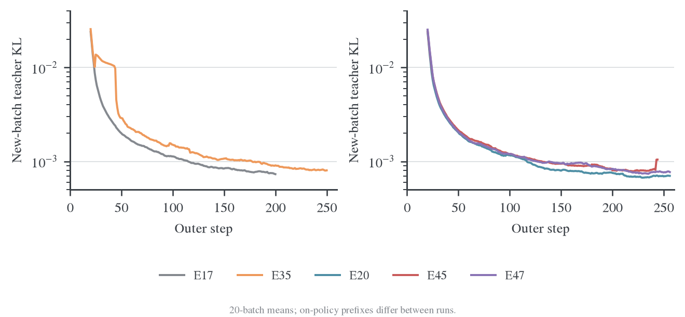

新批起点 teacher KL 在全部 run 中总体下降，但存在个别批次尖峰。它是在各自当前策略生成的前缀上测量，不是固定 held-out 前缀上的泛化 KL；下一批起点与上一批末点也不能直接解释为同一个输入的 loss 反弹。

E35 在 outer 25 的 teacher KL 从 0.10678 降至 0.01979，该批最大梯度范数为 1.4001；E45 在 outer 243 从 0.005468 降至 0.003117，最大梯度范数为 0.09518。两批都没有非有限观测，且批内能够下降。20 批滑动均值会把这样的高值展宽成台阶，不能把图中的台阶直接判断为持续发散。E45 的最后验证在 224，尚无这次尖峰后的任务验证，不能判断其下游影响。

共同后期窗口 outer 205–224 的逐批首末观测为：

| Run | teacher KL 首次 → 第 16 次 | 逐批相对降幅均值 | target KL 首次 → 第 16 次 | 逐批 target KL 相对变化均值 |
| --- | -------------------------- | ---------------- | ------------------------- | --------------------------- |
| E20 | 6.855e-4 → 3.733e-4        | −45.36%          | 不适用                    | 不适用                      |
| E45 | 8.058e-4 → 5.751e-4        | −28.27%          | 7.142e-5 → 1.162e-4       | +66.44%                     |
| E47 | 7.604e-4 → 5.541e-4        | −27.21%          | 6.326e-5 → 1.155e-4       | +83.42%                     |

表中的首末值先分别对 20 批取平均；相对变化先在每批计算再平均，因此不等于两个表中均值的比值。第 1、16 次都是产生各自梯度的前向观测，两个观测之间执行了 15 次更新；日志没有同批第 16 次 optimizer 更新后的额外测量。

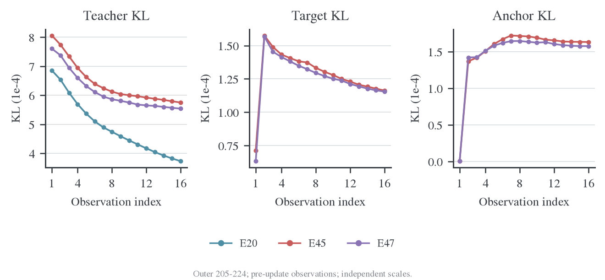

在这 20 批中，两种 MDPO 都有以下事实：

- target KL 的最小观测都在第 1 次，即开始本轮更新之前。
- 第 2 次观测，也就是第一步更新之后，target KL 全部升高。
- E45 的平均 target KL 为 7.142e-5 → 1.576e-4 → 1.162e-4；E47 为 6.326e-5 → 1.567e-4 → 1.155e-4，依次对应第 1、2、16 次观测。
- 同时 teacher KL 继续下降，anchor KL 从约 3.3e-7 增至约 1.6e-4。

早期 outer 1–20 的情况不同：两组 target KL 的逐批首末降幅约 48.36%/47.04%，最低观测都在第 16 次。到 outer 81–100，两个 run 的 20 批已经全部变成“起点最好，末次更差”。这是一种随训练阶段改变的内层拟合行为，不是整个训练从第一批就完全不下降。

E45 的 κ=0 目标给出直接的分解：

$$
L_{\mathrm{MDPO}}=\mathrm{KL}(p\Vert T)+\frac73\mathrm{KL}(p\Vert q).
$$

在上述后期窗口，第一步之后 teacher KL 约下降 3.16e-5，anchor 惩罚约增加 3.19e-4，净 objective 上升。只监控 teacher KL 会遗漏这种固定目标拟合退化。

统计还验证了以下一致性：

| 检查                                                 | E45     | E47     |
| ---------------------------------------------------- | ------- | ------- |
| 同批 target log Z 的最大变化                         | 0       | 0       |
| $\eta L=\mathrm{KL}(p\Vert m)-\log Z_m$ 最大绝对误差 | 4.69e-9 | 1.99e-9 |
| E45 几何目标分解最大绝对误差                         | 6.39e-8 | 不适用  |
| 位置 sum/count 重建全局 objective 最大绝对误差       | 1.62e-8 | 7.02e-9 |

这些误差远小于观测到的 target KL 跳升，支持把它视作真实的优化轨迹，而非目标常数刷新或指标换算错误。它们没有验证参数梯度的高精度参考，也不能排除低精度计算对更新方向的影响。

κ=0 时，在 p=q 起点，anchor KL 的一阶梯度为零；第一步并不会因为存在 anchor 正则就自动成为受约束的精确 mirror step。固定 LR、跨 outer 保留的 Adam 动量/二阶矩与越来越近的 target 距离可能不匹配，但现有日志没有参数更新范数、方向夹角或优化器状态对照，不能据此认定具体根因。

<a id="e50-complete-内层求解净下降与第一步反弹分开看"></a>

## 后续精度路径的内层求解

指标在更新前记录。每批首次至第 16 次观测跨越 15 次更新尝试，不是最后一次更新后的额外评分。普通 OPD 检查 teacher RKL；MDPO 检查固定融合目标的 target KL。上升判据采用绝对容差 `1e-10`。

| 实验 | 完整批数 | 首次→第二次上升 | 首次→第 16 次变差 | 相邻观测上升 / 总对数 |
| ---- | -------: | --------------: | ----------------: | --------------------: |
| E50  |      256 |               0 |                 0 |              8 / 3840 |
| E51  |      256 |               3 |                 1 |            107 / 3840 |
| E52  |      256 |               1 |                 0 |              9 / 3840 |
| E53  |      103 |              88 |                 0 |             93 / 1545 |

E51 新补齐的三批没有出现整批净退步，旧报告的 252/253 更新为 255/256；唯一变差仍是 outer155。该批 target KL 从 `4.7492e-5` 到 `5.1395e-5`，并伴随三次跳步，日志不足以区分跳步与其他优化状态的各自作用。E52 没有跳步且 256 批全部净下降，普通 OPD 路径未出现系统性反弹。

共同前 96 批中，E51 的第一步反弹为 0/96，E53 为 81/96；两组均为 96/96 批净下降。前期大 KL 批次会主导跨批均值，故再看 outer65–96：

| MDPO，outer65–96 | 首次 target KL 均值 |    第二次 |  第 16 次 | 首末降幅 | 第一步上升批数 |
| ---------------- | ------------------: | --------: | --------: | -------: | -------------: |
| E51，FP16        |           8.4492e-5 | 7.5019e-5 | 3.1101e-5 |   63.19% |         0 / 32 |
| E53，`bf16_fp32` |           1.0073e-4 | 1.1064e-4 | 5.6354e-5 |   44.05% |        32 / 32 |

E53 此窗口第一步均值上升约 9.84%，后续更新仍能把目标降到起点以下。它的近目标轨迹与 FP16 明显不同，但不复现旧 E45 后期整批返回更差点的现象。上升频率不能替代净收益判据，最后 16 次实际更新后的状态仍缺直接观测。

对 κ=0、η=0.3，令 $q$ 为冻结旧策略、$T$ 为教师、$m\propto q^{0.7}T^{0.3}$，则

$$
J(p)=D_{\mathrm{KL}}(p\Vert T)+\frac73D_{\mathrm{KL}}(p\Vert q)
=\frac{D_{\mathrm{KL}}(p\Vert m)-\log Z}{0.3}.
$$

outer65–96 中，E51 的 teacher 收益为 `3.3732e-4`、加权 anchor 成本为 `1.5935e-4`，成本占收益 47.24%；E53 分别为 `3.6798e-4`、`2.2006e-4`，占比 59.80%。两者仍有正净收益，E53 在自己的轨迹上付出了更高比例的 anchor 成本。两组同批 `log_z` 漂移均为 0；目标分解的最大绝对残差分别为 `1.07e-8`、`1.74e-8`，不足以解释上述 `1e-4` 量级的变化。已有日志支持继续定位近目标实际步幅，尚不足以把全部差异归给单个算子或 dtype。

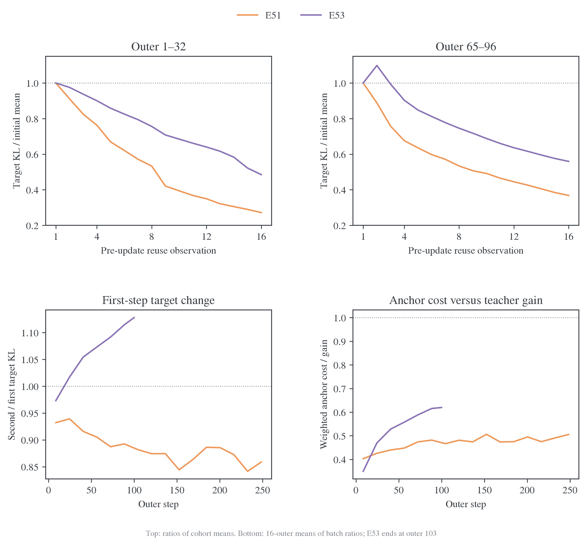

图上排先对同一窗口的原始 target KL 求均值，再除以首次均值；下排先计算每批比例，再做 16-outer 平均。两种统计不能混成一个百分比。E53 的第一次上升恰好覆盖 outer16–103 的连续 88 批，提示它随训练进入近目标区域后成为系统性现象，而不是几次孤立跳步；已有日志只支持这种时序关联，未证明具体浮点算子就是原因。

<a id="e50-complete-位置分解e53-的第一步反弹覆盖大部分响应"></a>

### 位置分解：E53 的第一步反弹覆盖大部分响应

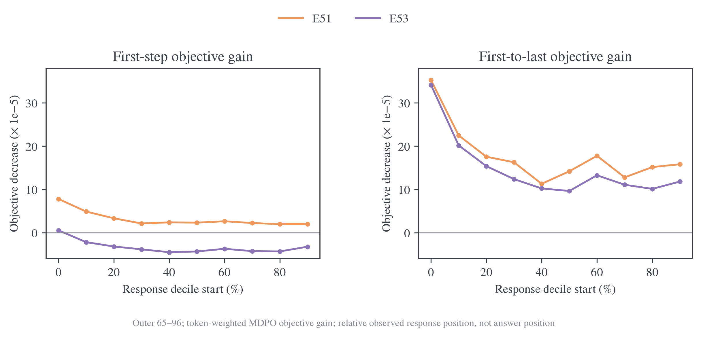

图取 outer65–96，同一位置先跨批累计 objective sum 和 token count 再求均值，绘制首次减去第二次/第 16 次的目标值；正值表示下降。E51 第一步在全部十个分桶均改善；E53 只有 0–10% 分桶改善，其余九桶均变差，其中 40–50% 的目标增加约 `4.51e-5`。到第 16 次观测，两者全部十桶都取得净下降。因而 E53 的全局反弹不能解释成只由少量末尾 token 拉高；后续净下降也不是只来自开头一桶。

这里记录的是 MDPO objective J，而不是每桶 target KL 本身；不能用 J 的绝对值当作 target 距离。十等分依据实际观察到的 response 长度，训练回答常被 cap 截断，因此 90–100% 桶也不等于完整推理的答案阶段。定义与归一化见[位置统计](../../../../../../verl/utils/metric/position.py)及[loss 汇总](../../../../../../verl/trainer/distillation/losses.py)。

<a id="e50-complete-训练动态梯度与跳步"></a>

### 训练动态、梯度与跳步

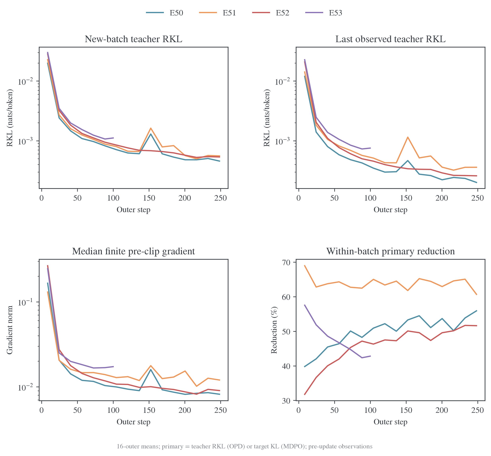

新批首次 teacher RKL 从 outer65–96 到 outer225–256，E50/E51/E52 分别由 `8.954e-4/9.665e-4/1.030e-3` 降至 `4.804e-4/5.616e-4/5.383e-4`。局部拟合以外，新访问状态的平均 teacher 差异仍在降低；但状态也随策略改变，不能据此单独分离参数泛化与访问分布变化。右下角 OPD 与 MDPO 的 primary reduction 对应不同目标，只用于看各自阶段变化，不用于按降幅排名算法。

E50/E51 在完整 4096 次尝试中各跳过 5 次，即约 0.12%；E52 为 0/4096，E53 为 0/1648。E50 跳步位于 outer156 的第 1–4 次及 outer227 的第 1 次；E51 位于 outer155 的第 3–5 次、outer156 的第 7 次及 outer245 的第 6 次。非有限梯度事件缺少普通的 `grad_norm_preclip` 数值，曲线只汇总有限值，跳步另外计数，没有把缺值补为零。四组的 `loss_nonfinite` 计数均为 0，但 E50/E51 的非有限梯度标记各为 5，恰好对应跳步次数；只监控 loss 是否出现 NaN/Inf 会漏掉这些数值事件。

outer65–96 的有限梯度中位数，E51 为 0.01395、E53 为 0.01633，两者均无大于 1 的观测，也没有跳步。E53 这段 32/32 批第一步反弹仍然存在，因而非有限梯度跳步不足以解释其系统性反弹。这个对照没有记录 Adam 动量、实际参数位移或 clipping 后梯度，不能据此进一步认定 optimizer 历史、学习率或特定算子的各自贡献。

<a id="e50-complete-outer156-的罕见数值事件"></a>

### outer156 的罕见数值事件

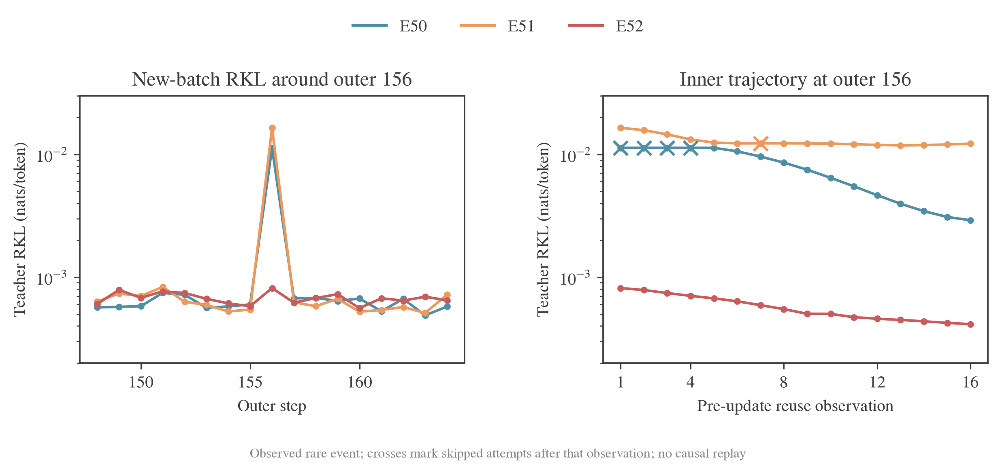

训练动态图中约 outer150 的峰值需要回到逐批记录，不能当作平滑后的正常趋势。E50 和 E51 在 outer32 之后最高的新批 teacher RKL 都出现在 outer156；图右的叉号标出该次观测之后被跳过的更新尝试。

| 实验 | outer155 首次 RKL | outer156 首次 / 第 16 次 RKL | outer156 跳步 | outer157 首次 RKL |
| ---- | ----------------: | ---------------------------: | ------------: | ----------------: |
| E50  |          6.002e-4 |          1.130e-2 / 2.905e-3 |             4 |          6.729e-4 |
| E51  |          5.446e-4 |          1.644e-2 / 1.221e-2 |             1 |          6.250e-4 |
| E52  |          5.798e-4 |          8.153e-4 / 4.145e-4 |             0 |          6.198e-4 |

两条 FP16 运行下一批的首次 RKL 又回到约 `6e-4`，不呈现持续全局发散；E52 在相同 outer 没有同量级尖峰。这是 `bf16_fp32` 的一项正面数值执行观测，与其完整运行没有跳步一致，应与任务和成本结果一起保留。E51 的 outer155 目标净退步和三次跳步发生在它之前，日志不能确定两者的因果顺序或共同原因。

此窗口由已观察到的峰值选出，是探索性定位，不是预先规定的独立检验。四组虽有相同数据 seed，各自 rollout 不同；尚缺相同输入、teacher 缓存与 optimizer 状态的重放，不能认定纯 dtype 已被证明是唯一原因，也不能把这一个事件外推为 FP16 必然不稳定。E51 另有 outer167、183 的新批 RKL 局部峰值，逐批 CSV 保留全部记录。

普通 OPD 的末段 outer225–256 中，E50 的 teacher RKL 为 `4.8044e-4→2.1720e-4`，降幅 54.79%；E52 为 `5.3829e-4→2.5997e-4`，降幅 51.70%。两者仍能优化，E52 的残差更高；这些是各自变化中的 rollout 状态，不能把两个绝对值直接解释为固定留出风险或不可约误差。

<a id="bf16"></a>
<a id="bf16-bf16-基线与普通-full-kl-的下降速度"></a>

<a id="bf16-整体下降曲线"></a>

## 普通 Full-KL 的精度参照

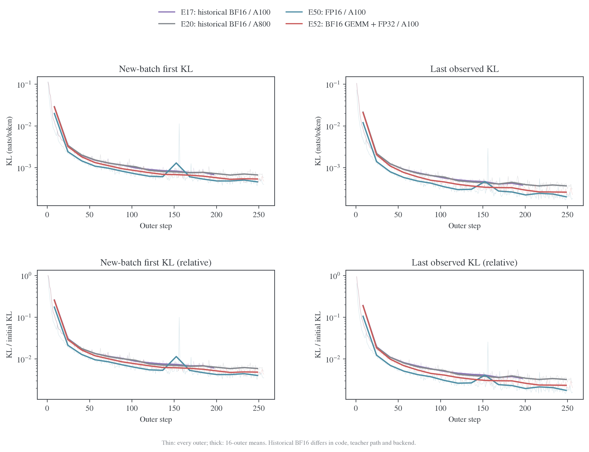

左列为每批第一次 teacher KL，右列为每批第 16 次观测；每批两个点之间跨 15 次更新尝试，不是第 16 次实际更新后的额外评分。细线保留全部 outer，粗线为不重叠的 16-outer 均值；E17 最后一个窗口只有 8 批，不补到 256 轮。纵轴为对数，下排再除以各 run 第一个训练前向的 KL。初始 KL 约为 E17 .11192、E20 .11352、E50 .11369、E52 .11088。

三点值得区分：

1. E17/E20 两条 BF16 曲线非常接近，均持续取得进展；这不是独立多 seed 估计，因为两组 seed 相同。
2. FP16 E50 从前期就显示更低的同预算 KL，后期差异在下面的线性放大图中更清楚。归一化没有消除这种排序，但也不能消除 teacher 版本差异。
3. E52 的混合模式没有全面超过 FP16。名字包含 FP32，不代表它的所有计算都比 FP16 更细；它仍使用 BF16 GEMM 操作数。

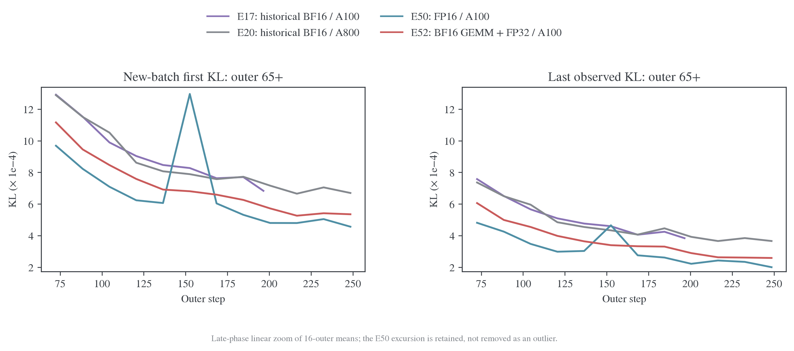

E50 约 outer156 的峰值保留在图中，没有按“异常值”删除。它与非有限梯度/跳步相邻，下一批又恢复；相关逐步图见 [KL 全程图册](kl-trajectories.md)。新批首次 KL 测量各自当前 rollout 的前缀，不能当成固定 held-out 风险；跨批变化不直接等于同一输入上的优化反弹。

| 窗口         | E17 BF16：首次 / 末次 | E20 BF16：首次 / 末次 | E50 FP16：首次 / 末次 | E52 混合：首次 / 末次 |
| ------------ | --------------------- | --------------------- | --------------------- | --------------------- |
| outer65–96   | 1.222e-3 / 7.040e-4   | 1.219e-3 / 6.928e-4   | 8.954e-4 / 4.532e-4   | 1.030e-3 / 5.524e-4   |
| outer169–200 | 7.459e-4 / 4.060e-4   | 7.425e-4 / 4.147e-4   | 5.474e-4 / 2.621e-4   | 6.248e-4 / 3.243e-4   |
| outer225–256 | 未记录                | 6.873e-4 / 3.752e-4   | 4.804e-4 / 2.172e-4   | 5.383e-4 / 2.600e-4   |

末段 E50/E52 的批末 KL 相对 E20 分别低约 42%/31%。这不是“下降速度快 42%/31%”，而是固定窗口的残差比例；不能进一步将全部比例归给 dtype。E17/E20 在共同后期窗口接近，也不能用两次同 seed 运行充当统计显著性证据。

<a id="bf16-精度差一点是否可以暂时不管"></a>

## BF16 中的优化进展与细粒度差异

对“训练能否取得大幅进展”，现有 BF16 baseline 给出了肯定答案；没有必要把它描述成无法训练。四组所有已记录批次的首次到末次 KL 都下降：E17 为 200/200，其余为 256/256。

| 运行 | 第一观测→第二观测上升批数 | 相邻 inner 观测上升 / 总对数 | 跳步 / 更新尝试 |
| ---- | ------------------------: | ---------------------------: | --------------: |
| E17  |                         0 |                    10 / 3000 |        0 / 3200 |
| E20  |                         2 |                    15 / 3840 |        0 / 4096 |
| E50  |                         0 |                     8 / 3840 |        5 / 4096 |
| E52  |                         1 |                     9 / 3840 |        0 / 4096 |

对“同样预算能拟合多细、后期单步是否稳定”，精度和执行路径仍然有关系，不能把约 42% 的末段残差差异称为没有影响。更早的固定输入精度干预已经确认舍入可削弱真实更新，不能由整段曲线下降反推精度误差不存在。另一方面，当前历史/新运行的差异包含多项修复，不能由本图认定这 42% 就是精度的独立贡献。

对“是否值得付出额外成本”，应看任务效果与时间预算，而不是只看 KL。已有 E50/E52 的完整任务结果没有证明更高成本的混合路径带来稳定准确率优势；这里也没有提供精度对最终能力的独立因果估计。合理做法是把精度固定为清楚的实验条件，再推进 optimizer 比较，而非要求先找到所有场景下最优的精度。

<a id="e45-3-实验结果任务表现"></a>

## E45/E47的任务表现

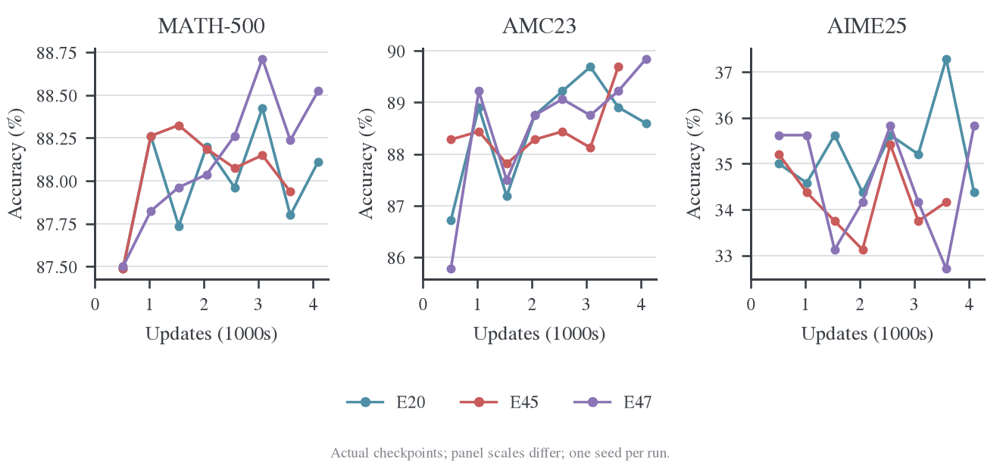

三组共同的最后验证预算是 outer 224 / update 3584：

| Run | MATH mean | AMC mean | AIME mean | AIME pass@16 | AIME majority@16 | AIME all-correct@16 |
| --- | --------- | -------- | --------- | ------------ | ---------------- | ------------------- |
| E20 | 87.8000%  | 88.9063% | 37.2917%  | 60.0000%     | 48.3333%         | 16.6667%            |
| E45 | 87.9375%  | 89.6875% | 34.1667%  | 60.0000%     | 40.0000%         | 13.3333%            |
| E47 | 88.2375%  | 89.2188% | 32.7083%  | 56.6667%     | 40.0000%         | 10.0000%            |

E45 在 AIME 上与 E20 的 pass@16 相同，但 mean、majority 和 all-correct 更低。它们衡量的是候选覆盖、平均正确率和回答稳定性的不同侧面，不能只报告相同的 pass@16 就称为等效。E47 在这个点上候选覆盖和回答稳定性也较低。AIME 的答案解析缺失为 E20/E45/E47 的 7/7/4 条；E47 的解析缺失更少，却仍有更低 mean，因此本点差距不是简单的格式失败增加。

七个共同 checkpoint 的描述性均值为：

| Run | MATH     | AMC      | AIME     |
| --- | -------- | -------- | -------- |
| E20 | 87.9821% | 88.4821% | 35.3869% |
| E45 | 88.0607% | 88.4375% | 34.2560% |
| E47 | 88.0768% | 88.3259% | 34.4643% |

在这段共同轨迹中，两种 MDPO 的 MATH 略高，AIME 均值低约 0.92–1.13 pp，没有逐集合一致收益。E45/E47 的平均训练长度与 E20 接近，outer 1–224 的 response token 只分别多 0.34%/0.30%，训练长度停止率均约 40%；任务差别不能直接归因于某组多生成了大量训练数据。

E47 的最终 outer 256 结果又高于 E20：

| Run            | MATH mean  | AMC mean   | AIME mean  |
| -------------- | ---------- | ---------- | ---------- |
| E20，outer 256 | 88.1125%   | 88.5938%   | 34.3750%   |
| E47，outer 256 | 88.5250%   | 89.8438%   | 35.8333%   |
| 差值           | +0.4125 pp | +1.2500 pp | +1.4583 pp |

224 与 256 的 AIME 排序反转，说明只挑终点或最好 checkpoint 容易改变结论。E45 没有 256 的验证记录，不能拿其 224 分数填入这张表。

AIME 仅有 30 题。共同 outer 224 的 mean 95% 题目 bootstrap 区间为 E20 [23.57,52.32]、E45 [19.11,48.88]、E47 [17.73,48.33]%。这些区间很宽；区间重叠不是等效性检验。当前日志不含可供本分析使用的跨 run 逐题联合回答记录，也没有重复 seed，不能做配对显著性或跨 seed 稳定性结论。

<a id="e50-complete-任务结果完整终点没有建立-mdpo-优势"></a>

## E50–E53 的任务表现

下表为每题 16 答的平均正确率，单位为百分数，不是 pass@16。前 96 批的三个共同 checkpoint 为 32、64、96；完整终点只列已结束的三组。

| 实验 | 验证 outer | MATH-500 | AMC23 | AIME25 |
| ---- | ---------: | -------: | ----: | -----: |
| E50  |         96 |    88.63 | 87.03 |  33.75 |
| E51  |         96 |    88.20 | 87.34 |  34.38 |
| E52  |         96 |    87.96 | 89.84 |  35.00 |
| E53  |         96 |    88.08 | 89.38 |  33.75 |
| E50  |        256 |    88.70 | 90.00 |  37.29 |
| E51  |        256 |    88.34 | 87.81 |  32.71 |
| E52  |        256 |    88.31 | 89.06 |  33.96 |

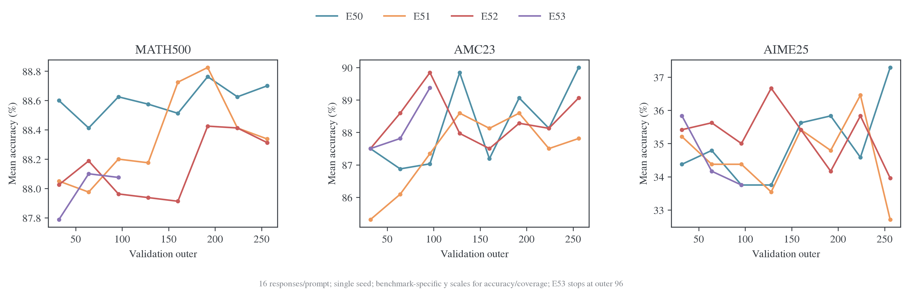

E51−E50 的最终差值依次为 −0.36、−2.19、−4.58 个百分点；8 个共同 checkpoint 的平均差值依次为 −0.26、−0.78、−0.39。新终点把旧七点统计中 AIME25 的微弱正均差改为负值，说明“MDPO 已取得稳定任务优势”没有得到这次完整训练支持。这个结果不否定 255/256 批的目标净下降：数值求解有效与任务准确率受益是两个不同结论。

E52−E50 最终差值为 −0.39、−0.94、−3.33 个百分点，但 8 个共同 checkpoint 的平均差值为 −0.45、+0.16、+0.26。MATH-500 八点均低于 E50，AMC23/AIME25 的排序随 checkpoint 变化，不能只用最后一点宣称混合精度在所有阶段更差，也没有证据支持它带来一致收益。

E53 在三个共同 checkpoint 相对 E51 的均差为 MATH-500 −0.09、AMC23 +1.98、AIME25 −0.07 个百分点；相对同精度普通 OPD E52 为 −0.07、−0.42、−0.76。前期 AMC23 的改善没有形成跨任务一致优势，更不能外推到尚未观察到的后期。

所有比较都是单训练 seed。MATH-500、AMC23、AIME25 分别只有 500、40、30 题；E50/E51 最终 AIME25 的单 run 题目 bootstrap 区间分别约为 [21.54%,52.76%]、[16.41%,48.05%]。这些不是差值的配对置信区间，也不是 seed 方差。checkpoint 均差只描述曲线，不能把同一 run 的八个点当八个独立实验。逐数据集完整 CI、pass@16、majority@16 保留在[验证汇总](../../../experiments/验证结果汇总.md)及冻结 CSV。

<a id="e50-complete-候选覆盖与多数票mean-较低不等于所有采样指标较低"></a>

### 候选覆盖与多数票：mean 较低不等于所有采样指标较低

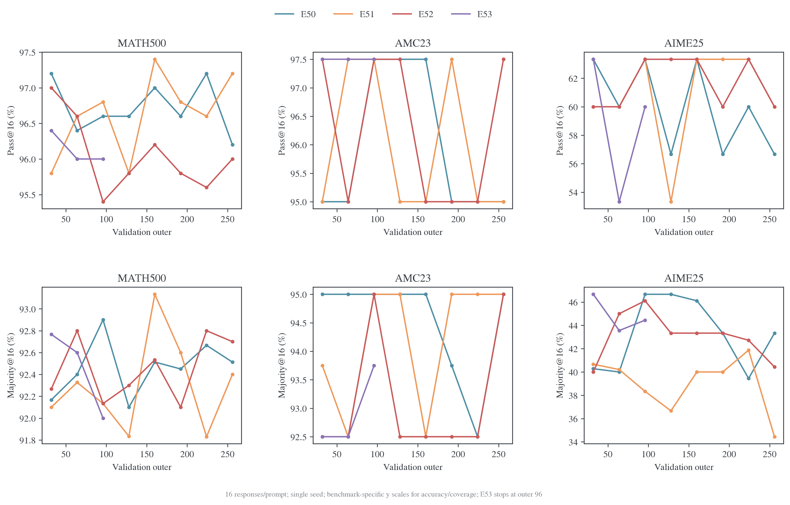

| outer256、AIME25 |   Mean | Pass@16 | Majority@16 | All-correct@16 | 已覆盖题数 / 30 | 正确回答数 / 480 |
| ---------------- | -----: | ------: | ----------: | -------------: | --------------: | ---------------: |
| E50              | 37.29% |  56.67% |      43.33% |         20.00% |              17 |              179 |
| E51              | 32.71% |  60.00% |      34.44% |         20.00% |              18 |              157 |
| E52              | 33.96% |  60.00% |      40.43% |         16.67% |              18 |              163 |

E51 比 E50 多覆盖一题，但正确回答总数少 22 个。每个“至少有一答正确”的题目，平均正确回答数从 `179/17=10.53` 降到 `157/18=8.72`；两者 16 答全对的题数均为 6。这是候选覆盖与正确答案概率集中程度的不同切面，不支持把 E51 简化为所有任务指标全面退步，也不支持称其更容易通过多数票得到正确答案。本次日志输入没有逐题配对文本，无法判断哪道新题被覆盖、哪些旧题正确率下降，或错误推理类型是否变化。

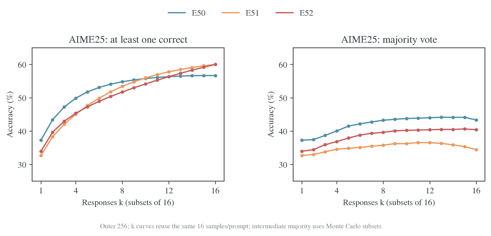

AIME25 的 E51−E50 pass@k 在 k=1–9 均为负，k=10 才转正，k=16 为 +3.33 个百分点；majority@16 反而低 8.89 个百分点。故这组有限样本支持“较大候选集的覆盖稍高、小预算和多数票利用较弱”，没有建立一致的采样效率优势。pass@k 按同一组 16 答的组合公式计算，不是重新采样的 16 次实验；中间 k 的多数票使用子集 Monte Carlo，k=16 为完整集合并包含并列多数的处理。口径见[评测实现](../../../../../../verl/utils/metric/evaluation.py)。AIME25 一题就是 3.33 个百分点，单 seed 的一题差异不能据此推广到普遍优势。

<a id="e50-complete-完成行为不足以单独解释-e51-的终点差距"></a>

### 完成行为不足以单独解释 E51 的终点差距

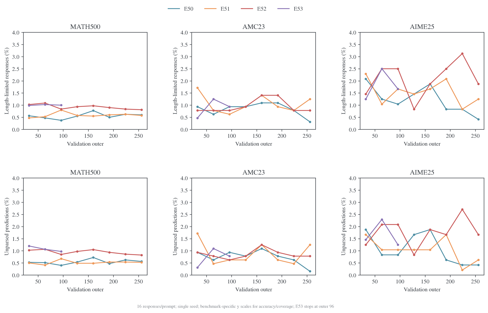

AIME25 终点 E50/E51/E52 的 length-stop 比例为 0.42%/1.25%/1.88%，预测答案解析缺失为 0.42%/0.63%/1.67%。E51 的 mean 落后 E50 4.58 个百分点，不能只归因于它的 3 条解析缺失回答：即使全部变正确，最多增加 0.625 个百分点。再把 6 条长度截断回答也按互不重叠、全部变正确的最宽松上界加入，总增益仍不超过 `9/480=1.875` 个百分点，尚不足以弥补 4.58 个百分点。这个上界无需假设截断与解析缺失是否实际重叠，但不解释剩余错误的具体原因。

E51 的 AIME25 平均长度由 outer96 的 11073 降到终点 10472 token，mean 却由 34.38% 降到 32.71%；更短回答不自动对应更高正确率。MATH-500 终点的解析缺失在 E51 反而略低于 E50（0.525% 对 0.563%），mean 仍略低。行为指标可以排除简单的“都是漏样本/解析故障”解释，但还不能识别知识迁移或推理策略变化。

<a id="e50-complete-生成预算与运行成本"></a>

## 新精度路径的执行成本

共同前 96 批均尝试 1536 次更新，生成 response token 数相近。表中时间为日志中的 actor 更新阶段累计值和 outer 阶段累计值，不包含未记录的排队/初始化开销，不将其视为纯内核基准。

| 实验 | 新 response token（百万） | actor 时间（小时） | outer 时间（小时） | 记录 actor allocated peak（GiB） |
| ---- | ------------------------: | -----------------: | -----------------: | -------------------------------: |
| E50  |                    35.030 |              3.342 |              4.398 |                            10.24 |
| E51  |                    35.189 |              3.759 |              4.791 |                            10.64 |
| E52  |                    34.985 |              3.923 |              4.984 |                            14.96 |
| E53  |                    35.014 |              4.924 |              5.982 |                            15.73 |

E52 相对 E50 的新 token 少 0.13%，actor 时间多 17.38%、outer 时间多 13.32%、记录峰值显存多 46.14%。E53 相对 E51 的新 token 少 0.50%，对应成本多 30.98%、24.86%、47.91%。相近生成量不能解释全部开销差距；当前记录没有显示 `bf16_fp32` 的运行成本优势。但跨主机尤其 E51/E53 的 CPU 配置不同，不能把全部差额直接归给精度算子，也不能用不同 GPU 型号的 E50/E51 排纯算法吞吐。

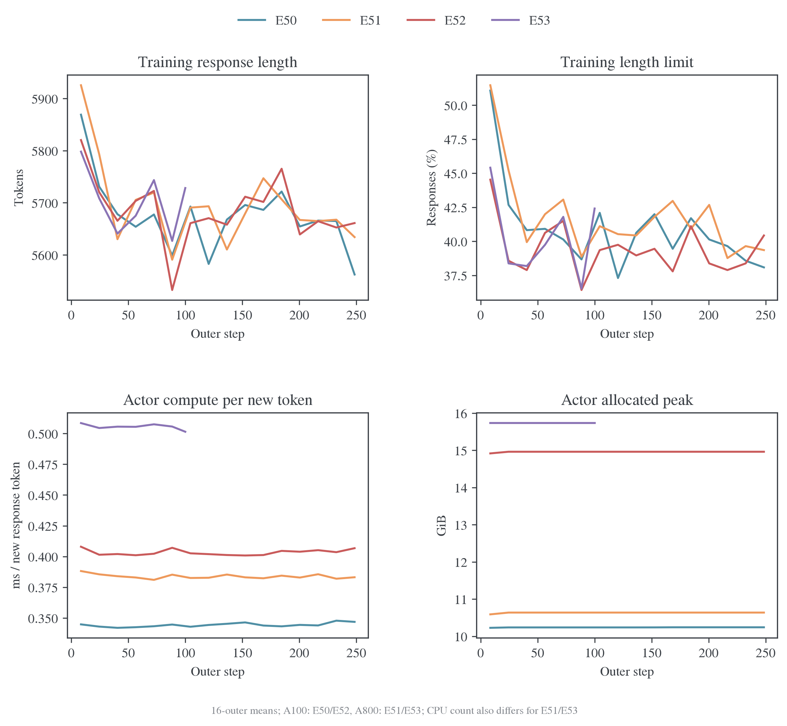

训练 cap7168 下，outer65–96 的长度停止比例仍为 E50 39.40%、E51 40.97%、E52 38.96%、E53 39.16%；与验证 cap31744 下通常几个百分点以内的截断率不是同一协议。这意味着训练仍大量访问被截断的前缀。位置桶“全部改善”只能说明已访问前缀内的目标下降，不能证明完整答案阶段已被充分监督；当前四组没有改变训练 cap，无法判定提高 cap 是否会改善最终能力。

成本图把 actor 时间除以新 response token，四组 reuse 都为 16；这个明确的新 response token 分母不与其他 time-per-token 字段混用。`bf16_fp32` 的显存和 actor 时间较高，而训练长度及生成量接近，未显示预期的生产成本优势。硬件与 CPU 差异仍阻止把整个墙钟差额单独归给精度算子。

<a id="bf16-按更新生成-token-与记录时间看速度"></a>

## 与历史 BF16 按预算和时间比较

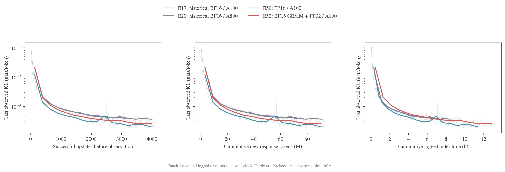

左图按该次前向之前已成功执行的更新计数，排除跳步，并避免把第 16 次更新前的观测标到第 16 次更新之后。中图按累计新 response token；这里不把同一条 response 的 16 次 reuse 算成 16 份新数据。右图把该批 KL 与累计 `perf/timing/outer_step_seconds` 关联，不将其当作精确的 loss 时间戳或包含所有初始化、等待和验证的完整进程墙钟。

| 运行 | 可用 outer | 新 response token（百万） | 记录 outer 时间（小时） | Actor 阶段累计时间（小时） | 记录 actor 峰值（GiB） |
| ---- | ---------: | ------------------------: | ----------------------: | -------------------------: | ---------------------: |
| E17  |        200 |                    73.175 |                   6.791 |                      4.611 |                  10.21 |
| E20  |        256 |                    93.368 |                   8.653 |                      5.858 |                  10.20 |
| E50  |        256 |                    92.983 |                  11.690 |                      8.894 |                  10.24 |
| E52  |        256 |                    93.134 |                  13.230 |                     10.434 |                  14.96 |

按 outer、成功更新或生成 token 比较，FP16 的下降优势较明显；换成记录时间，旧 BF16 的每批成本更低，差距缩小，混合模式的成本尤其需要一起考虑。不能从“同样更新数下更低”直接推导“同样时间下有同等幅度的优势”。这里的时间差包含历史代码、kernel/chunk、硬件、保存频率和在线轨迹差异，不能把 E20→E50 的耗时增加直接解释为 FP16 算术慢。

<a id="e50-complete-motivation-中的问题解决到什么程度"></a>

## 已有证据与剩余问题

下表回到 [E50/E51 的动机](../../../archive/engineering/2026-10-28-E50E51阶段精度观察.md#e50-partial-1-背景与-motivation)、[内层反弹审计](2026-10-26-数值链路审计.md)及[精度机制研究](mechanisms.md#precision)。结论限定于已有运行，不新增训练要求或“完全蒸馏”的评价门槛。

| 原问题                                           | 当前回答                                   | 关键证据与剩余缺口                                                                                                              |
| ------------------------------------------------ | ------------------------------------------ | ------------------------------------------------------------------------------------------------------------------------------- |
| 普通 OPD 在修复路径下能正常优化吗？              | 当前正式运行支持                           | E50/E52 均 256/256 批净下降；FP16 仍有 5 次跳步，不能称数值异常绝迹                                                             |
| 近目标 MDPO 是否真的取得净进展？                 | E51 已基本回答；E53 前期支持               | E51 255/256、E53 103/103 批净下降，teacher 收益覆盖 anchor 成本；缺最后一次实际更新后的独立评分                                 |
| 是否仅是日志目标变动、归一化或少数位置造成表象？ | 明显统计假象得到排查                       | log Z 同批固定、分解残差小、位置 count 恒定、全局重建一致；E53 九桶第一步变差、十桶最终改善；没有完整分布哈希和新增梯度数值验算 |
| BF16+FP32 是否消除了近目标反弹？                 | 没有消除第一步反弹；也没有出现已有整批失败 | E53 outer16–103 连续反弹后全部净下降；不能外推其后期                                                                            |
| 反弹能否直接归因于非有限梯度或单一 dtype？       | 不能                                       | E53 中段没有跳步、有限梯度较小仍反弹；缺相同输入/optimizer 状态的正式轨迹重放及参数位移                                         |
| 正确求解是否带来 MDPO 任务优势？                 | 尚未建立一致优势，现有证据不支持简单肯定   | mean 和多数票较弱，pass@16 有局部一题覆盖收益；缺多 seed、逐题配对和初始验证                                                    |
| `bf16_fp32` 是否提供效果与成本的折中收益？       | 数值执行有正面观测，任务/成本尚无一致优势  | E52 无跳步且 outer156 无同量级尖峰；E52/E53 成本较高、任务排序变化；未建立纯 dtype 因果                                         |
| 是否已解决完整回答覆盖与教师知识吸收？           | 尚未解决                                   | 训练约四成截断，无独立 held-out KL/JS/TV/entropy、同协议教师与初始学生对照；低在线 KL 不等于完整吸收                            |

已有数据最明确解决的是“这些生产配置有没有取得可观测的内层净下降”；它没有同时解决“为什么某精度第一步反弹”“这种镜像约束是否有稳定任务价值”和“是否完整吸收教师”。因此当前结果既不能用第一步反弹否定全部 MDPO 求解，也不能用低 target KL 宣称算法收益已经成立。

<a id="bf16-后续-optimizer-比较的建议"></a>

### 优化器对照的控制条件

当前仅复算已有运行，没有启动新的 GPU 训练。已有[大规模计划](../../../archive/engineering/2026-10-27-优化器大规模候选计划.md)保留完整候选与预算；这里补充与本基线有关的选择。

- **建立同版本 AdamW 对照。** 旧 E20 可作历史参考，不能作为新 optimizer 唯一控制组；否则 teacher、backend、precision 与 optimizer 同时改变。
- **先固定一条精度。** 若问题是实际 BF16 下谁更有效，就统一使用当前已修复的 BF16 路径；若希望减轻近目标精度干扰，可统一 FP16＋GradScaler，并记录实际成功更新及跳步。两种问题都合理，不能在同一排名中混用。
- **区分短程求解与在线学习。** 固定同一前缀、教师输出和模型起点检查 KL 拟合，再用在线 rollout 与独立固定 probe、任务验证看迁移。更低的在线 KL 可能混入访问分布改变。
- **各 optimizer 独立校准 LR，保持相同搜索机会。** AdamW、AdamW β1=0、无动量 SGD、Muon＋辅助 AdamW 不能机械共用一个 LR；冷启动/恢复状态、weight decay、clipping 与参数组要明确。已有短程实验中，同参数 L2 步幅下函数空间漂移相差很大，不能用参数范数匹配替代公平预算。
- **同时报告更新、生成和时间三条轴。** 主读数至少包括固定 probe KL、任务 mean/pass、非有限梯度及跳步、记录时间和峰值内存。按相同成功更新比较，同时保存尝试次数；不能把失败更新的计算成本丢掉。

后续 optimizer 比较固定执行精度与 teacher 路径，使优化器成为明确的比较因素。

<a id="e50-complete-当前结论与复算"></a>

## 结果与复算

最新证据强化了“先验收内层求解，再评价算法任务收益”的区分。E51 完整终点继续支持生产路径可有效求解 MDPO，但没有建立 η=0.3 的任务优势；E52 普通 OPD 稳定运行，却没有显示一致准确率或成本收益；E53 的第一步反弹应作为近目标轨迹现象保留，而不是直接判为实现失败。当前仍缺 E53 后期与最后一次实际更新后的目标评分，不扩展为更多训练计划。

冻结输入摘要、SHA-256、配置差异和统计在日志仓库的 `MirrorOPD-verl/analysis/e50-e53-20261029/`，分别为 `summary.json`、`config-differences.json`、`cohorts.csv`、`batches.csv`、`evaluations.csv`、`comparisons.csv` 和 `costs.csv`。原始日志及 10 月 28 日冻结统计保留不变；新统计由[复算脚本](../../../../research/studies/production_precision/precision_comparison.py)生成：

```bash
python -m examples.mirroropd.research.studies.production_precision.precision_comparison \
  --logs-repo ../wandb-logs \
  --out ../wandb-logs/MirrorOPD-verl/analysis/e50-e53-20261029
python -m examples.mirroropd.research.studies.production.refresh_tables \
  --logs-repo ../wandb-logs --skip-decode
```

原主表的降幅统一先跨批求首末均值再计算，比例不与逐批百分比均值混用；新增动态图的逐批比例平均在各图注中单独注明。脚本检查解码新鲜度、每批 16 条更新记录和窗口完整性；E53 只使用已完整解出的记录。

扩展统计位于上述证据目录的 `diagnostics/`：`inventory.csv`、`inner.csv`、`training.csv`、`evaluation.csv`、`sampling.csv`、`positions.csv`、`trajectories.csv` 和 `metric-audit.json`。九幅图的 PNG、同名 PDF、逐系列绘图值 `plotted-data.json` 与审计结果保存在 [图目录](../../../experiments/teacher-transfer/optimizer-precision/production/figures/precision-diagnostics-20261029)。accuracy/coverage 的跨基准纵轴差异是显式设计例外；其他压字、越界、调色板等检查均实际执行。可编辑源码为[指标分析与绘图脚本](../../../../research/studies/production_precision/precision_diagnostics.py)。

```bash
python -m examples.mirroropd.research.studies.production_precision.precision_diagnostics \
  --logs-repo ../wandb-logs \
  --out ../wandb-logs/MirrorOPD-verl/analysis/e50-e53-20261029/diagnostics \
  --figures examples/mirroropd/docs/experiments/teacher-transfer/optimizer-precision/production/figures/precision-diagnostics-20261029 \
  --figure-skill ~/.agents/skills/figure-viz
```

绘图 Python 环境需要 matplotlib；不改变训练环境。图的窗口平均只用于展示，逐批/逐次原始观测和置信区间保留在 CSV 中，不用平滑曲线制造独立样本或隐藏 E53 尚无后期记录的事实。

位置统计的浮点累计使用 `math.fsum`。Python 3.10 与 3.12 独立复算后，七份 CSV 和 `metric-audit.json` 逐字节一致；图目录记录的源表 SHA-256 均与冻结文件匹配。九幅图均经过实际机器审计与目检。

全部 outer 的未平滑 KL、每批 inner 的完整图册，以及学习率/η/κ 的理论区分见 [KL 轨迹与 κ 选择](kl-trajectories.md)。

<a id="e45-6-证据与复算"></a>

### E45/E47输入

[冻结联合分析](../../../archive/experiments/length-mirror/2026-10-26-E35长窗口与E45E47镜像目标对照.md)保存位置分桶、运行条件与原统计口径。数据位于 `wandb-logs/MirrorOPD-verl/analysis/length-mirror-20261026/`；上升比例先逐批计算再平均，不与 E50/E51 报告的窗口均值比值混用。

<a id="bf16-证据与复算"></a>

### BF16 参照输入

原始 run ID、输入 SHA-256、配置差异、逐 outer 数据和绘图聚合保存在日志仓库 `MirrorOPD-verl/analysis/bf16-convergence-20261029/`。其中 `outer.csv` 为逐批观测，`blocks.csv` 为实际绘图的窗口均值，`windows.csv` 为正文固定窗口统计；归一化分母和硬件信息保存在 `summary.json`。

可编辑[脚本](../../../../research/studies/production_precision/bf16_convergence.py)不加载模型。PNG 与同名 PDF 位于[图目录](../../../experiments/teacher-transfer/optimizer-precision/production/figures/bf16-convergence-20261029)，审计与绘图输入摘要随图保存。

```bash
python -m examples.mirroropd.research.studies.production_precision.bf16_convergence \
  --logs-repo ../wandb-logs \
  --out ../wandb-logs/MirrorOPD-verl/analysis/bf16-convergence-20261029 \
  --figures examples/mirroropd/docs/experiments/teacher-transfer/optimizer-precision/production/figures/bf16-convergence-20261029 \
  --style ~/.agents/skills/figure-viz/assets/mpl
```

脚本核对完整退出、解码新鲜度、连续 outer、每批 16 条观测，以及成功更新计数与日志 optimizer counter 的一致性。原始日志保持不变，缺少的 E17 后期点不外推。
