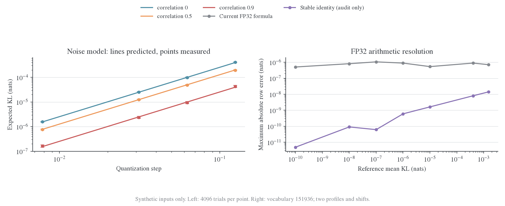
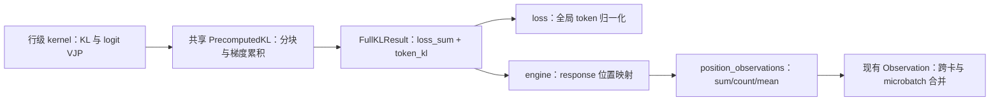

# KL 误差实验与历史接口验收

本文保留 2026-10-24 的数值实验、真实前缀 probe 和当时接口验收。理论模型见[误差推导](../../../theory/numerical-effects/error-model.md)，当前数据与指标接口由架构参考维护，以下历史状态不作为当前支持清单。

## 4. 小实验的结果

左图为均匀舍入模型，实线是推导、点是 Monte Carlo 均值、误差棒是均值的 95% 区间；右图为两种合成分布和共同 logit 平移下的最大逐位置绝对误差。所有输入均为合成，不是模型准确率实验。

### 4.1 相关舍入误差

每组 4096 个独立样本、64 分类，比较不同 $\Delta$ 和 $\rho$。下表选峰值分布 $C(p)=0.30593$、$\Delta=0.0625$：

| 师生误差相关系数 |           理论期望 KL |              实测均值 |    Monte Carlo 标准误 |
| ---------------- | --------------------: | --------------------: | --------------------: |
| 0                | $9.9587\times10^{-5}$ | $9.7964\times10^{-5}$ | $1.9804\times10^{-6}$ |
| 0.5              | $4.9794\times10^{-5}$ | $4.8870\times10^{-5}$ | $1.2813\times10^{-6}$ |
| 0.9              | $9.9587\times10^{-6}$ | $9.5311\times10^{-6}$ | $5.2959\times10^{-7}$ |
| 1                |                     0 |                     0 |                     0 |

全部非零实验点的实测/理论比值在 0.957–1.084 之间，理论均值偏差均小于 1.65 个 Monte Carlo 标准误。逐样本同时验证了 $K\leq R^2/8$。二阶近似与逐样本实际误差方差的计算也一致。

### 4.2 Head 输入量化

随机 128 维 hidden、1024 输出词表、128 个位置，用每个输入坐标的 BF16 步长估计舍入方差：

| 量                                     |                    KL |
| -------------------------------------- | --------------------: |
| 独立输入舍入模型预测                   | $2.7779\times10^{-6}$ |
| 实际 BF16 输入与原 FP64 输入的分布差异 | $2.7650\times10^{-6}$ |
| 用实际 logit 误差作二阶预测            | $2.7650\times10^{-6}$ |
| 两边都使用同一份 BF16 输入             |                     0 |

这验证了 head 层模型，不能直接外推到 28 层 Transformer，也不能把“BF16 对 FP64”的差异当作“BF16 学生对 BF16 教师”的不可消除差异。

### 4.3 小 KL 的数值测量

词表 151936、每组 8 个位置，使用峰值分布和较分散分布，并比较共同 logit 平移 0／16。以下摘取较分散分布、平移 0 的逐位置最大绝对误差：

|     参考 KL 均值 |  普通 FP32 公式误差 | 稳定恒等式 FP32 误差 |
| ---------------: | ------------------: | -------------------: |
| $4\times10^{-4}$ | $4.73\times10^{-7}$ | $3.20\times10^{-10}$ |
|        $10^{-5}$ | $3.16\times10^{-7}$ | $2.04\times10^{-11}$ |
|        $10^{-6}$ | $3.87\times10^{-7}$ | $7.34\times10^{-12}$ |
|        $10^{-8}$ | $3.30\times10^{-7}$ | $5.89\times10^{-13}$ |

稳定公式的效果依赖本组受控 log-ratio，不能当作任意输入的保证。两种公式在完全相同的输入上都返回零。

### 4.4 真实 R1-Distill-1.5B 初始权重的短前缀检查

从本机公开初始 checkpoint 构造两道固定数学问答的 teacher-forced 前缀，共 126 个 response 位置，不做优化或生成评测。FP32 参考使用 eager attention；另测 BF16 eager 与 BF16 FlashAttention2，head 都输出 FP32 logits，最终 KL 用 FP64 计算。保留 RoPE 频率 buffer 的 FP32 dtype，关闭 TF32 和 BF16 低精度 GEMM 归约。FlashAttention2 更贴近当前训练内核，但这个普通未 padding 前向不是完整的 packed FSDP 运行，也不是末期 checkpoint 或长 rollout。

| Probe          | 位置数 | BF16 FlashAttention2 对 FP32 的 KL 均值 |     中位数 |        p95 | 仅量化 head 输入的均值 |
| -------------- | -----: | --------------------------------------: | ---------: | ---------: | ---------------------: |
| 一元一次方程   |     55 |                              0.00017805 | 0.00001260 | 0.00104530 |            0.000001272 |
| 两颗骰子的概率 |     71 |                              0.00030004 | 0.00000727 | 0.00099552 |            0.000001578 |

两题按 token 加权平均约为 **0.00024679**，误差高度不均匀。将同一批量化参数转回 FP32 计算后，两个 probe 的 logits 都与初次 FP32 结果完全相同；本 checkpoint 参数本身可被 BF16 表示，这组差异主要来自前向计算路径。仅 head 输入量化远小于完整前向差异，不能只用 head 小实验推断 Transformer。

BF16 eager 对 FP32 eager 的 KL 均值分别约 0.00627、0.17640，比 FlashAttention2 路径大得多；第二题少量位置的大偏差已经超出小扰动近似。因此不能把 eager BF16 的数值当作当前 FlashAttention2 训练的误差估计。这也实证了 attention 内核需要纳入精度条件。

**这不是 0.00024679 的训练 loss 下限。** 测量的是同一 checkpoint 在两种执行精度下的差异；E16/E17 实际比较的是 BF16 学生与 BF16 教师，且前缀和权重都不同。

在近匹配、共同参考分布的局部模型下，设两边单独相对高精度的误差 KL 为 $\kappa_S,\kappa_T$，用共同 $F(p)$ 定义 $\kappa_i=\frac12\mathbb E[\epsilon_i^\top F\epsilon_i]$，以及加权相关项 $\rho_F=\mathbb E[\epsilon_S^\top F\epsilon_T]/(2\sqrt{\kappa_S\kappa_T})$。对误差差的二次型展开：

$$
\mathbb E K_{\rm error}\approx
\kappa_S+\kappa_T-2\rho_F\sqrt{\kappa_S\kappa_T}.
$$

若**额外假设**教师误差与上述初始学生 probe 同量级，且两边 $\kappa\approx2.47\times10^{-4}$，则：

| 假设的加权误差相关性 |  误差差所对应的期望 KL |
| -------------------- | ---------------------: |
| $\rho_F=0$           | 约 $4.94\times10^{-4}$ |
| $\rho_F=0.9$         | 约 $4.94\times10^{-5}$ |
| $\rho_F=1$           |                      0 |

上表用实测 KL 粗略代替二阶 $\kappa$；教师的该量级和师生相关性均未在这里测量，因此表格是条件估计，不是对 E17 的诊断结论。它说明当前 $4\times10^{-4}$ loss 附近，模型前向精度有可能产生相关影响，不能仅凭 FP32 损失公式准确就排除。

未来可对同一组代表性前缀保存师生 BF16 和高精度 logits，逐位置计算两边的误差、$F(p)$ 加权方差与协方差，再按相对位置十分桶汇总。用实际 $\kappa_S,\kappa_T,\rho_F$ 替换上述假设，才得到与具体 checkpoint、前缀长度、内核配置对应的估计。它仍然不自动成为训练收敛下界。

## 5. 代码走读与结构改进

### 5.1 上一版可以简化的地方

上一版的位置统计数值与梯度验证通过，但接口存在三处不必要的复杂度：`return_token_kl` 开关穿透多个 kernel，使返回类型随开关变化；engine 直接判断 `backend != liger`，耦合了后端能力；普通／fused precompute 重复实现了分块循环、梯度累积与 backward。位置桶数量和字段命名也分别出现在统计与 loss 层。

### 5.2 当前数据流

1. [full_vocab.py](../../../../../../verl/trainer/distillation/full_vocab.py) 定义固定结构 `FullKLResult(loss_sum, token_kl)`。标量 `full_reverse_kl()` 保持既有调用语义；需要诊断的 engine 调用 `full_reverse_kl_result()`。不支持逐 token 诊断的后端返回 `token_kl=None`，能力表达停留在 kernel 边界。
2. 普通 `precompute_kl_rows()` 与 [fused_kl_rows()](../../../../../../verl/trainer/distillation/full_vocab_triton.py) 只负责一个 block 的数值计算。共同的 `PrecomputedKL` 统一遍历、累积 hidden/head 梯度、保存 backward 缓存并返回固定两个输出；移除了 bool 输出开关和按输入数切片返回梯度的逻辑。
3. [FSDP engine](../../../../../../verl/workers/engine/fsdp/transformer_impl.py) 保留通过 wrapped head 调用以维护 FSDP hooks，读取具名结果；仅在 `token_kl` 存在时作位置统计，不再判断后端名称。
4. 公共 [utils/metric/position.py](../../../../../../verl/utils/metric/position.py) 负责通用相对位置映射与充分统计，业务 namespace 由调用方指定；response 预测下标换算由 engine 负责。[losses.py](../../../../../../verl/trainer/distillation/losses.py) 消费统计并复用现有 `Observation` 聚合。模块已从 distillation 目录移出，当前完整路径见[KL 计算与位置指标分层](../../architecture/metrics.md#相对位置统计)。

逐 token 行明确为 detached，只用于诊断；不能拿它作可反传的分桶加权 loss。如果将来改变位置权重，必须相应改变 VJP，不能只改日志向量。新增归一化修正仍同时进入标量和逐 token 诊断，确保教师额外词表行没有被统计遗漏。

### 5.3 复杂度与扩展边界

时间上，位置统计为 $O(T)$，没有新增模型 forward 或词表投影。空间上额外保留 $O(T)$ 的标量与索引；没有引入新的 $T\times V$ 缓存。为保持固定 kernel 结果接口，precompute 的标量调用也临时生成逐 token 行：FP32 时每 7168 个 token 约 28KiB，此行不会进入 backward 缓存。

指标保持 10 组 sum/count/mean，没有新增注册中心、动态 schema 或配置开关。后续增加别的位置统计只改统计模块；增加同类 precompute 数值算法只需提供行级 kernel。当前没有改动训练 KL 公式、梯度目标、精度配置或公开日志字段含义。

## 6. 验证与交付

重构后 CPU 验收合计 50 个不同用例通过，覆盖标量接口、逐 token 值与 VJP、额外教师词表支持、空输入、mask 位置、分区合并和 Qwen 输出适配。两卡 FSDP2 分别检查普通 precompute＋额外教师词表行，以及 Qwen3 tied-head＋fused 路径；真实跨卡 sum/count 可重建总 KL，包含一个 rank 无有效 token 的情况。

脚本、原始数值、图和测试结果见[数据与复现入口](../../../archive/evidence/root-data/precision-model-20261024/README.md)。代码未提交或部署；已有训练日志不发生追溯变化。

### 参考文献

[^numerical]: PyTorch 2.11。Numerical accuracy，归约次序与低精度矩阵乘法的影响。[官方文档](https://docs.pytorch.org/docs/2.11/notes/numerical_accuracy.html)。

## E16/E17 量级、合成输入与分桶验收

以下证据同样固定在 2026-10-24，不由当前默认精度或后续指标覆盖回写。

## 2. 当前 Token KL 的量级

E16 末期每 token KL 约 $1.5\times10^{-3}$；E17 同批末次更新前约 $4.1\times10^{-4}$ nats。以二分类、教师概率 $p=(0.5,0.5)$ 为直观示例，学生为 $q=(0.5+\delta,0.5-\delta)$。在小偏差下：

$$
D_{\mathrm{KL}}(q\Vert p)\approx2\delta^2.
$$

KL=0.0004 对应 $\delta\approx0.0141$，即 51.41% 与 48.59% 对 50% 与 50%；KL=0.0015 对应约 52.74% 与 47.26%。这只是直觉示例，不代表真实词表里每个词元都差 1.4 或 2.7 个百分点。少量尾部候选可能仍有很大的相对误差，平均 KL 不能描述误差集中在哪些位置。

该量级很小但并不等于所有更新都已无效。E17 后期同一批的最后相邻观测仍平均下降约 2.5%，约为 $10^{-5}$ nats/token 的变化量。全批均值也可能掩盖某些已经接近数值误差的小 KL 位置。

## 3. FP32/BF16 的作用分别在哪里

### 3.1 E16/E17 的实际配置与当前执行路径

| 环节                       | 配置／源码语义                                                                     |
| -------------------------- | ---------------------------------------------------------------------------------- |
| Student 常驻训练参数       | `model_dtype=fp32`，FSDP2，AdamW                                                   |
| Transformer 前向及计算参数 | 默认 mixed precision 使用 BF16                                                     |
| Teacher 权重／hidden       | BF16                                                                               |
| Full-KL 输出头投影         | BF16 hidden/head 输入，但 CUDA `torch.mm(..., out_dtype=float32)` 输出 FP32 logits |
| log-softmax、概率、KL 求和 | FP32；未将完整 KL 运算放在 BF16 中                                                 |
| 自定义 head VJP            | `dz` 转回 hidden dtype；梯度矩阵乘积累加器为 FP32，返回梯度转换回对应输入 dtype    |
| FSDP 梯度归约              | FP32 reduce dtype；优化器更新原始 FP32 参数                                        |

依据为运行快照 config、[full_vocab.py](../../../../../../verl/trainer/distillation/full_vocab.py) 的 `project/PrecomputedKL` 和 [FSDP engine](../../../../../../verl/workers/engine/fsdp/transformer_impl.py)。FSDP 的计算参数 dtype 与优化器使用的原参数 dtype 是不同概念，官方文档也明确区分。[^fsdp]

因此不能把 BF16 在 1 附近的间隔 0.0078125，当成 KL 的绝对下限。浮点间隔随量级变化；在 0.0004 附近，FP32 的相邻数间隔约 $2.91\times10^{-11}$，BF16 约 $1.91\times10^{-6}$。但最终 loss 标量的表示间隔也不是整个计算误差界，log-softmax、相减、求和和模型前向都会引入误差。

同样，LR=1e-6 不意味着更新必然被 BF16 参数舍入吞掉：这里优化器更新 FP32 原参数，微小更新可以累积，再在前向时转换。BF16 前向仍会产生量化效应，返回梯度也包含低精度舍入，不能据此宣称它完全无影响。

### 3.2 已执行的合成数值实验

在空闲 GPU0 上构造 8 个位置、词表 151936 的有峰值分布，教师平均熵约 0.561 nats。调节 logits 扰动，使 FP64 条件 KL 均值达到指定量级，再在**同一份 logits**上比较不同 dtype。没有加载真实末期 checkpoint；这些是数值实验，不是模型的精度消融。

| FP64 参照均值 | FP32 logits＋FP32 KL 均值 | 8 个位置的最大绝对误差 |
| ------------: | ------------------------: | ---------------------: |
|   0.001500000 |               0.001499916 |    $2.46\times10^{-7}$ |
|   0.000400000 |               0.000400038 |    $1.65\times10^{-7}$ |
|   0.000010000 |               0.000009962 |    $1.75\times10^{-7}$ |
|   0.000001000 |               0.000000996 |    $3.24\times10^{-7}$ |

在约 $10^{-6}$ 的平均量级，已经有个别位置算出小负 KL；$10^{-7}$ 时误差占比更大。这不是普适精度阈值，只是这组输入下，FP32 相减与求和误差开始显著的观察。不能通过把负数 clamp 到零就声称精度问题消失。

在 0.0004 参照下，若先将 logits 舍入为 BF16 再转回 FP32 计算，均值变成 0.000393696；如果连 log-softmax／KL 都用 BF16，结果为 0.000834227，偏差明显。给两份 logits 同时加 16 不会改变理想 softmax，但 BF16 舍入后的误差会变化，进一步说明误差依赖中间量尺度，而非固定的 KL 下限。**当前 precompute 路径避免了直接把投影输出及 KL 计算放在 BF16 的做法。**

另做一次 BF16 hidden/head 输入、FP32 输出的真实 `project()` 小规模验证，以同一份已经量化的输入做 FP64 GEMM 作为参照：KL 均值为 0.000443445，当前路径为 0.000443549，最大逐位置绝对误差约 $6.18\times10^{-7}$。它隔离了给定 BF16 输入后的投影／KL 算术误差，没有评估整个 Transformer 前向量化的影响。

### 3.3 现在能下的判断

当前 $4\times10^{-4}$ 到 $1.5\times10^{-3}$ 的平均 KL **没有证据表明已被 FP32 KL 计算误差主导**；观测到的后期更新幅度也高于上述合成验证的计算误差。BF16 模型前向与梯度量化是否限制最终可达对齐，仍缺末期 checkpoint 及代表性长轨迹的匹配输入消融。

严格核验应分两步：固定相同 hidden/head，比较 FP32 与 FP64 的 head/KL；再固定 checkpoint 与输入，比较 BF16 和 FP32 Transformer 前向得到的分布、KL 及梯度。前者检查损失计算，后者检查模型量化误差。PyTorch 文档指出低精度 GEMM 的归约策略和算子后端也会影响数值；原 run 没有记录全部相关后端开关，不能补写为已确定值。[^numerical]

## 5. 验证与复现

- 61 项 CPU 测试通过：既有 pass@k／prefix_mean 语义、原 Full-KL 值与梯度、新的分桶／掩码／空分区、异长教师词表、分桶重建与分区合并。
- 两卡 FSDP2 验收检查真实 microbatch/DP 聚合、某 rank 无有效 token、教师额外词表行与继续更新；输出见[验收数据](../../../archive/evidence/root-data/precision-deciles-20261024/README.md)。
- 数值实验脚本为 [audit_kl_precision.py](../../../../research/studies/pipeline/audit_kl_precision.py)，输入明确为合成分布；全部原始数字保存在同一数据目录。

改动对下一次使用该源码启动的训练生效，不会给已经生成的 E16/E17 日志补出位置数据，也不代表开发机已同步。

### 参考文献

[^fsdp]: PyTorch 2.11。FSDP2 MixedPrecisionPolicy 文档。[官方文档](https://docs.pytorch.org/docs/2.11/distributed.fsdp.fully_shard.html#torch.distributed.fsdp.MixedPrecisionPolicy)。
