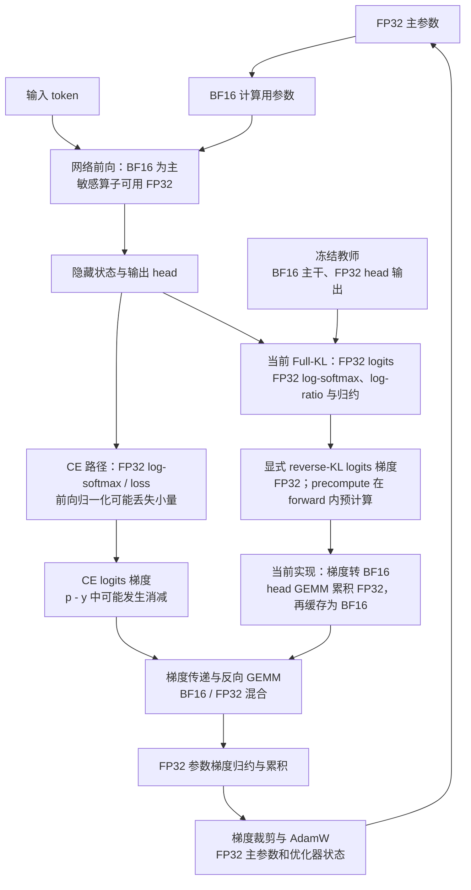

# OPD 数值精度与后期收敛核查

更新：2026-10-25。核查对象为论文 _A Fix for Softmax and Cross-Entropy_[^softmaxfix] 所讨论的浮点问题在 MirrorOPD 中的适用范围。训练源码未修改；工作包括读取 E15/E18/E19/E20 的本地日志、核对历史实现、运行受控算子实验，以及在本地初始师生模型的固定数学前缀上提取 logits 并进行 FP64 对照。

## 1. 判断与适用范围

Sampled OPD 确实存在局部信号消失的数值路径，初始模型就能触发，并非只有训练后期才会发生。对当前 Full-KL `precompute` 路径，实验没有支持“后期 KL 已被该误差卡住”或“整体梯度方向错误”。近相等输入下的相减误差仍然存在，但在所测 KL 约 $10^{-4}$ 的受控输入上，FP32 logits 梯度相对误差仅 $1.77\times10^{-6}$。

这里的“后期”包含两个独立变化：师生分布逐渐接近，以及部分 token 的预测越来越确定。前者使小差异容易被舍入抹掉，后者使选中 token 的概率接近一。初始语言模型在标点、数字、模板续写等位置也可能很确定，所以后者不需要等待 OPD 训练。

| 路径                       | 已验证的数值行为                                                                                           | 对已有训练的判断                                                     |
| -------------------------- | ---------------------------------------------------------------------------------------------------------- | -------------------------------------------------------------------- |
| Sampled k1/current         | FlashAttention CE 路径能将选中 token 的 log-prob 和目标梯度舍入为零；两侧 log-prob 相同会让 advantage 归零 | 局部信号丢失可以发生；所测初始前缀丢失的梯度极小，未观测整体方向反转 |
| Full reverse KL/precompute | 用 FP32 归一化和显式梯度，避免了直接计算 $p_t-1$；相同 logits 给出精确零梯度                               | E18–E20 仍持续优化，没有证据表明当前后期被该现象主导                 |
| 极近教师的受控输入         | Sampled 信号逐渐归零，Full-KL 的部分微小梯度分量可改变符号                                                 | 说明存在数值边界；这些输入是人工插值，不是 E18–E20 后期 checkpoint   |

## 2. 证据与复现

主要文件：

- [核查脚本](../../../../benchmarks/profile/audit_opd_numerics.py)。
- [环境与源码版本](../../../../../../outputs/opd-numerical-audit-20261025/metadata.json)。
- [历史 run 统计](../../../../../../outputs/opd-numerical-audit-20261025/histories.json)。
- [受控二分类实验](../../../../../../outputs/opd-numerical-audit-20261025/synthetic.json)。
- [真实 logits 与插值统计](../../../../../../outputs/opd-numerical-audit-20261025/real_logits.json)。
- [固定前缀和 token 坐标](../../../../../../outputs/opd-numerical-audit-20261025/prefixes.json)。

本机环境为单张 NVIDIA H800、PyTorch 2.11.0+cu128、Transformers 5.12.1。结果文件记录分析时源码提交 `3d0b1dd94419be801a54e12e3de7d379b37452ef` 和日志提交 `0da0a0412b775d555f08948aa6537244c1595aa2`。首次提取 logits 时源码为 `0f2eae6a9ba9148bf251d6885e52a180a60c5606`；两者之间本分析涉及的 `full_vocab.py`、`torch_functional.py` 和 `losses.py` 无差异。E18–E20 配置记录的历史提交 `376e8185e` 中，precompute 的投影、归一化和梯度公式与核查路径一致；Git 记录不能证明训练端工作区没有额外修改。

从已有本地数学验证记录中按文件顺序选前四个不同 prompt，每个使用前 512 个 response token，并均匀选择 32 个预测状态，共 128 个状态、151936 个词表项。师生分别为本地 `DeepSeek-R1-Distill-Qwen-1.5B` 和 `JustRL-DeepSeek-1.5B`，使用 BF16 权重、SDPA、eval 模式。固定前缀推理不等同于原训练的 FSDP、packing、FlashAttention 和 rollout 轨迹；这些结果只用于验证数值路径。

FP64 对照使用与被测函数完全相同的 logits，只提升损失计算精度。它隔离的是损失算子的误差，不包括 backbone 的 BF16 误差、历史 checkpoint 差异或推理与训练引擎不一致。首次运行保存 `fixed_logits.pt`；后续复算直接使用该文件。

从仓库根目录运行，选择一张空闲 GPU：

```bash
CUDA_VISIBLE_DEVICES=0 PYTHONPATH=. \
  /root/.local/share/mirroropd/venvs/profile-cu128/bin/python \
  -m examples.mirroropd.benchmarks.profile.audit_opd_numerics \
  --out outputs/opd-numerical-audit-20261025
```

原始训练日志始终从同级 `wandb-logs/derived/MirrorOPD-verl/` 读取。这里没有改动日志、模型参数或训练 loss，也没有重新训练四个历史 run。

## 3. 实际数学目标与数值路径

### 3.1 Sampled OPD

记学生分布为 $p_\theta$、教师为 $q$、采样 token 为 $a$。current advantage 为

$$
A(a)=\operatorname{stopgrad}\bigl[\log q(a)-\log p_\theta(a)\bigr].
$$

reinforce surrogate 及其梯度为

$$
\ell=-A(a)\log p_\theta(a),\qquad
\frac{\partial\ell}{\partial z_i}
=-A(a)\bigl[\mathbf 1_{i=a}-p_\theta(i)\bigr].
$$

对未触发 clamp 的 token-IS 分支，梯度再乘正的行为比值 $r$。PPO 激活裁剪分支时可以有意给出零梯度；这与舍入归零不同。E15 实际使用 legacy vanilla，具有 anchor 分母及既有 PPO 行为，不能把它当成显式 token-IS run；这里检查的是这些分支共享的 log-prob 计算和 current advantage 数值问题。

实现入口为 [sampled loss](../../../../../../verl/trainer/distillation/losses.py) 和 [log-prob 计算](../../../../../../verl/utils/torch_functional.py)。后者在 FlashAttention CE 可用且未被环境开关禁用时使用其 Triton 实现。本机实际走此路径，输入为 BF16 时，内部仍将 logits 转成 FP32 计算 LSE，并返回 FP32 log-prob，反向结果写回输入 dtype。

因此，不能只因为训练模型是 BF16，就直接把论文的 $m\approx5.5$ 阈值套在这条路径上。另一方面，Flash CE 使用 `logsumexp(z)-z_a` 并在反向计算 $p_a-1$，仍会发生吸收误差。绝对 logit 大小、归约实现和输入 dtype 都会改变具体边界。

### 3.2 Full reverse KL

在固定前缀上，完整词表目标为

$$
D(p\Vert q)=\sum_i p_i h_i,\qquad
h_i=\log p_i-\log q_i.
$$

利用 softmax 导数和 $\sum_i p_i=1$，学生 logits 梯度为

$$
\frac{\partial D}{\partial z_j}
=\sum_i p_i(\mathbf1_{i=j}-p_j)(h_i+1)
=p_j\left(h_j-\sum_i p_i h_i\right)
=p_j(h_j-D).
$$

[precompute 实现](../../../../../../verl/trainer/distillation/full_vocab.py) 正是这个显式公式。CUDA BF16 hidden/head 使用 `torch.mm(..., out_dtype=torch.float32)` 输出 FP32 logits，随后在 FP32 中计算 log-softmax、KL 和 logits 梯度；梯度送入 GEMM 前转回 BF16。它不是论文中的 $q-p$ 前向 KL/交叉熵梯度，也不直接计算 $p_t-1$。

当两侧 logits 完全相同时，两次 log-softmax 相同，$h=0$、$D=0$、$g=0$。受控实验确认该固定点为零；没有复现论文中“完全相同 logits 仍有非零梯度”的同一种问题。实际参数仍可能因历史 Adam 动量或 weight decay 移动；E18–E20 使用 weight decay=0.01，因此不能把这些移动直接归咎于数值错误。

它仍然会先分别归一化，再相减。师生差异极小时，两个 log-prob 的舍入误差可能大于真实差异。设输入 logit 差为 $\delta_i=z_{S,i}-z_{T,i}$，则

$$
h_i=\delta_i-c,\quad c=\log Z_S-\log Z_T,
$$

$$
h_i-D=\delta_i-\sum_jp_j\delta_j.
$$

公共归一化误差在中心化时会抵消，这解释了为何标量 KL 可能先失真，而梯度仍准确。诊断脚本还比较了先对 logit 差中心化的等价梯度，并在最大学生 logit 处先减去 gap 锚点以保护饱和行；它只是对照，不是已经部署的新 backend。

## 4. 历史日志

### 4.1 Sampled E15

E15 `krkmq098` 完成 200 次更新。以下窗口跨更新等权平均，不能解释为合并所有 token 后的单一比例。

| 指标                 | 前 20 更新 | 后 20 更新 |
| -------------------- | ---------: | ---------: |
| advantage 精确零比例 |    3.1497% |   10.7483% |
| advantage 绝对值均值 |    0.24816 |    0.06059 |
| 裁剪前梯度范数均值   |    1.17024 |    0.10311 |

零 advantage 比例后期更高，但仅凭日志不能将全部零值归因于舍入：也可能来自真实相等概率或其他输入处理。历史字段 `distill/advantage/sign_flip_fraction` 比较 current 和 frozen/rollout advantage，混合了策略变化与引擎差异；它没有高精度参照，不能作为“数值错误方向比例”。

E15 全部 200 次更新没有零梯度范数、非有限 loss/gradient 或跳步记录。局部信号被抹掉与全模型仍能训练可以同时成立。

### 4.2 Full-KL E18–E20

| Run            | 已记录更新数 |  首个 KL |     最后 KL | 最后裁剪前梯度范数 |
| -------------- | -----------: | -------: | ----------: | -----------------: |
| E18 / 9hx3uegm |         4096 | 0.115358 | 0.000154763 |         0.00492304 |
| E19 / d6jhh378 |         4096 | 0.115759 | 0.000271793 |         0.00525139 |
| E20 / lwgb5eex |         3024 | 0.113520 | 0.000346546 |         0.00837092 |

三个 run 的已记录更新均无零梯度范数、非有限 loss/gradient 和跳步。各自最后 256 对同批相邻观测中，KL 下降的比例分别为 93.36%、99.61%、97.27%；统计明确排除换批重置。

[等更新预算分析](../../../experiments/reuse-budget/equal-update-budget/README.md)还表明，在各自最后 512 updates 内，同批最后两个观测之间的平均 KL 降幅为 0.34%、1.25%、2.72%。这些结果支持“后期同批仍能优化”，不支持“已经完全卡死”。验证分数未随训练 KL 一致提高，也不能据此诊断数值精度：固定前缀拟合和完整回答质量是不同指标。

## 5. 算子与真实前缀实验

### 5.1 高置信预测：Sampled 可以失去目标梯度，Full-KL 仍保留梯度

使用学生 logits $[m,0]$、教师 logits $[m-2,0]$，采样类别为 0。Sampled 列先检查公共 log-prob 的反向，即单位系数的负 log-prob 梯度；实际 OPD 还要乘 advantage 和可能的 IS 比值。Full-KL 列直接调用仓库 `precompute_kl_rows`，以 identity head 构造同一输入。

| $m$ | Flash CE 的目标梯度，FP32 | FP64 正确 CE 目标梯度 | Full-KL logits 梯度相对 L2 误差 |
| --- | ------------------------: | --------------------: | ------------------------------: |
| 8   |               -3.35634e-4 |        约 -3.35350e-4 |                         1.44e-7 |
| 12  |               -5.78165e-6 |        约 -6.14417e-6 |                         4.40e-8 |
| 16  |                         0 |        约 -1.12535e-7 |                         1.91e-7 |
| 18  |                         0 |        约 -1.52300e-8 |                         1.70e-7 |
| 24  |                         0 |       约 -3.77513e-11 |                         4.63e-8 |

当 $m=24$ 时，Full-KL 的标量结果为负数 $-7.55\times10^{-11}$，但梯度为约 $[7.55,-7.55]\times10^{-11}$，相对误差仍为 $4.63\times10^{-8}$。这给出一个直接反例：不能把微小负 KL 或不准确的 loss 数字等同于错误的优化方向。

### 5.2 初始师生真实前缀

128 个位置的 sampled 路径使用真实 BF16 head 输出，并调用仓库 `logprobs_from_logits`。FP64 参照保持同一 BF16 logits 数值，仅提升归一化和梯度计算精度。

| 指标                                      |                结果 |
| ----------------------------------------- | ------------------: |
| 被算为零的 advantage                      |   15/128，11.71875% |
| FP64 参照中的精确零 advantage             |               0/128 |
| 被算为零的学生 sampled log-prob           |    14/128，10.9375% |
| advantage 与 FP64 参照符号相反            |               0/128 |
| 被抹掉 advantage 的 FP64 绝对值均值       |             5.53e-7 |
| 被抹掉行的真实 logits 梯度 L2 / 全部行 L2 |            7.65e-12 |
| 全部 sampled logits 梯度相对 L2 误差      | 0.001315，约 0.132% |
| 全部 sampled logits 梯度余弦相似度        |          0.99999917 |

因此已经在真实模型输入上证实“数值归零”，但没有证实它在这些输入上造成重要的方向错误。不能把零值比例视作丢失学习信号的比例。

这些位置多处于高置信预测区。学生、教师对选中 token 的概率都很接近一时，advantage 和 score gradient 都很小，两者相乘后的 sampled 梯度更小。在简单二分类同尺度尾部中，两者可分别为 $O(e^{-m})$，乘积为 $O(e^{-2m})$；少量罕见动作对完整期望的贡献可能更大。这还涉及 sampled estimator 的方差与动作覆盖，不能全部归到 softmax 数值问题。

### 5.3 近教师插值：后期数值边界

固定真实教师 logits $z_T$ 与初始学生 logits $z_{S,0}$，构造

$$
z_S(\alpha)=z_T+\alpha(z_{S,0}-z_T).
$$

插值只生成一份 FP32 输入，FP32 和 FP64 路径都使用它。它控制师生接近程度，不模拟 backbone 训练或真实 checkpoint 的局部误差分布。

| $\alpha$ | FP64 平均 reverse KL | Full-KL FP32 梯度相对误差 | 梯度转 BF16 后相对误差 | FP32 每行 KL 绝对误差均值 |
| -------- | -------------------: | ------------------------: | ---------------------: | ------------------------: |
| 1        |            1.2616e-1 |                   1.72e-7 |                1.79e-3 |                   1.06e-7 |
| 0.1      |            1.0363e-3 |                   4.79e-7 |                1.60e-3 |                   6.96e-8 |
| 0.03     |            9.2052e-5 |                   1.77e-6 |                1.52e-3 |                   6.64e-8 |
| 0.001    |            1.0178e-7 |                   5.92e-5 |                1.60e-3 |                   4.73e-8 |
| 0.00001  |           1.0100e-11 |                   4.88e-3 |                5.01e-3 |                   3.27e-8 |
| 0.000001 |           1.3888e-13 |                   4.38e-2 |                4.38e-2 |                   2.38e-8 |
| 0        |                    0 |            两侧梯度均为零 |         两侧梯度均为零 |                         0 |

在 $\alpha=0.03$、KL 约 $9.2\times10^{-5}$ 的输入上，FP32 归一化误差远小于后续 BF16 梯度转换误差。该量级接近 E18–E20 的后期日志，但不能仅凭平均 KL 相近就认定真实 checkpoint 的误差分布相同。

在 $\alpha=10^{-6}$ 的极近教师输入上，Full-KL logits 梯度相对误差为 4.38%，余弦相似度为 0.99905；符号错误分量对应的真实梯度绝对质量约占 0.265%。这里确实出现局部分量方向错误，整体梯度仍未反转。将真实 logit 差先中心化的诊断公式，在这组输入上的相对误差为 $1.85\times10^{-7}$。

同一插值下，sampled 路径也单独用 FP32 输入测量，以隔离 BF16 head 舍入：

| $\alpha$ | 零 advantage 比例 | logits 梯度相对误差 |   梯度余弦 |
| -------- | ----------------: | ------------------: | ---------: |
| 1        |            11.72% |             1.19e-6 |       约 1 |
| 0.03     |            27.34% |             2.20e-5 |       约 1 |
| 0.001    |            39.06% |             6.10e-4 | 0.99999983 |
| 0.00001  |            63.28% |              0.0614 |    0.99811 |
| 0.000001 |            88.28% |              0.5600 |    0.82869 |

这组 sampled 输入没有观测到 advantage 符号翻转，方向偏差主要来自部分信号被删掉和幅度失真。真实训练中若教师、学生或 behavior 使用不同数值路径，额外偏差仍可能使很小的 advantage 改变符号；现有实验没有量化那一项。

## 6. 对优化的含义与下一步

### 6.1 三类后果

1. advantage 被算成零时，该 sampled token 对这个 surrogate 的全部 logits 梯度为零，形成局部不更新。其他 token 仍可更新共享参数，因此不等同于整个模型停止学习。
2. 选中 token 的 score 梯度分量归零而其他分量保留时，梯度结构发生偏差。若 advantage 本身翻转符号，未裁剪分支的单 token 更新方向会翻转。这里的实测证明了归零和极近教师时的局部分量错误，没有证明当前历史训练的整体方向反转。
3. 小误差经 Adam 预条件后可能造成额外扰动或固定点附近噪声，但影响取决于逐参数的历史一阶矩、二阶矩、$\epsilon$、归一化和学习率。不能把 logits 误差或全局 grad norm 直接与 Adam 的 $\epsilon$ 比较后宣布发生 Slingshot。

### 6.2 优先级

当前优先增加固定前缀精度诊断，不宜因为论文直接改整套训练 loss。对真实 early/middle/late checkpoint 各采样一批状态，同时记录实际路径与 FP64 参照的 loss、logits 梯度、head/hidden 梯度、梯度余弦，以及零 advantage 所对应的参考梯度质量。还应将高置信、近教师和普通位置分开，避免均值掩盖少数异常状态。

Sampled 路径值得先评估稳定的 selected-token log-prob 与 VJP，并检查 teacher/student 是否使用一致精度。仅在 log-prob 已舍入之后调用 `.float()` 无法恢复信息；仅修复 advantage 的减法也不能补回已丢失的 score gradient。

Full-KL 的低成本候选是使用上文等价的 logit-gap 中心化梯度，另行提供稳定的 KL 诊断值。部署前仍需验证真实 head/hidden 梯度、吞吐和内存；不能把 logits 梯度误差直接当作最终参数梯度误差。论文的前向交叉熵修复不可直接套用到 reverse KL。

已有证据支持继续把 E18–E20 的后期现象理解为“训练目标仍下降，但任务收益有限”，而不是已经确认的 softmax 数值停滞。后期 checkpoint 和真实 Adam 更新的高精度对照仍是缺少的决定性证据。

## 7. 硬标签 CE 的近似失效阈值

以下阈值针对单个有效 token、无 label smoothing 的硬标签 CE，单位为 nats，不针对 batch 平均 loss 或完整 reverse KL。参考 CE 使用相同可表示 logits 的 FP64 计算；实际 loss 在阈值附近可能已经被记录成零。

令 $r=\sum_{j\ne t}e^{z_j-z_t}$，则

$$
L=\log(1+r),\qquad m=-\log r,\qquad p_t=e^{-L},\qquad |g_t|=1-e^{-L}.
$$

当 $L\ll1$，有 $L\approx r\approx1-p_t\approx|g_t|$。若 $1+r$ 的加法采用有效精度位数为 $p$ 的格式，round-to-nearest 下的理想吸收阈值为 $r\lesssim2^{-p}$，即 $L\lesssim\log(1+2^{-p})$、$m\gtrsim p\log2$。精确边界依赖求和顺序和具体 kernel。

| 关键计算采用的精度 | 有效位数 $p$ | 理想参考 CE 阈值 | Margin 阈值 |
| ------------------ | -----------: | ---------------: | ----------: |
| BF16               |            8 |          3.90e-3 |        5.55 |
| FP16               |           11 |          4.88e-4 |        7.62 |
| FP32               |           24 |          5.96e-8 |       16.64 |
| FP64               |           53 |         1.11e-16 |       36.74 |

表中 dtype 指关键计算路径，不能仅由权重 dtype 推断。PyTorch autocast 会将符合条件的 cross_entropy/log_softmax 提升到 FP32。[^amp] 本机 PyTorch 2.11.0 的 CPU 对照中，直接 BF16 CE 的首次目标梯度归零在参考 CE 约 0.00383，而 BF16 输入加 autocast 后在约 5.32e-8；二者都使用同一个 F.cross_entropy API。BF16 输入的 margin 量化使测得边界不等于理想值。

对于先保存绝对 LSE、再计算 `LSE - z_target` 的路径，还存在绝对 logit 尺度的舍入。正确类别为最大值且其 logit 为 $a>0$ 时，参考 CE 小于约 $\tfrac12\mathrm{ULP}_{32}(a)$，就可能在 `LSE = a + small` 时丢失。FP32 的该尺度约为 $2^{\lfloor\log_2a\rfloor-24}$。

| 正确类别 logit $a$ | 半 ULP 估计 | CPU 同形 LSE-minus-target 表达式的归零边界 |
| ------------------ | ----------: | -----------------------------------------: |
| 8                  |     4.77e-7 |                                    5.36e-7 |
| 16                 |     9.54e-7 |                                    1.01e-6 |
| 32                 |     1.91e-6 |                                    1.97e-6 |
| 64                 |     3.81e-6 |                                    3.87e-6 |

这是 FP32 表达式的 CPU 实测，不是重新测量 FlashAttention CUDA kernel。FlashAttention CE 中存在同样的绝对 LSE 与目标 logit 相减结构；实际 CUDA 边界需另测。前述 128 个真实初始学生状态中，最大 logit 为 22.58–36.58，中位数 28.37，因此 $10^{-6}$ 量级是有依据的 selected-token log-prob 诊断尺度。

目标梯度在完全归零之前也会失真。以下为两个类别的 CPU FP32 测试点，百分比是目标 logit 梯度相对 FP64 参照的误差，不是全模型参数梯度误差：

| 参考单 token CE | 标准 F.cross_entropy | LSE-minus-target，$a=32$ |
| --------------- | -------------------: | -----------------------: |
| 1e-4            |              0.0216% |                   0.813% |
| 1e-5            |               0.136% |                    14.4% |
| 1e-6            |                4.63% |       100%，目标梯度为零 |
| 1e-7            |                19.2% |       100%，目标梯度为零 |
| 1e-8            |   100%，目标梯度为零 |       100%，目标梯度为零 |

这些是代表性测试点，不是单调误差上界。核查脚本为 [calculate_ce_thresholds.py](../../../../benchmarks/profile/calculate_ce_thresholds.py)，[完整数值](../../../../../../outputs/opd-numerical-audit-20261025/ce-thresholds.json)可用以下命令复算：

```bash
/root/.local/share/mirroropd/venvs/profile-cu128/bin/python \
  -m examples.mirroropd.benchmarks.profile.calculate_ce_thresholds \
  --out outputs/opd-numerical-audit-20261025/ce-thresholds.json
```

训练诊断应记录有效 token 的 CE 分布和精确零比例，并抽样比较高精度梯度；忽略位置和 padding 不计入分母。还可以检查每 token 的零和残差 $|\sum_i g_i|/\sum_i|g_i|$：理想硬标签 CE 为零，目标梯度丢失而其他梯度保留时可接近一。不能用 batch 平均 CE 是否低于某个数代替这些观测。

这里的 margin 是 $z_t-\operatorname{LSE}_{j\ne t}z_j$，不是 top-1/top-2 差。例如 15 万词表中若其余 logits 完全相同，达到 $m\approx16.64$ 需要正确 logit 与其余项相差约 28.6。实际分布不满足等值假设时应直接计算 LSE margin。

## 8. 前向、反向精度与 Full-KL 的数值尺度

第 7 节的理想 $1+r$ 吸收阈值针对前向归一化计算。完整失效路径还包括前向缓存的 dtype、反向的 $p-y$ 消减、梯度矩阵乘法、归约以及参数更新。普通混合精度训练中的 FP32 loss 不意味着每个环节都使用 FP32；前向概率已丢失的信息，不能靠把缓存概率转成 FP32 恢复。



图按数学依赖展示常见混合精度配置。当前 precompute 还在 forward 中预计算 head/hidden 梯度；其 autograd backward 只应用上游归一化系数并返回缓存梯度，然后继续主干反向。梯度存储和执行时机不能仅凭函数名推断。

### 8.1 KL 的值与梯度为何具有不同尺度

在所有相关类别都满足 $|p_i-q_i|\ll q_i$ 的近教师区域，令 $\Delta_i=p_i-q_i$、$\sum_i\Delta_i=0$。展开对数可得

$$
D(p\Vert q)=\sum_i(q_i+\Delta_i)\log(1+\Delta_i/q_i)
\approx\frac12\sum_i\frac{\Delta_i^2}{q_i}.
$$

一阶项因归一化相消。学生 logits 梯度则为

$$
g_i=p_i\left[\log(p_i/q_i)-D\right]\approx\Delta_i.
$$

所以 KL 在局部是分布差异的二阶量，梯度是一阶量。KL 很小，并不意味着梯度已经小到 FP32 无法分辨。行内公共 log-prob 误差还可以在 $h_i-\mathbb E_p h$ 的中心化中抵消，使 loss 标量明显失真时梯度仍准确。

在本机 CPU 二分类对照中，教师 logits 为 $[0,0]$，学生为 $[0.0002,-0.0002]$；学生概率近似 $[0.5001,0.4999]$。同一输入的 FP64 KL 为 $2.00\times10^{-8}$，FP32 KL 为 $1.02\times10^{-8}$，但 logits 梯度相对误差只有 $1.70\times10^{-5}$，即 0.00170%。这不是高置信样本，说明 KL 很小与 $p_t$ 接近一是不同条件。

### 8.2 当前 precompute 路径的经验诊断范围

第 5.3 节 H800、128 个真实初始模型状态的 logit 插值结果，可转换为以下尺度。前向误差是每个位置 KL 绝对误差的平均值；梯度误差是全部位置的 logits 梯度拼接后相对 L2 误差。它们均使用同一 FP32 输入的 FP64 参照，不是全参数或 Adam 更新误差。

| 参考平均 KL | 每位置 KL 绝对误差均值 | FP32 logits 梯度相对误差 | 转 BF16 后的 logits 梯度相对误差 |
| ----------- | ---------------------: | -----------------------: | -------------------------------: |
| 9.21e-5     |                6.64e-8 |                0.000177% |                        约 0.152% |
| 9.16e-7     |                5.18e-8 |                 0.00182% |                        约 0.151% |
| 1.02e-7     |                4.73e-8 |                 0.00592% |                        约 0.160% |
| 1.02e-9     |                3.86e-8 |                  0.0489% |                        约 0.180% |
| 1.01e-11    |                3.27e-8 |                   0.488% |                        约 0.501% |
| 1.39e-13    |                2.38e-8 |                    4.38% |                         约 4.38% |

在这些输入上，平均 KL 到 $10^{-6}$ 时每位置绝对误差已相当于平均 KL 的几个百分点；到 $10^{-7}$ 时读数需要谨慎，$10^{-8}$–$10^{-9}$ 以下不能直接信赖逐位置 KL。平均多个位置可能抵消一部分误差，所以这不等于 batch 平均读数必然同样失真。另一方面，梯度到 $10^{-11}$ 量级才出现约半个百分点误差，到 $10^{-13}$ 量级出现几个百分点误差；精确相同 logits 的固定点仍然返回零 loss、零梯度。不能把这段经验关系外推成单调、普适的 KL 失效阈值。

补充的 256 类随机 logits CPU 实验得到相同的定性结论，但具体边界不同。例如 FP32 路径在参考 KL $5.06\times10^{-9}$ 时计算为 $2.49\times10^{-8}$，梯度误差为 0.0731%；到参考 KL $4.56\times10^{-12}$ 时梯度误差为 2.69%。如果连 log-softmax、KL 和梯度公式都改用 BF16，同一类型输入在参考 KL $9.37\times10^{-5}$ 时，计算出的 KL 已为负，梯度误差为 23.6%。该 BF16 路径不是当前 CUDA precompute 使用的路径。

这也说明 BF16 梯度存储与 BF16 归一化并非同一回事：小梯度本身可以在 BF16 中表示，主要风险是近数相减、归约或小更新加到大参数上。现有 FP32 log-softmax/KL 计算应保留。

补充实验脚本为 [calculate_kl_thresholds.py](../../../../benchmarks/profile/calculate_kl_thresholds.py)，结果为 [kl-thresholds-cpu.json](../../../../../../outputs/opd-numerical-audit-20261025/kl-thresholds-cpu.json)。复算命令：

```bash
/root/.local/share/mirroropd/venvs/profile-cu128/bin/python \
  -m examples.mirroropd.benchmarks.profile.calculate_kl_thresholds \
  --out outputs/opd-numerical-audit-20261025/kl-thresholds-cpu.json
```

### 参考文献

[^softmaxfix]: Jonathan T. Barron, Dan Gnanapragasam, Michael Tschannen. A Fix for Softmax and Cross-Entropy. arXiv v1, 2026. [arXiv:2610.31642](https://arxiv.org/abs/2610.31642).

[^amp]: PyTorch 2.11. Automatic Mixed Precision package, CUDA Ops that can autocast to float32. [官方文档](https://docs.pytorch.org/docs/2.11/amp.html#cuda-ops-that-can-autocast-to-float32).
