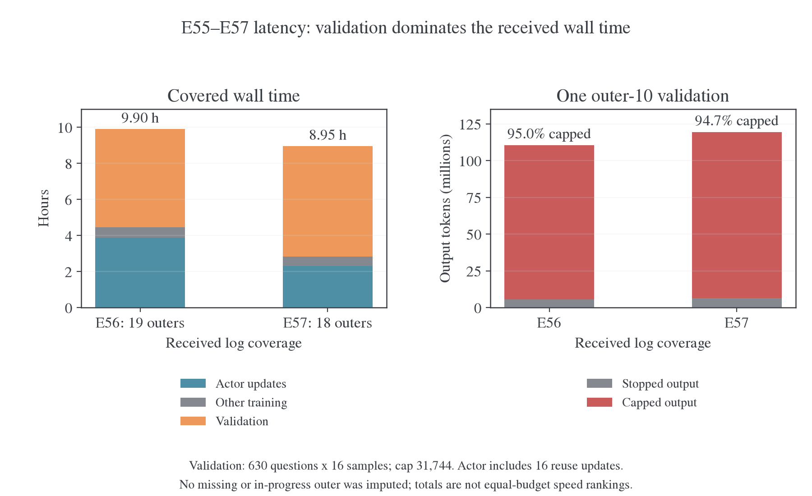
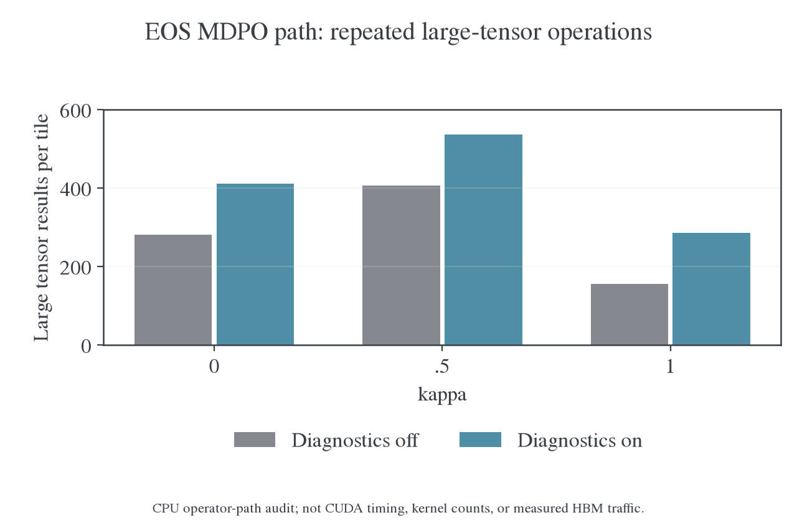

# E55–E57：MDPO 长程训练与验证耗时诊断

更新日期：2026-10-30。对象为 Qwen3-1.7B-Base ← Qwen3-30B-A3B-Instruct-2507。分析依据是[已接收快照](../../model-compatibility/qwen-e54/2026-10-30-E55至E57长程训练阶段分析.md)、对应 `9fd276af` 源码和 CPU 算子路径审计，没有修改正在运行的实验，也没有执行 CUDA 性能基准。

## 1. 定位结果与证据等级

**总进度慢的最大原因是完整验证；训练内部则主要耗在 actor 更新。** 这不是只调 rollout 并发就能解决的问题。

| 层次      | 已有证据                                                        | 能确定的结论                                             |
| --------- | --------------------------------------------------------------- | -------------------------------------------------------- |
| 总墙钟    | 第 10 步验证分别耗时 5.46 小时、6.12 小时                       | 在已完成计时范围内，验证占 E56/E57 的 55.1%/68.4%        |
| 训练单步  | 后期 actor 更新占训练步的 86%–91%；teacher 主干前向约 10 秒     | 训练提速应优先查 actor 内部，而不是更换 teacher 推理池   |
| 具体实现  | EOS 分支全词表 FP64、布尔索引、重复诊断和目标计算均可在源码复核 | 存在明确可优化的路径；其 GPU 时间占比尚无 CUDA trace     |
| KV 与通信 | 有显存和 GPU 采样，但 preemption 指标明确缺失；无 NCCL trace    | 不能把抢占当成已证实主因，也不能声称抢占为零或通信无开销 |

此前为 EOS 等价类加入的保守实现通过了数值和梯度检查，但没有完成生产吞吐验收。现在确认它会绕过已有快速路径，这是需要补齐的性能工作；不能把全部慢归因于模型大或回答长，也不能为了提速取消已经验证必要的 EOS 合并。

## 2. 实际时间花在哪里

下面只合计已有完整 outer 计时，不包含启动、缺失记录或 E56 尚无完整汇总的第 20 步。验证在训练步计时之外，不能只查看 `outer_step_seconds` 就估算总时间。

| 已覆盖范围                  | 训练合计 | 其中 actor | 完整验证 |   合计 | 验证占比 |
| --------------------------- | -------: | ---------: | -------: | -----: | -------: |
| E56，19 个 outer 加一次验证 |   4.44 h |     3.87 h |   5.46 h | 9.90 h |    55.1% |
| E57，18 个 outer 加一次验证 |   2.83 h |     2.31 h |   6.12 h | 8.95 h |    68.4% |

这三组是离线 run 的接收快照，云端只有在同步后才增加记录，并非实时监控。训练本地也在 16 次更新结束后成批记录更新指标，验证期间没有新的训练 loss。云端长时间不刷新不能作为进程卡死的证据；这里的小时数来自远端程序计时，不包含本机上传日志的时间。

即使把 actor 时间降为零，在当前已覆盖窗口内，总耗时最多也只分别加速约 1.64 倍、1.35 倍。这不是预测后续上限，而是说明单修训练 kernel 无法消除当前验证大头。

最后完整训练步的拆分如下。Anchor 准备已包含在 actor 时间内，不重复相加。

| 项目                    | E55 outer7 | E56 outer19 | E57 outer18 |
| ----------------------- | ---------: | ----------: | ----------: |
| 训练步总计              |  14.67 min |   24.04 min |   14.82 min |
| Actor，含 16 次复用更新 |  12.58 min |   21.94 min |   12.82 min |
| Rollout 批次            |   1.73 min |    1.69 min |    1.61 min |
| Teacher 主干前向        |     6.23 s |     10.18 s |     10.06 s |
| Teacher 搬入／搬出      |     9.58 s |      9.34 s |      7.99 s |
| Anchor 准备，actor 内部 |     4.67 s |      5.20 s |      5.58 s |

Teacher 主干时间不包含后面在 actor loss 内重复执行的 teacher 输出头投影。前者很短，不能据此说全部 teacher 相关工作都只有 10 秒。

## 3. 一次验证为什么需要五六小时

每次验证是 630 题×16 次采样，即 10,080 条回答，cap31,744。按每个 benchmark 的实际样本数与平均长度复算：

| 第 10 步验证              |           E56 |           E57 |
| ------------------------- | ------------: | ------------: |
| 输出 token 总数           |      110.48 M |      119.39 M |
| 触顶回答数                |  3,307/10,080 |  3,562/10,080 |
| 触顶回答贡献的 token 比例 |        95.02% |        94.71% |
| 生成流水线时间            |        5.44 h |        6.11 h |
| 八卡合计输出吞吐          | 5,641 token/s | 5,431 token/s |
| 平均到每卡                |   705 token/s |   679 token/s |

少数长尾回答消耗了绝大部分生成量。MATH-500 虽然中位回答很短，但有 8,000 次采样，仍贡献约六成验证 token；不能只把成本归给 AIME。

`validation_seconds` 是整个验证的墙钟计时；`validation_rollout_seconds` 来自提交起点到最后一条生成完成的流水线跨度，不是把所有请求耗时相加。两者相差约 51–52 秒，生成流水线占 99.7% 以上。这个跨度包含排队及服务开销，不能直接等同于 GPU kernel 时间；但后处理或 W&B 上传不是这五六小时的主要来源。

如果长度分布完全保持不变，100 outer 的 10 次验证单独就需要约 55/61 小时。这只是静态工作量外推，不是剩余时间承诺；训练质量变化会改变后续长度。沿用 n=16 的预算在当前长尾分布下成本很高，不能按短回答的推理体验估算。

### 3.1 KV 容量只能说明风险，不能代替抢占测量

按该模型 28 层、8 个 KV heads、head_dim128、BF16 KV、TP1 计算，每个上下文 token 的 KV 为：

$$
2\times28\times8\times128\times2=114{,}688\ \mathrm{bytes}.
$$

仅一条 31,744-token 回答就对应约 3.39 GiB KV；64 条独立满长序列约 217 GiB，尚未计 prompt。每卡 0.8×80 GiB 的总预算约 64 GiB，还需容纳模型和运行时。因此，`max_num_seqs=64` 不意味着 64 条满长回答都能同时常驻；调度器必须依据实际长度和可用 blocks 安排运行、等待或抢占。

这个估算没有计入共享前缀、缓存布局和运行时开销，不能当作实测 KV 容量。现有日志只明确警告 `backend did not report preemptions ... unknown is not zero`，没有完整抢占计数或 KV 使用率。当前不能认定 64 一定最优，也不能直接宣布改成 16 或 32 就更快。

长上下文还增加每个 decode token 的注意力读取成本，所以每卡约 700 token/s不能与短文本的峰值吞吐直接比较。应补齐 vLLM 的 KV 使用率、活跃／等待请求数、抢占与重算计数，再用相同题集、采样协议和稳定模型版本比较 16/32/64；同时报告输出总 token，防止把生成变短误当作引擎提速。

## 4. Actor 内部的明确慢路径

### 4.1 这里的 precompute 没有跨 16 次更新缓存完整目标

当前路径缓存 teacher/anchor hidden 与 head，但每次 learner 更新仍执行 student、teacher、anchor 三个输出头投影，并重算目标分布和诊断。`PrecomputedKL` 的含义是单次前向中预先算出一阶 VJP，供随后 backward 使用；它不是整批 16 次更新的目标缓存。

后期一个训练批次约 55 万 input token，reuse16 意味着约 880 万 input-token passes。`perf/throughput/tokens_per_gpu_second` 按新采样 token 与整步墙钟计账，没有乘 16；E57 日志约 78 token/s/GPU不等于每卡实际只处理78个更新 token。按 16 次复用、actor 阶段计时计算，其约为 1,437 input-token passes/s/GPU。

### 4.2 EOS 路径把整个词表块转成 FP64

[`_mirror_rows`](../../../../../../verl/trainer/distillation/full_vocab.py) 在启用停止类合并后执行 `z.double(), zq.double(), zt.double()`，随后传给通用 Torch 行运算。单个 512×151,936 的 FP64 矩阵约 0.58 GiB；这里会反复产生多个同规模结果。

[`relative_difference`](../../../../../../verl/trainer/distillation/numerics.py) 的 CUDA 快路径要求 FP32 连续输入，当前全 FP64 分支不会进入。配置虽然有 `vocab_chunk_size=8192`，但这个 MDPO `precompute` 分支只按 token chunk 分块，`_mirror_rows` 仍投影完整词表，8192 没有把这些矩阵切成词表小块。

通用稳定公式包含 `exp/log/expm1/log1p`、多项式、归约、复制和 `torch.where`。Eager 模式下 `where` 的两个分支都已先计算，近场和远场公式并不会因为只选一支就自动省掉另一支的工作。它们不是通常用于估算模型 MFU 的 Transformer 主干 FLOPs。

### 4.3 布尔索引引入每块 4 次同步点

三次 `logits[:, keep]` 和一次按同一布尔 mask 写回梯度，会通过 `nonzero` 展开索引。独立 CPU profiler 路径确认每块 4 次 `aten::nonzero`；PyTorch 2.11 的索引源码和文档确认 CUDA `nonzero` 会发生 host-device synchronization。[^torch-index][^torch-nonzero]

这是可以明确消除的同步点，但没有 CUDA trace，不能把全部 actor 时间归给它。固定整数索引、`index_select/index_copy_` 或 kernel 内固定 EOS 索引可避免动态布尔压缩；不需要改变停止类语义。

### 4.4 诊断计算了未使用的梯度，冻结目标也被重复计算

`mirror_logits_rows(... diagnostics=True)` 为 anchor KL 和 teacher KL 分别调用 `kl_rows(...)[0]`。`kl_rows` 会先计算 value 和完整 logit VJP，再由调用者丢掉梯度。它还重复计算 learner 的归一化与权重。

只读取该分支的 CPU 算子审计得到：

|   κ | 关闭诊断的大矩阵结果数 | 开启诊断的大矩阵结果数 | 每块 nonzero |
| --: | ---------------------: | ---------------------: | -----------: |
|   0 |                    281 |                    411 |            4 |
| 0.5 |                    407 |                    537 |            4 |
|   1 |                    156 |                    286 |            4 |

这是 4×1,024 小形状下的 Torch 算子路径统计，统计同尺寸大型结果、排除了已知视图；不是 CUDA kernel 数、显存峰值、HBM 实测流量或 GPU 耗时。κ=0.5 的通用幂均值正常化路径比 κ=1 更复杂，这能解释额外工作来源，但不能用表中比例直接承诺 GPU 加速倍数。

CPU 检查确认，关闭诊断不会改变同输入下的 objective 和 logit VJP。不过正式实验需要诊断，因此优先应让多个 KL 共用一次归一化和归约、避免无用 VJP，而不是长期关掉观测。

Teacher/anchor 在一个 outer 内固定，目标的归一化标量也固定。缓存这些逐 token 标量可减少 16 次重复计算。不能简单缓存所有完整词表分布：一份约 55 万×151,936 的 FP32 矩阵已经约 311 GiB，会引入新的内存或传输问题。缓存必须绑定 sample/position、anchor version、κ、η和 EOS 协议，并验证分块与重排的一致性。

### 4.5 κ=0、0.5、1 有可利用的特殊结构

κ=1 的归一化目标是概率混合，$Z=1$；κ=0 的目标可以写成 teacher KL 加 anchor KL。κ=0.5 时，若 q、T 是合并 EOS 后的归一化分布：

$$
Z=\sum_a\big((1-\eta)\sqrt{q_a}+\eta\sqrt{T_a}\big)^2
=1-2\eta(1-\eta)H^2(q,T),
\qquad
H^2(q,T)=\frac12\sum_a(\sqrt{q_a}-\sqrt{T_a})^2.
$$

因此可用 `log1p` 与稳定的 Hellinger 距离计算 logZ，并在同一批内缓存，不必每次更新重新走通用的多项式路径。随机、近同分布和大 logit 差异的 CPU 检查中，独立 FP64 式与当前通用实现的最大绝对差为 3.61×10⁻⁹，通过了 rtol=1e-7、atol=1e-14 的检查；这不是逐位相等的声明。这个恒等式是优化依据，不表示 FP32/CUDA 实现已经完成或已经测得速度收益。简式要求两分布均归一化且支持一致；跨词表或未归一化的 teacher 支持仍需保留 `support_correction`，不能直接套用。

## 5. GPU、MFU、offload 和通信应怎样解读

按计时端点近似对齐系统采样，八卡均值为：

| 阶段  | E56 GPU 忙碌率 | E57 GPU 忙碌率 | E56 平均显存 | E57 平均显存 |
| ----- | -------------: | -------------: | -----------: | -----------: |
| Actor |          97.1% |          96.7% |    27.46 GiB |    27.14 GiB |
| 验证  |          95.9% |          92.6% |    65.18 GiB |    65.33 GiB |

这些是采样窗口的时间加权估计，不是 profiler 精确区间。GPU 忙碌率高不代表 Tensor Core 利用充分；NVML memory activity 不是 KV 使用率，也不是实际带宽百分比。验证约 65 GiB 显存主要反映引擎预留，不能据此证明 cache 已用满。

Actor 的 model-FLOPs 估计 MFU 后期约 4.5%/7.3%，但该估计没有完整覆盖这些额外全词表行运算和诊断，不能把低 MFU 直接读成 GPU 空闲。

代码中 `train_mode` 包住整个 16 次更新循环，内层设置 `disable_auto_offload=True`；并非每次 reuse 都完整搬入／搬出模型和优化器。Teacher 的搬移已有单独计时且仅约 8–10 秒。后期 token balance 的 max/min 约 1.03，E55 最后一批约 1.15，也没有明显支持“全部时间浪费在严重 token 分配失衡”。

三组均启用动态 batch，按 32,768-token 预算决定微批数量，再平衡其工作量；`ppo_micro_batch_size_per_gpu=1`不表示当前实际始终单条处理。配置同时关闭了 `use_no_sync_for_gradient_accumulation`，因此多微批可能增加梯度 collective 次数。这是需单独 profiling 的次级候选，启用延迟同步会改变峰值显存和数值累加路径，不能未经验收就切换。

仍然缺少 actor 内部的 CUDA/NCCL、CPU等待和 hidden 传输分解，不能排除它们。E56 使用 A800，E55/E57 使用 A100，硬件也不完全一致；需要同设备、同输入的 profile 才能分配具体百分比。

## 6. 建议的处理顺序

1. **先做不改变训练目标的实现修复。** 去掉布尔 mask 动态压缩，保留 EOS 合并；恢复稳定的 FP32／融合计算路径，关键消减和归约使用必要的高精度；消除诊断中的无用 VJP，共用归一化，缓存冻结的逐 token 标量。目前 EOS 配置不支持直接切换 `precompute_fused`，需要先实现并验证兼容路径，而不是只改一个 backend 名称。
2. **用同一输入验证数值和性能。** 覆盖 κ=0/0.5/1、多个 η、近同策略、大 logit 差异、EOS 高概率及两种 EOS 交换；核对 loss、hidden/head 梯度、位置指标和更新结果。再在 A100/A800 上获取 CUDA trace，量化 projection、行运算、gradient GEMM、backbone、NCCL 及传输。不直接把全部 `double` 换成 `float`。
3. **补验证引擎观测。** 记录 KV 占用、活跃／等待请求、抢占和重算，再测 16/32/64。保持题目、n、采样和 cap 一致，同时报告输出量；不能只因一个设置生成更短就称其推理更快。
4. **把预算调整与工程提速分开。** 若接受更稀疏的中途估计，可以考虑中途 n=4、最终 n=16；预期输出工作量约降至四分之一，但实际时间和统计精度都要另评。三组应使用同一规则。当前代码是固定 n，不能声称已有该调度；最终 n=16 必须在内存模型释放前运行，因为本协议不保存 checkpoint。

这次没有调整 η、reuse、cap、验证频率或任何运行中进程。缩短 cap、加重复惩罚或强制 EOS 会改变研究问题，不能作为掩盖长尾的性能修复。当前没有保存 checkpoint，也不应为了测速直接重启已训练的远端进程。

## 7. 证据与复算

[汇总与 GPU 采样分段](figures/e55-e57-speed-20261030/data.json)、[计时复算程序](../../../../../../../wandb-logs/MirrorOPD-verl/analysis/e55-e57-long-20261030/performance/summarize.py)、[CPU 算子追踪](../../../../../../../wandb-logs/MirrorOPD-verl/analysis/e55-e57-long-20261030/performance/trace_rows_cpu.py)、[原始算子计数](../../../../../../../wandb-logs/MirrorOPD-verl/analysis/e55-e57-long-20261030/performance/row-operators.json)、[数学恒等式检查](../../../../../../../wandb-logs/MirrorOPD-verl/analysis/e55-e57-long-20261030/performance/identities.json)与[源码版本核对](../../../../../../../wandb-logs/MirrorOPD-verl/analysis/e55-e57-long-20261030/performance/provenance.json)均已保存。

当前检查的关键源码与运行记录中的 9fd276af 一致，未用后续实现替代旧运行条件。GPU 阶段窗口按 history 时间戳和阶段时长估计，系统采样最多向前保持 30 秒；它不是 CUPTI trace。算子审计明确不提供 GPU 时间或物理流量。

[绘图源码](../../../../research/studies/termination/plot_e55_e57_performance.py)；PDF：[时间与 token 预算](figures/e55-e57-speed-20261030/latency.pdf)、[算子路径](figures/e55-e57-speed-20261030/operators.pdf)。

### 参考文献

[^torch-index]: PyTorch contributors. IndexingUtils.h，PyTorch v2.11.0. [布尔索引展开为 nonzero](https://github.com/pytorch/pytorch/blob/v2.11.0/aten/src/ATen/native/IndexingUtils.h#L20-L63).

[^torch-nonzero]: PyTorch contributors. torch.nonzero，PyTorch 2.11 文档。[CUDA host-device synchronization](https://docs.pytorch.org/docs/2.11/generated/torch.nonzero.html).
