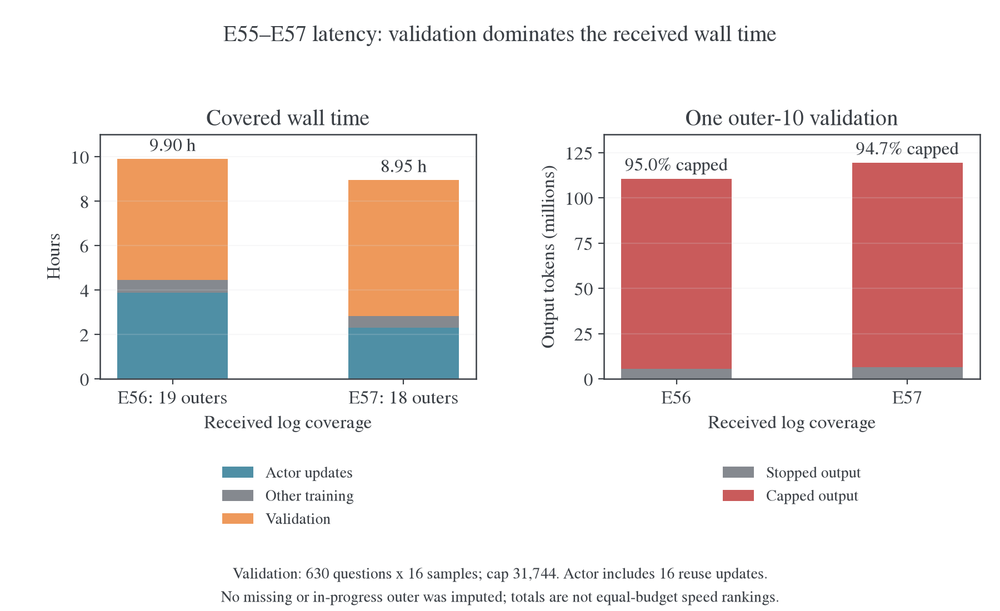
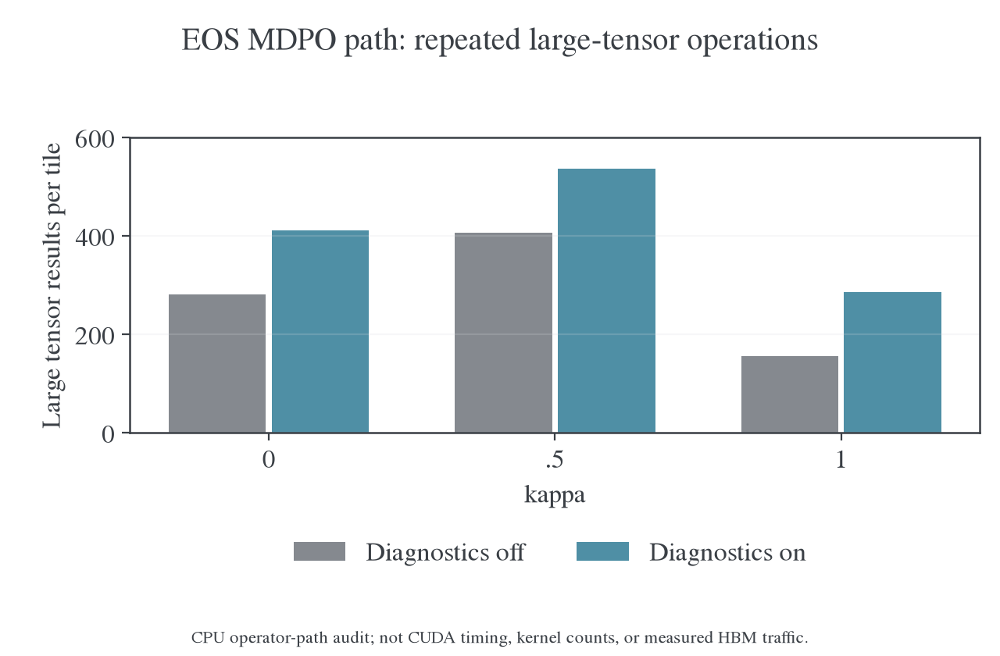

# E55–E57：MDPO 长程训练与验证耗时诊断

更新日期：2026-10-31。对象为 Qwen3-1.7B-Base ← Qwen3-30B-A3B-Instruct-2507。分析依据是[已接收快照](../../../archive/experiments/weighted-target/2026-10-31-E55至E57阶段快照.md)、对应 `9fd276af` 源码和 CPU 算子路径审计，没有修改正在运行的实验，也没有执行 CUDA 性能基准。

## 1. 与历史 training profile 的对照

这里分别使用历史完整训练 trace 和生产日志，不能把二者当成同一实验。旧细分 profile 为 `8c3dda8c` 的 E45：四张 H800、R1-1.5B ← JustRL-1.5B、batch64、reuse16、`precompute_fused`、chunk128、无 EOS 合并。已从原始压缩 trace 重新计算 rank0、outer4、前两次更新的 GPU 区间和 head 归因，与原报告逐项一致。旧生产 E45 为八张 A100 的完整训练日志，与八张 A100 的新 E55/E57 做同设备类型的阶段比较；旧生产 E51/E53 与新 E56 均为八张 A800。不同模型、序列和精度的差异继续保留。

### 1.1 新增训练时间主要发生在 actor

下表统一取各生产 run 的 outer26–35，每项是十批均值，单位秒。只包含训练阶段，验证计时不进入比较。

| 训练阶段                  | 旧 E45，8×A100 | 新 E55，8×A100 | 新 E56，8×A800 | 新 E57，8×A100 |
| ------------------------- | -------------: | -------------: | -------------: | -------------: |
| 整个训练 outer            |         140.32 |        1415.49 |        1350.17 |         912.81 |
| Rollout 管线              |          33.01 |         117.89 |          88.87 |          87.29 |
| Teacher 主干前向          |           1.88 |          11.53 |           8.92 |           9.44 |
| Teacher 搬入／搬出        |           0.98 |           9.73 |           9.23 |           9.02 |
| Actor 的 16 次更新        |         101.02 |        1272.40 |        1239.25 |         803.04 |
| 权重同步                  |           3.39 |           3.90 |           3.85 |           3.99 |
| Anchor 准备，已计入 actor |           4.21 |           5.45 |           4.98 |           4.93 |
| 每批输入 token            |        376,747 |        681,865 |        550,627 |        572,705 |

E45→E55 每个 outer 新增约 1275.16 秒，其中 actor 新增 1171.39 秒，占增量的 **91.86%**；rollout 新增 84.87 秒，teacher 前向与搬移合计新增约 18.40 秒。E45→E57 的新增时间也有 **90.88%** 来自 actor。旧八卡 A800 E53 的 actor 为 182.33 秒，新 E56 为 1239.25 秒，二者新增 outer 时间的 **93.58%** 来自 actor。该归因使用各阶段独立计时，不把 anchor 再加到 actor 上。

输入变长只能解释部分差距。E55 的输入是旧 E45 的 1.81 倍，actor 耗时为 12.60 倍；按输入 token×reuse16／GPU 数归一化后，旧 E45／新 E55／E57 分别约 7459／1072／1426 token passes/s/GPU，即每单位输入的 actor 成本约高 6.96／5.23 倍。旧 A800 E53 与新 E56 的对应差距为 4.52 倍。这些是配方级的观测差距，不是纯代码回退的因果倍率；token 归一化没有消除 attention 对长度分布的依赖，也没有匹配师生 hidden 宽度和计算精度。

### 1.2 旧 profile 中的 actor 内部结构

旧 E45 的正常 outer2–3，每个 actor 调用为 98.40 秒，forward/backward 的 host 区间均值为 91.36 秒，其中嵌套 head-loss 为 20.60 秒；optimizer 含裁剪与非有限检查为 0.56 秒，hidden 显式等待为 2.09 秒，micro-batch H2D 为 1.80 秒，engine transfer 为 3.91 秒。host 区间存在嵌套和 CUDA 异步关系，不能相加或用减法将余量全部命名为 backbone。

GPU 表只统计 rank0、outer4 的前两次更新，按 kernel 的发射关联互斥归因；它既不是完整 outer 的墙钟，也不含前面的 teacher/anchor 主干前向。

| 旧 E45 head 内 GPU kernel 工作量 | 两次更新合计 |
| -------------------------------- | -----------: |
| Student 投影                     |    301.31 ms |
| Teacher 投影及归一化             |    476.87 ms |
| Anchor 投影及归一化              |    474.25 ms |
| Weighted target                  |    123.41 ms |
| Objective／诊断归约              |    270.16 ms |
| dH 累计                          |    279.99 ms |
| dW 累计                          |   1419.29 ms |
| 其他 head 与 backward apply      |     44.89 ms |
| Head 合计                        |   3390.17 ms |

Head 占旧 profile 全部训练 kernel duration 的 28.18%；target＋objective／诊断归约仅约 3.27%。当时 head 最大项是 dW 累计。相同 trace 的 compute 区间并集为 10.251 秒，NCCL 为 1.711 秒，二者重叠 1.222 秒，不与 compute 重叠的 NCCL 为 0.489 秒。旧 profile 不支持把旧 MDPO 的主要成本归为 target 公式或 optimizer。

新 E55–E57 的配置均为 `global_profiler.tool=null`、`steps=null`，接收的 history 没有 backbone、head-loss、optimizer、hidden wait 或 NCCL 的独立阶段计时。现有计时定位到 actor 耗时大幅增长；新运行的 head-loss GPU 占比仍需独立测量，上表旧占比只对应旧配置。

### 1.3 确认新增的执行路径差异

| 路径或配置              | 旧 E45/E51/E53                    | 新 E55–E57                         | 对解释退化的作用                          |
| ----------------------- | --------------------------------- | ---------------------------------- | ----------------------------------------- |
| Backend                 | `precompute_fused`                | `precompute`                       | 原融合路径被明确撤下                      |
| EOS 合并                | 空 stop IDs                       | `[151643,151645]`                  | 新进入合并动作路径                        |
| 全词表中间量            | FP32 融合归约，必要差分局部高精度 | student/anchor/teacher 整块转 FP64 | 新增大矩阵 FP64 路径                      |
| KL 诊断                 | fused `gradient=False` 只算 value | `kl_rows(...)[0]` 先算 VJP 再丢弃  | 新增无用完整梯度计算                      |
| 固定动作索引            | 无动态布尔压缩                    | 每块四次 `nonzero` 展开            | 新增同步与复制路径                        |
| Token chunk             | 128                               | 512                                | 单块变大；不能单独据此解释十倍 actor 耗时 |
| Reuse16、三组 head 投影 | 已存在                            | 继续存在                           | 是原有成本，不能当作本轮新增原因          |
| async write／prefetch   | 开启                              | 开启                               | 没有配置层面的 IO 关闭                    |
| 梯度累积 no-sync        | 关闭                              | 关闭                               | 不是新开关变化，仍可能随微批数量影响通信  |

引入 EOS MDPO 的提交 `cb890d2e` 同时增加了两项限制：有 EOS IDs 时，backend 只能为 dense/precompute，`precompute_fused` 会明确报错；进入 `_mirror_rows` 后先对三份 logits 做 `.double()`，再用通用 `mirror_logits_rows` 计算。这是代码可确认的融合路径回退，不是仅凭低 MFU 作出的推断。新配方也在 launcher 中显式指定了 `precompute/chunk512`。

旧 fused 诊断的 `weighted_rows(..., gradient=False)` 与新 Torch 诊断的 `kl_rows(...)[0]` 不同：后者会构造完整梯度再丢弃。旧 fused 路径通过局部高精度差分和 FP32 行归约维持稳定性；新 EOS 路径的完整 FP64 输入又绕过 `relative_difference` 的 FP32 CUDA 快路径。已有 CPU 路径审计确认新分支存在数百个大矩阵结果，但逻辑结果量不是实测 HBM 流量或 CUDA 时间。这些是当前应优先验证的 head-loss 回退项；其各自占新增千秒的比例仍需要新 trace。

Teacher 主干参数变为 30B 不能直接解释 actor 新增千秒：teacher 主干前向在独立阶段执行，actor 读取缓存 hidden/head。Actor 内仍会重复执行 teacher 输出头，因此应比较其 hidden 宽度、投影精度与输入量，而非将 30B 参数量乘进 16 次 actor 更新。

恢复性能需要在保留 EOS 聚合目标和小梯度稳定性的前提下，把 EOS 操作接入融合路径并消除无用 VJP；仅改 backend 字符串或删除 stop IDs 都不能视为等价修复。要定量区分 head 行运算、三个 projection、dH/dW、backbone 重算、NCCL 和 hidden 等待，应沿用旧 profile 的范围，对新配置采相同的两个 mini-batch。现有接收包没有这份新 trace；本文没有为补观测启动 GPU 实验或修改运行中的配置。

逐运行配置、raw SHA-256、同窗口阶段差额、归一化公式和旧 trace 重算核对见[训练 profile 对照数据](../../../../../../../wandb-logs/MirrorOPD-verl/analysis/e55-e57-long-20261031/performance/training-profile-comparison.json)，同目录保留统计程序及重算结果。历史原 trace 与原报告的完整分层口径见[多次复用训练](training.md#多次复用的完整训练)。

## 2. 最新快照：验证工作量与 actor 更新共同限制速度

最新日志覆盖 E55/E56/E57 的 35/58/69 个完整 outer。下表合计训练步与独立验证生成计时，不含未记录的启动时间；三组覆盖的训练进度和硬件不同，总小时数不是吞吐排名。

| 实验          | 已记录训练 | 验证生成 |    合计 | 验证占比 | Actor 占总时间 |
| ------------- | ---------: | -------: | ------: | -------: | -------------: |
| E55，35 outer |    12.51 h |  24.02 h | 36.53 h |   65.75% |         30.48% |
| E56，58 outer |    19.25 h |  27.46 h | 46.71 h |   58.79% |         37.38% |
| E57，69 outer |    16.19 h |  28.34 h | 44.52 h |   63.64% |         31.62% |

历史累计成本中，验证生成占 59%–66%，actor 更新占 30%–37%，新训练 rollout 只占约 3%–4%。按这一已测分解静态估算，即使 actor 提速一倍，总耗时也只加速约 1.18–1.23 倍；仅优化训练 rollout 的收益更小。这里的上限计算固定其他阶段，不是后续运行时间预测。

每十个 outer 只新生成 64×10=640 条训练回答，而一次验证要生成 630×16=10,080 条，回答数量是前者的 15.75 倍，验证 cap 还从训练的 16,384 增至 31,744。E55 outer20 一次验证生成 180.14 M token，耗时 9.10 h，其中 97.82% 的 token 来自触顶回答。E56/E57 首次验证触顶回答也消耗了约 95% 的输出量，生成长尾是实测工作量大头。

后期验证已有改善，不能继续按早期长尾外推全部剩余时间。E56 outer50 为 87.77 M token、3.25 h、八卡 7,503 output token/s；E57 outer60 为 86.78 M、2.78 h、8,682 token/s。长度缩短的同时，生成流水线平均吞吐也提高；没有 KV／抢占 trace，不能进一步把吞吐增幅全归于某个调度因素。完整验证比生成管线只多约 48–56 秒，后处理和指标上传不能解释数小时等待。

| 最新阶段               |       E55 |       E56 |       E57 |
| ---------------------- | --------: | --------: | --------: |
| 最近十个训练 outer     |     26–35 |     49–58 |     60–69 |
| 每 outer 平均训练时间  | 23.59 min | 23.37 min | 16.31 min |
| 每 outer 的 actor 更新 | 21.21 min | 21.53 min | 14.38 min |
| Actor 占训练步         |    89.89% |    92.14% |    88.15% |
| 最新一次验证生成       |    8.66 h |    3.25 h |    2.78 h |

E56/E57 最近十轮训练各约 3.89/2.72 h，已经与最近一次验证的 3.25/2.78 h 相近。后期 actor 优化和验证优化同样重要；E55 仍主要受验证长尾限制。

训练的额外成本可在实际运行提交 `9fd276af` 的代码中确认：reuse16 每次更新都会重新进行 student/teacher/anchor 输出头投影；EOS 合并路径将整块词表运算转为 FP64，绕过现有 FP32 CUDA 快路径；诊断重复计算归一化与未使用的 VJP。`precompute` 只缓存单次 forward 的 VJP，不是跨 16 次更新缓存冻结目标。第 5 节给出具体路径和已有 CPU 审计；目前缺少该运行的 CUDA/NCCL trace，不能将这些开销逐项分摊为 GPU 时间百分比。

共同 outer26–35 窗口，E56/E57 的 actor 每批为 20.65/13.38 min，按全部输入 token×reuse16 归一化后，分别约 889/1,426 input-token passes/s/GPU；E56 每单位工作量仍约慢 1.60 倍。因此回答长度不能单独解释差距。κ=0.5 的通用数值路径比 κ=1 多出一批大型运算，但 E56 使用 A800、E57 使用 A100，状态也不同，当前不能把 1.60 倍全部归给 κ 或硬件。

Teacher 主干前向在共同窗口每批约 9–12 秒，明显小于十几到二十分钟的 actor 阶段；teacher 输出头在 actor 中的重复投影另计，不能把这部分成本一起排除。已测 GPU 忙碌率、offload 及早期吞吐见第 6 节。抢占、通信和传输仍是需要 trace 才能量化的候选，不把它们写成已确定主因。

## 3. 10 月 30 日早期窗口的时间分解

下面只合计已有完整 outer 计时，不包含启动、缺失记录或 E56 尚无完整汇总的第 20 步。验证在训练步计时之外，不能只查看 `outer_step_seconds` 就估算总时间。

| 已覆盖范围                  | 训练合计 | 其中 actor | 完整验证 |   合计 | 验证占比 |
| --------------------------- | -------: | ---------: | -------: | -----: | -------: |
| E56，19 个 outer 加一次验证 |   4.44 h |     3.87 h |   5.46 h | 9.90 h |    55.1% |
| E57，18 个 outer 加一次验证 |   2.83 h |     2.31 h |   6.12 h | 8.95 h |    68.4% |

这三组是离线 run 的接收快照，云端只有在同步后才增加记录，并非实时监控。训练本地也在 16 次更新结束后成批记录更新指标，验证期间没有新的训练 loss。云端长时间不刷新不能作为进程卡死的证据；这里的小时数来自远端程序计时，不包含本机上传日志的时间。

即使把 actor 时间降为零，在当前已覆盖窗口内，总耗时最多也只分别加速约 1.64 倍、1.35 倍。这不是预测后续上限，而是说明单修训练 kernel 无法消除当前验证大头。

最后完整训练步的拆分如下。Anchor 准备已包含在 actor 时间内，不重复相加。

| 项目                    | E55 outer7 | E56 outer19 | E57 outer18 |
| ----------------------- | ---------: | ----------: | ----------: |
| 训练步总计              |  14.67 min |   24.04 min |   14.82 min |
| Actor，含 16 次复用更新 |  12.58 min |   21.94 min |   12.82 min |
| Rollout 批次            |   1.73 min |    1.69 min |    1.61 min |
| Teacher 主干前向        |     6.23 s |     10.18 s |     10.06 s |
| Teacher 搬入／搬出      |     9.58 s |      9.34 s |      7.99 s |
| Anchor 准备，actor 内部 |     4.67 s |      5.20 s |      5.58 s |

Teacher 主干时间不包含后面在 actor loss 内重复执行的 teacher 输出头投影。前者很短，不能据此说全部 teacher 相关工作都只有 10 秒。

## 4. 一次验证为什么需要五六小时

每次验证是 630 题×16 次采样，即 10,080 条回答，cap31,744。按每个 benchmark 的实际样本数与平均长度复算：

| 第 10 步验证              |           E56 |           E57 |
| ------------------------- | ------------: | ------------: |
| 输出 token 总数           |      110.48 M |      119.39 M |
| 触顶回答数                |  3,307/10,080 |  3,562/10,080 |
| 触顶回答贡献的 token 比例 |        95.02% |        94.71% |
| 生成流水线时间            |        5.44 h |        6.11 h |
| 八卡合计输出吞吐          | 5,641 token/s | 5,431 token/s |
| 平均到每卡                |   705 token/s |   679 token/s |

少数长尾回答消耗了绝大部分生成量。MATH-500 虽然中位回答很短，但有 8,000 次采样，仍贡献约六成验证 token；不能只把成本归给 AIME。

`validation_seconds` 是整个验证的墙钟计时；`validation_rollout_seconds` 来自提交起点到最后一条生成完成的流水线跨度，不是把所有请求耗时相加。两者相差约 51–52 秒，生成流水线占 99.7% 以上。这个跨度包含排队及服务开销，不能直接等同于 GPU kernel 时间；但后处理或 W&B 上传不是这五六小时的主要来源。

如果长度分布完全保持不变，100 outer 的 10 次验证单独就需要约 55/61 小时。这只是静态工作量外推，不是剩余时间承诺；训练质量变化会改变后续长度。沿用 n=16 的预算在当前长尾分布下成本很高，不能按短回答的推理体验估算。

### 4.1 KV 容量只能说明风险，不能代替抢占测量

按该模型 28 层、8 个 KV heads、head_dim128、BF16 KV、TP1 计算，每个上下文 token 的 KV 为：

$$
2\times28\times8\times128\times2=114{,}688\ \mathrm{bytes}.
$$

仅一条 31,744-token 回答就对应约 3.39 GiB KV；64 条独立满长序列约 217 GiB，尚未计 prompt。每卡 0.8×80 GiB 的总预算约 64 GiB，还需容纳模型和运行时。因此，`max_num_seqs=64` 不意味着 64 条满长回答都能同时常驻；调度器必须依据实际长度和可用 blocks 安排运行、等待或抢占。

这个估算没有计入共享前缀、缓存布局和运行时开销，不能当作实测 KV 容量。现有日志只明确警告 `backend did not report preemptions ... unknown is not zero`，没有完整抢占计数或 KV 使用率。当前不能认定 64 一定最优，也不能直接宣布改成 16 或 32 就更快。

长上下文还增加每个 decode token 的注意力读取成本，所以每卡约 700 token/s不能与短文本的峰值吞吐直接比较。应补齐 vLLM 的 KV 使用率、活跃／等待请求数、抢占与重算计数，再用相同题集、采样协议和稳定模型版本比较 16/32/64；同时报告输出总 token，防止把生成变短误当作引擎提速。

## 5. Actor 内部的明确慢路径

### 5.1 这里的 precompute 没有跨 16 次更新缓存完整目标

当前路径缓存 teacher/anchor hidden 与 head，但每次 learner 更新仍执行 student、teacher、anchor 三个输出头投影，并重算目标分布和诊断。`PrecomputedKL` 的含义是单次前向中预先算出一阶 VJP，供随后 backward 使用；它不是整批 16 次更新的目标缓存。

后期一个训练批次约 55 万 input token，reuse16 意味着约 880 万 input-token passes。`perf/throughput/tokens_per_gpu_second` 按新采样 token 与整步墙钟计账，没有乘 16；E57 日志约 78 token/s/GPU不等于每卡实际只处理78个更新 token。按 16 次复用、actor 阶段计时计算，其约为 1,437 input-token passes/s/GPU。

### 5.2 EOS 路径把整个词表块转成 FP64

[`_mirror_rows`](../../../../../../verl/trainer/distillation/full_vocab.py) 在启用停止类合并后执行 `z.double(), zq.double(), zt.double()`，随后传给通用 Torch 行运算。单个 512×151,936 的 FP64 矩阵约 0.58 GiB；这里会反复产生多个同规模结果。

[`relative_difference`](../../../../../../verl/trainer/distillation/numerics.py) 的 CUDA 快路径要求 FP32 连续输入，当前全 FP64 分支不会进入。配置虽然有 `vocab_chunk_size=8192`，但这个 MDPO `precompute` 分支只按 token chunk 分块，`_mirror_rows` 仍投影完整词表，8192 没有把这些矩阵切成词表小块。

通用稳定公式包含 `exp/log/expm1/log1p`、多项式、归约、复制和 `torch.where`。Eager 模式下 `where` 的两个分支都已先计算，近场和远场公式并不会因为只选一支就自动省掉另一支的工作。它们不是通常用于估算模型 MFU 的 Transformer 主干 FLOPs。

### 5.3 布尔索引引入每块 4 次同步点

三次 `logits[:, keep]` 和一次按同一布尔 mask 写回梯度，会通过 `nonzero` 展开索引。独立 CPU profiler 路径确认每块 4 次 `aten::nonzero`；PyTorch 2.11 的索引源码和文档确认 CUDA `nonzero` 会发生 host-device synchronization。[^torch-index][^torch-nonzero]

这是可以明确消除的同步点，但没有 CUDA trace，不能把全部 actor 时间归给它。固定整数索引、`index_select/index_copy_` 或 kernel 内固定 EOS 索引可避免动态布尔压缩；不需要改变停止类语义。

### 5.4 诊断计算了未使用的梯度，冻结目标也被重复计算

`mirror_logits_rows(... diagnostics=True)` 为 anchor KL 和 teacher KL 分别调用 `kl_rows(...)[0]`。`kl_rows` 会先计算 value 和完整 logit VJP，再由调用者丢掉梯度。它还重复计算 learner 的归一化与权重。

只读取该分支的 CPU 算子审计得到：

|   κ | 关闭诊断的大矩阵结果数 | 开启诊断的大矩阵结果数 | 每块 nonzero |
| --: | ---------------------: | ---------------------: | -----------: |
|   0 |                    281 |                    411 |            4 |
| 0.5 |                    407 |                    537 |            4 |
|   1 |                    156 |                    286 |            4 |

这是 4×1,024 小形状下的 Torch 算子路径统计，统计同尺寸大型结果、排除了已知视图；不是 CUDA kernel 数、显存峰值、HBM 实测流量或 GPU 耗时。κ=0.5 的通用幂均值正常化路径比 κ=1 更复杂，这能解释额外工作来源，但不能用表中比例直接承诺 GPU 加速倍数。

CPU 检查确认，关闭诊断不会改变同输入下的 objective 和 logit VJP。不过正式实验需要诊断，因此优先应让多个 KL 共用一次归一化和归约、避免无用 VJP，而不是长期关掉观测。

Teacher/anchor 在一个 outer 内固定，目标的归一化标量也固定。缓存这些逐 token 标量可减少 16 次重复计算。不能简单缓存所有完整词表分布：一份约 55 万×151,936 的 FP32 矩阵已经约 311 GiB，会引入新的内存或传输问题。缓存必须绑定 sample/position、anchor version、κ、η和 EOS 协议，并验证分块与重排的一致性。

### 5.5 κ=0、0.5、1 有可利用的特殊结构

κ=1 的归一化目标是概率混合，$Z=1$；κ=0 的目标可以写成 teacher KL 加 anchor KL。κ=0.5 时，若 q、T 是合并 EOS 后的归一化分布：

$$
Z=\sum_a\big((1-\eta)\sqrt{q_a}+\eta\sqrt{T_a}\big)^2
=1-2\eta(1-\eta)H^2(q,T),
\qquad
H^2(q,T)=\frac12\sum_a(\sqrt{q_a}-\sqrt{T_a})^2.
$$

因此可用 `log1p` 与稳定的 Hellinger 距离计算 logZ，并在同一批内缓存，不必每次更新重新走通用的多项式路径。随机、近同分布和大 logit 差异的 CPU 检查中，独立 FP64 式与当前通用实现的最大绝对差为 3.61×10⁻⁹，通过了 rtol=1e-7、atol=1e-14 的检查；这不是逐位相等的声明。这个恒等式是优化依据，不表示 FP32/CUDA 实现已经完成或已经测得速度收益。简式要求两分布均归一化且支持一致；跨词表或未归一化的 teacher 支持仍需保留 `support_correction`，不能直接套用。

## 6. GPU、MFU、offload 和通信应怎样解读

在 10 月 30 日早期窗口中，按计时端点近似对齐系统采样，八卡均值为：

| 阶段  | E56 GPU 忙碌率 | E57 GPU 忙碌率 | E56 平均显存 | E57 平均显存 |
| ----- | -------------: | -------------: | -----------: | -----------: |
| Actor |          97.1% |          96.7% |    27.46 GiB |    27.14 GiB |
| 验证  |          95.9% |          92.6% |    65.18 GiB |    65.33 GiB |

这些是采样窗口的时间加权估计，不是 profiler 精确区间。GPU 忙碌率高不代表 Tensor Core 利用充分；NVML memory activity 不是 KV 使用率，也不是实际带宽百分比。验证约 65 GiB 显存主要反映引擎预留，不能据此证明 cache 已用满。

Actor 的 model-FLOPs 估计 MFU 后期约 4.5%/7.3%，但该估计没有完整覆盖这些额外全词表行运算和诊断，不能把低 MFU 直接读成 GPU 空闲。

代码中 `train_mode` 包住整个 16 次更新循环，内层设置 `disable_auto_offload=True`；并非每次 reuse 都完整搬入／搬出模型和优化器。Teacher 的搬移已有单独计时且仅约 8–10 秒。后期 token balance 的 max/min 约 1.03，E55 最后一批约 1.15，也没有明显支持“全部时间浪费在严重 token 分配失衡”。

三组均启用动态 batch，按 32,768-token 预算决定微批数量，再平衡其工作量；`ppo_micro_batch_size_per_gpu=1`不表示当前实际始终单条处理。配置同时关闭了 `use_no_sync_for_gradient_accumulation`，因此多微批可能增加梯度 collective 次数。这是需单独 profiling 的次级候选，启用延迟同步会改变峰值显存和数值累加路径，不能未经验收就切换。

仍然缺少 actor 内部的 CUDA/NCCL、CPU等待和 hidden 传输分解，不能排除它们。E56 使用 A800，E55/E57 使用 A100，硬件也不完全一致；需要同设备、同输入的 profile 才能分配具体百分比。

## 7. 建议的处理顺序

1. **先做不改变训练目标的实现修复。** 去掉布尔 mask 动态压缩，保留 EOS 合并；恢复稳定的 FP32／融合计算路径，关键消减和归约使用必要的高精度；消除诊断中的无用 VJP，共用归一化，缓存冻结的逐 token 标量。目前 EOS 配置不支持直接切换 `precompute_fused`，需要先实现并验证兼容路径，而不是只改一个 backend 名称。
2. **用同一输入验证数值和性能。** 覆盖 κ=0/0.5/1、多个 η、近同策略、大 logit 差异、EOS 高概率及两种 EOS 交换；核对 loss、hidden/head 梯度、位置指标和更新结果。再在 A100/A800 上获取 CUDA trace，量化 projection、行运算、gradient GEMM、backbone、NCCL 及传输。不直接把全部 `double` 换成 `float`。
3. **补验证引擎观测。** 记录 KV 占用、活跃／等待请求、抢占和重算，再测 16/32/64。保持题目、n、采样和 cap 一致，同时报告输出量；不能只因一个设置生成更短就称其推理更快。
4. **把预算调整与工程提速分开。** 若接受更稀疏的中途估计，可以考虑中途 n=4、最终 n=16；预期输出工作量约降至四分之一，但实际时间和统计精度都要另评。三组应使用同一规则。当前代码只支持固定 n，分阶段 n 调度待实现；最终 n=16 必须在内存模型释放前运行，因为本协议不保存 checkpoint。

这次没有调整 η、reuse、cap、验证频率或任何运行中进程。缩短 cap、加重复惩罚或强制 EOS 会改变研究问题，不能作为掩盖长尾的性能修复。当前没有保存 checkpoint，也不应为了测速直接重启已训练的远端进程。

## 8. 证据与复算

最新计时来自[10 月 31 日完整快照分解](../../../../../../../wandb-logs/MirrorOPD-verl/analysis/e55-e57-long-20261031/performance/current-timing.json)；该目录同时保存只读统计脚本。以下来源保留 10 月 30 日窗口，用于复核早期数值和同一运行代码的算子路径。

[汇总与 GPU 采样分段](figures/e55-e57-speed-20261030/data.json)、[计时复算程序](../../../../../../../wandb-logs/MirrorOPD-verl/analysis/e55-e57-long-20261030/performance/summarize.py)、[CPU 算子追踪](../../../../../../../wandb-logs/MirrorOPD-verl/analysis/e55-e57-long-20261030/performance/trace_rows_cpu.py)、[原始算子计数](../../../../../../../wandb-logs/MirrorOPD-verl/analysis/e55-e57-long-20261030/performance/row-operators.json)、[数学恒等式检查](../../../../../../../wandb-logs/MirrorOPD-verl/analysis/e55-e57-long-20261030/performance/identities.json)与[源码版本核对](../../../../../../../wandb-logs/MirrorOPD-verl/analysis/e55-e57-long-20261030/performance/provenance.json)均已保存。

当前检查的关键源码与运行记录中的 9fd276af 一致，未用后续实现替代旧运行条件。GPU 阶段窗口按 history 时间戳和阶段时长估计，系统采样最多向前保持 30 秒；它不是 CUPTI trace。算子审计明确不提供 GPU 时间或物理流量。

[绘图源码](../../../../research/studies/termination/plot_e55_e57_performance.py)；PDF：[时间与 token 预算](figures/e55-e57-speed-20261030/latency.pdf)、[算子路径](figures/e55-e57-speed-20261030/operators.pdf)。

### 参考文献

[^torch-index]: PyTorch contributors. IndexingUtils.h，PyTorch v2.11.0. [布尔索引展开为 nonzero](https://github.com/pytorch/pytorch/blob/v2.11.0/aten/src/ATen/native/IndexingUtils.h#L20-L63).

[^torch-nonzero]: PyTorch contributors. torch.nonzero，PyTorch 2.11 文档。[CUDA host-device synchronization](https://docs.pytorch.org/docs/2.11/generated/torch.nonzero.html).
