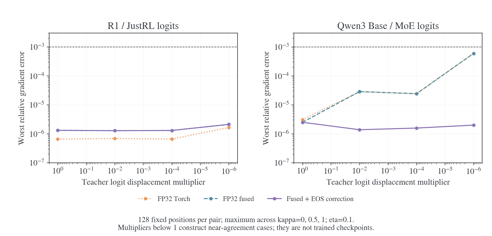
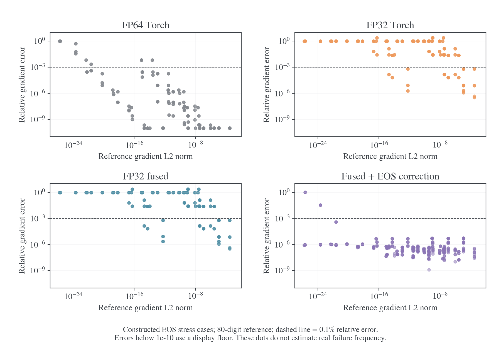
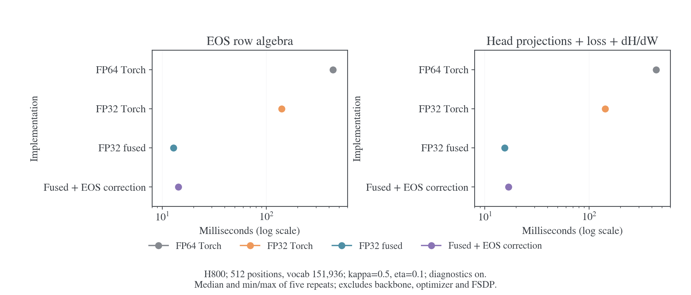

# EOS 合并的精度与速度权衡

更新日期：2026-11-01。研究对象是 E55–E57 使用的合并停止类 MDPO，κ=0/0.5/1、η=0.1。固定输入实验支持在已测真实 logits 上采用以 FP32 为主的稳定计算；直接舍入 EOS 聚合量会在特定小信号输入上产生明显误差。保留少量 EOS 高精度修正的融合候选，取得了接近无修正融合的速度，并显著改善这些边界。本文保留接入前的候选测量，结果不是长期任务质量验收；后续接入和完整 actor 结果见[EOS 融合实现与训练验收](2026-11-01-EOS融合实现与训练验收.md)。

## 背景与比较对象

历史精度修复使用 FP32 主计算、关键差分的局部 FP64，以及保留二阶小量的稳定公式；EOS 分支随后采用完整 FP64 行代数。目标是衡量减少高精度范围的误差和收益，不以极端例的相对误差单独判断训练可用性，也不以随机样本通过替代全部数值边界。相关历史见[数值修复与验收](../../numerics/precision/2026-10-27-蒸馏数值修复与验收.md)。

| 实现            | EOS 聚合与行代数                                 | 说明                                                                           |
| --------------- | ------------------------------------------------ | ------------------------------------------------------------------------------ |
| FP64 Torch      | 全词表 FP64；稳定 Torch 行公式                   | 冻结 `9fd276af` 数值模块作为既有基线                                           |
| 纯 FP32 Torch   | FP32 聚合、差分与稳定行公式                      | 保留 log1p/expm1 等公式；不是朴素 KL 改 dtype。Dispatch 检查未产生 FP64 tensor |
| 稳定 FP32 Torch | FP32 聚合／主运算，沿用局部 FP64 差分            | 区分“整个词表 FP64”和“局部高精度”                                              |
| FP32 fused      | FP32 聚合＋现有稳定融合行公式                    | 仍含历史局部 FP64 差分，不宣称全部指令为 FP32                                  |
| Fused＋EOS 修正 | FP32 大张量，每个合并 logit 附一个 FP64 舍入修正 | 修正接入相对差分，概率权重和主要归约仍用 FP32；属于待验收候选                  |

五种实现全部开启相同的四项 MDPO 诊断。Torch 基线保留原诊断调用；融合实现复用已有只求数值的诊断路径。FP64→FP32 Torch 主要比较精度范围；FP32 Torch→fused 还包含融合与诊断实现收益，不能把全部加速归因于 dtype。

## 输入、参考与测量协议

真实数据共 256 个 logit 位置：历史 R1-1.5B／JustRL 的四条数学前缀提供 128 个；Qwen3-1.7B-Base／Qwen3-30B-A3B-Instruct-2507 从现有 S0 非 thinking 轨迹银行取八条原始 token 序列，每条在最多 2048 个 response token 内均匀取 16 个预测位置，另得 128 个。Qwen 两个初始模型按相同固定 token 前向，使用 BF16 模型操作数、保留 FP32 RoPE buffer、输出头返回 FP32 logits。没有新增 rollout。

Qwen 银行不是 E55–E57 的在线轨迹，模型也不是它们的中途 checkpoint；R1 的两个 EOS 合并仅作为相同数值操作的输入对照。这里不能估计这些配方真实训练全过程的失败频率。

由真实 logits 构造五个非自目标窗口：原始师生、learner 向 teacher 的 logit 差移动 5%，以及 teacher 相对 anchor 的位移缩至 10⁻²、10⁻⁴、10⁻⁶。最后三项使用 `teacher_logits = anchor_logits + α × (original_teacher_logits − anchor_logits)`，是受控近一致输入，不是实际训练 checkpoint。另检查 p=q=T 的自目标。每个窗口比较三种 κ，因此每种实现有 3840 个非自目标位置／参数组合和 768 个自目标组合，不能当成独立训练重复。

真实及插值输入对照同一份 FP32 logits 上的稳定 FP64 行代数。360 个人工边界／参数组合另外使用独立 80 位十进制概率空间 oracle，覆盖高置信 EOS、EOS 总质量 1%／50%／99%、类内不平衡、小扰动、logit 公共偏移及 η 边界。其误差比例不能解释成真实训练失败率。

梯度比较对象是未除 η 的逐位置 logit 梯度 `d(ηL)/dz`；最终 loss 的 `1/η` 和全局 token 分母未施加，所有实现一致。主要报告逐行相对 L2、绝对 L2、方向、非零信号归零比例和 loss／target KL 的绝对误差。0.1% 和 1% 只是报告阈值，不是已验证的任务质量门槛。

GPU 测量使用经资源登记预留的单张 H800（物理 GPU6），PyTorch 2.11.0+cu128。每形状预热两次，交错正／反序测五轮，同步边界内取 wall time，中位数与全部样本均保留。没有锁频或多进程独立重复，属于开发阶段算子／head 测量，不是旧四卡正式吞吐协议的复测。没有改动训练中的模型、配置或新的 E* 预设。

## 真实输入上的误差

下表为每组 128 个位置、三种 κ 中最大的逐行梯度相对 L2，数值无单位。

| 输入                          | 纯 FP32 Torch | FP32 fused | Fused＋EOS 修正 |
| ----------------------------- | ------------: | ---------: | --------------: |
| R1／JustRL 原始 logits        |       6.57e-7 |    1.32e-6 |         1.32e-6 |
| Qwen3 原始 logits             |       3.09e-6 |    2.51e-6 |         2.51e-6 |
| R1／JustRL，teacher 位移×10⁻⁶ |       1.69e-6 |    2.12e-6 |         2.12e-6 |
| Qwen3，teacher 位移×10⁻⁶      |       5.95e-4 |    5.95e-4 |         2.00e-6 |

全部非自目标组合均低于 0.1% 相对误差；自目标梯度保持零，没有记录到负 target KL 或非零整行梯度被清零。纯 FP32 在所有真实／插值窗口的最大误差为 5.95e-4，即约 0.0595%；带 EOS 修正的融合候选最大为 6.50e-6。实际 head 测量中，候选 dH/dW 相对 L2 最大约 7.85e-7；这些结果不包含模型前向舍入误差或完整参数更新。

这些数据支持“在已测常见输入上，以 FP32 为主已经足够精确”。它不证明所有训练阶段都安全：只采了十二条前缀，没有训练后 checkpoint 或长序列全位置的随机代表性样本，不能由此给出总体失败概率。

## 边界误差应同时看相对量和绝对量

| 实现            | 360 个构造组合中，梯度相对误差大于 1% | 其中这些失败项的最大绝对 L2 误差 |
| --------------- | ------------------------------------: | -------------------------------: |
| FP64 Torch      |                                    18 |                         1.12e-24 |
| 纯 FP32 Torch   |                                   300 |                          1.23e-7 |
| FP32 fused      |                                   300 |                          1.23e-7 |
| Fused＋EOS 修正 |                                     6 |                         7.78e-26 |

其中 EOS 总质量为 1%／50%／99% 的 243 个组合，纯 FP32 和无修正 fused 各有 198 个超过 1%；FP64 和带修正融合均无此类失败。带修正融合在这 243 个组合上的最大相对误差约 5.49e-6。

独立的公共平移对照使用能精确表示的输入差异：对 logits 同时加 0、32、128，数学上的分布不变。真梯度范数约 2.48e-6 时，纯 FP32／无修正 fused 的最大相对误差为 **4.82%**，绝对误差约 1.19e-7；带 EOS 修正后最大相对误差约 **1.81e-6**。这表明 EOS 聚合舍入并非只在 10⁻²⁶ 量级的梯度上出现。

另一方面，FP64 基线超过 1% 的极端例，其真梯度仅约 10⁻²⁶–10⁻²⁴；带修正融合剩余六个失败例也属于这一极小量级。不能单凭接近 100% 的相对误差宣称会损害训练，也不能把它们删除后宣称所有严格数值测试通过。完整逐例数据同时保留参考梯度范数和绝对误差。Teacher EOS ID 交换的数值与梯度逐位一致检查通过。

## 速度与内存

词表 151936、512 个位置、κ=0.5、η=0.1，全部诊断开启。每个 head 的 hidden 宽度为 2048；大规模计时按需重复已有 128 个位置来形成 512 行，这不增加真实样本数量。

| 实现            | EOS 行代数中位耗时 | 三组投影＋loss＋dH/dW 中位耗时 | 相对 FP64 的 head 速度倍率 |
| --------------- | -----------------: | -----------------------------: | -------------------------: |
| FP64 Torch      |          435.13 ms |                      438.01 ms |                      1.00× |
| 纯 FP32 Torch   |          139.44 ms |                      142.19 ms |                      3.08× |
| FP32 fused      |           12.82 ms |                       15.50 ms |                     28.26× |
| Fused＋EOS 修正 |           14.33 ms |                       16.90 ms |                     25.92× |

Fused＋EOS 修正比无修正融合多约 1.40 ms，head 成本增加约 9.1%，仍保留了绝大部分对 FP64 的加速。32／128／512 个位置及三种 κ 共九组 head 测量中，该候选的速度倍率为 7.04–25.92×。FP32 Torch 自身的收益约为 2.36–3.08×；进一步的大幅收益来自融合及减少诊断的无用工作。

同一 512 行、κ=0.5 的 head 调用，扣除调用前全部常驻张量后的额外 allocated 峰值约为 FP64 的 14.94 GiB、纯 FP32 的 7.10 GiB、两种 fused 的 2.90 GiB。这是函数调用增量，包含梯度输出缓冲，不是模型总占用或整轮训练峰值。

Head 测量使用 BF16 head 操作数和 FP32 投影输出，按原 BF16 路径转换 dZ 后，计算 FP32 输出的 dH/dW。所有方法使用相同输入和乘法精度，因此梯度误差只讨论这一固定执行口径。它没有 backbone、FSDP、optimizer、梯度累积调度或训练/生成切换，**25.92× 不能当作整轮 actor 加速比**。

## 精度取舍与实现方向

证据支持优先采用 FP32 大张量和稳定融合计算，并保留成本很小的 EOS 高精度修正。当前数据不支持为了规避全部极端相对误差而让所有词表元素继续走 FP64，也不支持删除所有局部高精度处理。一个固定的混合精度路径已经能兼顾多数输入和主要 EOS 边界，暂不需要增加按误差阈值动态切换的运行时分支。

带修正融合仍有极小信号反例；配置入口、完整 FSDP 更新、AMP 和长序列真实训练也未在这组实验中验收。因此单独这组实验还不足以发布新的默认值；后续分布式验收与 E59–E62 的登记见[实现记录](2026-11-01-EOS融合实现与训练验收.md)。继续实现时应把精度门槛写成相对与绝对量共同约束，并保留历史强数值用例；性能测量与数学正确性用不同层级的证据说明。

## 数据与复算

[完整证据目录](../../../../../../../wandb-logs/MirrorOPD-verl/analysis/eos-precision-study-20261101/)包含协议、输入来源、全部误差与时间样本、候选代码快照和绘图脚本。[真实输入误差](../../../../../../../wandb-logs/MirrorOPD-verl/analysis/eos-precision-study-20261101/real-audit.json)、[80 位边界对照](../../../../../../../wandb-logs/MirrorOPD-verl/analysis/eos-precision-study-20261101/boundary-audit.json)、[head 计时与梯度](../../../../../../../wandb-logs/MirrorOPD-verl/analysis/eos-precision-study-20261101/head-benchmark.json)及[公共平移／EOS 交换检查](../../../../../../../wandb-logs/MirrorOPD-verl/analysis/eos-precision-study-20261101/additional-checks.json)可分别复核。

较大的固定 logits、原生 head 和工作日志保留于仓库 `runs/eos-precision-study-20261101/`，来源哈希见证据目录的 `provenance.json`。最终实验脚本为 `study.py`、`head_study.py`、`checks.py`；`attempt1/attempt2` 是修正纯 FP32 控制和对齐原 FP64 聚合算法之前的开发结果，不进入正文表格。预览 PNG 与 PDF 同目录保存；[可编辑绘图源码](../../../../../../../wandb-logs/MirrorOPD-verl/analysis/eos-precision-study-20261101/plot.py)可重画三张图。
