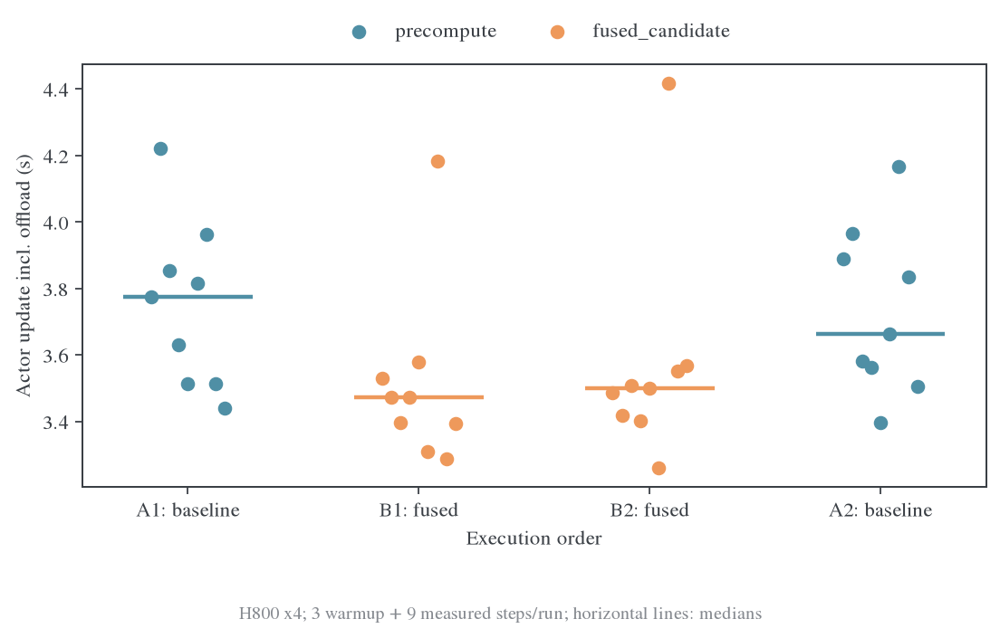
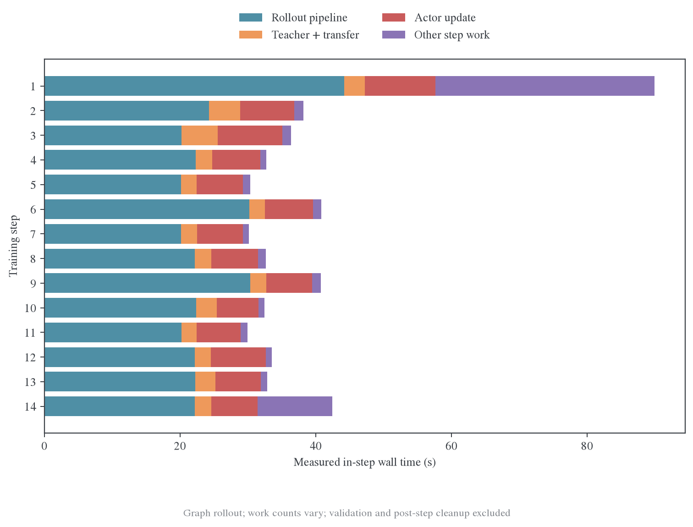
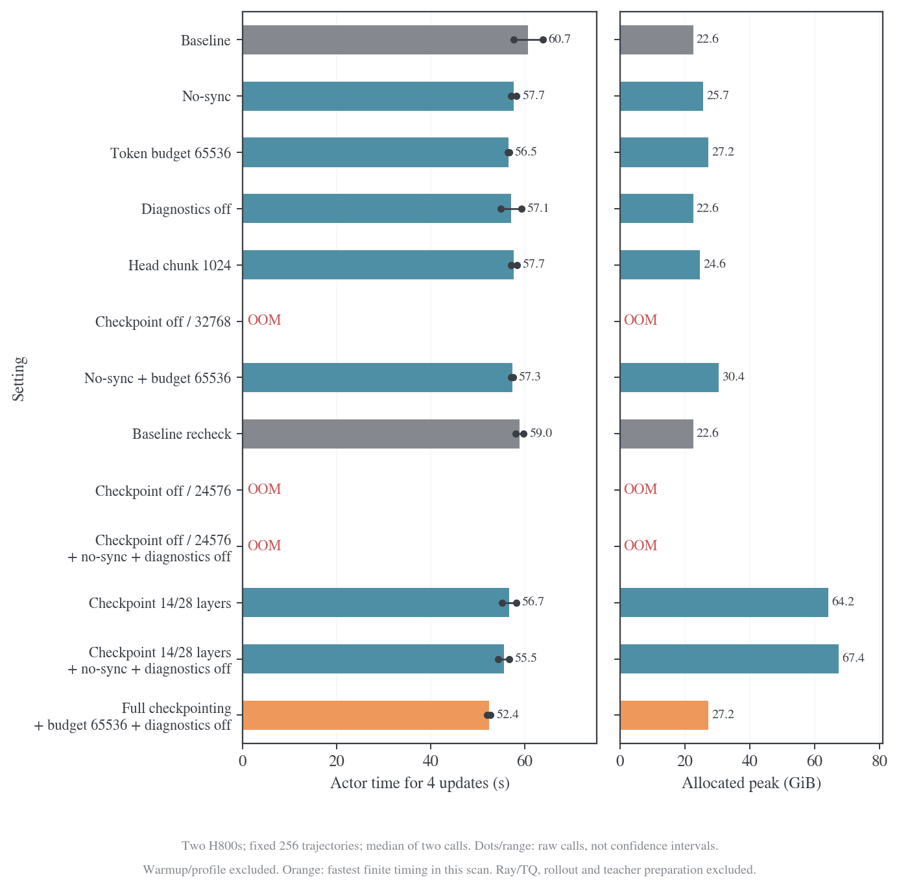
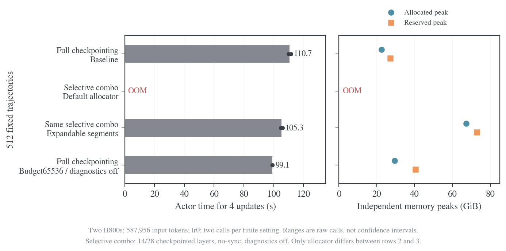
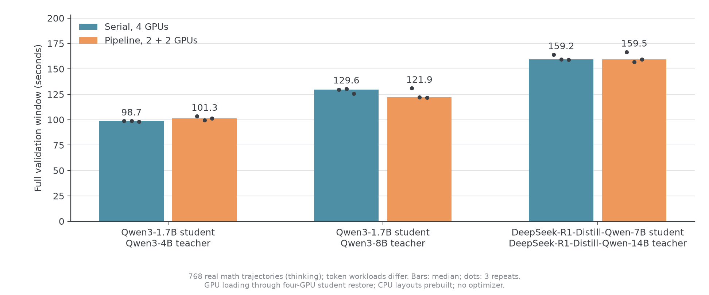
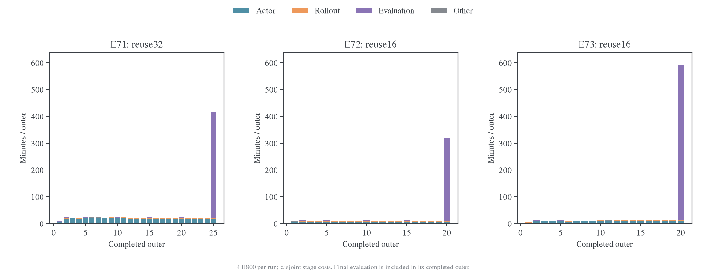
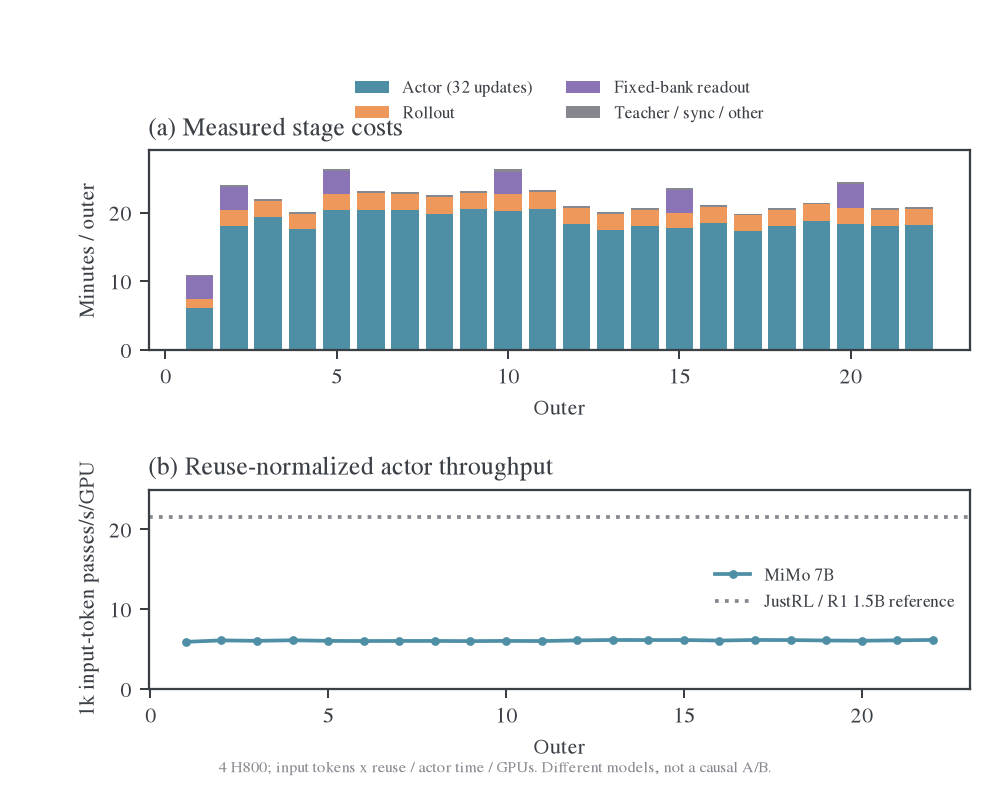
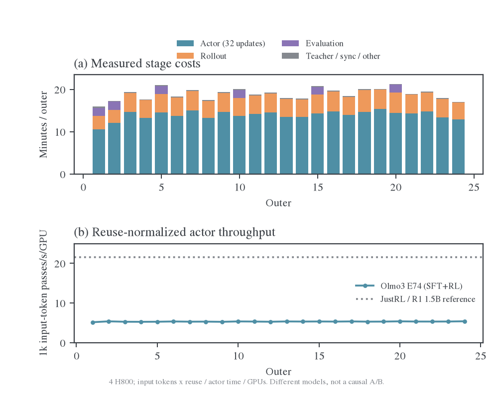

# Full-vocab 训练性能

本页维护固定输入管线、自然生成训练、reuse 与 full/sample 成本。计时、显存和 trace 口径见[测量方法](methodology.md)，head-loss 微基准见[算子性能](operators.md)。各节保留测量身份，当前代码或预设改变后不据此修改旧读数。

## Aggregate/future 的完整 actor 配对（2026-11-04）

两卡 H800，student 为 Qwen3-1.7B-Base；teacher hidden/head 来自 Qwen3-30B-A3B-Instruct-2507 的既有缓存。固定同一组 8 条原始回答，保留完整 prompt，分别取回答的 64-token 前缀、1024-token 前缀和交替 64/1024 的前缀；对应 hidden 同步切片。它们是工程输入条件，不是三组新科学样本。

目标为 MDPO，κ=1、η=0.1、EOS `[151643,151645]`、diagnostics 开启，BF16 forward／FP32 参数与 AdamW、activation checkpointing、参数和 optimizer offload、reuse1；梯度累积 no-sync 关闭。基线为 precompute_fused/chunk256、token-mean、future none；每个对照只改表内单项。计时覆盖实际 anchor capture、完整主干／head 反传、clipping、AdamW 和上下卡，排除 teacher 准备、Ray/TQ/vLLM 与 case 配置初始化。

每个长度条件使用独立进程，每个对照各自执行 A–B–B–A；每 block 2 次预热、3 次非预热采集，因此同一对照的每侧有 6 个有效样本。Block 开始恢复相同 optimizer／scheduler／RNG；lr=0，两 rank 开始／结束参数 hash 一致。耗时和 allocated／reserved 峰值分别取 DP MAX；下表报告中位数及未裁剪范围，不计算独立重复的置信区间。整机同时有 Olmo3 训练，配对不消除全部主机噪声；reserved 缓存可跨 block 保留，不把它当纯工作区或新增活跃张量。方法与工具合同见[测量方法](methodology.md#aggregatefuture-的完整-actor-配对入口)。

| 输入       | 回答 token | 输入 token | 每卡 token budget | 每 rank engine train/capture forward |
| ---------- | ---------: | ---------: | ----------------: | ------------------------------------ |
| 短（64）   |        512 |       1468 |               512 | rank0: 2/2; rank1: 2/2               |
| 长（1024） |       8192 |       9148 |              1536 | rank0: 4/4; rank1: 4/4               |
| 长短混合   |       4352 |       5308 |              1536 | rank0: 2/2; rank1: 2/2               |

同条件配对的 precompute 相对 fused 整步中位数分别增加 3.0%／30.7%／22.0%，allocated 峰值中位数分别增加约 1.83／5.11／5.12 GiB。题均 aggregate 的耗时变化为 -2.1% 到 +4.8%，future mean 为 -1.6% 到 +5.0%，discounted_sequence 为 -7.7% 到 +0.7%。若干样本有接近 10 秒或更长的尾部，各模式的范围存在重叠；这组小窗口不能将 discount 的负变化解释成确定的加速，也不能把小整步差异解释成 head 计算免费。各模式的 engine 调用次数在同一长度条件内完全一致。Chunk512 在混合长度下的中位数低 10.0%，但 allocated 峰值增加约 1.14 GiB，且耗时范围仍重叠；生产默认值保持不变。

### 短回答

| 单项对照                           | 基线 s，中位数 [范围] | 对照 s，中位数 [范围] | 对照耗时变化 | allocated GiB，基线/对照 | reserved GiB，基线/对照 |
| ---------------------------------- | --------------------: | --------------------: | -----------: | -----------------------: | ----------------------: |
| backend→precompute                 |  4.821 [4.609, 5.237] |  4.964 [4.571, 5.251] |        +3.0% |            17.249/19.075 |           19.902/22.682 |
| aggregate→seq-mean-token-mean      | 4.752 [4.478, 11.541] |  4.713 [4.408, 5.348] |        -0.8% |            17.249/17.249 |           19.902/19.902 |
| future→mean                        |  4.567 [4.113, 6.738] |  4.793 [4.475, 5.116] |        +5.0% |            17.249/17.249 |           19.902/19.680 |
| future→discounted_sequence，γ=0.95 |  4.854 [4.542, 5.470] |  4.889 [4.721, 9.952] |        +0.7% |            17.249/17.249 |           19.902/19.680 |
| chunk→512                          |  4.694 [4.456, 5.162] | 4.696 [4.345, 11.829] |        +0.0% |            17.249/17.249 |           19.902/19.902 |

### 长回答

| 单项对照                           | 基线 s，中位数 [范围] | 对照 s，中位数 [范围] | 对照耗时变化 | allocated GiB，基线/对照 | reserved GiB，基线/对照 |
| ---------------------------------- | --------------------: | --------------------: | -----------: | -----------------------: | ----------------------: |
| backend→precompute                 | 5.572 [4.892, 10.386] |  7.280 [6.732, 7.774] |       +30.7% |            17.249/22.356 |           20.625/26.150 |
| aggregate→seq-mean-token-mean      |  5.220 [4.999, 6.083] |  5.472 [4.889, 6.216] |        +4.8% |            17.249/17.249 |           20.625/20.625 |
| future→mean                        |  5.243 [4.948, 5.741] |  5.428 [5.111, 6.083] |        +3.5% |            17.249/17.574 |           20.625/21.064 |
| future→discounted_sequence，γ=0.95 |  5.669 [5.183, 9.639] |  5.234 [5.161, 7.014] |        -7.7% |            17.249/17.574 |           20.625/21.064 |
| chunk→512                          |  5.556 [4.925, 6.684] |  5.426 [4.882, 6.453] |        -2.3% |            17.249/18.371 |           20.625/21.781 |

### 长短混合

| 单项对照                           | 基线 s，中位数 [范围] | 对照 s，中位数 [范围] | 对照耗时变化 | allocated GiB，基线/对照 | reserved GiB，基线/对照 |
| ---------------------------------- | --------------------: | --------------------: | -----------: | -----------------------: | ----------------------: |
| backend→precompute                 |  4.657 [4.423, 5.432] | 5.680 [5.492, 11.482] |       +22.0% |            17.249/22.370 |           20.659/26.193 |
| aggregate→seq-mean-token-mean      | 4.950 [4.755, 10.277] |  4.844 [4.400, 5.071] |        -2.1% |            17.249/17.249 |           20.668/20.668 |
| future→mean                        |  5.077 [4.622, 5.532] |  4.994 [4.500, 5.627] |        -1.6% |            17.249/17.588 |           20.668/21.404 |
| future→discounted_sequence，γ=0.95 |  4.753 [4.579, 5.081] |  4.741 [4.625, 5.159] |        -0.3% |            17.249/17.588 |           20.668/21.404 |
| chunk→512                          | 5.291 [4.834, 10.322] |  4.760 [4.509, 6.350] |       -10.0% |            17.249/18.385 |           20.668/21.824 |

各对照有自己的 baseline cohort，不能拿某行较快的基线替换另一行分母，也不跨长度排名。短／长两组的回答等长，token-mean 与 seq-mean-token-mean 的题目权重等价；混合长度才改变题目相对权重。Future 更改训练信用目标，耗时比较只回答工程成本，不解释学习效果。实际 forward 次数指 engine 调用，不统计 activation checkpointing 内部的层级重算或 head 内部投影次数；这些工作及 score／suffix 与 VJP 成本均已包含在整步计时中。该 8 条前缀条件不代表正式大 batch 或更长回答的 outer 吞吐。

[完整采集样本与输入身份](data/aggregate-future-20261104/actor-paired-summary.json)保留每个 cohort 的六个样本、loss／梯度范数、各 rank forward 次数、cache hash、参数 hash 与 settings；[命令／源码身份和退出状态](data/aggregate-future-20261104/actor-paired-manifest.json)绑定冻结源码。原始 100 条记录（含 40 条预热）及大缓存留在各运行目录。该配对没有修改 kernel 或生产默认值，数值验收与仍失败的混合精度严格参数门槛见[验证矩阵](../../numerics/full-vocab/validation.md#混合精度-mdpo-参数差异)。

## 固定输入管线

四张 H800，student 为 DeepSeek-R1-Distill-Qwen-1.5B、teacher 为 JustRL-DeepSeek-1.5B。固定同一批 32 条数学回答，输入 token=163573、有效 loss token=161701，token chunk=512、每卡 token budget=16384、activation checkpointing 开启、lr=0。测量包含真实 FSDP2 worker 和上下卡，不含 Ray/TQ/vLLM。

冻结源码 `fc81ec6a9`，A 为 precompute，B 为 fused candidate；每次独立进程预热 3 步、测量 9 步，采用 A–B–B–A 顺序。每个 backend 共 18 个非预热样本，合并后取中位数；不把这些步当独立实验计算置信区间。[原始记录](data/final/confirmation)、[聚合数据](figures/final/confirmation.json)。

| 测量范围                | precompute |         fused | 差异            |
| ----------------------- | ---------: | ------------: | --------------- |
| Actor 更新中位数        |    3.719 s |       3.480 s | 耗时减少 6.4%   |
| Teacher→actor 中位数    |    5.080 s |       4.885 s | 耗时减少 3.9%   |
| 固定输入 allocated 峰值 | 17.031 GiB | 约 16.600 GiB | 减少约 0.43 GiB |

两次融合进程的 actor 中位数分别为 3.472、3.499 s，两次基线为 3.774、3.663 s；单步仍有波动。数值对照的 loss 绝对差约 $6.71\times10^{-8}$、首轮梯度范数最大绝对差约 $1.06\times10^{-5}$。它们验证该输入与实现的相符程度，不证明长期训练效果。

额外的 checkpointing 关闭测试将 allocated 推至约 61.3 GiB、reserved 推至约 77.7 GiB，短窗口没有明确速度收益。该结果仅适用于当时的输入/token budget，不排除其他预算下的取舍；证据见[固定管线原始数据](data/review-004)。

## 单次更新的完整训练

冻结源码 `8132ca543`，四张 H800、同一 1.5B 师生、batch=mini-batch=64、n=1、每批更新一次、prompt/response cap=4096/7168、precompute、async write/prefetch、graph rollout。共 14 个训练 outer，步骤 4–13 为正常统计窗口；另有独立 5 步 Torch 运行，第 4 步采四 rank 训练与四 rollout replica trace。

依赖为 PyTorch 2.11.0+cu128、vLLM 0.25.1+cu129、Ray 2.56.1、Transformers 5.12.1。数据见 [review.json](e2e-4gpu/review.json)；完整输入、配置和 trace 位于 `outputs/reasoning-e2e-profile-20261023`。

| Driver 阶段                   | 十步均值（s） | 步内占比 |
| ----------------------------- | ------------: | -------: |
| Rollout pipeline              |        23.247 |   69.12% |
| Teacher 上下卡                |         0.742 |    2.20% |
| Teacher forward + hidden 发布 |         1.745 |    5.19% |
| Actor update                  |         6.866 |   20.41% |
| 权重同步 / rollout wake       |         0.998 |    2.97% |
| 其余步内工作                  |         0.035 |    0.10% |

步内均值为 33.632 s，中位数 32.721 s，范围 29.956–40.823 s；完整步间周期均值 33.716 s。初始化至第一步开始为 254.68 s，首步 89.95 s，最后一次 checkpoint 10.139 s；末尾 8 题×2 次、response cap=1024 的小验证耗时 4.117 s，不能代表全量数学验证。

正常窗口生成 640 条回答、3956383 个输出 token，平均约 6182 token/回答。生成请求区间平均 19.94 s，而 driver rollout pipeline 为 23.25 s；第 6、9 步有约 8 s 的生成后评分 RPC 等待。63.59% 回答触及长度上限，最后 10% 请求集中结束，这组证据不支持优先把瓶颈归为 decode 长尾。

HTTP 采样观察到每引擎最多 16 个运行请求、KV 使用率最大约 5.49%；first-token 字段缺失。Rollout trace 只覆盖 128 次引擎 iteration，约 0.38–0.40 s 的局部窗口。训练 trace 的 host 时钟校准最大偏差 0.053 ms，且停止点在步末权重同步之前；空的同步 GPU 事件不表示同步耗时为零。

独立 profile 步的 actor wall time 为 7.284 s，四 rank compute 区间并集约 4.67–4.74 s，无 compute 重叠的 NCCL 约 0.21–0.33 s。仅从这些区间不能把其余时间全部标为浪费。Actor 日志 allocated 高水位为 14.14–15.07 GiB、reserved 为 15.48–16.34 GiB；没有该周期的 allocator snapshot，不能分解为精确的参数/激活/碎片占比。

14 次更新全部 applied，loss/梯度均有限，checkpoint 和小验证链路完成。Nsight 最终补采的队列已完成，但 [产物状态](../../../../../../outputs/reasoning-e2e-nsys-final-20261023/report-status.json)仍为未通过采集验收；本节 GPU 结论使用已审阅的 Torch trace，不把队列退出当成 Nsight 证据。

## 多次复用的完整训练

E44 Full-KL、E45 MDPO（kappa=0、eta=0.3）、E46 BPO（同 kappa/eta）各完成 4 outer×16 reuse、64 次成功更新。冻结源码为 `8c3dda8cb91f0a9778e32d78f3959ac9a79f8218`，四张 H800、同一 1.5B 师生、DAPO、seed=42、batch=mini-batch=64、n=1、prompt/response cap=4096/7168。

三组均使用 precompute_fused、head chunk=128、actor/teacher token budget=32768、FP32 参数与 AdamW、BF16 混合精度、activation checkpointing、hidden async write/prefetch。Mirror 开启 diagnostics；梯度累积 no-sync 关闭。Rollout 为四个 TP1 副本、graph、并发上限 128、token budget=8192、显存比例 0.65。验证与保存关闭，这不是正式 256 outer run 的完成报告。

Outer 1 单列预热，outer 2–3 为无 Torch profiler 的正常窗口，outer 4 在 rank 0 采 teacher/anchor 与前两次 actor 更新。以下数值只使用标明的窗口；每方法只有两个正常 outer，轨迹不同，不做同输入速度排名或置信区间。[摘要与检查](data/mirror-observe-20261026/summary.json)、[完整运行资料](../../../../../../outputs/mirror-training-observe-20261026/README.md)。

### 正常窗口的阶段与工作量

| 方法 | Outer（s） | Rollout（s） | Teacher 含搬运（s） | Actor（s） | Actor 内 anchor（s） | 同步（s） | Actor 占比 |
| ---- | ---------: | -----------: | ------------------: | ---------: | -------------------: | --------: | ---------: |
| E44  |     109.26 |        25.20 |                2.47 |      80.48 |                    — |      1.08 |      73.7% |
| E45  |     126.99 |        22.84 |                4.55 |      98.40 |                 3.26 |      1.16 |      77.5% |
| E46  |     121.03 |        20.22 |                2.45 |      97.21 |                 3.09 |      1.13 |      80.3% |

| 方法 | 平均新 response token | 平均输入 token | 每更新每 rank micro-batches：outer 2/3 | Actor 输入 token/s，含16次reuse |
| ---- | --------------------: | -------------: | -------------------------------------- | ------------------------------: |
| E44  |                366300 |         372548 | 3/3                                    |                           74067 |
| E45  |                378890 |         385138 | 4/3                                    |                           62625 |
| E46  |                374845 |         381094 | 4/3                                    |                           62727 |

Actor token/s 的分母包含 anchor 和调用开销；它不是新生成速度，也没有消除 attention 对序列长度分布的依赖。E44 两轮 rollout pipeline 为 30.21/20.19 s，生成请求区间都约 19.58 s；E45 teacher forward 为 4.47/1.71 s。波动保留在均值中，不能只选最快一轮。

### Actor 内部成本

下表先在每个 rank/outer 内合并同名 host span 的区间并集，再对 4 rank×2 outer 取均值；各行存在嵌套，不能求和重建 actor wall time。

| 每 rank 每 outer 的 host 区间（s） |   E44 |   E45 |   E46 |
| ---------------------------------- | ----: | ----: | ----: |
| Forward/backward                   | 77.79 | 91.36 | 90.97 |
| 其中 head-loss                     | 13.61 | 20.60 | 21.11 |
| Optimizer，含 clipping/非有限检查  |  0.57 |  0.56 |  0.63 |
| Hidden read 显式等待               |  1.30 |  2.09 |  2.51 |
| Micro-batch H2D，含 anchor         |  1.01 |  1.80 |  1.65 |
| Engine transfer                    |  1.53 |  3.91 |  2.67 |

Rank 0、前两次 actor 更新的 GPU kernel 工作量如下。根据 launch correlation 限定训练区间，排除前面的 teacher/anchor backbone；每行互斥归因，单位 ms。

| Head 内工作                   |    E44 |    E45 |    E46 |
| ----------------------------- | -----: | -----: | -----: |
| Student 投影                  |  300.9 |  301.3 |  301.0 |
| Teacher 投影；mirror 含归一化 |  292.8 |  476.9 |  477.4 |
| Anchor 投影与归一化           |      — |  474.3 |  474.2 |
| Weighted target               |      — |  123.4 |  123.5 |
| Objective/诊断归约            |  188.2 |  270.2 |  372.1 |
| dH 累计                       |  277.0 |  280.0 |  278.2 |
| dW 累计                       | 1404.5 | 1419.3 | 1422.7 |
| 其他 head / backward apply    |   54.0 |   44.9 |   44.0 |
| Head 合计                     | 2517.4 | 3390.2 | 3493.2 |
| Head 占全部训练 kernel 工作量 |  22.3% |  28.2% |  28.9% |

dW 是 head 最大项；C=128 会频繁读写完整 FP32 累计缓冲，支持对更大 chunk 做配对试验。MDPO/BPO 的 target+ 归约仅占全部训练 kernel 工作量约 3.3%/4.1%；继续只优化逐元素归约的整轮收益受限。约 50%–56% 的 kernel 工作量未被 full-vocab 标签归因，其中还含 NCCL 等，不能全部算作 backbone。

### 通信与显存

| Rank 0 前两次更新的区间（ms） |    E44 |     E45 |     E46 |
| ----------------------------- | -----: | ------: | ------: |
| Compute 并集                  | 9232.4 | 10250.6 | 10323.9 |
| NCCL 并集                     | 2002.0 |  1710.9 |  1684.9 |
| Compute 与 NCCL 重叠          | 1101.6 |  1222.4 |   773.2 |
| NCCL 无 compute 重叠          |  900.4 |   488.5 |   911.7 |

当前测量每个 micro-batch 同步梯度；启用 no-sync 的实际收益与未分片梯度内存尚需固定输入检查，不能按 micro-batch 数线性推算。该窗口 pageable H2D 为 141/292/278 ms、约 1.00/2.00/2.01 GiB，包含首次 frozen head 上卡，不能直接乘 8 外推整轮。

NVML 约 1 Hz，按阶段边界各裁 0.25 s；下表是采样峰值，可能漏掉短尖峰。

| 方法 | 正常 actor 整卡峰值（GiB） | Rollout 整卡峰值（GiB） | Actor GPU busy 均值 | 第 4 轮 rank-0 trace allocated 峰值（GiB） |
| ---- | -------------------------: | ----------------------: | ------------------: | -----------------------------------------: |
| E44  |                      19.56 |                   54.04 |               93.6% |                                      13.53 |
| E45  |                      20.07 |                   54.11 |               89.3% |                                      14.05 |
| E46  |                      19.87 |                   54.11 |               90.0% |                                      14.03 |

Trace 峰值包含此前评分阶段，NVML 包含同卡其他分配，二者不能相减得到碎片。任务顺序执行、启动前遵守共享锁和空闲门槛，但没有持续记录所有 GPU PID，不能严格排除瞬时外部干扰。部分 rollout preemption 字段缺失，不据此宣称零抢占。

三组更新坐标 1–64 连续、全部 applied，无非有限梯度或跳步，位置桶计数与目标重建通过。它们确认短程执行与观测完整，不证明目标单调下降或长期质量。下一项可判别对照统一见[性能入口](README.md#下一组有判别力的测量)。

## Qwen n=4 批量训练验收

Qwen3-1.7B-Base←Qwen3-30B-A3B-Instruct-2507 在物理 GPU0–3 完成一轮实际训练：256 道不同题、每题 4 条回答、1,024 条轨迹，复用 32 次，32 次更新全部 applied，loss 与梯度有限。这里只验收批量、更新、重复停止和终点 accuracy 调用路径；50 outer 的正式训练尚未启动，10 条小验证回答不作为效果结果。

### 数据量与参数单位

DAPO 原文件 17,917 行，按 prompt 精确去重得到 17,255 道题；使用 Qwen3 Base 的实际模板分词，prompt 最长 1,496 token，全部适配 prompt cap2,048。原文件保持不变，验收与正式计划使用同一派生去重文件。[数据审计](data/kappa1-batch-acceptance-20261101/dataset-audit.json)记录原文件与派生文件 SHA256。

50 outer 不跨 epoch 重抽时，题数上限为 $\lfloor17255/50\rfloor=345$；当前四卡入口要求题批量可被 4 整除，因此最多 344 题／轮。512 或 1,024 道不同题／轮不够用。采用 256 题／轮，只消耗 12,800 道不同题，剩余 4,455 道。`rollout.n` 扩大每题回答数，不增加跨 outer 的题目消耗。

| 每轮题数 | rollout.n | 每轮轨迹数 | 50 outer 题数 | 50 outer 新轨迹数 |
| -------: | --------: | ---------: | ------------: | ----------------: |
|      256 |         1 |        256 |        12,800 |            12,800 |
|      256 |         2 |        512 |        12,800 |            25,600 |
|      256 |         4 |      1,024 |        12,800 |            51,200 |

验收选择最后一行。`data.train_batch_size=256`、`actor.ppo_mini_batch_size=256` 都以 prompt 为单位；原生训练器会将 mini-batch 乘以 `rollout.n=4`，实际每次更新使用 1,024 条轨迹。`ppo_epochs=32` 因此恰好是每轮 32 次更新，正式 50 轮共 1,600 次；将 mini-batch 填成 1,024 会再次被乘以 4。过滤分组与失败补题均关闭，单 epoch 内顺序遍历打乱后的去重数据。n=4 增加同题回答多样性，其题目覆盖量仍为 12,800，不能等同于 51,200 道不同题。

### 实际执行设置与耗时

冻结主干 `402f6353` 加[训练重复停止](../../rollout/repetition-detection.md)补丁；源码补丁哈希见[单轮审计](data/kappa1-batch-acceptance-20261101/acceptance-audit.json)。MDPO 的 κ=1、η=0.1、LR1e-6，BF16 计算、EOS `precompute_fused`、head chunk512、hidden async write／prefetch；mirror diagnostics 沿用 E61。共享同步池为四张 H800，teacher 无独立卡；rollout 是四个 TP1 副本，CUDA Graph 开启。Prompt／response cap 为 2,048／16,384，actor、teacher、rollout 的每卡 token budget 均为 32,768；每引擎 `max_num_seqs=256`、显存比例 0.8。训练与验证均开启精确重复检测 16–128 token 连续 8 次。

| 阶段                   |       秒 |
| ---------------------- | -------: |
| Rollout pipeline       |    98.47 |
| Teacher 搬运           |    17.81 |
| Teacher forward        |    17.32 |
| Actor 32 次更新        |   867.01 |
| 权重同步               |     6.59 |
| 整个训练 outer         | 1,043.33 |
| 末次 10 条回答的小验证 |    46.23 |

本轮实际生成 1,218,606 个 response token，均长 1,190.04；训练 outer 约 17.39 分钟，其中 actor 占 83.10%。初始 student 的短回答不能代表后期长回答的成本，不能据此直接给出 50 轮 ETA。FSDP allocated 峰值 20.75 GiB；它与下表含 KV 等分配的 NVML 整卡峰值采用不同口径。包含模型／Ray 启动与退出的进程墙钟为 1,489.16 秒。

### 与历史 profile 对齐后的效率与版本核对

上述单轮实际使用 `402f6353`（2026-11-01 11:21）加已保存的重复停止补丁，未使用当前本地 main `71f74688`（14:36）。两者相差 19 个提交。逐 Git blob 核对确认 EOS 融合 kernel、停止类映射、数值归约、BF16 投影、精度 adapter 和 hidden IO 完全一致；后续提交主要调整执行／优化器合同、评估、动作空间和校验，不构成这轮遗漏 EOS 融合优化的证据。新 main 的结果类型和分派仍有变化，下面的耗时不能转记为新 main 的性能结果。

按输入 token×reuse／actor 秒数／GPU 数计算 token passes/s/GPU，比较同为四张 H800 的历史测量。输入 token 同时包含 prompt 和回答；它没有消除模型宽度、目标、EOS、长度分布及 warmup 差异。[复算摘要](data/kappa1-batch-acceptance-20261101/performance-comparison.json)记录实际 token 数、版本和核心文件 blob。

| 测量                                     | 每轮输入 token | Reuse | Actor 秒 | 输入 token passes/s/GPU |
| ---------------------------------------- | -------------: | ----: | -------: | ----------------------: |
| 历史 E45 MDPO，outer2–3 均值             |        385,138 |    16 |    98.40 |                  15,656 |
| 历史 JustRL→R1 Full-KL，reuse32 两轮均值 |        784,077 |    32 |   307.25 |                  20,415 |
| 当前 Qwen MDPO κ=1，首个 outer           |      1,321,946 |    32 |   867.01 |                  12,198 |

相对旧 E45，actor 工作量扩大 6.86 倍，耗时扩大 8.81 倍；归一化后每 token pass 成本高 28.35%，吞吐低 22.09%。这组分解确认大部分单轮耗时差异与工作量扩大同时发生，剩余差距仍值得定位，不能直接命名为代码回退。相对 reuse32 的 Full-KL 验收，归一化成本高 67.37%；该组的冻结来源只有 teacher，当前一般 MDPO 还包含 anchor 输出头、目标与诊断，且 student／teacher 也不同，不能当作相同算法的回归对照。当前样本为冷启动后的首轮，旧 E45 使用正常窗口，两者尚无相同输入的 A/B。

| 优化或成本项                                              | 这轮实际状态 | 解释                                                                                                                |
| --------------------------------------------------------- | ------------ | ------------------------------------------------------------------------------------------------------------------- |
| EOS `precompute_fused`、BF16、chunk512                    | 已开启       | 三份全词表 logits 不再整体转 FP64；EOS 小子集仍保留高精度补偿                                                       |
| Hidden async write／prefetch、去 padding、动态 token 分批 | 已开启       | TQ 读取预取后仍需将当前 micro-batch hidden 搬上 GPU                                                                 |
| Rollout Graph、256 并发、训练重复停止                     | 已开启       | 主要作用于生成；actor 占 outer 的 83.10%                                                                            |
| 梯度累积 no-sync                                          | 关闭         | 每个 micro-batch 都同步梯度；旧 E45 也关闭，属于待测优化，不能解释为新增关闭                                        |
| Activation checkpointing                                  | 开启         | 保留 backbone 重算成本；旧固定输入关闭测试曾推高显存且无明确提速，不能直接假定关闭更快                              |
| 完整 mirror diagnostics                                   | 开启         | 旧 E45 同样开启；关闭前后需固定输入测量，现无当前设置的独立成本比例                                                 |
| Teacher／anchor 跨 reuse 输出头缓存                       | 未实现       | Backbone hidden/head 已冻结复用，但每次更新仍重做三组 head 投影与行运算；`precompute` 缓存范围是单次 forward 的 VJP |

配置中的通用 `use_fused_kernels=False` 对应另一套 PPO／模型融合接口，精度 adapter 要求关闭；它与这里的 full-vocab `backend=precompute_fused` 不是同一个开关。当前动态分批开启，因此 `ppo_micro_batch_size_per_gpu=1` 也不表示逐条训练。Actor token budget32768 与均衡后每 rank 约 330K 输入 token，按当前分批公式推算约 11 个 micro-batch／更新；没有实际事件记录，不将该推算当作测得的通信次数。

当前没有内部 CUDA trace，不能给出 backbone、head、NCCL、hidden 等待的百分比分摊。后续性能核对应先在固定同一批 token、相同 κ／η 和 optimizer 初态下比较当前 main，再分别检查 no-sync、token budget 和 diagnostics；checkpointing 仅作为有显存约束的对照。Frozen q/T 的逐 token 归一化标量可考虑有界缓存；完整 FP32 target 在本轮约需 689.74 GiB，不能直接常驻 GPU。

当前 main `71f74688` 的 50 轮配置已在独立工作树解析通过，保留 n4 和终点 accuracy，额外准备轻量 host timeline。该版本已完成下述两卡固定 token actor 对照；四卡完整 outer 尚未重跑，50 轮也未启动。实际配置见[main 配置预览](data/kappa1-batch-acceptance-20261101/formal-main-config.yaml)；工作目录 `formal-plan-main.json` 是当前 main 的后续候选，旧 `formal-plan.json` 保留为上一版本的计划来源。

### 固定 token 的配置优化实测

在 main `71f74688` 的冻结工作树上，用空闲物理 GPU2、3 的两张 H800 完成 18 个 actor 配置／容量检查：13 个成功、5 个 OOM。成功记录共 132 次有效 optimizer step，均为 LR0，loss／梯度有限、无跳步，每个 rank 的参数哈希前后不变，所有配置也使用相同初始参数哈希。测试保留原生 FSDP2、FP32 master、BF16、κ=1、η=0.1、EOS `precompute_fused`，并固定 `FLASH_ATTENTION_DETERMINISTIC=1`；未修改训练 kernel；新增的是 benchmark 入口与精度参数传递。当前 main 后续的文档提交不改变这份冻结身份。

输入为 128 条历史自然回答的原始 token 及真实 teacher hidden；复制为 256 或 512 条，仅放大固定计算量，不作为新训练样本或 accuracy 证据。256 条对应 293,978 个输入 token、257,316 个 loss token，每 rank 输入 146,989；512 条将这些量翻倍，每 rank 293,978，接近之前完整四卡批的 330,486.5。历史银行最长回答 5,463 token，没有覆盖 16K 自然长回答的容量。每配置独立进程预热两次更新，再测两次 reuse4；profile 另外采两次更新。计时包含 anchor、backward、AdamW 和参数／optimizer 上下卡，排除 teacher 准备、Ray／TQ 和 rollout。LR0 参数不变用于控制计时输入，不证明非零学习率下逐参数更新等价。

| 256 条固定输入的配置                   | 两次 actor 秒数，每次 4 更新 | Allocated 峰值 GiB | Reserved 峰值 GiB |
| -------------------------------------- | ---------------------------: | -----------------: | ----------------: |
| 基线                                   |                63.86 / 57.63 |              22.55 |             27.25 |
| 末尾基线复测                           |                58.12 / 59.78 |              22.55 |             27.25 |
| 只开 no-sync                           |                58.27 / 57.06 |              25.68 |             32.77 |
| 只把 actor budget 升到 65536           |                56.37 / 56.64 |              27.19 |             33.71 |
| 只关 diagnostics                       |                54.87 / 59.29 |              22.55 |             27.25 |
| 只把 head chunk 升到 1024              |                58.30 / 57.11 |              24.63 |             28.51 |
| no-sync＋budget65536                   |                57.52 / 57.17 |              30.40 |             38.58 |
| 14／28 层 checkpoint                   |                58.23 / 55.14 |              64.18 |             77.46 |
| 14／28 层＋no-sync＋关闭诊断           |                54.39 / 56.67 |              67.39 |             77.64 |
| 全部 checkpoint＋budget65536＋关闭诊断 |                52.07 / 52.73 |              27.19 |             33.71 |

单项 no-sync、chunk 及 budget 的改善与初始基线波动存在重叠，不能据此宣称稳定的 5%–8% 因果收益。保留全部 checkpointing，只组合 actor budget65536 与关闭额外 diagnostics，256 条的中位时间为 52.40 秒，相对末尾基线 58.95 秒减少 11.11%；512 条的基线为 110.70 秒，组合为 99.12 秒，减少 10.46%，allocated 峰值为 29.51GiB。这里报告两次原始读数，未计算置信区间，也未将重复的 inner update 当作独立重复实验。四卡完整 outer 与 reuse32 的收益仍待复验。

全关 checkpointing 在 budget32768、24576 均 OOM，24576 再加 no-sync 及关闭诊断也 OOM，扩大到 512 条仍失败。只保留 14／28 层 checkpointing 在 256 条上能跑通，但 allocated 升到 64–67GiB，速度收益较小；相同组合放大到 512 条时 OOM，报错时 allocated66.52GiB、reserved 但未使用 10.93GiB。开启`PYTORCH_ALLOC_CONF=expandable_segments:True`后，同一 512 条选择性 checkpoint 组合完成，allocated／reserved 峰值为 67.38／72.94GiB；actor 中位 105.28 秒，仍未优于低显存的全部 checkpoint 组合。allocator 对照确认了该输入下的容量改善，不能把它解释为主要训练加速。

两个 GPU 分别通过 64MiB CUDA tensor 的跨进程 IPC 往返与数值核对；它验证当前 PyTorch／驱动的该项能力，未覆盖 vLLM sleep、完整 refit 或共享同步生命周期。选择性 checkpoint 仅是 benchmark 内的实例设置，尚未成为正式 launcher 参数；上述 allocator 开关也未自动写入正式默认值。

两 rank 实际 CUDA trace 按 launch correlation 过滤出两次训练更新：每 rank 每次更新有 5 个 micro-batch，head 相关 kernel duration 合计占 32.12%，其中`mirror_rows`为主要部分；teacher／anchor 两次投影合计约 2.2%，不支持优先缓存完整投影矩阵。NCCL 区间并集约 1.42 秒，与 compute 重叠约 0.83 秒，不重叠约 0.59 秒；这些是设备区间统计，不与 host 墙钟相加。约一半 kernel 尚无更细的 full-vocab 语义归属，不能全部命名为 backbone。Trace 由[汇总](data/actor-settings-20261101/summary.json)给出细项，原始压缩 trace 保留在运行目录。

后续工程优先级是：先对 budget65536＋关闭诊断的标准配置补四卡完整 outer、长回答与权重同步验收；再沿 trace 优化目标／诊断的重复行归约，并检查 norm／MLP 的高频逐元素算子。Frozen q/T 的逐 token 稳定归一化标量可考虑有界跨 reuse 缓存，需绑定 sample／position、anchor version 和 EOS 协议；完整 FP32 target 在原批量下约 690GiB，不直接缓存。reshard／预取策略和完整 TQ 路径仍未在这组对照中测量。

可复用入口为[固定 token 配置 probe](../../../../benchmarks/profile/benchmark_actor_settings.py)、[选择性 checkpoint probe](../../../../benchmarks/profile/benchmark_partial_checkpoint.py)和[allocator probe](../../../../benchmarks/profile/benchmark_expandable_checkpoint.py)。完整日志、退出码、缓存哈希、源码快照、参数哈希及复算脚本位于仓库`runs/actor-settings-20261101/`。[候选正式配置](data/actor-settings-20261101/candidate-config.yaml)保留 256 题×n4、reuse32、outer50 及仅终点 accuracy，使用全部 checkpoint、actor budget65536、diagnostics 关闭、chunk512、no-sync 关闭；该 50 轮实验尚未启动。

### Rollout 并发扫描

四个独立 TP1 引擎分别测试同一组 256 道真实题，采用相同 seed、采样和重复停止协议。批处理会影响实际生成长度，下表是单次配置探索，不能作为固定 token 工作量的因果加速比。[扫描摘要](data/kappa1-batch-acceptance-20261101/rollout-sweep.json)保留 token 数、计时、抢占和强制停止检查。

| 每引擎 max_num_seqs | 显存比例 | 输出 token | 输出 token/s | NVML 峰值 MiB |
| ------------------: | -------: | ---------: | -----------: | ------------: |
|                  64 |      0.8 |    288,904 |        3,532 |        66,737 |
|                 128 |      0.8 |    257,771 |        4,675 |        66,771 |
|                 256 |      0.8 |    255,944 |        6,358 |        66,985 |
|                 256 |      0.9 |    279,141 |        4,162 |        75,201 |

自然生成扫描均无 OOM、无 preemption；额外 8K prompt 合成容量压力检查中，64 并发无抢占，其余三个设置各发生一次抢占，均正常完成。选择已通过真实四卡训练的 256／0.8。四副本请求上限合计 1,024；KV 容量仍限制同时驻留的长上下文，不能解读为每卡保证同时运行 256 条满长 16K 回答。

正式计划保留上述训练设置，仅将 `total_training_steps=50`、`test_freq=50`、`val_before_train=False`，并关闭 RKL 银行与额外 readout。终点运行 MATH-500、AMC23、AIME24／25／26 全集 accuracy，每题 16 次、T=1、top_p=0.7、response cap16,384。关闭 checkpoint，避免额外保存成本。此全量终点评估尚未执行。[已解析的正式配置](data/kappa1-batch-acceptance-20261101/formal-config.yaml)是待运行计划，不是 50 轮完成证据。

完整单轮配置、32 次更新指标、末次验证、源码补丁和各扫描原始记录位于仓库 `runs/kappa1-setting-study-20261101/`；`formal-plan.json` 为 50 轮计划，`preview_formal.py` 仅解析配置，不启动 GPU。训练采用已验证的 `profile-cu128/bin/python` 入口；直接调用其符号链接目标会选中另一套环境，不能据路径相似替换。

## IO 与模型驻留

同步/异步 IO 的独立对照使用 `39d8be84a`、四卡 H800、eager rollout，各 4 步，第 3 步 profile；两组生成 token 不相同。因此记录等待变化，不宣称整步 IO 的因果加速比例。[原始证据](data/review-005)。

| 主线程观测                   | 同步（ms） | Async write + prefetch（ms） |
| ---------------------------- | ---------: | ---------------------------: |
| Hidden read wait             |    228.934 |                       68.034 |
| Hidden write wait            |     未启用 |                        0.077 |
| Hidden write flush           |     未启用 |                       53.465 |
| Teacher hidden D2H host span |    213.741 |                      197.056 |

该组 PyTorch trace 未保留后台 read/write 主体，不能以零补齐；D2H host span 包含此前 CUDA 等待，不能全算 PCIe 传输。Graph 单次更新窗口中，teacher D2H 约 0.213 s、后台 write 约 0.210 s、最终 flush 约 0.056 s、后台 read 约 0.205 s；这些嵌套区间不相加为关键路径成本，详见[已聚合观测](e2e-4gpu/review.json)。

固定管线 rank-0 snapshot 回放的 requested 峰值为 16.822 GiB、reserved 为 20.670 GiB；它与四卡最大 allocated17.031 GiB 不同。原始 snapshot 位于 `outputs/full-kl-profile-20261022/pipeline-baseline/memory-rank0.pickle`，图见[allocator 轨迹](figures/review-005/memory-baseline.png)。

## Full-KL 与 sampled

下一组配对实验的矩阵、统一启动命令和固定前缀工具需求维护在[公平性能对照方案](../sampled-full/README.md)，尚未产生新的测量结果。

比较配置与全部训练成本的唯一数据表维护在[五组 Math 实验对比](../../../experiments/learning-signal/sampled-full.md#five-7-时间成本显存和资源活动)。该组包括八卡 A100 上的 Full-KL E14 与 sampled vanilla E15，full 使用 precompute，二者学习率、生成轨迹和实际源码状态未完全控制。

该观察支持：full 的 actor 稍慢，但通过省去 old-log-prob/advantage、使用 hidden teacher 通路，普通 outer 更短；actor 进程 allocated 高水位较低，而 NVML 整卡峰值接近。它不构成当前 fused 与显式 token-IS 的固定输入 benchmark。复用多次的 actor 时间应同时报告每 outer 与每次更新，不能把开销摊薄解释为生成周期变快。

完整实验还包含大规模验证，其生成预算可超过训练；验证协议与成本分布继续引用原实验分析，避免在性能页重复维护 run 级报表。推理参数选择见[学生模型推理性能](../2026-10-27-学生模型推理性能与参数选择.md)。

## 无 teacher 缓存的批量 RKL 评分实测

2026-10-31，在物理 GPU5 的单张 H800 上测量固定 Qwen3-1.7B student 配 Qwen3-1.7B／4B／8B teacher 的即时评分。每配置 128 条合成 token 序列，prompt256，response 分别 2,048／7,168；microbatch1、词表 chunk256。student 权重 FP32、teacher 权重 BF16，骨干执行 BF16 autocast 和 FA2，输出层 FP32 且 TF32 关闭。每配置预热两条，再完整评分 128 条；每个配置测一次完整批，不报告为多次重复的中位数。

包含 student 前向、teacher 前向、两者词表投影、log-softmax、full-vocab RKL 及归约；不包含模型加载、rollout、磁盘读取、optimizer、分布式通信或训练／验证权重切换。不持久缓存 teacher hidden 或 log-prob，单条评分工作张量计算后释放。RKL-only 实现与仓库 `native_metrics` 在每配置预热的首个 chunk 做了数值一致性检查并通过；这不等于完整分布式实现验收。合成输入只用于测执行成本，RKL 数值不用于科学结论。

| Teacher    | Response token／条 | Student 前向／秒 | Teacher 前向／秒 | 输出层与 RKL／秒 | 整批／秒 | 峰值 allocated／GiB |
| ---------- | ------------------ | ---------------- | ---------------- | ---------------- | -------- | ------------------- |
| Qwen3-1.7B | 2048               | 4.80             | 3.92             | 7.36             | 16.10    | 11.85               |
| Qwen3-1.7B | 7168               | 13.57            | 12.15            | 25.71            | 51.44    | 11.91               |
| Qwen3-4B   | 2048               | 4.79             | 7.74             | 8.15             | 20.68    | 16.43               |
| Qwen3-4B   | 7168               | 13.69            | 25.81            | 28.99            | 68.50    | 16.49               |
| Qwen3-8B   | 2048               | 4.79             | 10.91            | 10.69            | 26.40    | 25.07               |
| Qwen3-8B   | 7168               | 13.58            | 36.35            | 37.43            | 87.36    | 25.14               |

完整原始读出见[result.json](data/rkl-throughput-20261031/result.json)。复算脚本位于仓库同级 `wandb-logs/MirrorOPD-verl/analysis/rkl-throughput-20261031/probe.py`。此结果是未做 batch 吞吐调优的单卡前向评分基线，不能外推为任意 student 尺寸或原生分布式训练中断点的实测耗时。

新协议每 outer 评 128 条当前来源留出和 128 条动态历史，两者均 cap7,168。若全部达到 cap，按本次吞吐线性估计，每 outer 分别约 103／137／175 秒，50outer 分别约 86／114／146 分钟。公共 benchmark cap16,384 与生成时间另计，未在此测试；实际短回答会改变开销，prompt 长度、模型共驻和训练切换也需重新验收。

仓库已有 `research/backends/hf_rkl.py::score`，按 microbatch 与 token chunk 评分，但它接收预先准备的 teacher hidden states，并额外计算 JS、TV、熵等。原生 verl 也有 full-vocab 训练算子、forward-only 执行与并行引擎；尚未接通本轮要求的仅 token 输入、即时双模型评分、动态历史集合和每 outer 评估调度。这次脚本复用了模型 hidden 提取与指标校验，不是已交付的生产评分入口。

## 真实轨迹 RKL 瓶颈诊断与四卡测试状态

2026-10-31 请求四卡串行共享与固定 2＋2 并行的完整切换测试。资源检查仅确认物理 GPU4／5 原为 gpu-occupy，GPU0–3 仍属 scientific-expanded-v1 活动实验；未停止这些模型任务，四卡对比未启动。为继续定位计算瓶颈，仅回收 GPU4 执行下述单卡诊断，不能将其作为四卡加载／卸载／恢复基线。

输入为已有 Qwen3 thinking 银行的 128 条原始轨迹，response 总计 131,072 token（每条 1,024），prompt 共 12,588 token；未重新 tokenize 或重复拼接。student Qwen3-1.7B FP32、teacher Qwen3-8B BF16，骨干 BF16 autocast／FA2，输出层 FP32、TF32 关闭，microbatch1。每个 chunk 预热 2 条后测 3 次完整 128 条，单独对 4 条轨迹采集 CPU／CUDA trace。各分块结果与 chunk256 比较，单题累计 RKL 最大绝对差小于 5.1e-6。

| Token chunk | 128 条墙钟中位数／秒 | 峰值 allocated／GiB |
| ----------- | -------------------- | ------------------- |
| 128         | 15.190               | 24.543              |
| 256         | 14.696               | 25.050              |
| 512         | 14.609               | 26.064              |
| 1024        | 14.580               | 28.096              |

chunk256 中位数对应那次测量的顺序 CUDA event 阶段时间如下；它是阶段 elapsed，不是所有 kernel duration 的简单相加。详细 profiler 运行与无 profiler 计时分开，不把 profiler 中的父子事件重复求和。

| 阶段                   | 秒    | 阶段合计占比 |
| ---------------------- | ----- | ------------ |
| student_backbone       | 3.603 | 24.5%        |
| teacher_backbone       | 5.839 | 39.8%        |
| student_projection     | 1.603 | 10.9%        |
| teacher_projection     | 3.168 | 21.6%        |
| log_softmax_pair       | 0.218 | 1.5%         |
| rkl_elementwise_reduce | 0.254 | 1.7%         |

在这组短前缀、单卡、microbatch1 读出中，teacher／student 骨干约占 40%／25%，双方词表投影约 33%，log-softmax 与 RKL 逐元素归约约 3%。详细 trace 的矩阵乘是主要 CUDA kernel 类别；这是整个评分路径的观察，不是只针对 KL 减法／乘法的算子结论。

chunk256→1024 墙钟中位数只下降约 0.8%，峰值 allocated 增加约 3.05GiB。测试为顺序 chunk sweep、每配置 3 次，未做多轮交错确认，不据这一小差值宣称确定的加速。后续优先测试骨干 microbatch／packing 及 FP32 词表投影效率，再评估 KL 归约融合；精度改变必须单独数值验收。不能从此推断 16K、FSDP 通信或完整_validate 切换的瓶颈占比。

数据见[single-profile.json](data/rkl-diagnostic-20261031/single-profile.json)、[inputs.json](data/rkl-diagnostic-20261031/inputs.json)。脚本、独立 trace、kernel 表与资源状态保存在仓库同级 `wandb-logs/MirrorOPD-verl/analysis/rkl-four-gpu-20261031/`。其中 `rkl-four-real-rows.trace.json.gz` 名称的 four 指四条轨迹，不是四张 GPU。

初次资源不足时的单卡诊断已由下文四卡完整对照补齐；14B 权重、768 条性能输入及恢复窗口现均已完成。正式四域题目清单与 Trainer 集成另行推进。

## 四卡验证评分：串行与固定 2＋2 的完整对照

2026-10-31，在物理 GPU0、2、4、5 的 H800 上完成三组师生对照。固定 2＋2 在三组尺寸上都可运行，但没有统一的速度优势：4B teacher 组串行略快，8B teacher 组并行中位数较低，7B student／14B teacher 组持平。完整 18 个正式计时点的逐题 RKL 及恢复后 student 检查输出均一致，最大观测差为 0。

### 测试合同与可比较范围

- 串行：teacher 骨干在四卡加载并评分，真实 TQ SimpleStorage 暂存 hidden；teacher 卸载，student 四卡加载后评分与归约。
- 并行：teacher 使用物理 0／2，student 使用 4／5；固定两个 2-rank FSDP2 组，以最多两个在途 hidden 张量的 NCCL 队列流水处理。teacher head 在 student 侧做 FP32 投影。
- 两者计时均从 CPU 布局已准备、开始 GPU 加载，到 student 四卡 FSDP2 骨干和独立输出头驻留并通过一次就绪 forward；包括装卸、hidden 传输、清理和四卡 student 恢复。无 optimizer／梯度，无 vLLM 权重同步，不含生成与磁盘下载。
- 每策略预热后测三次，顺序为串行、并行、并行、串行、串行、并行。正式计时保留轻量阶段 CUDA events；完整 torch.profiler trace 独立采集，不混入中位数。每组另采串／并各四个 rank 的 trace，共 24 份。
- Student 主权重 FP32，teacher 主权重 BF16；FSDP2 计算参数 BF16，两个输出头使用严格 FP32 operands／FP32 输出，TF32 关闭；microbatch2、token chunk256，按长度排序后轮转分配。GPU 通过 NV8 互联，CPU 未做 NUMA 绑核。

这是基于 verl 装卸工具、FrozenTeacherHead 和 TQ 的 FSDP2 评分原型，**尚非正式 Trainer 的_validate 集成验收**。输出头在评分 rank 上复制，CPU 侧四卡及两卡布局预先构造；当前训练 checkpoint 的 4→2 权重重分片／同步成本尚未计入，也不能把一次性冷初始化当作已经被生产运行自动摊销。没有使用完整 verl remove-padding／动态 token 批处理。源代码和数据身份均已保存，三组主结果使用同一 benchmark 代码 hash。

### 真实输入

| 模型家族        | 轨迹数 | 回答 token | Prompt token | 最大回答长度 | 超过 7,168 的轨迹 |
| --------------- | ------ | ---------- | ------------ | ------------ | ----------------- |
| Qwen3           | 768    | 3,819,455  | 68,957       | 16,384       | 189               |
| R1-Distill-Qwen | 768    | 2,772,962  | 67,117       | 16,384       | 113               |

每套输入含 256 条已有银行轨迹及 512 条已有数学 benchmark 回答；前者保留原始 prompt／response IDs，后者保留原始 response IDs 并用对应固定 tokenizer 重新编码已记录的 rendered prompt。公共部分截到 16,384，银行部分实际多为 1,024。它们是执行性能用的真实数学轨迹，**不是新四域科学评估清单，也不是所有 768 条都达到 cap**。两种布置在同一模型对上使用完全相同的 token；跨模型家族的 token 量不同，只做同行布置比较，不据此拟合模型规模速度规律。

### 完整窗口结果

单位秒，范围是三次实际读数的最小值至最大值，不是置信区间。正的耗时变化表示并行更慢。显存是单 rank 最大 PyTorch allocated，不含所有 NCCL 外部分配或冷构造峰值。

| Student／teacher                                          | 串行中位数〔范围〕      | 2＋2 中位数〔范围〕     | 并行耗时变化 | 串行／并行峰值 GiB |
| --------------------------------------------------------- | ----------------------- | ----------------------- | ------------ | ------------------ |
| Qwen3-1.7B／Qwen3-4B                                      | 98.67〔98.20–98.75〕    | 101.27〔99.35–103.43〕  | +2.64%       | 6.73／8.33         |
| Qwen3-1.7B／Qwen3-8B                                      | 129.61〔125.71–130.27〕 | 121.92〔121.70–130.97〕 | -5.93%       | 8.85／12.54        |
| DeepSeek-R1-Distill-Qwen-7B／DeepSeek-R1-Distill-Qwen-14B | 159.21〔159.05–164.03〕 | 159.53〔156.92–166.65〕 | +0.20%       | 17.89／24.52       |

不能从 8B 组的中位数下降推出普遍优势：并行重复有波动，且另外两组没有改善。独立分组还增加当前 checkpoint 同步的工程成本，正式部署收益需在集成后复测。

### 阶段瓶颈

下表来自各策略中位数对应运行。数值为角色内 rank 的平均 CUDA range elapsed，包含等待，不是纯 kernel 时间；并行 teacher 与 student 各行工作会重叠，不能相加当总墙钟。

| Student／teacher                                          | 串行 teacher 骨干 | 串行 student 骨干 | 串行两 head | 串行归一化＋RKL | 串行 TQ＋hidden 搬运 |
| --------------------------------------------------------- | ----------------- | ----------------- | ----------- | --------------- | -------------------- |
| Qwen3-1.7B／Qwen3-4B                                      | 35.08             | 18.00             | 26.44       | 3.45            | 10.59                |
| Qwen3-1.7B／Qwen3-8B                                      | 48.88             | 18.08             | 35.01       | 3.45            | 15.66                |
| DeepSeek-R1-Distill-Qwen-7B／DeepSeek-R1-Distill-Qwen-14B | 59.33             | 31.19             | 36.07       | 2.51            | 15.54                |

| Student／teacher                                          | 并行 teacher 骨干 | Teacher 等待消费 | 并行 student 骨干 | Student 侧两 head | 归一化＋RKL | Student 等待 teacher |
| --------------------------------------------------------- | ----------------- | ---------------- | ----------------- | ----------------- | ----------- | -------------------- |
| Qwen3-1.7B／Qwen3-4B                                      | 67.97             | 25.80            | 33.24             | 53.05             | 6.90        | 0.73                 |
| Qwen3-1.7B／Qwen3-8B                                      | 93.23             | 17.90            | 33.06             | 70.27             | 6.90        | 1.10                 |
| DeepSeek-R1-Distill-Qwen-7B／DeepSeek-R1-Distill-Qwen-14B | 117.04            | 20.04            | 57.79             | 73.00             | 5.01        | 1.45                 |

骨干 range 还包含输入准备与 FSDP 通信。当前主要代价在骨干与词表投影，log-softmax 及 RKL 逐元素归约较小。2＋2 将两套输出头都放到 student 两卡，使该侧承担更大的 head 工作量；teacher 存在等待消费，而 student 等 teacher 数据较少。trace 里较长的 NCCL kernel 驻留不能单独证明链路带宽不足，它也可能包含等待接收方和流水背压。

| Teacher                      | 串行 hidden D2H／H2D，各 GiB | 并行 hidden 单向发送 GiB |
| ---------------------------- | ---------------------------- | ------------------------ |
| Qwen3-4B                     | 18.21／18.21                 | 18.21                    |
| Qwen3-8B                     | 29.14／29.14                 | 29.14                    |
| DeepSeek-R1-Distill-Qwen-14B | 26.45／26.45                 | 26.45                    |

这些是 hidden 本体的逻辑字节，不含模型／head 参数装卸、TQ 元数据、CPU 副本及 FSDP all-gather。串行 D2H 与 H2D 是两次真实搬运；并行 send／recv 表示同一次传输两端，不能重复相加。

### 现成投影快路径的独立小测

主表测量严格 FP32 operands 投影参考路径；生产优化路径另做下述对照。`verl.utils.linear.project`已有 BF16 operands、FP32 output 路径。另在单 H800 上用 8 条真实前缀产生的 8,192 个 hidden 位置比较 teacher 投影；同一 BF16 hidden 和 BF16 teacher 权重，参考先转 FP32，候选直接调用 project。关闭 BF16 reduced-precision reduction，不降低训练后 FP32 student head 精度。

| Chunk | 严格 FP32 投影中位秒 | BF16 输入／FP32 输出中位秒 | 仅 teacher 投影加速 | 最大 token RKL 绝对变化 |
| ----- | -------------------- | -------------------------- | ------------------- | ----------------------- |
| 256   | 0.19945              | 0.01767                    | 11.28×              | 9.36e-05                |
| 512   | 0.20141              | 0.01670                    | 12.06×              | 9.36e-05                |
| 1024  | 0.19969              | 0.01717                    | 11.63×              | 9.36e-05                |

最大 logit 绝对差约 0.000362；teacher-copy 单 token 读出在约[-2.31e-07, 2.78e-07]，均值约 -4.32e-10。微小负值是浮点读出误差，不是真实负 KL。快路径有明显性能潜力，也存在可见数值差异；这是投影微基准，不是完整验证 11 倍加速。尚未用它替换主表计算，也未完成全部模型、16K 和训练后 FP32 checkpoint 的数值验收。

### 串行与并行优化后的配对结果

Qwen3-1.7B student／Qwen3-8B teacher 在相同四卡上完成了配置筛选和完整数据确认。筛选使用按长度抽取的 128 条真实轨迹，比较 36,864／73,728／147,456／294,912 token 预算、最大 microbatch16、串行异步 TQ 写入与预取、并行最多 32 个在途 hidden 张量，以及 padded／packed 输入。完整确认复用上述 768 条、3,819,455 个 response token；每个配置重复两次，计时仍到四卡 student 恢复并完成固定前向探针。

| 投影及执行配置                                  | 串行两次耗时（s） | 串行中位（s） | 并行两次耗时（s） | 并行中位（s） | 串行／并行峰值 allocated（GiB） |
| ----------------------------------------------- | ----------------- | ------------: | ----------------- | ------------: | ------------------------------- |
| FP32 head；36k 动态批处理，串行预取／并行深流水 | 111.06／109.96    |        110.51 | 121.39／117.45    |        119.42 | 9.09／16.35                     |
| BF16 head 乘法、FP32 输出；packed；其余同上     | 72.41／79.15      |         75.78 | 94.30／91.01      |         92.66 | 8.98／16.33                     |

在 FP32 参考下，串行比并行节省 7.5% 时间；在第二行精度设置下，节省 18.2%。旧保守基线为串行 129.61 s、并行 121.92 s；只调整批处理与传输，串行改善更大，两个方案的排序发生变化。第二行另外改变投影精度与 packing，不能把全部收益归因于串行布局。

128 条筛选中，串行 36k／74k／147k／295k 预算的中位耗时分别约 25.47／26.28／30.59／36.33 s。增加微批并未持续加速；36k 是已测试配置中更合适的预算，不是所有模型与输入上的全局最优。固定 2＋2 的深流水减少了发送阻塞，但 teacher 8B 只占两卡，head 加速后 teacher 骨干及模型切换成为更主要的成本。串行预取的 TQ 等待接近零；CUDA 区间中的骨干时间包含 FSDP 通信及相关等待，不能直接解释为纯算术 kernel 时间。

数值核对使用相同题目、原始 token 和每题有效长度。FP32 调优与旧参考的逐题 RKL 一致；第二行相对 FP32 的最大逐题平均 RKL 差为 $2.565\times10^{-6}$。四卡恢复后的固定前向探针输出一致；此探针不是全部参数的逐字节哈希。原始 student head 来自 BF16 权重，第二行显式采用原生 BF16 混合精度的投影口径；后续训练读出仍需与训练实现保持相同精度，不能将任意训练后 FP32 权重降精度当作严格等值变换。

另以 64 个真实状态的 FP64 投影作参考，teacher 严格 FP32 与 BF16 输入／FP32 输出的最大 token RKL 误差分别约 $4.51\times10^{-5}$ 和 $3.43\times10^{-5}$。两个实现之间的差异不全来自快路径；FP32 参考本身也有舍入误差。原生只读 RKL 复用 `weighted_rows(..., gradient=False)`：GPU 与训练 fused 算子的最大 token 差为 $1.19\times10^{-7}$，teacher-copy 为零，额外 teacher 词表项的 FP64 小规模核对误差小于 $4.5\times10^{-8}$。

优化比较限定于这组 Qwen3 模型和真实数学轨迹。已有三种尺寸的保守基线保留；其他模型、当前训练后 student、四域题池和完整训练切换不沿用上述加速比。accuracy、各类 RKL 频率和训练 loss 平均方式继续待定。

[配置与逐项审计](data/validation-optimization-20261031/audited-comparison.json)保留全部重复值、峰值、逐题差异和分角色阶段时间。原始配置扫描、脚本快照、逐题输出和日志位于仓库同级 `wandb-logs/MirrorOPD-verl/analysis/rkl-optimization-20261031/`。

### 原生 verl 的 JustRL → R1-1.5B 完整设置验收

四卡串行 `shared_sync` 已完成两轮完整设置验收：teacher 为 `hbx/JustRL-DeepSeek-1.5B`，student 为 `deepseek-ai/DeepSeek-R1-Distill-Qwen-1.5B`，沿用原生 V1、FSDP2 和 vLLM。训练池准备 6,400 道去重 DAPO 题，实际使用 256 道不同题；每轮 batch128、n=1、fresh student rollout、reuse32，共 64 次有效更新。Prompt cap2048、response cap7168；teacher／actor 的 packed token budget 均为 32768，head chunk256，`precompute_fused`，hidden async write／prefetch 开启。

AdamW 使用 LR=$10^{-6}$、constant scheduler、betas=(0.9,0.999)、weight decay=0.01、grad clip=1。该次训练及以下来源留出数值采用当时的 token-mean；新 Parquet 验收的评估题均值另表报告，不回写这些旧数值。任务奖励不参与蒸馏 loss。

来源留出为独立 128 题，由 initial student 一次生成，共 808,935 个 response token；三次读出使用相同银行哈希。历史集合使用真实训练 token，第二轮后从两批各保留 64 题。

| 有效更新数 | 固定来源留出 RKL | 历史 RKL（逐批等权 token-mean） |
| ---------: | ---------------: | ------------------------------: |
|          0 |         0.114618 |                               — |
|         32 |         0.060328 |                        0.056084 |
|         64 |         0.026837 |                        0.023065 |

固定来源留出 RKL 下降 **76.6%**。两批的首／末次训练 forward loss 分别为 0.115172→0.057652、0.060034→0.022055；末次 forward 发生在该批最后一次参数更新之前。历史集合成员随批数变化，因此不能直接把表中两个历史均值之差当作固定集合改善。单独匹配两次读出都出现的第 1 批 64 条轨迹，其 RKL 从 0.055724 降至 0.024888，下降 55.3%。

| 每轮阶段（s）                   | 第 1 轮 | 第 2 轮 |
| ------------------------------- | ------: | ------: |
| Fresh rollout 管线              |   26.25 |   26.21 |
| Teacher 加载／卸载＋评分        |    4.01 |    4.05 |
| Actor 的 32 次更新              |  311.49 |  303.01 |
| 来源＋历史共 256 条固定轨迹读出 |   26.58 |   24.89 |
| 权重同步回 rollout              |    1.15 |    1.10 |
| 整个 outer                      |  371.19 |  360.85 |

训练循环合计约 **12.2 分钟**；actor 更新平均约 9.6 s／次。首次验证另耗时 140.2 s，包含 initial student 银行生成及首次生成服务调用。表中的固定轨迹读出启用了完整参数／Adam 哈希验收，包含该额外成本；正式频率仍需按选定评估任务和关闭哈希后的耗时决定。训练阶段 NVML 采样多次达到 88%–100% GPU utilization；原始时间线保留在运行目录，生成、权重切换及初始化分开观察。

验收脚本核对了 64 条连续有效更新记录、finite loss／梯度、256 道唯一训练题、来源留出无重叠、rollout 版本 0→1、历史 64＋64 配额，以及每次读出前后四个 rank 的参数／Adam 内容哈希不变。两轮实际生成 1,544,472 个训练 response token。Teacher hidden 只在当前评分或 reuse 阶段存放于 CPU TQ，SSD offload 关闭；运行没有保存 checkpoint 或 optimizer 文件，日志和原始轨迹等产物约 83 MB。

短验收为 batch8、reuse2、cap256、两轮，已先通过相同接口；完整设置另起新运行，从原始 student 权重和新的 128 题初始银行开始。该工程验收覆盖来源留出和历史轨迹，公共四域／teacher-rollout 银行及断点恢复仍需接入。

[完整验收摘要](data/native-rkl-acceptance-20261031/acceptance-audit.json)可由[audit_fixed_rkl.py](../../../../benchmarks/profile/audit_fixed_rkl.py)复算。完整配置、64 次更新指标、逐题 RKL、轨迹、状态哈希、源码快照与 NVML 时间线位于仓库同级 `wandb-logs/MirrorOPD-verl/analysis/rkl-optimization-20261031/native-acceptance-a01/`；源码快照另见相邻 `source-snapshots/native-acceptance-a01/`。

### Parquet 基础链路的四卡 GPU 验收

新`FixedRKLReadout`已完成实际 GPU 端到端验收：物理 GPU0–3，JustRL→R1-1.5B，原生 V1 同步／FSDP2／vLLM；batch128、reuse32、LR1e-6、训练与来源 cap7168，共两轮 64 次有效更新。训练用 token-mean；以下评估先题内 token 均值再按题平均，history 外层按 batch 等权。这是基础训练链路验收，不是四域 50outer 正式实验。

| 更新数 | 固定来源 heldout RKL | 动态 history RKL |
| ------ | -------------------: | ---------------: |
| 0      |             0.112802 |                — |
| 32     |             0.059306 |         0.055371 |
| 64     |             0.025966 |         0.022233 |

固定来源风险下降 76.98%。相邻两次 history 共同保留的第 1 批 64 条轨迹，从 0.055064 降到 0.024597；动态 history 整体均值包含换样，不直接解释成相同状态的降幅。该结果与上一节 token-mean 旧验收口径不同。

三次读出分别覆盖 128／256／256 条轨迹，均无无效评分行，四个 rank 的参数／Adam 只读哈希检查均通过。保存了 256 道不同训练题的真实 token；第 1／2 批 rollout 版本分别为 0／1，末轮 history 每批 64 条。银行、训练轨迹、history 引用和逐题 RKL 均为 Parquet，manifest 完整发布；终止原因也已落盘。

| 阶段（秒）                     | 第 1 轮 | 第 2 轮 |
| ------------------------------ | ------: | ------: |
| Rollout 管线                   |   26.21 |   26.21 |
| Teacher 加载／卸载＋前向       |    4.13 |    3.69 |
| Actor 的 32 次更新             |  316.56 |  299.28 |
| 来源＋history 读出，含状态审计 |   26.21 |   24.02 |
| 最终 checkpoint 保存           |       — |    5.29 |
| 权重同步                       |    1.01 |    0.89 |
| 完整 outer                     |  375.75 |  361.06 |

两轮训练约 12.3 分钟；包含冷启动、初始验证与进程清理的实际运行耗时约 19.0 分钟。初始生成＋读出 129.33 秒，其中固定 token 评分与状态恢复约 15.82 秒。各阶段有额外编排开销，不能将局部计时简单当作完整 outer。

仅保存`global_step_2`一份原生 FSDP model-only checkpoint，包含 4 个权重分片，总计 7,109,058,476 字节；无 optimizer 和 extra-state 权重文件，保留了原生保存器的小型配置／进度元数据。CPU 读回四个分片通过：每片 339 项，全为 FP32 且有限，合计 1,777,088,000 个本地参数元素。此次未重新加载模型做前向／RKL 对齐，也未验证拟议的统一 HF 导出器。

首个实际训练尝试在初始银行阶段暴露`KVBatchMeta.fields=None`兼容问题，当时尚无参数更新。修复后将回调测试改用真实 KVBatchMeta，15 项相关 CPU 回归通过，再从原始权重重新运行本次成功验收。失败尝试保留为工程证据，不混入上述指标。

[完整验收摘要](data/parquet-gpu-acceptance-20261031/summary.json)、[逐阶段验收](data/parquet-gpu-acceptance-20261031/acceptance-audit.json)与[checkpoint 读回检查](data/parquet-gpu-acceptance-20261031/checkpoint-inspection.json)对应仓库`runs/parquet-gpu-acceptance-20261031/native-a03/`。运行期间源码 hash 无变化。GPU0–3 已确认恢复为 gpu-occupy，其他实际任务未停止；[恢复记录](data/parquet-gpu-acceptance-20261031/occupancy-restored.json)保留物理映射及进程状态。

未覆盖：公共 benchmark 全集 accuracy、公共 initial／teacher／current 银行、32K 评分窗口、推理专用 padding、四域数据清单与 50outer 预算。已有基础链路通过不代表这些功能已实现。

### 证据与复算

结果见[审计摘要](data/validation-placement-20261031/audited-summary.json)、[投影小测](data/validation-placement-20261031/projection-probe.json)、[依赖与源码身份](data/validation-placement-20261031/dependencies.json)。输入统计见[Qwen3](data/validation-placement-20261031/qwen3-inputs.json)与[R1](data/validation-placement-20261031/r1-inputs.json)。

配置扫描审计：[audit_validation_sweep.py](../../../../benchmarks/profile/audit_validation_sweep.py)。执行原型：[validation_placement.py](../../../../benchmarks/profile/validation_placement.py)；分析：[analyze_validation_placement.py](../../../../benchmarks/profile/analyze_validation_placement.py)；绘图：[plot_validation_placement.py](../../../../benchmarks/profile/plot_validation_placement.py)。原始逐题读出、24 份主结果 trace、启动命令、脚本快照和日志保存在仓库同级 `wandb-logs/MirrorOPD-verl/analysis/rkl-four-gpu-20261031/`。

主结果统一采用 microbatch TQ 读写。同目录的`qwen4-n128`及早期`qwen4-n768`逐题 TQ 版本只作为诊断，不混入主表。首次 shape／memory profiler 与 FSDP 参数 swap 冲突后，正式 trace 改为不记录 shape／memory；峰值显存由非 profiler 阶段的 allocator 计数提供。三个主运行均正常退出、通过逐题及恢复检查，绘图使用真实重复读数。

## 统一四域评估与模型导出验收

原生 V1／FSDP2／vLLM 的统一协调器完成四卡集成：JustRL→DeepSeek-R1-Distill-Qwen-1.5B，batch8、reuse2、两轮 4 次更新；source8 题，公共 RKL 面板 10 题，各模型／节点 16 条公共回答。训练与来源回答 cap7168，公共 cap32768；评估 hidden 窗口 128MiB。这里的小预算用于覆盖执行路径，不作为正式 50 轮结果。

| 完成 outer | 逻辑评分行 | RKL 窗口 | Source 按题 RKL | History 批等权 RKL |
| ---------- | ---------: | -------: | --------------: | -----------------: |
| 0          |         28 |        3 |        0.106107 |                  — |
| 1          |         46 |        5 |        0.105909 |           0.102227 |
| 2          |         46 |        5 |        0.105296 |           0.104221 |

每次读出都合并同一边界到期的轨迹，再按字节窗口依次进行 teacher 与 student 前向；padding 不计入逻辑行数。全部行有效，四 rank 参数／Adam 只读审计通过。outer0 的 current 结果复用 initial 评分，没有重复 forward。训练轨迹的权重版本分别为 0、1，两个 outer 确实使用 fresh student rollout。

最终保存 FP32 master 权重，不保存 Adam。原生 model-only 重载的固定输入 RKL 最大误差为 0，之后删除临时 FSDP 分片；独立新进程从 HF 权重初始化，再评分原 8 条 source 轨迹，最大误差同样为 0。完整运行墙钟 660.94 秒，包含模型启动、训练、公共生成、判分、评分与导出；不能将它当作单轮训练吞吐。

[验收摘要](data/unified-core-acceptance-20261031/summary.json)、[实际配置](data/unified-core-acceptance-20261031/config.yaml)和[启动时源码 hash](data/unified-core-acceptance-20261031/source-hashes.json)保留了条件与证据。原始轨迹、日志和逐 run 图表位于仓库`runs/unified-evaluation-20261031/`；后续规模验收状态由[实施页](../../../archive/engineering/evaluation/2026-11-01-分阶段代码走读与验收.md#8-统一评估实现与待验收边界)维护。

### 规模与六卡检查

Code、Science、IF 分别完成两轮集成，每组使用 128 条对应来源留出。7B 同权重参考与 7B student／14B teacher 各对 7 条 32768 token 合成诊断前缀评分，验证长序列、补零和窗口变化，不作为自然 rollout 上的拟合结果。

| Student／Teacher | window／token chunk | 窗口数 | 评分墙钟（含审计） |
| ---------------- | ------------------- | -----: | -----------------: |
| R1-7B／R1-7B     | 512MiB／128         |      4 |           99.04 秒 |
| R1-7B／R1-7B     | 1GiB／256           |      2 |           52.71 秒 |
| R1-7B／R1-14B    | 512MiB／128         |      7 |          176.36 秒 |
| R1-7B／R1-14B    | 1GiB／256           |      3 |           80.43 秒 |

两种执行配置逐题 RKL 完全一致；同权重组 RKL 为 0。窗口和 token chunk 同时改变，因此这些时延不是单因素比较。14B teacher 每条 32K 前缀的 hidden＋positions 实际传输约 320.3MiB，与 BF16 hidden 宽度 5120 的估算一致。

六卡使用 batch128／reuse32 完成 32 次真实更新，物理补齐到 132 行，统计仍为 128 题。Actor 更新阶段 202.41 秒；固定 source128 的 RKL 从 0.106403 降至 0.056139，降幅 47.24%。该检查只有一个 outer，数据也不同于旧四卡基准，不能据此作严格吞吐或收敛比较。最终模型重载 RKL 误差为 0，无 Adam 文件。[规模验收摘要](data/unified-scale-acceptance-20261101/summary.json)保存逐题集合的汇总与审计。

## 正式 50outer 的阶段成本与数据量

数据来自已完成的`justrl-r1-1p5b-math-50outer-common-v1`：四张 H800、JustRL-1.5B→R1-1.5B、batch128、reuse32、50outer，训练 cap7168、公共评估 cap32768。这里使用原启用 source/history 的运行日志；关闭后的耗时只作估算，没有另跑大型实验。

| 普通 outer 阶段                |   实测均值 | 逻辑数据量                                                                |
| ------------------------------ | ---------: | ------------------------------------------------------------------------- |
| Current student rollout 流水线 |   25.04 秒 | 128 道新题、128 条回答；约 73.18 万 response token                        |
| Teacher 上下卡                 |    0.91 秒 | 本轮一次评分阶段的加载／卸载                                              |
| Teacher backbone 评分          |    2.90 秒 | 约 74.43 万 prompt＋response 输入 token；保留约 73.18 万有效位置的 hidden |
| Actor 更新                     |  275.84 秒 | 同批数据 32 次 student forward/backward，约2341.87万有效loss位置使用次数  |
| Student 权重同步               |    0.93 秒 | 同步更新后的权重供下轮 rollout 使用                                       |
| 原 source/history 评估         |   14.35 秒 | 来源 128＋动态 history128，teacher／student 各评分一次                    |
| 其他调度与写入差额             | 约 0.83 秒 | 训练轨迹、指标及流程调度                                                  |
| 原普通 outer 合计              |  320.80 秒 | 约 5.35 分钟                                                              |

Actor 阶段包含 teacher head 投影、full-vocab KL、student 反向、Adam 和 FSDP 通信；teacher 的 2.90 秒只统计 backbone 与 hidden 准备，不能当作全部 teacher 计算成本。32 次更新平均约 8.62 秒一次。正式日志没有把这一阶段进一步可靠拆为 head／backbone／optimizer，不能将其他微基准数字直接填入这里。

每 outer 实测 prompt 约 1.25 万 token、response 约 73.18 万，平均回答 5717token；各批 response 总数范围约 67.77 万–77.60 万。32 次更新对应同一 128 条回答被使用 32 遍，绝非 4096 道新题；含 prompt 的 student 逻辑前向 token 访问约 2381.80 万，另有反向及 activation checkpoint 重算。50outer 合计 6400 道新题、3659.16 万训练 response token，约 11.71 亿有效 loss 位置使用次数。

Teacher hidden 按 1536 维、BF16 计算，逻辑体积约 2.09GiB／outer，另有少量位置元数据。它在本轮 reuse 期间临时复用；这是内存/TQ 数据量，不是长期磁盘缓存，也不等于实测 PCIe 字节数。

### 不同评估节点

| 节点类型              | 旧设置下 outer 总耗时 | 其中评估耗时 | 关闭 source/history 后仍需处理的数据                          |
| --------------------- | --------------------: | -----------: | ------------------------------------------------------------- |
| 普通 outer，38 次     |        平均 320.80 秒 |     14.35 秒 | 无额外评估；只保留训练本体                                    |
| 固定 bank 节点，10 次 |        平均 385.76 秒 |     76.98 秒 | initial-student512＋teacher512 条固定回答，不生成新回答       |
| Outer25               |            3126.69 秒 |   2823.55 秒 | 6703 条新 bench 回答＋判分；固定 banks1024＋current512 条 RKL |
| Outer50               |            3234.98 秒 |   2925.56 秒 | 同上，另含最终模型导出／校验                                  |

固定两类公共银行合计 670.60 万有效 response 位置，每次分别由 teacher 和 student 前向评分。Outer25／50 的 current bank 分别增加约 292.03 万／288.04 万位置，所以关闭 source/history 后主 RKL 集合为 1536 条、约 962.63 万／958.64 万位置。每个模型都要评分这些前缀；不能把一次生成当作已经缓存了 full-vocab 分布。

Outer25／50 各生成 6703 条公共回答，实际约 5431.22 万／5426.52 万 response token。样本来自全量 1648 题，按各 bench 既定 n 生成；RKL 只选每域 128 题的 sample0 复用。生成与 CPU 判分重叠，评估计时也包含模型切换、RKL 和终点导出，不能把单请求耗时求和当墙钟。两次完整评估中的 RKL 评分分别约 102.89／103.19 秒，主要耗时仍是大批量自回归生成与判分。

初始 student 公共生成约 7304.48 万 token，teacher 约 5530.14 万；对应两个 bootstrap 阶段约 72.19／53.80 分钟。旧 student 阶段另含 source128 题生成。全部阶段记录合计约 8.45 小时，其中训练进程含验证约 6.33 小时。

### 关闭后的估算与口径

普通 outer 从实测 320.80 秒扣除原评估 14.35 秒，得到约 306.45 秒，即 5.1 分钟；这是按旧日志估算，尚非新运行实测。38 个仅有 source/history 的节点，其评估共约 545 秒，关闭后还会减少公共评估节点中的额外评分，但组合窗口的加载和前向成本不能直接线性相减。

按同一旧运行的读出次数计，主 RKL 轨迹评分数会由 27264 降至 14336；初始化 current 复用 initial，不重复计数。条数降低约 47.4%，不代表总训练时间降低 47.4%：训练更新与 6703 样本的 bench 生成保持原预算，公共轨迹也通常更长。

[统计摘要](data/justrl-outer-profile-20261101/summary.json)、[阶段表](data/justrl-outer-profile-20261101/stages.csv)、[逐批 token 表](data/justrl-outer-profile-20261101/training-tokens.csv)和[评估节点表](data/justrl-outer-profile-20261101/evaluation-nodes.csv)保留实际数值。复算入口是[analyze_native_outer.py](../../../../benchmarks/profile/analyze_native_outer.py)。`rollout_batch_seconds`是`rollout_pipeline_seconds`的内部计时，以上表格只加后者，避免重复求和。

## MiMo 7B 阶段对照的训练成本

2026-11-04 11:10 的终点快照覆盖 E71 outer1–25、E72／E73 outer1–20。三组均为 MiMo-7B-Base student、四张 H800、batch128、Full-vocab RKL、FP32 主权重与 BF16 混合计算；教师和实际预算见[阶段对照](../../../experiments/teacher-transfer/post-training-stages.md#mimo-e71-early)。以下按完成日志分析，没有改变运行配置。

普通轮排除固定银行及全量读出节点；actor、rollout、evaluation 和其余阶段互斥求和。下表各行按相同分支的普通轮集合计算，吞吐使用`总输入 token × reuse / 总 actor 秒数 / 4`，输入含 prompt。

| 指标                          | E71 SFT+RL | E72 direct RL | E73 SFT，终点 outer20 |
| ----------------------------- | ---------: | ------------: | --------------------: |
| 普通轮数                      |         18 |            14 |                    14 |
| Reuse                         |         32 |            16 |                    16 |
| 平均输入 token                |     855318 |        659793 |                842646 |
| Rollout                       |   139.32 s |      130.35 s |              138.61 s |
| Teacher 主干与上下卡          |    13.56 s |       10.80 s |               13.14 s |
| Actor                         |  1125.10 s |      438.63 s |              561.13 s |
| 权重同步                      |     2.70 s |        2.59 s |                2.96 s |
| 整个普通 outer                |  21.36 min |      9.72 min |             11.94 min |
| Actor 占普通轮墙钟            |     87.80% |        75.24% |                78.31% |
| Actor 输入 token passes/s/GPU |       6082 |          6017 |                  6007 |
| Actor MFU 估计                |     32.19% |        32.10% |                32.09% |
| Actor allocated 峰值均值      |  47.91 GiB |     48.04 GiB |             48.25 GiB |

E72／E73 的 reuse 减半，回答长度也不同，原始 outer 时长不能解释成后端提速。三组按输入工作量归一化的 actor 吞吐约为 6000 token passes/s/GPU。E71／E72 的终点 evaluation 分别为 23821.90／18549.64 秒，即 6.62／5.15 小时；其中包含公共生成与判分、RKL、模型切换及终点导出等，不能把终点大柱当作 actor 变慢。终点 outer 总计 6.96／5.31 小时，远高于普通轮。E73 终点 evaluation 为 34669.14 秒（9.63 小时），终点 outer 共 9.85 小时；它的最后一批平均回答长 7063.3 token，97.66% 达到训练长度上限，公共生成的成本应按各自实际轨迹解释。

最新[冻结数据与来源](../../../experiments/teacher-transfer/data/mimo-stage-20261104-final/manifest.json)、各分支 [E71](../../../experiments/teacher-transfer/data/mimo-stage-20261104-final/E71/summary.json)／[E72](../../../experiments/teacher-transfer/data/mimo-stage-20261104-final/E72/summary.json)／[E73](../../../experiments/teacher-transfer/data/mimo-stage-20261104-final/E73/summary.json)摘要及[生成器](../../../../research/studies/pipeline/report_mimo_snapshot.py)支持复算。终点不再做下一轮 rollout 的权重同步，相应计时记为 0。

### Outer22 历史快照与 1.5B 成本参照

以下保留 2026-11-02 E71 outer1–22 的冻结统计，用于解释 7B 与历史 1.5B 的成本差异；它不替代上面的三组新快照。

普通轮排除固定 bank 读出节点，实际为 outer3／4／6–9／11–14／16–19／21／22，共 16 轮。历史参照是上节已完成的 JustRL→R1-1.5B 50outer 运行中的 38 个普通轮；两组均为四卡、batch128、reuse32、训练 response cap7168，采用同一 Full-KL 目标、head chunk256、`precompute_fused`、关闭 diagnostics 和梯度累积 no-sync。MiMo 的 actor token budget 为每卡 32768，历史正式运行实际为 49152。模型、回答长度、预算和源码版本仍有差异，这是一组成本参照，不是受控回归测试。

| 普通轮指标                    | MiMo 7B，16 轮 | JustRL／R1 1.5B，38 轮 |
| ----------------------------- | -------------: | ---------------------: |
| 每轮输入 token，含 prompt     |        859,542 |                743,531 |
| Rollout 流水线                |       139.57 s |                25.04 s |
| Teacher 主干与上下卡          |        13.58 s |              约 3.81 s |
| Actor，32 次更新              |     1,130.73 s |               275.84 s |
| 平均每次 optimizer 更新       |        35.34 s |                 8.62 s |
| 权重同步                      |         2.69 s |              约 0.93 s |
| 原 source/history 读出        |           关闭 |                14.35 s |
| 整个普通 outer                |     1,287.29 s |               320.80 s |
| Actor 输入 token passes/s/GPU |          6,081 |                 21,564 |

最后一行按匹配轮集合的`总输入 token × reuse / 总 actor 秒数 / GPU 数`计算，包含 prompt，未把新生成 token/s 当作训练吞吐，也不计入激活重算的额外逻辑访问。历史表格中的全 50 轮平均输入 token 与此处 38 个普通轮均值略有不同，不能混用。

MiMo 普通轮平均 21.45 分钟，其中 actor 占 87.84%。比历史 1.5B actor 慢约 4.10 倍，同时每轮输入量多 15.60%；按 token 工作量归一化后，每 token pass 成本约为 3.55 倍。这一量级与更大的 7B student、不同长度和较小 token budget 相容，没有单凭墙钟时长认定代码回退的依据。它也不证明配置已经最优；目前没有同一 MiMo checkpoint、同一 token 输入的 actor CUDA/NCCL 对照。

运行中普通轮的模型 FLOPs 利用率估计均值为 32.19%，actor allocated 峰值均值为 47.86 GiB，负载均衡后的输入 token max/min 均值为 1.0036。GPU utilization=100% 表示持续忙碌，不等于全部计算单元达到峰值；上述日志估计也不能分离 backbone、输出头、通信或 CPU hidden 等待的耗时。

已核对实际冻结源码与配置：full-vocab fused 后端、异步 hidden 运输／预取、动态 token 分批和 activation checkpointing 均开启；无 EOS 合并、无 anchor、无额外 mirror diagnostics。优化后的评估调度已经接入，但它不改变每批 32 次 actor 更新的预算。[原生 worker](../../../../../../runs/mimo-stage-transfer-20261101/optimized-handoff-20261102/source/verl/workers/engine_workers.py)的 train-mode 覆盖整个 reuse 循环，内层设置`disable_auto_offload=True`；不能把耗时解释成每个 reuse 都整模上下卡。

若后续开展性能实验，优先在同一冻结 token 批次上验证 actor 配置：保持目标、reuse、cap 和学习率不变，比较 token budget32768→49152／65536、head chunk256→512，再评估 no-sync 的收益与 7B 未分片梯度显存代价。已有[Qwen 固定 token 配置实验](#固定-token-的配置优化实测)在 1.7B 上测得组合约 10%–11% 的改善，但其任务、模型和显存代价不同，不能转写为 MiMo 的预期收益。完整 teacher 概率缓存也不是现有 precompute 的含义，不能把隐藏状态缓存当成已经消除了每次更新的 teacher 输出头投影。

作为成本上界的简单核算，若固定其他阶段，即使普通轮的 rollout 耗时降为零，最多也只减少约 10.84% 的墙钟时间；actor 提速一倍则可减少约 43.92%。这不是后续训练预测，而且未覆盖 outer25／50 的全量生成评估。全量评估的收益应独立参考[统一请求池实测](../inference/validation-resources.md#native-scheduler)。

证据为[逐轮表](../../../experiments/teacher-transfer/data/mimo-e71-20261102-outer22/outers.csv)与[摘要](../../../experiments/teacher-transfer/data/mimo-e71-20261102-outer22/summary.json)，历史参照沿用[已发布原始统计](data/justrl-outer-profile-20261101/summary.json)。绘图使用同一份冻结标量输入，复算入口见[生成器](../../../../research/studies/pipeline/plot_stage_progress.py)。

## Olmo3 E74 的训练与公共读出成本

2026-11-04 的冻结统计覆盖已完成 outer1–24；四张 H800、batch128、reuse32，Student 为共同 BayesProtocol 的 Olmo3 Base，教师为 C3PO。科学设置和运行状态见[阶段对照](../../../experiments/teacher-transfer/post-training-stages.md#olmo3-正式队列)。Outer25 的 800 次累计更新已完成，公共读出仍在执行，尚未计入下图。

普通轮排除公共读出节点，共 18 轮，平均 outer1125.83 秒（18.76 分钟），其中 actor849.90 秒、rollout263.14 秒、teacher 主干与上下卡 9.80 秒、权重同步 2.44 秒。Actor 占墙钟 75.49%；平均输入 567163 token，按输入 token×reuse／actor 秒／4 计算为 5339 token passes/s/GPU，actor allocated 峰值均值 39.29 GiB。日志 MFU 字段为 0，当前未提供可解释的 Olmo3 FLOPs 利用率估计，不能把它解释成计算利用率为零。图内 1.5B 历史参照是不同模型与输入预算，不构成受控速度对照。

Initial／teacher bootstrap 的退出记录分别为 13376.80／12490.45 秒，即 3.72／3.47 小时；finalize 约 59.63 秒。11 月 4 日 06:25 完成第 800 次更新后，outer25 进入 6703 回答的公共生成，11:07 为 3776/6703；完整评测还包含 CPU 判分、RKL 及模型切换。生成条数的进度不等于时间进度，长回答和不同任务会改变后半程速率。

按已完成普通轮均值，剩余 25 轮的训练主体约 7.8 小时，另有当前 outer25 未完成部分、outer50 完整公共评测及其他固定银行读出。完整公共评测尚无同配置结束样本，因此暂不给精确完工时间；E75 还需要独立 teacher bootstrap、50 轮训练与两次完整公共读出，复用 E74 的 initial 产物。

[摘要](../../../experiments/teacher-transfer/data/olmo3-e74-20261104-outer24/summary.json)、[逐轮表](../../../experiments/teacher-transfer/data/olmo3-e74-20261104-outer24/outers.csv)和[来源哈希](../../../experiments/teacher-transfer/data/olmo3-e74-20261104-outer24/manifest.json)保存实际测量。阶段柱互斥求和，rollout 内部计时不重复相加；当前全量读出待完成后再更新成本。
