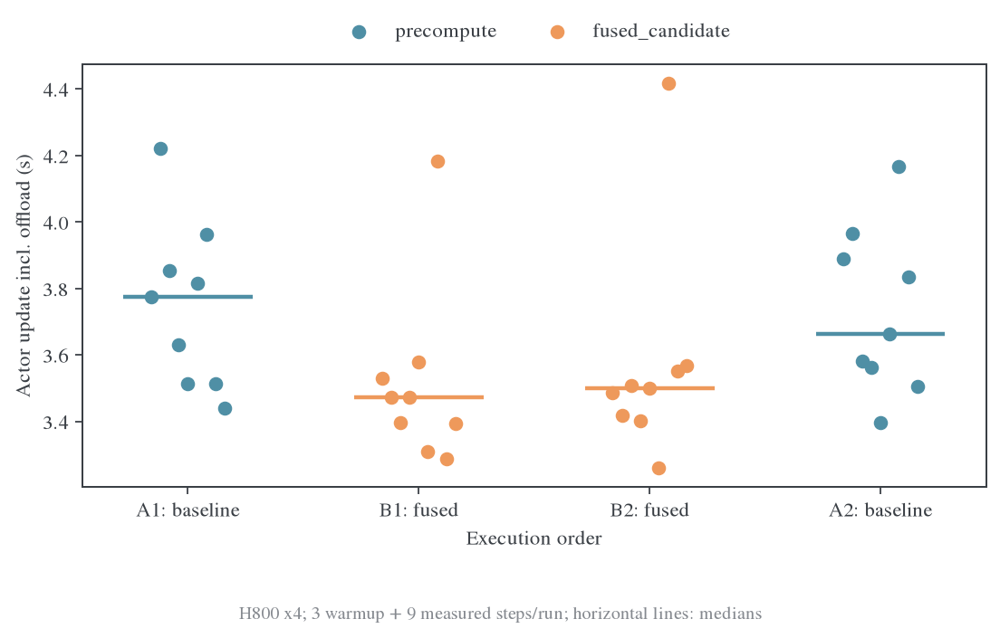
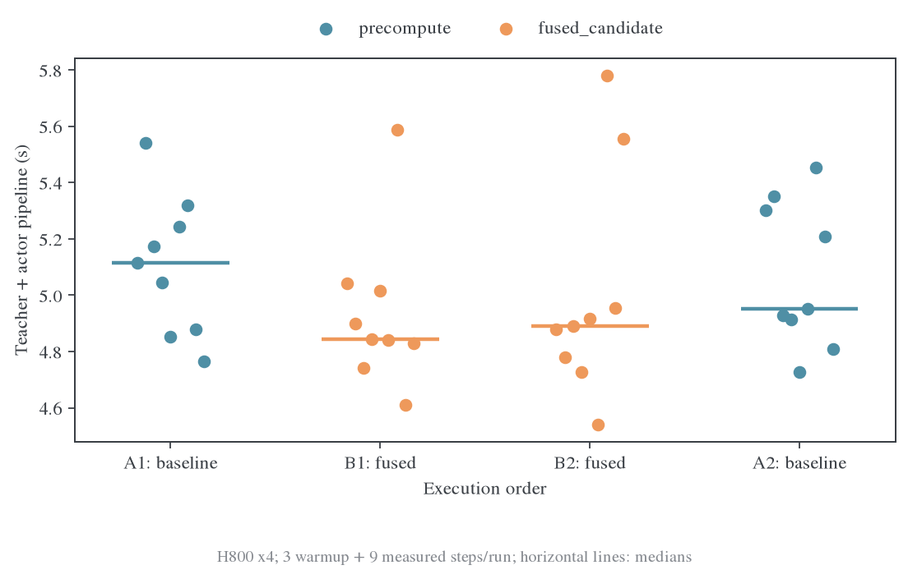
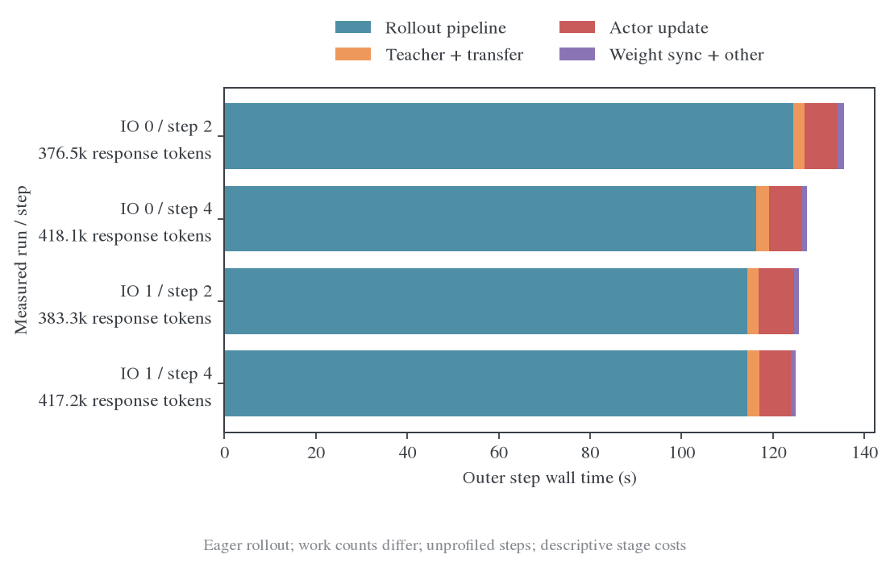

# Full-KL 优化结论与启动

## 结论

在本机四张 H800、当前 1.5B 数学模型上，新增可选 `precompute_fused` backend。它融合全词表 KL 归一化与 logits 梯度表达式，保留 cuBLAS 投影和梯度矩阵乘，不改变固定 prefix 下的 reverse KL 目标、teacher 冻结、有效 token 归一化或 FSDP head 调用路径。

| 测量范围 | 原 precompute | 融合实现 | 解释 |
| --- | ---: | ---: | --- |
| 单卡 head/loss，32K 有效 token、chunk=512 | 287.785 ms | 162.675 ms | 耗时减少 43.5%，约 1.77 倍速度 |
| 四卡 actor 更新，中位数 | 3.719 s | 3.480 s | 耗时减少约 6.4%，包含 actor 上下卡 |
| 四卡 teacher→actor 管线，中位数 | 5.080 s | 4.885 s | 耗时减少约 3.9%，不含 rollout/Ray/TQ |
| 四卡固定输入峰值 allocated | 17.031 GiB | 约 16.600 GiB | 同 chunk 节省约 0.43 GiB |

这些数字分别对应不同测量层级，不能互换。完整 eager 训练周期主要耗时在 rollout；尚未测得 graph rollout 或集群八卡上的融合整步收益。默认 E13/E14 继续使用 `precompute`，融合版本通过环境变量显式开启。

## 交错复测

复测固定同一批 32 条历史数学回答、163573 个输入 token、161701 个有效 loss token，使用相同 chunk=512、每卡 token budget=16384 和 activation checkpointing。lr=0 保持权重一致，optimizer 计算仍执行。采用 A–B–B–A 顺序，每次预热 3 步、测量 9 步，无 profiler；两种 backend 各有 2 次独立进程运行、18 个计时样本。

| 顺序 | backend | actor 中位数 s | teacher→actor 中位数 s |
| --- | --- | ---: | ---: |
| A1 | precompute | 3.774 | 5.116 |
| B1 | fused_candidate | 3.472 | 4.845 |
| B2 | fused_candidate | 3.499 | 4.889 |
| A2 | precompute | 3.663 | 4.951 |

`fused_candidate` 是原测量源码中的名称，其实现现已移入生产 `precompute_fused`。最终数字使用每个 backend 的 18 个非预热样本中位数，不把同一运行内的步骤当成独立重复计算置信区间。两次融合运行的中位数均低于两次基线，单步仍有较明显波动。





原始记录和启动计划见 [data/final/confirmation](data/final/confirmation)，聚合与图表数据见 [confirmation.json](figures/final/confirmation.json)。

## Profile 指向的瓶颈

单卡 head trace 中，原归一化与 logits 梯度 kernel 合计约 157.2 ms，融合后约 29.9 ms；两边投影与 `dH/dW` GEMM 基本不变。加速来自减少完整词表中间量和逐元素/reduction kernel，详细证据见[首次测量](2026-10-23-首次测量与后续验证.md)。

完整训练的阶段分解如下。IO 0/1 分别表示同步和 async write/prefetch 同开；每行的实际生成 token 数不同，因此图用于展示成本分布，不用于估计 IO 的因果加速比例。



主线程 hidden 读取等待从约 229 ms 降至 68 ms，异步写入结束仍需约 53 ms flush。PyTorch 没有采到异步工作线程的 read/write 主体，相关缺失值记作 null；不能按零耗时处理。同步 CPU D2H 标记也包含此前 GPU 工作的等待，不能当成纯 PCIe 传输时间。详见[IO 对照与显存轨迹](2026-10-23-IO对照与显存轨迹.md)。

关闭 activation checkpointing 将固定输入管线峰值 allocated 推到约 61.3 GiB、reserved 推到约 77.7 GiB，短测未见明确速度收益，因此保留 checkpointing。此次不继续扩展词表 TP、多 teacher 或模型架构适配，也不因尚有可调参数而无限扫描。

## 正确性与生产入口验证

- 合成 GPU 输入逐配置核对 loss 和 student hidden/head 梯度；CPU/FP64 路径、空本地 token、teacher 无梯度等目标测试通过。
- 真实模型固定输入的 loss 差约 $6.71\times10^{-8}$，首轮梯度范数最大绝对差约 $1.06\times10^{-5}$。
- 生产名称 `precompute_fused` 的四卡 FSDP2 测试通过，覆盖空本地 mask、三次更新、head/backbone 参数变化及 checkpoint 保存恢复。[结果](data/final/production-validation/fsdp4-checkpoint/result.json)
- 非零学习率的完整 Ray/TQ/vLLM 重试通过：四卡、batch=8、response 上限 128、lr=1e-6，完成两次真实 optimizer 更新，loss 为 0.055225 / 0.067491，梯度范数为 1.5044 / 1.7119，均有限。它是短程入口验收，不用于速度或质量结论。[结果](data/final/production-validation-retry/summary.json)

首次生产入口启动在进入模型训练前因 Ray 临时目录过长而失败。已修复通用队列生成器，使用短且唯一的 `/tmp/mopd-…` 路径，并通过包含长实验名的 11 项队列测试。原失败证据保留，新目录独立重试，不将失败记录覆盖成成功。

该工作没有进行长程数学准确率评估。实现等价与短程训练通过不等于已证明质量无差异；集群 A100 八卡也仍需独立吞吐和显存验证。

## 启动方式

直接复用原启动脚本。需要使用目标机器已有的 Python 环境和模型/数据路径；以下命令不自动触发本机训练。

本机四卡：

```bash
CUDA_VISIBLE_DEVICES=0,1,2,3 STUDENT_GPUS=4 \
FULL_KL_BACKEND=precompute_fused FULL_KL_TOKEN_CHUNK=512 \
bash examples/mirroropd/run_math_opd_ablation_fsdp2.sh E13
```

集群八卡：

```bash
STUDENT_GPUS=8 FULL_KL_BACKEND=precompute_fused FULL_KL_TOKEN_CHUNK=512 \
bash examples/mirroropd/run_math_opd_ablation_fsdp2.sh E13
```

E14 保持同一实现，只做原有学习率消融。要恢复原 backend，改为 `FULL_KL_BACKEND=precompute`。CPU 和非 BF16 输入自动走原 precompute 参考路径，只有 CUDA BF16 执行融合 Triton kernel。

代码当前在本机提交；集群源码通过既有离线流程传输：发送端 `make archive-pack TARGET=dev`，人工上传 bundle 后，接收端执行 `make archive-unpack ARCHIVE=/上传路径/代码包.bundle`。具体收发目标和确认流程见 [meituan/README.md](../../../../../meituan/README.md)。

## 证据目录与复现工具

| 内容 | 运行目录或脚本 |
| --- | --- |
| 初始分层测量、Nsight、完整 IO 对照 | `outputs/full-kl-profile-20261022` |
| 同 chunk ABBA 复测 | `outputs/full-kl-confirmation-20261023` |
| 四卡 checkpoint 验证及首次启动失败 | `outputs/full-kl-fused-validation-20261023` |
| 修复短路径后的独立重试 | `outputs/full-kl-fused-validation-retry-20261023` |
| 语义 kernel 归因 | `scripts/semantic_trace.py` |
| 区间并集和局部 CUDA 时间线 | `scripts/analyze.py` |
| allocator 请求字节回放 | `scripts/memory_timeline.py` |
| ABBA 聚合和点图 | `scripts/summarize_confirmation.py` |
| 完整周期阶段图 | `scripts/plot_step_breakdown.py` |

图表均提供 PNG、PDF、SVG 和可复算的数据；原始大 trace 与 pickle 保留在运行目录。kernel 分类优先识别 Attention，再识别 GEMM，避免 FlashAttention 模板中的 `cutlass::bfloat16_t` 被误归为 GEMM。CPU launch correlation 用于 Triton 归因，CPU 标记时长不直接当成 GPU kernel 时间。
