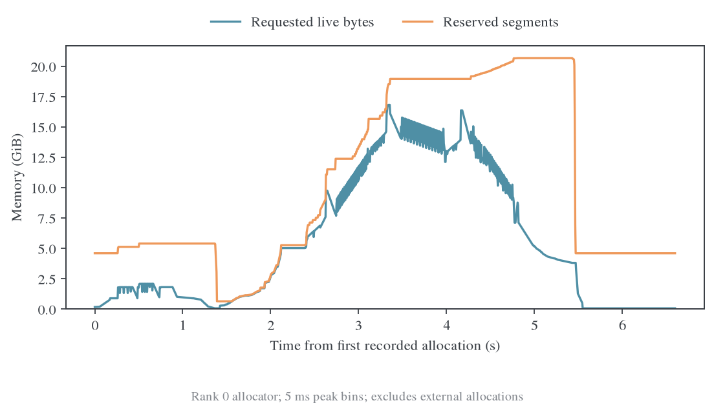

# Full-KL IO 对照与显存轨迹

本文保留对应检查阶段的记录；后续验证已完成，当前结论见[最终报告](2026-10-23-Full-KL优化结论与启动.md)。

## 完整训练已完成

初始冻结队列 `39d8be84a` 已于 2026-10-23 04:36 完成，所有任务退出 0。同步与异步 IO 两组均完成四步真实 Ray/TQ/vLLM 训练。退出码只证明任务执行成功；以下分析同时核对原始工作量、trace 覆盖和测量范围。

[原始指标与 span 摘要](data/review-005/io-summary.json) 保存两组每步 response token、阶段时间和 rank 0 的 CPU 标记统计。异步组开启 async write 和 prefetch，同步组均关闭。两组都使用 eager rollout、batch=64、response 上限 7168，第 3 步采 profile。

| 配置 | step | response token | teacher forward 秒 | actor update 秒 | outer step 秒 |
| --- | ---: | ---: | ---: | ---: | ---: |
| 同步 IO | 2 | 376453 | 1.748 | 7.301 | 135.530 |
| 异步 IO | 2 | 383306 | 1.580 | 7.874 | 125.671 |
| 同步 IO | 4 | 418083 | 1.881 | 7.237 | 127.420 |
| 异步 IO | 4 | 417232 | 1.740 | 6.902 | 124.904 |

第 1 步包含明显预热，第 3 步包含采集/导出开销，均不作为吞吐基准。两组生成 token 不完全一致，actor 时间在 step 2 与 step 4 的变化方向也不相同。因此不据此宣称稳定的整步 IO 加速百分比。

## 等待与后台线程可见性

第 3 步 rank 0 的 CPU 标记合计为：

| 标记 | 同步 IO ms | 异步 IO ms | 解释 |
| --- | ---: | ---: | --- |
| hidden_read_wait | 228.934 | 68.034 | 主线程等待 teacher hidden 的可见区间 |
| hidden_read | 206.685 | 未采集 | 异步组在工作线程读，不能当成耗时为零 |
| hidden_write | 222.800 | 未采集 | 异步组在工作线程写，不能当成耗时为零 |
| hidden_write_wait | 未启用 | 0.077 | 提交下一次写入前的等待 |
| hidden_write_flush | 未启用 | 53.465 | Teacher 阶段结束时等待最后一次写入 |
| teacher_hidden_d2h | 213.741 | 197.056 | CPU 范围含同步等待，不等于纯设备拷贝时间 |
| micro_batch_h2d | 63.365 | 82.618 | 两个阶段各四个 micro-batch 的 CPU 范围 |
| teacher_head_get | 61.655 | 66.621 | 首次 teacher head 搬运和后续缓存获取 |

两个 profile 步分别生成 398329、386848 个 response token。等待减少与异步覆盖部分 IO 的机制一致，但精确收益还受工作量与运行波动影响。预取没有消除第一批读取，async write 也没有消除最终 flush。

PyTorch trace 保留了主线程等待，却没有保留这组异步线程的 read/write 主体。JSON 对缺少事件的字段使用 null，明确区别于实测零值。若后续继续优化传输，应使用跨线程 NVTX/Nsight 观察后台工作，并用 CUDA memcpy 事件分离传输和此前 GPU 工作的同步等待。

## 显存生命周期

初始固定输入 baseline 的 rank 0 allocator snapshot 已回放成以下曲线。横轴从首次记录分配开始；纵轴分别为仍存活的请求字节与保留 segment 字节，按 5 ms 窗口取峰值。

该窗口的请求字节峰值为 16.822 GiB，reserved 峰值为 20.670 GiB。它与原报告的四卡最大 allocated 17.031 GiB、reserved 20.898 GiB 口径不同：图只覆盖 rank 0，requested 不含分配器对齐，allocator 记录也不包含外部库分配。完整 snapshot 仍保存在 `outputs/full-kl-profile-20261022/pipeline-baseline/memory-rank0.pickle`，可用 memory_viz 继续检查分配堆栈。

前后阶段的设备迁移会改变常驻量，单个峰值无法解释生命周期。结合[首次测量](2026-10-23-首次测量与后续验证.md)可知，关闭 checkpointing 增加的 backbone 激活远大于 head 融合节省的约 0.43 GiB，当前保留 checkpointing。

## 后续验证与默认值

同 chunk 的 ABBA 交错复测已经启动，记录在 `outputs/full-kl-confirmation-20261023`。生产 backend 名称的 FSDP2 更新、checkpoint 恢复和非零学习率完整训练验证排在其后，记录在 `outputs/full-kl-fused-validation-20261023`。两者共用同一个 GPU 锁，后者当前只等待，不会与前者同时占卡。

接入细节见[融合算子接入与验证](2026-10-23-融合算子接入与验证.md)。在复测与生产入口验证结束前，E13/E14 默认不变，定时检查继续。
