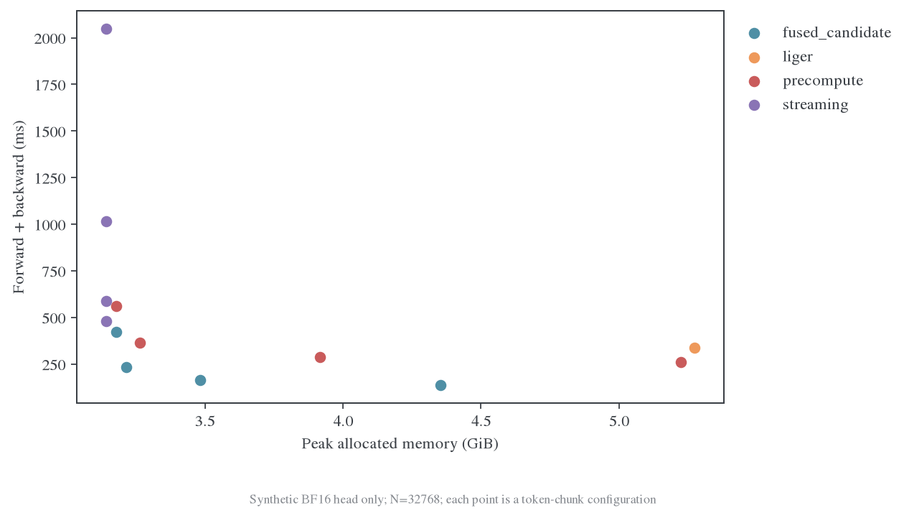
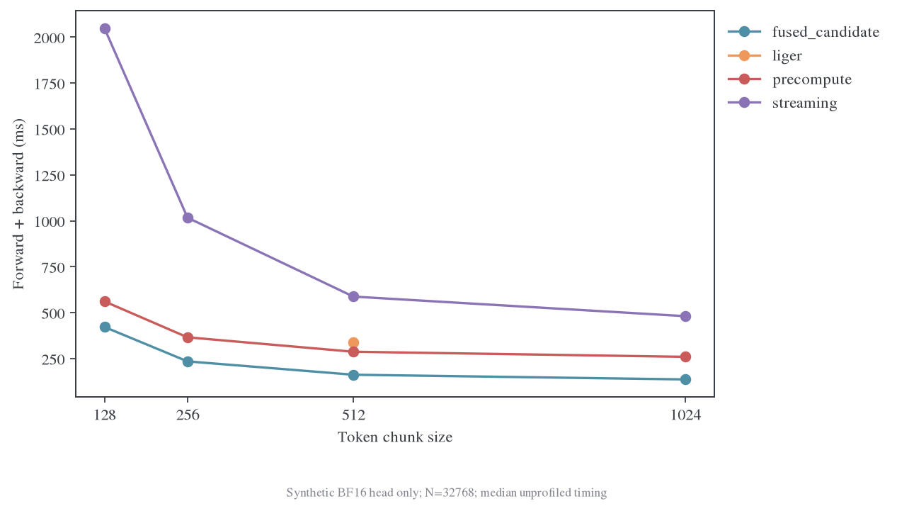
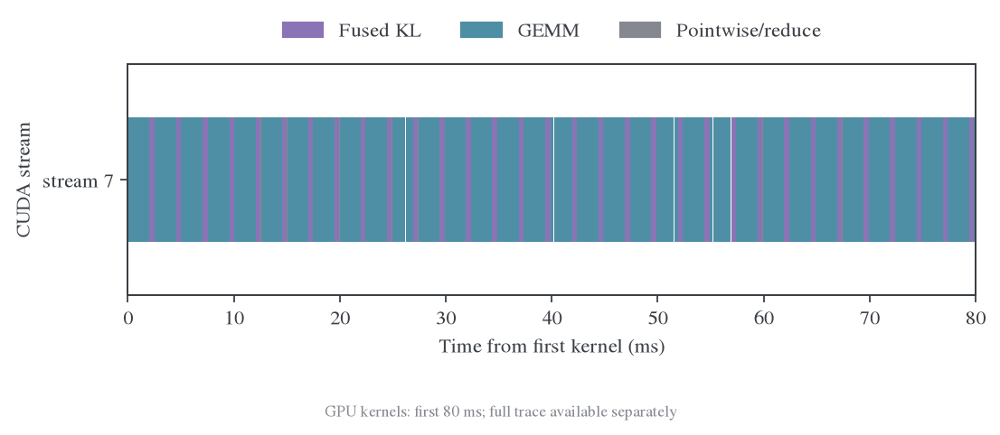

# Full-KL 首次测量与后续验证

## 当前判断

2026-10-23 第 4 次定时检查时，初始队列已经完成算子扫描、Nsight head 采集、真实模型固定输入对照和同步 IO 的完整训练。任务均退出 0；异步 IO 对照仍待完成。融合候选在 head/loss 层有明确收益，真实管线尚需更长预热和交错重复确认，生产 E13 默认保持不变。

实验源码为 `39d8be84a`，原始运行目录为 `outputs/full-kl-profile-20261022`。该文使用的已完成证据单独复制到 [data/review-004](data/review-004)，不会随着运行队列后续写入而改变。分析工具和预热参数的后续修改只发生在主工作区，没有修改运行中的冻结源码。

## Head/loss 结果

[原始 JSON](data/review-004/kernel/benchmark.json) 使用 H800、BF16 hidden/head、FP32 logits/梯度累加，V=151936、d=1536、N=32768；每个配置先核对 loss 和梯度，再计时 7 次。以下是相同 chunk 的比较，避免把 chunk 调优混入融合收益。

| backend | token chunk | 前向加反向中位数 ms | 峰值 allocated GiB |
| --- | ---: | ---: | ---: |
| precompute | 512 | 287.785 | 3.917 |
| fused_candidate | 512 | 162.675 | 3.482 |
| precompute | 1024 | 260.098 | 5.223 |
| fused_candidate | 1024 | 137.127 | 4.353 |

chunk=512 时，耗时减少 43.5%，约 1.77 倍速度，峰值 allocated 减少 0.434 GiB。chunk=1024 时，耗时减少 47.3%，约 1.90 倍速度。上述速度只覆盖 head/loss，不含 backbone、teacher 前向、模型上下卡、TQ 或 rollout。

## Trace 解释

[语义归因数据](data/review-004/reviews/004-semantic-traces.json) 把 CUDA kernel 关联到发起操作的 CPU 标记，并对嵌套标记只归到最深一层。Triton 的 External id 有时指向整个自定义 autograd Function，不能直接使用该 Function 的开始时间；分析器优先使用 CUDA correlation 找到实际 launch 时间，才可归到正确的 fused 范围。没有匹配的事件保留 unattributed。

N=32768、chunk=512 的 GPU kernel 工作量如下。表中是 kernel duration 求和；两次 head trace 均为单计算 stream，其结果仍与无 profiler 墙钟计时分开记录。

| 计算组 | precompute ms | fused_candidate ms |
| --- | ---: | ---: |
| student + teacher projection | 44.439 | 45.180 |
| KL 归一化 + logits 梯度 | 157.231 | 29.879 |
| hidden 梯度矩阵乘 | 19.702 | 20.130 |
| head 梯度矩阵乘 | 61.009 | 61.081 |
| backward 梯度应用 | 1.033 | 1.062 |

收益主要来自替换 softmax、逐元素表达式和 reduction 的中间张量读写；投影和梯度 GEMM 没有相应变快。该证据支持继续验证融合候选，不支持把全部收益归于 cuBLAS 参数调优。

时间线图按真实 kernel 名称分类，覆盖首个 kernel 开始后的 80 ms。`nvjet` 属于这里实际使用的 GEMM 名称，已补入分类。完整 trace 保存在运行目录，局部窗口不能代替全步分析。

## 真实模型固定输入

该 probe 使用真实 student/teacher 模型和同一批历史数学回答重新分词，32 条样本、163573 个输入 token、161701 个有效 loss token。学习率为 0，optimizer 状态和更新计算仍执行；直接调用生产 FSDP2 worker，不包含 Ray/TQ/vLLM。

| 配置 | chunk | 两次非预热 actor 秒数 | 两次总管线秒数 | 非预热峰值 allocated GiB |
| --- | ---: | --- | --- | ---: |
| precompute 基线 | 512 | 4.517 / 3.946 | 6.278 / 5.319 | 17.031 |
| fused_candidate | 1024 | 4.276 / 3.891 | 6.073 / 5.457 | 17.467 |
| precompute 调 chunk | 1024 | 4.313 / 4.138 | 6.106 / 5.724 | 18.338 |
| precompute 关闭 checkpointing | 1024 | 4.733 / 4.179 | 6.567 / 5.530 | 61.271 |

这组数据只排除了首步和详细 profile 步，同配置第 1、2 次计时差异仍明显。因此暂不宣称管线百分比收益。下一轮应预热至少 3 步、采 8–10 步，按基线—候选—候选—基线交错重复，并先固定相同 chunk 和 token budget。

[数值对照](data/review-004/pipeline-agreement/checks.json) 已通过：loss 绝对差约 $6.71\times10^{-8}$，梯度范数最大绝对差约 $1.06\times10^{-5}$。该 probe 验证的是固定权重 loss/梯度与真实 FSDP2 路径，不等于训练质量收敛验证。

关闭 activation checkpointing 明显增加内存，占用约 61.3 GiB allocated、77.7 GiB reserved，短窗口没有明确速度收益。该配置不作为当前优先方案；优先保留 checkpointing，验证融合及 micro-batch token budget。

## 完整训练的首组结果

同步 IO 的完整四卡训练已完成 4 步。使用 batch=64、response 上限 7168、eager rollout；第 3 步采 profile。第 4 步的日志为：

| 观测 | 数值 |
| --- | ---: |
| response token | 418083 |
| rollout pipeline 秒 | 116.369 |
| teacher transfer 秒 | 0.866 |
| teacher forward 秒 | 1.881 |
| actor update 秒 | 7.237 |
| weight update 秒 | 1.032 |
| outer step 秒 | 127.420 |

这个 eager 诊断配置下，actor 更新约占 outer step 的 5.7%。即使改进 head 算子，整步收益也会被 rollout 占比限制。正式 E13 使用 graph rollout，不能直接套用此处的整步占比；需要分别报告训练更新收益与生成在内的完整周期收益。

采集过程中出现 `External init callback must run in same thread as registerClient` 警告。已检查导出的四个 rank trace：每份约 3.3 万个 CUDA kernel，均包含 teacher forward、student forward、hidden IO 和 head/loss 标记。该警告没有导致本组 trace 完全缺失，但不能仅凭退出码认为采集完整；异步 IO 组还需核对后台线程的覆盖。

## 尚未完成

1. 审阅异步 IO 组，核对生成 token 工作量、profile 中实际等待以及 IO 重叠。
2. 对融合候选做充分预热、同 chunk、交错顺序的真实模型复测。
3. 确认非零学习率的生产入口可用后，再决定是否增加可选 backend；当前不切换默认。
4. 最终报告区分算子、固定输入管线、完整 eager 周期和 graph 配方，整理负结果与硬件适用范围。

定时检查继续保留；尚未写入 `REVIEW_DONE.json`。
