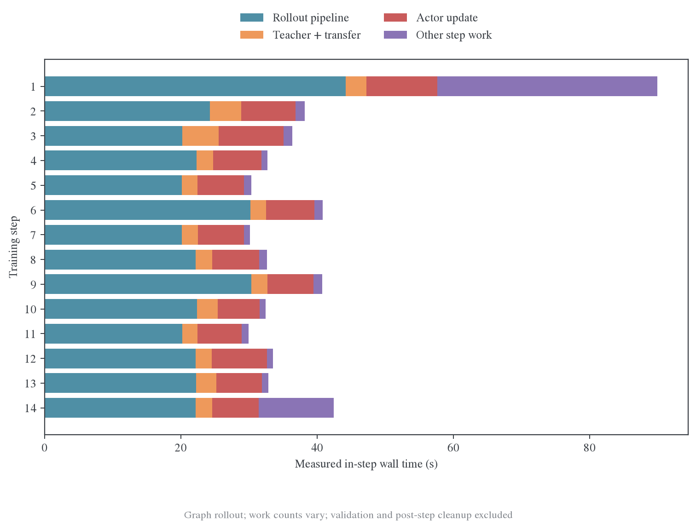
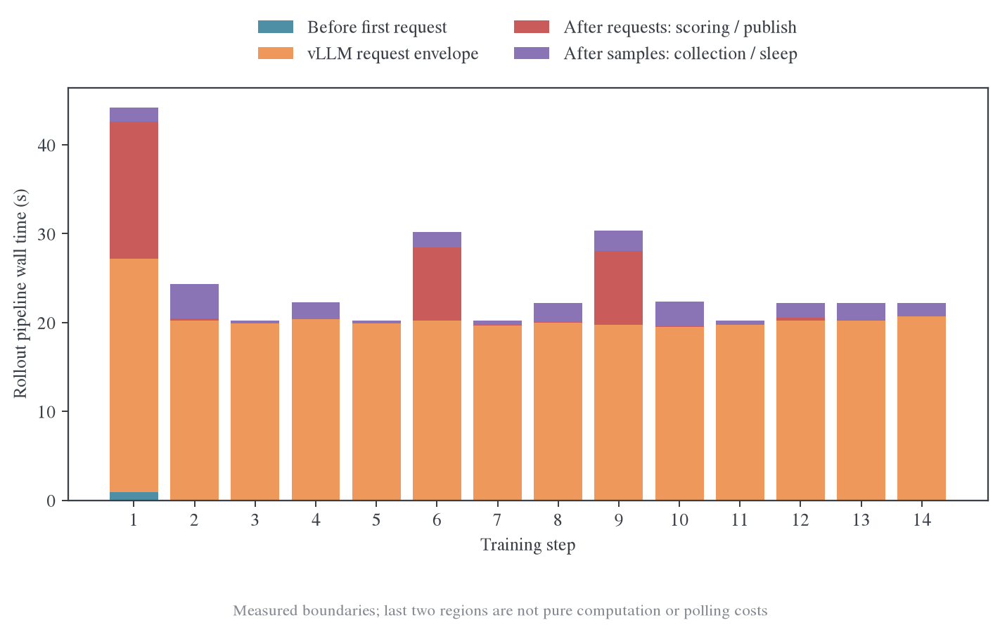
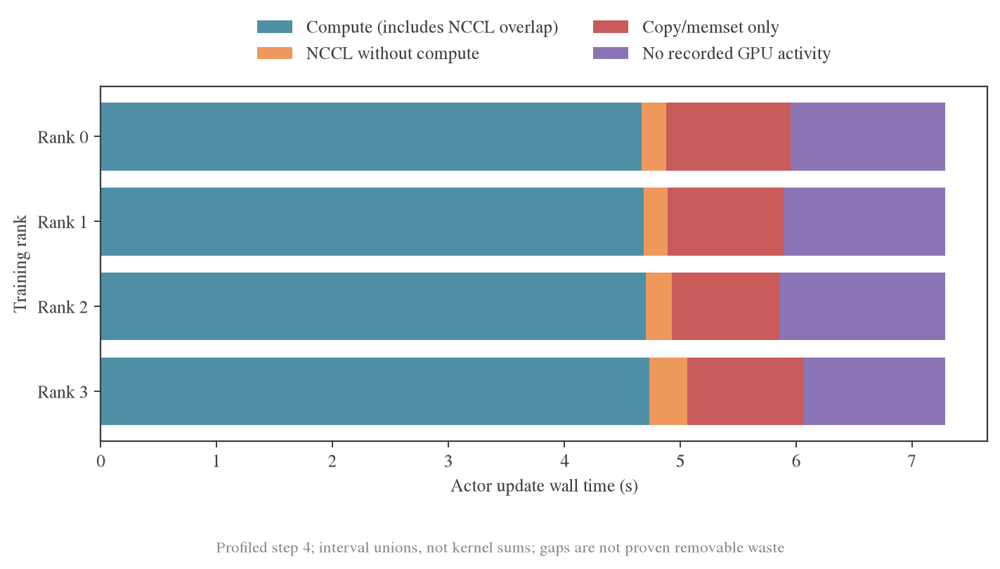
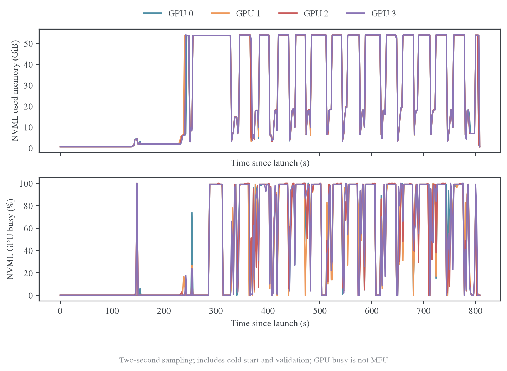

# 四卡 Full-KL 完整训练：第一轮实测

## 结果与范围

正式 graph rollout 的 14 步训练已完成；独立的 5 步 Torch profile 也已完成，取得四个训练 rank 和四个 rollout replica 的原始 GPU trace。当前默认配方的稳态候选步骤 4–13 平均 **33.63 秒/步**：rollout 管线占 **69.1%**，actor 更新占 **20.4%**，teacher forward 与上下卡合计占 **7.4%**，权重同步占 **3.0%**。

这轮数据不支持先把问题归结为 decode 长尾。生成请求本身约 20 秒，第 6、9 步在生成后仍有约 8 秒的评分 RPC 等待；另外，63.6% 的稳态回答触及 7168 token 上限，最后 10% 请求几乎同时完成。当前更值得拆查的是评分和结果收集的暴露等待、推理主计算，以及 actor 的传输/提交间隙。hidden async write / prefetch 的暴露等待较小。

这是单轮数学 reasoning、单 teacher、四张 H800 上的短程工程测量。目标、batch、训练 token 上限、学习率、`precompute` 后端及 IO 开关均保持原配方。未执行新的性能配置优化，也没有用详细 profiler 的耗时宣称吞吐收益。

基线实际记录的软件版本为 PyTorch `2.11.0+cu128`、vLLM `0.25.1+cu129`、Ray `2.56.1`、Transformers `5.12.1`；每卡 NVML 报告总容量 85,520,809,984 bytes。完整记录在运行目录 `baseline/versions.json`，交互页的证据面板也保留这些字段。

- [单文件离线交互报告](dashboard.html)：数据和绘图库全部嵌入 HTML，下载后直接打开。
- [完整测量设计与流程走读](2026-10-23-全流程测量与现状说明.md)：模型、配置和代码路径。
- [可复核的聚合结果](review.json)：阶段统计、请求边界、更新健康、trace 时钟校准与 GPU 区间并集。
- 运行源码：`8132ca543`。原始目录：`outputs/reasoning-e2e-profile-20261023`。Nsight 环境修复与重试见后文。

## 完整周期和阶段成本

| 指标 | 结果 | 口径 |
| --- | ---: | --- |
| 进程启动至第一步开始 | 254.68 s | 包括 Ray、数据、模型和 rollout 引擎初始化 |
| 第一步 | 89.95 s | 包含尚未归属的首次准备成本，不能当稳态 |
| 步骤 4–13 平均步内耗时 | 33.632 s | 10 个真实更新步，保留工作量变化 |
| 步骤 4–13 中位数 | 32.721 s | 范围 29.956–40.823 s |
| 步骤 4–13 平均完整步间周期 | 33.716 s | 从本步起点到下一步起点，包含步后日志和清理 |
| 第 14 步 checkpoint | 10.139 s | 同步保存，包含于该步的 42.426 s |
| 最后的小验证窗口 | 4.117 s | 8 题 × 2 次，最大 response=1024，不代表完整验证集 |
| 命令总时长 | 812.24 s | 包括初始化、14 步、验证及收尾 |

步骤 4–13 的阶段均值和总时间占比如下。占比是各阶段总时间除以十步总时间；不把不同 rank 的时长相加。

| Driver 阶段 | 均值 (s) | 占步内时间 |
| --- | ---: | ---: |
| Rollout 管线 `gen` | 23.247 | 69.12% |
| Teacher 上下卡 | 0.742 | 2.20% |
| Teacher forward + hidden 发布 | 1.745 | 5.19% |
| Actor update | 6.866 | 20.41% |
| 权重同步 / rollout wake | 0.998 | 2.97% |
| 其余步内工作 | 0.035 | 0.10% |

第 1 步有约 31.01 秒位于 `step` 开始之后、`gen` 开始之前。当前埋点没有把这段进一步拆成数据读取、提交和 worker 就绪，不能直接归入 GPU 编译。代码中的 `prepare_step()` 会取 batch 并提交请求；若要优化冷启动，需要补充这个范围内的细分证据。第 2、3 步的 actor / teacher 成本也高于后续多数步骤，因此没有用前三步计算稳态均值。

## Rollout：生成、评分和返回是三个不同问题

稳态十步共 640 条回答、3,956,383 个输出 token，平均约 6182 token/回答。每步从第一条 vLLM 请求开始到最后一条结束的区间平均 **19.94 秒**，范围 19.47–20.32 秒；而 driver `gen` 平均为 23.25 秒。二者的差不能全部算成推理引擎的 decode 时间。

图中四段按完成边界顺序构造，相加等于 `gen`：首请求前、vLLM 请求区间、最后请求结束至所有样本完成、样本完成至 `gen` 返回。后两段分别包含剩余评分/发布和收集/sleep，不能理解成纯评分计算和纯轮询。

| 训练步 | `gen` (s) | vLLM 请求区间 (s) | 最后请求后至样本完成 (s) | 样本完成后 (s) | 最慢评分 RPC (s) |
| --- | ---: | ---: | ---: | ---: | ---: |
| 4 | 22.294 | 20.323 | 0.062 | 1.889 | 0.205 |
| 6 | 30.207 | 20.216 | 8.215 | 1.760 | 8.389 |
| 9 | 30.330 | 19.750 | 8.280 | 2.290 | 8.314 |
| 11 | 20.218 | 19.680 | 0.053 | 0.454 | 0.021 |

`timer/compute_score` 计量的是评分 RPC 区间，可能包含排队、进程调度和计算。这里可以确认评分链上有显著延迟，但尚不能把这 8 秒精确归因到某个 SymPy 算法或某次超时。相应的 grader 实现在 [one_shot_opd/math.py](../../../../../../verl/utils/reward_score/one_shot_opd/math.py)，通过数学等价性判断评分。

样本完成后的等待与现有 [ReplayBuffer](../../../../../../verl/trainer/ppo/v1/replay_buffer.py) 默认 2 秒轮询相吻合，但它还包含其他工作；有些步骤超过 2 秒，不能把整段都归因于 `sleep(2)`。后续若优化，应对“样本已发布 → buffer 变为可取 → sample 返回 → rollout sleep 完成”增加独立事件。

### 长度上限改变了对长尾的判断

稳态回答中 **63.59%** 的 `finish_reason` 为 `length`。每步 t90 到 t100 的完成间隔仅 1.76–5.01 ms，说明这批最后完成的请求集中到达；这不证明一般 reasoning rollout 没有长尾，而是当前配方的大量请求被同一个长度上限截断。

上限本身可能影响回答完整性和数学结果，因此不能把缩短回答作为无代价的性能优化。若未来放宽 response 长度，必须重新测量长度分布、批尾行为和 KV cache，而不能直接外推本报告。

### HTTP 指标和推理 trace 的覆盖

采到了 1112 个非空 HTTP 指标样本。单引擎观测到最多 16 个运行请求，等待请求数和累计 preemption 的观测最大值均为 0；KV cache 使用比例最大约 **5.49%**。这是采样证据，短暂排队仍可能遗漏。

请求的 backend first-token 字段全部为空，所以没有编造逐请求 TTFT。HTTP 汇总字段存在，但不能倒推每个请求的分位时延。四份 rollout Torch trace 各包含 128 个 engine iteration，仅覆盖约 **0.38–0.40 秒**的局部 GPU 窗口；不能把它们代表整个约 20 秒的生成过程。其可见 GEMM 工作量约 194–202 ms、attention 约 59–61 ms，分类依据 kernel 名称，保留未知项。

## Teacher / actor：GPU 工作、通信与 IO

四份训练 trace 各有约 3.47 万个 kernel，覆盖 teacher 上下卡、teacher forward 和 actor update。利用每个进程内 8 个 `full_vocab/backbone` 事件，将 Torch 的 `baseTimeNanoseconds + ts` 与 host `monotonic_ns` 对齐；四 rank 最大校准偏差为 **0.053 ms**。聚合脚本遇到超过 5 ms 的偏差会拒绝对齐。

独立 Torch 运行第 4 步的 actor 总墙钟为 7.284 秒。下图按区间并集构造，计算包含与 NCCL 重叠的时间，后续分量均剔除了前面已覆盖的区间。

四个 rank 的计算区间并集约 4.67–4.74 秒；大部分 NCCL 与计算重叠。没有计算重叠的 NCCL 约 0.21–0.33 秒，这仍不是经过依赖分析证明的可消除等待。其余 copy/memset 独占区间和无已记录 GPU 活动区间需要结合 CPU 调度、参数/优化器搬运及同步点解释，不能直接标为浪费。

`_stop_profiling()` 当前在步末权重同步之前执行，因此 **这批 Torch trace 没有覆盖后续权重同步的 GPU 内部细节**。分析器将该阶段标为未覆盖，不把空事件当成零 GPU 时间。完整 driver 时间线仍测到了权重同步约 1 秒。Nsight 的最终覆盖也必须按实际 capture 窗口核对。

### Full-KL head 仍有优化空间，但要按整步收益排序

通过 CUDA launch correlation 将 kernel 归入最深的 Full-KL 语义区间，四 rank 每次更新的 normalization/KL 工作量约 362–366 ms，grad-logits 约 146–148 ms，student/teacher projection 各约 73–75 ms，grad-head 约 197–200 ms。它们是独立 profile 窗口中的累计 GPU 工作量，不是基线 head 的 CPU 墙钟时间，也不能直接跨 rank 相加。

该结果支持继续关注已有融合后端的逐元素计算，但不能据此宣称整步大幅加速。以基线 actor 的 20.4% 占比估算，即便把整个 actor 更新耗时减半，理想情况下整步耗时也只减少约 10.2%；只改 head 的可达收益更小，且需要固定输入和真实整步对照。

### IO 已有一定重叠

以下是步骤 4–13、四个 worker 共 40 个“step × worker”样本的区间总和中位数。每项分别统计，嵌套和重叠区间不能相加。

| Host 区间 | 每 worker、每步中位数 | 解释 |
| --- | ---: | --- |
| Teacher hidden D2H | 0.213 s | 同步 `.cpu()` 路径，包含等待未完成设备工作的可能性 |
| 后台 hidden write | 0.210 s | CPU → TQ 后台工作量 |
| 前一笔 write 的等待 | 0.000026 s | 中间批次的背压等待很小 |
| 最终 write flush | 0.056 s | 离开 teacher 阶段前仍需完成的尾部写入 |
| 后台 hidden read | 0.205 s | TQ → CPU 工作量 |
| hidden read wait | 0.077 s | 当前批次等待读取的暴露部分 |
| micro-batch H2D | 0.079 s | 该区间在 teacher 和 actor 两侧均出现，表中为合计 |
| optimizer step | 0.043 s | 主机区间，不能代替 optimizer CUDA kernel 时间 |

因此，当前首先应确认 D2H/H2D 和模型/优化器搬运的关键路径，再考虑更深预取；只根据后台 IO 总量就把它列为首要瓶颈会高估收益。当前 actor/teacher 的按总输入 token 平衡已较接近：十步中四 rank 的 balanced max-min 除以均值为 0.061%–0.554%。这不等于 attention 计算量完全相同，但暂时没有明显的总 token 分配失衡证据。

## 显存与生命周期

NVML 观测到的全卡峰值为 54.10–54.14 GiB。稳态阶段的采样范围：rollout 约 52.05–54.13 GiB，teacher forward 约 6.26–7.18 GiB，actor update 约 4.51–19.58 GiB。teacher 阶段只有 8 个采样时刻，不能把该范围当成精确峰值。

Trainer 报告的 actor allocated peak 为 14.14–15.07 GiB、reserved peak 为 15.48–16.34 GiB。它们与 NVML 全卡量的统计范围不同；不能把差额直接解释成碎片，也不能据此说 KL 占用了全部约 54 GiB。vLLM 配置按 0.65 的显存比例预留容量，而观测到的 KV cache 使用率较低，当前 batch 下没有明显的 KV 容量压力。

本轮没有采集新的 allocator snapshot，因此还不能给出全周期参数、梯度、临时 logits、KV cache 和碎片的精确分解。需要进一步优化显存时，应针对明确的峰值阶段补一次短窗口 snapshot，而不是默认整个训练内存不足。

## 正确性与采集健康

- 14 次 optimizer update 全部实际应用，跳过次数为 0；loss 与梯度的非有限计数均为 0。
- loss 范围 0.10158–0.11285；裁剪前梯度范数范围 0.97385–1.34195。短程下降不构成长程效果结论。
- 每个训练步记录到 64 条成功请求，共 896 条；验证另有 16 条。请求事件没有失败或缺少输出 token 数。
- 第 14 步保存了 checkpoint，验证返回完整 16 条响应。小验证集不足以判断收敛或准确率变化。
- 新增分析测试验证时间基准校准、kernel 区间并集、NCCL 重叠和未覆盖窗口；未采到的阶段不会转换为零耗时。

Nsight 首次启动失败的原因是 Ray 的 Nsight plugin 将 `py_executable` 替换成裸 `python`，继承的 PATH 选中了另一个 Python 3.10 Conda 环境的 Ray，无法运行 Python 3.12 的 worker。失败日志、退出码和诊断保留在原目录。修复只固定 profiling venv 的 PATH，提交 `1be19b738`；新证据目录为 `outputs/reasoning-e2e-nsys-retry-20261023`，训练源码和参数不变。该重试完成了 2 次真实更新，但没有形成四 rank 的 GPU trace，因此没有通过采集验收。进一步检查发现旧 WorkerGroup 将 capture-range-end 自动设为 repeat-shutdown:6，而本路径实际只结束一个连续区间；收集函数还使用了错误的默认 Ray 目录。修复见提交 `c27998361`：显式采用单区间 stop-shutdown、按当前 worker session 找到日志，并在清理前等待报告完成。最终补采目录为 `outputs/reasoning-e2e-nsys-final-20261023`，当前因前四卡再次被其他任务占用而等待空闲。训练退出不等于采集成功，四份报告会在导出 SQLite 后逐 rank 检查 CUDA kernel 和 NVTX 记录。

## 下一轮值得做的事

建议按下面顺序讨论优化实验，先保持数学目标和生成预算不变：

1. **评分和收集路径**：定位两个约 8 秒的评分 RPC；为样本发布到 batch 可取的过程补齐事件。`use_task_rewards=false` 下可以研究将诊断评分移出更新关键路径，但须先检查过滤、错误处理和指标归属，不能直接丢掉评分。
2. **Actor 的可见传输和提交间隙**：结合四 rank CUDA/NVTX 查模型/optimizer 上下卡、H2D 与计算间隙。已有证据比“单看 head kernel 慢多少”更适合决定下一步。
3. **正式 graph 配方的 fused backend 对照**：用同一固定输入检查数值/梯度，再比较整步；按相同 token 工作量解释收益，不复用旧 eager 的端到端数字。
4. **推理主计算与调度**：rollout 仍是最大部分，应检查稳定 decode 的 token/s 与局部 kernel；当前证据不支持优先改 KV 容量或依赖长尾消除获取主要收益。
5. **冷启动与周期任务**：如果实际实验短或频繁重启，254 秒首步前启动、首步准备和 10 秒 checkpoint 可能值得单独优化；长训练时要按实际触发频率摊销。

本报告没有改变以上性能配置。静态图支持 PNG/PDF/SVG；重画脚本为 [plot_review.py](scripts/plot_review.py)，机器审计记录在 [review-audit.json](figures/review-audit.json)。复核原始 trace 和命令的方法见 [README](README.md)。
