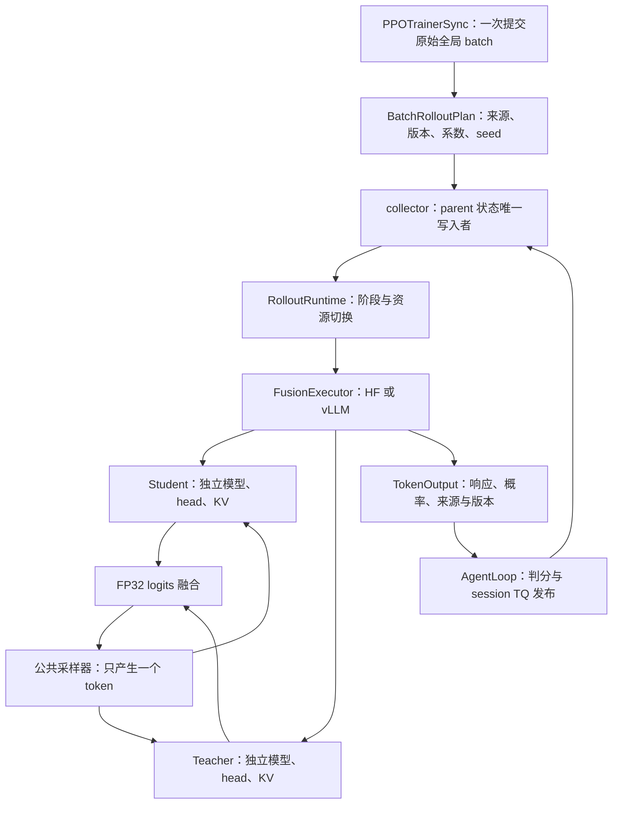

# Rollout 双模型融合：vLLM 重构、优化与验收方案

更新日期：2026-10-29。状态：进入本机单卡开发，尚未完成 vLLM fusion 后端验收。本文件是[公开实现调研](../../../literature/infra/2026-10-28-vLLM逐Token双模型融合实现调研.md)的工程续篇，与[原验收计划](2026-10-28-Rollout双融合实现细节与验收计划.md)配合使用。

审阅基线为 Git HEAD `b94ad661c6d4dd93ce9a6d12fa0f6e2d761fa1b2` 加当前工作区修改与未跟踪文件。不能用该 commit 单独复现新增融合实现。逐文件 SHA-256、公开源码版本、本地模型配置和测量证据见[源码审阅清单](../../architecture/acceptance/data/2026-10-28-vllm-fusion-review.json)。本文进行了源码与既有 JSON 记录审阅，没有重跑 GPU 实验。文中的“已有记录”与“拟议验收”分别表述。

## 1. 建议采用的路线

保留现有 `BatchRolloutPlan → collector → AgentLoop/TQ` 控制流程，新增一个使用单一 vLLM 调度器的双模型执行后端。模型使用各自的完整配置、LM head 和 KV；同一个请求驱动两侧 forward；FP32 加权 logits 后只进行一次公共采样。保留 HF 路径作兼容回退与数值对照，生产后端在完整负载验证之后切换。

现有 HF 路径已经包含 FlashAttention KV 解码、预分配缓存、CUDA graph 和自定义精度/kernel，并有基础路径真实训练证据。重构的目的包括减少自维护推理代码、引入持续批处理和 TP，以及统一生命周期。不能把当前实现描述成尚无优化的 HF 原型，也不能在没有测量时承诺 vLLM 必然更快。[^local-record][^local-hf][^local-precision]

以下裁决贯穿实施：

| 问题                   | 建议                                                                         |
| ---------------------- | ---------------------------------------------------------------------------- |
| 训练目标               | 保持现有 Full-KL、anchor、optimizer、reuse；后端迁移不夹带目标函数变更       |
| 调度结构               | 首选一个调度器管理组合模型；双独立引擎作为布局确有必要时的备选               |
| 公开代码复用           | 借鉴结构和经过审阅的局部实现；不整包移植旧 fork 或 contrastive 专用规则      |
| 当前 student           | 继续从 FSDP2 流式导出，只更新组合模型中的 student                            |
| 初始 student / teacher | 冻结 checkpoint，恢复后仍保持原绑定                                          |
| 采样语义               | 原始 token logits 加权、一次温度与过滤、一次采样；EOS 规则保持现有定义       |
| 默认 single            | 继续使用既有 vLLM 验证/生成路径，迁移改动限定于融合后端                      |
| 交付标准               | 真实模型数值、请求/权重生命周期、正式 cap 性能及默认路径回归全部满足既有要求 |

## 2. 当前实现应保留的部分与实际证据

### 2.1 控制链已经具备正确的职责边界

当前非默认策略从 `PPOTrainerSync._submit_batch_to_rollout` 进入 runtime，构造一次批计划，交给 collector 执行。AgentLoop 负责单条响应的 token 构造、判分与 TQ 发布；collector 验证整个 batch 的 session 集合、来源与完成状态。[^local-trainer][^local-plan][^local-collector][^local-agent]



上图中 `FusionExecutor` 是拟议边界；其余控制结构已有实现。TQ 接收完整响应，不参与逐 token 循环。两个模型的 KV 记录各自 hidden states；共享请求身份和生成 token 不等于共享相同 KV 数值。

应保留的具体约束如下：

- `plan.py` 固定本批系数和 actor 版本；stable seed 不依赖随机 UUID 或任务返回顺序。换后端不改来源配额与 RNG 身份。
- `collector.py` 校验返回集合恰好等于预期集合，禁止来源变化、重复、缺失和提前 parent finished。
- `generate_sessions/drain_sessions` 的独立排空确认必须保留。取消 Ray awaiter 不证明 GPU 任务或 TQ writer 已停止。
- `phase_token` 拒绝旧阶段请求。vLLM 后端也必须在提交 gate 检查，不能将旧 token 悄悄丢进下一批。
- `TokenOutput` 与连续 token wiring 保持兼容；不得先 decode 文本再 tokenize，也不得把模板插入 token 当作采样结果。

这些能力已有实现或对应测试，迁移应参数化执行后端，而不是重新设计一套队列。[^local-plan][^local-collector][^local-agent][^local-hf-server][^local-tests]

### 2.2 性能基线已有收益，但不是新后端的验收结果

原始 dense 完整批记录使用四张 H800、batch64、cap7168、每 replica 微批 16、$\alpha=0.5$、三次重复，均为自然 EOS 生成。两种配置使用 stable 精度。[^dense-ref][^dense-opt]

| 记录                 | 中位完整批生成时间 | 每次有效 response tokens | 图与缓存                     |
| -------------------- | -----------------: | -----------------------: | ---------------------------- |
| dense-base-reference |          938.176 s |                  458,583 | 普通 KV，无 Flash KV/graph   |
| dense-base-optimized |          344.260 s |                  456,835 | Append KV + Flash KV + graph |

墙钟比约为 2.725，但输出 token 数不同；这不是同 token 回放的内核加速比，也不包含 actor 更新、teacher scoring、验证切换和首次加载。读取时，记录内的部分源码指纹已与当前工作区不同，因此只能作为对应代码快照的历史性能证据。新候选需要固定源码重新对照，不能继承这些结果宣布通过。[^local-benchmark][^local-fingerprint]

已有数值记录还暴露出值得保留的失败样本：早期 dense 长批候选在共同前缀上，选中 token 概率最大差为 0.0468，超过预设 0.01 门槛。后续 stable 候选的长前缀检查已显著改善，但应保留失败数据作为回归样例。[^failed-compaction]

`verify_numerics.py` 对长前缀运行的是固定 5 步 cached/full-prefix 对照。把 `prefix_tokens` 和 `cache_cap` 都设为 7168，表示长前缀与追加容量，不表示执行了 7168 步 decode。其 cached/reference 两侧还使用同一组经 precision patch 的模型；这能检测缓存/布局差异，不能单独排除共同 kernel 偏差。[^local-numerics]

## 3. 公开实现的可复用边界

| 来源与阅读点                                      | 可借鉴设计                                | 本项目不能直接沿用的部分                                          |
| ------------------------------------------------- | ----------------------------------------- | ----------------------------------------------------------------- |
| CoS `EnsembleDecodeWorker._run_ensemble_decoding` | 同一执行请求送入多模型，统一返回采样结果  | 旧 worker/sampling 接口及整套旧 fork                              |
| CoS `EnsembleSampler.forward`                     | `raw-logits` 分支在公共处理前融合         | 默认 `we.yaml` 为概率平均，且返回第一模型 log-prob                |
| vllm-logits `DualQwen2ForCausalLM`                | 单引擎双模型、独立 head、外部注册         | 两侧复用主体配置、EOS 保护、从 checkpoint 重新加载式权重入口      |
| DoubtLess `ContrastForCausalLM`                   | 单请求、独立小模型配置、GPU 内组合 logits | brief/verbose 双视图、thinking 区间、EOS 改写、专用指令 attention |
| DoubtLess `engine.py/state.py`                    | 图捕获与请求状态随 batch 更新             | 为不同指令前缀引入的专用状态与 scheduler patch                    |
| CoDIT sampler/scheduler patch                     | 双引擎统一 token 回传与同步问题清单       | CPU/ZeroMQ 整词表传输、基于批形状的 hash、float32 请求 ID 存储    |

以上判断来自固定提交的实际代码。CoS、vllm-logits、CoDIT、DoubtLess 分别以 `b7c5553`、`a987755`、`a73844a`、`4f2b3f9` 为阅读点。[^cos-worker][^cos-sampler][^cos-we][^vl-backbones][^dl-model][^dl-engine][^dl-state][^codit-sample][^codit-scheduler]

DoubtLess 支持分离 hidden size 的方式适合借鉴，但不要复制它的两个小模型视图来实现本项目。我们只需要同一个前缀的 student 与 teacher 两次 forward。两个 LM head 都需要计算；“单引擎调用”不等于减少为单模型计算量。

## 4. 重构边界：先解耦 runtime，再引入后端

### 4.1 当前硬编码的位置

`RolloutRuntime.fusion_client` 硬编码 `hf_fusion`、按 actor worker 数创建 replica，并直接调用 `configure_fusion / initialize_fusion_student / prepare_fusion / fusion_metrics / release_fusion`。这些方法又在 actor worker 内直接操作 HF adapter。迁到独立 vLLM worker 进程后，继续沿用这些假设会把显存统计、版本状态和实际执行位置分开。[^local-runtime][^local-worker]

建议增加轻量的 `FusionExecutor` 门面。它只统一以下职责，不扩展成通用工作流系统：

| 操作       | 输入/输出与约束                                                                  |
| ---------- | -------------------------------------------------------------------------------- |
| 构建       | 解析后端能力、模型绑定和 replica 拓扑；初始化后 gate 关闭                        |
| 准备阶段   | 接收不可变 plan 与 phase token；完成必要 refit、驻留恢复和版本核对，最后允许提交 |
| 获取客户端 | 返回既有 LLMServerClient 兼容接口，结果仍为 TokenOutput                          |
| 排空与释放 | 关闭新请求、确认引擎任务结束；TQ writer 仍由 runtime/AgentLoop 确认              |
| 指标       | 从实际执行 worker 获取时间、显存、KV、版本与采样实现信息                         |
| 失败处理   | 不确定是否排空时返回 UnsafeDrainError，停止当前 run                              |

HF executor 包装现有 adapter/server；vLLM executor 包装新的 replica/server/worker extension。CPU 控制层只传元数据和完整请求，不接收逐 token 词表张量。

### 4.2 拟议文件组织

| 位置                                                    | 计划改动                                                                   |
| ------------------------------------------------------- | -------------------------------------------------------------------------- |
| `verl/experimental/rollout_policy/runtime.py`           | 通过 executor 完成融合准备、路由、释放与指标；保留 collector 调用          |
| `verl/experimental/rollout_policy/execution.py`（新增） | 轻量门面、后端构建和能力描述                                               |
| `verl/experimental/rollout_policy/validation.py`        | 分离策略语义、公共采样、后端能力与 transport 检查                          |
| `verl/workers/rollout/hf_fusion/`                       | 保留现有数值路径，通过 HF executor 接入                                    |
| `verl/workers/rollout/vllm_fusion/`（新增）             | `model.py`、`replica.py`、`adapter.py`、`worker_extension.py`、`compat.py` |
| `verl/workers/engine_workers.py`                        | 从硬编码 HF 接收器改为命名 target 路由；保留共同 FSDP 导出逻辑             |
| `verl/workers/rollout/base.py / replica.py`             | 显式注册融合后端，不替换默认 vLLM 注册项                                   |
| `examples/mirroropd/benchmarks/fusion/`                 | 同一 workload manifest 驱动 HF 与 vLLM；统一汇总与指纹                     |
| `tests/experimental/rollout_policy/`                    | 现有控制层测试复用；新增真实 vLLM 生命周期与异构模型测试                   |

新增文件名是建议，均不表示已有实现。原始 `plan.py`、`collector.py`、AgentLoop 的来源/完成语义不因引擎选择改变。

### 4.3 配置与能力检查

建议在 `rollout_policy` 下增加执行配置；默认 single 不消费它，旧 token mixture 配置在迁移期仍解析到 HF。示例只说明字段层次，不是已可运行命令：

```yaml
rollout_policy:
  mode: token_mixture
  student: current
  teacher_weight: 0.5
  execution:
    backend: vllm_fusion
    tensor_parallel_size: 1
    max_num_seqs: 8
```

`micro_batch_size` 继续只控制 HF 静态微批。vLLM 的 `max_num_seqs` 是活跃请求上限，不能把二者视为相同调度策略。默认 student/validation 的 `actor_rollout_ref.rollout` 配置与 fusion execution 配置分别解析，避免新增 TP 设置同时改变验证拓扑。

当前 `validate_policy` 在 token mixture 下强制 Transformers、FlashAttention、Triton 和精度控制能力。拆分后，HF 专用检查留在 HF capability checker；vLLM 使用自己的版本、runner、模型类型和拓扑检查。公共限制保留：同 token-ID 映射、同一停止协议、单轮文本、全参数 dense learner、无量化/LoRA、无动态过滤/refill。新增功能经过验收后逐项放开。[^local-validation]

首个 vLLM 候选固定当前集成使用的 0.25.1/V1 接口。当前 validator 显式拒绝 V2 runner；启动日志必须记录实际 runner，不能依赖环境默认。DoubtLess 固定 0.29.0，不能直接复制代码后宣称兼容 0.25.1。升级只有在兼容性原型给出具体阻塞和回归证据后单独决定。[^local-validation][^dl-package]

## 5. vLLM 组合模型：最早需要解决的结构问题

### 5.1 独立配置与 native 模型类

本地 checkpoint 配置如下。三个模型 vocab head size 都为 151,936，但仍须核对完整 tokenizer 映射。[^model-small][^model-dense][^model-moe]

| 模型                        | hidden size | 层数 | Q heads / KV heads | head dim | embedding/head 绑权 |
| --------------------------- | ----------: | ---: | ------------------ | -------: | ------------------- |
| Qwen3-1.7B-Base             |        2048 |   28 | 16 / 8             |      128 | 是                  |
| Qwen3-8B                    |        4096 |   36 | 32 / 8             |      128 | 否                  |
| Qwen3-30B-A3B-Instruct-2507 |        2048 |   48 | 32 / 4             |      128 | 否                  |

因此复制一份 student 配置后只改 teacher 层数无法覆盖两个实际配对。每侧应保留自己的 architecture、hidden size、attention/KV heads、RoPE、最大上下文、绑权关系及 MoE 参数。

vLLM 0.25.1 源码提供 `init_vllm_registered_model(..., hf_config=..., prefix=...)` 和 `VllmConfig.with_hf_config`；可用它们构建独立子模型，而不手写 Qwen3 decoder。Qwen3 dense 与 MoE 类分别提供 native forward、head 与 weight loader。首个原型先验证这套嵌套方式，不能把 helper 存在等同于完整组合模型已经受支持。[^vllm-model-utils][^vllm-config][^vllm-qwen][^vllm-qwen-moe]

模型注册使用独立 architecture 名，例如 `MirrorOPDFusionForCausalLM`。不要覆盖全局 `Qwen3ForCausalLM`，避免默认 rollout 和 teacher scoring 被替换。公共入口首先限定 `input_ids`；不能把 student embedding 计算结果直接作为 teacher 的 inputs_embeds。相同 token ID 必须分别经过两侧 embedding。

组合类还要验证 MoE 能力发现、层枚举、权重后处理与编译配置是否能识别 teacher 子模块；嵌套一个 native MoE 类不自动覆盖这些外层协议。上下文上限按两侧共同能力检查：进入生成前验证 prompt 长度与声明 cap，不能在 server 内静默缩短某侧 cap 后仍把它当成原计划负载。

`forward` 返回两侧 hidden states 的承载结构要与 runner 取样、dummy profiling 和 graph 路径核对。若采用拼接，应明确 $H_S+H_T$ 的分割点；不能假定等宽，也不能把所有 HF config 的 hidden size 改成总和来掩盖不兼容。

### 5.2 KV 身份与几何形状

为两模型使用不同的 attention 名称空间，例如 `student.model.layers.*` 和 `teacher.model.layers.*`。同时核实所选 backend 是否还依赖纯数字 layer index；vLLM 的 `extract_layer_index` 会从名称中提取整数，名称前缀不同不自动保证所有 index-based 路径都独立。不要机械复制旧仓库的层号偏移方式，先列出注册 attention 名称、KV spec、layer index 与最终存储映射进行验收。[^vllm-model-utils][^vl-backbones]

当前 vLLM KV 工具包含 `UniformTypeKVCacheSpecs` 分支，可以按每层 spec 分配不同字节数。这是处理不同 KV heads 的可用基础，但仍要验证 runner、attention backend 和 profile 是否正确纳入两侧全部层。[^vllm-kv]

首个原型必须完成两组配对的以下检查：

- 每侧 KV 层数量与各自模型配置一致，没有层名覆盖或物理存储别名。
- 同一 request 的 slot/block 映射驱动两侧前缀，存储内容仍独立。
- prefill、chunked prefill、decode、preemption 后重算的位置与 HF 共同前缀对照一致。
- 内存 profile 同时包含两个模型的参数、激活和 KV；启动成功后至少执行实际请求。
- current refit 后清除两侧本批 KV；若未来保留 teacher prefix cache，必须另证 token 前缀、模型身份与缓存键一致，首版先全部清除。

第一组是不同 hidden size；第二组是不同 KV heads 和 dense/MoE 混合。只通过两个同构微型模型不够。

### 5.3 TP 与显存预算

以 TP1、FP16/BF16 KV、full attention 估算，每个有效上下文 token 的双模型 KV 字节数为

$$
b_{\mathrm{KV}}=2d_{\mathrm{KV}}\sum_{M\in\{S,T\}} L_M N_{\mathrm{KV},M}D_M,
$$

其中首项 2 表示 K 和 V，$d_{\mathrm{KV}}=2$ 字节，$L_M$ 为层数，$N_{\mathrm{KV},M}$ 为 KV heads，$D_M$ 为 head dim。代入本地配置：

| 配对           | 每 token KV | 8192 总上下文长度、每请求 KV |
| -------------- | ----------: | ---------------------------: |
| 1.7B + 8B      |     256 KiB |                        2 GiB |
| 1.7B + 30B-A3B |     208 KiB |                    1.625 GiB |

8192 只是 1024 prompt + 7168 response 的估算例子。实际预算使用真实 prompt 长度与 block rounding，另加权重、激活、graph pool、通信 buffer、运行时和切换期峰值。MoE active parameters 不能替代总权重驻留量。

四卡先比较四个 TP1 replica，再比较两个 TP2 replica。TP2 中两模型先共用同一 TP group，保持每个 rank 的两侧 forward、head collectives 顺序一致。对这三份配置，KV heads 可被 2 整除，但更大 TP 下可能发生 KV head 复制，不能无条件按 TP 线性除内存。

`runtime.py` 当前按 actor world size 分配 fusion replica 与请求。TP2 后必须按实际 replica 数路由，并记录 actor rank → rollout replica → TP local rank 映射。不能只解除 validator 的 TP1 限制。[^local-runtime][^local-replica]

## 6. 融合与采样：保留数学目标，验证边界行为

设两侧对共同前缀 $h$ 的 logits 为 $z_S,z_T$，本批 teacher 权重为 $\alpha$。正温度下，目标为

$$
z_\alpha=(1-\alpha)z_S+\alpha z_T,\qquad
q(\cdot\mid h)=\operatorname{softmax}\!\left(\operatorname{Filter}(z_\alpha/T)\right).
$$

先核对合法 token-ID 支持，再用 FP32 融合；温度、top-k/top-p、采样各执行一次。$\alpha=0/1$ 用分支取对应模型结果，避免 $0\times(-\infty)$。$T=0$ 的 behavior 分布是确定性的，实际选中 token 的 log-prob 应为 0。[^local-sampling]

在组合模型 `compute_logits` 内分别调用两侧 native head，只在两边 logits 完整对齐后融合。TP 中非输出 rank 可能得到 `None`，应沿用 native runner 约定，不能只在某 rank 进入需要 collective 的 head。初版接受必要的两个 head/vocab collectives，后续有测量依据再做分片融合。

不要把两个不同 LM head 的 hidden states 先线性平均后只调用一个 head；一般情况下 $W_S h_S$ 与 $W_T h_T$ 使用不同矩阵和维度，不能这样替换。

### 6.1 返回最终 behavior log-prob

当前 validator 已要求 `processed_logprobs`，vLLM server 也区分选中 token 的 `logprobs=0` 和 `None`。这部分契约应延续；不把 behavior 概率写进 learner 的 `old_log_probs` anchor 字段。[^local-validation][^local-vllm-server]

审阅的 vLLM sampler 在 native top-k/top-p 路径先过滤，再计算 processed log-softmax。但 `processed_logprobs` 会使该版本避开不提供过滤后概率的 FlashInfer sampler 路径。这是性能与正确性共同决定的配置，报告必须记录实际 sampler，而不只写“使用 vLLM”。[^vllm-sampler][^vllm-topkp]

Full-KL 不需要 behavior 分母时，允许关闭传输并单独测量；正确性 gate 仍要在真实采样点取最终分布。不能把开启和关闭 log-prob 的吞吐混在一张无标注的表里。

### 6.2 top-p 临界点需要显式裁决

本地 sampler 使用降序累计概率、`> top_p` 后右移掩码；审阅的 vLLM PyTorch top-p 分支使用升序累计概率、`<= 1-top_p`。按源码做精确算术分析，当两 token logits 都为 0、$top_p=0.5$ 时，本地分支会保留两个 token，而后者保留一个；相等 logits 的保留身份还涉及排序规则。这个例子说明不同实现的支持集可能在临界点不同，不是所有差别都能归结为浮点误差。[^local-sampling][^vllm-topkp]

先将现有语义写成 golden cases，覆盖精确累计边界、并列 logits、top-k 再 top-p、只剩一个合法 token。再对实际选中的 vLLM kernel 路径验证。若存在差异，采用局部兼容处理，或把采样定义变更作为单独的算法变更记录；不能靠放宽数值容差接受支持集变化。

### 6.3 系数、随机性与端点

首版每个全局 batch 只有一个 $\alpha$。在 gate 关闭并排空后统一更新 executor 状态，避免为尚不需要的逐请求系数引入复杂 slot 状态。graph 不能捕获后一直使用旧 Python 常数；需要可更新的设备控制量，或按 active component/执行形状管理图失效。

$\alpha=0/1$ 的“跳过另一模型 forward”与“释放另一模型权重/KV”是不同能力。组合模型注册了两侧 attention 后，KV 预算不会因为某一步没有调用其中一侧就自动减半。先分别验收数学端点、计算快路径和资源释放，再报告支持等级。

保留每请求 seed；验收同后端重排、分桶、preemption 后的 RNG 归属。HF 与 vLLM 的采样算法不同，相同 seed 不要求生成逐 token 完全一致的自然轨迹。数值比较必须固定同一前缀；自然生成结果同时报告 token 数、停止率和长度。

## 7. 权重同步与驻留：迁移中最容易失效的部分

### 7.1 同步接收目标必须显式区分

现有 HF 分支在 `ActorRolloutRefWorker.update_weights(target="fusion_student")` 中调用全 rank 流式导出，接收完后汇总错误、barrier，再发布版本。应保留这个“完整接收后才可见”的协议，只替换接收实现。[^local-worker][^local-refit-tests]

FSDP2 导出流含 `.full_tensor()` collectives，不能只让某个 leader 独自遍历。首个 vLLM 版本复用已有 bucketed IPC sender/receiver 与 native loader；它不需要把完整 checkpoint 收到 trainer CPU，也不需要每 outer 写磁盘。[^local-fsdp][^local-vllm-adapter]

`target="fusion_student"` 表示接收语义，不等于后端名。建议用小型 target 表将默认 student 与 fusion student 分开，分别持有 adapter、loaded version 和 KV 有效性。teacher/initial 不注册为 actor 更新目标。

vLLM worker extension 必须定向加载 student 子模块。现有通用接收器不仅调用 `load_weights`，还遍历模型做 MoE 参数 staging 和 `process_weights_after_loading`；部分后处理不是幂等的。组合模型若原样套用该入口，可能重复处理冻结 teacher。应为融合接收器限定 student 的 loader、buffer 和后处理范围，保留 teacher 权重及其 kernel 布局。[^local-vllm-extension]

接收校验以原始 student 参数及 native loader 的 packed/sharded 映射为依据。不能简单比较“checkpoint 参数名集合”等于“组合模型 named_parameters 集合”，因为 qkv packing、TP shard、绑权别名会改变表示。

### 7.2 两阶段发布与错误边界

建议每次 refit 使用以下顺序：

1. 关闭 fusion admission；确认全部生成结束；清除两侧 KV/prefix 状态。
2. 所有接收 rank 标记 student 无效，记录待接收版本；准备目标权重内存。
3. 所有训练 rank 一致导出；每个 bucket 定向交给 student loader。
4. 接收端检查缺失、重复、shape/dtype、绑权关系；只在全部 bucket 后执行一次必要后处理。
5. 汇总训练与接收 rank 的结果，等待设备写入完成；统一提交 loaded version。
6. 核对 teacher/initial 未改动，恢复 KV，最后开启本批 gate。

“原子”指请求看不到半更新模型，不要求保存完整旧模型做内存回滚。局部可报告错误时继续排空带 collective 的流；若进程失联或无法排空，则有限 deadline 后终止 run，不能假装仍能安全遍历完成。

IPC 地址与 Ray actor 名需要共同包含 job、target/用途、replica、local rank 信息。当前默认 vLLM 地址按 job + replica + rank 构造，仅增加 server 名称后缀未必能隔离传输 socket。新 sender 与 receiver 必须使用同一映射。[^local-vllm-adapter][^local-vllm-extension]

### 7.3 teacher 在 sleep/wake 中必须恢复

现有 vLLM hybrid full-weight 路径默认选择 sleep level 2；其前提是之后通过 actor weight sync 恢复所需权重。融合模式只会同步 student，不能因此恢复被冻结的 teacher。[^local-vllm-server]

首个正确性版本应为 fusion server 显式采用可保存两侧权重的 level 1 策略，并验证真实卸载与恢复；不要假定默认 level 2 可直接复用。后续再比较一次初始化的 teacher CPU backup、按组件标签管理或重新加载等优化。自定义 `teacher` allocator tag 是否被所选版本支持，需要实际实现与验证，不能只传一个 tag 字符串。

当前 HF adapter 已保留 CPU parameter backup，释放时切回 CPU storage，减少冻结权重的重复 D2H；迁移不能忽略这项已有优化。vLLM level 1 的整模型搬运成本需要计入每 outer，而不是只比较 decode TPS。[^local-hf-adapter]

| 状态          | 是否允许生成     | 必须成立的条件                                    |
| ------------- | ---------------- | ------------------------------------------------- |
| 初始化/恢复中 | 否               | 两侧模型配置与参数清单核实                        |
| 休眠          | 否               | 记录权重是否有效、是否需恢复，以及图/缓存的有效性 |
| Refit 中      | 否               | student 无效；teacher 保持独立身份                |
| Ready         | 是，限当前 phase | 目标版本、phase token、系数与驻留状态一致         |
| Draining      | 不接受新请求     | 已提交工作和 TQ writer 分层确认结束               |
| Failed        | 否               | 不发布版本、不返回成功 batch；必要时终止进程      |

## 8. 优化顺序与已有 HF 路径的改进

### 8.1 优先消除调度、缓存与同步开销

当前 HF 微批完成前不会补入新请求；二次幂压紧保留部分结束行；压紧会清除 graph，并通过 `index_select` 复制预分配 KV buffer。每个微批还重新创建 decoder/graph 生命周期。vLLM 持续批处理与分页 KV 是优先评估的收益来源。[^local-hf-server][^local-hf][^local-kv][^local-graph]

HF 循环还包含每 token 的逐请求 multinomial、token/log-prob `.tolist()`、有效性 `.item()`、mask 拼接和 KV 张量遍历。它们是源码可见的同步/launch 候选，不代表已被 profiler 证实是主要瓶颈。应测 GPU 时间线之后，再决定是否把输出缓存在设备上、批量取回，或用批级 sampler 替代循环。[^local-sampling][^local-hf]

vLLM 原型先保持默认 stream 顺序，验证数值和生命周期，再考虑两个 CUDA stream 重叠。两模型可能同时竞争 HBM/SM；“并发”不是性能收益的充分条件。DoubtLess 的 stream 实现可参考，但其大模型 + 很小模型的负载不能替代 1.7B + 8B/30B 的测量。

### 8.2 精度优化从可解释基线开始

当前 `stable` 会转换为 intermediate 模式，使用 FP32 中间激活、自定义 linear/grouped GEMM、FP16 attention/KV，并上转 MoE router 权重。它并非普通 BF16 HF forward。迁到 native vLLM 时必须记录实际 attention、GEMM、router、head 与 KV 精度，不能仅以“都是 BF16 权重”认为数值一致。[^local-precision][^local-kernels]

自定义 Triton GEMM 指定了 `input_precision="tf32x3"`。因此 FP32 张量和输出 dtype 不等于所有乘法都采用同一种纯 FP32 路径；PyTorch 的 `allow_tf32` 开关也不能替代对 Triton kernel 参数的记录。数值报告应保留算子实现与精度配置。[^local-kernels]

建议把参考分为三个层次：

| 参考层              | 用途                                                    | 独立性要求                                           |
| ------------------- | ------------------------------------------------------- | ---------------------------------------------------- |
| FP64 小词表 sampler | 验证融合、过滤、归一化和选中概率                        | 不调用被测融合实现生成 oracle                        |
| 独立模型数值参考    | 检查 native vLLM/自定义 kernel 是否偏离 checkpoint 模型 | 使用独立算子路径与固定真实前缀；允许顺序加载降低显存 |
| 同精度系统参考      | 检查缓存、graph、重排、TP 和权重版本                    | 可以共享模型算子，但明确只验证系统差异               |

采用原生 vLLM 推理精度。融合与采样保持独立 FP64 oracle 的 2e-6 门槛；组合模型两侧与独立 native vLLM 对照，使用分离的校准输入先冻结误差标准，再检查候选。HF 的既有最大误差阈值保留为历史证据，不作为跨后端通用门槛。系统优化与模型数值差异分别报告，异常定位到 attention、linear、router、缓存或采样；失败后不自动放宽标准。

### 8.3 先修正指标口径，再评价优化

当前 `kv_peak_bytes` 对 `layer.keys/values.numel()` 求和，但 AppendCache 的正常 view 表示有效前缀，graph 路径可能暴露整容量 buffer；该指标在不同路径下未必都代表物理 KV 分配。建议分别记录 live token KV、allocated KV storage 和 allocator reserved bytes，按唯一底层 storage 去重。[^local-hf][^local-kv]

其他指标要求：

- 实际执行进程报告峰值显存；vLLM 子进程的峰值不能从 actor 进程 `torch.cuda.max_memory_allocated()` 读取。
- host launch 计时与 CUDA event 计时分别命名；重叠阶段不能简单相加作为总时间。
- 每 batch 记录有效响应 token、完整响应数、EOS/cap 数、长度分位数、队列等待、preemption/recompute。
- 每 outer 记录 refit、sleep/wake、teacher scoring、actor update 与验证；首次加载和图捕获单独报告。
- 指纹扩展到 `engine_workers.py`、vLLM adapter/server/extension、配置、外部插件和 vLLM build。当前 fingerprint 主要覆盖三组融合目录，不能完整标识训练接入变动。[^local-fingerprint]

## 9. 验收分层与需要新增的测试

原 G0–G7 中的来源、采样、权重和失败协议继续适用；HF 专属性能矩阵退出迁移前置条件。下表细化后端迁移的证据要求；现有测试名称只是可复用入口，不表示新增场景已通过。

| 层级       | 已有入口                                                           | 新增覆盖与通过条件                                                                     |
| ---------- | ------------------------------------------------------------------ | -------------------------------------------------------------------------------------- |
| 策略与配置 | `test_plan_on_cpu.py / test_preflight_on_cpu.py`                   | 不变的来源/seed/时钟；后端专项检查；旧配置继续解析                                     |
| 采样数学   | `test_sampling_on_cpu.py`                                          | 真实 vLLM sampler 输出；top-p 临界/并列、greedy log-prob=0、合法支持                   |
| 模型构造   | 新增 vLLM smoke                                                    | 两份真实配置、不同 hidden/KV heads、全部权重加载、两侧层身份正确                       |
| 缓存与图   | `test_decoder_on_gpu.py`                                           | 真实模型同前缀、变长请求、请求重排、chunked prefill、preemption、graph/replay          |
| 当前权重   | `test_refit_on_cpu.py / refit_distributed.py`                      | 真实 vLLM 接收器；TP1/TP2；teacher 不变；单 rank/bucket 错误不发布版本                 |
| 请求与 TQ  | `test_server_on_cpu.py / test_tq_integration_on_cpu.py`            | late phase、scorer 失败、取消、abort 后独立 drain，无迟到写入                          |
| 生命周期   | 现有训练验收脚本扩展                                               | current/initial，训练→验证→训练，保存恢复，$\alpha$ 端点，sleep/wake 后 teacher 仍正确 |
| 性能与回归 | `benchmark.py / performance_acceptance.sh / default_regression.sh` | 两组真实配对、正式 cap、并发扫描、至少三次重复、默认 single 回归                       |

数值测试应同时使用：真实训练 prompt、初始 Base 的长重复前缀、可用后期 student 的短响应前缀、提前 EOS 与 cap 边界。后期 checkpoint 仅作为工作负载，不改变 `student=initial` 的定义。

固定前缀回放分离数值/算子因素；自然 EOS 生成检验真实吞吐。相同 seed 下跨后端自然轨迹不同并不自动失败，但共同前缀的分布误差、支持集差异、版本错误和 EOS 协议变化必须解释。完整长 cap 生成与长前缀的短步数值检查分别报告。

记录中 dense/MoE 的 7168-token 前缀检查均通过其预设门槛，但这里只引用历史 JSON；不将其转写为新后端或当前全部代码通过。[^dense-numerics][^moe-numerics]

## 10. 当前开发顺序与资源边界

2026-10-29 确认仅使用物理 GPU 7（H800 80GB）；其他 GPU 等用户明确提供后再启用。vLLM 为开发主线，HF 保留作参考、反例重放和回退，停止扩展 HF 专属优化。运行日志、环境锁和临时进展归仓外 `runs/vllm-fusion-20261029/`，不改写历史测量。

| 阶段        | 交付内容                                                 | 通过条件                                                     |
| ----------- | -------------------------------------------------------- | ------------------------------------------------------------ |
| P0 开发基线 | 独立 worktree、持久环境、GPU 选择及监控                  | 原生依赖可复建；执行和监控仅使用分配的 GPU                   |
| P1 模型原型 | 单调度器、TP1/eager、独立 native 子模型和 KV、公共采样   | Dense/MoE 两组真实配对、来源与端点正确                       |
| P2 训练接入 | 最小 executor、student 专项 refit、teacher 恢复、TQ 排空 | 两轮更新与验证，保存后恢复再执行一轮；initial 覆盖 α=1/0.5/0 |
| P3 单卡候选 | 动态调度、graph、长历史、正式 cap                        | 分别给出 Dense/MoE 容量和性能；最终候选三次完整批测量        |
| P4 多卡扩展 | 用户提供资源后检查 TP2、多 replica、跨 rank refit        | 多卡版本、路由、失败与训练恢复通过；单卡证据不替代           |
| P5 交付     | 推荐配置、默认路径回归、支持范围和文档                   | 实际可复现入口与验收范围一致                                 |

先做真实组合模型原型，再按实际接口抽取 executor。Dense 跑通后立即检查 MoE 的异构 KV；current refit 和 sleep/wake 先于性能精调。单卡训练从 batch2、短 cap、计算微批 1 开始，验证集从五个来源各取固定少量样本；这些结果检查接线，不作为准确率结论。正式生成仍使用 batch64/cap7168，以排队和低并发执行；容量不足记录实际驻留阶段，不自动借用其他 GPU。

融合语义、权重身份和失败处理属于必须通过的正确性条件。短响应、停止质量与长期学习效果单独研究；固定回放与自然生成分别计量。旧 HF 的布局扫描、完整短响应矩阵和全套长 cap 生命周期不阻塞 vLLM 开发，也不转写成已通过。

P1 阶段若失败，输出具体的模型构造、KV、版本 API 或数值差异证据。不要直接把“组合模型不支持”写成结论；也不要为绕过一个问题立即维护第二套大 fork。确需升级 vLLM 或选择双引擎时，先列出要消除的阻塞、实际兼容差异和需要重跑的 gate。

双独立引擎仅在 GPU 子组、异构 TP 或单引擎实现边界有明确收益时进入候选。它需要共同请求调度、设备侧 logits 交换、一次采样、token 广播以及共同失败处理。不能只按 batch 行号拼接两个独立 continuous-batching engine 的输出。CoDIT 可提供问题清单，但其通信路径不是生产目标。

本阶段不引入 speculative fusion、TRB 在线预算求解、teacher scoring 复用、量化或多轮工具调用。它们会改变验收维度。普通双模型路径完成后，再分别评估；保留现有规划中的扩展表达，不预先增加空实现。

### 参考文献

[^local-record]: MirrorOPD 工作区。Rollout 双融合实现与验收记录，基础训练与待完成 gate. [源码或记录](2026-10-28-Rollout双融合实现与验收记录.md)；工作区内容以审阅清单 SHA-256 为准。

[^local-hf]: MirrorOPD 工作区。HFFusionDecoder.generate/_generate/_forward_models. [源码或记录](../../../../../../verl/experimental/rollout_policy/hf_decoder.py)；工作区内容以审阅清单 SHA-256 为准。

[^local-precision]: MirrorOPD 工作区。configure_precision、stable/intermediate 路径。[源码或记录](../../../../../../verl/experimental/rollout_policy/precision.py)；工作区内容以审阅清单 SHA-256 为准。

[^local-trainer]: MirrorOPD 工作区。PPOTrainerSync 提交与验证生命周期。[源码或记录](../../../../../../verl/trainer/ppo/v1/trainer_sync.py)；工作区内容以审阅清单 SHA-256 为准。

[^local-plan]: MirrorOPD 工作区。BatchRolloutPlan、build_plan 与 alpha 端点。[源码或记录](../../../../../../verl/experimental/rollout_policy/plan.py)；工作区内容以审阅清单 SHA-256 为准。

[^local-collector]: MirrorOPD 工作区。collect_plan 与 UnsafeDrainError. [源码或记录](../../../../../../verl/experimental/rollout_policy/collector.py)；工作区内容以审阅清单 SHA-256 为准。

[^local-agent]: MirrorOPD 工作区。generate_sessions、drain_sessions、_agent_loop_postprocess. [源码或记录](../../../../../../verl/trainer/ppo/v1/agent_loop_tq.py)；工作区内容以审阅清单 SHA-256 为准。

[^local-hf-server]: MirrorOPD 工作区。FusionBatchServer 的 admission、微批与 drain. [源码或记录](../../../../../../verl/workers/rollout/hf_fusion/replica.py)；工作区内容以审阅清单 SHA-256 为准。

[^local-tests]: MirrorOPD 工作区。Rollout policy 测试，尤其 server、TQ、postprocess 与版本检查。[源码或记录](../../../../../../tests/experimental/rollout_policy)；工作区内容以审阅清单 SHA-256 为准。

[^local-benchmark]: MirrorOPD 工作区。benchmark.py 的 workload、barrier、计时与 metadata. [源码或记录](../../../../benchmarks/fusion/benchmark.py)；工作区内容以审阅清单 SHA-256 为准。

[^local-fingerprint]: MirrorOPD 工作区。source_fingerprint 当前覆盖范围。[源码或记录](../../../../benchmarks/fusion/fingerprint.py)；工作区内容以审阅清单 SHA-256 为准。

[^local-numerics]: MirrorOPD 工作区。verify_numerics.py，同一模型 cached/full-prefix 对照与固定 range(5). [源码或记录](../../../../benchmarks/fusion/verify_numerics.py)；工作区内容以审阅清单 SHA-256 为准。

[^local-runtime]: MirrorOPD 工作区。RolloutRuntime.fusion_client、generate、drain、release. [源码或记录](../../../../../../verl/experimental/rollout_policy/runtime.py)；工作区内容以审阅清单 SHA-256 为准。

[^local-worker]: MirrorOPD 工作区。configure_fusion、fusion_metrics 与 update_weights(target=fusion_student). [源码或记录](../../../../../../verl/workers/engine_workers.py)；工作区内容以审阅清单 SHA-256 为准。

[^local-validation]: MirrorOPD 工作区。validate_policy，HF 专项依赖、TP 与 runner 限制。[源码或记录](../../../../../../verl/experimental/rollout_policy/validation.py)；工作区内容以审阅清单 SHA-256 为准。

[^local-replica]: MirrorOPD 工作区。RolloutReplica 拓扑与 TokenOutput. [源码或记录](../../../../../../verl/workers/rollout/replica.py)；工作区内容以审阅清单 SHA-256 为准。

[^local-sampling]: MirrorOPD 工作区。fusion_log_probs、sample_tokens、validate_tokenizers. [源码或记录](../../../../../../verl/experimental/rollout_policy/sampling.py)；工作区内容以审阅清单 SHA-256 为准。

[^local-vllm-server]: MirrorOPD 工作区。vLLMHttpServer.generate、_resolve_sleep_level、_sleep_hybrid 与 server hooks. [源码或记录](../../../../../../verl/workers/rollout/vllm_rollout/vllm_async_server.py)；工作区内容以审阅清单 SHA-256 为准。

[^local-refit-tests]: MirrorOPD 工作区。多 rank refit 成功/失败、流排空与 teacher 不变检查。[源码或记录](../../../../../../tests/experimental/rollout_policy/refit_distributed.py)；工作区内容以审阅清单 SHA-256 为准。

[^local-fsdp]: MirrorOPD 工作区。get_per_tensor_param，FSDP2 参数导出与 collectives. [源码或记录](../../../../../../verl/workers/engine/fsdp/transformer_impl.py)；工作区内容以审阅清单 SHA-256 为准。

[^local-vllm-adapter]: MirrorOPD 工作区。ServerAdapter.update_weights、BucketedWeightSender 与 IPC 地址。[源码或记录](../../../../../../verl/workers/rollout/vllm_rollout/vllm_rollout.py)；工作区内容以审阅清单 SHA-256 为准。

[^local-vllm-extension]: MirrorOPD 工作区。vLLMColocateWorkerExtension.update_weights_from_ipc/_update_weights. [源码或记录](../../../../../../verl/workers/rollout/vllm_rollout/utils.py)；工作区内容以审阅清单 SHA-256 为准。

[^local-hf-adapter]: MirrorOPD 工作区。HF adapter 的参数 CPU backup、refit 与 prepare/release. [源码或记录](../../../../../../verl/workers/rollout/hf_fusion/adapter.py)；工作区内容以审阅清单 SHA-256 为准。

[^local-kv]: MirrorOPD 工作区。AppendLayer/AppendCache 的 storage、views 与 batch_select_indices. [源码或记录](../../../../../../verl/experimental/rollout_policy/kv_cache.py)；工作区内容以审阅清单 SHA-256 为准。

[^local-graph]: MirrorOPD 工作区。DecodeGraph 的构建、捕获与回放。[源码或记录](../../../../../../verl/experimental/rollout_policy/cuda_graph.py)；工作区内容以审阅清单 SHA-256 为准。

[^local-kernels]: MirrorOPD 工作区。自定义 linear/grouped FP32 输出 GEMM. [源码或记录](../../../../../../verl/experimental/rollout_policy/grouped_mm.py)；工作区内容以审阅清单 SHA-256 为准。

[^model-small]: 本地 checkpoint. Qwen3-1.7B-Base/config.json；仅核对配置，不代表全权重审计. [源码或记录](../../../../../../../model/Qwen3-1.7B-Base/config.json)；工作区内容以审阅清单 SHA-256 为准。

[^model-dense]: 本地 checkpoint. Qwen3-8B/config.json. [源码或记录](../../../../../../../model/Qwen3-8B/config.json)；工作区内容以审阅清单 SHA-256 为准。

[^model-moe]: 本地 checkpoint. Qwen3-30B-A3B-Instruct-2507/config.json. [源码或记录](../../../../../../../model/Qwen3-30B-A3B-Instruct-2507/config.json)；工作区内容以审阅清单 SHA-256 为准。

[^dense-ref]: 本地历史记录。g7-stable-v2 dense reference，三次完整批；参数与源码指纹见同目录 rank-0.jsonl. [源码或记录](../../../../../../../runs/rollout-fusion-20261028/g7-stable-v2-20261028/dense-base-reference/summary.json)；工作区内容以审阅清单 SHA-256 为准。

[^dense-opt]: 本地历史记录。g7-stable-v2 dense optimized，三次完整批；参数与源码指纹见同目录 rank-0.jsonl. [源码或记录](../../../../../../../runs/rollout-fusion-20261028/g7-stable-v2-20261028/dense-base-optimized/summary.json)；工作区内容以审阅清单 SHA-256 为准。

[^failed-compaction]: 本地历史记录。dense 早期候选压紧/分桶共同前缀检查，选中概率最大差 0.0467999. [源码或记录](../../../../../../../runs/rollout-fusion-20261028/dense-base-optimized-long/compaction_equivalence.json)；工作区内容以审阅清单 SHA-256 为准。

[^dense-numerics]: 本地历史记录。Dense stable 长前缀检查，logits/probability/selected-logprob 最大误差约 0.007418/0.0005241/0.001511. [源码或记录](../../../../../../../runs/rollout-fusion-20261028/dense-numerics-stable-long7168.json)；工作区内容以审阅清单 SHA-256 为准。

[^moe-numerics]: 本地历史记录。MoE stable 长前缀检查，logits/probability/selected-logprob 最大误差约 0.07005/0.001432/0.003881. [源码或记录](../../../../../../../runs/rollout-fusion-20261028/moe-numerics-stable-long7168.json)；工作区内容以审阅清单 SHA-256 为准。

[^cos-worker]: CoS. 同请求多模型 worker 与 KV 预算。阅读提交 `b7c55532`，2026-10-28. [源码](https://github.com/Kamichanw/CoS/blob/b7c555324539bb476d39a4002922973e296d1e18/vllm/vllm/ensemble_decode/ensemble_decode_worker.py).

[^cos-sampler]: CoS. raw-logits/logits/probs sampler 分支。阅读提交 `b7c55532`，2026-10-28. [源码](https://github.com/Kamichanw/CoS/blob/b7c555324539bb476d39a4002922973e296d1e18/vllm/vllm/ensemble_decode/ensemble_sampler.py).

[^cos-we]: CoS. 默认 weighted ensemble 配置与返回 log-prob. 阅读提交 `b7c55532`，2026-10-28. [源码](https://github.com/Kamichanw/CoS/blob/b7c555324539bb476d39a4002922973e296d1e18/configs/method/we.yaml).

[^vl-backbones]: vllm-logits. 双模型构造、head、EOS 保护和权重加载。阅读提交 `a987755a`，2026-10-28. [源码](https://github.com/NizarIslah/vllm-logits/blob/a987755aad1a94689745843676d491bc77201e51/src/vllm_logits/backbones.py).

[^dl-model]: DoubtLess. ContrastForCausalLM、ThinkerDecoder、compute_logits 与 load_weights. 阅读提交 `4f2b3f9e`，2026-10-28. [源码](https://github.com/leoluolol/DoubtLess/blob/4f2b3f9e4cf4a5ea6c6ace4b148f5699895bb372/doubtless/vllm/model.py).

[^dl-engine]: DoubtLess. 引擎配置、graph、prefix cache salt 与 generation. 阅读提交 `4f2b3f9e`，2026-10-28. [源码](https://github.com/leoluolol/DoubtLess/blob/4f2b3f9e4cf4a5ea6c6ace4b148f5699895bb372/doubtless/vllm/engine.py).

[^dl-state]: DoubtLess. ThinkerStateProcessor 与 batch 更新。阅读提交 `4f2b3f9e`，2026-10-28. [源码](https://github.com/leoluolol/DoubtLess/blob/4f2b3f9e4cf4a5ea6c6ace4b148f5699895bb372/doubtless/vllm/state.py).

[^dl-package]: DoubtLess. vLLM 0.29.0 依赖与插件入口。阅读提交 `4f2b3f9e`，2026-10-28. [源码](https://github.com/leoluolol/DoubtLess/blob/4f2b3f9e4cf4a5ea6c6ace4b148f5699895bb372/pyproject.toml).

[^codit-sample]: CoDIT. 逐步分布传输、形状 hash 与 token 回传。阅读提交 `a73844a9`，2026-10-28. [源码](https://github.com/Tatsuya736482/contrastive_decoding_public/blob/a73844a928ba0017605a388425e088b9047a7836/src/patch_vllm_sample.py).

[^codit-scheduler]: CoDIT. 双引擎 scheduler 与共享内存同步。阅读提交 `a73844a9`，2026-10-28. [源码](https://github.com/Tatsuya736482/contrastive_decoding_public/blob/a73844a928ba0017605a388425e088b9047a7836/src/patch_vllm_scheduler.py).

[^vllm-model-utils]: vLLM 0.25.1. init_vllm_registered_model 与 extract_layer_index. 阅读提交 `752a3a50`，2026-10-28. [源码](https://github.com/vllm-project/vllm/blob/752a3a504485790a2e8491cacbb35c137339ad34/vllm/model_executor/models/utils.py).

[^vllm-config]: vLLM 0.25.1. VllmConfig.with_hf_config. 阅读提交 `752a3a50`，2026-10-28. [源码](https://github.com/vllm-project/vllm/blob/752a3a504485790a2e8491cacbb35c137339ad34/vllm/config/vllm.py).

[^vllm-qwen]: vLLM 0.25.1. Qwen3ForCausalLM native 构造、forward、head、loader. 阅读提交 `752a3a50`，2026-10-28. [源码](https://github.com/vllm-project/vllm/blob/752a3a504485790a2e8491cacbb35c137339ad34/vllm/model_executor/models/qwen3.py).

[^vllm-qwen-moe]: vLLM 0.25.1. Qwen3MoeForCausalLM. 阅读提交 `752a3a50`，2026-10-28. [源码](https://github.com/vllm-project/vllm/blob/752a3a504485790a2e8491cacbb35c137339ad34/vllm/model_executor/models/qwen3_moe.py).

[^vllm-kv]: vLLM 0.25.1. UniformTypeKVCacheSpecs 的逐层分配分支。阅读提交 `752a3a50`，2026-10-28. [源码](https://github.com/vllm-project/vllm/blob/752a3a504485790a2e8491cacbb35c137339ad34/vllm/v1/core/kv_cache_utils.py).

[^vllm-sampler]: vLLM 0.25.1. Sampler.forward/sample 与 greedy/processed 概率。阅读提交 `752a3a50`，2026-10-28. [源码](https://github.com/vllm-project/vllm/blob/752a3a504485790a2e8491cacbb35c137339ad34/vllm/v1/sample/sampler.py).

[^vllm-topkp]: vLLM 0.25.1. processed_logprobs 路径选择与 top-p 边界。阅读提交 `752a3a50`，2026-10-28. [源码](https://github.com/vllm-project/vllm/blob/752a3a504485790a2e8491cacbb35c137339ad34/vllm/v1/sample/ops/topk_topp_sampler.py).
