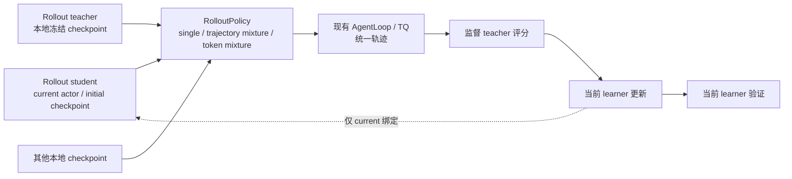

# 本地模型 Rollout：轨迹混合与逐 Token Logit 融合

设计日期：2026-10-28。本文保留实现前的配置、语义与生命周期设计，代码阅读基点为 MirrorOPD-verl `b94ad661`；上游资料的核对日期与版本见参考文献。基础路径已有实现，当前完成范围与未通过项以[实现与验收记录](2026-10-28-Rollout双融合实现与验收记录.md)为准，不能由本文的拟议接口推断全部验收已经通过。

执行者先阅读[实施交接说明](2026-10-28-Rollout双融合实施交接说明.md)，再按配套实施计划推进。实现前请结合[双融合实施细节、优化与验收计划](2026-10-28-Rollout双融合实现细节与验收计划.md)阅读：其中明确权重接收路径、TQ 完成协议、解码边界、显存估算和实验矩阵。

## 1. 范围与推荐方案

所有生成模型都由本任务从本地 checkpoint 加载、部署和管理。“额外模型”指指定另一份本地权重进行 rollout。方案不包含外部 API、远端第三方服务接入、文本重分词接入或参数合并。

统一保留三种生成模式：

| 模式                 | 生成方式                                                                       | Student 选择                                                                     |
| -------------------- | ------------------------------------------------------------------------------ | -------------------------------------------------------------------------------- |
| `single`             | 使用一个本地模型生成完整轨迹                                                   | 选择 student 时，可用 current 或 initial；也可直接选 teacher 或另一份 checkpoint |
| `trajectory_mixture` | 同一个全局 batch 内，一部分完整轨迹由 student 生成，另一部分由 teacher 生成    | current 或 initial                                                               |
| `token_mixture`      | 每次 decode 对 student 与 teacher 的 logits 加权，再从融合后的分布采一个 token | current 或 initial                                                               |

`token_mixture` 通过 `fusion_space` 选择 `logit`（默认，等价于归一化 log-prob 几何融合）或 `probability`（概率算术融合）。概率扩展处于独立分支的验证阶段，实际通过范围以验收记录为准。Trajectory mixture 不以每批随机整批选来源代替同 batch 混合；α 端点或整数配额导致空来源时按明确的单来源边界处理。

推荐结构为 `ModelBinding + RolloutPolicy + Runtime`：

- `ModelBinding` 描述权重从哪里来：当前 actor，或一个冻结的本地 checkpoint。
- `RolloutPolicy` 描述如何生成：single、同 batch 的 trajectory mixture、逐 decode 的 logit fusion。
- `Runtime` 复用现有推理服务、资源池和 checkpoint engine，负责模型加载、版本固定、同步、休眠与采样阶段切换。

Learner、监督 teacher、loss、anchor、TQ 和 optimizer 保持原来的职责。实现上使用三个明确的策略类型与少量配置，不增加任意嵌套策略图或一套新的 trainer。Single 和 trajectory mixture 保留现有整请求生成快路径；只有 token mixture 需要逐步融合执行器。



## 2. Learner 与 Rollout Student 的身份

令本批开始时的 learner 参数为 $\theta_k$，实验初始化权重为 $\theta_0$。用于生成的 student 为

$$
S^*=
\begin{cases}
S_{\theta_k}, & \text{student=current},\\
S_{\theta_0}, & \text{student=initial}.
\end{cases}
$$

两种情况都更新当前 learner $S_\theta$。Initial 模式只冻结生成用的 student，不冻结训练模型，也不把 mirror anchor 改成初始权重。

| 对象                     | 权重来源                                       | 生命周期                                     |
| ------------------------ | ---------------------------------------------- | -------------------------------------------- |
| Learner                  | 当前训练状态                                   | 接受所有 optimizer 更新                      |
| Rollout student：current | 本轮生成前的 actor 版本                        | 本轮轨迹生成期间固定；下一轮可同步最新 actor |
| Rollout student：initial | 本次实验初始化 checkpoint                      | 整个训练期间固定                             |
| Rollout teacher          | 本地固定 checkpoint，默认取监督 teacher 的路径 | 整个训练期间固定                             |
| 监督 teacher             | 现有 distillation 配置                         | 对统一轨迹提供原有监督                       |
| Mirror anchor            | 本批更新开始前的 learner                       | 保持当前 `anchor_scope` 的语义               |

Rollout teacher 默认与监督 teacher 使用同一 checkpoint，但配置身份分开。显式覆盖 `teacher_model_path` 只改变生成用 teacher，不改变监督目标。

Initial student 始终指本次实验原始初始化模型。恢复训练后，仍使用原来的 $\theta_0$ 生成，不能把恢复出来的 $\theta_k$ 当成 initial。任意历史 checkpoint 可以通过 single 模式作为额外的冻结生成模型。

初始 student 每轮都重新 rollout，固定的是生成策略，不是轨迹内容。Semi-OPD 原论文使用预先生成的固定数据集，因此这里不是其逐样本复现，也不具有相同的离线缓存收益。论文还指出，初始 Base rollout 太弱时，Semi-OPD 可能不如 OPD。[^semi-opd]

## 3. 接口与配置：模式和 Student 版本正交

建议只暴露 `mode`、`student` 和具有明确含义的模式参数。以下都是拟议配置，当前 launcher 尚未实现。

### 3.1 单模型生成

```yaml
rollout_policy:
  mode: single
  source: student
  student: current          # current | initial
```

单独使用另一份本地模型：

```yaml
rollout_policy:
  mode: single
  source: checkpoint
  model_path: /shared/model/another-model
```

`source: teacher` 使用生成用 teacher 的本地路径。`student` 只属于选择 student 的配置分支；不同分支解析为各自的 dataclass，避免出现大量无效参数。

### 3.2 同 Batch 的 Trajectory Mixture

```yaml
rollout_policy:
  mode: trajectory_mixture
  student: initial          # 也可改为 current
  teacher_weight: 0.5
```

`teacher_weight` 表示本批 teacher 轨迹的目标比例，实际比例受整数条数约束。需要单独指定生成用 teacher 时，可添加本地 `teacher_model_path`；默认从现有监督 teacher 配置取得。

### 3.3 逐 Decode 的 Token Mixture

```yaml
rollout_policy:
  mode: token_mixture
  fusion_space: logit  # probability 选择概率算术混合
  student: current          # 也可改为 initial
  teacher_weight: 0.5
```

这里 `teacher_weight` 是每次 decode 中 teacher logits 的系数。默认使用常数权重；开启全局 schedule 后也在本批内保持系数固定。两种 mixture 可以共用参数名称，但解析后的配置与日志必须保留 `mode`，不能把轨迹比例与 logit 系数混为同一统计量。

Temperature、top-p、top-k 和响应 cap 继续由公共 rollout 采样配置管理。Token mixture 不再为两个分量分别设置一套采样温度或 top-p：它们只输出未经过这些变换的 logits，公共采样规则作用于融合结果。

### 3.4 可选的全局衰减

常数 `teacher_weight` 是默认。若单独研究 schedule，可将它写为明确的线性配置：

```yaml
rollout_policy:
  mode: token_mixture
  fusion_space: logit  # probability 选择概率算术混合
  student: current
  teacher_weight:
    kind: linear
    start: 0.5
    end: 0.0
    steps: 1600
    clock: optimizer_step
```

这里 `steps` 是示例，不直接复制博客的 5000。`optimizer_step` 使用现有已应用更新计数；也可以明确选择 outer 时钟。α 在每批生成开始时计算并固定，内部 reuse 不重新解释已生成数据的 behavior 分布。旧 checkpoint 缺少所选时钟时直接报错，不猜测进度。若要在训练末段保留纯 student 采样，衰减结束点须早于总训练预算。

Trajectory mixture 也可使用同一 schedule，先计算 α 再整数化配额；token mixture 使用该 α 融合 logits。按题目难度缩放不进入默认配置，需有可审计标签后另做实验。Initial student 模式衰减到 0 后仍是初始策略采样。

## 4. Trajectory Mixture：先分配，再生成，最后合并训练

### 4.1 在全局 Batch 上分配轨迹

设本批有 $B$ 个 prompt，每题生成 $n$ 条响应，则有效轨迹数为 $N=Bn$。首版沿用全批固定的 $n$，不新增逐题不同 $n$ 的训练配置。Padding 不参与来源配额。

给定 teacher 目标比例 $\alpha$，使用明确的最近整数规则：

$$
N_T=\lfloor \alpha N+0.5\rfloor,\qquad
N_S=N-N_T,\qquad
\alpha_{\mathrm{effective}}=\frac{N_T}{N}.
$$

在 DP 切分、worker fan-out 和响应生成之前，为每个 `(prompt_id, response_index)` 生成稳定顺序，用基础 seed 与采样轮次得到一个可复现的随机排列。取其中 $N_T$ 条交给 teacher，剩余 $N_S$ 条交给选定的 $S^*$。

这种分配保证同 batch 的条数，不依赖哪个 worker 更快，也不会总把固定的一段 prompt 交给 teacher。来源分配不查看题目答案、响应长度或未来 reward。记录目标比例与整数化后的实际比例；例如 $N=64,\alpha=0.3$ 时，teacher 为 19 条，实际比例约 29.69%。

整数配额可能有一侧为 0，尤其在 schedule 衰减末期。此时跳过空来源并记录实际比例，不强行增加样本，也不中止 schedule。需要每批两侧都有数据时，实验者须选择可实现的 batch 与权重。$\alpha=0$、$\alpha=1$ 退化为相应单来源。

### 4.2 同一份采样计划，不同的本地生成阶段

| 生成阶段     | 操作                                                                 |
| ------------ | -------------------------------------------------------------------- |
| 规划         | 固定 student 版本、teacher checkpoint、轨迹分配、采样参数和请求 seed |
| Student 子批 | 使用 $S^*$ 生成分配给 student 的完整轨迹                             |
| Teacher 子批 | 使用固定 teacher 生成分配给 teacher 的完整轨迹                       |
| 汇合         | 保留原 prompt/response 身份，合并为原来的全局训练 batch              |
| 训练         | 对合并 batch 做 teacher 评分、原有 loss 和 learner 更新              |

共享 GPU 时，两个来源子批可以串行生成，完成一个来源后排空请求并休眠，再激活另一个来源；它们仍属于同一个 outer batch。生成阶段可以拆分，训练阶段不拆成“student 数据先更新一轮、teacher 数据再更新一轮”。

不同来源有足够独立资源时可以并行，但这属于同一采样计划的执行优化。配额、样本身份和更新预算不随执行方式变化。

### 4.3 保留 Prompt Group 的完成语义

当前 [`AgentLoopWorkerTQ._run_prompt`](../../../../../../verl/trainer/ppo/v1/agent_loop_tq.py) 在一个 prompt 的全部响应任务结束后才发布 finished/failure。若同一 prompt 的多条响应被分给不同来源，不能让先完成的子批提前关闭整个 prompt group。

建议由一个本批 collector 负责 parent 状态；worker 通过阻塞的 `generate_sessions` 只运行分配的响应并报告已发布 TQ 的结果。保留默认 single 的现有接口。完成顺序为：

1. 在提交前登记本批所有预期响应及其来源。
2. 来源子任务只完成自己分配的响应，保留原 response/session 序号。
3. 一个 prompt 的全部预期响应结束后，才发布该 group 的最终状态。
4. 所有来源子批完成并排空后，才进入 learner 更新。
5. 新融合模式首版禁用动态过滤/refill；任一响应失败则整批失败，先排空所有任务再清理，不能静默换来源补齐。既有 single 行为不变。

当 `n=1` 时，来源子批只是在 prompt 维度拆分，改动较小。实现仍应使用完整轨迹身份，避免之后支持 `n>1` 时重写协议。验收必须覆盖一个 prompt 的响应分属两个来源的情况。

### 4.4 比例与概率的含义

每条轨迹仍然完全来自一个模型，因此其直接记录的 behavior log-prob 是选中来源的概率：

$$
\log \beta_C(y_t\mid s_t),\qquad C\in\{S^*,T\}.
$$

这是条件于已分配来源的概率，不能把它写成某个 token fusion 分布的概率。固定配额也使同 batch 的来源选择相互依赖；首版不把这份数据声明为独立 Bernoulli 路由的整批样本。

对 Full-KL，无需给来源增加概率修正。对 sampled IS，必须显式使用条件来源语义，并验证目标支持被各选中来源覆盖。精确理论权重满足

$$
\mathbb E_{a\sim\beta_C(\cdot\mid s)}
\left[
\frac{p_\theta(a\mid s)}{\beta_C(a\mid s)}g(s,a)
\right]
=
\sum_a p_\theta(a\mid s)g(s,a),
$$

前提是所需目标支持没有被该来源截断。它修正给定 state 下的动作积分，不恢复当前 learner 的 state 分布。Top-p、PPO clipping 和既有 log-ratio guard 仍须分别说明；首批来源对照优先使用 Full-KL。

同 batch 采用 token-mean loss 时，teacher 的轨迹占比不等于有效 token 占比。若两个来源的平均有效长度为 $\mathbb E[L_S]$、$\mathbb E[L_T]$，teacher token 占比约为

$$
\frac{N_T\mathbb E[L_T]}
{N_S\mathbb E[L_S]+N_T\mathbb E[L_T]}.
$$

两种比例都要记录，不隐式调整来源 loss 权重。

## 5. Token Mixture：两种逐 Token 分布融合

### 5.1 公共采样与默认 Logit 融合

在同一实际前缀 $s_t=(x,y_{<t})$ 上，令 $z_{S^*}(v\mid s_t)$ 和 $z_T(v\mid s_t)$ 为两个模型未经过采样处理的 logits。每次 decode 构造

$$
z_{\mathrm{mix}}(v\mid s_t)
=(1-\alpha)z_{S^*}(v\mid s_t)+\alpha z_T(v\mid s_t).
$$

如果仅施加公共温度 $\tau>0$，采样分布为

$$
\beta_t(v)
=
\frac{\exp\bigl(z_{\mathrm{mix}}(v\mid s_t)/\tau\bigr)}
{\sum_u\exp\bigl(z_{\mathrm{mix}}(u\mid s_t)/\tau\bigr)}.
$$

实际启用的 top-p、top-k、token mask 等操作在统一采样阶段施加，最终概率与最终 token 一起记录。$\alpha$ 始终表示 teacher 权重。

这不是一个新的参数合并模型。两侧可以有不同层数、hidden size 和 dense/MoE 结构，只要输出 token 语义能够严格对齐。

### 5.2 概率平均与 Logit Fusion 的区别

概率平均先分别 softmax，再加权：

$$
p_{\mathrm{arithmetic}}(v)
=(1-\alpha)\operatorname{softmax}(z_{S^*})(v)
+\alpha\operatorname{softmax}(z_T)(v).
$$

Logit fusion 先加权 logits，再 softmax：

$$
p_{\mathrm{fusion}}(v)
=
\operatorname{softmax}\bigl((1-\alpha)z_{S^*}+\alpha z_T\bigr)(v).
$$

两者通常不同。若两边概率为 $p_{S^*}=(0.8,0.2)$、$p_T=(0.4,0.6)$，且 $\alpha=0.5$、$\tau=1$：

| 算法         | 结果                   |
| ------------ | ---------------------- |
| 概率平均     | $(0.6,\ 0.4)$          |
| Logit fusion | 约 $(0.6202,\ 0.3798)$ |

概率平均可以保留某一个分量单独给予的较大概率；logit fusion 对分量概率做乘法组合，倾向于压低被任一有正权重分量强烈反对的 token，但不保证因此得到更好的任务效果。系数也不是“本次选用 teacher 的概率”。

两种规则均保留。`fusion_space=probability` 先在共同合法 token 集上分别归一化两侧概率，再作算术混合；实现使用 FP32 log-space 加权求和避免先取极小概率再取 log。两者都在融合后施加一次公共温度和过滤，因此上面的概率公式直接对应温度 1、无截断。原生 head 的额外行仍保留给独立 RKL scorer，不能因生成支持限制而裁掉训练目标。融合规则写入不可变 plan 与返回 metadata，已有引擎不允许在未重建时切换规则。

### 5.3 Logit Fusion 等价于归一化的几何组合

定义 $p_i(v)=\operatorname{softmax}(z_i)(v)$，则

$$
z_i(v)=\log p_i(v)+\log Z_i,
\qquad
Z_i=\sum_u e^{z_i(u)}.
$$

代入加权 logits：

$$
z_{\mathrm{mix}}(v)
=(1-\alpha)\log p_{S^*}(v)+\alpha\log p_T(v)
+\underbrace{(1-\alpha)\log Z_{S^*}+\alpha\log Z_T}_{\text{与 }v\text{ 无关}}.
$$

Softmax 会消去最后一项，因此在公共温度 $\tau$ 下、尚未施加其他采样变换时，

$$
\beta(v)
\propto
p_{S^*}(v)^{(1-\alpha)/\tau}
p_T(v)^{\alpha/\tau}.
$$

$\tau=1$ 时就是归一化的加权几何平均。因此后端也可提供未经温度或过滤的完整 log-softmax，而不传原始 logits，结果相同。经过 top-p、top-k 或不同分量温度处理的概率，不能直接替换这里的输入。

该推导说明两个模型 logits 的整体加性平移不影响结果，但模型置信度或 logit 尺度仍影响融合。第一版固定相同处理规则，通过 $\alpha$ 做明确对照，不额外引入隐式校准。

### 5.4 一个采样器，两份 KV，同一个真实前缀

```text
共同 prompt + 已生成的真实前缀
→ 两个模型分别 forward，取得同一预测位置的 logits
→ 在共同合法词表上加权 logits
→ 应用一次公共温度和采样规则
→ 只采一个 token，并记录最终分布下的 log-prob
→ 将这个 token 提交给两侧，推进两份 KV
→ 直到共同停止规则或响应 cap
```

不能先让两个模型各自产生续写，再平均这些不同前缀上的概率；也不能每个 token 随机选择一个模型来替代 logit fusion。后者在特定条件下实现的是算术概率混合，不是这里的几何组合。

模型版本、$\alpha$、prompt 协议和采样规则在整批生成期间固定。Student=current 时，使用本轮开始时的 actor 版本；learner 只在整批轨迹结束后更新。

$\alpha=0$ 或 $\alpha=1$ 退化为单模型路径，不必加载零权重分量，也避免直接计算 `0 × (-inf)`。其他情况检查系数有限、共同支持合法和最终归一化有效；不能自动加 $\epsilon$ 来改变策略定义。

### 5.5 停止集合不能代替停止概率验收

两边偏好的 EOS ID 不同时，把两种 ID 都设为 stop 只能决定“抽到后停止”，不能阻止几何融合压低总停止概率。一个简单反例为 $p_S=(0.9,0.001,0.099)$、$p_T=(0.001,0.9,0.099)$，前三项分别表示 student EOS、teacher EOS 和继续生成。两边停止质量均为 0.901，α=0.5 的原始 token fusion 停止质量却约为 0.3774。

基础实现保留 raw-token logit fusion，不能静默改变为先合并 STOP 事件再融合。真实 Base/Instruct 配对在长训前必须检查停止质量与长度；现有 loss 侧的终止动作合并不会自动修复生成分布。完整推导和额外研究对照的边界见[停止概率验收](2026-10-28-Rollout双融合实现细节与验收计划.md#6-base--instruct-的停止概率问题)。

## 6. 统一代码结构

建议在 `verl/experimental/rollout_policy/` 中集中维护小范围实现，内部使用三类配置和三类策略。所有策略返回现有 AgentLoop/TQ 能消费的相同轨迹结构。

| 组件                      | 职责                                                                                       |
| ------------------------- | ------------------------------------------------------------------------------------------ |
| `ModelBinding`            | 将 student=current 解析为 actor 绑定；initial、teacher、额外模型解析为本地 checkpoint 绑定 |
| `BatchRolloutPlan`        | 固定本批版本、有效轨迹 ID、来源配额/分配、系数与 seed；在 worker fan-out 前建立            |
| `SinglePolicy`            | 委托一个本地模型的现有整请求生成路径                                                       |
| `TrajectoryMixturePolicy` | 按 plan 执行两个来源子批，完成原始 prompt group 后合并                                     |
| `TokenMixturePolicy`      | 调用 logit-fusion executor，产出一条统一响应                                               |
| `RolloutRuntime`          | 加载、同步、唤醒、排空和休眠模型；维护权重是否有效、版本与资源状态                         |

不为这些配置再建立一套通用插件注册系统，也不要求 single/trajectory 通过逐 token Python 循环。公共层只关心同一份采样计划和生成结果，executor 的差异局限在策略内部。Plan 只需一或两个顺序 phase，不引入通用执行图。

Token mixture 的参考执行器可使用如下内部会话合同。它不是当前 vLLM 已提供的公共方法：

```python
class LogitSession(Protocol):
    async def next_logits(self) -> LogitBatch: ...
    async def accept(self, token_ids: Tensor) -> None: ...
    async def close(self) -> None: ...
```

`LogitBatch` 声明合法词表、所属预测位置与固定模型版本。若输入为未经采样处理的 log-softmax，则必须明确表示该格式。融合在生成执行侧完成，Trainer 不逐 token 搬运整词表数据。

旧 `HFRollout` 未注册进当前 V1 后端，且保留 FSDP1/DataProto 接口，不能直接启用。参考实现需新增本地 HF fusion adapter/replica，以及明确的 fusion_student 权重接收目标；详见[接入点](2026-10-28-Rollout双融合实现细节与验收计划.md#5-token-fusion-的本地参考后端)。参考实现先用微型模型验证数值和 KV 推进。生产实现需接入本地批量解码与缓存调度；普通的完整响应生成接口不能直接提供它。一个 custom logits processor 也不会自动管理第二个模型和第二份 KV，不能据此声称只加一个 processor 就完成了高吞吐融合。

## 7. 资源生命周期与拓扑

### 7.1 Trajectory Mixture 允许串行切换

同 batch 的两个来源可以共用全部 GPU，按来源生成子批并切换。开始每个阶段前保证 teacher scorer、learner 和非活跃生成器处于合适的卸载/休眠状态。两份数据生成完成后统一评分、更新 learner。

Current 绑定使用原有 actor → rollout 同步。冻结绑定从 checkpoint 真实加载，不接收 actor 更新。当前 rollout 默认 `load_format=dummy`，因此冻结生成器必须覆盖为真实加载；其常规休眠使用能恢复冻结权重的 level 1 路径。

### 7.2 Token Mixture 需要两侧模型与 KV 可持续访问

每次 decode 都依赖两个模型。默认生产方案不能每个 token 都把一整套权重上下卡。应在生成阶段为两侧同时保留可用的权重与 KV，并设计共同的显存预算；teacher/scorer 与 learner 更新随后复用这些 GPU。

为控制首版改动，优先保留现有 actor/student 生成拓扑，为额外 teacher 配置共置生成实例和独立 TP、并发及显存预算。两边都按各自 0.8 显存预算初始化不可作为默认配置。

如果两侧不能在现有拓扑中共存，下一步才考虑同一节点内的独立 GPU 子组。当前 trainer 强制 checkpoint engine 使用 `naive`，而它把同步委托给原 actor worker group；不能假定把 student 生成副本改成较小子组后仍可直接使用同一同步路径。变更拓扑需要同时验证相应权重传输，不纳入“简单改并发”的范畴。

是否选择共置或独立子组，以实际权重、KV、CUDA graph/NCCL 常驻量、CPU 备份和切换峰值测量为准。不同模型大小不能直接复用 1.7B 的推理资源设置。Token mixture 的具体生产 executor 及吞吐尚未验收。

### 7.3 Initial 模式还需要当前 Learner 的验证引擎

| 训练配置                                     | 可能需要的生成实例                              | 同时活跃的生成实例                     |
| -------------------------------------------- | ----------------------------------------------- | -------------------------------------- |
| Single current student                       | 当前 student                                    | 1                                      |
| Single initial / teacher / 额外模型          | 冻结模型、当前 student 验证实例                 | 1                                      |
| Current student + teacher trajectory mixture | 当前 student、teacher                           | 默认按来源串行，1                      |
| Initial student + teacher trajectory mixture | initial student、teacher、当前 student 验证实例 | 默认按来源串行，1                      |
| Current student + teacher token mixture      | 当前 student、teacher                           | 训练生成时 2                           |
| Initial student + teacher token mixture      | initial student、teacher、当前 student 验证实例 | 训练生成时 2；验证时只激活当前 student |

这里统计的是生成实例，不包含原来的 learner FSDP 和监督 teacher FSDP 实例。Initial student 模式不能把当前 learner 验证错误地指向初始 student。

引擎是否持有有效权重与权重版本分别记录。经历丢弃权重的休眠后，即使版本未变也需要恢复。验证结束后也不能假定训练生成器还保持就绪状态。[^nemo-refit-pr]

## 8. 与现有 Trainer、TQ 和 Loss 的连接

### 8.1 生效点在首次提交之前

[PPOTrainer.step](../../../../../../verl/trainer/ppo/v1/trainer_base.py) 先执行 `prepare_step()`，其中已提交生成，之后才进入 `_step_once()` 的 `on_sample_begin()`。因此新 plan 必须在 `prepare_step / _submit_batch_to_rollout` 的实际提交前完成，不能只在 `on_sample_begin` 唤醒所需模型。

对于 trajectory mixture，这个阶段负责执行来源子批、维护共同完成状态和统一汇合。生成计时必须包含全部来源阶段及切换时间，不能只统计最后一个子批。首版新模式拒绝动态过滤/refill。未来支持替换或重试时必须复用本轮版本与原来源，不能重新随机换来源。

### 8.2 行为概率、Anchor 与监督各自保留含义

| 字段/对象                           | 来源                                                                  |
| ----------------------------------- | --------------------------------------------------------------------- |
| Trajectory mixture 的 behavior 概率 | 实际生成该完整轨迹的 student 或 teacher；标注 `conditional_component` |
| Token mixture 的 behavior 概率      | 融合并经过公共采样处理后的最终分布；标注 `fused`                      |
| Current learner log-prob            | 每次更新重新计算                                                      |
| `old_log_probs` / mirror anchor     | 本批更新开始前的 learner                                              |
| Teacher log-prob / hidden           | 原监督 teacher 在统一轨迹上的评分                                     |

现有 [`_sampled_inputs`](../../../../../../verl/trainer/distillation/losses.py) 和 [`anchor_scope`](../../../../../../verl/trainer/distillation/anchor.py) 已经区分相应概率角色，保持这些意义。若下游需要 behavior 概率，不能用融合前的某一个模型概率代替 token mixture 的最终概率。

Full-vocab 路径不需要 behavior 概率，仍对访问的 state 计算原有目标；但 sampled 路径要检查分母、支持集、温度和过滤语义。现有显式 sampled 校验不会自动接受新融合路径，必须在验收后有针对性地扩展，不能通过关闭校验接入。

即使轨迹由 teacher 生成，也继续走监督 teacher 的现有评分阶段。生成引擎的选中 token log-prob 不能替代 Full-KL 所需的 hidden，也不自动改变 KL 方向。

### 8.3 模型与输入一致性

所有参与模型通过本地 tokenizer/config 校验，沿用同一 Continuous Token 输入链：

- 要求 token→ID 映射兼容，不能仅比较 vocab size。
- 对齐共同合法输出支持，排除仅作 padding 的输出行。
- Prompt token、thinking 模式、终止动作语义和 response cap 明确固定。
- 每个 token-fusion 分量消费同一个真实前缀，保持独立 KV。
- 请求预算必须满足所有参与模型的 context 限制；不能只对某个分量静默截断。
- 第一版不提供跨 tokenizer 重分词或自动映射路径。

对 Qwen3 Base / Instruct 的不同 EOS 默认角色，继续明确使用当前的终止动作协议；生成端停止规则与 loss 端终止动作合并是两个不同位置的处理，不能互相代替。

### 8.4 源码改动集中在五个边界

| 位置                                                                                                                                                | 拟议改动                                                                |
| --------------------------------------------------------------------------------------------------------------------------------------------------- | ----------------------------------------------------------------------- |
| 新 `verl/experimental/rollout_policy/` 与配置                                                                                                       | 三种模式、current/initial 解析、全局 BatchRolloutPlan、结果检查         |
| [LLMServerManager](../../../../../../verl/workers/rollout/llm_server.py)、[replica.py](../../../../../../verl/workers/rollout/replica.py)           | 显式本地模型绑定，复用 colocated 初始化和资源池切分                     |
| [trainer_base.py](../../../../../../verl/trainer/ppo/v1/trainer_base.py)、[trainer_sync.py](../../../../../../verl/trainer/ppo/v1/trainer_sync.py)  | 提交前规划、来源阶段执行、统一汇合、验证与恢复                          |
| [agent_loop.py](../../../../../../verl/experimental/agent_loop/agent_loop.py)、[TQ adapter](../../../../../../verl/trainer/ppo/v1/agent_loop_tq.py) | 按计划调度完整响应/融合执行器；保留响应身份，正确汇总 prompt group 状态 |
| [math_experiment.py](../../../../launchers/math_experiment.py) 与配置校验                                                                           | 简洁选项、解析后的实际配置、支持范围检查                                |

Full-KL 数值内核、teacher hidden 存储、mirror anchor、mini-batch/reuse 循环和 optimizer 继续复用。普通 single/trajectory 保留原有批量推理快路径；token executor 作为局部扩展实现。

## 9. 恢复与可复现记录

沿用已有 checkpoint 元数据，不新增文件摘要系统。每批记录 `mode`、`student=current/initial`、生成 student 版本、生成 teacher checkpoint、系数/轨迹配额、稳定轨迹身份和请求 seed。

Trajectory mixture 保存来源分配或能够确定性重建它的状态。Token mixture 保存两侧版本及共同采样配置。断点恢复后，初始路径、生成 teacher 与监督 teacher 的绑定仍须一致。

验证总是生成当前 learner 的响应。它不能改变下一批 source 选择、初始模型绑定或请求 seed 的推导。通过稳定样本 ID、采样轮次和 response 序号确定 seed，而不是依赖 worker 顺序或随机 UUID；这不构成跨硬件或跨后端版本逐 token 一致的保证。

## 10. 上游依据与采用范围

### 10.1 Logit-Fusion 博客的实验结论

Juzheng Zhang 等人的工作直接使用 current student 与冻结 teacher 的逐 token logits 线性组合，并用 RL 更新 student。正文给出的主要比较集中在 DeepMath-103K、Qwen2.5-0.5B student 和 Qwen2.5-7B teacher；公开入口使用 accuracy reward，公共脚本启用 LoRA。这是与本方案相关的生成方法证据，不是 Full-KL 训练结果。[^lf-blog][^lf-entry][^lf-gspo]

| 作者比较                                    | 正文报告的趋势                                             | 可以支持的判断                                       |
| ------------------------------------------- | ---------------------------------------------------------- | ---------------------------------------------------- |
| 使用 mixed behavior 分母 vs 旧 student 分母 | Mixed ratio 的 student-only evaluation 更好                | 不能忽略实际生成策略；不证明所有 IS 形式都无偏       |
| 原 ratio vs shaping `r/(r+γ)`               | Shaping 早期训练奖励高，但不稳定                           | 训练 reward 不代表 learner 独立能力                  |
| 单 ratio 上限截断 vs decoupled PPO          | 其设置下，单 ratio 最终评估更高                            | 分别截断和裁剪会改变目标；不能否定 ratio 分解恒等式  |
| 固定 α / 衰减 α，与 clipping 交叉           | 固定 α + 无 clipping 不稳；衰减 α + 无 clipping 在该组最好 | Guidance schedule 与更新约束相互影响，需要分因素对照 |

正文先讨论 capped single-ratio，后面的 α 消融又推荐 scheduled α + no clipping，属于不同实验分支。公共 GSPO launcher 只在衰减期关闭 clipping，DAPO launcher 在衰减期使用上限截断；难度缩放开关默认关闭且两个公共 launcher 均未开启。因此不能把文章中的几个结论拼成一份与代码完全相同的默认配方。[^lf-code][^lf-config][^lf-gspo][^lf-dapo]

训练 reward 来自融合策略，evaluation reward 来自 student 独立生成。文章报告后者提升，但未核得可复算这些曲线的完整逐步原始数据和多 seed 误差表，本文不从图名或文字描述推断具体提升百分点。代码默认 evaluation 为 DeepMath `test[:100]`，不能外推为 AIME 或我们五集协议的成绩。[^lf-entry]

主训练方法不是概率 mixture，也不是 Full-KL。正文将 MiniLLM 列为相近 logit/log-prob 插值先例的说法需要区分：MiniLLM 公式（4）是概率算术混合。本方案保持用户选择的 logit fusion，但不声称论文已证明它优于概率混合。[^minillm]

复用实现时需要重新核验：最终 behavior 概率是否包含全部采样变换，原代码 `old_per_token_logps` 的字段复用是否覆盖 anchor 语义，以及 capped-ratio 的梯度是否与目标实现一致。逐项源码判断见[实现审阅](2026-10-28-Rollout双融合实现细节与验收计划.md#8-原-logit-fusion-工作实验结论与实现差异)。

### 10.2 其他代码与论文依据

以下资料保留与本地模型生成、混合和生命周期直接相关的部分。PR 状态为 2026-10-27 的核对结果，不代表已经在本项目落地。

| 来源                        | 核对机制                                                                 | 采用方式                                                                  |
| --------------------------- | ------------------------------------------------------------------------ | ------------------------------------------------------------------------- |
| NeMo RL `4e9a597a`          | GenerationInterface、WeightSynchronizer、student/teacher/generation 分工 | 统一生成结果和生命周期职责；复用本项目已有服务管理，不复制整套框架        |
| verl `#8335`，Open/Draft    | 按 batch 选择来源，验证固定使用 student                                  | 借鉴提交前选择、来源记录和验证隔离；其整批选择不是这里要求的同 batch 拆分 |
| verl `#7742`，Open          | teacher 意外继承 dummy 权重的修复                                        | 冻结模型必须真实加载，不依赖 actor 后续 refit                             |
| NeMo RL `#4660`，Open       | 验证后权重恢复与 refit                                                   | 验收训练→验证→训练的驻留与同步                                            |
| NeMo RL `#4939`，Open/Draft | 用冻结模型组合监督分布                                                   | 区分监督目标融合与本方案的生成 logits 融合                                |
| slime `540ea919`            | 整个 rollout 与局部 generation 的不同扩展边界                            | 保留公共数据通路，把生成差异局限在局部实现                                |
| Model Arithmetic `6779b407` | 多模型公式求值、KV 管理、融合后采样                                      | Token-fusion 参考实现的机制依据，不作为本机高吞吐验收                     |
| vLLM `0.25.1`               | 自定义 logits processor 与执行路径限制                                   | 单独验证后端能力；processor 不自动提供双模型解码                          |

对应接口、源码与 PR 见参考文献。[^nemo-generation][^nemo-sync][^nemo-distillation][^verl-source-pr][^verl-dummy-pr][^nemo-refit-pr][^nemo-w2s-pr][^slime-hooks][^model-arithmetic][^vllm-processors]

ThinkMerge 展示的是同一个 reasoning 模型在不同 trace 上的答案阶段 logit averaging；其 vLLM/SGLang 集成不能直接当作异构 student/teacher 双模型后端。[^thinkmerge]

本机 vLLM 0.25.1 的配置代码把 custom logits processor 列入 V2 runner 的不支持项；采用该扩展时必须核实实际 runner 和吞吐，不能直接沿用原性能结论。上游可扩展接口不等于本机已有可直接调用的双模型逐步解码 API。

### 10.3 相关采样方法与实施范围

TRB、SKD 和 AdaSwitch 都会改变实际生成的 token 及后续前缀，属于行为策略层面的干预。下表仅保存研究引用；当前实施 single、trajectory mixture 和两种 token fusion，完整 TRB 作为后续独立阶段。SKD、AdaSwitch 不进入当前配置、接口预留、代码、测试或实验矩阵。TRB 与 AdaSwitch 的工程判断尚未经过官方实现核验。

| 方法                  | 生成规则                                                           | 干预粒度                                         | 与本方案的关系                          |
| --------------------- | ------------------------------------------------------------------ | ------------------------------------------------ | --------------------------------------- |
| TRB[^trb]             | 在 student-centered KL 预算内，寻找最接近 teacher 的分布并采样     | 每个前缀重新求融合系数；预算在 warmup 内衰减至零 | 复用 token logit fusion，增加系数求解器 |
| SKD[^skd]             | Student 提议 token；不在 teacher top-$K$ 内时，从 teacher 重新采样 | Token 接受/替换；后续沿替换后的前缀生成          | 仅保留引用，不实施                      |
| AdaSwitch[^adaswitch] | 分歧超过历史窗口阈值时，由 teacher 接管                            | 单条轨迹内最多一次 student → teacher 切换        | 仅保留引用，不实施                      |

这里的 trajectory mixture 是整条响应的来源分配；AdaSwitch 是一条响应内部的控制权移交。SKD 虽然名称含 speculative，但其接受规则有意改变行为分布，与[保持融合目标分布不变的 speculative 加速](2026-10-28-Rollout双融合实现细节与验收计划.md#73-speculative-fusion-是后续优化不是改变采样策略)需要分开。

### 10.4 TRB：用 KL 预算决定 Logit Fusion 强度

TRB 在每个已生成前缀 $h$ 上求以下问题，训练时仍使用原来的 per-prefix reverse-KL 目标。设 $p_S$ 为当前 student 分布，$p_T$ 为 teacher 分布，$\mu$ 为实际采样分布：[^trb]

$$
\min_{\mu}\;D_{\mathrm{KL}}(\mu\Vert p_T),
\qquad
\text{s.t.}\quad D_{\mathrm{KL}}(\mu\Vert p_S)\leq\varepsilon,
\quad \sum_v\mu(v)=1.
$$

两个 KL 的左侧都是行为分布 $\mu$。“以 student 为中心”指约束参照 $p_S$，不能写成 $D_{\mathrm{KL}}(p_S\Vert\mu)$。解位于几何融合族中：

$$
\mu_\alpha(v\mid h)
=\frac{p_S(v\mid h)^{1-\alpha}p_T(v\mid h)^\alpha}
{\sum_u p_S(u\mid h)^{1-\alpha}p_T(u\mid h)^\alpha},
\qquad
\alpha^*(h)=\max\{\alpha\in[0,1]:D_{\mathrm{KL}}(\mu_\alpha\Vert p_S)\leq\varepsilon\}.
$$

论文把 teacher 系数写作 $\beta$；这里统一使用前文的 $\alpha$。在共同支持、温度为 1 的条件下，这正是逐 token logit fusion。区别在于 TRB 每个前缀通过二分搜索决定 $\alpha$，训练阶段调度的是 KL 预算 $\varepsilon$。同一步、同一 batch 的不同位置可以得到不同融合强度。$\varepsilon=0$ 返回 student；若 teacher 已在预算内，则允许直接使用 teacher。

论文使用线性预算衰减：

$$
\varepsilon_k=\varepsilon_0\max(1-k/K,0).
$$

Warmup 结束后恢复 current student rollout。论文的 fixed-$\varepsilon$ 对照仍逐前缀求系数，只是预算不衰减；它不等于固定 $\alpha$。我们的 reuse 设置使 outer 与 optimizer updates 不同，实施时必须明确 $k$ 的时钟。若中心改成 initial student，则预算归零返回 initial student，这属于另一个实验，不能称为恢复 on-policy。

原文两个模型对的结果如下。数值为各自评测集合的平均 pass@1（%），按方法选择评测均值最高的 checkpoint：[^trb]

| 方法         | Qwen3-1.7B-Base ← Qwen3-8B | Qwen3-0.6B-Base ← Qwen3-4B |
| ------------ | -------------------------: | -------------------------: |
| Vanilla OPD  |                       32.3 |                       44.0 |
| 固定 KL 预算 |                       32.6 |                       43.8 |
| SKD          |                       32.7 |                       44.2 |
| TRB          |                       33.2 |                       44.4 |

TRB 相比 Vanilla 分别提高 0.9、0.4 个百分点，并非所有单项都提高。两个模型对的评测集合不同，列间均值不能直接比较；论文每 20 个优化 step 评测并选择最佳 checkpoint，也不能将这里的分数当作固定终点成绩或多 seed 显著性结论。

原设置使用 verl、SGLang、FSDP2、8 张 H100，训练 response cap 7168；reverse-KL 在 **student top-16 支持**上估计。初始预算搜索为 0.001、0.005、0.01、0.02、0.05，warmup 长度为 15、25、50。它与我们的模型对、长生成问题接近，但不同于 full-vocab KL、reuse 和五集验证协议。建议先在现有 Full-KL 上单独比较固定融合、衰减融合与 TRB 预算控制；复现论文的 top-16 设置应另列实验。

论文还固定 continuation 模型与截断长度，只改变初始前缀来源；在该 step-0 探针中，TRB 前缀让 student、teacher 的后续成功率都更高。Teacher 在 warmup 前缀上的熵也较低，warmup 后与 Vanilla 接近。作者据此把收益解释为早期访问了更有利的学习状态；这些证据支持研究 early-state 干预，不构成“始终加强 teacher 更好”的结论。[^trb]

附录 D 还在**采样与 KL 计算之前**对齐不同原生 EOS 的语义事件。它不是只把两个 token 加入 stop 列表，具体映射及我们需要补充的验收见[停止概率问题](2026-10-28-Rollout双融合实现细节与验收计划.md#6-base--instruct-的停止概率问题)。这一处理与现有 loss 侧 EOS 修复相关，但不能互相替代。

对本项目的设计判断：TRB 最适合作为 token-fusion 执行器内部的可选系数控制方式，复用双模型 logits、双 KV 与统一 sampler。先完成基础融合路径，再增加预算调度和逐前缀求解；无须为 TRB 改 learner loss 或公共轨迹格式。求解、采样变换和成本边界见[实现细节](2026-10-28-Rollout双融合实现细节与验收计划.md#74-trb-系数求解与实际采样分布)。

### 10.5 研究引用的使用边界

SKD 的接受/替换与 AdaSwitch 的一次性接管仅用于区分相关方法，不作为实现任务。SKD 公开 README 的依赖要求也只作为研究记录，不引入本项目环境。[^skd-code] 执行者无需实现这些方法或为其增加占位类；本轮代码边界按两种 fusion 的实际需要确定。

## 11. 实施顺序与验收

| 阶段       | 交付                                                      | 核心验收                                                                                                                 |
| ---------- | --------------------------------------------------------- | ------------------------------------------------------------------------------------------------------------------------ |
| P0         | 三种模式的配置、ModelBinding、BatchRolloutPlan 与默认兼容 | 默认 current single 保持原数据、预算、更新与验证语义                                                                     |
| P1         | Single current / initial / teacher / 本地 checkpoint      | 真实加载、冻结源不被更新、验证当前 learner、恢复仍绑定初始模型                                                           |
| P2         | 同 batch 的 trajectory mixture                            | 全局精确配额、随机位置分配、`n>1` 跨来源 prompt group、串行汇合后只更新一次原 batch                                      |
| P3         | Token mixture 的微型模型参考执行器                        | 相同前缀、每步 logit fusion、最终概率、两份 KV 推进与 current/initial 选择                                               |
| P4（必需） | Token mixture 的本地生产 executor 与性能报告              | 与 P3 数值对照；真实 dense/MoE 配对的批处理、缓存、通信和显存优化；通过配套实施计划的性能、同步/取消、训练→验证→恢复验收 |

Trajectory mixture 必须从 P2 就实现同 batch 的拆分，不用整批轮换代替。以 $B=64,n=1,\alpha=0.5$ 为例，验收要求每个有效 batch 都有 32 条 student 和 32 条 teacher 轨迹，合并后沿用原来的 batch64、reuse 和 optimizer 更新预算。Padding 不计数，失败不悄悄改变来源。

Token mixture 至少测试：

1. 使用第 5.2 节的反例，确认结果约为 `(0.6202, 0.3798)`，而不是概率平均的 `(0.6, 0.4)`。
2. 在同一后端和同一采样合同下，$\alpha=0/1$ 与对应单模型基线一致。跨 HF/vLLM 比较不承诺逐 token bitwise 一致；零权重分量不产生无效运算。
3. 两个结构不同、词表一致的微型模型，在同一个真实前缀上 forward；每次采样后都推进正确 KV。
4. 温度、top-p 和约束只作用于融合后的公共采样阶段；behavior log-prob 对应最终分布。
5. Student=current 随本批开始前的 actor 同步；student=initial 在 learner 更新和恢复后仍不变。
6. 检查 EOS 分歧反例、pad==EOS、不等 prompt 长度和 source 阶段失败；完整执行两轮训练、中间验证、保存与恢复，验证对象始终为当前 learner。
7. 资源不足、词表不一致或不支持的解码后端，在正式训练前给出明确错误。

P3 的 HF 数值参考不能代替 P4；双模型推理优化是基础设施交付的一部分，先通过性能验收，再开展长程学习比较。默认先用 Full-KL 做来源与融合对照，再单独验收 sampled loss 的概率消费者。数值参考和整条训练入口都要测试，避免局部解码正确但主 trainer 初始化、同步或 TQ 汇总不兼容。

## 12. 指标与实验解释

所有配置共享现有指标实现，补充模式、student 版本与来源身份即可：

| 指标                                           | 解释                                                      |
| ---------------------------------------------- | --------------------------------------------------------- |
| 目标 teacher 权重、实际轨迹数、有效 token 数   | Trajectory mixture 的配额与真正进入 loss 的比例           |
| Logit-fusion 系数、两侧版本、公共采样规则      | Token mixture 的实际生成策略                              |
| 训练 rollout 的 length、repeat、score          | 训练数据性质；initial 模式下不直接表示 learner 的生成能力 |
| 当前 learner 的 validation acc、length、repeat | 实际学习效果                                              |
| Teacher KL、位置 KL、overlap                   | 给定训练 state 上的拟合与监督信号，比较时标明来源         |
| 各来源生成、融合、同步/切换、评分、更新耗时    | 分离算法效果与系统成本                                    |
| GPU 峰值、CPU 备份、KV、失败/取消数量          | 检查资源执行与数据完整性                                  |

比较 current 与 initial 时，固定 learner 初始化、监督 teacher、loss、prompt 顺序、采样协议、训练 cap 和更新预算。Trajectory mixture 的比例与 token mixture 的系数虽都写作 $\alpha$，却代表不同生成机制，不能按同一个“teacher 数据比例”解释。

### 参考文献

[^semi-opd]: Siyan Zhao et al. _When Do We Need On-Policy Distillation? Distilling on Offline Student Rollouts Is Often Better_. arXiv:2610.11291v1，2026，第 2.2、4–5 节与附录 A。[原文](https://arxiv.org/html/2610.11291v1)。

[^nemo-generation]: NVIDIA. NeMo RL `GenerationInterface` 与生成数据合同，代码快照 `4e9a597af9e5c84f21c4762408c6d1eac90342bc`，2026。[源码](https://github.com/NVIDIA-NeMo/RL/blob/4e9a597af9e5c84f21c4762408c6d1eac90342bc/nemo_rl/models/generation/interfaces.py)。

[^nemo-sync]: NVIDIA. NeMo RL `WeightSynchronizer`，同一代码快照，2026。[源码](https://github.com/NVIDIA-NeMo/RL/blob/4e9a597af9e5c84f21c4762408c6d1eac90342bc/nemo_rl/weight_sync/interfaces.py)。

[^nemo-distillation]: NVIDIA. NeMo RL distillation setup 与训练循环，同一代码快照，2026。[源码](https://github.com/NVIDIA-NeMo/RL/blob/4e9a597af9e5c84f21c4762408c6d1eac90342bc/nemo_rl/algorithms/distillation.py)。

[^verl-source-pr]: verl contributors. _Experimental teacher-generated distillation rollouts_. PR #8335，head `8029bfb5fc5b8b6034704f9c062610613f1bf05c`；2026-10-27 核对为 Open/Draft，未合并。[PR](https://github.com/verl-project/verl/pull/8335)。

[^verl-dummy-pr]: verl contributors. _Prevent multi-teacher OPD from using dummy weights_. PR #7742，head `299b36c67134dcba36d5d079f93956f01b8e5507`；核对为 Open，未合并。[PR](https://github.com/verl-project/verl/pull/7742)。

[^nemo-refit-pr]: NVIDIA-NeMo/RL contributors. _Restore colocated policy refit after validation_. PR #4660，head `b659f64cfe364c2fe6bac85858e52b02d5ff4d52`；核对为 Open，未合并。[PR](https://github.com/NVIDIA-NeMo/RL/pull/4660)。

[^nemo-w2s-pr]: NVIDIA-NeMo/RL contributors. _W2S-OPD, frozen contrastive-proxy on-policy distillation_. PR #4939，head `b3531045e76faed425762bd4586d4d279c1c5426`；核对为 Open/Draft，未合并。[PR](https://github.com/NVIDIA-NeMo/RL/pull/4939)。

[^slime-hooks]: THUDM. slime Customization Guide，代码快照 `540ea919e45b8b929198abce008a103be9cfc779`，2026。[接口说明](https://github.com/THUDM/slime/blob/540ea919e45b8b929198abce008a103be9cfc779/docs/en/get_started/customization.md)。

[^model-arithmetic]: Jasper Dekoninck et al. _Controlled Text Generation via Language Model Arithmetic_. 作者实现，代码快照 `6779b40702d5214525a21e51c91d5042f873bd81`。[算子](https://github.com/eth-sri/language-model-arithmetic/blob/6779b40702d5214525a21e51c91d5042f873bd81/src/model_arithmetic/operators.py)、[生成实现](https://github.com/eth-sri/language-model-arithmetic/blob/6779b40702d5214525a21e51c91d5042f873bd81/src/model_arithmetic/model_arithmetic.py)。

[^vllm-processors]: vLLM contributors. Custom Logits Processors，v0.25.1；结合本机同版本 `config/vllm.py` 的 V2 runner 能力检查阅读。[文档](https://docs.vllm.ai/en/v0.25.1/features/custom_logitsprocs/)。

[^lf-blog]: Juzheng Zhang et al. _Learning from Mixed Rollouts: Logit Fusion as a Bridge Between Imitation and Exploration_. 2026-02-25，研究博客；完整正文于 2026-10-28 审阅，实验趋势依作者说明记录。[文章](https://juzhengz.notion.site/logit-fusion)。

[^lf-code]: Juzheng Zhang et al. Logit-fusion trainer，代码 `404082a95dc19b963b13a7ae0c798a8c92d20c6a`，2026。[融合、概率与更新实现](https://github.com/juzhengz/logit-fusion/blob/404082a95dc19b963b13a7ae0c798a8c92d20c6a/trl/trainer/grpo_trainer.py)。

[^lf-config]: Juzheng Zhang et al. Fusion 配置，同一代码快照。[配置](https://github.com/juzhengz/logit-fusion/blob/404082a95dc19b963b13a7ae0c798a8c92d20c6a/trl/trainer/grpo_config.py)。

[^lf-gspo]: Juzheng Zhang et al. GSPO 公共启动脚本，同一代码快照。[脚本](https://github.com/juzhengz/logit-fusion/blob/404082a95dc19b963b13a7ae0c798a8c92d20c6a/scripts/run_logit_fusion_gspo.sh)。

[^lf-dapo]: Juzheng Zhang et al. DAPO 公共启动脚本，同一代码快照。[脚本](https://github.com/juzhengz/logit-fusion/blob/404082a95dc19b963b13a7ae0c798a8c92d20c6a/scripts/run_logit_fusion_dapo.sh)。

[^lf-entry]: Juzheng Zhang et al. DeepMath 数据与 reward 入口，同一代码快照。[入口](https://github.com/juzhengz/logit-fusion/blob/404082a95dc19b963b13a7ae0c798a8c92d20c6a/examples/scripts/gspo.py)。

[^minillm]: Yuxian Gu et al. _MiniLLM: Knowledge Distillation of Large Language Models_. ICLR 2024，Section 2.2、公式（4）。[论文](https://arxiv.org/html/2306.08543v4)。

[^thinkmerge]: Haonan Wang et al. _Think in Parallel, Answer as One: Logit Averaging for Open-Ended Reasoning_. ICLR 2026，单模型多 reasoning trace 的答案阶段融合。[论文](https://proceedings.iclr.cc/paper_files/paper/2026/file/7d53575463291ea6b5a23cf6e571f59b-Paper-Conference.pdf)。

[^trb]: Daniil Plyusov et al. _Trust-Region Behavior Blending for On-Policy Distillation_. arXiv:2605.31159v1，2026，第 4 节、主结果表与附录 A、C、D、E；2026-10-28 核对正文和 TeX。[方法](https://arxiv.org/html/2605.31159v1#S4)、[完整论文与附录](https://arxiv.org/html/2605.31159v1)。

[^skd]: Wenda Xu et al. _Speculative Knowledge Distillation: Bridging the Teacher-Student Gap Through Interleaved Sampling_. arXiv:2410.11325v3，2025，第 3.2 节、Algorithm 1 与实验设置。[论文](https://arxiv.org/html/2410.11325v3#S3.SS2)。

[^adaswitch]: Jingyu Peng et al. _AdaSwitch: Balancing Exploration and Guidance in Knowledge Distillation via Adaptive Switching_. arXiv:2510.07842v3，2026，第 2.3 节、Algorithm 1 与实验设置。[论文](https://arxiv.org/html/2510.07842v3#S2.SS3)。

[^skd-code]: Google Research. _Speculative Knowledge Distillation_，公开实现 README，2026-10-28 查阅；记录其安装与配置要求，不据此宣称本项目已兼容。[README](https://github.com/google-research/google-research/blob/master/speculative_kd/README.md)。
