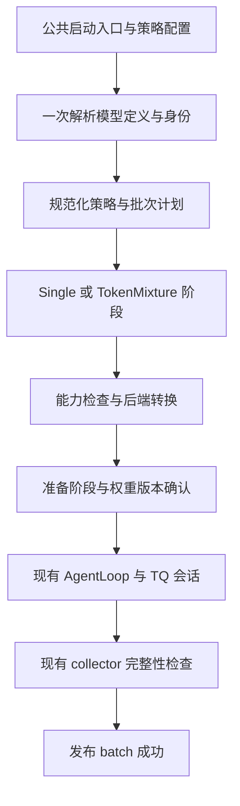

# Rollout 架构走读与重构建议

本文审阅 `9fad6d437cc201670b769c27fa09949f6a8c85e6` 的配置、计划、执行、权重同步与训练接线，并对照 `b94ad661` 的原始同步训练路径和 `d56e081d` 的首版 HF fusion。结论是：公开模型来源接口已经统一，内部仍保留了从 HF 专用流程逐步增加 native vLLM、固定模型和 current-right 支持时形成的职责交叉。下一轮应先整理语义与资源所有权，再开展专项 profiling。

本文是代码审阅及提案，不表示下述重构已经实现。已交付接口与 GPU 验收范围仍以[统一接口实施计划](2026-10-31-Rollout统一接口实施计划.md)为准；公开概念由[统一模型来源与组合语义](2026-10-31-Rollout统一模型来源与组合语义.md)维护。本文独立维护内部架构问题、依据和重构取舍，不新增一份执行进度表。审阅没有改动生产代码，也没有启动训练或 GPU 实验。

阅读入口：[演化与保留项](#演化与应保留的设计)、[具体问题](#具体问题与代码依据)、[目标边界](#目标架构与最小接口)、[迁移顺序](#迁移顺序与验收)。

## 演化与应保留的设计

`b94ad661` 的同步 trainer 只在初始化、训练步结束与采样结束处理同步权重和 sleep。`d56e081d` 引入全局批次计划、来源路由、collector 和 HF 双模型执行。随后 native vLLM 复用了计划与收集协议，同时增加组合模型、独立 KV、student 定向接收与 replica/TP 拓扑。`1913418f` 起，公开模型引用改为 `model/left/right`，允许任意固定 A/B 与 current 位于任意一侧，并归一化端点与同源组合。

这条演化路线保留了原有普通训练入口，也避免重写 AgentLoop 和 TransferQueue（TQ）。代价是早期的 student/teacher、HF 本地实例和 default/nondefault 假设仍进入了通用控制层。重构的评价标准应是“同一概念是否只有一个定义和所有者”，不以减少文件数或抽象类数量作为目标。

以下机制已有明确职责，应保留：

- `build_plan` 先确定全局配额、请求身份与随机种子；trajectory mixture 的配额不受请求完成顺序影响。
- `collect_plan` 校验请求唯一性、来源和完整性，只在所有阶段完成后发布父 batch 成功。
- `UnsafeDrainError` 表示无法证明写入者停止。此时终止运行，不清理可能仍被写入的 TQ 键，也不切换 GPU 阶段。
- 权重接收先加载与校验，再汇总各 actor rank 的结果，成功后提交版本；固定模型不参加 actor refit。
- native 子模型保持自己的配置、embedding、head 和 KV 名称空间；公共采样只发生一次。
- HF 作为数值参考与回退；后端特有的加载、KV 和算子实现保留在后端内部。

这些是正确性约束，不属于用户不需要的自动失败恢复。重构可以减少它们的重复实现，但不能删除约束。

## 具体问题与代码依据

### 1. 模型解析、身份与计划没有形成单向依赖

[plan.py](../../../../../../verl/experimental/rollout_policy/plan.py) 的 `ModelRef.resolve` 既解释 current/initial/teacher，又解析目录、调用 `examples.mirroropd.assets.paths` 并检查资产位置。`ModelBinding.__post_init__` 检查本地目录，`build_plan` 在没有 bindings 时仍能执行解析。这样，计划层依赖文件系统及 example 工程，构造一个逻辑模型值也会触发环境检查。

[validation.py](../../../../../../verl/experimental/rollout_policy/validation.py) 先解析引用并按路径判断同源；[identity.py](../../../../../../verl/experimental/rollout_policy/identity.py) 的 `bind_policy` 再次解析并计算内容哈希；最终计划才使用哈希判断同源。`requires_fusion`、`fusion_needed` 和 `build_plan` 因而分别使用引用、路径、内容身份判定是否需要融合。

这会产生可推导的次序问题：两个路径的内容相同，最终计划可以折叠成 single，但前置检查已经按双模型要求拒绝某项能力。并非所有输入都会触发此问题；它说明能力判断尚未统一建立在规范化结果上。`validate_policy` 还会修改传入配置，加入 `TokenizerSupport` processor，使“校验”同时承担 engine 配置生成。

建议将流程收敛为：解析语法 → 一次解析模型定义 → 建立内容身份 → 规范化组合 → 检查所需能力 → 生成后端配置。资产别名解析器由应用入口传入；通用计划不再 import `examples`。构造配置时可以做语法检查，但模型族、TP 等能力限制由后端检查。

线性 schedule 需要检查整个计划会使用的生成器种类，不能仅按启动时的 α=0 放行；每个实际 batch 再根据当前系数与整数配额折叠阶段。规范化不要求立即分配模型显存。

### 2. 模型身份包含了不属于模型的内容，恢复合同又混入执行参数

`checkpoint_identity` 递归哈希目录内所有指定后缀文件，包括任意 `.txt`、`.json` 和 `.bin`。CPU 合成目录检查确认：仅新增 `notes.txt`，身份就变化。这个检查没有加载真实模型，证明的是文件选择规则。

`verify_resume_bindings` 比较整个 state，其中包含完整 `policy` 和绝对路径。只修改 deadline、活跃请求数或经核验的模型位置，也会被视为策略变化。与此同时，该 state 并没有直接覆盖存放在 rollout 配置中的全部采样参数。当前实现严格禁止改变，但比较边界未准确对应“哪些变化会改变研究语义”。

建议明确三个对象：

| 对象     | 内容                                                            | 所有者       |
| -------- | --------------------------------------------------------------- | ------------ |
| 模型定义 | 实际加载文件的 manifest、内容摘要、有效模型配置、tokenizer 映射 | 模型解析层   |
| 模型位置 | 当前可读取的路径或应用别名                                      | 应用解析器   |
| 生成版本 | 固定模型的内容身份，或 learner 身份与已提交更新版本             | 权重同步协议 |

文件 manifest 应根据实际支持的加载方式列出权重分片、索引、配置和 tokenizer 依赖；不能简单删除所有 `.txt`，因为部分 tokenizer 确实依赖文本文件。模型加载需要的代码或 overrides 若尚不支持，应明确拒绝，不能漏出身份合同。

手动恢复单独比较语义合同：模型身份、initial 绑定、组合与系数时钟、请求随机流规则、采样和停止语义。执行设置另行记录并验证允许的变更，不把“可以修改执行配置”外推为跨拓扑逐 token 可复现。旧 checkpoint 可以继续要求使用冻结代码恢复，无需增加自动迁移或自动重试系统。

### 3. 逻辑左右侧、物理 student 槽位与 current 版本相互混用

`BatchRolloutPlan.fusion_components` 为适配 native 接收器只更新第一组件的限制，把右侧 current 交换到第一组件，并将 α 改为 `1 - α`。后端接收器的位置约束因此进入了语义计划。组合模型中的 student/teacher 又实际表示第一、第二物理组件；在固定 A/B 情况下，它们不一定是 learner 或监督 teacher。

[metadata.py](../../../../../../verl/workers/rollout/vllm_fusion/metadata.py) 通过 `alpha < 1` 以及版本首项是否为整数推断是否含 current。语义来自系数与类型猜测，而非显式的模型绑定。

一个已复现的 CPU 边界例子是：左侧固定、右侧 current、逻辑 α=`1e-20`。计划仍是 token mixture，`has_current=True`；交换后浮点 `1 - α` 为 `1.0`，元数据返回 `actor_version=None`。它不证明常用 α=0.5 的训练有误，也未进行 GPU 重放；它证明计划、物理布局与元数据存在不一致的表达路径。

建议让计划只持有逻辑左右模型及原始系数，后端转换显式产出“逻辑侧 → 组件槽位”的映射及 refit target。计算时保留原始权重对应关系，避免通过反复取补数重建权重。是否含 current、使用哪个版本由绑定与已提交回执提供。对外元数据始终使用逻辑侧；物理 slot、replica、TP rank 只出现在执行审计中。

第一轮不必重命名模型内部所有参数前缀。可以暂时保持 native 的 student/teacher 权重名称，把映射封装在适配层，避免同时改动加载器与语义层。

### 4. 单模型执行已经统一，采样语义尚未完全统一

[trainer_sync.py](../../../../../../verl/trainer/ppo/v1/trainer_sync.py) 对 `single(current)` 走原始默认路径；其他策略走 `RolloutRuntime`。runtime 在 policy 的单模型阶段临时安装公共 sampler，验证前恢复原始 sampler。

[已有采样测试](../../../../../../tests/experimental/rollout_policy/test_vllm_fusion_sampling_on_cpu.py) 给出准确反例：两个相同 logits、top-p=0.5，policy filter 保留两个 token，原生 vLLM 的被测 PyTorch filter 保留一个。该反例适用于对应 filter 实现，不代表所有 GPU 内核、精度和输入都会出现同样差异。

因此，“α=0 自动执行左模型”已经成立；“显式 single(current) 与任何等价的 mixture 写法拥有完全一致的采样合同”尚未成立。之前保留默认行为与融合 oracle 的选择可以解释这一点，仍需把取舍明确写入下一轮设计。

建议定义一份不可变的采样合同，包含合法 token 支持、温度、top-k/top-p 边界、停止集合、cap 和所选 token 的 behavior log-prob 定义。公共数学放在策略的共享模块，native/HF 只适配执行接口。受支持的 single 与 mixture 应最终使用同一合同；验证可以使用不同参数，但规则定义相同。

迁移应分开提交：先把原有两种行为显式隔离并做特征测试，再统一默认语义。改变默认 top-p 行为是可观察的行为变更，不能称为无语义变化的文件整理。也不宜永久增加一个公开的 legacy sampler 开关；旧实验由冻结代码承担复现。

### 5. Runtime 与 executor 共同修改同一批状态

[runtime.py](../../../../../../verl/experimental/rollout_policy/runtime.py) 同时负责 trainer 接线、构造模型与 replica、HF 生命周期、采样器切换、会话组装、TQ 发布、指标和错误清理。[execution.py](../../../../../../verl/workers/rollout/vllm_fusion/execution.py) 的 `NativeVLLMExecutor` 虽然已独立成文件，却接收整个 runtime，并反向修改 `replicas`、`clients`、`phase_token` 和 `metrics`。

`generate` 依赖 runtime 当前的 `batch/client/phase_token`；`release` 读取当前的 `active_plan`。`drain` 既证明会话写入结束，又执行部分 release，异常路径随后还会调用 `release_all`。这些调用目前按串行阶段组织，但新能力必须同时了解多个对象中的隐含状态。

建议让后端准备操作返回一个明确的 `PreparedPhase`：client、阶段身份、实际加载版本、请求路由及资源句柄。runtime 不再被后端反向写入；生成和释放均显式接收该阶段。会话驱动器只负责 AgentLoop/TQ 写入完成，后端只负责引擎资源，collector 继续负责父 batch 提交。

资源状态还需覆盖准备失败。native 在所有 `launch_servers` 返回后才设置 `awake=True`，release 又以 awake 为条件；frozen replicas 也在全部启动成功后才注册进 runtime。若一部分启动成功、一部分失败，清理入口不能完整表达已获得的资源。这是代码上的所有权缺口，不是已观测到的泄漏结论。

创建句柄时即登记所有者，分别记录创建、启动、驻留状态；将 sleep 与最终 close 区分。异常清理应根据已经获得的句柄进行。若无法确认会话或底层请求停止，仍保留现有 fail-stop 行为，不能用无条件 `finally: release()` 破坏排空保证。

### 6. 权重传输对象被包装成了生成后端

[engine_workers.py](../../../../../../verl/workers/engine_workers.py) 的 `configure_fusion` 按 backend 选择不同 `ServerAdapter`。HF adapter 持有可执行模型；[native adapter](../../../../../../verl/workers/rollout/vllm_fusion/weights.py) 主要是 bucketed IPC 权重发送与 RPC 代理，却也继承 `BaseRollout`，统一保存在 `fusion_rollout` 中。worker 随后需要区分同步/异步提交，并在指标中读取 HF 专有的 student/teacher 属性。

建议拆开“生成后端”与“权重接收目标”。actor worker 负责导出权重流、汇总 rank 结果和确认提交；目标适配器负责传输、加载与后处理。生成后端只在需要 current 时声明接收目标。固定 A/B 自然没有 actor receiver，不需要散落的例外分支。

版本在 executor、发送 adapter、worker extension、服务入口都有副本。分布式系统需要这些副本，不能一概删除；应定义谁提交、谁核验、谁仅缓存。使用明确的版本值与提交回执，避免每层自行推导状态。继续复用现有 checkpoint engine 和 IPC，不新增权重传输框架。

### 7. 请求路由复用了 priority，计划之外又计算了一遍配额

`LocalPhaseClient.generate` 按 `priority % len(servers)` 选择 replica。runtime 将 `row * config.rollout.n + response_index` 填入 priority；native executor 用同一表达式计算 admission count。逻辑请求身份、调度优先级、replica 路由因此混用，且依赖计划生成后仍可访问的配置。

当前串行固定配置可以使两处计算一致；扩展负载均衡或独立 priority 时却容易只修改一端。建议计划保存稳定请求键及路由序号；执行转换根据拓扑生成唯一 route map，admission 与客户端共同消费它。priority 保留调度含义。逻辑计划不绑定 GPU 数量，物理路由也不改变 seed 与 batch quota。

### 8. 模型定义被压缩成路径，后端配置来源不够明确

frozen/native 执行都通过 `HFModelConfig(path=..., trust_remote_code=False)` 重新构造模型；[组合模型](../../../../../../verl/workers/rollout/vllm_fusion/model.py) 又从路径加载 AutoConfig。当前受验收的普通模型可以工作，但“路径＋更新权重”没有显式携带 learner 的有效配置。后续支持模型 overrides 时，必须决定哪些配置参与等价判断和后端加载。

建议由解析层给出已校验的模型定义，后端从中生成 native 子模型配置。未验收的 overrides 明确拒绝；不要让 public single、固定 single、fusion 各自重新解释一遍。tokenizer 与合法支持的检查也基于同一份解析结果，后端保留加载时必要的防御检查。

## 目标架构与最小接口

### 将三个变化维度分开

公开字段暂不再更名。`current/initial/teacher/checkpoint` 继续作为用户输入，其中 initial/teacher 是解析便利方式；执行时只区分可更新 learner 绑定与固定模型绑定。

| 维度 | 负责的问题                 | 建议表达                               |
| ---- | -------------------------- | -------------------------------------- |
| 来源 | 用哪份模型定义、哪一版权重 | current 或固定绑定                     |
| 组合 | 一条请求如何生成           | Single 或 TokenMixture                 |
| 路由 | 哪条请求由哪一个生成器负责 | trajectory quota 与 request assignment |
| 执行 | 用哪个后端和拓扑运行生成器 | 后端适配器与 execution spec            |

trajectory mixture 编译成两组 Single 请求即可，无需第三类神经网络执行器。token mixture 才需要两侧在同一步提供分布；logit 与 probability 是它的数学参数。current/fixed 是权重来源，不分别衍生一套后端类。

不建议建立 current、initial、teacher、fixed-A/B、batch-fusion、token-fusion 各自独立的完整 executor，也不引入任意多模型嵌套策略图。当前需求用两个生成器类型、有限的后端工厂与清楚的能力检查即可表达。已有普通 vLLM 与融合 vLLM 可以有不同内部实现，共享生命周期合同。

图中 trajectory mixture 的分配在计划层完成。后端转换负责物理组件、TP/replica 路由和接收目标；HF 数值实现及 vLLM 模型实现均在这层以下。训练入口不需要理解 physical student slot。

### 少量接口承接职责，不为每个名词建立服务

下表是提议的边界，不是现有可调用 API。可以在现有 package 中渐进完成，不必先移动目录或建立插件框架。

| 边界             | 输入与输出                                            | 明确不负责的事情              |
| ---------------- | ----------------------------------------------------- | ----------------------------- |
| `resolve_policy` | 用户引用与应用 resolver → 模型定义、绑定、解析证据    | GPU 分配、训练生命周期        |
| `build_plan`     | 已解析绑定、时钟、请求身份、采样合同 → 不可变批次计划 | 文件 I/O、后端组件交换        |
| 后端准备         | 生成器、路由和目标版本 → `PreparedPhase`              | 修改 trainer/runtime 内部字段 |
| 会话执行         | batch payload、plan、prepared phase → 完成回执        | 模型构造与 actor 权重导出     |
| 权重更新         | 明确的接收目标与版本 → 提交回执                       | 猜测该目标是不是 teacher      |
| collector        | 预期请求集合、阶段回执 → 父 batch 状态                | 选择 vLLM/HF 或自动重试       |

`PreparedPhase` 的最小内容是 client、阶段 token、逻辑模型版本、route map 和后端资源句柄。所有者独占改变其生命周期；普通数据使用不可变值。必要的序列化发生在 RPC、checkpoint 与日志边界，内部不持续传递任意 settings dict。

trainer 只调用一层 rollout 服务来完成初始化、提交 batch、采样后释放和验证切换。默认路径先由委托适配器保持原有行为，避免把 upstream 的异步、多轮等能力硬塞入当前仅支持同步单轮的 policy collector。统一 trainer 接口可以先完成，统一采样数学则单独验收。

### 失败合同保持简短且明确

准备成功才允许 admission；权重提交成功才允许使用新版本；全部请求和 scorer/TQ 写入确认结束后才释放阶段；只有 collector 可以发布父 batch 成功。无法证明排空时停止该运行。

这些步骤足以支持手动恢复和可审查的异常行为。不增加自动失败重跑、全局任务恢复服务或新的分布式事务框架。资源状态在后端内维护，父 batch 完成状态在 collector 内维护，两者不互相替代。

## 迁移顺序与验收

结构重构与行为变更应分别提交。以下顺序以降低同时变化的边界为依据，不是已经开始的执行计划。

| 顺序 | 修改范围                                                           | 能观察到的完成条件                                                                |
| ---- | ------------------------------------------------------------------ | --------------------------------------------------------------------------------- |
| A    | 记录采样、归一化、来源、版本与失败合同；补关键反例                 | 明确哪些行为保留、哪些需单独迁移                                                  |
| B    | 一次解析、规范化和能力检查；移除 plan 对 examples 与文件系统的依赖 | 等价引用只产生一份模型定义；能力检查消费规范化结果；校验不修改调用方配置          |
| C    | 显式逻辑侧与物理组件映射；统一请求 route map                       | current 在左右两侧的系数、元数据与接收目标一致；admission 与请求路由共用映射      |
| D    | 后端返回 PreparedPhase；抽出 HF 生命周期与会话驱动                 | executor 不回写 runtime；部分 prepare 失败仍有完整资源所有者；排空与 release 分离 |
| E    | actor 权重目标与生成后端分离；trainer 委托统一服务                 | trainer 不分支判断融合后端；固定模型没有 actor 接收目标；跨 rank 提交不变量保留   |
| F    | 手动恢复语义合同与采样默认规则分别迁移                             | 恢复明确区分模型/语义变化与执行设置变化；受支持的等价 single/mixture 采样一致     |

每步均运行受影响的 CPU 合同测试；纯结构步骤比较改前改后的计划、请求来源、种子及行为 log-prob 定义。重点覆盖同内容异路径、current 与 initial 不可混为同一可变绑定、奇数 batch 配额、端点与空配额、current-right、加载失败、部分启动失败和无法确认排空。

涉及后端、采样或权重接线的实施完成后，再用已存在的小规模真实训练生命周期检查 current 更新、固定权重不变、验证切换与手动恢复。TP 路由改变还需要对应多 rank 检查。CPU 审阅与单卡结果均不替代这些证据。

这轮不安排性能调参，也不凭代码阅读判断热点。后续 profile 应建立在稳定的阶段与所有权边界上；当前只能保留已有测量能力，不能把预期收益写成结果。

## 审阅证据与边界

代码依据是文内所链的 `9fad6d43` 源码及历史提交。CPU 检查包括既有 `test_vllm_fusion_sampling_on_cpu.py`，以及纯 Python 的身份和槽位交换反例；后者输出见 [cpu-probes.json](../../../../../../../runs/rollout-architecture-review-20261031/cpu-probes.json)。合成文件仅用于身份函数检查，不是可加载模型。

资源部分启动失败、模型 overrides 和多路径规范化的后果属于源码推导，未通过 GPU 故障注入复现。本文不报告新的性能结论，也不扩大原有验收范围。
